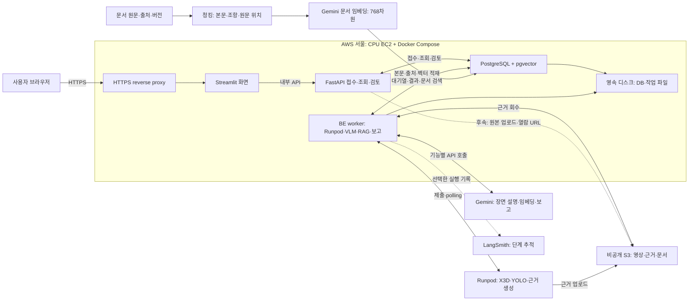
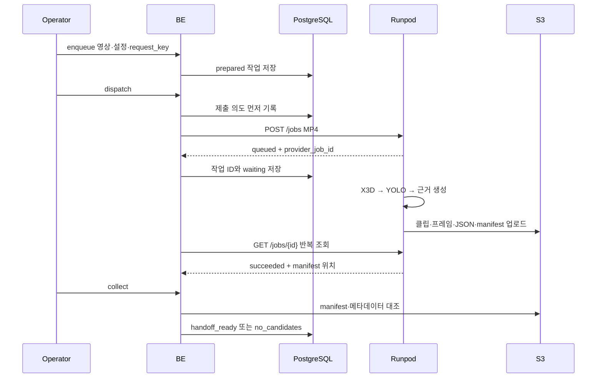
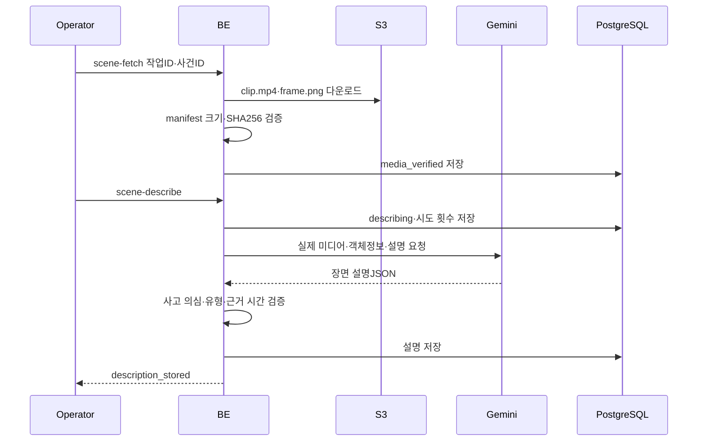

# 아키텍처와 시퀀스

기준: 2026-09-29. Mermaid를 지원하는 GitHub Markdown에서 볼 수 있다.
배포 목표와 처리 순서를 설명한다. 점선은 선택 실행 또는 후속 연결이다.

## 1. 목표 배포 구성

아래는 합의한 배치 목표다. 현재 이 전체 구성으로 배포된 것은 아니다.
RAG는 별도 GPU 서버가 아니라 BE에서 수행하는 임베딩 API 호출·DB 검색·보고 생성 코드다.

S3는 PostgreSQL의 실행 디스크가 아니다. DB 파일과 실행 중 작업 폴더는 호스트의 영속 디스크에 둔다.
S3에 DB dump를 보관하는 백업은 별도 운영 단계다. Gemini 영상 설명 모델과 임베딩 모델은 다른 API 호출이다.
현재 이미지/설정에서 EC2 권한·네트워크·컨테이너의 역할 접근을 별도로 검증해야 한다.

문서 청킹·문서 임베딩은 자료를 추가할 때 실행한다. 검색할 때에는 검색 문장만 새로 임베딩하고,
PostgreSQL의 기존 문서 벡터와 비교해 본문·출처를 반환한다. 설명에서 검색 문장을 만드는 함수와
설명·검색 근거를 함께 쓰는 보고 함수는 BE의 확장 지점이다. 실행 명령은 [README](README.md)에 있다.

## 2. 제출·분석·S3 인계 시퀀스 — 정상 경로

BE는 기본 최대2건을 Runpod에 배정한다(분석1/대기1). `--slots 1`이면1건만 배정한다.
아래는 정상 경로의 명령 간 관계다. 현재 CLI는 `dispatch`와 `collect`를 각각 실행한다.
`GET /jobs/{id}`는 대기 중 작업에 대해 약2초 간격으로 반복된다. 분석 완료 후 manifest가 유효해야 다음으로 간다.

## 3. 근거 → VLM → DB 시퀀스 — 정상 경로

아래는 코드가 지원하는 성공 경로다.
`scene-fetch`와 `scene-describe`도 현재는 사람이 별도로 실행한다. 문서 검색·보고는 별도 후속이다.

