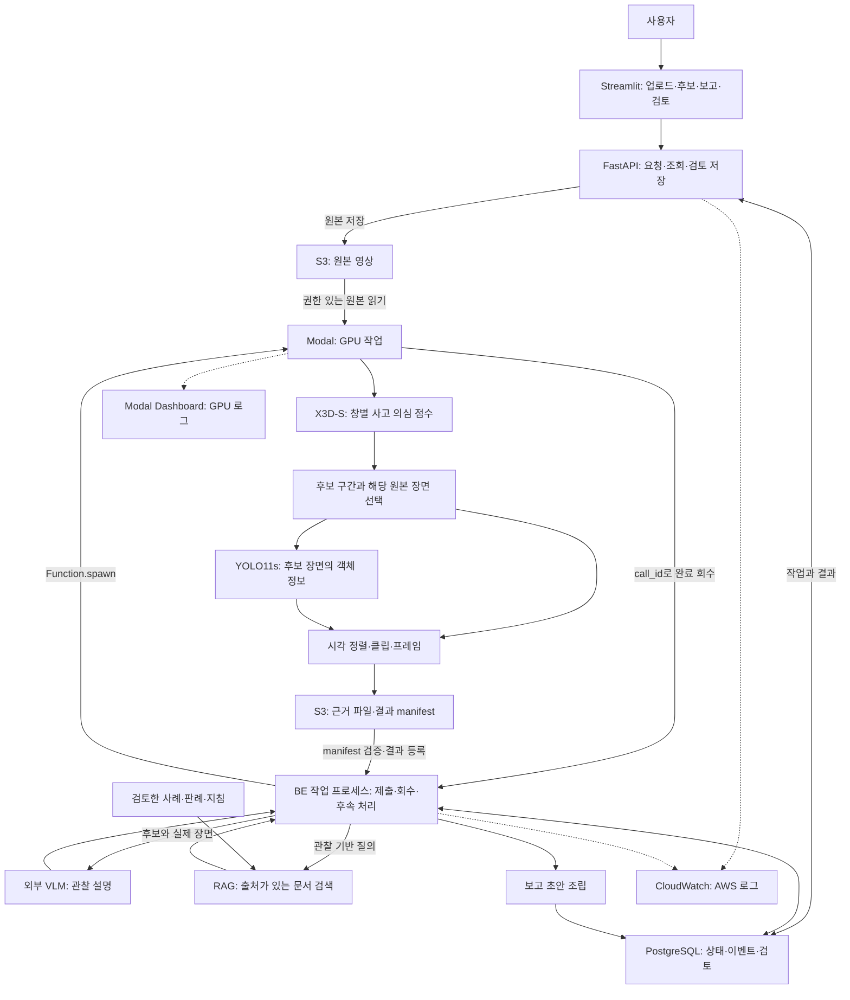

# CCTV 사고 의심 분석·검토 서비스 — PRD v0.2

작성일: 2026-09-26 · 용도: 팀 개발·발표 · 문서 상태: 사용자 선택 구성 반영, 세부 연결 규칙은 개발 기준 제안

### 2026-09-27 최신 적용 사항

외부GPU는현재Runpod A4000 Pod이며한건파일분석결과검증을완료했다. 사용자는보유녹화영상을CCTV처럼재생하며분석하는시연과 **X3D후보→YOLO객체→원본근거/S3→BE의VLM호출→설명/평가검증→사고의심알림** 흐름을원한다. 첫사용자알림은VLM설명을포함하며후보선알림제안은철회했다. 내부후보·사용자알림·사람사고확정을구분한다. RAG/최종보고는후속보강제안이며알림채널은미정이다.

현재실행된것은전체MP4한건→JSON/ZIP까지다. 재생공급/실행중후보전달·근거/S3·BE/VLM·알림은미구현이며설명으로완료처리하지않는다. 아래Modal SDK/배치부분은이전설계참고로보존한다. 현재담당자교환물·입력/알림규칙은[인프라](docs/roles/infrastructure.md), [BE](docs/roles/backend.md), [공통계약](docs/contracts/service_contract.md)을우선한다. 실제카메라/RTSP상시운영·외부기관전송은현재시연의전제조건이아니다.

## 1. 서비스 목표

녹화 CCTV에서 사고 의심 구간을 찾고, 실제 장면·AI 설명·관련 문서가 연결된 보고 초안을 제공한다. 담당자는 원본을 확인해 사고 확인·사고 아님·판단 보류를 기록한다.

관제 담당자는 확인할 구간을 찾고, 프로젝트 영상 검토자는 탐지 결과와 근거를 비교하며, 경찰·사고 대응 담당자는 출처가 있는 보고 초안을 검토한다. 세 사용자군을 대상으로 하되 첫 버전은 공통 검토 화면으로 제안한다. 사용자군별 별도 화면·권한 체계는 미정이다.

**이번 완료물은 PRD와 역할별 개발 문서다.** 새 서비스의 구현·배포·모델 품질 검증은 아직 완료되지 않았다. 이전 R3D-18 실험, 읽기 전용 결과 화면, 합성 이벤트 시험은 기존 성과이며 YOLO11s/X3D-S 서비스 통합 성과와 구분한다.

## 2. 결정과 미정 항목

| 구분 | 현재 기준 |
|---|---|
| 사용자 선택 | Streamlit, FastAPI, S3, Modal 비동기 작업, YOLO11s(전달 체크포인트 7개 클래스), X3D-S, 외부 VLM, RAG, 보고 초안, 사람 검토, 작업 상태 DB, CloudWatch·Modal Dashboard |
| 서비스 범위 | 탐지·영상 확인 + VLM 설명 + 유사 사고·판례 등 RAG 문서 안내 + 보고 초안 |
| 개발 기준 제안 | 녹화 MP4 한 건씩 접수, X3D-S가 후보를 찾은 뒤 해당 원본 장면에 YOLO로 객체 정보를 추가, BE 작업 프로세스가 Modal 완료 회수와 후속 단계를 관리 |
| 저장·배포 제안 | S3 비공개 파일 보관, PostgreSQL 상태 저장, pgvector 문서 검색. Streamlit·FastAPI·BE 작업 프로세스는 AWS CPU 환경에 배치; 초기 단일 EC2 구성은 인프라 검토안 |
| 확인 필요 | Dynamic 클래스의 라벨 정의·표시 정책, 받은 모델 설정의 실제 동작 검증과 서비스 전처리/후처리 버전, VLM 업체, 확보한 RAG 원문, 영상 제한·수치 합격선·유료 사용 상한 |
| 팀 운영 | 사람 이름별 업무 배정은 하지 않는다. FE·BE·모델·VLM/RAG·인프라·QA의 산출물과 연결점만 나눈다 |

모델의 시간 창별 점수에서 의심 구간을 정리한다. 이 시각은 원본 영상의 상대 초이며 미래 사고 예측 시각이나 정확한 충돌 정답 시각을 뜻하지 않는다. 모델 점수를 검증된 사고 확률로 표시하지 않는다.

## 3. 첫 완성본의 범위

**포함**

- 영상 업로드 또는 등록된 영상 선택, 분석 요청, 상태 조회와 실패 사유 표시.
- YOLO 객체 정보와 X3D-S 창별 판정, 사고 의심 구간·원본 시각·대표 프레임·검토용 클립.
- 근거 영상 우선 열람, 후보가 있을 때 VLM 설명과 RAG 검색을 순차 보강.
- 영상 관찰·탐지 추정·문서 인용을 구분한 사고 분석 보고 초안.
- 사람 검토와 메모 저장, 새로고침·중복 요청·실패 후 재개를 고려한 기록.

**후속 검토**: RTSP 상시 감시, 여러 카메라 동시 운영, 기관 자동 전송·출동 연계, 사용자군별 세 화면, 자동 재학습, 고가용성 구성. STATS19와 부상·사망 정도 예측, 과실·사고 원인 확정은 현재 범위에 포함하지 않는다.

## 4. 서비스 구성

노드는 책임 구분이며 각각 서버 한 대를 뜻하지 않는다. FastAPI와 작업 프로세스는 같은 BE 코드·DB를 사용할 수 있다. GPU 작업이 끝난 뒤 CPU 후속 처리로 넘어가므로 VLM/RAG 응답을 기다리는 동안 GPU를 붙잡아 두지 않는 구성을 제안한다.

### 원래 그림에서 보완한 연결

1. **FastAPI가 작업을 접수하고 BE 프로세스가 Modal을 호출한다.** S3는 영상 보관소다. 초기 구성에 S3 업로드 이벤트 트리거를 추가하지 않는다.
2. **X3D-S는 후보 구간, YOLO는 객체 정보를 담당한다.** 사용자 답변에 맞춰 X3D-S가 원본 전체의 지정 범위를 분석하고, 후보 장면에 YOLO를 실행하는 순서를 제안한다. 원본 시각으로 결과를 결합하며 YOLO crop을 X3D 입력으로 넣지 않는다. 후보가 없으면 YOLO도 생략해 불필요한 연산을 줄인다.
3. **완료 회수를 추가한다.** BE가 `call_id`를 보관하고 Modal 결과 및 S3 manifest를 확인해 DB에 등록한다. 브라우저를 닫아도 이 작업은 BE가 이어가야 한다.
4. **검토 저장은 UI→API→DB다.** 화면이 DB를 직접 수정하지 않는다.
5. **CloudWatch와 Modal 로그는 별도다.** 공통 `job_id/run_id`로 대조한다. Modal 로그의 CloudWatch 자동 전송은 구축된 기능으로 표시하지 않는다.

Modal은 배포된 함수의 `spawn()`과 호출 ID를 통한 결과 조회를 지원한다. 이 PRD의 DB 작업 관리·회수·재시도 규칙은 그 기능 위에 제안한 서비스 설계다. [Modal 공식 작업 처리 문서](https://modal.com/docs/guide/job-queue).

## 5. 영상 한 건의 사용자 흐름

1. 사용자가 영상을 올리거나 기존 영상을 선택한다. 업로드 완료를 확인한 뒤 분석 버튼을 누른다.
2. API는 `job_id/run_id`를 발급하고 대기 상태를 반환한다. 화면은 작업 목록에서 다시 열 수 있다.
3. BE가 Modal 작업을 제출한다. 모델 버전·전처리·실제 분석 범위와 미분류 구간을 기록한다.
4. 모델 결과와 근거를 등록하면 후보 목록을 먼저 보여준다. 설명이 아직 없으면 ‘설명 준비 중’으로 표시한다.
5. 후보별 실제 클립 또는 여러 프레임을 VLM에 보내고, 설명과 검색 조건으로 관련 문서를 찾는다.
6. 설명·인용·부족한 근거를 합쳐 보고 초안을 저장한다. 한 단계 실패로 이미 나온 근거를 지우지 않는다.
7. 담당자는 원본과 설명을 확인하고 판단·메모를 저장한다. AI 초안과 사람의 판단은 따로 보존한다.

후보가 없으면 분석 범위와 함께 ‘분석된 범위에서 사고 의심 후보 없음’을 표시한다. 미분류나 미처리 범위가 있으면 부분 결과다. 처리 실패를 ‘사고 없음’으로 바꾸지 않는다.

## 6. 화면 요구

| 화면 영역 | 표시·동작 | 확인 기준 |
|---|---|---|
| 영상 접수·작업 목록 | 파일·등록 영상, 요청 버튼, 상태, 오류, 다시 열기 | 새로고침이 새 분석을 만들지 않음 |
| 분석 상세 | 원본/클립, 후보 시작·끝, 대표 프레임, 객체 정보, 미분류 범위 | 동일 `run_id`의 원본 시각과 근거가 연결됨 |
| 설명·문서·보고 | 준비/완료/실패 구분, 출처 링크·절, 불확실성 | 출처 없는 사실을 판례 근거처럼 쓰지 않음 |
| 사람 검토 | 사고 확인·사고 아님·판단 보류, 메모·검토 이력 | API 저장 후 다시 열어 동일 판단 확인 |

FE 상세는 [FE 문서](docs/roles/frontend.md), 필드·상태는 [공통 계약](docs/contracts/service_contract.md)을 따른다.

## 7. 데이터와 기능 완료 기준

- 파일은 S3, 영구 상태·메타데이터·검토 기록은 DB에 둔다. S3 URL 자체를 영구 식별자로 쓰지 않는다.
- Job, Run, Event, Asset, Report, Review를 구분한다. 재분석은 새 Run이며 이전 결과를 덮어쓰지 않는다.
- 기능 인수는 [QA 시나리오](docs/roles/validation.md)와 [요구사항](docs/requirements.md)을 기준으로 한다. 가상 응답 확인과 실제 모델 연결 시험을 따로 기록한다.
- 모델 품질은 같은 평가 목록·정답·전처리·판정 규칙으로 평가한다. 사건 Recall, 정상 시간당 오탐, 탐지 지연과 미분류율은 정의·정답이 갖춰진 범위에서만 보고한다. 합격 수치는 미정이다.
- 전체 처리시간을 업로드·대기·GPU 준비·추론·저장·VLM·RAG·보고 단계로 나눈다. 비용은 GPU 시간·외부 API 사용량·AWS 저장/전송/실행을 따로 측정한다. 예산·유료 실행 상한은 아직 정하지 않았다.
- 공개 배포 전 접속 통제·파일 접근·보관 기간·삭제와 백업 범위를 결정한다. 첫 시연은 제한된 팀 접근을 제안한다.

## 8. 개발 착수 순서와 문서 운영

1. 공통 계약·가상 응답으로 FE/BE가 접수→조회→검토 저장 흐름을 맞춘다.
2. 모델 담당은 받은 두 가중치·7개 클래스·전처리 명세를 기준으로 서비스 계약 변환과 결과 manifest를 준비한다.
3. S3/Modal 한 건 연결과 실패·중복·재시작 복구를 확인한다.
4. VLM/RAG·보고를 붙이고 후보만 있는 상태와 후속 실패 상태를 확인한다.
5. 실제 자료로 통합 시연과 별도의 품질 평가를 수행한다.

전체 읽기 순서·역할별 편집 방법은 [팀 공유 안내](docs/team_handoff.md), 실행 TODO는 [계획](IMPLEMENTATION_PLAN.md), 실제 완료 상태는 [현재 상태](docs/current_status.md)에 둔다. API·상태를 바꾸면 역할 문서에서 각각 정의하지 않고 공통 계약을 먼저 바꾼다.

## 9. 이번 변경 기록

수동 Colab 연결·React 제안에서 사용자 최신 그림의 Streamlit·Modal·YOLO11s·X3D-S 설계로 개정했다. RAG와 사람 검토는 첫 완성본 범위에 반영했다. R3D-18 기존 평가·다음 실험 TODO는 별도 이력과 계획으로 보존한다. 모델 선택 변경은 성능 우위나 운영 적합성을 입증하지 않는다.

지정한 deployment_handoff에서 YOLO .pt의 7개 클래스·두 가중치 해시·X3D epoch 7/임계값 0.5를 정적 확인했다. 원래 그림의 6개 표기를 실제 파일 기준 7개로 수정했다. Dynamic의 뜻과 표시 정책은 추가 확인이 필요하다. 모델 로딩·추론·통합 품질은 미검증이다. 계속해서 공통 계약·가상 응답을 사용한 문서 검토와 화면 설계는 가능하다.

<!-- SERVICE_PRD_V02_HISTORY -->

v0.2 개정 전 문서 — 당시 범위·결정·측정 이력

# CCTV 사고 의심 검토 도구 — PRD 초안

> **2026-09-26 RAG 별도 조사:** 사용자 최신 요청으로 다혜·정찬우·박창현의 RAG 협업을 위한 [자료·서비스 설계안](docs/rag_service_research.md)을 작성했다. 이번3인구성은RAG협업에적용하며아래과거개인모델작업이력을바꾸지않는다. 이름별분담·화면·기관전송흐름은제안이고조사완료가서비스구현승인은아니다. 최신실제상태는current_status의재개요약을따른다.

> **2026-09-25 현재 진행 안내:** 최신 목표·TODO는 [IMPLEMENTATION_PLAN.md](IMPLEMENTATION_PLAN.md)의 상위 계획, 실제 완료/다음 작업은 [current_status](docs/current_status.md) 최상단을 따른다. 아래 날짜별 상태와 “다음 작업”은 당시 이력이며 최신 실행 지시가 아니다. 기능동작·품질합격·후반웹 전달을 구분한다.

**2026-09-22 우선순위 정리:** 다음 작업은 **M2 현재 저장 모델의 첫 독립 비교 평가**다. M3/M4의 추가 기능 개발을 평가 선행 조건으로 두지 않는다. 기존 사고2구간의 승인 정답은 유지하고, 추가 맥락/입력 품질·학습 원본과의 관계·사용 근거 및 새 정상 후보2개의 실제 구간 검수를 마무리한다. 후속 사용자 결정으로 TAD는 제외하고 이번 검증 후보는 ACCIDENT로 제한한다. 기존 두 파일의 첫2초를 정답 없는 검수 후보로 준비했으며, 후보02는 차량 회전·먼지 관찰로 정상 사용 보류다. 아래 완료 상태를 최신 근거로 갱신했지만 미정 제품 범위/전체 계획의 자동 승인은 아니다.

**2026-09-22 결과 표시 방식 후속:** 사용자 요청으로 M4의 결과 확인에 **로컬 Streamlit 읽기 전용 화면**을 추가한다. 기존 HTML/미리보기/원본 시각을 재사용하며 학습·추론과 화면 실행을 분리한다. 최종 웹의 범위/운영 방식과 모델 품질은 이 선택으로 확정하지 않는다. 이번 구현·시험 상태는 [최신 기록](docs/current_status.md)을 따른다.

**2026-09-22 후속 실행:** 첫 묶음 M1의 기술 보완·T9 두 후보 미리보기/관련 시험은 사용자 승인으로 완료했다. 전체 계획·미정 범위는 그대로이며, 정답/품질·독립성·정상2원본은 대기다. [최신 결과](docs/current_status.md#m1-local-complete)를 우선한다.

> **상태: draft-2026-09-22 / 계획 미승인.** 사용자 최신 요청과 첨부를 반영한 제품·일정 검토용 초안이다. 아래 ‘필수’는 **첫 완성본에 포함할 제안**이며 구현·학습·전송 승인이 아니다. 현재 승인 지침은 [AGENTS](AGENTS.md)와 [v2 실행 기준](CODEX_LOCAL_R3D18_C_TO_E_v2.md), 실제 상태는 [현재 기록](docs/current_status.md)을 따른다. 기존 문서는 아래 이력에 보존했다. **작성 중 사용자 결정: 최종 결과물은 웹사이트, 웹은 후순위로 검토한다. 현재는 개인 프로젝트이며 6명·3:3·10월 5일 전제를 사용하지 않는다. 첫 전달 방식은 HTML 보고서와 원본 영상 확인으로 결정했다. 무료·기존 자원으로 연습하고 품질·속도 측정 뒤 비용을 점차 줄이는 방향이며, 유료 금액·장시간 상한은 미정이다.**

## 한 화면 요약

| 항목 | 요약 |
|---|---|
| 전체 목표 | 허용된 도로 CCTV에서 사고 의심 상황을 찾아, 원본 시각과 영상 근거를 사람이 확인하도록 돕는다. 모든 카메라에서의 동작이나 사고 확정을 보장하지 않는다. |
| 첫 사용자·문제 가설 | 녹화 CCTV를 검토하는 사람의 ‘긴 영상을 모두 보며 의심 장면을 찾고 근거를 정리하는 부담’을 줄인다. 현재 실제 사용자는 프로젝트를 진행하는 본인·검수자이며 관제 실무 인터뷰/업무 효과 측정은 미실시다. |
| 현재 위치 | 소수5구간 학습·저장/재개·008 원본30초/29창 추론 완료. 이벤트 코드는 생성 시험 완료/실제 적용 대기, Streamlit 읽기 전용 화면은 제한 시험 완료. 핵심 미완료는 첫 독립 검증이다. |
| 완성본을 나누기 | 첫 기술 완성본: 파일1개·최대60초 분석→의심 이벤트/근거→독립 예비 검증·한 비교 결과. **최종 완성본: 이를 실제 웹사이트의 영상 검토 흐름으로 연결한다.** 화면/연결 기술은 뒤에서 정한다. |
| 확인된 자료 변화 | T9 사고2파일/CSV·부분 디코딩/각16장224 연결 및 두 기존2초 구간 사고 정답 승인 완료. 추가 맥락/품질·독립성/사용 근거는 대기. 요청한 후보1 앞뒤0.5초 준비 완료, 후보2 기존 앞0.5초 재사용. ACCIDENT 정상 후보01 [0,2) 정상0 확정,02 정상 사용 제외. 최신 묶음에 정상1·사고2 배열 연결 완료, 품질/독립성/사용승인은 별도 대기다. |
| 현재 모델·환경 | R3D-18은 기준선이며 영구적인 제품 요구사항이 아니다. Mac 개발·검수·소규모 실행, 부하/시간이 불편하면 Colab 선택. 장치 이동과 모델 개선을 별도 실험으로 기록한다. |
| 완료 판정 | 기능 동작 / 모델 품질 / 속도·비용 / 운영 준비를 별도로 판정한다. 문서 작성·학습loss·테스트 개수를 제품 성능이나 완료율로 바꾸지 않는다. |
| 이번에 하는 일 | ACCIDENT-only 검증 후보/참고 장면 준비, 최신 검수와 평가 예약 설정 연결. 기존 코드 재사용/출력 연결8항목 통과. 새 모델 실행·학습·전송 없음. |
| 다음 작업 묶음 | 기존 사고 참고 장면과 정상 후보 검수 → 원본 관계/사용 근거와 평가 목록 확정 → 최신 Colab 묶음 → 현재 모델의 최대10구간/추론300초 예비 평가. 정상·사고가 같은 원본이면 한 그룹으로 세며 현재 정상 후보02는 보류한다. 자료 미승인은 그 조건만 대기하고 같은 준비 시험을 반복하지 않는다. |

## 1. 해결할 문제와 사용 시나리오

**PRD는 누구의 어떤 문제를 무엇으로 해결하고 어디까지를 성공으로 볼지 정하는 문서다.** 사고 판정을 대신 확정하거나 경찰 출동을 자동 결정하는 서비스는 현재 목표가 아니다.

장기적으로는 다양한 도로·카메라·시간대에서 의심 상황을 찾아 근거와 함께 검토 담당자에게 전달한다. 운영 사용자, 알림 채널, 서비스 수준은 실제 업무 확인 후 정한다. 개인 프로젝트의 중간 기술 완성본은 녹화 파일 한 개를 분석하고 본인이 검수하는 도구다. 사용자는 최종 웹사이트를 결정했고 웹 작업은 모델·검증 이후에 검토하기로 했다. 최종 웹 완성은 중간 HTML 보고서 생성과 구분한다.

첫 사용 흐름(제안):

1. 검토자가 사용 허용된 영상과 처리 범위를 지정한다. 모델·설정이 없거나 파일을 읽지 못하면 실행 불가 이유를 보인다.
2. 분석기는 판단 시각까지 들어온 최근2초의16장을224픽셀로 처리한다. 첫2초 준비, 프레임 부족, 끊김을 사고/정상과 구분한다.
3. 점수와 판정, 실제 입력 시각을 기록한다. 정답·사고 시점·위치로 추론 입력을 골라주지 않는다.
4. 연속된 의심 결과를 고정 규칙으로 묶고, 같은 `prediction_id` 재전달은 새 의심 근거로 세지 않는다. 이벤트는 ‘함께 살펴볼 의심 결과 묶음’이며 실제 사고 사건과 동일하지 않다.
5. 검토자가 목록·원본 시각·근거 장면을 확인한다. 모델 답과 사람이 승인한 정답을 별도로 본다. `events.json` 저장은 외부 수신자에게 알림을 보낸 것이 아니다.
6. 정답 있는 독립 자료에서는 예측을 저장한 다음 비교표·오탐/미탐·측정 범위를 확인한다. 정답 없는 연속 영상에는 품질 지표를 만들지 않는다.

현재 승인된 개별 구간의 사고/정상 정답은 유지한다. 탐지 대상은 기존 정책의 **충돌·전복 발생 장면**을 유지한다. 사고 후 정차·잔해만 있는 장면은 기존 보류 원칙을 적용하고 정상/사고로 자동 전환하지 않는다. 탐지 대상을 확대할 때는 새 정답 정의와 자료 검수가 선행한다. [라벨 정책](docs/label_policy.md)의 최초 ‘영상 전체’ 제안은 이력이며 실제 학습 단위는 검수된 구간이다.

## 2. 현재 상태에서 첫 완성본까지의 차이

| 구분 | 현재 근거 | 남은 차이 |
|---|---|---|
| 실행 근거 있음 | 실제 사고008·009와 QMUL정상3, 총5구간·파일3개·관리 묶음2개로 head학습5epoch/25업데이트. 저장·재개·재로딩, 특징부/BN 유지 확인. [실행 결과](artifacts/training/limited-real-iid-20260921-01/result.json) | 독립 자료에서 구별하는 능력, 출처/시간 밀도 가설의 검증 |
| 실행 근거 있음 | 008 원본30초, 겹치는2초 창29개·1초마다 판단·모두사고 판정. [추론 기록](artifacts/inference/008-sequential-20260921-01/result.json) | 새 창 정답 없음, 학습 원본 재분석이므로 독립 검증 아님 |
| 구현·제한 시험 완료 | 공통 평가 코드·Colab 노트북. 해시 정의/로컬·클라우드 사용 조건 보완은 M1에서 완료 | Colab 실제 실행 미확인. 예전127.18MiB 묶음에는 최신 코드/검수 입력이 없으므로 실행 가능한 최신 묶음으로 갱신 필요 |
| 구현·제한 시험 완료 | JSON/HTML/미리보기·원본 시각, 이벤트 생성 시험26개, Streamlit 관련21개 시험 | 실제 이벤트 규칙 적용·원본재생/사용자 인수 미완료. 이 항목들을 M2의 추가 선행 조건으로 요구하지 않음 |
| 사용자 보고 | 클라우드에 영상 업로드 중이며 느리다고 설명 | 대상/범위/전송 완료/Colab 실행은 에이전트가 확인하지 않음 |
| 파일/구간 정답 확인 | T9의 F0NHENn-HS4_00.mp4(4,760,564 bytes), XaqA-uzqeNc_00.mp4(956,322 bytes). CSV IID train·부분 디코딩·각16장 및 다헤/2026-09-22 사고 정답 확인 | 추가 맥락/입력 품질 마무리·학습 원본/사건 관계·사용 근거는 대기. 원본 정답을 취소하거나 승인 범위를 자동 확대하지 않음 |
| 미확인 | 새 정상2원본, 웹 화면/연결·공개 범위, 개인 가용시간·유료 금액 상한 | 아래 결정 기록과 실행계획의 선행 조건으로 관리 |

29개 점수가 모두 사고였던 이유는 아직 확정되지 않았다. 점수/입력 복사와 클래스 계산 오류는 **기존 점검 범위에서 발견하지 못함**이 정확한 표현이다. 학습 자료량, 출처 차이, 사고2초/정상6초 시간 샘플링은 가설이다. 이번 정리 과정에서 발견한 새 평가 코드 보완점은 과거29개 판정 경로와 다른 코드이므로 그 결과의 원인으로 연결하지 않는다.

기존 브리프·개발계획의 ‘학습 미실행’, 과거 `cause-audit`/pending명세의 ‘사고 파일 미확보’는 당시 상태다. 2026-09-21 학습 결과와 이번 T9 존재 확인을 우선하며 원본 기록을 고쳐 과거부터 완료된 것처럼 만들지 않는다. `CODEX_LEARNING_MODE.md`는 저장소에 없고 사용자/AGENTS의 설명 규칙을 적용한다.

## 3. 필수·확장·제외·미정

| 구분 | 범위 |
|---|---|
| 첫 완성본 필수 제안 | 녹화파일1개/최대60초의 제한 분석, 시간순 입력·원본 시각, 모델·전처리·판정 버전, 상태/실패/부분 결과, 로컬 의심 이벤트·중복 처리, 근거 영상 확인, 독립 구간 예비 검증과 비용 측정, 승인된 한 가지 개선 비교, 재실행·인수 안내. **최종 웹사이트**는 사용자 결정이며, 단일 영상 검토 흐름 연결은 후반 구성 제안 |
| 확장 후보 | YOLO·ByteTrack, 모델 교체/비교, 사고 위치·충돌 유형·유사 영상, RTSP/여러 카메라, 외부 알림, 검토 상태/로그인/DB/큐, 자동 재학습. 각각 필요성·자료·평가·운영 부담과 별도 승인 필요 |
| 현재 제외 | STATS19, 경상/중상/사망 예측, 과실·사고 원인 확정, 실제 경찰 연동·자동 출동, 검수 없는 라벨/재학습, 전체 데이터/프레임 자동 추출 |
| 미정 | 웹사이트의 세부 화면·연결/공개 방식, 실제 운영 사용자, 화면 수(사용자·CCTV·경찰3개 확정 아님), 목표 품질·허용 비용·개인 가용시간. 최종 웹/개인 진행은 확정; 과거 팀분담/제출일 전제는 제외 |

R3D-18·2초16장224·현재argmax는 첫 비교의 **실험 통제 조건**이다. 제품 요구는 재현 가능한 판정·근거·측정이며 특정 모델을 영구 고정하는 것이 아니다. 모델 변경을 자동 승인하는 뜻도 아니다.

첫 전달은 **HTML 보고서와 원본 영상 확인으로 사용자 결정**했다. 이를 먼저 마무리하고 후반에 단일 영상 검토 웹사이트로 연결하는 순서를 제안한다. **웹사이트가 최종이라는 방향은 사용자 확정**, 단일화면·구현기술·외부알림/공개배포는 아직 제안/미정이다. 여러 역할 화면은 업무·권한 합의가 필요한 확장이고 지금 추가하지 않는다.

## 4. 목표·지표·완료 판정

**독립 검증은 학습에 쓰지 않은 원본/사건으로 모델의 답을 확인하는 시험이다.** Precision은 사고라고 한 것 중 실제 사고 비율, Recall은 실제 사고 중 찾아낸 비율, F1은 이 둘을 함께 보는 값이다. 파일/사건 수와 실패·미판정 범위를 함께 읽어야 한다.

| 목표 | 현 측정/한계 | 제안 기준·측정 조건 | 확정 역할(안)·시점 |
|---|---|---|---|
| 기능 동작 | 시간순 입력/JSON/미리보기 일부 실행. 이벤트·근거 재생 인수 미완료 | 선택 범위/16장 시각·순서·모델 매핑 일치, 동일prediction 재전달 시 새 이벤트 증가0, 실패의 정상 변환0. 반복 범위와 합격 사례는 요구사항 표 참조 | 본인의 제품/인수 책임 + 연결 역할, M3 구현 전 고정 |
| 구간 모델 품질 | 독립 Precision/Recall/F1·혼동행렬 미측정 | 자료 확보 목표는 학습과 겹치지 않는 정상2원본·사고2사건의 작은 예비 측정이다. ACCIDENT-only 변경 후 같은 검증 원본의 정상/사고 구간도 검수 후 사용 가능하나 4구간=4원본이 아니다. 현재 정상 확정0/원본·사건 관계 미확인으로 목표 미충족이다. 더 작은 평가를 승인하면 실제 클래스/원본 수와 한계를 그대로 표시한다. 수치 합격 목표는 **미정**; 95% 등 임의 숫자를 정하지 않음 | 평가 담당이 표본/기준선 오차와 사용 목적을 설명, 사용자/제품 담당이 M2 첫 기준 검증 후 M5 비교 전에 수치·근거를 서명 고정 |
| 이벤트 품질 | 이벤트 코드·정밀 시간 정답/매칭 규칙 미완료 | 시간 정답과 사전 고정한 일대일 사건 매칭·허용 지연 규칙이 있을 때만 사건Recall·지연을 산출. 없으면 미측정 이유 기록 | 평가/제품 담당, 점수 비교 전. 최초MVP에서 측정 불가이면 운영 품질 미검증으로 표시 |
| 정상 시간당 오탐 | 독립 정상 전체 검수 시간 부족 | 사람이 확인한 정상 분석 시간에 발생한 잘못된 **이벤트 수/시간**. 겹친 창 수를 사건 수로 바꾸거나4개2초 구간으로 장시간 오탐률 주장 금지. 첫 수집량30분 이상을 논의용 출발점으로 제안하되 충분성 보장 없음/이번 실행 승인 아님 | 데이터·평가 담당/사용자, 장시간 자료 확보·분석 승인 전에 확정 |
| 처리속도 | 기존29회 추론 합계10.010초, worker13.612초, 자식 감싼 시간15.096초. 부모 준비/최종 기록 포함 전체 시간은 미측정 | 같은 모델·장치·영상범위·입력규칙으로 준비→결과 저장까지 전체시간과 모델호출 시간을 분리. 모델호출에는 현재 텐서 구성·전송도 포함됨. 목표RTF≤1은 논의용 제안(처리초/영상초), 실제 실시간 전달 보장 아님 | 본인의 실행/평가 역할, M2 비용 측정 후 다음 속도 비교 전 |
| 지연 P95 | 기존 호출29개는 워밍업/동일원본의 작은 관측, 장시간 지연 보장 없음 | 원본시각 기반 의심 탐지 지연과 계산1회 지연을 분리. 표본 수·범위·워밍업·실패 수와 함께 표기, 표본 부족이면 분포/원값만 제시 | 평가 담당, 평가 규칙 고정 시 |
| 자원·비용 | MPS 단기 학습/추론의 RSS·driver관측값 있음. 시스템압박·발열·장시간 안정성 미측정, Colab 비용 미측정 | 기존 소규모 실행의 프로세스RSS/MPS driver 각8GiB 중단 기준과 시스템 메모리 보호 유지. 이번/다음 예비평가 추론≤300초, 무료·기존 자원 우선, 유료 금액 상한·실행 범위 승인 전 유료 사용 0. CUDA메모리는 별도 장치 지표로 기록 | 실행 담당/사용자, 각 실행 묶음 승인 전 |
| 재현·제출 | 실제 코드/설정/모델/로그 있음, 첫Git커밋 없음 | 파일해시와 내용해시를 구분, model/data/split/code/preprocess/run_id 보존. 본인이 재실행 안내를 따라 동일 자료/설정의 제한 결과를 확인하고, 이후 공유받는 사람의 재현은 별도 실제 확인으로 기록. 자료 공개/외부전송 범위 별도 확인 | 재현/인수 담당, M6 |

기능이 연결되어도 품질이 목표 미달이면 **기능 완료 / 품질 미달**로 보고한다. 소수 예비 검증만 했다면 **예비 검증 완료 / 일반화·운영 품질 미검증**이다. 품질 목표 미정 상태에서 제품 전체 합격이나 완료율을 계산하지 않는다. 목표는 비교 전에 고정하고, 바꾸면 사유·승인자·새 버전을 남겨 이전 결과를 새 기준으로 몰래 합격시키지 않는다. 첫 완성본의 제출 가능 여부와 실제 운영 승인도 별개다.

**품질·속도·비용의 개선 순서(제안):** 무료·기존 자원에서 첫 기준을 측정하고, 같은 입력/자료에서 시간이 디코딩·전처리·모델 계산·저장 중 어디에 쓰이는지 나눈다. 첫 변경은 예정된 시간 샘플링 통일 하나만 비교한다. 그 결과를 확인한 뒤 다음 실험에서 병목 한 곳만 바꾸고 품질과 전체 처리시간을 함께 비교한다. 모델·전처리가 고정된 경우의 특징 재사용, 장치 선택 등은 그때 비교할 후보이지 지금 실행할 작업이 아니다. 품질을 희생한 것을 무조건 비용 개선으로 채택하지 않으며, 유료로 옮길 때는 대상·예상 사용량·금액 상한을 먼저 정한다. 지금은 실제 서비스당 비용과 비용 절감률을 산출할 근거가 없다.

## 5. 자료·평가·실험 원칙

- 원본 정답인 시점/유형/위치와 사람의 정상/사고 구간 정답, 실제/합성 출처를 구분한다. 미주석=정상, 사고 이전=정상, 사고 이후=사고로 만들지 않는다.
- 현재 학습008·009는 사건 관계 미확인으로 같은 보수적 관리 묶음이다. QMUL3구간도 같은 원본 묶음이다. 다른 시간/재편집본을 독립 검증으로 세지 않는다.
- 첫 실험은 ACCIDENT IID 참고 자체 이진 구간 평가다. 공식 IID test와 별도 최종test는 개발용 검증·튜닝에 쓰지 않는다. 지리 일반화/공식 시점·유형·위치 벤치마크와 다르다.
- 예약한 네 후보는 검증 전용을 유지한다. 현재 소수 자료를 비율에 맞춰 재분할하지 않는다. 확장 시 공식IIDtest를 보존하고 학습 허용 풀 안에서 원본/사건/재편집 그룹 기준 약80:20 학습:개발검증을 출발점으로 제안한다. 정상 최종평가 원본도 별도 확보한다.
- 비교 전에 자료목록/구간/정답/그룹/판정 규칙을 고정하고 예측 저장 후 정답 비교한다. 실패·미판정·보류의 개수/사유도 남긴다. 일부 성공 자료의 지표를 전체 자료 성능으로 표시하지 않는다.
- 첫 개선 후보는 **정상 학습 입력6초→2초 통일 하나**다. 초기공식가중치/seed·모델·head·학습량·학습률·판정·검증목록은 유지한다. 현재 모델에서 추가 학습하면 동등 조건 비교가 아니다. 새2초 입력은 검수 후 사용하며 효과는 아직 모른다. 두 번째 실험은 첫 비교의 실패 이유를 보고 선정하며 미리 여러 변경을 묶지 않는다.

## 6. 현재 구조와 필요한 연결

| 흐름 | 현재 구현/근거 | 첫 완성본에서 보완할 것 |
|---|---|---|
| 영상·주석·검수 입력 | 검사/검수 스크립트·CSV path 연결·별도 label_review | T9 실제 파일과 메타정보 버전/원본 그룹 연결. 허용 범위별 실행 경로 |
| 구간·전처리 | `preprocessing.sample_frames/save_frames`, `training.SegmentDataset/tensor_from_array` | 새 승인2초 입력만 연결. 기존 입력 재추출/재검수 반복 금지 |
| 저장 모델·순차 추론 | `training.py`, `video_inference.WindowBuffer/sequential_windows`, `analyze_video.py` 실제29창 | 장치/범위가 다른 실행은 같은 기준/별도 비용 기록. 결과 메타정보의 목적 구분 |
| 개발 검증 | `evaluation.preflight/load_model/predict/compare`·노트북 구현/단위시험 | 해시 의미 일치, 로컬/클라우드 사용 조건 분리, 실제 승인 자료 평가 |
| 의심 이벤트 | v2 E-2는 명세, 대응 구현 없음 | prediction_id 중복 처리·의심 묶음 상태·근거prediction연결·로컬events 파일 |
| 사람이 결과 확인 | 저장 HTML·PNG·JSON 보고서 실행 이력 | 원본 시각으로 근거 재생/찾기 인수, 사건 묶음과 실패 가시화. 화면 선택 응답에 따라 최소 구성 |
| 미래 서비스 | 없음 | 필요가 확인된 이후에만 외부알림/RTSP/API/DB/큐/운영 구조 |

최종 웹 구현은 후반 단계에서 화면과 기존 Python 모듈의 최소 연결부터 정한다. 서버/브라우저 실행 경로와 배포 방식은 그때 합의하며 특정 프레임워크·업무용 다중 화면·DB·로그인을 자동 추가하지 않는다. 중간 보고서만으로 최종 웹사이트 구현을 완료했다고 하지 않는다.

## 7. 사용자 결정 기록 — 네 질문의 답변 반영

| 결정 ID | 기존 근거 | 제안/선택지와 이유 | 상태 |
|---|---|---|---|
| DEC-01 최종 웹 | 사용자: “최종은 웹사이트인데 그건 나중에 고려해도 될거같아” | **최종 웹사이트 방향 확정, 구현은 후반 검토.** 중간 모델/검증/HTML을 먼저 진행. 과제 원문을 확인했다는 뜻은 아님 | 2026-09-22 사용자 결정 반영 |
| DEC-02 첫 전달 | 사용자: “HTML 보고서와 원본 영상 확인” | **첫 결과물의 전달 방식 확정.** 기존 결과를 재사용하며 후반 최종 웹과 구분. 외부 알림·다중 화면은 자동 추가하지 않음 | 2026-09-22 사용자 결정 반영 |
| DEC-03 개인 진행 | 사용자: “그건 신경안쓰고 그냥 내가 개인으로 한걸로 해줄래?” | **개인 프로젝트 기준. 6명·3:3·10월5일을 현재 전제로 사용하지 않음.** 과거 기록은 이력 보존, 실제 개인/AI 기여는 구분 | 2026-09-22 사용자 결정 반영 |
| DEC-04 품질·속도·비용 | 사용자: 정확도와 신속도도 중요하며 비용은 점차 절감, 무료 연습 가능 | **무료·기존 자원 우선, 측정 후 단계적 비용 절감.** 유료 허용 금액과 회당 긴 실행 상한은 미정. 무료 Colab GPU 가용성을 보장하지 않으며 전송은 별도 승인 | 방향 반영 / 유료 금액·긴 실행은 해당 작업 전 확정 |

탐지 대상은 기존 검수·라벨 정책으로 해결되는 부분이므로 같은 사고 정답을 다시 묻지 않았다. 첫 버전도 충돌/전복 발생 장면을 기준으로 초안을 작성하고 사고 후 현장 탐지를 추가하려면 별도 범위 변경으로 받는다. 네 질문의 답변을 반영했다. 첫 HTML 전달·최종 웹·개인 진행·단계적 비용 절감은 정해졌으며 웹 세부 흐름, 품질 목표, 유료 금액·긴 실행 상한은 해당 단계 전에 정한다. 최종 웹으로 기존 사고 정답이 바뀌지는 않으며 무응답을 나머지 선택의 승인으로 간주하지 않는다.

## 8. 제약·위험·범위 축소 기준

| 위험/제약 | 대응과 범위를 줄여도 남길 것 |
|---|---|
| 독립 정상/사고 부족·출처 편향 | 파일 확보→독립성/정답 검수로 끝나는 한 번의 접수 묶음. 남은 자료를 명시하고 같은 검사 도구 추가 중단. 이벤트 코드/보고서 계약은 생성시험으로 병행 가능 |
| 새 평가 연결의 정적 코드 보완점 | [현황의 기술 보완점](docs/current_status.md#planning-technical-gaps)을 M1에 반영. 기존 모델/학습 결과를 덮어쓰거나 보호 검사를 삭제하지 않음 |
| 모든 창 사고·잘림/시간 밀도 가설 | 기존 결과를 기준선으로 보존하고 독립 검증 후 시간규칙 한 가지 비교. 낮은 결과도 공개 |
| 개인 가용시간/예산 미확정 | 과거 팀 일정에 맞춘 달력 납기를 확약하지 않음. 단일 파일·정적 보고서·한 실험으로 축소. 자료/정답 분리·오류 상태·측정/한계는 생략하지 않음 |
| T9/Drive 경로·전송 지연 | T9를 읽기 전용 원본 위치로 사용 가능. 읽기 권한/실제 파일 연결은 다음 접수에서 확인. 전송 완료를 기다리지 않고 로컬 검수 가능하며 업로드 관리/중단은 이번에 수행하지 않음 |
| 운영 범위·이용 조건 불명 | 외부전달/공개/유료 사용은 대상과 허용 조건 확인 후. 상시 서비스/실제 경찰 연동 완료를 주장하지 않음 |

## 9. 문서 책임과 변경 기록

| 정보의 원본 위치 | 역할 |
|---|---|
| 이 문서 | PRD: 목적·범위·성공 기준·결정 ID |
| [요구사항 정의서](docs/requirements.md) | 추적 가능한 요구사항 ID·인수 기준·상태/근거 |
| [개발계획](IMPLEMENTATION_PLAN.md) | M1~M6 작업·의존 관계·역할·작업량·첫 승인 묶음 |
| [현재 상태](docs/current_status.md), [진행](docs/PROGRESS.md) | 최신 사실과 명령/변경 이력 |
| [데이터 목록](docs/data_inventory.md), [라벨 기준](docs/label_policy.md) | 파일/메타정보/검수 근거와 라벨 정책 |
| [학습 안내](docs/training.md), artifacts 실행별 JSON | 재실행 명령·모델/추론의 원래 실행 근거 |
| [학습 기록](docs/LEARNING_LOG.md) | 원리·선택 이유·한계·이해 확인 |

변경: 초기 샘플/연산 중심 문서에서 기존 첫 학습·연속 추론 이후의 제품 완성 계획으로 확장했다. R3D-18은 실험 기준선으로 유지하되 제품 영구 제약에서 분리했다. 화면/경찰 업무는 미확정을 유지한다. 사용자 후속 답변으로 최종 웹을 후반 필수로, 첫 HTML 전달·개인 진행·측정 후 비용 절감을 현재 방향으로 반영했다. 과거 팀 활동을 본인 단독 기여로 바꾼 것은 아니다. 새 요구사항 문서·ID는 기존 문서에서 해당 표/ID를 발견하지 못해 도입하며 기존 S0~S6/C~E 단계 이름은 그대로 참조한다. 구현·검수 기여의 주체는 기록으로 구분하고 AI 작성물을 특정 개인의 성과로 자동 배정하지 않는다.

이전 v0.2 브리프 원문 — 날짜별 과거 상태, 현재 승인으로 자동 적용하지 않음

# 프로젝트 개요 v0.2 — CCTV 사고 여부 판별부터 시작

2026-09-21 사용자 결정: 첫 R3D-18 사고/정상 구간 분류는 ACCIDENT의 **IID(`split_in_distribution`) 분할을 참고**한다. 지리 일반화는 별도 후속 실험이다. 공식 사고 시점·위치·유형 벤치마크와 우리의 사람 검수 이진 구간 분류는 정답·평가 대상이 다르며 공식 점수 재현으로 보고하지 않는다. 공식 IID test는 학습·튜닝에서 제외한다. [실제 입력 후보와 A 동작 점검/B 독립 평가 준비 상태](docs/experiments/2026-09-19_readiness.md#2026-09-21--iid-선택-반영과-a-학습-후보-목록-확인-완료)를 따르며 실제 학습은 아직 실행하지 않았다. 아래 날짜별 설명은 이전 이력이다.

보람3조 / 6명 / 문서 수정 기준 2026-09-17

2026-09-20 현황 정리: 첫 기준선은 R3D-18 단독, M1 Max/64GB 로컬 우선이며 필요 시 Colab을 선택한다. 단계별 승인으로 세 구간의 입력·정답 연결과 C-1의 224픽셀·head MPS 연산/비용 점검을 완료했다. 테스트 입력 결과이며 실제 사고 학습은 아직 보류다. 초기 단계 설명과 실제 완료 상태는 구분하며 [현재 현황](docs/current_status.md)을 따른다. YOLO·ByteTrack·웹·DB·작업 큐는 지금 추가하지 않는다.

## 1. 확정된 방향
**정답이 있는 CCTV 영상 또는 영상 구간으로 사고 여부를 판별하는 모델을 만들고, 이후 필요한 기능을 단계적으로 붙인다.**

STATS19 및 부상 중증도 예측은 사용하지 않는다. 최종 웹사이트 화면 수·사용자 역할·제보·관제·경찰 업무 흐름은 미정이다. 웹을 만들지 않겠다는 결정이 아니라 **모델과 데이터의 가능성을 먼저 확인하겠다는 결정**이다.

이 문서는 앱 구현 완료, 데이터 다운로드 완료, 학습 모델 확보, MPS 검증을 주장하지 않는다. 이전 문서에 남아 있는 2026-10-05 제출 목표와 6명 팀 구성은 배경이며, 그 날짜 때문에 미래 기능을 현재 승인 범위로 자동 승격하지 않는다.

## 2. 현재 목표를 한 문장으로
입력 영상에 대해 사고 장면이 포함되었는지 분류하는 재현 가능한 실험을 시작한다. 첫 범위는 **녹화 영상의 사후 분석**이며, 실시간 경보나 사고 발생 전 예측은 아니다.

최신 [C~E v2](CODEX_LOCAL_R3D18_C_TO_E_v2.md)의 후속 목표는 녹화 CCTV를 시간순으로 분석해 사고 의심 구간과 로컬 이벤트 파일을 남기는 것이다. E-1 순차 분석과 E-2 이벤트 기록을 별도로 승인하며, 현재 구현 완료나 외부 알림 전송을 뜻하지 않는다.

현재 선택 샘플은 짧은 구간 안의 사고 발생 장면 포함 여부를 판정하며, 세 구간의 사고 검수 기록이 있다. 이를 모든 영상의 구간 생성 규칙으로 일반화하지 않는다. 학습 전에 다음을 짧은 라벨 명세로 고정한다.
- 무엇을 사고 정답으로 보는가? 충돌 발생 장면과 사고 후 정차 현장을 같은 범주로 볼지는 별도 결정한다.
- 라벨 단위는 영상 전체인가, 구간인가? 사고 시점만 있다면 구간으로 확장하는 규칙이 정답으로 검증되었는가?
- 정상 표본과 판단할 수 없는 표본을 어떻게 구분하는가?

## 3. 지금·이후·미정 구분
| 단계 | 내용 | 상태 |
|---|---|---|
| 초기 완료 작업 | 환경, 선택 샘플 3개·원본 라벨 점검, 검토용 전처리·구간 검수, C-1 연산, C-2 코드·테스트 | 실제 사고 학습·독립 평가와 구분 |
| 이번 완료 범위 | C-1의 테스트 입력 224픽셀·head MPS 업데이트 1회 및 워밍업/eval 시간·메모리 | B 연결도 완료. 실제 사고 학습·평가는 보류 |
| 다음 핵심 목표 | 공통 전처리, 작은 기준 모델, 튜닝, 독립 평가, 저장 모델로 추론 | 데이터 점검 후 승인 |
| 다음 분석 확장 | 사고 의심 시점·구간, 원본 전후 영상 확인 | 시간 라벨·성능 확인 후 |
| 선택 AI 확장 | 충돌 유형, 사고 위치, 차량 추적, 현장 정보, 유사 영상 검색 | 필요한 정답·평가 방법 확인 후 |
| 선택 서비스 확장 | 단일 화면 또는 여러 화면, 제보·탐지 등록·검토 상태 | 사용 시나리오 합의 후 |
| 운영 확장 | 실시간 CCTV, 큐·DB·배포, 자동 재학습 | 속도·운영 목적 확인 후 |
| 제외 | STATS19·경상/중상/사망 판정, 과실·원인 확정, 실제 출동 자동 결정 | 현재 프로젝트 범위 아님 |

## 4. 데이터 계획
우선 사용자 제공 Kaggle 출처 `https://www.kaggle.com/datasets/picekl/accident`와 그 설명·원본 라벨을 확인한다. SO-TAD는 추가 후보이며 지금 두 데이터셋을 모두 받을 필요는 없다. 한국 시연 영상도 현재 첫 점검의 필수 조건은 아니다.

실제 파일 경로, 다운로드 범위, 사고·정상 표본 수, 공식 학습/검증/평가 분할, 시점·구간 라벨, 실제/합성 구분, 촬영 방식, 이용 조건은 로컬 검사로 확정한다. 공개 링크가 있다는 사실과 다운로드·정제·검증 완료는 구분한다.

개발 점검용 영상 2~3개와 전체 메타정보 파일을 함께 둘 수 있다. 검사기는 사용자가 고른 파일만 디코딩하고, 그 밖의 메타정보 행에 영상이 없다고 자동 다운로드하거나 모두 오류로 처리하지 않는다. 정상 영상이 없으면 파일 점검은 진행하되, 사고/정상 학습·오탐 평가에는 자료 보충이 필요하다고 남긴다.

## 5. 모델·출력 제안
- 환경: 개발·데이터 점검·검수는 M1 Max / 64GB의 macOS 네이티브 환경에서 이어간다. 모델 평가·이후 학습은 Mac 부하를 줄이기 위해 Colab GPU도 선택한다. 로컬 실패는 필수 조건이 아니며 외부 전송·설치·추가 학습은 별도 승인한다.
- 첫 기준선: R3D-18 단독. 현 코드는 16프레임·224×224 입력이며 C-1 난수 연산의 112×112와 구분한다. 새 모델·추적기 추가나 입력 변경을 자동 진행하지 않는다.
- 최소 출력: 선택 영상/구간의 모델 결과, 실제 모델·전처리·설정 버전, 실행 상태·시간.
- 모형 파일이 없으면 ‘모델 미등록’으로 남긴다. 검사 스크립트는 사고 점수를 만들지 않는다.
- 초기 결과는 노트북·터미널·JSON/CSV 파일로 확인할 수 있다. 결과를 보기 위해 먼저 웹·DB·큐를 구현하지 않는다.

향후 추론 함수는 입력 영상과 설정을 받고 결과를 반환하도록 UI와 분리한다. 다만 아직 확정되지 않은 프런트엔드·경찰 도메인·모델 플러그인 프레임워크까지 추상화하지 않는다.

## 6. 평가 방향
영상/구간 단위 Precision·Recall·F1, 혼동행렬, 클래스별 표본 수를 기본 후보로 한다. 시간 라벨이 확보되면 이벤트·구간 지표를 별도로 추가한다. 어떤 지표도 2~3개 점검 샘플로 신뢰할 수 있는 일반화 성능을 입증했다고 보고하지 않는다.

원본·사건 단위로 분리하고, 모델 비교·판정 임계값 조정은 검증 자료로 진행한다. 최종 테스트는 모델·규칙을 확정한 뒤 평가한다. 입력·전처리·라벨·분할·코드·모델 버전을 처음부터 파일로 남긴다. MLflow는 선택 사항이며 자동 재학습은 현재 구현하지 않는다.

현재 세 공식 test 영상은 이미 샘플 개발·사람 검수에서 본 자료다. 노출 이력을 보존하고 비공개 최종 평가 자료처럼 보고하지 않는다. 후속 사건 Recall·정상 시간당 오탐·영상 시각 기준 지연과 처리속도/자원은 각각 필요한 정답·모델·코드가 준비됐을 때만 측정한다.

## 7. 6명 분담에 대한 원칙
화면당 2명이나 A/B팀 업무는 지금 강제하지 않는다. 다음 실험에서 데이터, 라벨 기준, 기준 모델, 튜닝, 평가·오류 분석, 추론·재현성 등의 단위로 분담할 수 있다. 개인 배정과 서비스 담당은 별도로 합의한다.

최종 화면을 뒤늦게 연결할 수 있도록 전처리·학습·평가·추론을 분리하되, 현재의 작은 실험을 과도하게 큰 플랫폼으로 만들지 않는다.

