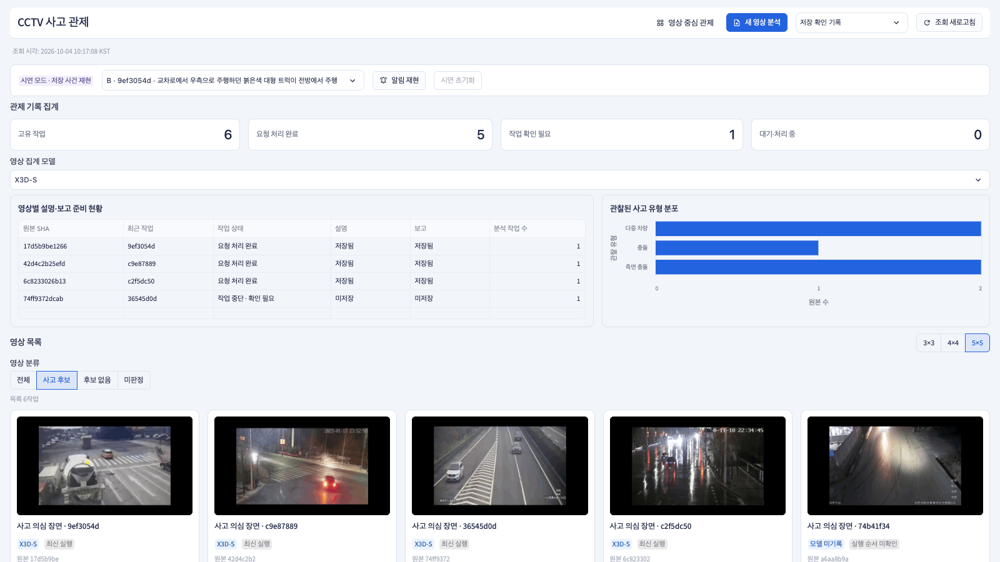

# CCTV 사고 관제 지원 파이프라인

녹화된 CCTV 영상을 분석해 **사고 의심 구간, 장면 설명, 문서 근거, 대응 보고 초안**을 한 화면에서 확인하는 프로젝트입니다.

관제 담당자가 영상 전체를 반복해서 확인하는 부담을 줄이고, 먼저 살펴볼 장면과 관련 근거를 함께 검토할 수 있도록 만들었습니다. 영상 모델의 후보 탐지부터 보고 저장까지 연결하고, 같은 작업의 처리 과정을 MLflow에 기록합니다.



## 주요 기능

| 기능 | 설명 |
|---|---|
| 영상 분석·모델 선택 | X3D-S 또는 R(2+1)D-18로 사고 후보 구간을 찾고, 공통 YOLO 모델로 객체 근거를 구성합니다. |
| 영상 근거 확인 | 원본·후보 영상, ROI 영상, 박스 주석 이미지를 구분해 확인합니다. |
| 장면 설명 | Gemini VLM이 영상 근거를 바탕으로 관찰 내용을 구조화합니다. |
| 근거 문서·보고 초안 | 관찰 내용과 관련된 문서를 검색해 기관별 대응 근거와 6절 보고 초안을 구성합니다. |
| 관제 화면·완료 알림 | 영상별 처리 상태와 결과를 조회하고, 보고서 저장 완료 알림에서 같은 사건을 엽니다. |
| 실행 추적 | MLflow에서 모델·설정·처리 시간·성공 여부와 VLM 요청·응답·토큰 사용량, 문서 검색 과정을 확인합니다. |

같은 영상 파일은 SHA-256으로 식별하고, 모델·가중치·전처리 설정을 함께 기록해 모델별 실행을 구분합니다. 화면의 **사고 후보 / 후보 없음 / 미판정**은 서로 다른 상태이며, 처리 실패를 정상 영상으로 표시하지 않습니다.

## 분석 과정

1. **접수:** MP4 영상과 분석 모델을 선택하면 EC2가 작업과 설정을 저장합니다.
2. **후보 탐지:** Runpod의 영상 모델이 사고 의심 구간을 찾습니다.
3. **영상 근거 생성:** 후보 구간에 YOLO를 적용하고 후보·ROI 영상과 주석 이미지를 생성해 S3에 저장·검증합니다.
4. **장면 설명:** EC2가 영상 근거를 Gemini에 전달하고, 응답의 관찰 내용과 근거 연결을 검사합니다.
5. **문서 검색·보고 구성:** BM25·E5 검색으로 관련 문서를 찾고 규칙 템플릿으로 보고 초안을 만듭니다.
6. **저장·확인:** 결과를 DB에 저장하고 화면과 MLflow에서 확인합니다. 보고서 저장 완료 뒤 알림을 표시합니다.

후보가 없는 분석과 실패한 작업은 별도 상태로 남깁니다. 최종 보고서는 검색된 문서 근거와 템플릿으로 구성하며, VLM은 영상의 관찰 내용을 생성하는 역할을 맡습니다.

## 시스템 구성

| 실행 위치 | 구성 요소 | 역할 |
|---|---|---|
| EC2 · Docker | Streamlit, Python API, Worker | 화면 제공, 작업 접수·단계 연결·결과 회수 |
| EC2 · Docker | PostgreSQL | 작업 상태, 장면 설명, 보고 결과 저장 |
| EC2 · Docker | MLflow | 모델 이력과 분석·VLM·문서 검색 실행 추적 |
| EC2 · Worker | SQLite, BM25, multilingual-e5-small, RRF | 문서·벡터 보관과 키워드·의미 검색 결과 결합 |
| Runpod · GPU 컨테이너 | PyTorch, X3D-S / R(2+1)D-18, YOLO | 영상 분석과 근거 미디어 생성 |
| Amazon S3 | 모델·영상·결과 객체 | 가중치와 분석 근거 저장·전달 |
| Gemini API | VLM | 후보 영상의 관찰 설명 생성 |
| GitHub Actions · Docker Hub | 코드 검사·이미지 게시 | 소스 검증과 Runpod 이미지 버전 관리 |

EC2 API는 Python HTTP 서버를, Runpod API는 Starlette·Uvicorn을 사용합니다. EC2 서비스는 Docker 컨테이너와 호스트의 코드·데이터 마운트를 함께 사용합니다.

## 화면 사용 흐름

**영상 업로드·모델 선택 → 관제 화면에서 진행 확인 → 보고 완료 알림 → 사건 상세 → 영상·설명·기관별 근거·보고서 확인** 순서로 사용합니다. MLflow에서는 해당 작업의 모델 버전과 단계별 기록을 대조할 수 있습니다.

화면은 운영용, 저장 결과를 보는 조회 전용 공유용, 시간·건수·동시 실행 수를 제한한 시연용으로 구분합니다. 조회 전용 모드는 업로드·분석·데이터 변경을 서버에서도 차단합니다. 접속·시작·종료 절차는 [실행 안내](LOCAL_SETUP.md)를 참고하세요.

## 개발 환경과 코드 검사

Python 3.12 기준으로 저장소의 합성 데이터·API/DB 대역을 사용하는 CPU 검사를 실행할 수 있습니다.

```bash
git clone https://github.com/boramsam-zo/cctv-pipeline.git
cd cctv-pipeline
python3.12 -m venv .venv
source .venv/bin/activate
python -m pip install \
  -r apps/runpod_image/requirements-ci.txt \
  -r scripts/requirements-viewer.txt \
  jsonschema==4.25.1
HF_HUB_OFFLINE=1 TRANSFORMERS_OFFLINE=1 \
  python -B scripts/ci_source_checks.py
```

이 검사는 실제 GPU·VLM 호출이나 모델 품질 평가를 수행하지 않습니다. 전체 서비스를 실행하려면 EC2·Runpod, 모델 가중치, 검색 문서·인덱스, DB와 비밀 설정을 별도로 준비해야 합니다. 영상·가중치·비밀·운영 데이터는 Git에 포함하지 않습니다. 준비 범위는 [개발·배포 인수인계](docs/team_handoff.md)에 정리했습니다.

## 코드 검사와 이미지 배포

- 관련 코드의 Pull Request와 `main` 변경에 대해 CPU 검사를 실행합니다.
- Runpod 이미지에 영향을 주는 `main` 변경은 이미지 빌드·Docker Hub 게시로 이어지며, 이미지 tag와 digest를 남깁니다.
- UI·보고 코드만 바뀌면 기존 GPU 이미지를 다시 게시하지 않습니다.
- 게시된 이미지의 Pod 적용과 EC2 서비스 반영은 별도의 배포 절차에서 수행합니다.

설정: [소스 검사 workflow](.github/workflows/source-checks.yml) · [Runpod 이미지 workflow](.github/workflows/runpod-image.yml)

## 저장소 구조

| 경로 | 내용 |
|---|---|
| `apps/cctv_ui/` | Streamlit 관제·분석·사건 상세 화면 |
| `apps/be_worker/` | 작업 API, Worker, 저장·복구·MLflow 연동 |
| `apps/runpod_image/`, `apps/runpod_worker/` | GPU 이미지 구성, 분석 API·작업 처리 |
| `apps/scene_description/` | VLM 요청·응답과 영상 근거 계약 |
| `apps/team_rag/` | 문서 검색과 보고서 구성 |
| `scripts/`, `infra/` | 준비·운영 도우미와 배포 설정 |
| `tests/` | 계약·처리·화면·보안 경계 검사 |
| `docs/` | 설계, 실행 안내, 현재 상태와 개발 이력 |

## 결과를 해석할 때

- 분석 대상은 업로드한 녹화 영상입니다. 상시 RTSP 스트림 감시 기능과는 구분합니다.
- 사고 후보는 검토 대상이며 확정 사고 판정이 아닙니다. 후보 없음도 안전을 보증하지 않습니다.
- 보고서는 사람이 영상·문서 근거를 검토하는 초안입니다. 외부 기관에 자동 전송하지 않습니다.
- 실행 성공과 모델 정확도는 다른 지표입니다. 정확도·F1은 공통 정답·평가 목록·판정 기준을 갖춘 평가에서만 기록하고, 개발 검증과 독립 최종 평가를 구분합니다.

## 문서 안내

- [실행·접속 안내](LOCAL_SETUP.md)
- [개발·배포 인수인계](docs/team_handoff.md)
- [현재 상태와 다음 작업](docs/current_status.md)
- [개발 진행 기록·이전 README 이력](docs/PROGRESS.md)
- [구현 계획과 TODO](IMPLEMENTATION_PLAN.md)
