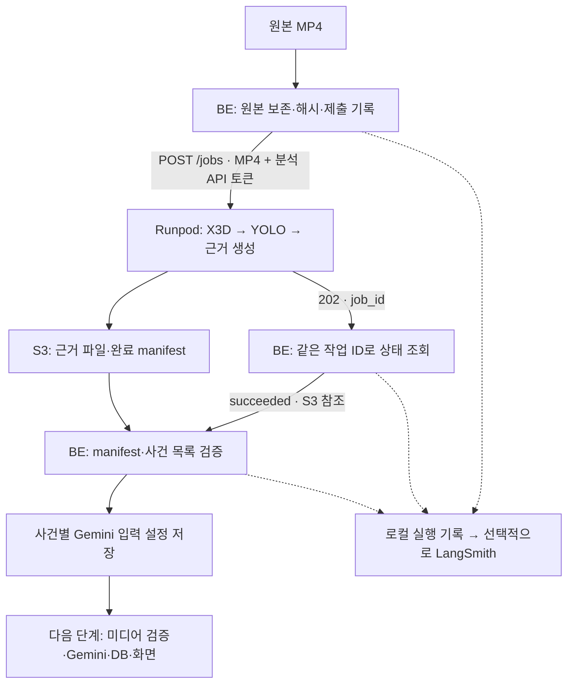

# BE worker — 원본 제출부터 S3 근거 연결까지

## P6 A/B 연결 — 로컬 검증 완료, EC2 반영 대기

현재 구현은 A/B/A+B 선택과 `gpu_comparison` / `full_report` 목적을 접수한다. UI는 접수·조회만 하며 독립 worker가 기존 Runpod/S3/장면/RAG/보고 코드를 실행한다. 기존 버전 미기록 결과를 자동으로 A로 바꾸지 않는다.

- `analysis_profiles.py`: 고정 모델·코드·실행 환경과 입력 SHA로 GPU 키 생성.
- `selection_jobs.py`: A/B 작업 묶음과 목적별 작업을 원자적으로 저장. 같은 A를 A+B에서 재사용. 동일 영상의 별도 Gemini 모델·기준일 비교는 현재 범위 밖이므로 기존 보고 설정과 충돌하면 원본을 보존하고 거절.
- `selection_schema.sql` / `prepare_selections.py`: 기존 5테이블 값을 보존하는 추가 테이블 2개. 기존 `flows`는 과거 작업용으로 유지.
- `ab_evidence.py` / `ab_scene.py`: A PNG와 B 전체·ROI·JPEG·문맥의 형식/시각/해시 연결.
- `browser_preview.py`: B 원본을 보존하고 CPU로 H.264 화면 사본 생성. Gemini에는 원본 근거 사용. 조회는 사본을 만들지 않음.
- `flow_service.py`: 비교는 미디어 검증까지만 수행. 설명·보고는 작업에 고정한 설정으로 실행. 응답이 불확실하면 재제출하지 않음.

불확실 제출의 재개 버튼은 worker가 기존 GPU 키를 조회해 작업 ID를 복구하도록 요청한다. GPU 처리 후 S3 실패는 검증된 기존 출력의 게시만 재개한다. 분석 자체가 실패했거나 완성 출력이 없으면 새 GPU 실행을 추가하지 않고 멈춘다. 근거 무결성 오류는 수동 확인이 필요하다.

새 CPU 릴리스는 `av==16.1.0`이 필요하다. 기존 `cctv-be-queue:pg-v1` 태그를 덮어쓰지 않고 새 이미지 태그를 `BE_QUEUE_IMAGE`로 선택할 수 있다. 미지정이면 기존 태그를 유지한다. Runpod URL·인증 토큰·Gemini 키는 서버에 두며 화면으로 보내지 않는다.

**검증 범위:** 대역 API/생성 응답, 실제 격리 PostgreSQL, 저장된 A/B 근거와 제한 CPU 미리보기 검사. 실제 새 Runpod 서비스·S3 권한·새 Gemini 생성·EC2 버튼 검증은 아직이다. 최신 판정과 원본 영수증은 `docs/current_status.md` 및 `IMPLEMENTATION_PLAN.md` P6을 따른다.

**다음 사용자 실행 위치: Mac 터미널.** 기존 SSH 경로로 EC2 상태를 읽기만 한다.

```bash
cd .
bash artifacts/infra/cpu-rag-ssh-20260927-01/ssh.sh \
  'sudo python3 -' < scripts/read_p6_readiness.py
```

예상: `p6_readiness_read`, 현재 테이블/작업 상태·서비스 코드 경로·이미지·행수/MD5, 모델/S3/DB쓰기/설정 변경0. 새 테이블이 없으면 `false`로 표시한다. 확인 전 원격 적용·이미지 교체·모델 실행을 시작하지 않는다. 변경된 Pod에 추가 보관 자료가 있을 수 있으므로 이미지 교체 전 현재 상태/근거의 외부 보관을 확인한다. 기존 P4 이미지와 성공 결과는 보존한다.


## P5 — Gemini 설정 분리 (2026-10-01)

아래는 로컬 구현이며 EC2 적용·실제 Gemini 검증은 별도다. 전체 현재 상태는
[재개 요약](../../docs/current_status.md)을 따른다. 이전 날짜의 설명은 당시 이력이다.

| 설정 | 입력 위치 | 반영 대상 |
|---|---|---|
| `BE_GEMINI_SCENE_MODEL` | Compose가 읽는 환경변수 / `.env` | 새로 접수한 영상의 장면 설명 |
| `BE_GEMINI_REPORT_MODEL` | Compose가 읽는 환경변수 / `.env` | 새로 접수한 영상의 보고 초안 |
| Gemini API 키 | `${BE_SECRETS_DIR}/gemini_api_key` 파일 | worker에서 새 API 요청 직전에 읽음 |

두 모델의 기본값은 기존 `gemini-3.5-flash-lite`다. 이름의 형식 검사만 수행하며
실제 모델 제공 여부·계정 권한·영상 응답 품질은 별도 검증해야 한다.
`generation.env.example`에는 모델명만 있고 키를 넣지 않는다.
Compose의 **be-api**가 환경변수로 받은 기본값을 접수 시 저장한다.
worker는 DB의 작업별 설정을 읽으므로 worker에 모델 환경변수만 넣어서는 바뀌지 않는다.
독립 CLI의 `--model` 지정 방식은 유지한다.

### 접수·재시작·중복 요청

- `admit()`가 모델명·4 FPS·설명/보고 프롬프트 버전과 템플릿 해시·검색문장 계약·기존
  임베딩 프로필을 `cctv_jobs.flows.generation_settings`에 저장한다. 큐 행과 흐름 행은
  같은 트랜잭션으로 commit하며 spool의 `flow-settings.json`과도 대조한다.
- 기본값 변경 후 같은 영상 SHA를 다시 보내면 기존 작업을 반환한다. 기존 모델/날짜/결과를
  바꾸거나 같은 영상을 GPU로 다시 처리하지 않는다. 다른 Gemini 모델로 기존 근거를
  비교하는 별도 실행/화면은 이번 P5에서 추가하지 않았다.
- 설정 없는 이전 흐름은 기록된 이전 기본값을 사용한다. 현재 환경변수로 채우지 않는다.
  기존 CLI 작업은 화면 조회 때문에 자동 처리 목록에 등록하지 않는다.
- 실행 코드의 프롬프트/임베딩 계약과 작업 설정이 다르면 새 제출·생성을 멈춘다.
  이미 받은 Runpod 작업 ID의 조회·근거 회수는 별도로 이어질 수 있다.
- 키 파일이 없으면 외부 호출 시도를 기록하기 전에 멈춘다. 파일을 복구한 뒤 실패 단계부터
  재개할 수 있다. 실제 요청 후 응답이 불확실한 기록은 키를 교체해도 자동 재호출하지 않는다.
  완료된 설명/보고는 키 없이 저장된 응답을 재사용한다.
- 트랜잭션 실패 때 남은 미제출 spool은 자동 삭제하지 않는다. DB에 없는 이 폴더가
  자동으로 처리되지는 않으며 기존 원본 보존 원칙을 유지한다.

### 적용·교체 순서 (EC2에서 사용자가 실행)

1. 기존 서비스/진행 작업을 읽기 확인하고 새 접수를 잠시 중단한다. 진행 중인 모델 요청이
   끝났는지 확인한 뒤 API/worker를 함께 교체한다. 강제 중단으로 응답이 유실되면
   불확실 요청으로 남을 수 있다.
2. 새 코드 묶음을 별도 릴리스 경로에 두고 `prepare_generation_settings.py`를 실행한다.
   이 준비 스크립트는 JSONB 컬럼만 추가하고 기존 큐·흐름·설명·보고·벡터 값을 대조한다.
   예상 결과는 `generation_settings_schema_ready`, `existing_data_unchanged: true`,
   `transaction_committed: true`, 모델 호출0이다. 스크립트 전달/실행은 적용 단계에서 안내한다.
3. 모델명은 기존 서버 설정 파일에 위 두 변수를 추가하거나 Compose의 `--env-file`로
   명시해서 읽는다. `queue.sh` 방식은 기존처럼 실행 셸에 export한 값을 사용한다.
   `.env`를 임의 경로에 두기만 하면 적용되지 않는다. API를 재생성하면 이후 새 접수에
   반영된다. `restart`만 하거나 일회성 `run --env`를 실행하는 것은 기존 API의 환경변수
   변경 방법이 아니다.
4. 키 교체는 기존 비밀 파일을 서버에서 수정한다. 파일을 새 파일로 교체(rename)했다면
   worker를 재생성해 secret을 다시 연결한다. API/UI에는 키를 전달하지 않는다.
   일반 Compose의 파일 기반 secret은 서버 원본 파일을 자동 암호화하지 않는다.
5. 설정·재시작·기존 결과 보존을 확인한 뒤 합의한 모델/호출 상한으로 실제 응답·DB를 검증한다.
   코드에 모델명 읽기가 구현된 뒤에는 값/키 교체를 위해 Runpod GPU 이미지를 재빌드할 필요가 없다.

실제 배포 경로와 진행 작업 상태를 확인하기 전에는 위 절차를 기동 명령으로 자동 실행하지 않는다.
새 UI·추가 RAG 문서·임베딩 모델 변경·GPU 재추론은 P5에 포함하지 않는다.

## 2026-09-29 현재 연결 범위

기존 PostgreSQL 큐의 S3 인계를 받아 사건별 미디어 검증·Gemini 설명·DB 저장까지
명시적인 CLI로 연결했다. [현재 실행 순서](QUEUE.md#기존-s3-결과--gemini-설명--db-저장--2026-09-29)를 먼저 따른다.
`dispatch`/`collect`는 계속 GPU 접수·조회/S3 메타데이터 회수까지만 수행한다.
새 `scene-fetch`는 S3 읽기, `scene-describe`는 첫 실행에 Gemini 1회와 DB 저장을 한다.
실제 현재 A의 장면 호출은 사용자 실행 대기이며 자동 상시 실행·화면·보고는 후속이다.


## 2026-09-28 추가 — 여러 영상의 PostgreSQL 대기열

[대기열 실행 안내](QUEUE.md)에 A/B/C 접수·DB 작업 기록·Runpod 제한 배정·polling·별도 S3 회수를 추가했다. 아래 `worker.py` 한 작업 CLI는 유지하며 새 `job_queue.py`가 그 함수를 재사용한다. 공용 대기열 코드 준비와 실제 PostgreSQL/원격 배포 완료는 구분한다. 검증 상태는 안내와 원본 영수증을 따른다. Gemini 자동 설명·화면·보고 연결은 후속이다.

## 이번에 구현한 범위

BE의 CPU 작업 코드가 원본 MP4를 Runpod에 한 번 제출하고, 상태를 조회하고, S3 결과 목록을 검증해 Gemini 도구용 사건별 입력 설정을 만든다. 기존 Runpod 서버 코드는 교체하지 않는다. `run`/`resume`/`collect`는 Python 함수로도 호출할 수 있다.

현재는 **한 작업을 실행하는 CLI와 파일 기반 재개 기록**이다. 웹 업로드 API, PostgreSQL의 작업 큐/상태 테이블, 상시 worker 배포와 Gemini/보고/알림 자동 실행은 후속이다. 기존 사용자 결정대로 실제 클라우드·API 실행은 사용자가 수행한다. 로컬 합성 HTTP 시험과 원격 실행을 구분한다.



- 최초 POST는 자동 재시도하지 않는다. 응답이 끊기면 접수됐을 수 있기 때문이다.
- 작업 ID를 받은 뒤에는 `resume`이 GET 상태 조회만 한다. 대기 종료와 분석 실패를 구분한다.
- 서버 상태의 원본 SHA256/크기와 S3 버킷·리전·작업 경로가 원래 요청과 같아야 통과한다.
- `collect`는 S3 manifest와 evidence.json 두 파일을 읽는다. 실제 클립·프레임의 바이트 검증은 후속 `scene.py fetch`가 한다.
- 후보가 없으면 `no_candidates`이며 사고 없음 확정/추론 실패와 구분한다. Gemini를 자동 호출하지 않는다.

## 1. 어디서 실행하나?

먼저 **Mac의 이 프로젝트 폴더**에서 실행한다. BE가 나중에 EC2에서 할 일을 Mac에서 연결 확인하는 것이다. Python 3.10 이상 표준 라이브러리로 제출·조회·LangSmith 기록이 가능하며 모델 설치/GPU가 필요하지 않다. S3 회수는 기존 AWS CLI `cctv` 프로필을 사용한다.

필요한 정보:

1. Runpod Connect → **Port 8000 HTTP Service의 HTTPS 주소**. 주소 뒤의 `/docs`·경로·쿼리는 제외한다.
2. 그 Pod의 분석 API 토큰. 기존 `apps/runpod_worker/client.py`가 `.api-token`에서 읽는 값이다. Runpod 계정 API 키와 다르다. 키를 채팅·Git·명령 인자에 붙이지 말고 아래 숨김 입력이나 기존 비공개 파일로 사용한다.
3. Mac에 있는 정상 MP4 원본 경로. 현재 Pod 제한은 200MiB·120초, GPU 동시 처리1이며 대기열 초과는429다.
4. Runpod의 S3 업로드 설정이 활성화돼 있어야 한다. `/health`의 `storage=s3`를 제출 전에 확인한다.

기존 S3 결과만 확인할 때는 새 GPU 작업을 보내지 않는다. 이 안내의 `run`은 **새 영상 한 건의 전체 제출 연결 시험**이므로 새 분석과 S3 업로드가 발생한다.

## 2. LangSmith 프로젝트·키 준비 — 기존 계정 사용

1. [LangSmith](https://smith.langchain.com)에 로그인하고 사용할 워크스페이스를 선택한다.
2. **Settings → API Keys**에서 해당 워크스페이스에 기록할 수 있는 키를 만든다. 키는 생성할 때 한 번 표시되므로 개인 비밀 저장소에 보관한다. [공식 키 설정](https://docs.langchain.com/langsmith/create-account-api-key).
3. 이번 프로젝트 이름은 **`cctv-be-runpod`**으로 사용한다. 코드가 이 이름으로 trace를 보낸다. 프로젝트가 없으면 첫 trace 수신 시 생성된다. [프로젝트 설정](https://docs.langchain.com/langsmith/log-traces-to-project).
4. 기본 API는 GCP US의 `https://api.smith.langchain.com`이다. **계정의 배포 리전에 맞춰** `LANGSMITH_ENDPOINT` 또는 `--langsmith-endpoint`를 지정한다. EU는 `https://eu.api.smith.langchain.com`, APAC은 `https://apac.api.smith.langchain.com`, AWS US는 `https://aws.api.smith.langchain.com`이다. AWS S3를 서울로 선택한 것과 LangSmith 계정 리전은 별개다.
5. 키가 여러 워크스페이스에 걸쳐 있으면 Settings → General의 Workspace ID를 `LANGSMITH_WORKSPACE_ID` 또는 `--langsmith-workspace`로 설정한다. 프로젝트 이름은 `LANGSMITH_PROJECT` 또는 `--langsmith-project`로 변경 가능하다.

키는 `--langsmith` 실행 때 숨김 입력으로 받는다. 기존 `LANGSMITH_API_KEY` 환경변수 또는 `--langsmith-key-file`도 지원한다. 별도 `LANGSMITH_TRACING=true` 설정은 이 CLI에 필요하지 않다. 플래그 없이 실행하면 기록은 로컬에만 남는다.

### LangSmith에 기록되는 범위

- BE 작업 ID와 Runpod 작업 ID, 원본 해시/크기, 코드 버전/해시, 단계 시작·종료 시각, 상태·조회 횟수·후보 수.
- 원본 영상/프레임, 인증 키, 서명 URL, 개인 파일 경로, S3 버킷 이름은 trace로 보내지 않는다.
- `be.run` 안에 `runpod.health`·`runpod.submit`·`runpod.poll`, 별도 `be.collect` 안에 `s3.verify`가 기록된다. **각 CLI 실행은 별도 trace**이며 `worker_job_id` 메타데이터로 같은 작업을 묶어 조회한다. Runpod 내부 GPU 단계별 시간과 Gemini 토큰·답변은 이번 추적에 포함되지 않는다.
- 완료/대기 반환 후 기록을 전송한다. LangSmith 연결 실패는 `langsmith.status=pending`으로 남기고 분석 결과를 보존한다. `trace` 명령으로 기록만 재전송할 수 있다.
- 이번 소규모 CLI는 [공식 REST API](https://docs.langchain.com/langsmith/trace-with-api)를 사용하므로 SDK 설치가 없다. 재전송에는 같은 span UUID를 쓰고 수신 확인을 로컬에 저장한다. 강제 종료로 끝나지 않은 trace는 원본으로 보존하고 자동 전송하지 않는다. 상시 처리량이 커지면 공식 SDK의 배치/백그라운드 전송을 검토한다.

## 3. 연결 설정 만들기 — API 호출 없음

프로젝트 루트에서 실행한다.

```bash
python3 apps/be_worker/worker.py configure \
  --output artifacts/be-worker/config-v1.json
```

`Runpod Port 8000 HTTPS service URL:`에 **현재 Pod의 주소**를 입력한다. 기존 서울 버킷 `boram3-cctv-evidence-80bee9db7c3bca316ef395375a`를 사용한다. 버킷을 바꿔야 하면 설정 JSON의 `s3_bucket`을 수정한다. 인증 키는 이 파일에 넣지 않는다. 같은 설정 파일을 덮어쓰지 않으므로 재설정 시 새 출력 이름을 쓴다.

예상 출력: `{"status": "configured", "api_calls": 0}`.

## 4. 원본 한 건 제출·완료 조회

`/실제/원본영상.mp4`를 **Mac의 실제 원본 경로**로 바꾼다. 결과 폴더는 새 경로를 사용한다.

```bash
python3 apps/be_worker/worker.py run \
  --config artifacts/be-worker/config-v1.json \
  --video "/실제/원본영상.mp4" \
  --output artifacts/be-worker/job-v1 \
  --langsmith
```

LangSmith 키, Runpod **분석 API 토큰** 순서로 숨김 입력을 요청한다. 입력 문자가 안 보이는 것이 정상이다. 기존 비공개 분석 토큰 파일이 있으면 `--token-file /비공개/토큰파일`로 지정할 수 있다.

성공 기준:

```json
{
  "status": "evidence_ready",
  "post_attempts": 1,
  "gemini_api_calls": 0,
  "langsmith": {"status": "delivered"}
}
```

실제 출력에는 생성된 작업 ID·크기·조회 횟수 등도 포함된다. `evidence_ready`는 **Runpod이 S3 업로드 완료 참조를 반환했다는 뜻**이고, 다음 `collect`에서 내용을 검증한다. `delivered`는 trace API가 기록 요청을 수락했다는 뜻이며 LangSmith 프로젝트 화면에서도 작업 ID를 확인한다.

300초 안에 끝나지 않으면 `waiting`과 `wait_limit_resume_only`가 나온다. 새 제출을 하지 말고 다음 명령을 사용한다.

```bash
python3 apps/be_worker/worker.py resume \
  --job-dir artifacts/be-worker/job-v1 \
  --langsmith
```

## 5. S3 결과 목록 검증·Gemini 입력 설정 만들기

`evidence_ready`를 확인한 뒤 Mac에서 실행한다. 새 GPU/Gemini 호출은 없고 S3 GET 요청과 LangSmith 기록 전송이 발생한다.

```bash
python3 apps/be_worker/worker.py collect \
  --job-dir artifacts/be-worker/job-v1 \
  --aws-profile cctv \
  --langsmith
```

후보가 있으면 `handoff_ready`와 `event_count`가 나온다. 후보가 없으면 `no_candidates`이며 실패와 구분한다. 권한/네트워크 오류는 원인을 해결한 뒤 이 `collect`만 다시 실행한다.

출력 폴더:

```text
job-v1/
  input.mp4                 제출 바이트 보존용 사본
  state.json                BE 작업 ID ↔ Runpod 작업 ID·상태·SHA
  provider-status.json      허용 필드만 보존한 Runpod 완료 상태
  manifest.json             S3 결과 목록
  evidence.json             검증한 사건 목록
  handoff.json              검증 완료·후속 입력 파일 목록
  scene-event_000.json      기존 scene.py fetch가 받는 설정
  traces/                   허용 필드 실행 기록·전송 확인
```

사건별 입력 파일 이름은 `handoff.json`의 `scene_configs`를 따른다. 항상 event_000이 존재한다고 가정하지 않는다. 파일 사본/재개 기록은 기본적으로 보존하며 수동 정리 전 S3/필요 결과를 확인한다. 원본과 사본은 최대 각각200MiB이며 컨테이너 실행 시 이 폴더를 영속 경로에 둬야 한다.

사건이 `event_000`일 때 실제 클립·프레임을 회수·검증하는 다음 명령도 기존 도구와 호환된다.

```bash
python3 apps/scene_description/scene.py fetch \
  --config artifacts/be-worker/job-v1/scene-event_000.json \
  --aws-profile cctv \
  --output artifacts/vlm/be-job-v1-event000-input
```

여기까지 Gemini 호출0이다. **사고 의심 여부·사건 유형(충돌·전도 등) 분류 보완 후** describe→DB→화면/보고를 연결한다. 기존 충돌 중심 스키마의 `no_visible_collision`을 사고 없음으로 해석하지 않는다.

## 6. 오류·재개와 기록만 재전송

| 상태/오류 | 조치 |
|---|---|
| `waiting` | `resume`으로 상태 조회만 재개 |
| `submission_unknown` 또는 `submitting` | 접수됐을 수 있다. **새 폴더로 run을 다시 실행하지 않는다.** Runpod의 `runtime/jobs/*/status.json`에서 해당 원본 SHA/시각으로 ID를 확인한 뒤 아래 수동 ID 복구 사용 |
| `submission_rejected`, `http_429` | 대기열/저장 한도 확인. 자동 반복 없음. 다른4xx는 인증·주소·크기 점검 |
| `provider_failed` | 기존 `client.py log --job <ID>`로 분석 로그 확인. 정상이나 후보 없음으로 처리하지 않음 |
| `storage_not_ready` | 해당 Pod의 S3 업로드 설정/실패 로그 확인. 기존 결과의 업로드 복구를 우선하고 GPU를 다시 돌리지 않음 |
| `verification_failed` | 원본/작업/S3 참조 불일치. 입력·Pod 주소·작업 ID를 확인하고 잘못된 결과를 다음 단계에 넘기지 않음 |
| `langsmith.status=pending` | 지역·키·workspace·권한을 확인하고 아래 trace 명령만 실행 |

확인한 Runpod ID로 접수 응답을 복구할 때만:

```bash
python3 apps/be_worker/worker.py resume \
  --job-dir artifacts/be-worker/job-v1 \
  --provider-job-id <확인한_32자리_Runpod_ID> \
  --langsmith
```

원본 해시·크기가 같아야 ID가 연결된다. 이미 다른 ID가 연결된 작업을 바꾸는 용도로 쓰지 않는다. 자동 중복 방지 키를 받는 서버 API는 아직 없으므로 작업 폴더를 버리고 새로 제출하면 중복 분석을 막을 수 없다.

로컬 상태만 읽기:

```bash
python3 apps/be_worker/worker.py status --job-dir artifacts/be-worker/job-v1
```

기록만 LangSmith에 보내기:

```bash
python3 apps/be_worker/worker.py trace --job-dir artifacts/be-worker/job-v1
```

`trace`는 Runpod/S3/Gemini를 호출하지 않는다. 키 값이나 전체 trace를 채팅에 보낼 필요 없이 상태·오류 코드만 공유하면 된다.

## 7. EC2·Compose 연결과 검증 범위

Mac에서 한 건을 확인한 뒤 동일 코드를 EC2의 CPU worker에 배포한다. EC2에서는 AWS `cctv` 프로필을 복사하지 않고 인스턴스 역할을 사용하는 `collect --job-dir ...`를 쓴다. 현재 EC2 역할 연결·실제 stopped 상태 확인은 별도 대기다. 이 작업은 Terraform/EC2/Runpod 설정을 변경하거나 서버를 재시작하지 않았다.

실행 ZIP은 코드만 포함하며 키·영상·결과·Terraform state는 제외한다. 루트 구조를 보존해 압축을 풀고 `python3 apps/be_worker/verify_bundle.py`로 해시를 확인한다.

로컬 검증: 합성 데이터로 기존 Runpod ASGI API를 루프백 HTTP로 호출하는 CLI 시험, 인증/redirect·접수 응답 유실·재개·S3 변조·후보 없음·기존 scene fetch 호환, LangSmith 요청/허용 필드/전송 실패/중복 UUID 처리. 실제 모델 품질·원격 Pod/S3/LangSmith 계정 연결을 완료했다고 표시하지 않는다. 상세 근거는 `artifacts/be-worker/be-runpod-20260928-01/verification.json`과 프로젝트 `docs/PROGRESS.md`를 따른다.
