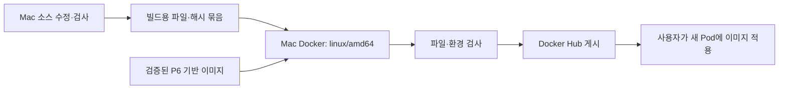
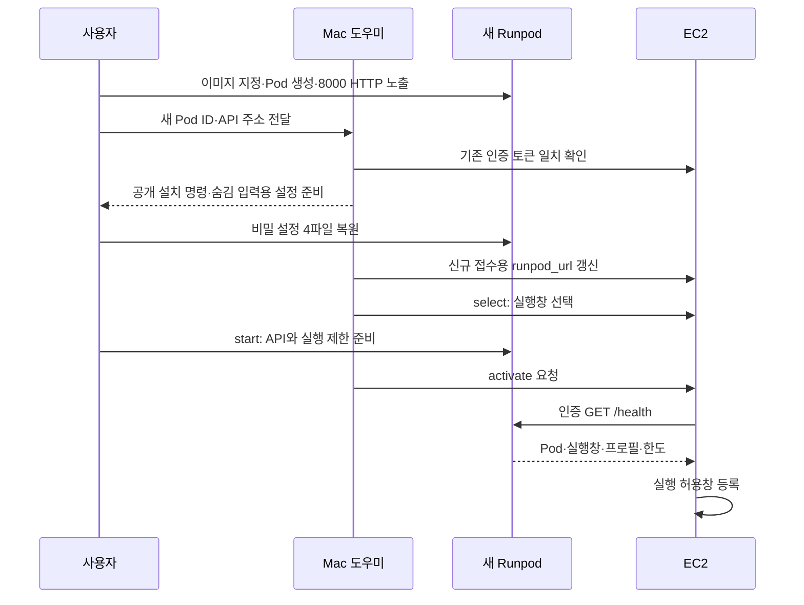
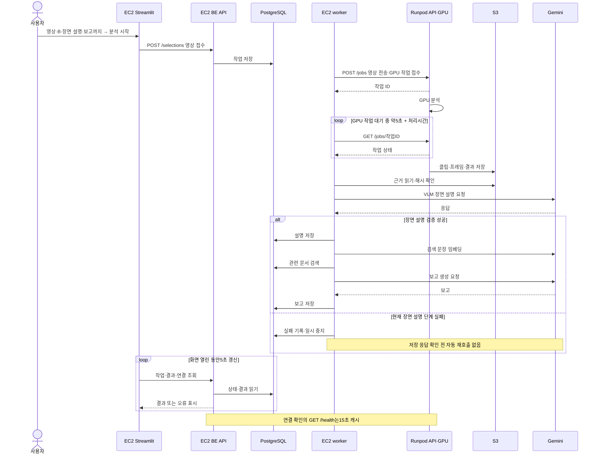
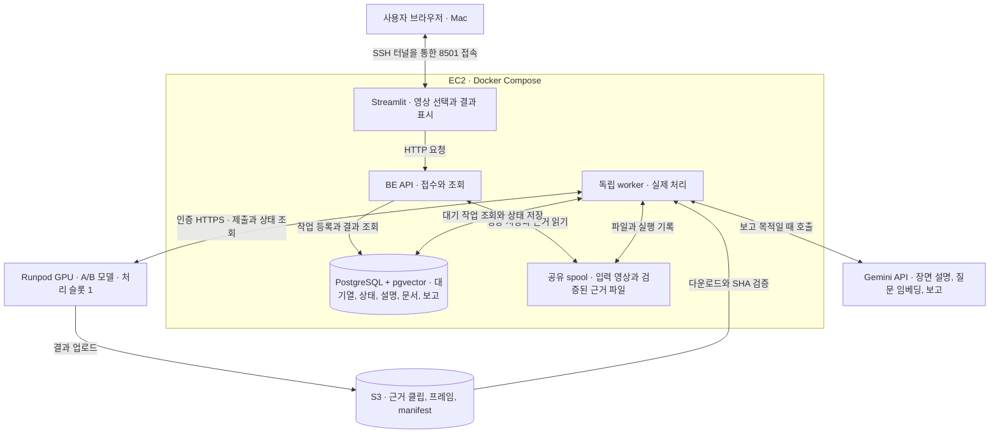
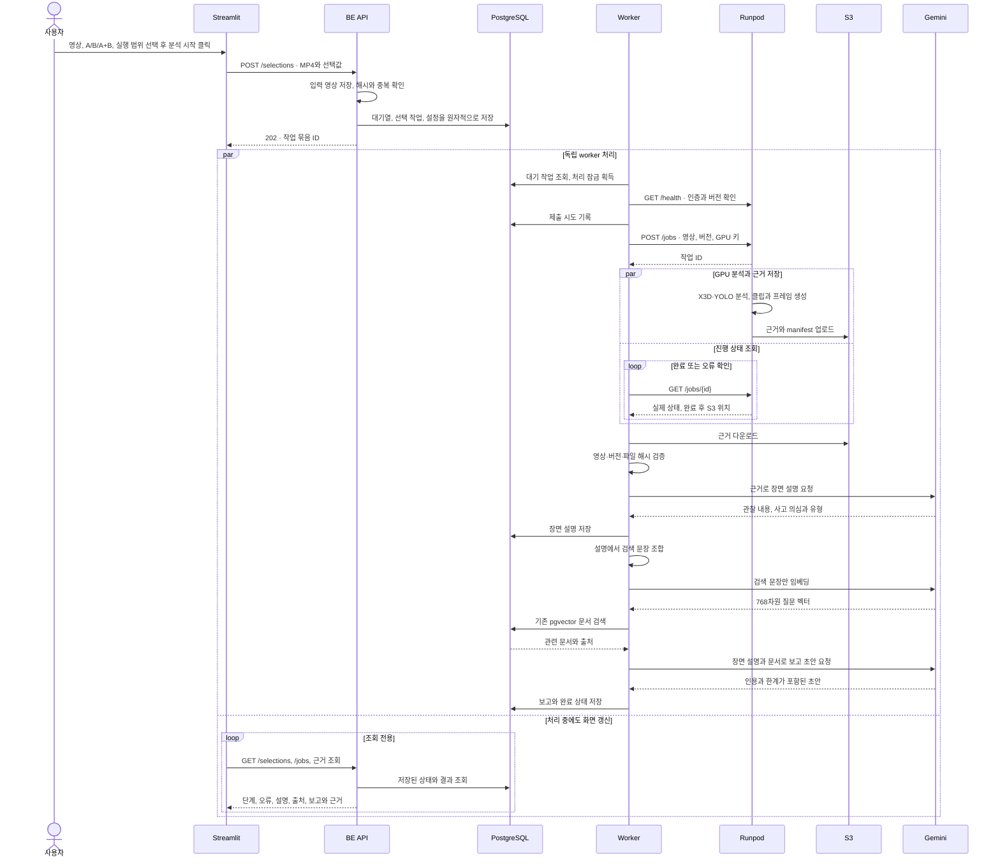

# 학습 기록 — 원리와 설계 선택

## 2026-10-05 — 원본을 보존하는 관련성 검수와 실행 식별

**정의:** 관련성 검수본은 저장된 관찰·검색 문서를 다시 검사해 근거 연결만 보정하고, 최초 보고를 별도 원본으로 남긴 결과다.

**예시:** 보행자가 관찰되지 않은 차량 사건에 보행자 조문이 검색되어도 기관의 대응 지침으로 연결하지 않는다. 제외 원문과 이유는 검수 기록에 남긴다. 이는 그 법이 실제로 적용되지 않는다는 법률 판단이 아니다.

**실제 함수 흐름:** `relevance.source_relevance`가 관찰 조건/조치 주체를 확인하고 `review.review_saved_report`가 저장 보고의 source·ref를 일치시킨다. `report_review.build`는 원본/장면/정책 코드 SHA를 고정한 검수 ID를 만들고 별도 sidecar에 저장한다. 기존 report DB행·Markdown·영상은 그대로다. `flow_service.view`의 읽기 결과 안에 검수본을 연결하고 `control_data.normalize_case`와 관제의 보고 판 선택이 표시/복사/다운로드를 함께 전환한다. MLflow에는 검수 실행 ID와 원본 ID·해시를 별도로 기록한다.

**선택 이유/대안:** GPU/VLM/문서 검색을 재실행하면 원본과 비교할 조건·비용이 바뀐다. 저장 결과에 대한 순수 함수와 별도 파일을 사용하면 같은 관찰에서 무엇이 달라졌는지 확인할 수 있다. 원본 DB행을 덮어쓰는 방식은 채택하지 않았다.

**한계:** 구조화되지 않은 장소/신호/횡단 의도를 추정하지 않고 근거 부족으로 남긴다. 현행 법령 여부와 실제 법적 적용 판단, 모델 정확도·F1 검증을 대신하지 않는다. SHA-256은 동일 바이트·변조 여부를 비교하는 지문이지 영상 의미, 동일 사고, 예측 정확도를 판별하는 값이 아니다. 세부 실행 수치/검사는 PROGRESS·current_status와 연결 원문을 따른다.

**직접 확인/이해 질문:** `apps/team_rag/review.py`, `apps/be_worker/report_review.py`, `LOCAL_SETUP.md`. 같은 영상 파일에 다른 모델을 쓰면 입력 SHA와 실행 ID 중 무엇이 같고 달라지는가? MLflow 성공 상태가 보고 내용의 정확성까지 보장하는가? 사용자 이해는 답변 전 미확인이다.

**30초 설명:** 같은 영상과 모델 버전을 해시로 추적하며 분석부터 보고까지 실행 기록을 MLflow에 남깁니다. 관련성 검수는 추가 모델 호출 없이 저장 근거를 검사하고 최초 보고와 검수본을 함께 보여줍니다. 기능 성공, 문서 관련성, 모델 성능은 각각 따로 확인합니다.

## 2026-10-05 — GPU 결과 재사용과 별도 보고 실행 기록

**한 문장 정의:** 보고 후속 연결은 이미 완료된 GPU 분석의 입력·모델·결과를 그대로 가리키면서 새 장면 설명/문서 검색/보고만 별도 실행으로 기록하는 방식이다.

**쉬운 예시:** 같은 CCTV 영상의 X3D-S 후보가 이미 있으면 GPU로 다시 분석하지 않고 그 후보 클립으로 Gemini 설명1개와 CPU 문서 근거/6절 보고1개를 만든다. 이번에는 기존GPU1회가 유지되고 VLM1회만 늘었다.

**실제 파일/함수 흐름:** `activate_report_continuation.inspect_source`가 완료된 비교 작업·13개 파일·원본세션해시·모델설정을 읽어 계획SHA를 만든다. 사용자 승인 후 `apply`가 새 실행창/보고작업 하나를 접수하고, `report_continuation`의 고정 식별/횟수 검사를 거쳐 기존 `team_jobs`의 장면 설명→CPU 검색/보고→MLflow 기록으로 이어진다. `worker.submit_once`는 이 후속창에서 GPU제출을 차단한다. 관제는 같은 worker/report ID의 저장 원문을 조회한다. E5는 worker에만 연결되어 있어 계획도 worker에서 실행하며 API에 추가모델복사/mount를 하지 않았다.

**선택 이유/대안:** 이전 비교세션을 보고용으로 덮어쓰거나 GPU를 재실행하면 첫 검증의 범위/근거가 바뀐다. 별도 후속 작업은 원본과 새 보고를 함께 추적하면서 비용과 중복을 제한한다. 대신 일반 무제한 큐가 아니므로 새 영상 입력에는 새 승인 범위/실행창이 필요하다.

**검증과 한계:** 전용15개 및 BE전체524개 통과/격리PostgreSQL32개 미실행. 실제 새 보고1개와 관제6절 표시까지 확인했으나, 기능 성공은 모델 정확도나 보고 내용 품질 합격이 아니다. 이번 초안에는 보행자 관찰이 없는데 보행자 조항이 검색되는 관련성 문제가 남았다. 정답이 없어 정확도/F1은 미기록이며 R2의 새 보고는 실행하지 않았다. 900초는 접수 허용시간이고 Pod자동종료·과금상한·전체실행 hard timeout이 아니다.

**직접 확인/이해 질문:** `scripts/activate_report_continuation.py`, `apps/be_worker/report_continuation.py`, 비공개 `artifacts/mlops/report-continuation-20261005-01`의 계획/승인/실행/브라우저 영수증을 본다. GPU결과 재사용과 모델 재추론은 무엇이 다른가? 보고가 저장됐다는 사실만으로 문서근거가 적절하다고 할 수 있는가? 사용자 이해는 답변 전 미확인이다.

**30초 설명:** 새 Pod에서 두 모델의 추론과 MLflow 저장을 확인했습니다. 그중 X3D 결과로 GPU재실행 없이 장면 설명과 보고를 추가했고 관제에서 같은 영상과 함께 보여줍니다. 원본 비교와 후속보고를 나눠 남겨 비용·횟수·실행 근거를 추적하며 내용 품질은 별도 검수합니다.

## 2026-10-05 — SSH 키 해제와 Pod 설정·모델 실행의 구분

**정의:** ssh-add는 암호화된 로컬 개인키를 해제하여 현재 SSH agent가 사용할 수 있게 등록한다. 예를 들어 Bad passphrase가 여러 번 나와도 마지막 Identity added가 있으면 마지막 입력으로 등록된 것이다. 암호는 Runpod 로그인 비밀번호가 아니며 개인키 파일을 만든 때 지정한 잠금 암호다. agent 등록은 Pod의 공개키 허용과 별개지만 이번에는 등록 후 실제 직접 SSH 접속까지 성공했다.

**실제 흐름:** 기존키 해제→pod-ssh.py의 고정 host key/Pod 연결→restore_pod_runtime.py의 승인된 API/S3 인증 복원→model_prepare의 기존가중치캐시/해시검사→start-model-session.sh→activate_mlops_session.py→first-gpu-check.py의 기존EC2 API접수. 가중치를EC2에보관할필요없이Pod에서S3로읽고MLflow에는실행식별정보를기록한다. UI는control_room에서저장결과를조회하고analysis_app에서명시적으로새분석을접수한다.

**선택 이유/대안:** 잠금이 풀린 기존키를 재사용하므로 새키/공개키교체가 필요 없다. 공개 이미지에 모든비밀/가중치를넣는대신 private파일과S3참조를사용한다. SSH터널은EC2를켜는명령과분리한다. MLflow의Models등록과Experiments실행기록도다르다.

**한계/직접 확인:** Identity added만으로S3접근/추론/보고성공을뜻하지않는다. API900초는Pod자동종료나과금상한이아니다. 관련원문은LOCAL_SETUP과pod-connect영수증이며모델성능평가는공통정답자료가필요하다. 이해확인: SSH키등록과Pod접속허용은어떻게다른가? 터널을닫으면EC2도중지되는가? 사용자이해는답변전미확인이다.

**30초 설명:** 로컬키를풀어Pod에접속하고기존인증을복원한다. EC2가선택모델을요청하면Pod가해시가맞는가중치로분석하고결과를돌려준다. 관제화면은결과와보고를보여주고MLflow는어떤모델/설정으로실행했는지기록한다.

## 2026-10-04 — 실행 범위 확정과 저장·자원·검증 조건

**정의/예시:** 모델 종류를 확정하는 일과 그 파일을 어디에 공개하고 어느 자원에서 검증할지 정하는 일은 별개다. 현재 운영 X3D-S+R2 두 모델은 확정됐다. 신규 R2를 공개 Hub 이미지에 넣으면 이미지 이용자에게 가중치도 제공되는 반면, 비공개 S3를 쓰면 Runpod의 읽기 권한과 파일 해시를 확인하는 과정이 필요하다.

**실제 흐름/선택:** 고정 모델 식별자·해시/설정→EC2 요청 확인→Runpod 기존 이미지의 운영 X3D 또는 저장소의 R2 로딩→결과 회수/MLflow 기록 연결이 권고안이다. 현재 구현 사실은 아니며 저장 방식 답변 대기다. MLflow 메타데이터 서비스와 가중치 저장소를 구분하면 EC2가 R2 파일을 직접 보유할 필요가 없다. 가중치 공개 여부·추가 비용 경계·GPU 실행 한도는 사용자 선택이며, 키 이름/해시 검사/오류 처리/CI 세부사항은 에이전트가 맡는다.

**한계/검증:** 과거 EC2 메모리 기록으로 현재 MLflow 추가 여유를 확정하지 않는다. 제안한 동일 짧은 영상×두 모델의 검증은 새 모델 선택과 기록의 연결 확인이며 정확도 비교가 아니다. 회당 분석5분은 Pod 전체 과금 상한이나 자동 정지 약속이 아니다. 현재까지 새 서비스/모델 실행은 하지 않았다.

**직접 확인/이해 확인:** IMPLEMENTATION_PLAN의 MOPS0~5와 apps/runpod_image/README의 게시 이력. 공개 이미지에 가중치를 넣는 것과 비공개 모델 저장소에서 읽는 것의 차이는 무엇인가? 짧은 영상2회 연결 검증으로 모델 성능까지 검증했다고 말할 수 있는가? 사용자 이해는 아직 미확인이다.

**동료에게30초 설명:** 운영 X3D와 기존 R2만 선택 가능하도록 연결하고 YOLO는 고정합니다. Actions는 이미지를 게시하고 Pod 적용은 사용자가 맡습니다. 모델 공개 범위·MLflow 자원·검증 횟수를 미리 정하면 구현 세부사항은 에이전트가 연속해서 처리할 수 있습니다.

## 2026-10-04 — 가중치 동일성과 실행 호환성의 구분

**정의/예시:** 파일 SHA 일치는 기록된 학습 가중치와 바이트가 같다는 뜻이며 새 런타임에서 로딩/추론이 된다는 뜻은 아니다. T9 candidate-epoch-7.pt는125,379,501B·c40c150e…로 기존 R2epoch7 후보와 실제 일치했다.

**실제 흐름:** 원본 읽기/해시→학습 result/comparison의 후보SHA 대조→모델 구조·checkpoint key·클래스·전처리/시간 규칙 확인→별도 실행 검증 순서다. 이번은 첫 바이트 대조와 코드상 계약 조사까지만 완료했다. 모델 파일 역직렬화는 하지 않았다.

**설계 선택/대안:** 사용자 요구에 맞춰 YOLO는 현재 운영 판본/설정으로 고정하고 사고 영상 분류기 선택을 분리한다. 현재 A/B 전체 파이프라인 선택을 그대로 '모델 선택'으로 이름만 바꾸면 YOLO도 바뀌므로 부적절하다. X3D용 로더/전처리에 R2 파일 경로만 꽂는 방식도 key/입력/출력 계약이 달라 사용할 수 없다. 기존 파이프라인에 모델별 어댑터와 공통 결과 식별을 추가하는 최소안을 검토한다.

**한계/확인:** T9원본 불변, 후보SHA/epoch 일치 영수증을 남겼다. 새 Runpod GPU 호환성·MLflow 연결·CI 모델 파일 접근은 아직 확인하지 않았다. X3D 현재운영/비교버전 선택과 사용자 이해도는 미확인이다. 정확도/F1 평가에는 별도의 공통 정답/평가 계약이 필요하다.

**직접 확인/이해 확인:** artifacts/mlops/weight-audit-20261004-01/r2plus1d-epoch7-verification.json, apps/be_worker/analysis_profiles.py·ab_evidence.py, 비교 학습 payload/models.json·adapter.py. 파일SHA가 같아도 모델 로딩 검증이 별도로 필요한 이유는 무엇인가?

**동료에게30초 설명:** T9의 R2 가중치가 학습 기록과 같은 파일인 것은 확인했습니다. 이제 YOLO를 고정한 상태에서 R2에 맞는 로더·전처리와 결과 연결을 추가해야 합니다. 기존 X3D 흐름은 보존하고, 실제 GPU 호환성과 평가는 별도 단계로 검증합니다.

## 2026-10-04 — 기존 학습 모델을 재사용하는 구현 범위와 완료 기준

**정의:** 재현 가능한 모델 서비스는 노트북 이름이 아니라 실제 가중치·구조·전처리·출력 규칙과 실행 기록을 함께 연결한다.

**쉬운 예시:** 같은 R2 후보 이름이라도 빈 candidate-model.pt와 정상 candidate-epoch-7.pt가 구분돼야 한다. 가중치 SHA가 기존 기록과 맞는 정상 파일을 사용하면 새 학습 없이 모델을 연결할 수 있다.

**실제 확인:** 지정 compare 노트북은 실행 시 학습하는 준비 코드이며 결과ZIP에서 .pt를 제외한다. 수신된 후보/평가/재로딩 원문은 학습 완료 근거다. 가중치 자체의 현재 로컬 수신/Drive 현존과는 다르다. R2epoch7·X3D-Sepoch2·X3D-Mepoch9, 별도 공통 R3Depoch6의 후보 해시와 전처리를 기록에서 확인했다. 현재 운영 X3D와 비교 X3D-S를 같은 버전으로 합치지 않는다.

**선택/흐름:** MOPS0에서 실제 파일/모델 계약을 고정→Git/CI→한 모델 MLflow 추적→지정 세 모델 연결→이미지 자동 게시→사용자 Pod 적용/유한 실제 검증. 기존 한 모델과 같은 계약으로 먼저 연결을 확인하면 장애 원인을 단계별로 분리하기 쉽다. 새 학습/튜닝·추가 모델·관리 기능은 목표에 포함하지 않는다.

**평가를 나중에 받는 방법:** 지금 입력 해시·영상/창 ID·예측 원점수·모델/설정/이미지·실행 시간을 보존한다. 이후 사용자가 제공하는 정답과 평가 규칙을 버전으로 연결해 정확도/F1을 계산할 수 있다. 정답이 없을 때는 미평가로 두고 실패를 정상/0점으로 바꾸지 않는다. 당시 개발236의 후보선택 지표는 새 독립 평가의 성능이 아니다.

**한계/검증:** 기존 기록을 읽어 설계 가능성을 확인했을 뿐 새 환경의 실행 성공을 보장한 것은 아니다. 실제 가중치 접근·호환성·MLflow 저장/접속·배포/실행 권한은 단계별 확인 대상이다. `.ipynb` 재실행·모델 load·추론/학습·설치·외부 연결은 하지 않았다. 코드 구현은 시작 보류 상태이며 사용자 이해는 미확인이다.

**직접 확인:** compare 폴더 README/received-verification/received 각 모델 result, gradcam-two-sotad-20260928-02의 received/run/model-search.json, rerun-r3d-sotad-common-20260927-01의 received/r3d_18/result.json, IMPLEMENTATION_PLAN MOPS0~5.

**이해 확인:** 노트북과 학습 완료 기록이 있어도 실제 추론 전에 무엇을 연결해야 하는가? 정답을 나중에 받으려면 지금 어떤 예측 정보를 보존해야 하는가?

**동료에게30초 설명:** 기존 학습 모델은 다시 학습하지 않고 실제 가중치와 전처리를 고정해 가져옵니다. GitHub는 검사·이미지를 만들고 MLflow는 모델/실행 이력을 관리합니다. 정답이 준비되기 전에는 동작과 추적을 확인하고, 정확도는 같은 평가 기준이 확보된 뒤 계산합니다.

## 2026-10-04 — MLflow 모델 관리와 Actions의 함께 도입

**정의:** MLflow는 모델 버전과 실행의 정보/산출물을 관리하고 Actions는 개발 변경의 검사·패키징·게시를 자동 실행한다. 모델 선택/추론 경로는 EC2→Runpod로 유지할 수 있다.

**쉬운 예시:** 지원하는 R(2+1)D 실행기를 새로 추가한 코드를 Actions가 검사해 이미지로 배포한다. 이후 그 실행기가 지원하는 특정 가중치를 선택하면 EC2가 정확한 버전과 전처리 계약을 확정하고 Runpod가 분석한다. 매 영상마다 이미지 빌드나 Actions 실행이 필요한 것은 아니다.

**현재 사실/새 범위:** `analysis_profiles.py`의 A/B는 X3D 기반 고정 묶음이다. 제안한 세 모델 선택 기능은 새 연결 작업이다. MLflow에 모델 이름이나 가중치만 등록해도 자동으로 호환되는 것이 아니며 구조 생성/가중치 로딩·시간/공간 전처리·클래스 순서·출력 형식과 지원 이미지가 맞아야 한다. 이전 분석 코드 변경 불필요 설명은 빌드·Pod 연결 자동화에 한정한 것이다.

**권고 흐름:** 최소 모델 계약과 저장 방식 설계→Git 게시+기본 CI→기존 한 모델로 Registry/Tracking 최소 연결→그 구조를 검사·빌드·게시하는 Actions 연결→다른 모델 어댑터 추가와 동등 조건 평가. 전체 MLOps 완료 뒤에 CI를 붙일 필요는 없고 기본 CI를 일찍 두되, 바뀔 모델 패키징 방식을 정하기 전에 기존 Mac 방식의 대규모 자동화부터 고정하지 않는다.

**기록:** 작업 시작 시 run을 연결하고 선택 모델 버전/가중치 해시·코드 커밋·이미지 digest·입력 목록/해시·설정을 고정한다. EC2가 회수한 실제 처리시간·성공/실패·결과 참조를 기록한다. accuracy/F1 등은 정답과 평가 로직이 필요하며 동일 목록·분할·판정 기준인지 먼저 확인한다. 서로 다른 모델의 자체 점수를 공통 검증 확률처럼 직접 비교하지 않는다.

**선택 이유/대안·한계:** 첫 모델 하나로 추적을 연결하면 기존 결과 보존과 새로운 관리 기능을 분리해 검증할 수 있다. 가중치를 이미지에 포함하는 현재 방식과 외부 모델 저장소에서 특정 버전을 받는 방식은 별도 설계 선택이다. 외부 모델 방식은 호환되는 가중치 버전만 바뀔 때 이미지 재빌드를 줄일 수 있으나 새 모델 구조/의존성에는 실행 이미지 갱신이 필요하다. MLflow는 GPU 실행 장소나 프로젝트 고유의 작업 큐/연결 도우미를 자동 대체하지 않는다.

**실제 확인/직접 확인:** 소스와 공식 Registry/Tracking 문서 대조만 했다. 설치·등록·모델/원격 실행·새 수치 측정 없음. `apps/be_worker/analysis_profiles.py`, `apps/runpod_image/GPU.Dockerfile`와 PROGRESS의 출처를 참조한다. 사용자 이해와 비교 가중치 준비는 미확정이다.

**이해 확인:** 모델 버전 선택과 영상 분석 때마다 Docker 이미지를 새로 만들어야 하는가? 처리시간과 정확도 지표를 기록할 때 필요한 근거는 어떻게 다른가?

**동료에게30초 설명:** Actions는 모델 실행 프로그램의 검사·이미지 게시를 맡고 MLflow는 어떤 모델 버전으로 어떤 영상을 실행했는지 관리합니다. EC2가 버전을 확정해 Runpod로 보내고 실제 결과를 기록합니다. 기존 모델 하나부터 연결한 뒤 다른 모델을 같은 조건으로 비교하도록 확장합니다.

## 2026-10-04 — Pod 연결 자동화와 모델 관리 도구의 역할

**정의/예시:** sh/Python은 실제 작업 로직, Actions는 그 로직을 정한 조건이나 입력으로 실행하는 수단이다. 사용자가 Pod을 만든 뒤 Actions의 Connect Pod에 새 주소를 넣으면 연결 스크립트를 실행하도록 구성할 수 있다. 현재는 그 통합 workflow가 없다.

**실제 흐름/선택:** 기존 복원·URL 도우미를 입력 인자로 일반화→Pod/EC2 SSH 접근과 보관 비밀 주입→API가 Pod에서 계속 실행되도록 준비→인증 health/설정 일치 확인→결과 표시를 제안한다. 이미지 빌드 workflow는 별도다. Ansible로 서버 설정을 관리하는 대안도 가능하지만 이번 목적에 새 도구가 필수는 아니다.

**MLflow/한계:** MLflow는 실험·평가·모델 등록/버전·배포 기능을 제공한다. 이 프로젝트의 새 Pod 비밀 복원/EC2 주소 변경은 별도 연결 로직이 필요하므로 MLflow만 설치해 해결되는 작업으로 설명하지 않는다. 자동 연결 확인은 새 GPU 분석·S3 쓰기 성공 검증과 다르며 기존 session/claims는 보존한다. 실제 workflow/원격 실행은 미실행이다.

**직접 확인/이해 확인:** 앞선 빌드·연결 절의 sh/Python 파일과 PROGRESS에 연결한 공식 문서. Actions가 스크립트를 실행해도 MLflow를 별도로 설치해야 하는가? 사용자 이해는 미확인이다.

**동료에게30초 설명:** 새 Pod 연결도 Actions의 입력 버튼으로 자동화할 수 있습니다. 실행 내용은 기존 스크립트를 재사용하고 서버 접속과 비밀 주입을 준비합니다. MLflow는 모델 관리에 유용하지만 이 연결 자동화의 필수 구성은 아닙니다.

## 2026-10-04 — 빌드 자동화가 유리한 조건

**한 문장 정의:** 빌드 자동화는 반복 명령과 누락 가능성을 줄이며, 필요한 입력과 동일 검증을 자동 실행 환경에서도 재현할 수 있어야 이점이 생긴다.

**예시/실제 흐름:** GPU 서비스 코드를 자주 바꾸면 관련 검사→linux/amd64 이미지 생성→버전 게시를 Actions가 실행하도록 묶을 가치가 있다. 같은 이미지로 Pod만 바꾸거나 UI만 수정하면 GPU 재빌드를 생략한다. 현재 생성기의 고정 context와 빌더의 darwin 가드는 선행 정리 대상이다.

**선택 이유/대안:** 지속 개발에는 기존 검사/빌드 스크립트를 재사용하는 부분 자동화를 권고한다. 발표용 저장 화면만 유지한다면 기존 방식도 충분하다. Git 게시 정리 후 관련 코드 변경 검사와 main의 해당 이미지 게시를 연결하고, 사용자 Pod 교체는 유지한다. 현재 도입을 실행한 것은 아니다.

**한계/실제 확인:** 공식 workflow·빌드 안내와 현재 코드만 대조했다. 손으로 수행하는 작업은 줄일 수 있으나 초기 설정/유지 작업이 필요하며 실제 빌드시간·비용/Pod 복구 단축은 측정하지 않았다. 사용자 이해는 미확인이다.

**직접 확인/이해 확인:** `scripts/build_runpod_gpu_release.py`, `scripts/build_verify_runpod_gpu_image.py`. 같은 이미지를 쓸 때 Pod ID 변경이 이미지 재빌드 이유가 되는가?

**동료에게30초 설명:** 반복 빌드/게시에는 Actions 자동화가 유용합니다. 기존 검사를 유지하고 변경된 서비스만 새 이미지로 만들면 됩니다. 현재 Mac 전용 입력/검사부터 정리해야 하며 Pod 교체와 복원은 별도입니다.

## 2026-10-04 — 스크립트와 CI/CD·MLOps의 관계

**한 문장 정의:** 스크립트는 작업을 수행하는 도구이고, CI/CD는 변경 검사·전달/배포 절차이며, MLOps는 데이터·모델·평가·배포·운영을 관리하는 실천이다.

**쉬운 예시:** 사람이 build.sh를 실행하면 수동으로 시작하는 빌드 자동화다. 코드 변경 때 Actions가 그 스크립트와 검사를 실행하고 이미지를 게시하도록 구성하면 CI/CD 흐름에 재사용할 수 있다. 배포 전에 사람이 승인하는 단계도 둘 수 있다.

**실제 흐름:** 현재 sh 도우미는 Python 검사/설정 변경기를 호출한다. 파일명이 sh라는 이유로 CI/CD에서 멀거나 가까운 것이 아니며, 현재 프로젝트에는 Actions 연결이 없다. Pod 복원·EC2 URL 변경은 운영 자동화이고 모델/환경 식별·재현·추론 이력 관리는 MLOps에 해당하는 일부 활동이다.

**선택 이유/대안·한계:** 현재는 '컨테이너 기반 모델 추론 서비스와 배포·운영 기반 구축'으로 범위를 명시한다. 전체 MLOps 플랫폼 완성이라는 표현은 근거보다 넓다. 자동 재학습이 없다고 MLOps가 아니라고 단정하지 않으며 필요 없는 학습/도구를 명칭 때문에 추가하지 않는다. 기존 스크립트를 CI/CD 실행 단계에서 재사용하는 대안은 향후 구현 사항이다.

**실제 확인/직접 확인:** 이전 코드 추적 결과와 GitHub/Google Cloud 공식 설명을 대조했다. 새 구현/실행/측정 없음. 이 문서의 바로 아래 빌드·Pod 연결 절과 PROGRESS의 공식 출처를 참조한다. 사용자 이해 여부는 미확인이다.

**이해 확인:** 같은 sh 파일을 사람이 실행할 때와 코드 변경 시 Actions가 실행할 때 달라지는 것은 무엇인가?

**동료에게30초 설명:** 현재 도우미는 반복 운영 작업을 줄이는 sh/Python 스크립트입니다. 이를 변경 검사와 이미지 게시·배포 흐름에 연결하면 CI/CD에서 사용할 수 있습니다. 모델 버전과 재현 가능한 환경·추론 운영은 MLOps의 일부지만 이 연결 자동화만으로 전체 모델 생애주기를 구축했다고 하지는 않습니다.

## 2026-10-04 — 빌드와 Pod 교체 후 EC2 연결의 실제 순서

**한 문장 정의:** 빌드는 배포할 실행 환경을 만드는 과정이고, Pod 연결은 새로 실행된 GPU 서버의 주소·인증·실행 허용 상태를 EC2와 맞추는 과정이다.

**쉬운 예시:** 같은 프로그램이 설치된 새 GPU 컴퓨터로 바꿨다면 프로그램 묶음은 재사용하고, EC2에 그 컴퓨터의 새 주소를 알려 주며 접속 자격과 API 실행 상태를 준비한다. GPU 기종·Pod ID만 바뀌면 같은 portable 이미지를 재사용한다.

**현재 빌드:** Mac 수정/관련 검사→`scripts/build_runpod_gpu_release.py`가 context/manifest와 파일 해시 연결→`apps/runpod_image/GPU.Dockerfile`이 기존 P6 기반에 runtime/service 추가→`scripts/build_verify_runpod_gpu_image.py`의 linux/amd64 빌드·격리 검사→검증 이미지에 태그/push→사용자가 Pod Container image에 digest 지정. P4(모델/의존성)→P6(API/S3)→portable(GPU 자동 감지)는 제작 이력이지 매번 전체를 만드는 절차가 아니다. 완료된 v1 명령은 고정 입력/해시를 검사하므로 새로운 소스의 패키징을 대신하지 않는다.



**현재 Pod 복원/연결:** 최신 LOCAL_SETUP352~415 기준이다. 과거 p1z 안내와 사용 완료된 joz/04-01 실행 명령을 새 실행 승인처럼 재사용하지 않는다.



**입력과 저장 위치:** 새 Pod ID와 Connect의8000 HTTP 주소가 바뀐다. EC2는 `apps/be_worker/flow_service.py`의 `BE_TARGET_CONFIG`(기본 `/input/config-ec2-v1.json`)에서 runpod_url을 읽는다. `update-default-url-02.py`는 기존 파일을 백업하고 URL만 수정하며 API/worker readback을 한다. 서비스 재시작이나 기존 작업 설정 교체는 하지 않는다. `copy-runtime-settings-02.py`는 Mac의 비공개 token/AWS 보관본을 사용하며 EC2 token 일치를 검사한다. Pod에 만드는 파일은 runtime.env·runpod_worker_token·aws_credentials·aws_config다. 채팅이나 Git에 비밀을 입력하는 흐름이 아니다.

**실제 분석 요청:** 화면 접수→EC2 worker가 `runpod_api.py`로 인증 POST /jobs(영상 전달)→Pod가 job ID 응답→EC2 GET /jobs/{id} 폴링→Pod S3 결과 저장→EC2가 S3 원문/해시 확인→VLM·CPU RAG·보고/DB→화면 조회다. Mac은 운영 설정을 전달하는 역할이고 GPU 요청은 EC2가 직접 보낸다. 로컬 저장 화면만 볼 때 이 경로는 실행하지 않는다.

**한 입력으로 묶는 제안:** 사용자가 Pod을 켠 뒤 로컬 연결 도우미에 Pod ID/API 주소를 입력하고 검증 이미지 식별자를 선택한다. Pod 파일 확인·기존 비밀 복원·EC2 URL 갱신·연결 상태 확인을 같은 도우미로 묶을 수 있다. SSH 복원까지 자동화하려면 SSH 주소/포트/기존 키 참조가 필요하고 HTTP 주소만으로 SSH 작업은 불가능하다. 다음 분석을 열 때만 새 session/승인 처리량을 함께 연결하며 기존 budget/claims를 초기화하지 않는다. 기존 start/activate는 인자를 지원하지만 복원/URL 도우미는 특정 Pod에 고정되어 있어 전체 통합 입력은 아직 미구현이다.

**선택 이유/대안:** 기존 Mac helper를 단일 명령으로 묶으면 현재 절차를 재사용할 수 있다. GitHub Actions 수동 입력으로 실행하는 대안도 가능하지만 EC2/Pod SSH 접근과 비밀 주입을 Actions에 별도로 마련해야 한다. 이미지 빌드 자동화와 새 Pod 연결 자동화는 독립적으로 진행할 수 있다.

**한계/실제 확인:** 이번은 소스·완료 기록·공식 문서 대조다. 현재 원격 생존/연결, 새로운 빌드·추론·S3 쓰기는 미검증이고 재실행하지 않았다. 새 Pod Running은 API 준비 완료를 뜻하지 않는다. health는 인증/프로필/설정 확인이며 실제 추론/저장 성공과 구분한다. 완료 v1 빌더는 Git 제외 context·Mac 가드가 있어 Actions로 바로 복사할 수 없다. 사용자 이해는 미확인이다.

**직접 확인:** `LOCAL_SETUP.md`의 운영 기준/터미널/Pod 교체 절, `GPU.Dockerfile`, `build_runpod_gpu_release.py`, `build_verify_runpod_gpu_image.py`, `apps/be_worker/flow_service.py`, `apps/be_worker/runpod_api.py`.

**이해 확인:** ①Pod 주소만 바뀔 때 이미지도 다시 빌드해야 하는가? ②새 Pod에서 API를 시작한 뒤 실제 분석 요청을 보내는 쪽은 Mac인가 EC2인가?

**동료에게30초 설명:** Mac에서 실행 이미지를 만들고 Docker Hub에 올리면 사용자가 새 Pod에 적용합니다. 그다음 Pod의 인증/S3 설정을 복원하고 EC2의 대상 URL을 바꿉니다. Pod API를 켜고 EC2와 실행창을 맞추면 EC2가 GPU 작업을 보내고 결과를 회수합니다. 이 연결 절차는 Pod 정보를 한 번 받는 도우미로 묶을 수 있지만 현재는 개별 도우미입니다.

## 2026-10-04 — 코드 보관·실행 이미지·자동 게시의 구분

**한 문장 정의:** GitHub는 소스와 이력을 보관하고 Docker Hub는 실행 이미지를 배포하며, GitHub Actions는 설정한 조건에 따라 이미지 빌드·게시 작업을 수행한다.

**쉬운 예시:** 새 Runpod에서 Python/PyTorch/모델을 매번 구성하는 대신 검증한 이미지를 가져와 같은 구성을 재사용한다. 코드를 GitHub에 올리는 것만으로 이 이미지가 바뀌지는 않는다.

**실제 흐름:** `scripts/build_runpod_image_context.py`가 검증된 artifacts ZIP으로 컨텍스트를 준비→`apps/runpod_image/Dockerfile`이 실행 환경·A/B 코드와 가중치를 포함→`Service.Dockerfile`이 서비스 코드를 추가→Docker Hub 게시→Runpod가 지정 이미지를 받아 기동. 최신 GPU 대응 변경의 운영 기준은 LOCAL_SETUP을 따른다. 현재 로컬에는 `.github/workflows`가 없어 이 절차를 Actions가 자동 수행하지 않는다.

**선택 이유/대안:** 이미지 재사용은 설치 반복·버전 차이를 줄인다. Git checkout 뒤 서버마다 직접 설치하거나 다른 이미지 저장소를 사용하는 대안도 있지만 GitHub와 이미지 저장소의 역할은 여전히 다르다. 자동화가 필요할 때 workflow·게시 토큰·이미지별 빌드 입력을 준비하며 UI 수정이 GPU 이미지 재빌드를 자동 요구하지 않는다.

**한계/실제 확인:** 영상·결과·비밀·실행 상태는 이미지 밖이다. 자동 게시와 Pod 재배포/데이터 복구는 별개다. Git 제외 ZIP 입력을 마련하지 않으면 현재 빌드는 checkout만으로 완성되지 않는다. 정적 확인·공식 문서 대조만 했으며 원격 자동화 설정/신규 빌드 성공은 검증하지 않았다. 기존 CI/CD 제외 결정 유지, 사용자 이해는 미확인.

**직접 확인:** `apps/runpod_image/README.md`의 구성·환경 절, `LOCAL_SETUP.md`의 CI/CD 도입 판단·이미지 변경 절차.

**이해 확인:** Docker Hub에 새 이미지가 생겼을 때 실행 중인 Pod도 자동으로 바뀌는가?

**동료에게30초 설명:** GitHub에는 코드와 변경 이력을 두고 Docker Hub에는 Runpod가 가져갈 실행 환경을 둡니다. Actions를 설정하면 코드 변경 뒤 이미지 제작·게시를 자동화할 수 있지만 지금은 미구현입니다. Pod의 이미지 교체와 영상·결과 복구는 별도 작업입니다.

## 2026-10-04 — Git 파일 교체와 클라우드 실행 환경의 구분

**한 문장 정의:** Git은 선별한 파일의 변경 이력을 전달하고, 클라우드 개발 환경은 그 파일에 필요한 도구·자료·접근 설정을 별도로 준비해 실행한다.

**쉬운 예시:** 현재 Streamlit 코드와 저장 보고 JSON을 올려도 ignore된 영상은 전달되지 않는다. main에 최신 파일을 담은 새 커밋을 추가하면 파일 내용은 교체되면서 이전 버전도 남는다.

**실제 흐름:** `.gitignore`로 게시 후보 결정→기존 main을 부모로 파일 교체 커밋→GitHub→Codex Cloud 저장소 선택/의존성 준비→`apps/cctv_ui/app.py`→`control_data.load_saved_snapshot`→repo JSON·별도 미디어. `scripts/requirements-viewer.txt`의 Streamlit 의존성과 artifacts 원본을 읽는 테스트 조건을 별도로 정해야 한다.

**선택 이유/대안:** force push로 이력을 바꾸지 않아도 최신 파일 전체를 교체할 수 있다. 가상환경을 복사하는 대신 설치 명세로 재생성해야 Mac 전용 바이너리를 클라우드에 옮기는 문제를 피한다. 전체 artifacts를 Git에 넣는 대안은 비밀/대용량/공유 범위가 섞여 있으므로 선택한 fixture·자료만 준비하는 편이 현재 목적에 맞는다.

**실제 확인/한계:** 게시 후보에596,045,775바이트의 실험 venv가 포함됨을 확인했다. 저장 JSON은 후보에 있지만 영상/일부 테스트 원본은 제외된다. 이번은 정적 준비도 판단이며 게시·클라우드 실행·모델/운영 검사 성공이 아니다. 사용자 이해 여부는 미확인이다.

**직접 확인:** `.gitignore`, `pyproject.toml`, `scripts/requirements-viewer.txt`, `apps/cctv_ui/control_data.py`, `tests/cctv_ui/test_control_data.py`; 상세 측정은 PROGRESS의 같은 날짜 Git 판단 절.

**이해 확인:** ①main의 파일 내용을 교체할 때 기존 커밋 이력도 지워야 하는가? ②코드가 GitHub에 있어도 영상이 클라우드에 없는 이유는 무엇인가?

**동료에게30초 설명:** 현재 프로젝트를 선별해 기존 main 다음 커밋으로 올리면 최신 내용으로 바꾸면서 이전 이력을 남길 수 있습니다. Codex Cloud에서 코드 개발은 가능하지만 로컬 가상환경·영상·운영 DB까지 자동으로 옮겨지지는 않습니다. 설치 명세와 공유 가능한 테스트 자료를 준비해야 같은 화면과 검사를 재현할 수 있습니다.

## 2026-10-04 — 보고 원문과 화면 표현의 분리

**한 문장 정의:** 저장 보고의 내용을 바꾸지 않고 읽기 구조만 바꾸며, 내보내기는 항상 저장 원문을 사용한다.

**쉬운 예시:** ‘불꽃: 가시 구간에서 관찰되지 않음 / 영상 근거: 없음’을3칸 표로 보여도 원문 복사 파일에는 저장된 문장과 줄바꿈이 그대로 남는다. c2 사건을 선택하면 보고 ID와 카드·복사 대상이 함께 바뀐다.

**실제 흐름:** 기존 normalize_case→control_panels.report_result(작업/analysis/report/event/scene SHA 연결 확인)→render_report→control_report.report_html(표시용 escape/절·R anchor) 및 report_actions(변경하지 않은 raw Markdown→CCv2 clipboard/native download). 저장 결과가 없는 작업은 반환하고6절을 만들어 채우지 않는다. 기존 경로는 원래 renderer를 유지한다.

**선택 이유/대안:** 긴 st.markdown 대신 HTML의 semantic section/table/dl/article를 st.html로 안전하게 표현해 전체 페이지 스크롤과 균일한 카드 밀도를 유지했다. native widget을 기관마다 중첩하거나 expander/내부 scroll을 쓰는 대안은 이번 명세에 맞지 않는다. 복사만 작은 CCv2 client interaction이며 JSON/MD data를 JS 문자열 안에 직접 보간하지 않는다. 원문 다운로드를 표시용 재구성 텍스트로 대체하지 않는다.

**실제 확인/한계:**26 관련검사·두 해상도 가로 넘침0, 두 원문 복사/다운로드 정확 일치. HTML-only 미리보기 제한은 실제 앱 성공 근거로 사용하지 않았다. AppTest는 copy mount 실행을 검증하지 못하므로 실제 브라우저로 보완했다. 출처 날짜의 현행성/동료 날짜 필터 지원을 새로 확보한 것은 아니다.

**이해 확인(사용자 답변 전 미확인):** ①표에 표시된 내용과 Markdown 다운로드의 줄바꿈이 달라도 원문 보존이라고 할 수 있는 조건은 무엇인가? ②보고 미생성/현장 대응 근거 부족/영상 미관찰을 왜 서로 다른 상태로 두는가?

**동료에게30초 설명:** “저장된 보고를 개요·관찰 표·기관 카드·근거 카드로 나눠 읽기 쉽게 만들었습니다. 복사와 파일 저장은 카드 내용이 아니라 같은 작업과 보고 ID로 검증한 원문 전체를 사용합니다. 두 사건에서 실제 복사와 다운로드가 원문과 일치했고, 과거 형식과 미생성 상태도 구분합니다.”

## 2026-10-04 — 저장 사건 선택과 발표 알림의 상태 분리

**한 문장 정의:** 시연 알림은 저장 사건을 가리키는 화면 세션 상태이며, 사고 판정이나 새 분석 기록이 아니다.

**쉬운 예시:** 완료된9ef3054d를 선택해2초 뒤 알림을 띄워도 저장 작업은6개다. ‘알림 확인’은 unread→read만 바꾸며 사람 검토 전·완료 상태와 보고 원문은 그대로다.

**실제 흐름:** 저장 snapshot→control_data.normalize_case/report_result→control_demo.candidates(같은 작업·event·analysis·report)→schedule(due+2초)→fragment advance→banner/같은카드→choose_job→기존 detail/render_report. acknowledge는읽음, reset_demo는control_demo만비운다. 기존 이벤트/보고/격자 위젯은persist_state=session으로 카드 전환 뒤에도 유지한다.

**선택 이유/대안:** DB나 이벤트 버스 대신 Session State1건을 사용해 시연과 실제 기록을 분리했다. native 버튼·영상/조회 코드 재사용으로 기존 미연결/실패 처리를 보존했다. 클릭 후 스크롤 위치는 Streamlit rerun 기본값만으로 복원되지 않아 정적 presentation JS로 상단 이동만 처리한다. CSS contain은 여백을 만들지만 영상 근거를 자르지 않는다.

**한계/측정:**18검사3.233초와1600/1920 실제 UI 비교,2초 경계 시험·실제 도착2228ms,통계 불변 확인. fragment는 브라우저 탭과 로컬서버가 실행 중일 때 동작하므로 백그라운드/부하로 도착이 늦을 수 있고 서버 종료·새 세션의 알림 보존은 제공하지 않는다. CSS는Streamlit1.64 DOM 기준으로 확인했으며 버전 변경 시 시각 검증이 필요하다. 모바일/실제 알림 전달은 검증 범위 밖이다.

**직접 확인:** control_room.py의 monitor/alert_banner/choose_job, control_demo.py의schedule/advance/acknowledge,06 verification JSON과실제캡처. 구현/검사는 에이전트 수행, 사용자 시각 승인과 이해 여부는미확인이다.

**이해 확인:** ‘알림 확인’ 후 바뀌는 것은 읽음 상태인가, 저장된 사고 판단인가? 왜 화면 알림1건을 실제 고유 작업 수에 더하면 안 되는가?

**동료에게30초 설명:** 이미 저장된 사건을 골라 화면에서만 알림을 재현한다. 알림이 가리키는 작업·장면·보고 ID를 함께 유지하므로 열기와 왼쪽 카드 선택이 같은 영상/보고로 이어진다. 원문과 실제 통계는 그대로이며 초기화는 시연 상태만 지운다.

## 2026-10-04 — 기능을 보존하며 화면 밀도와 우선순위 맞추기

**한 문장 정의:** 화면 표현 분리는 저장된 사실과 조회 동작을 유지하면서 정보의 위치·크기·간격을 바꾸는 것이다.

**쉬운 예시:** 같은 B 영상8초와 후보7초를 읽되 목록 위에 실제 통계를 두고, 상세의 왼쪽에 영상/관찰·오른쪽에 확인6개/기관별 근거를66:34로 배치했다. 보고 문장을 다시 만들지 않아 화면 개선이 분석 결과 변경으로 이어지지 않는다.

**실제 파일/함수 흐름:** saved-control-room.json → 기존 control_data.normalize_case → control_room.gallery/statistics/detail → control_panels의 compact 관찰/확인/기관 요지 → 기존 render_report의6절/문서 원문이다. control_room.css와 .streamlit/config.toml이 간격/글자/색/영상 contain을 담당한다. 요약은 저장 VLM summary 그대로이고 전체 관찰은 보고 다음에 남긴다. 모델 실행 경로는 추가하지 않았다.

**선택 이유와 다른 방법:** Streamlit 기본 위젯과 조회 동작을 재사용하고 keyed CSS/compact 표시 옵션으로 범위를 제한했다. 원본비율을 유지하는 contain은 빈 여백이 생기지만, cover와 달리 사고 주변 장면을 자르지 않는다. 앱을 다른 프레임워크로 옮기거나 보고를 새 요약으로 대체할 필요가 없다. 통계 날짜축은 표시만 짧게 하고 tooltip/집계는 전체 날짜를 유지한다. 모바일 목록은 실제 이미지와 식별 문구를 읽기 쉬운1열을 택했으며 HTML의2열과 차이를 공개했다.

**한계와 실제 결과:** 관련19검사2.609초, AST4/TOML, HTML/앱 동일1600×900·1920×1080·390×844 브라우저 비교를 수행했다. 1600영상360px/보고918.11px,1920영상410px/보고968.11px,390가로 넘침0이다. 자동 검사는 기능 보존을 확인하고, 여백/글자 겹침은 실제 비교에서 발견해 고쳤다. 참고 HTML에는 미연결 도식/제안 기능이 있으므로 실제영상/기능으로 오인하면 안 된다. 사용자 이해 및 시각 승인 여부는 미확인이다.

**직접 확인:** control_room.py의 gallery/detail, control_room.css, control_panels.py compact 옵션, artifacts/cctv-ui/control-room-20261004-05/verification-05.json과6장 앱 screenshot.

**이해 확인:** 검사가 통과해도 같은 크기의 브라우저 비교가 필요한 이유는 무엇인가? 실제4:3 영상을 넓은 카드에 넣을 때 여백과 잘림 중 어느 쪽이 관제 근거를 보존하는가?

**동료에게30초 설명:** 기존 저장 결과와 영상/보고 조회는 그대로 두고 HTML의 영상 중심 배치로 화면만 정리했다. 통계는 목록 위, 상세는66:34, 전체 보고는 핵심 바로 아래다. 세 화면 크기를 직접 비교해 겹침을 고쳤고, 실제 데이터·미연결 상태·출처와 화면 차이는 숨기지 않았다.

## 2026-10-03 — 독립 파일 성공을 운영 연결로 옮길 때의 완료 기준

**정의:** 운영 연결은 새 영상의 접수·처리·저장·화면 조회가 동일 사건과 버전으로 이어지는 것이다. 파일로 보고를 만들 수 있는 것과 운영 worker가 그 경로를 사용하는 것은 각각 확인해야 한다.

**예시:** 동료의 event2.0 JSON으로6절 보고 파일은 이미 만들었다. 새 업로드가 그 코드를 호출하고 보고ID/해시가 DB→API→Streamlit에서 같아야 이번 목표를 완료했다고 할 수 있다. 예전 보고도 기존형식대로 계속열려야한다.

**실제 연결 검토:** 새 요청/scene/report 버전은 generation_settings→scene_jobs/report_jobs→DB→UI에연결해야한다. 현재settings는현재생성자의해시와비교하므로단순교체하면과거작업을거절한다. 동료 event2.0은기존 cctv-scene-v2와다르고,동료E5-small384/SQLite와기존Gemini768/pgvector도다르다. 보고는템플릿이므로Gemini보고호출0과CPU검색모델연산을구분한다.

**선택 이유/대안:** 새 영상에는새계약,과거결과는구계약으로조회하면 원본을보존하면서필요한연결만구현할수있다. 전체재설계/과거보고재생성/새문서재임베딩은이번목표에필요없다. 독립파일성공은호환성선행근거로재사용하고운영완료gate를낮추지않는다. 현재질문중인보고3개내용보완은연동필수라는이유로자동포함하지않는다.

**한계와확인자료:** IMPLEMENTATION_PLAN의TR0~TR7와scope-read-01.json. 이번은계획/읽기검토만,코드/배포/새모델호출0이다. 동료코드기준·내용수정범위·시험순서·검색기준일정책은답변대기이며사용자의이해여부는미확인이다.

**이해확인:** 보고파일저장성공만으로Streamlit연동완료라고할수있는가? CPU검색임베딩연산과외부Gemini보고생성은같은호출인가?

**동료에게30초요약:** 기존GPU/S3근거를쓰고새VLM규격으로동료RAG의6절보고를만든다. DB/API/화면의사건식별과과거보고·중복방지를함께확인해야운영완료다. 정한필수TODO까지만수행하고완료뒤추가개선은시작하지않는다.

## 2026-10-03 — 클립 상대 시각과 입력 확인 버튼

**정의:** 클립 상대 시각은 잘라낸 영상의 첫 순간을0초로 잡은 위치다. 원본 영상의 시각과 출발점이 다르다.

**이번 예:** 원본1.0~8.56초를 자른 클립은7.56초다. 관측 시각2.0초는 허용되지만7.74초는 끝을 넘어 설명 검증에서 거절된다. `source_time_interpretation_in_range:true`는7.74가 원본1.0~8.56에도 들어간다는 진단값이다. 그것만으로 원본 시각이라고 단정하거나1초를 빼서는 안 된다.

**실제 코드 흐름:** ab_scene.build_request는 clip-relative 지시와 함께 원본source_start/end·candidate/representative/display 시각을 전달한다. scene.describe는 원본응답을 먼저 저장하고 validate_description에서 `0 <= time < source_end_s-source_start_s`를 검사한다. 실패하면 task를paused로 남기고 보고는 생성하지 않는다. 이번 reader02는 새 모델 호출 없이 저장된 응답을 검사했다.

**선택 이유와 대안:** 잘못된 시각을 경계값으로 맞추면 실제 관측을 바꿔 기록할 수 있어 기존 검사를 유지한다. 향후 요청에 길이/허용범위/시간축을 명시할 수 있다. [Google 공식 구조화 출력 문서](https://ai.google.dev/gemini-api/docs/structured-output)는 숫자의 minimum/maximum과 배열의 minItems/maxItems를 지원한다고 설명한다. 요청 보완만으로 모든 모델 응답의 의미가 맞는다고 보장할 수 없으므로 응답 검사도 유지한다. 새prompt버전은 과거 결과와 저장settings의 해시 호환을 함께 다뤄야 한다.

**입력 확인 버튼:** UI가 받은 파일과 사용자가 고른 파일이 같은지 확인하는 진단 도구다. 예를 들어 같은 이름의 다른 파일을 선택했다면 크기와SHA256이 달라진다. cctv_ui.app의inspect_only는 이 기록만 출력하며 분석 시작 분기만BE `/selections`로 요청을 보낸다. 영상 재생 가능 여부나 사고 판정은 이 버튼의 검사가 아니다. 일반 사용에서는 바로 분석 시작을 누르고 입력 불일치 때만 확인한다.

**한계/직접 확인:** 사용자 실행 원본 `scene-failure-read-user-result-02.json`, scene.validate_description, ab_scene.build_request, cctv_ui.app의inspect_only 분기. 실제응답353문자/STOP·Gemini1회와7.74초 범위초과를 확인했고 보고는 아직 없다. 이번에는 원격 실행·새 모델 호출·코드 배포가 없다. 사용자의 개념 이해 여부는 미확인이다.

**이해 확인:** 원본1초부터 자른 클립의 상대2초는 원본 몇초인가? 입력 확인 기록이 정상이어도 실제 분석은 실패할 수 있는가?

**동료에게30초 설명:** GPU와 Gemini 응답까지 왔지만7.56초 클립에7.74초 관측값이 있어 보고 전 검증에서 멈췄다. 입력 확인 버튼은 잘못된 파일 선택을 찾기 위한 보조 도구이며 분석 성공을 검사하지 않는다. 다음 요청은 시간축을 더 명확히 하되 원본응답과 기존 결과를 보존한다.

## 2026-10-03 — 추가 영상 접수와 GPU·보고 처리 순서

추가 영상은selection_jobs.admit에서DB대기열과task로저장된다. 접수성공뒤사용자가주기적으로재전송할필요는없다. queue는sequence순/GPUslots1,task는created_at/version순이다. daemon은tick끝난뒤5초쉰다. 현재tick은dispatch→collect→scene/report동기처리라Gemini응답대기동안같은worker의다음dispatch가늦어질수있다. 따라서다음영상접수는가능하지만GPU/보고가독립병렬로항상진행되는구조라고표시하지않는다. 실패paused task는pending에서제외해자동재호출하지않는다. hour만료는새접수/dispatch/생성claim을막으며대기열등록만으로마감후호출을보장하지않는다. 이해확인(미확인): 영상접수와실제분석시작은왜시점이다를까? 동료요약: 접수하면줄서서worker가처리하며현재보고생성대기시간이다음영상처리에도영향을준다.

## 2026-10-03 — Gemini 호출 성공과 관측 계약 검증

Gemini의STOP은응답생성을끝냈다는뜻이며관측내용의유효성을보장하지않는다. 예를들어6초클립의clip_times_seconds는0이상6미만이어야하고,6초/원본12초/빈시각배열/잘못된근거명은현재검사에실패할수있다. 실제검사는scene.validate_description: times배열1~20/유한숫자/0<=t<duration,refs비어있지않음/허용개수/clip·frame·B의roi_clip/중복없음이다. 현재응답353문자·STOP/키인증성공/실호출1회지만정확한invalid값은미확인이다. 프롬프트는상대시각을요청하지만스키마에minItems/시각범위가없고문맥에는원본시각도포함된다. 이는향후보완후보이며이번응답원인을추측해확정하지않는다. 세부reader는원본을보존하고검사조건별값만읽는다. 규칙을완화하거나자의보정하는복구는검증근거를잃을수있어정확한시간/근거확인부터한다. 로컬합성9통과/원격호출0. 이해확인(미확인): HTTP/STOP성공과내용검증성공은왜다른가? 동료요약: 모델응답은왔지만시각또는근거참조가현재계약에맞지않아보고전단계가중단됐다.

## 2026-10-03 — 화면 갱신·GPU 상태 조회·VLM 실패 시퀀스

**정의:** polling은 이미 접수한 작업의 상태를 다시 읽는 요청이다. 예를 들어 GET /jobs/{id}가 여러번 찍혀도 같은 영상을 여러번 GPU 분석했다는 뜻은 아니다. 영상접수는 POST /jobs다.

**실제 코드:** cctv_ui.results의5초fragment→web_api의DB조회와 /connection→15초캐시health, daemon.main의tick→5초sleep→job_queue.dispatch의poll(wait_seconds0)→Runpod GET /jobs다. 실제 간격에는 처리/통신시간이 더해진다. worker.poll의default2초는 별도CLI의긴poll기본값이다. UI조회·Runpod상태조회·모델연산횟수를구분한다.



위 Gemini응답화살표는성공응답이저장됐을경우의경로다. 현재스크린샷만으로응답수신여부는미확인이다. scene_attempt_failed_no_auto_retry는scene.describe의일반예외매핑이며request생성·응답종료·JSON/내용검사실패를포함한다. read-scene-failure helper가원문을출력하지않고저장파일존재·finishReason·usage·오프라인검증을읽는다. 합성5검사와Bash/AST통과,운영재호출0. 실제원인은사용자판독출력으로확인한다.

**선택 이유·한계:** 저장응답으로진단하면GPU/VLM중복호출없이오류단계를확인할수있다. 현재HTTP타임스탬프를실측한것은아니며약5초/15초는코드의대기/캐시기준이다. 새보고완료와모델정확도는미확인이다. 이해확인(미확인): GET상태조회10회가추론10회를뜻하는가? 동료요약: 영상은접수때전송하고EC2가상태만조회한다. GPU뒤장면설명실패는EC2저장응답으로진단한다.

## 2026-10-03 — GPU 자동감지와 시험 시간창

GPU 자동감지는 API 시작 때 nvidia-smi로 장치명을 읽어 실행/결과에 기록하는 방식이다. RTX 기종이 바뀌어도 공통 이미지를 재사용하지만 새 Pod URL·비밀 설정은 연결해야 한다. service_job.Runtime.startup→실제 GPU 기록→작업 실행 흐름을 확인했다. 한시간은 저장된 시작/마감 시간으로 관리하므로 프로그램 재시작 후에도 같은 마감을 사용한다. 예:14:37 시작이면15:37 만료이며15:00 재시작으로16:00이 되지 않는다. 현재 activate는 기존 만료/종료 session을 열지 않는다. 새1시간 기능은 결과/호출 이력을 보존하는 별도 구현이 필요하다. 실제 인증/규격은 사용자 출력으로 통과, 추론/보고는 미확인. 이해 확인(미확인): GPU 자동감지가 새Pod의 주소까지 바꾸는가? 동료 요약: GPU는 자동감지하고 새Pod 연결은 갱신하며, 시간창은 재시작으로 초기화하지 않는다.

## 2026-10-03 — 설치 완료와 분석 API 시작 구분

**정의·예시:** EC2 설치 완료는 요청을 처리할 코드가 배치됐다는 뜻이다. 화면과 worker가 실행 중이어도 Runpod 분석 API는 따로 시작해야 한다. 이번 사용자 출력은 `portable_be_installed`와 네 서비스 running, API/worker의 새 코드·설정 일치를 확인했다.

**실제 흐름:** Mac `tunnel.sh`는 화면용 연결을 유지한다. 별도 Mac 창에서 `start-runpod-command.sh`를 복사하고 Runpod에 붙여넣으면 `runpod-hour.py`의 공개 파일·비밀 설정·기존 상태 검사를 거쳐 API가 시작된다. Mac `activate-command.sh`→EC2 `activate.py`는 인증 health 응답과 규격·기한을 확인하고 같은 시간창을 연결한다. 설치를 다시 실행하는 대신 완료 기록과 실제 마운트 읽기를 사용해 중복 작업을 피했다.

**확인 범위·다음:** EC2 설치 확인은 통과했지만 현재 Pod API·시간창·실제 GPU/S3/VLM/보고는 미확인이다. 원본은 portable-session-20261003-01/install-status-user-result-01.json, 명령은 LOCAL_SETUP.md 상단이다. 이해 확인(답변 미확인): 화면 터널 연결과 Runpod API 시작 중 어느 시점부터 시험1시간이 시작되는가? 동료에게30초 요약: “EC2 설치는 끝났고 네 서비스가 실행 중입니다. 화면 터널을 연결한 뒤 Runpod API를 시작하고 EC2에서1시간 시험을 활성화하면 새 영상부터 보고까지 확인할 수 있습니다.”

## 2026-10-03 — 화면 터널과 설치용 SSH는 별도 연결

화면 터널은 Mac의 localhost:8501을 EC2의 화면 서비스로 연결한다. 설치 명령은 자체 SSH로 실행되므로 화면 터널이 없어도 EC2 코드 적용을 수행할 수 있다. 실제 wrapper→ssh.sh→원격 installer와 터널의 포트 전달은 목적이 다르며, 설치 후 UI→API 목록 검사는 EC2 컨테이너 내부에서 수행된다. 현재 출력은 격리20검사 성공이고 완료 기록은 아직 미확인이다. 다음은 read-install-status-command-01.sh의 읽기 결과로 적용 상태를 확인하며 설치를 반복하지 않는다. 이해 확인(미확인): 화면 터널을 닫으면 EC2 worker도 정지하는가? 동료 요약: “화면 터널은 브라우저 연결용이고 설치·분석 서버 실행과 별개다.”

## 2026-10-03 — 설치 중간 검사와 서비스 적용 완료 표시

**정의:** 검사 통과 메시지는 그 검사 단계의 성공이며 뒤에 이어지는 설치 전체의 완료 표시는 별도다. **예시:** portable_isolated_postgres_checks_passed는 격리20검사의 성공이고, 최종 portable_be_installed가 나와야 API/worker 전환과 사후 확인까지 통과한 것이다.

**실제 흐름:** install.main→isolated→Compose 설정 대조→API/worker 재생성→기존 데이터/프로필/idle/UI 읽기 확인→installed.json 및 완료 상태 출력이다. subprocess 출력은 모아서 받으므로 중간에 화면이 조용해도 실행 여부를 그 사실만으로 판정할 수 없다. 사용자 현재 출력은 첫 검사 성공까지다.

**방법과 한계:** 새 명령을 반복 실행하기보다 현재 터미널의 완료/오류 출력을 확인한다. 완료 뒤 Runpod API 기동, 그 뒤 EC2 시간창 활성화로 이어간다. 이번 출력만으로 현재 서비스 변경 유무·API 기동·1시간 시험 시작을 확정하지 않는다. 실제 격리 검사20통과, 에이전트의 원격/재시험0. **이해 확인(답변 미확인):** 검사 통과와 설치 완료는 어떤 status로 구분할까? **동료 요약:** “격리 검사는 통과했고 서비스 전환 완료 로그를 기다리고 있다.”

## 2026-10-03 — 공통 GPU 배포 연결과 시험 시작 시점

**정의:** 공통 GPU 배포 연결은 Runpod이 실행하는 분석 규격과 EC2가 요청·결과 검증에 사용하는 규격을 맞추는 작업이다. **예시:** Runpod이 auto로 RTX2000Ada를 감지해도 EC2가 과거 A4500 규격만 예상하면 새 결과를 올바르게 받아들이지 못한다.

**실제 흐름:** Mac run-install-command→SSH→EC2 install.py가 동결된 배송 소스와 격리 DB 검사를 확인하고 API/worker의 코드 마운트와 CCTV_ANALYSIS_DEPLOYMENT만 교체한다. analysis_profiles는 새 분석의 portable 규격을 선택하고 기존 저장 규격도 유지한다. generation_settings/hour_session/trial_limits는 과거 설정·호출 기록을 당시 규격으로 읽는다. 이후 Runpod start helper→service.create_app→원래 Jobs budget이 API 기동부터 1시간을 기록한다. Mac activate.py는 인증 GET /health와 계약 검사 뒤 같은 기한을 EC2에 저장한다.

**선택 이유와 다른 방법:** 이미지 안의 모델·패키지는 이미 게시·적용됐으므로 BE 코드만 작은 별도 묶음으로 전달한다. 새 이미지를 다시 만들거나 다른 채팅의 VLM/RAG 변경까지 적용할 필요가 없다. 대기 시간을 줄이기 위해 EC2 설치를 먼저 끝내고 Runpod API 시작 직후 활성화한다. 시간창을 매번 덮어쓰는 대신 만료/중지 기록은 남긴다.

**실제 검사·한계:** 로컬77검사와 파일 식별/명령 구문은 통과했고 원격 실행·모델 호출은 없다. 다음 EC2 격리 검사는 운영 DB와 별도이며 통과 뒤 서비스가 바뀐다. health 성공은 인증·규격·S3 저장 모드 확인이고 실제 S3 읽기/쓰기 권한이나 GPU 추론 성공을 뜻하지 않는다. 첫 B 실제 분석의 결과 게시와 VLM·보고 완료로 이를 확인한다. 이 성공도 모델 정확도의 독립 평가를 대신하지 않는다.

**직접 확인:** LOCAL_SETUP.md 상단의 3단계 명령과 portable-session-20261003-01/preparation-verification-01.json. **이해 확인(답변 미확인):** EC2 코드 적용과 Runpod API 기동 중 어느 시점부터 1시간이 흐를까? **동료에게 30초 요약:** “새 GPU를 자동으로 쓰는 이미지와 EC2의 결과 검증 규격을 맞췄다. EC2 적용을 먼저 끝내고 API를 시작한 뒤 1시간 동안 B 영상 분석부터 보고까지 시험한다.”

## 2026-10-03 — EC2의 Runpod 목적지 주소 변경

**정의:** `update-default-url-command-02.sh`는 EC2가 앞으로 접수하는 분석 작업에 사용할 Runpod 주소를 갱신한다. **예시:** 새 Pod을 만들면 HTTP 주소가 달라지므로 EC2 설정도 p1zl69a2uzjgz5의 주소로 연결해야 한다.

**실제 파일·함수 흐름:** Mac의 cd는 프로젝트 폴더로 이동하고 bash는 wrapper를 실행한다. wrapper→기존 ssh.sh→EC2의 update-default-url-02.py 순서로 이어진다. `service_source()`가 두 서비스의 공유 `/input` 설정 위치를 찾고, `main()`이 원본 백업→runpod_url만 교체→`readback()`으로 두 컨테이너가 읽는 값을 확인한다. 컨테이너에서 보이는 파일은 `/input/config-ec2-v1.json`이다. 주소 변경은 비밀 설정 복사나 이미지 게시와 별도 단계다.

**선택 이유와 다른 방법:** 주소를 외부 설정에 두면 Pod 주소 변경 때 이미지를 다시 빌드하지 않아도 된다. 파일을 수동 편집할 수도 있으나 이번 helper는 원본 백업과 URL 외 값·권한 보존, 양쪽 서비스 읽기 확인을 함께 수행한다.

**실제 결과·한계:** 사용자 출력에서 URL 변경/백업/두 서비스 읽기 일치가 성공했다. 기존 작업/이미 읽은 요청은 바뀌지 않았다. `runpod_connectivity_verified:false`는 실제 API 연결 검사를 이번에 하지 않았다는 뜻이다. `external_network_requests:0`은 원격 updater 범위이고 Mac→EC2 SSH 접속은 있었다. 다음은 공통 프로필과 현재 Pod 시작 절차를 연결하는 준비다. 원본 기록은 pod-restore-20261003-01/default-url-user-result-01.json이며 앱 코드/새 시험 실행은 없다.

**이해 확인(답변 미확인):** 설정 파일에 새 주소가 저장된 것과 그 주소의 API가 응답하는 것은 어떻게 다를까? **동료에게 30초 요약:** “새 Pod 주소로 EC2의 분석 목적지를 바꾸고 두 서비스가 그 값을 읽는 것까지 확인했다. 실제 API 접속과 분석 실행은 다음 단계다.”

## 2026-10-03 — Mac 설정 복사 명령과 Runpod의 비밀 파일

**정의:** copy-runtime-settings-command-02.sh는 Mac에보관된Runpod인증·S3접속정보를현재Pod에전달하기위한클립보드복사명령이다. **예시:** 새Pod에는분석프로그램은이미지로들어있지만EC2요청을인증할토큰과S3에결과를저장할AWS키가없으므로이를별도로연결한다.

**실제 흐름:** cd는프로젝트폴더로이동한다. bash는wrapper를실행하고copy-runtime-settings-02.py의main이Mac보관2파일읽기→verify_ec2_token의SSH/HMAC일치비교→목적지JSON작성→pbcopy순서로처리한다. 사용자가Runpod숨김입력에붙여넣으면installer의parse_payload→create_files가4파일을저장한다. runpod_worker_token은EC2요청인증용, aws_credentials는S3접속키, aws_config는리전설정, runtime.env는버킷/리전/비밀파일경로를연결하는환경설정이다.

**선택 이유와 다른 방법:** 키를공개Docker이미지에넣지않고실행환경에서공급하면같은이미지를재사용하고키도따로교체할수있다. 플랫폼Secret/환경변수로공급할수도있지만현재프로젝트는기존Mac보관파일과Runpod권한600파일방식을사용한다. runtime.env에는키값대신별도파일위치가있다. Gemini키는기존EC2worker설정에서사용한다.

**실제 결과·한계:** 사용자가4파일저장·읽기일치·권한검사true를전달했다. 인증/S3권한검사는아직false이며실패판정이아니라미실행이다. network_requests0은설치기범위이고복사helper에는EC2토큰비교SSH가있다. 사용자성공출력원본은pod-restore-20261003-01/runtime-install-user-result-01.json. 이해확인(답변미확인): runtime.env에키값을직접넣는것과비밀파일경로를넣는것의차이는무엇인가? 동료에게30초요약: “이미지에는분석코드를넣고,인증토큰과S3키는Mac에서숨김입력으로새Pod에옮겼다. 파일설정은끝났고실제접속검증과API기동은다음이다.”
## 2026-10-03 — GPU 변경 시 같은 공통 이미지 재사용

사용자 후속 질문은 GPU 기종이 바뀔 때마다 게시해야 하는지였다. 이번에는 기종 고정 코드를 공통auto 코드로 바꿨기 때문에 새 build/push가 필요했다. 이제 GPU 기종만 바뀌면 같은 게시이미지를재사용한다. 새Pod이기존이미지를내려받는것과Mac에서수정이미지를만들어다시올리는것은다르다. 모델/실행코드/패키지변경때는새버전게시가필요하며CUDA호환·기존가드는유지한다.

실제근거: 사용자13:54:36 KST push성공/한번/exit0와로그해시일치, immutable_reference는 dahyeguk/cctv-runpod-ab@sha256:95590931c8cda4b68ac22b099ed90035f387249d48179734eb155849b2754ddd. Pod에는사용자가이주소를적용하고새공개파일확인명령을실행한다. 현재Pod실제적용/추론은미확인이다. 동료에게30초요약: “GPU자동감지공통버전을한번올렸다. 앞으로GPU기종만바꾸면그이미지를그대로받아쓰고,코드가바뀔때새로게시한다.”

## 2026-10-03 — GPU 자동 감지 변경 후 Docker Hub에 새 버전을 게시하는 이유

**정의:** build는 Mac에 실행 이미지를 만들고, push는 Runpod이 내려받을 수 있도록 Docker Hub에 그 이미지를 게시한다. **예시:** 기존 Hub의 p6-service-v1에는 기종 고정 코드가 있고, 방금 Mac에서 만든 p6-cuda-portable-v1에는 auto 설정과 공통 실행기가 있다. Mac 빌드 성공만으로 Hub나 실행 중인 Pod가 바뀌지는 않는다.

**실제 파일·명령 흐름:** 공통 context/Dockerfile은 기존 공개 digest037355…를 기반으로 runtime·image manifest·service를 복사하고 CCTV_EXPECTED_GPU=auto를 설정한다. image-build-receipt.json은 Mac image ID95590931…754ddd의 검증 기록이다. 새 publish-command-01.sh는 그 이미지와 원본 영수증을 확인해 dahyeguk/cctv-runpod-ab:p6-cuda-portable-v1로 tag/push한다. push가 반환하는 registry digest를 받은 뒤에야 Runpod Container image용 repository@sha256:… 주소를 확정한다. Mac image ID를 registry digest로 추정하지 않는다.

**선택 이유와 대안:** 사용 중인 같은 Hub 저장소에 새 태그를 추가하면 기존 p6-service-v1/p4-v1을 보존하면서 변경 버전을 배포할 수 있다. Runpod 안에 수정 파일을 수동 복사하는 방법도 있지만 새 Pod에서 다시 적용해야 하므로 이번에는 빌드한 공통 이미지로 전달한다. 동일 기반 레이어는 재사용할 수 있지만 실제 전송량·시간은 push 출력으로 확인한다.

**현재 확인·한계:** 공통 빌드 완료, 실제 게시·Pod 갱신은 아직이다. 이번 변경을 담기 위해 새 게시가 필요하며 이후 GPU 기종 변경만으로 매번 게시하는 것은 아니다. 게시 자체는 API/1시간 시험을 시작하지 않는다. 이해 확인(답변 미확인): Mac의 build와 Hub의 push 중 어느 단계가 Runpod이 받을 새 버전을 올리는가? 동료에게30초요약: “GPU 자동 감지 코드는 지금 Mac 이미지에만 있다. 새 태그로 Hub에 올린 다음 Runpod에서 그 버전을 받아야 적용된다.”

## 2026-10-03 — 빌드 확인과 실제 GPU 실행 확인을 첫 분석에 연결하기

**정의:** 이미지 빌드 확인은 필요한 코드·파일·환경이 들어 있는지 확인하고, GPU 실행 확인은 그 장치에서 모델이 실제 영상을 처리했는지 확인한다. **예시:** 공통 이미지의 auto 설정이 맞아도 실제 모델을 올리기 전에는 해당 영상의 GPU 메모리 사용과 처리 성공을 알 수 없다.

**실제 파일·함수 흐름:** scripts/build_verify_runpod_gpu_image.py의 PROBE는 image/service 파일과 패키지 메타데이터·프로필을 검사하며 torch 등 모델 라이브러리를 불러오지 않는다. 이후 service_job.Runtime.startup의 장치 감지 → Runtime.command의 observed_gpu 기록 → image_runtime → job.run_job의 CUDA 실행 → 결과/근거 검증으로 이어진다. 이번 사용자 receipt는 p6-cuda-portable-v1 빌드와 auto 설정을 확인했으며 gpu_inference_verified=false다.

**선택 이유와 대안:** 별도 검사 영상을 추가로 돌리는 대신 이미 예정된 첫 B/full_report 분석의 실제 GPU 완료와 결과를 확인한다. 호출을 더 쓰지 않고 사용자가 원하는 영상→VLM→보고 흐름도 함께 확인할 수 있다. 저장 결과 재사용은 원래 분석한 GPU 기록을 유지하므로 새 장치의 실제 실행 확인으로 세지 않는다.

**실제 확인·한계:** 공통 빌드 성공(13:43:55 KST), image53/service17·환경/A/B연결·auto 설정 확인. 모델/GPU호출0, 실제 새GPU 추론·게시/원격 적용은 아직이다. 첫 영상 성공은 해당 장치/입력의 실행 확인이며 모델 정확도나 모든 영상의 메모리 적합성을 보장하지 않는다. 원본은 artifacts/runpod/service-cuda-portable-20261003-01/image-build-receipt.json. **이해 확인(답변 미확인):** 이미지 빌드 성공만으로 모델이 GPU에서 실행됐다고 할 수 있는가? **동료에게30초요약:** “공통 이미지 빌드는 끝났고 GPU는 자동 감지한다. 추가 테스트 영상을 돌릴 필요 없이 첫 실제 B 분석이 완료되는지 확인하면 된다.”

## 2026-10-03 — 변하는 GPU 기종을 코드 대신 실행 설정으로 받기

**한 문장 정의:** 같은 모델·CUDA 프로그램을 여러 GPU에서 실행할 수 있도록 기종은 실행할 때 읽고, 반드시 고정할 때만 환경변수로 제한하는 방식이다.

**쉬운 예시:** `CCTV_EXPECTED_GPU=auto`이면 A4500 Pod과 RTX2000Ada Pod에서 같은 이미지를 쓴다. 특정 기종의 재현 시험이라면 정확한 이름을 지정하면 된다. 기종을 바꾸었다고 모델/가중치/패키지까지 바뀌는 것은 아니므로 매번 이미지를 만들 필요가 없다. 프로그램 변경을 담는 공통 이미지 전환은 이번에 한 번 필요하다.

**실제 코드 흐름:** `GPU.Dockerfile`이 auto와 공통배포를 기본값으로 둔다. `service_job.Runtime.startup()`이 nvidia-smi로 실제이름/VRAM을 읽어 optional 이름조건과 대조한다. `command()`가 plan.observed_gpu에 기록하고 `image_runtime`이 이 값을 `job.py --expected-gpu`에 전달한다. job은 실제CUDA장치와맞는지검사한뒤 raw/runtime.json/result.json에실명을남긴다. `runner.verified_result()`와`ab_evidence`가 저장계획/원본/정규화결과의GPU일치를확인한다. 과거결과는현재Pod의장치가아니라저장된기록으로검증한다.

**선택 이유와 대안:** 기종별고정카탈로그대신공통CUDA프로필을사용하면BE와이미지를GPU교체마다수정하지않아도된다. 정확한기종강제는환경변수로남겨재현시험때사용한다. 모든검사를없애는대신장치1개/CUDA/패키지/원본해시·실제결과일치검사는유지한다. 완료결과캐시는같은입력/공통프로필기준이며실제GPU기록은바뀌지않는다. 새GPU시간/수치비교가목적이라면기존결과재사용과새실행을구분해야한다.

**실제 검사·한계:** 로컬224검사는통과했고공통이미지빌드묶음을준비했다. 실제GPU를새로실행한것은아니다. GPU가이름검사를통과하는것과현재CUDA/드라이버에서모델이정상실행되는것은별도이며,메모리가부족하면실행오류로남긴다. 기종이달라도성능/시간이같다고주장하지않는다. 기존작업당300초/동시1/1시간시험제한은이번변수화와독립적으로유지한다.

**직접 확인:** `LOCAL_SETUP.md`상단의auto/기종지정예시와공통빌드명령, service-cuda-portable-20261003-01/preparation.json·verification-01.json. **이해 확인(아직답변미확인):** GPU기종만바꿀때와모델코드를바꿀때이미지갱신은어떻게다른가? 기존완료결과를다른GPU Pod에서조회하면GPU필드는어느장치를뜻하는가? **동료에게30초요약:** “한공통CUDA이미지에서실제GPU를자동감지하고결과에기록한다. 기종을강제할때만변수를설정한다. 모델·코드가같은완료결과는재사용하며원래GPU정보를보존한다.”

## 2026-10-03 — GPU 변경과 Docker 이미지·실행 결과의 식별

**정의:** GPU 지원은 실제 장치에서 실행할 수 있게 코드를 연결하고, 어떤 장치/코드로 만든 결과인지 함께 기록하는 일이다. **예시:** 같은 B 모델을 A4500에서 돌린 결과와 RTX2000Ada에서 돌린 결과는 모델 가중치가 같아도 실행 환경과 시간이 다르다. A4500이라는 문자열만 숨기면 비교 기록이 잘못된다.

**실제 파일 흐름:** `analysis_profiles.profile()`이 새 GPU·전체 image manifest·실행기 SHA를 선택한다. `service_job.Runtime.startup()`은 실제 nvidia-smi 이름과 양의 VRAM값을 읽는다. `Runtime.command()`는 계획에 기대GPU를 넣고 `image_runtime`→`job.run_job()`이 같은GPU를 검사한다. 저장 결과도 runner가 그GPU로 검증한다. 기존 작업을 조회할 때는 현재 기본 GPU가 아니라 그 작업의 저장된 프로필을 사용한다. 새 프로필은 배포 환경변수 `CCTV_ANALYSIS_DEPLOYMENT=rtx2000ada-20261003-v1`로 명시하며, 키 값은 이 프로필에 포함하지 않는다.

**선택 이유와 다른 방법:** 현재 GPU를 유지하면서 모델/원본소스/패키지는 그대로 재사용한다. 공개 P6를 기반으로 실행기3파일·서비스코드·새 manifest만 추가하는 Dockerfile을 쓴다. 원본 P4를 다시 크게 빌드하거나 GPU 이름 검사를 없애는 방식보다 변경 범위를 확인하기 쉽다. Docker Hub의 새태그/digest는 실제 빌드·push 이후 생성되며 Mac에서 코드를 저장하는 것만으로 Pod에 적용되지는 않는다.

**실제 측정과 한계:** 사용자 실제 GPU16380MiB/드라이버595.91.07과 기존 이미지 manifest를 확인했다. 로컬188검사와 새23파일 context 포장은 통과했지만 모델을 실제 새 GPU에 올린 것은 아니다. VRAM20000MiB 최소조건을 제거했다는 사실만으로 모든 영상이16GB에 들어간다고 단정하지 않는다. 앞으로 실제 단일 B 작업의 완료·오류·시간·메모리를 확인한다. 실제 GPU가 바뀐 시간을 모델 개선 효과로 비교하지 않는다.

**직접 확인:** `artifacts/runpod/service-rtx2000ada-20261003-01/preparation.json`(변경 범위), verification-01.json/tests-01.log(로컬검사), `LOCAL_SETUP.md` 상단(Mac명령). **이해 확인—아직 답변 미확인:** Mac의 코드 수정만으로 실행 중인 Pod도 바뀌는가? 파일/환경 검사 성공과 실제 GPU분석 성공은 어떤 차이가 있는가? **동료에게30초 요약:** “현재16GB GPU에 맞춘 실행코드를 따로 묶었고 이전 결과는 보존했다. 이미지를 빌드·게시해서 Pod에 적용한 뒤 비밀설정과BE를 연결하고 실제 B분석을 확인하면 된다.”

## 2026-10-02 — 저장된 GPU 근거에서 시작하는 독립 후속 시험

정의: 완료된 GPU 분석이 만든 클립·프레임을 입력으로 고정하고, 그 이후의 VLM 설명·문서 검색·보고만 별도 실행하는 방법이다. 예를 들어 완료 B의 같은 클립을 Gemini로 새로 설명하고 동료 RAG에 넣으면 Runpod를 켜거나 X3D/YOLO를 다시 돌릴 필요가 없다.

실제 함수 흐름은 scene.fetch→ab_scene.fetch의 S3 읽기/해시 검증, scene.describe의 Gemini 설명, 검색 문장/질문 임베딩과 검색, 보고 생성이다. S3에는 GPU 근거가 있고 현재 설명/보고는 EC2 DB와 spool에 저장된다. 동료 시험은 자체 환경과 결과 경로를 사용하도록 제안했으며 이 독립 실행 묶음은 아직 구현/실행하지 않았다. 새 VLM과 보고는 별도 API 호출이고 GPU 생략이 전체 모델 호출0을 뜻하지 않는다.

현재 ReportJobs는 DB의 완료 단계를 재사용하므로 새 문서를 넣고 완료 버튼을 누르는 동작이 새 검색 비교가 되지는 않는다. 기존 설명 JSON부터 시작하면 VLM까지 재사용하는 또 다른 시험이 되지만 사용자는 이번에 VLM부터 결과를 보려 한다. 동료 입력 규격에 없는 값을 추측해 채우지 않고 입력/출력 계약을 먼저 맞춘다. 이해 확인(미확인): Runpod 없이 VLM을 실행할 수 있는 이유는 무엇인가? 저장 결과 조회와 새 보고 생성은 어떤 호출 차이가 있는가? 동료 요약: “GPU가 만든 S3 근거는 재사용하고, 별도 환경에서 설명·검색·보고만 시험한다. 현재 운영 연동과 기존 결과는 그대로 둔다.”

## 2026-10-02 — RAG 청크 원문과 임베딩 벡터·검색 코드의 차이

**정의:** 청크는 검색할 문서 조각이고, 임베딩은 그 조각을 검색에 쓰는 숫자 배열로 바꾼 결과다. 검색 코드는 질문과 문서 종류·적용 조건에 맞춰 어떤 조각을 가져올지 정한다.

**예시:** 이번 CSV의 embedding_text에 조항 설명이 있어도 768개 숫자가 들어 있는 것은 아니다. “고속도로에서 비가 올 때의 통계”는 문장이 비슷한 행을 고르는 것만으로 정확한 집계 조건이 보장되지 않는다.

**실제 파일 흐름:** 이번 ZIP은 509행 원문·메타데이터와 message.txt 입력 항목표다. 현재 index.py는 문서 ID/해시/출처/적용일을 확인하고 문서용 벡터를 저장하며, report_jobs.py는 장면 설명으로 만든 검색 문장을 질문용으로 임베딩해 저장된 문서 벡터와 비교한다. 검색 후 인용이 실제 본문에 있는지 검사한다. 동료 입력 표의 도로·위험상태 등을 현재 자유문장 설명에서 항상 얻을 수 있다고 가정하지 않는다.

**선택 이유와 대안:** 현재 검색·보고 코드를 재사용하며 새 자료만 호환시킬 수 있다. 동료의 조건별 검색 기능까지 재현하려면 그 실행 코드/입출력 예제가 필요하다. 이미 만든 벡터가 있다면 먼저 모델·차원·입력·용도·정규화가 맞는지 확인해 재사용하고, 없으면 새 문서 임베딩 범위를 별도로 정한다. 기존2개 벡터를 지우거나 재임베딩할 필요는 없다.

**실제 결과·한계:** 509행 형식/ID 검사는 통과했지만 통계334행의 출처와 비통계47행의 날짜 의미는 보완이 필요하다. 자료 대부분이 사고 대응·조사 절차라 과실·책임 판단의 충분성을 입증하지 않는다. 인용이 요약문과 일치하는 것과 실제 법령 원문 인용은 구분해야 한다. 출처 내용 검증·실검색/생성은 이번에 실행하지 않았다.

**이해 확인(답변 미확인):** embedding_text가 있으면 임베딩까지 끝난 것인가? 문서 행이 늘었다는 사실이 해당 사건에 적합한 근거가 검색된다는 뜻인가? **동료에게 30초 요약:** “509개 문서 조각은 받았고 형식은 확인했다. 벡터와 검색 실행 코드는 없으며 일부 출처·날짜가 비어 있다. 그 정보와 예제를 받은 뒤 기존 결과를 보존하면서 연결 범위를 정하면 된다.”

## 2026-10-02 — 전송 횟수·GPU 실행·전체 작업 완료 구분

정의: 요청을 보낸 횟수와 실제 GPU가 처리한 횟수는 다르며, GPU 근거 단계와 설명/보고 작업에도 각각 상태가 있다. 이번에는 첫 전송이 시간 만료로 거절됐고 두 번째 전송이 접수돼 BE post_attempts2/Runpod attempts1이다. 재개 기록을 보존했으므로 전송횟수가2라고 GPU중복2회로 판단하지 않는다.

실제 기록 흐름은 Runpod succeeded/S3uploaded→BE queue handoff_ready→scene_events.media_bytes_verified/description_stored→descriptions DB→report_runs.report_stored→analysis_tasks.completed다. B는15:02:43 KST에 마지막 단계까지 저장됐다. 이후 Runpod API 연결이 끊겨도 저장된 설명/보고를 다시 생성할 필요는 없다.

선택 이유는 성공 결과와 실패 이력을 보존해 필요한 단계만 재개하기 위해서다. 상태 하나나 문서 개수만으로 장면 설명/법령의 정확성을 알 수 없으므로 사용자는 원본 클립·설명·인용 문서/출처·보고를 검수한다. 동료 요약: “B는 GPU1회로 근거를 만들고 설명/검색/보고까지 DB에 저장됐다. 이제 기존 결과를 화면에서 검수하며 A와 실제 중복/재시작 검증은 별도로 남아 있다.” 이해 확인(답변 미확인): post_attempts2가GPU2회를뜻하는가? 보고저장완료가검색문서의충분성을보장하는가?

## 2026-10-02 — 화면 터널과 기존 결과 조회

정의: SSH 터널은 Mac 브라우저를 EC2의 Streamlit 포트에 연결하는 통로다. 터널 창을 유지한 채 새 터미널 탭에서 별도 DB조회 명령을 실행할 수 있다. 터널을 닫으면 화면 통로가 끊기지만 EC2 Docker 서비스를 종료하는 명령은 아니다.

실제 흐름은 tunnel.sh의 ssh -N -L8501→EC2 UI, UI의 작업 선택→BE GET→DB descriptions/report_runs와 spool 미디어다. 영상 근거는 S3에 저장하고 EC2가 내려받은 검증 복사본을 화면에 제공한다. 이미 생성된 설명/보고 본문은 EC2 PostgreSQL에서 읽으므로 Runpod 분석을 다시 실행할 필요가 없다. 현재 UI의 health 확인은 계속되며 연결 실패 경고와 과거 결과 조회를 구분한다.

선택 이유: 이미 저장된 결과의 내용 검수에 유료 분석을 다시 호출하지 않기 위해서다. 아직 설명/보고가 없는 새 작업은 조회만으로 결과가 생기지 않으므로 해당 단계의 상태를 먼저 확인한다. 동료 요약: “터널은 화면 연결용이라 켜두고 다른 탭에서 점검한다. 완료된 설명과 보고서는 DB에서 읽어 GPU가 꺼져 있어도 확인할 수 있다.” 이해 확인(답변 미확인): 터널을 종료하면 EC2 worker도 정지하는가? S3에 클립이 있다는 사실만으로 보고서 생성 완료를 알 수 있는가?

## 2026-10-02 — 실행 범위와 파일 확인 버튼

정의: 실행 범위는 분석을 어디까지 처리할지 고르고, 파일 확인 버튼은 현재 화면 서버가 받은 입력을 보여준다. 예를 들어 gpu_comparison은 X3D/YOLO 근거를 확인하고, full_report는 후보가 있을 때 장면 설명·질문 임베딩/문서 검색·출처 보고까지 연결한다. 선택만으로 실행되지는 않는다.

실제 app.py는 inspect_input일 때 getvalue→길이/SHA→st.json만 수행한다. 분석 시작 분기는 같은 바이트를 /selections로 전송하고 BE가 허용 조건을 검사한 뒤 worker가 처리한다. 확인 버튼은 반복 입력 혼동을 추적하기 위해 추가했으며 분석 전에 매번 필요한 절차가 아니다. 현재 검사로 MP4 디코딩/서버 기동/모델 실행 가능성을 보장하지 않는다.

선택 이유는 GPU 근거만 볼 때 Gemini 호출을 추가하지 않기 위해서다. 현재 최종 시험은 full_report로 제한돼 있어 일반 기능 선택과 시험 허용 조건을 구분해야 한다. 동료 요약: “파일 확인은 입력 내용만 보여주고 분석 시작은 실제 접수를 한다. GPU 근거까지만 볼지 설명과 보고까지 만들지 선택할 수 있으며, 지금은 보고까지 이어지는 경로를 검증 중이다.” 이해 확인(답변 미확인): 파일 해시가 맞으면 GPU 서버가 켜져 있다고 알 수 있는가? 실행 범위만 바꾸면 분석 요청이 전송되는가?

## 2026-10-02 — 입력 허용 조건과 서버 연결은 다른 검사

정의: 입력 검사는 이번 실행 범위에 맞는 파일인지 확인하고, 연결 검사는 분석 서버에 도달하는지 확인한다. 예를 들어 정상 MP4라도 지정된 한 영상의 시험에 다른 내용을 올리면 거절된다. 파일명 변경으로 내용 해시가 바뀌지는 않는다.

실제 흐름은 UI getvalue→길이/SHA 표시(inspect_only), 분석 요청 시 BE trial_limits.check_admission→승인 SHA/길이/full_report 확인이다. 별도 결과 조회가 Runpod health의 http_502를 표시한다. 이번 train_100은 승인 입력과 달랐고, 연결 실패도 함께 관찰됐다. 파일 손상이나 모델 분석 완료는 검증하지 않았다.

한 영상/호출 상한으로 최종 검증 범위를 지키려는 검사이며, 일반 영상 선택 화면에는 이 조건을 명확히 보여줘야 한다. 제한을 무조건 없애는 방법은 현재 시험 범위를 바꾸므로 이번에는 원인 확인만 진행한다. 동료 요약: “화면은 열리지만 이번 시험용 파일과 다른 영상이 선택됐고 GPU 서버 연결도 실패했다. 둘을 구분해서 API 상태와 기존 접수 결과부터 확인 중이다.” 이해 확인(답변 미확인): 입력 정보 확인 버튼만으로 분석이 실행되는가? 다른 파일명으로 바꾸면 같은 내용 해시가 달라지는가?

## 2026-10-02 — 파일명 대신 업로드된 내용을 확인하기

파일 해시는 영상 바이트가 같은지 비교하는 식별값이다. 이름이 모두 input_001.mp4여도 재인코딩하거나 다른 영상을 선택했다면 해시가 달라진다. 반대로 이름을 바꿔도 내용이 같으면 해시는 같다.

이번 UI는 `video.getvalue()`를 한 번 읽고 그 바이트의 길이·SHA를 표시한다. 분석을 요청할 때도 바로 그 바이트를 client.request에 전달한다. 별도 확인 버튼은 그 기록만 표시하므로 GPU 실행 없이 화면 서버가 받은 내용을 확인할 수 있다. 제한을 해제하거나 같은 요청을 계속 보내는 대신 전송 경계를 확인하는 방법을 선택했다. 다만 UI 확인은 BE가 받은 바이트와 DB 계획까지 검증하는 것은 아니다. UI가 일치하는데 다시 거절되면 다음에는 BE 수신값을 확인한다.

동료에게 설명: “원본 영상은 승인값과 맞는데 반복 입력 오류가 나서, 화면 서버에 실제로 올라온 영상의 해시를 분석 없이 확인하도록 보완했다. 아직 반복 거절의 원인은 확정하지 않았다.”

후속 실제 확인: 14:48의 접수 영상은 5,407,190바이트/b565e089…로 원본과 달랐다. 승인 사본을 선택한 뒤 14:49 입력 확인은 5,855,313바이트/6c823302…로 일치했다. 따라서 이번에는 영상 파일의 내용 차이가 입력 거절을 설명한다. 어디서 다른 파일이 선택되거나 만들어졌는지는 이 기록으로 알 수 없다. 현재 동료 요약: “실제 업로드 해시가 달랐음을 확인해 승인 사본으로 맞췄고, 분석 실행 없이 화면 서버까지 동일한 바이트가 도착하는 것을 검증했다.”

## 2026-10-02 — 거절된 요청의 재개에서 기록을 보존하는 방법

정의: 명시적 재개는 이전 실패를 지우지 않고, 확인된 조건에서 다음 시도를 별도 기록하는 것이다. 이번 B는 서버에한번전송했지만GPU시작전에시간제한으로거절됐다. 그래서 전송횟수는1이며 실제 GPU접수는0이다. 재제출시 전송횟수를2로늘리고 원래실패기록은남긴다.

Runpod 연장 helper는 예산원문을보관하고 원래started_at을유지한다. 새마감은사용자적용시각+30분, 전체시간값은그마감-원래시작시각이다. 따라서표시되는전체시간값은1800보다커질수있지만새로남은처리시간은최대1800초이며GPU총2/각300초는같다. 영수증이같은마감을고정하므로재실행해도30분이계속늘어나지않는다.

BE helper는파일과DB에시도2를저장한뒤기존Runpod어댑터로한번전송한다. 응답전에끊기면실행여부가불명일수있으므로반복전송대신저장ID/서버조회를사용한다. 단순카운터초기화나새작업복사는중복실행을만들수있어선택하지않았다. 실제운영복구는아직미실행이며로컬44검사/독립검토까지완료했다. 동료에게설명: “이번에는영상분석횟수를소진한것이아니라대기중30분이끝났다. 기존실패와횟수를남기고시간창만명시적으로연장해한번재개하도록준비했다.”


## 2026-10-02 — 인증, 입력 제한, 실행 시간 제한은 별개다

정의: 인증은 요청자의 토큰을 확인하고, 시험 제한은 허용된 입력과 처리 시간을 확인한다. 예를 들어 열쇠가 맞아 서버에 들어가도 시험 영상이 다르거나 마감이 지나면 분석을 시작할 수 없다.

실제 코드: Streamlit→BE의 selection_jobs.admit→trial_limits.check_admission에서 파일 바이트의 SHA·크기를 검사한다. Runpod 인증을 통과한 뒤 service.reserve는 저장된 deadline과 현재 시각을 비교한다. 마감이면 HTTP429/service_time_budget_exhausted를 BE가 provider_ 접두사로 표시한다. 토큰 불일치는 HTTP401이다. health연결 표시만으로 처리 허용 시간이 남았다고 볼 수 없다.

이번 유한 시험의 동일입력/과금 상한을 지키기 위해 이 검사를 선택했다. 토큰 재발급이나 예산파일 삭제로 해결할 문제가 아니며, 먼저 기존 접수·실행 기록을 읽어 사용한 횟수와 남은 범위를 확인한다. 현재 거절된 업로드 해시와 실제 신규 호출수는 미확인이다. 동료에게 설명: “연결 인증은 앞서 통과했고, 지금은 지정 영상 제한과 30분 시간 제한에서 각각 막혔으므로 접수 기록부터 확인 중이다.”


## 2026-10-02 — BE 호출 제한과 Runpod 기동 상한의 역할

정의: BE는 어떤 영상/모델 작업을 허용할지와 Gemini 호출 횟수를 제한하고, Runpod은 GPU 접수 수와 실행 시간을 제한한다. 예를 들어 BE가 input_001의 A/B 각 1회만 허용하고, Runpod에 총 2회·작업당 300초·최초 budget 생성부터 1800초를 설정하면 서로 다른 지점에서 같은 승인 범위를 지킨다. Runpod의 총 2회만으로 A/B 각 1회가 강제되는 것은 아니다.

실제 흐름: EC2의 trial_limits 계획 저장/커밋·재조회는 사용자 출력으로 통과했다. 다음 Runpod start-final-trial-01.py는 복원된 runtime.env 내용과 파일 경로를 확인하고 같은 환경을 자식 Bash→start-service.sh→Uvicorn에 전달한다. start-service와 Runtime.startup이 기존 파일/패키지/A4500을 확인한 후 Jobs.start가 최초 budget을 저장한다. 새 영상 POST가 없고 이전 jobs도 없으면 기동만으로 모델 추론을 하지 않는다.

선택 이유/대안: 이미 통과한 S3 검사를 반복하거나 이미지를 다시 만들 필요 없이 외부 설정을 기동 시 주입한다. 기존 서비스는 queued 작업을 복원할 수 있으므로 최초 기동 명령에서 이전 작업/예산이 있으면 중단한다. 별도 시작 영수증으로 붙여넣기 중복도 막으며, 재시작으로 예산 시간을 갱신하지 않는다. 나중에 재개가 필요하면 저장된 작업·예산을 먼저 읽고 판단해야 한다.

한계: 30분은 GPU 예산으로 API·Pod 과금 자동 정지 타이머가 아니다. S3 게시와 BE 보고 저장까지 모두 30분에 종료된다는 뜻도 아니다. Uvicorn 시작 로그는 서버 기동 증거이며 EC2 토큰 인증·선택 버전 분석·설명/보고 성공은 각각 후속 실제 검증이 필요하다. 모의 기동18/인증11시험은 통과했지만 실제 기동/인증은 아직 사용자 실행 대기다.

직접 볼 파일: artifacts/runpod/service-p6-20261002-01/start-final-trial-preparation-01.json. 동료에게 설명: “EC2의 중복/호출 제한 반영은 끝났고, 이제 Runpod API에 승인한 2회·30분 GPU 상한을 넣어 연결을 확인한다.” 이해 확인(답변 미확인): API 기동 성공과 영상 분석 성공을 어떤 결과로 구분할 수 있는가?

## 2026-10-02 — 검증한 호출 제한을 운영 worker에 반영하기

정의: 테스트를 통과한 코드를 운영 프로세스가 읽도록 바꾸고, 실제 DB에 저장한 제한 계획을 다시 읽어 적용 여부를 확인하는 단계다. 예를 들어 모의 검사에서 설명 최대 2회가 통과해도 기존 worker가 이전 코드를 계속 읽으면 운영 제한은 적용되지 않는다.

파일 흐름: Mac run-apply-command-01.sh → 새 ZIP/helper를 EC2에 전송 → prepare-and-apply-command-01.sh에서 해시 확인/새 경로 해제 → apply-ec2-trial-01.py가 API/worker 코드 마운트 전환 → trial_limits.initialize()로 앱 권한 저장/커밋 → 새 연결과 worker 재조회다. 기존 이미지와 UI/DB는 유지한다. UI 마운트가 BE_APP_DIR에 연결되어 있어 별도 Compose 파일을 마지막 -f로 명시해 현재 UI 경로를 유지한다. 환경변수에 그 경로를 기록하는 것만으로 Compose 옵션이 자동 추가되지는 않는다.

선택 이유/대안: 모든 서비스를 다시 만들거나 이미지를 새로 빌드할 필요 없이, 검증한 코드 변경만 기존 마운트 방식으로 반영한다. 실패하면 API/worker를 정지하고 제한 행을 보존한다. 이전 worker로 자동 복귀하면 저장된 호출 제한을 읽지 않을 수 있기 때문이다.

검증의 한계: 실제 격리 PostgreSQL 26개는 통과했지만 운영 반영은 사용자 실행 대기다. 전환 helper의 32개와 배송 4개 검사는 모의 Docker/SQL을 사용했다. 추가 검토에서 SQL NULL→psql 빈 줄→JSON 파싱 오류를 발견해 JSON null로 통일하고 회귀 검사했다. 이 결과만으로 Runpod 인증이나 새 설명/보고 생성 성공을 판단하지 않는다.

직접 확인: artifacts/be-worker/final-trial-p6-20261002-01/rollout-preparation-01.json. 동료에게 설명: “중복 호출과 승인 횟수 제한은 실제 DB 검사까지 통과했고, 이제 기존 데이터를 보존하며 운영 API와 worker에 적용하는 단계다.” 이해 확인(답변 미확인): 테스트 통과와 운영 적용 완료는 어떤 출력으로 구분할 수 있는가?

## 2026-10-02 — 호출 전에 DB에 횟수를 예약하는 이유

실제 검증 추가: 사용자 EC2의 격리 PostgreSQL에서 기존접수14+새제한12시험이 모두 통과했다(8.647813초). 별도 연결에서 커밋된 예약을 확인하고, 같은 슬롯의 동시예약·프로세스 재시작에 해당하는 재접속·불확실응답 재시도 차단·A+B접수원자성을 확인했다. 모델은 호출하지 않았으며 운영DB의 제한계획은 아직 초기화하지 않았다. 시험통과와 운영반영·실제영상 생성은 서로 다른 단계다. 근거 ec2-postgres-user-result-01.json.

정의: 호출 예약은 외부 모델을 부르기 전에 DB에 시도 1회를 확정해 두는 것이다. 예를 들어 설명 요청의 응답을 받기 전에 worker가 꺼지면 모델이 이미 처리했을 수 있다. 예약이 남아 있으므로 재시작해도 그 요청을 자동으로 다시 보내지 않는다. 예약 수는 성공 결과 수와 다르다.

실제 파일 흐름: `selection_jobs.admit()`는 승인 영상·A/B·목적을 확인하고 같은 접수 트랜잭션에서 작업을 고정한다. `flow_service.process_events()`는 모든 후보를 먼저 확인해 복수 후보면 첫 생성 전 중단한다. `trial_limits.claim()`은 service_state의 한 행을 잠그고 횟수를 저장·커밋한 다음 반환한다. 이어 `SceneJobs.describe()`나 `ReportJobs`의 `Journal.step(reserve=...)`이 기존 요청/응답 영수증과 연결해 실제 호출을 수행한다. 저장된 성공 응답을 재사용할 때는 새 예약과 모델 호출이 없다.

선택 이유와 대안: 메모리 변수만으로 횟수를 세면 worker 재시작 때 초기화된다. DB 예약은 새 API/worker가 같은 기록을 볼 수 있고 동시에 같은 슬롯을 쓰려는 요청을 직렬화한다. 기존 service_state 테이블을 사용하므로 새 운영 테이블은 필요 없다. 계획이 없거나 예전 DB에 테이블이 실제로 없으면 기존 처리 방식을 유지하며, 권한·연결 오류를 제한 미설정으로 숨기지 않는다.

한계: 예약 직후 실제 호출 전에 장애가 나도 슬롯은 소비된 것으로 남긴다. 이번 시험 상한을 넘기지 않기 위한 보수적인 선택이며 자동 환불/초기화하지 않는다. Runpod GPU2회·작업당300초·최초API기동부터1800초는 GPU 서비스의 별도 제한이다. Pod 과금 종료나 BE 전체 처리시간 제한은 아니다. 로컬 SQL 대역/임시 파일/localhost API 검사는 통과했지만 실제 PostgreSQL·원격 적용·새 생성·버튼/내용 검수는 다음 단계다.

동료에게 30초 설명: “A/B 한 영상의 최종 버튼 시험을 준비했고, 재시작해도 GPU·Gemini 요청이 늘지 않도록 사용 기록을 저장합니다. 호출 전 검사와 중복 방지는 로컬에서 확인했고, 운영과 분리된 DB 검증 후 실제 화면을 시험합니다.” 이해 확인(답변 미확인): 예약 1회가 남았다는 것만으로 모델 응답 성공을 뜻하는가?


## 2026-10-02 — S3 파일 준비와 실제 업로드 권한 검증

후속 실제 결과: 사용자 p6_s3_runtime_verified 수신. 검사 본문155바이트/4요청과 재다운로드SHA가 통과했고 공개 입력으로 재구성한 본문 길이·SHA도 수신값과 같다. 모델/생성/API기동0이며 영상 전체 흐름 검증은 남았다. Mac Docker Desktop 종료는 로컬 컨테이너에 영향을 주며 별도 서버인 EC2/Runpod을 정지시키지 않는다. 현재 원격 접근의 native SSH와 화면용 터널도 Mac Docker와 별개다. 화면을 유지하려면 터널창을 유지한다.

정의: 자격 증명 파일의 읽기 성공은 키를 사용할 준비가 됐다는 뜻이고, 실제 권한은 같은 키로 요청을 보내 원하는 작업이 수행되는지 확인해야 한다. 예를 들어 AWS 키 파일을 읽어도 키가 만료되거나 저장 권한이 없으면 클립 업로드는 실패할 수 있다.

현재 출력: 사용자 Runpod 파일4개·권한/바이트 재읽기·현재 Pod 일치가 통과했다. `current_shell_environment_changed:false`이므로 작성된 runtime.env가 부모 셸에 적용된 것은 아니다. 후속 검사 wrapper는 하위셸에서 source하고 끝나므로 확인 명령 종료 후 부모 셸 환경을 바꾸지 않는다. API 시작 때도 설정을 명시적으로 전달해야 한다.

코드 흐름: `check-s3-runtime-01.py`는 실제 서비스의 `apps.runpod_worker.storage._put_v2()`를 재사용한다. 새 작은 검사 객체에 없는키 HEAD→조건부 PUT→저장된키 HEAD→GET을 보내고 메타데이터·길이·SHA를 확인한다. 본문은 검사 목적과 임의 식별자만 담고 영상/키를 포함하지 않는다. 전송 전에 전용 로컬 영수증을 만들며 재실행은 차단한다. 조건부 PUT은 같은 키가 있으면 덮어쓰지 않고, 검사 객체는 삭제하지 않는다. 서비스/예산/GPU/Gemini는 시작하지 않는다.

선택 이유와 한계: PUT·GET만 확인하면 실제 서비스의 사전 HEAD 조건을 놓칠 수 있다. AWS는 없는 객체를 HEAD할 때 ListBucket 권한 유무에 따라404 또는403을 반환한다고 명시한다. [AWS HeadObject 문서](https://docs.aws.amazon.com/AmazonS3/latest/API/API_HeadObject.html). 저장소의 Terraform 출력 정책에는 객체 Put/Get만 있지만 이것이 실제 자격 증명에 붙은 전체 권한인지는 미확인이다. 사전403이면 없는 객체를 확인할 권한 부족이나 다른 접근 제한을 구분해 조사해야 하며, 즉시 IAM 권한을 바꾸지 않는다. 서비스 코드는 그대로 보존한다.

검사 통과 범위는 새 검사 객체의 S3 권한/바이트검증까지다. 영상 분석·근거 manifest 게시 전체·EC2 다운로드·HTTP 토큰 인증·새 보고 생성은 별도 실제 검증이 남는다. 동료에게 설명: 새 Pod에 비밀 파일 준비는 끝났고, GPU를 쓰기 전에 실제 저장 코드로 작은 파일을 왕복 확인한다. 이해 확인(답변 미확인): 작은 검사 파일 성공만으로 영상→보고 전체 성공을 확정할 수 있는가?

## 2026-10-02 — 이미지 밖의 비밀 파일 복원과 셸 적용

정의: 실행 비밀은 코드 이미지와 분리해 새 서버의 제한된 파일로 준비하고, 프로그램에는 그 파일 경로를 전달한다. 예를 들어 같은 A/B 이미지를 새 Pod에서 받아도 토큰과 AWS 키는 별도로 넣어야 한다. EC2 IAM 역할이 Runpod에 자동 전달되지는 않는다.

현재 흐름: 사용자 Mac `copy-runtime-settings-01.py`가 기존 파일을 읽고 EC2 API/worker 토큰과 내부 HMAC 비교 → 비밀 JSON을 클립보드에만 저장 → Runpod `install-runtime-settings-01.py`의 getpass 숨김 질문으로 전달 → 새 폴더0700/파일0600 및 바이트 재읽기 검증. runtime.env에는 토큰/키 자체 대신 CCTV_API_TOKEN_FILE·AWS_SHARED_CREDENTIALS_FILE 등 경로와 S3 대상만 기록한다. getpass를 쓰는 이유는 붙여넣는 비밀이 일반 shell 명령/화면 출력에 들어가지 않도록 하기 위해서다. 숨김 입력이 불가능하면 중단한다.

준비와 적용은 별도다. Python이 runtime.env 파일을 작성해도 이미 실행 중인 부모 Bash 환경은 바뀌지 않는다. 후속 `source`로 해당 셸에 설정을 읽힌 후, 실제 S3 권한과 HTTP 인증을 따로 확인해야 한다. 현재는 파일 준비 명령과 합성10+9시험만 통과했고 실제 복원은 사용자 실행 대기다. 런타임 파일도 현재 overlay 저장소에 있으므로 Pod 교체 시 다시 준비해야 한다. 이미지/Runpod Secret 설정을 통한 전달은 대안이며 이번에는 확인된 기존 파일과 사용자 터미널 흐름을 재사용한다.

동료에게 설명: EC2의 새 Pod 주소 반영은 끝났고, 같은 인증 토큰과 S3 키를 새 Pod의 비공개 파일로 복원하는 단계다. 이 단계에는 GPU/모델 호출이 없으며, 실제 인증과 버튼 실행은 이후 검증한다. 이해 확인(답변 미확인): runtime.env가 생성된 것과 현재 셸에서 그 설정을 사용하는 것은 어떻게 다른가?

## 2026-10-02 — 연결 설정 확인과 실제 인증의 차이

실제 읽기 결과 추가: EC2 두 서비스의 토큰과 설정은 서로 같았지만 현재 Pod 주소와는 달랐다. Runpod의 현재 터미널에는 토큰 경로·S3 모드/버킷/리전·AWS 자격 증명·실행 상한 설정이 없었다. prefix_matches true는 기본값만으로도 나올 수 있다. 지정 P6 launcher·예산 파일·작업 기록은 0/없음으로 확인됐지만 다른 경로의 비밀이나 모든 GPU 프로세스를 조사한 것은 아니다.

주소 변경 범위: `flow_service.config()`가 새 접수 시 읽는 기본 JSON과 이미 DB/spool에 저장된 작업 설정은 다르다. 기본 JSON의 runpod_url을 바꾸면 이후 그 값을 읽는 접수에 적용되고, 이미 설정을 읽은 요청이나 기존 완료 작업은 원래 주소를 유지한다. 이 용도에는 작업별 DB/spool을 바꾸고 health를 호출하는 `retarget`을 사용하지 않는다. 디렉터리 bind mount의 파일을 원자 교체하면 코드·이미지·컨테이너 재생성 없이 새 값을 읽을 수 있으며 원래 파일 소유자와 권한을 유지해야 한다.

정의: 설정 확인은 실행할 프로그램이 주소·토큰·저장소 설정을 읽을 수 있는지 보는 것이고, 인증 검증은 실제 서버가 그 자격 증명을 받아들이는지 확인하는 것이다. 토큰 파일이 있어도 서로 다른 토큰이거나 AWS 키가 만료됐다면 실제 요청은 실패할 수 있다.

현재 코드: BE `flow_service.api_for()`는 `/run/secrets/runpod_worker_token` 파일을 읽는다. P6 Runpod `service.create_app()`은 `CCTV_API_TOKEN_FILE`이 지정한 파일을 읽으며 과거 `.api-token`을 자동으로 찾지 않는다. 토큰은 앞뒤 공백을 제거한 뒤 ASCII·32자 이상·내부 공백 없음 조건을 확인한다. S3 업로드는 boto3 기본 자격 증명 탐색을 사용하며 EC2 IAM 역할이 Runpod에 자동 전달되지 않는다.

선택한 방법: API 시작 전 두 서버의 설정을 읽고 값 대신 일치/존재/읽기 가능 여부만 출력한다. Runpod 명령의 대상은 실행을 시작할 현재 터미널 환경이며 이미 실행 중인 서비스 환경을 대신하지 않는다. AWS SDK의 자격 증명 조회도 외부 프로세스나 메타데이터 서버에 접근할 수 있어 이번 읽기에는 사용하지 않는다. 네트워크 인증·S3 읽기/쓰기는 후속 실제 검사로 구분한다.

시작 시점: Runpod `Jobs.start()`는 예산 파일을 만들거나 기존 예산과 작업을 복원한다. 기존 queued 작업이 있으면 이어 처리할 수 있으므로 기동 명령 자체를 설정 확인용으로 쓰지 않는다. 읽기 결과에서 기존 예산·작업·서비스가 확인되면 먼저 그 상태를 검토한다. 새 실행 횟수·시간은 이번 읽기로 승인되지 않는다.

직접 볼 파일: `artifacts/runpod/service-p6-20261002-01/read-runtime-settings-01.py`. 동료에게 설명: EC2 배포는 완료했고 이제 실제 모델 실행 전에 양쪽 주소·토큰·S3 설정을 대조한다. 값은 숨기고 준비 여부만 확인한 뒤 필요한 부분만 연결한다. 이해 확인(답변 미확인): 키 파일을 읽을 수 있다는 결과만으로 S3 업로드 성공을 확정할 수 있는가?

## 2026-10-02 — P6 아키텍처와 요청 시퀀스

아키텍처는 구성 요소가 어디에 있고 무엇을 연결하는지, 시퀀스는 누가 누구에게 어떤 순서로 요청하는지 보여준다. 아래는 현재 구현된 코드의 구조다. 사용자 출력으로 EC2 P6 전환·기존 업무 데이터 보존·조회·worker idle까지 통과했다. 새 Runpod 인증/S3 연결과 A/B 버튼의 새 생성 흐름은 아직 실제 검증 전이다.

### 배치 구조



UI는 DB/Runpod/Gemini를 직접 호출하지 않는다. 브라우저 접속은 기존 EC2 loopback 8501 포트와 SSH 터널 방식이며 이번 출력으로 현재 Mac 터널의 접속까지 검증한 것은 아니다. Docker Compose는 EC2 컨테이너·네트워크·파일 마운트·비밀 연결을 관리한다. Runpod은 별도 GPU Pod다. Docker Hub는 실행 이미지를 배포하는 장소이며 분석 요청을 중계하지 않는다.

### 새 영상의 요청 순서

다음은 후보가 있는 영상에 **설명·보고 포함**을 선택했을 때의 흐름이다. A+B는 같은 영상의 두 버전을 슬롯 1에서 순차 처리한다. 다이어그램은 실행 계약이며 이번에 모든 화살표를 실제로 검증했다는 뜻은 아니다.



요청 방향: 독립 worker가 약 5초마다 DB를 조회한다. DB가 작업을 밀어 보내거나 Runpod이 완료 callback을 보내는 방식은 아니다. Runpod POST는 Bearer 토큰과 X-CCTV-Version/Input-SHA256/GPU-Key 헤더를 사용한다. `query_from_description()`은 로컬 문자열 조합이며 별도 Gemini 생성 요청이 없다. 기존 법령 청크/768차원 벡터는 재사용하고 질문만 RETRIEVAL_QUERY로 임베딩한다.

분기와 재개:

- 기존 동일 영상·버전은 원본 작업을 재사용한다. 같은 A 실행 뒤 A+B를 요청하면 A를 재사용하고 B만 추가한다.
- GPU 비교 목적은 근거 조회까지 수행하고 Gemini 설명·임베딩·보고를 호출하지 않는다.
- 후보 없음은 no_candidates로 끝내며 정상으로 확정하거나 Gemini를 호출하지 않는다. 실패/불확실 상태와도 구분한다.
- 응답이 불확실하면 기존 GPU 키로 조회해 확인한다. 성공한 분석 뒤 S3 게시만 실패한 경우에는 기존 출력의 게시 단계만 재개한다.
- 화면 새로고침은 조회다. 미디어 GET은 spool의 검증된 원본/표시 사본을 읽으며 추가 분석이나 변환을 시작하지 않는다. B의 표시 사본은 worker가 CPU에서 준비한다.

설정과 비밀: 장면/보고 모델명은 서버 환경 설정이며 접수 시 작업에 고정한다. Gemini 키는 worker에만 Compose secret 파일로 연결된다. Runpod 토큰은 BE와 Runpod 서버에만 두고 Runpod AWS 자격 증명도 런타임에서 관리한다. UI에는 비밀 값을 전달하지 않는다. LangSmith는 선택 관측 기능이며 처리 성공의 필수 조건이 아니다.

실제 파일 흐름: `apps/cctv_ui/app.py` → `apps/be_worker/web_api.py` → `selection_jobs.py`/`queue_store.py` → `daemon.py`/`flow_service.py` → `runpod_api.py` → `apps/runpod_image/service.py`/`service_job.py` → `apps/runpod_worker/storage.py` → BE `scene_jobs.py`/`report_jobs.py`. 검색 문장 조합과 pgvector 검색은 report_jobs.py, 임베딩 호출은 apps/rag_index/index.py다.

현재 증거: `artifacts/be-worker/selection-p6-20261002-01/ec2-rollout-user-result-01.json`. 기존 queue 2/flow 1/설명 2/보고 2/문서 2개 보존, 새 선택 작업/묶음은 0개다. 모델/임베딩/S3 호출 0이며 new_generation_verified·end_to_end_verified는 false다. 화면 렌더링/실제 영상·설명·보고의 일치는 사용자가 최종 검수한다.

동료에게 30초 설명: 화면에서 영상과 A/B 버전을 선택하면 BE가 작업을 DB에 등록한다. 독립 worker가 Runpod GPU 분석과 S3 근거 검증을 처리하고, 보고 목적이면 Gemini 설명·문서 검색·출처 보고까지 이어간다. EC2 배포와 데이터 보존은 확인됐고 새 Runpod 연결부터 실제 버튼 검증이 남았다. 이해 확인(답변 미확인): 화면을 새로고침해도 GPU 분석이 다시 시작되지 않는 이유는 무엇인가?

## 2026-10-02 — 서비스 전환 검증과 실제 분석 검증

정의: 서비스 전환 검증은 준비한 코드·이미지가 실행 중인 컨테이너에 연결되고 기존 결과를 그대로 읽을 수 있는지 확인하는 과정이다.

예: Runpod 서비스 파일 15개 해시가 맞아도 BE의 URL·토큰이 연결됐거나 새 영상 분석이 성공했다는 뜻은 아니다. EC2 화면도 기존 이미지를 재사용할 수 있지만 코드 마운트를 P6로 바꾸려면 컨테이너를 다시 만들어야 한다.

실제 흐름: apply-ec2-p6-01.py는 릴리스/이미지 검사 → DB·spool 잠금/진행 작업 확인 → 기존 설정 비공개 보관 → API/worker 재생성 → 조회/A·B 설정/새 idle 검사 → UI 재생성·조회 → 7업무 테이블 전후 대조 순서다. worker의 생존 상태를 기록하는 service_state는 갱신되므로 업무 데이터 불변과 DB 쓰기 0은 다른 말이다.

선택 이유와 대안: 이미 검증한 앱·이미지를 그대로 재사용하고 새 설정 연결만 검사한다. 모든 이미지를 다시 빌드하거나 성공 영상을 재분석할 필요가 없다. 실패 시 자동으로 이전 worker를 시작하면 새 작업을 잘못 처리할 수 있어 앱을 정지하고 이전 서비스별 설정과 작업 상태를 먼저 확인한다.

검증·한계: 로컬 배포 대역 20시험/1.556초 통과이며 실제 EC2 적용과 버튼 실행은 아직이다. health는 서버 준비 상태만 확인하므로 영상·설명·인용·보고의 내용 검수를 대신하지 않는다. 직접 확인할 파일은 apply-ec2-p6-01.py와 rollout-local-tests-02.json이다.

이해 확인(답변 미확인): 화면 이미지가 같아도 코드 경로가 바뀌면 왜 컨테이너 재생성이 필요한가? 동료에게 30초 설명: Runpod의 A/B 모델 환경과 서비스 파일은 검증했다. 지금 EC2의 API·worker·화면을 새 코드로 연결하면서 기존 결과 보존을 확인하고 있다. 이후 실제 버튼 흐름과 보고 내용을 검수하면 이번 범위를 마친다.

## 2026-10-02 — EC2 코드 설치·DB 준비·이미지 빌드·서비스 반영의 차이

정의: 코드 설치는 새 파일을 두는 일, DB 준비는 필요한 표를 추가하는 일, 이미지 빌드는 실행에 필요한 패키지를 묶는 일이다. 실행 중인 서비스에 새 코드와 이미지를 선택해 연결하는 단계가 따로 있다.

예: 이번 Bundle verified48/analysis_selection_schema_ready는 새 코드와 A/B 선택용 테이블이 준비됐다는 뜻이다. 아직 기존 API·worker가 그 코드를 실행하는 것은 아니다. P6용 BE 이미지에는 B 클립의 화면 사본을 만들 av16.1.0을 넣는다.

실제 흐름: Queue.Dockerfile은 고정 Python과 queue_requirements의 psycopg/boto3/av를 설치한다. 앱 코드는 COPY하지 않고 Compose의 읽기 전용 bind mount로 연결한다. 따라서 이미지 검사에서도 새 릴리스 apps를 /code/apps에 연결하고 기본 job_queue 실행을 python 검사로 바꿔야 한다. 검사 컨테이너는 DB·비밀·spool 없이 합성3프레임을 H.264로 인코딩하고 다시 디코딩한다.

선택 이유·대안: 기존 pg-v1을 보존하고 p6-v1을 따로 만들면 적용 전에 의존성을 검증하고 기존 이미지로 복구할 수 있다. 앱코드를 이미지에 함께 넣는 방식도 가능하지만 이번에는 기존 EC2의 코드마운트 배포 방식을 유지한다. 이미지 검사 성공만으로 실제 S3/Gemini/DB 전체 흐름을 성공으로 판단하지 않는다.

이해 확인(답변 미확인): 새 테이블과 이미지가 준비됐어도 기존 서비스가 자동으로 새 코드로 바뀌지 않는 이유는 무엇인가? 동료에게30초 설명: EC2의 기존 데이터를 보존하면서 A/B 작업용 테이블을 추가했다. 이제 필요한 패키지가 들어간 새 BE 이미지를 검사한 뒤 서비스에 연결하고 마지막 버튼 흐름을 검증한다.

## 2026-10-02 — 화면 선택과 실제 작업, 원본과 재생 사본

정의: 화면은 어떤 영상·버전·목적을 처리할지 접수하고, DB에 기록된 작업을 독립 worker가 실행한다. 작업 ID와 실행 기록을 유지하면 새로고침과 다시 분석하라는 요청을 구분할 수 있다.

예시: A 분석을 완료한 영상에 A+B 비교를 요청하면 A는 기존 작업이고 B만 새 작업이다. 같은 버전으로 보고를 추가할 때도 GPU 근거는 재사용한다. 비교 버튼은 Gemini를 호출하지 않으며, 보고 목적은 장면/보고 모델·프롬프트·기준일을 접수 시 고정한다. 이번 범위에는 같은 GPU 결과로 다른 Gemini 모델을 번갈아 비교하는 기능을 넣지 않았다.

실제 흐름: app.py form → web_api.py /selections → selection_jobs.admit → analysis_tasks/analysis_selections와 queue의 단일 트랜잭션 → flow_service.tick → RunpodAPI.submit_versioned → service.JobStore/Runtime → 기존 P4 실행기 → ab_evidence/storage → BE 수집/장면/보고다. GPU 키는 영상·추론 설정을, 보고 작업 키는 생성 설정까지 구분한다. 불확실 POST는 lookup으로 확인하며 기존 완료 근거의 업로드만 따로 재개한다.

선택 이유와 대안: 브라우저가 실제 처리를 맡으면 새로고침 후 진행 여부를 판단하기 어렵다. DB 고유성과 worker 기록을 함께 사용해 중복 접수/실행을 제어한다. Docker 이미지는 코드·의존성을 재사용하고 요청마다 A/B를 선택할 수 있다. 이번 서비스 이미지는 기존 모델 층을 그대로 재사용했으며, 비밀이나 작업 결과를 이미지에 넣지 않았다.

원본과 화면 사본: B의 MPEG4 근거는 원본 해시로 검증하고 보존한다. 브라우저 표시용 H.264 사본은 CPU로 한 번 만들고 원본/사본의 해시·프레임·시각을 연결한다. 사본 생성이 실패하면 원본 다운로드와 오류를 보여주며 GPU를 다시 돌리지 않는다. 실제 미디어 변환/디코딩 검증과 브라우저에서 사람에게 보이는지 확인하는 검수는 다르다.

검증·한계: 실제 격리PG14시험과 UI/API·Runpod 대역·미디어 검사가 통과했고 새 로컬 이미지도 빌드했다. 운영EC2/Runpod 배포·실제 S3/새 Gemini 생성·최종 화면 검수는 P6-4에 남았다. Pod 임시 저장소는 교체 시 사라질 수 있어 GPU 키만으로 분실된 결과가 복구되지는 않는다. 과거 GPU 실행 승인은 이미 소진됐으며 새 검증은 새 유한 상한이 필요하다.

이해 확인(답변 미확인): A 다음에 A+B를 선택할 때 왜 GPU 작업이 하나만 추가되어야 하는가? 원본 클립과 H.264 사본을 왜 각각 보존하는가? 동료에게30초 설명: A/B 선택과 비교 화면, 중복 방지 worker를 연결했고 로컬 DB 검사를 통과했다. 새 Runpod 이미지는 기존 모델을 재사용한다. 이제 EC2 상태를 확인한 뒤 실제 버튼 한 번의 전체 흐름과 영상·설명·보고 내용을 검수하면 이번 TODO가 끝난다.

## 2026-10-02 — 파일 전달과 근거 형식 연결

정의: 근거 어댑터는 모델마다 다른 결과 파일을 원본 의미와 해시를 보존하면서 BE가 검증할 수 있는 공통 목록으로 연결한다.

예: B는 전체 클립 외에 ROI·주석 JPEG·문맥 JSON을 낸다. 단순히 ZIP을 Mac으로 받는 것만으로 기존 PNG 전용 BE가 이 자료를 올바르게 처리하지는 못한다. 새 어댑터는 파일 종류와 시각을 분리하며 JPEG 원본을 그대로 둔다.

실제 흐름: ab_evidence.prepare가 원본 결과에서 v2 목록을 만들고 storage.publish가 바이트 검사 후 S3 manifest를 마지막에 게시한다. worker.collect/ab_scene.fetch가 해당 버전·입력·해시를 대조하고 장면 요청에 전체 클립·프레임·B ROI를 연결한다. scene_jobs는 완료 결과 재사용 시에도 모든 근거 해시를 확인한다.

선택 이유와 다른 방법: B를 A 형식으로 강제하면 ROI·문맥이 빠지거나 객체 추정 의미가 달라진다. 별도 버전 계약은 기존 결과를 보존하면서 새로운 근거를 검증한다. manifest를 마지막에 저장하면 전체 목록이 완료된 것과 부분 업로드를 구분할 수 있다.

검증/한계: 신규46·기존93 로컬시험 통과, 환경 전용2skip. 실제 저장 자료를 사용했지만 S3와 생성 API는 대역이며 원격 성공으로 취급하지 않는다. B003 후보2초와 실제 표시 프레임6.16초는 다르고 박스 겹침은 실제 충돌 정답이 아니다. 이해 확인(답변 미확인): 다운로드 완료와 서비스 연결 완료는 왜 다른가? 동료에게30초 설명: 보관된 A/B 결과를 원본 그대로 BE로 연결하는 검사가 끝났고, 이제 화면 선택과 작업 대기열에 버전을 연결한다.

## 2026-10-01 — 분석 결과 식별과 전체 보고 작업 식별

정의: 결과 식별값은 어떤 영상에 어떤 모델·코드·설정을 적용했는지를 구분하는 값이다. 같은 조건이면 같은 값을 만들어 기존 결과를 찾는 데 쓸 수 있다.

예: 같은 영상을 A로 분석한 뒤 A+B 비교를 선택하면 A 결과는 재사용하고 B 결과를 별도로 연결할 수 있다. Gemini 모델이나 문서 기준일만 바꿨다면 후속 보고는 구분하면서 기존 GPU 근거를 사용할 수 있다. 현재 구현한 것은 이 식별 규칙이며 실제 서비스 재사용은 후속 연결이 필요하다.

실제 파일·함수: apps/be_worker/analysis_profiles.py의 profile/validate_profile이 보관된 A/B의 전체 출처를 확인하고 gpu_identity가 영상 SHA와 파이프라인 SHA를 연결한다. request_identity는 GPU 비교/보고 목적의 자식 요청을 구분하며 selection_identity는 A/B/A+B 자식 목록을 만든다. 전체 보고 키에는 아직 Gemini 설정과 기준일을 추가하지 않았으므로 이 자식 요청 키만으로 보고 중복을 판단하면 안 된다.

선택 이유와 다른 방법: 영상 SHA만 쓰면 A/B 결과가 섞이고, 이미지 전체 SHA만 쓰면 설명 문서나 API 포장 변경에도 GPU 재분석 대상이 될 수 있다. 그래서 전체 배포 출처는 기록하면서 실제 모델·추론 코드·환경·실행 설정으로 GPU 키를 정했다. 임의로 제공한 프로필 변경은 거절하며, 검토한 코드에서 고정 프로필을 바꾼 경우만 새 기준이 된다.

검증과 한계: Mac에서15시험/0.018초 통과. 보관 모델/코드 해시와 실제 실행 환경 기록을 확인했고 새 모델 로드·호출은 없었다. 식별값이 같다는 사실만으로 동시접수·재시작 때 중복 실행이 막히지는 않는다. DB 잠금/고유성·worker 실행 기록과의 연결은 P6-3에서 확인한다. 버전 미기록 과거 결과를 자동 A로 간주하지 않는다.

이해 확인(답변 미확인): 같은 영상의 A/B 결과는 왜 구분해야 하며, Gemini 모델만 바뀌면 왜 GPU 결과를 재사용할 수 있는가? 동료에게30초 설명: 기존 설명과 보고 보존 검증은 끝났고, A/B 결과가 섞이지 않도록 버전 식별 코드를 만들었다. 다음은 기존 A/B 클립·프레임을 서비스에서 읽을 수 있게 연결하는 단계다.

## 2026-10-01 — 검증 범위의 완료와 새 생성 검증 구분

정의: 설정 변경 검증은 설정 전달·작업별 고정·기존 결과 보존을 확인하고, 새 생성 검증은 새 요청이 실제 외부 모델을 거쳐 결과를 저장하는지 확인한다.

이번 EC2 출력에서는 기존 설명2건·보고2건·파일44개, 정확한 요청/응답·미디어·인용·검색·DB가 모두 맞았다. 현재 키로 모델 정보도1회 조회했다. 두 보고의 database.exact_match:false는 DB 객체로 다시 만든 내부 JSON 문자열의 표현이 다르다는 뜻이며, 원본 파일 재구성은 exact_match:true다. 원본 결과를 바꾸거나 모델을 다시 부르지 않았다.

같은 모델/프롬프트를 유지하므로 P5 설정·호환성 범위는 이 근거로 완료했다. 새 결과를 만들지 않았기에 new_generation_verified:false는 그대로 남긴다. P6의 최종 버튼 검사에서는 신규 접수의 고정 설정·새 설명/보고·인용·DB 저장을 실제로 확인해야 한다. 이 구분으로 불필요한 중복 모델 호출을 줄이고 검증하지 않은 기능을 완료로 표시하지 않는다.

다음 설계의 핵심: 영상이 같아도 A/B는 모델·처리 설정이 달라 서로 다른 분석 작업이다. 반대로 Gemini 모델이나 문서 기준일만 바뀌면 GPU 분석 결과를 재사용할 수 있다. 그래서 GPU 결과 식별과 후속 보고 작업 식별을 분리한다. 식별값이 같다는 검사만으로 DB 동시접수·worker 재시작 시 중복 방지가 구현됐다고 하지는 않는다. 그 연결은 P6 후속 검사다.

동료에게30초 설명: Gemini 모델명을 서버 설정으로 분리했고, EC2의 기존 설명과 보고를 원본까지 확인했다. 이제 같은 영상의 A/B 분석을 구분해 화면에서 비교할 수 있도록 연결하며, 새 버튼 실행의 전체 검증은 마지막에 진행한다.

## 2026-10-01 — JSON 객체와 그 객체를 담은 문자열의 비교

정의: 객체는 키와 값이 같으면 순서가 달라도 같은 내용으로 비교할 수 있지만, JSON을 담은 문자열은 글자 순서까지 같아야 동일하다. 예를 들어 객체 {a:1,b:2}와 {b:2,a:1}의 내용은 같아도 이를 그대로 문자열로 만들면 다르다.

실제 흐름: report_request는 장면 설명·검색 문서를 json.dumps로 문자열 text 안에 넣는다. 최초 검증기는 DB에서 읽은 객체로 이 문자열을 재구성했다. 로컬에서 DB 객체 키 순서만 바꾸자 기존 요청과의 문자열 비교가 실패했다. 이전 대역 검사는 Python 객체 순서를 유지해 이 문제를 발견하지 못했다.

수정 방식: verify-p5-existing-results-02.py는 report-v1/state.json과 DB의 전체 내용·해시 일치를 먼저 확인하고, 원본 파일이 보존한 순서로 당시 요청을 재구성한다. 그 결과를 저장된 요청과 정확히 비교한다. JSON 문자열을 파싱한 내용 비교는 원인을 보여주는 진단으로만 쓰며 실제 통과 기준을 대신하지 않는다. 프롬프트·문서·관측 내용·배열 순서·생성 설정 변경은 계속 차단한다.

한계: 이는 검증 명령의 비교 문제를 고친 것이며 새 보고 생성이나 실제 모델 품질 개선이 아니다. EC2 오류의 원인이 같은지와 기존 보고 전체 통과는 사용자의 수정 명령 출력으로 판단한다. 동료에게 요약: 저장 내용이 같아도 DB에서 항목 순서가 바뀌면 요청 문자열이 달라질 수 있어, 당시 저장 파일을 기준으로 요청을 정확히 복원하도록 검사를 보완했다.

## 2026-10-01 — 기존 응답 재검증과 새 모델 호출의 차이

정의: 기존 응답 재검증은 저장된 결과가 원본 요청·응답·근거와 맞는지 확인하는 작업이다. 새 모델 호출은 모델이 새 응답을 생성하도록 요청하는 작업이다.

예: 장면 설명과 보고 모델을 모두 기존 gemini-3.5-flash-lite로 유지하면, 완료 영상을 다시 분석하기 전에 저장된 클립·프레임 해시와 설명 원문, 보고의 인용을 대조할 수 있다. 저장된 질문 벡터로 문서를 다시 검색할 때도 새 임베딩이 필요하지 않다.

실제 흐름: verify-p5-existing-results-01.py의 읽기 전용 SQL → scene.load_bundle/build_request/validate_description → report_jobs.query_from_description/retrieve/parse_report → DB·파일 전후 해시 대조다. 모델 정보 GET은 read_generation_key로 읽은 worker secret을 인증에 사용하며 영상이나 보고 생성 요청은 보내지 않는다. 완료 작업의 describe/run 메서드는 복구 쓰기를 포함하므로 검증에서는 순수 검증 함수만 사용한다.

선택 이유와 한계: 사용자가 현재 모델을 유지했으므로 기존 성공 근거부터 재사용한다. 모델 정보 조회 성공은 현재 키로 해당 모델 정보를 읽었다는 뜻이다. 현재 계정의 새 생성 성공·품질까지 검증한 것은 아니다. 프롬프트 계약 검사와 실제 API 생성 검사를 구분하고 P5 전체 완료는 후속 근거로 판단한다.

직렬화 주의: CLI의 4.0 FPS와 서버 설정의 4 FPS는 같은 샘플링 값이지만 JSON 바이트는 다르다. 과거 요청 해시는 저장된 숫자 표현으로 재구성해야 하며, 이 차이 때문에 원본을 변경하거나 모델을 재호출하지 않는다.

이해 확인(답변 미확인): 저장된 질문 벡터로 검색할 때 새 임베딩 비용이 필요한가? 동료에게 30초 설명: EC2의 Gemini 설정 분리와 기존 데이터 보존은 통과했다. 모델은 유지하고, 다음에는 이미 받은 응답과 원본 근거를 대조한다. 새 GPU 분석이나 Gemini 생성은 이 검사에 포함하지 않는다.

## 2026-10-01 — DB 컬럼 준비와 실행 중인 코드 교체

정의: DB 컬럼 추가는 설정을 저장할 자리를 만드는 작업이고, 서비스 교체는 실행 중인 API·worker가 새 코드를 읽도록 연결하는 작업이다.

예: 새 릴리스 파일을 EC2에 풀어도 기존 컨테이너의 코드 마운트가 stage6이면 계속 stage6을 실행한다. 사용자 실제 조회에서 이 경로를 확인했다. 기존 완료flow의 settings_saved=false는 새 설정 컬럼이 비어 있다는 뜻이며 완료 결과가 없어졌다는 뜻이 아니다.

실제 흐름은 prepare_generation_settings.py의 추가컬럼/보존검사 → Compose의 코드·환경변수·비밀파일 연결 → generation_settings.from_environment의 접수 기본값 확인이다. 기존 완료 결과는 flow_service.view로 조회하고 자동으로 새 설정을 채우거나 재생성하지 않는다.

기존 코드/설정을 보존한 별도 릴리스를 쓰면 원인을 비교하고 복구할 근거가 남는다. 단순 restart로 기존 마운트·환경변수가 바뀌지는 않는다. daemon에는 SIGTERM drain이 없으므로 진행 작업을 확인하고 잠금을 확보한 뒤 교체한다. 설정/키파일 읽기 성공과 실제 Gemini 인증·품질 검증은 구분한다.

## 2026-10-01 — 기본값 변경과 진행 작업 설정 고정

**정의:** 기본값은 앞으로 접수할 작업에 적용하고, 이미 접수한 작업은 그때 저장한 설정으로 재개한다.

**예시:** 영상 A를 모델1로 접수한 뒤 서버 기본값을 모델2로 바꿔도 영상 A는 모델1을 유지한다. 새 영상 B는 모델2로 접수한다. A를 다시 누르면 기존 작업을 보여준다. 모델 비교를 위한 새 결과 생성은 별도 실행 식별이 필요한 다른 기능이다.

**실제 흐름:** service.compose.yaml의 be-api 환경변수 → generation_settings.from_environment → flow_service.admit → PostgreSQL queue/flows 동시 commit + spool 영수증 → prepare_settings/AutomaticStore 확인 → SceneJobs/ReportJobs. worker 키는 read_generation_key가 secret 파일을 새 요청 직전에 읽는다. 보고 단계는 키를 읽은 다음 호출 intent를 저장하므로 키 누락만으로 호출 횟수가 증가하지 않는다.

**선택 이유와 대안:** worker가 매번 현재 env를 읽으면 재시작 중에 모델이 바뀔 수 있어 접수 시 설정을 저장했다. 프롬프트 버전뿐 아니라 고정 입력으로 만든 요청 템플릿 해시도 저장해 같은 버전명으로 문구/스키마를 바꾼 경우를 감지한다. 과거 흐름은 고정 legacy 설정으로 이어가며 지원하지 않는 계약은 새 호출 전에 멈춘다. API 키 값은 설정 영수증에 저장하지 않는다. 화면에서 모델을 선택하는 대안은 후속 범위다.

**검증과 한계:** 대역/HTTP54개 및 실제 격리 PostgreSQL46개 확인을 통과했다. 실제 DB는 컬럼 추가 전후5테이블·rollback·session잠금·재접수/재연결 보존을 확인했다. 계정의 실제 Gemini 모델 지원/응답 품질·EC2 적용·키 재연결은 미검증이다. 임베딩 프로필과 원본벡터는 유지했고 실제 GPU/모델API 호출은0이다.

**이해 확인(답변 미확인):** 기본 모델을 바꾼 뒤 이미 접수한 영상이 이전 모델을 유지해야 하는 이유는 무엇인가? 키를 새로 넣어도 응답 불확실 작업을 자동 재호출하지 않는 이유는 무엇인가?

**동료에게 30초 설명:** Gemini 모델명을 서버 설정으로 바꿀 수 있도록 분리했고, 접수할 때 설정을 저장해 재시작이나 이중 클릭으로 모델이 바뀌거나 결과가 중복 생성되지 않도록 했다. 키는 worker의 비밀 파일로 유지한다. 로컬 코드·실제 격리 DB 검사는 통과했고 다음은 EC2 기존 작업 확인과 적용이다.

## 2026-10-01 — 환경변수 전달과 Compose secret 파일 연결

정의: 환경변수 방식은 이름과 값을 컨테이너 프로세스의 실행 환경에 넣고, secret 방식은 서버의 비밀 파일을 지정한 컨테이너 내부 경로에서 읽을 수 있게 연결한다. 둘 다 실행 시 외부 설정을 전달하며 이미지에 값을 넣을 필요가 없다.

쉬운 예시: 모델명은 `.env`의 값 → Compose `environment` → Python `os.environ`으로 읽는다. API 키는 서버 파일 → Compose `secrets` → Python `Path(...).read_text()`로 읽는다. 첫 방식에서 `.env` 파일 자체가 컨테이너에 복사되는 것은 아니며, `.env`를 만드는 것만으로 모든 값이 컨테이너에 들어가지도 않는다.

Compose의 역할과 시점: 운영자가 Compose 명령을 실행하면 Compose가 서비스 설정을 읽어 Docker Engine에 컨테이너 생성·실행과 환경변수/파일/네트워크 연결을 요청한다. 프로그램은 실행 후 자신의 코드로 환경변수나 파일을 읽는다. 분석 버튼의 업무 요청은 화면→BE API→DB 대기열→worker 경로이며, 매 요청마다 Compose를 호출하는 구조가 아니다. `up -d`는 지속 실행 서비스를 기동하고 설정이 바뀌면 해당 컨테이너를 재생성할 수 있다. `run --env`는 값을 지정한 별도 일회성 컨테이너를 만들며 이미 실행 중인 worker의 설정을 바꾸지 않는다. `.env` 편집만으로 기존 프로세스의 환경변수가 자동 갱신되지는 않는다.

실제 파일·함수: `apps/be_worker/service.compose.yaml`은 `${BE_SECRETS_DIR}/gemini_api_key`를 worker의 `/run/secrets/be_gemini_api_key`에 연결한다. `flow_service.key()` → `worker.secret()`이 이 파일 내용을 읽는다. 모델명 환경변수 분리는 P5 미구현이며 설명의 모델 환경변수명은 예시다. 현재 `daemon.main()`은 DB 연결 후 `flow_service.tick()`을 반복 실행한다.

선택 이유·대안·한계: 모델명 같은 일반 설정에는 환경변수, API 키에는 기존 secret 파일을 사용하면 키가 컨테이너 환경변수 출력에 섞이는 위험을 줄일 수 있다. 키를 환경변수로 주는 대안도 있지만 현재 worker는 고정 파일 경로를 읽는다. 일반 Compose의 파일 기반 secrets가 원본 파일을 자동 암호화하는 것은 아니므로 서버 원본 파일의 권한 관리가 필요하다. 이번에는 코드와 Docker 공식 문서를 읽었고 실제 키 열람·전달 시험·서비스 변경·모델 호출은 하지 않았다.

이해 확인(답변 미확인): `.env`를 서버에 만들기만 하면 컨테이너의 Python에서 바로 읽을 수 있는가? 동료에게 30초 설명: 일반 설정은 실행 환경의 이름/값으로, 비밀 키는 worker에만 연결한 파일로 전달한다. 두 방식 모두 이미지와 분리되며 프로그램도 각각 환경변수와 파일을 읽도록 작성해야 한다.

근거: https://docs.docker.com/compose/how-tos/environment-variables/set-environment-variables/ , https://docs.docker.com/compose/how-tos/use-secrets/ , https://docs.docker.com/reference/cli/docker/compose/run/ , https://docs.docker.com/reference/cli/docker/compose/up/ .

## 2026-10-01 — 서버 기본 설정과 작업별 모델 선택

정의: 서버 설정은 기본값과 사용 가능한 선택지를 정하고, 화면 요청은 그중 이번 작업에 쓸 값을 고른다. 예를 들어 장면 설명은 기본 모델로, 보고서는 다른 허용 모델로 고를 수 있다. 키는 서버에서 관리한다. 프런트 요청으로 서버의 .env를 매번 바꾸는 구조를 뜻하지 않는다.

제안 흐름은 서버 모델목록→화면 프로필선택→BE 검증→실제 모델/프롬프트 버전을 작업에 저장→worker가 서버 키로 호출이다. 현재 flow_service는 모델 고정·영상SHA 중복판정이며 이 선택흐름을 아직 구현하지 않았다. 기존 secret파일은 이미 이미지 밖에 있고 자동worker는 env키로fallback하지 않는다.

선택 이유: 현재 비밀파일을 재사용하면서 모델 기본값 변경과 작업별 비교를 구분할 수 있다. env만 쓰면 구현이 단순하지만 자주 모델을 바꿔 비교할 때 불편하다. 관리화면에서 전역값을 바꾸는 대안은 권한/반영범위/변경이력이 더 필요하다. 같은 영상의 다른모델 비교에는 기존결과를덮어쓰지않는 후속실행ID가 필요하며 GPU근거는 재사용한다.

한계: 모델 설정을 읽는 코드와 Compose주입은 최초 구현/배포가 필요하다. 그후 env값변경은관련컨테이너재생성으로반영하며 Runpod GPU이미지재빌드와는별개다. 키교체는진행작업의모델선택과별개로반영을검증한다. 이번은설계설명만했으며모델접근권한/결과품질을검증하지않았다. 동료요약: 기본값과키는서버에서관리하고화면은작업별모델선택만보내는구성을추천한다. 아직확정하지않았고코드변경도없다.

## 2026-10-01 — 이미지 재현 확인과 모델 개선의 차이

정의: 이미지 재현은 기존 코드·가중치·입력을 새 실행환경에서도 같은 분석내용으로 얻는지 확인하는 것이다. 예를 들어 같은7초영상을 이전A와이미지A에서 비교해6개창점수와클립바이트가같다면 배포환경을바꿔도그입력의출력이유지됐다는근거가된다.

실제흐름: image_runtime의승인plan/상태→frozen job.py의GPU추론/근거→export_results의ZIP/manifest→Mac analyze-reproduction-01.py의입력·JSON·미디어대조. 기존 A/B를각각자기이전버전과비교해모델개선과환경재현을섞지않았다. 전체JSON SHA만비교하는대신,각manifest무결성을확인하고실행시간·저장경로·파일명차이를명시한뒤점수/객체/문맥을정확대조했다. 이번에는근거미디어5개자체도바이트동일했다.

한계: 한영상각1회의시간차이로속도개선이나정확도향상을말할수없다. P5 Gemini설정과P6서비스연결은별도다. 동료30초요약: A/B를한Docker이미지로배포한뒤기존영상으로각1회실행했고, 이전점수·객체정보·근거미디어가그대로재현됐다. 다음은Gemini모델설정을분리하는작업이다. 사용자이해여부는미확인, 요청한세항목보고를유지한다.

## 2026-10-01 — P5의 외부 설정과 로컬 준비

정의: 외부 설정은 이미지 내용과 별도로 실행할 때 모델명·인증정보를 전달하는 방식이다. 예를 들어 지원되는 Gemini 모델명이나 키를 바꿀 때 Runpod의 X3D/YOLO 이미지를 다시 만드는 작업을 연결하지 않는다. Gemini API를 호출하는 주체는 BE worker다.

실제 키 흐름: service.compose.yaml이 서버의 `${BE_SECRETS_DIR}/gemini_api_key`를 컨테이너 `/run/secrets/be_gemini_api_key`에 연결 → flow_service.key가 경로 전달 → worker.secret이 파일을 읽는다. 이 경로가 지정돼 있으면 환경변수를 대신 읽지 않는다. 다른 CLI에서 path를 전달하지 않을 때 사용할 환경변수 분기는 있으므로 기능 이름만 보고 자동 worker에도 환경변수가 적용된다고 하면 안 된다.

P5는 설명/보고 모델 외부 설정·작업별 모델/프롬프트 유지·기존 결과 재사용을 준비하는 단계다. 키도 런타임 외부 설정으로 교체할 수 있지만 모델/프롬프트 기록과 달리 키 값은 작업 DB나 결과에 저장하지 않는다. 선택안은 모델명 환경변수·키 Compose 비밀 파일 유지이며, 사용자 요청에 따라 명시적 환경변수 입력도 설계할 수 있다. Docker Compose 비밀 파일은 호스트 파일을 마운트하므로 그 자체를 자동 암호화 보관 기능으로 설명하지 않는다.

로컬 준비는 Mac에서 설정을 읽는 코드와 가짜 API 응답으로 재시작·설정 변경·중복 방지 시험을 만드는 것이다. 실제 모델을 Mac에서 실행한다는 뜻이 아니다. 설정 코드의 최초 배포와 이후 값 교체를 구분하며, 기존 서버 프로세스에 새 값이 반영되는지도 확인해야 한다. 한계: 로컬 시험만으로 새 키의 실제 권한, Gemini 응답·인용 품질, EC2 DB 저장 성공을 판단할 수 없다. 동료 요약: Runpod 이미지 업로드와 별개로 BE의 Gemini 교체 방법을 준비할 수 있고, 실제 호출 검증은 기존 단계 순서를 따른다. 사용자 이해 여부는 미확인.

## 2026-10-01 — 이미지 태그와 Hub 쓰기 권한

정의: 레지스트리용 태그는 같은 로컬 이미지를 어느 계정의 어떤 저장소·버전으로 올릴지 나타내는 이름이다. 예를 들어 cctv-runpod-ab:p4-v1에 dahyeguk/cctv-runpod-ab:p4-v1을 붙여도 CUDA와 모델을 다시 설치하지 않는다.

실제 흐름: 기존 태그 조회 → docker tag → 새 태그 inspect에서 이전 이미지 ID·linux/amd64 동일 확인 → 사용자가 push → 원격 digest 확인. 근거는 registry-tag-01.json과 apps/runpod_image/README.md다. 기존 이미지 내용이 같으므로 재빌드 대신 태그만 추가했다. 로그인은 계정 인증이고 push에는 대상 저장소의 쓰기 권한도 필요하다. 이번 오류의 원래 대상/인증 계정은 미확인이며 태그 추가만으로 해결 완료라고 하지 않는다.

동료 30초 요약: 로컬 이미지 준비는 끝났고 Hub 주소를 붙였다. 다음은 본인 저장소로 업로드한 결과를 확인하는 것이다. 모델 실행·GPU 검증과는 별도 단계다. 사용자 이해 여부는 미확인으로 유지한다.

## 2026-10-01 — 이미지 빌드 통과와 Runpod GPU 통과

정의: 이미지 빌드는 설치된 실행 환경을 저장하는 과정이다. 예를 들어 Mac에서 CUDA·PyTorch를 포함한 linux/amd64 이미지를 만들 수 있어도 Mac에서 NVIDIA GPU 분석이 검증되는 것은 아니다.

이번에는 Dockerfile → 패키지 설치 → image_runtime.inspect/check-environment → build_check의 작은 합성 클립·프레임 저장/디코딩 → 이미지 저장까지674.142초에 완료했다. 완성된 이미지도 별도 컨테이너3개로 읽어 파일/버전/코덱 검사 기록이 유지되는지 확인했다. 이 시간에는 약10.57GB 베이스 다운로드가 들어 있다. Docker 보고 최종 크기 약10.90GB는 CUDA와 라이브러리를 포함하며 두 모델의 가중치 크기와 다르다.

선택 이유: 이미 사용한 공식 베이스와 A/B 코드를 재사용해 재현 여부부터 확인한다. 더 작은 이미지로 최적화하는 대안은 있지만 지금 TODO에는 추가하지 않는다. 다음은 사용자 저장소에 이미지를 게시하고 Runpod에서 불러오는 단계다. 실제 GPU 가중치 로딩·출력 재현은 새로운 유한 상한을 확정한 뒤 확인하며, 로컬 빌드 성공으로 대신하지 않는다.

직접 확인: apps/runpod_image/README.md와 artifacts/runpod/image-p4-20261001-01/build-verification.json. 동료 30초 요약: A/B를 담은 이미지가 Mac에서 실제로 만들어졌고 패키지·파일·영상 저장 검사를 통과했다. Runpod에서 가져올 저장소 게시와 GPU 재현은 아직 남아 있다. 사용자 이해 여부는 미확인, 요청한 단계별 세 항목 보고를 유지한다.

## 2026-10-01 — A/B 이미지 준비와 실행 결과의 경계

정의: Docker 이미지는 코드·설치된 실행 환경을 배포하는 단위이며, 빌드 context는 그 이미지를 만드는 입력 파일이다. 예를 들어 A/B 코드와 두 YOLO 가중치를 한 이미지에 넣으면 실행할 때 A 또는 B를 선택할 수 있다. 새 입력·결과와 비밀값은 실행 환경에서 별도로 연결한다.

이번 파일 흐름은 `scripts/build_runpod_image_context.py`가 기존 ZIP/manifest·P3 실행기를 검증해 context 생성 → Dockerfile이 패키지 설치와 import/합성 코덱 확인 → entrypoint의 pod 시작이 파일/환경 확인 후 베이스 연결 서비스 실행 → 별도 유한 실행 계획으로 image_runtime.run이 선택한 P3 job.py를 실행하는 순서다. 이번에 실제 완료한 범위는 첫 단계와 Mac 합성16시험이다. 이미지 빌드 성공, GPU 분석 성공은 아직 확인하지 않았다.

선택 이유: 이미 같은 A4500 환경에서 실행한 두 묶음을 한 이미지에서 재현하되 각 작업은 별도 프로세스·출력으로 보관한다. A/B별 이미지 두 개를 만드는 대안도 있지만 지금은 같은 주요 패키지를 썼으므로 공통 환경을 먼저 검증한다. Docker 빌드에는 GPU가 없는 경우가 있어 기존 GPU 필수 setup.sh를 그대로 실행하지 않고 import/합성 코덱과 실제 CUDA 추론 검사를 나눴다.

중복 방지는 실행 전에 남긴 의도·시도횟수와 고정 상태 경로를 근거로 한다. 경로를 바꿔 완료 기록을 잃으면 같은 분석을 다시 실행할 수 있으므로 고정 경로와 공통 GPU 잠금을 선택했다. 컨테이너 저장소 자체가 사라지는 상황까지 해결하는 것은 아니며 입력·상태·결과의 외부 회수는 계속 필요하다. 이미지가 GPU 재고나 비용 상한도 보장하지 않는다.

직접 확인할 파일: apps/runpod_image/README.md, image_runtime.py, artifacts/runpod/image-p4-20261001-01/local-verification.json. 동료 30초 요약: A는 기준으로 유지하고 B는 비교용으로 보존했다. 같은 코드와 가중치로 Runpod 이미지를 만들 준비와 중복 방지 검사를 마쳤으며, 실제 빌드와 새 한도 내 GPU 재현을 통과한 뒤 Gemini 설정과 Streamlit 버전 선택을 연결한다. 사용자 이해 여부는 미확인으로 두며 요청한 세 항목 보고 형식에 맞춰 별도 이해 질문은 생략한다.

## 2026-09-30 — 실행 중인 EC2와 S3 접근 권한은 별개

정의: EC2인스턴스역할은그서버의프로그램이AWS에접근할때쓰는권한이고HopLimit은역할인증정보를받는메타데이터응답의네트워크홉한도다. 예: 서버와DB가켜져있어도S3창고출입증은별도로필요하다. 이번credentials단계는boto3.Session().get_credentials가iam-role을반환하는지검사하며파일다운로드전중단됐다. 기존EC2의ProfileAttachedfalse를확인해기존프로필을연결하고Docker용hop2로설정했다. IMDSv2 required는유지했다.

같은EC2를사용하며이미지빌드와일회성컨테이너생성은새EC2생성과다르다. Terraform계획의SSH허용규칙삭제를피하기위해역할/hop만사용자AWS CLI로변경했다. 대안인정적AWS키복사는선택하지않았다. associated/applied는설정완료증거이며해당역할의실제S3객체읽기권한/해시검증은남아있다. 동료요약: 기존서버는정상이었고S3인증준비가없어권한과컨테이너접근설정을추가했다. 사용자이해여부는아직미확인이며별도질문은생략한다.

## 2026-09-30 — 분석 API 토큰을 새 Pod에 복원한 이유

분석API토큰은요청자가서버를사용할수있는지확인하는비밀값이다. 예를들어EC2가가진열쇠와새Pod의자물쇠설정을맞추는것에가깝다. EC2 RunpodAPI가Authorization:Bearer로토큰을전달하고Runpod서버가.api-token과검사한다. start.sh는파일이없으면새토큰을생성하므로기존값을먼저복원해EC2설정을유지했다. 대안은새토큰발급후EC2도교체하는것이며이번에는기존값재사용을선택했다. 한계:파일복원과서버시작은인증성공증거가아니며실제health로확인해야한다. AWS/S3인증이나Gemini키와는용도가다르다. 사용자요청의세항목보고형식을유지하고별도이해질문은생략한다.

## 2026-09-30 — 단계 통과와 트랜잭션

정의: 단계 통과는 미리 정한 결과를 실제 출력으로 확인한 상태이고, 트랜잭션은 관련 DB변경을 함께 저장하거나 함께 취소하는 단위다. 예: 장면테이블권한검사가실패하면이번큐테이블생성도함께취소한다. prepare_stage1.py의 sql→기존두스키마→법령행전체대조→앱역할컬럼/권한검사→COMMIT→prepare의JSON영수증 순서다.

선택이유: 기존두CLI의각각commit보다부분준비와기존벡터변경을명확하게차단한다. 법령은단순행수대신본문/벡터를포함한행전체를비교한다. 한계: Mac대역4시험은SQL의실제PostgreSQL동작검증이아니므로사용자EC2출력전에는단계1미통과다. 이후health도GPU/S3/설명/보고성공으로확대하지않는다. 이번에는개념확인질문을별도로요청하지않고사용자가요청한세항목보고형식을따른다. 동료요약: 각단계가남긴실제근거를확인하고넘어가며,부족한DB테이블만기존법령을보존하면서준비한다.

## 2026-09-30 — 준비 상태와 실제 연결 성공의 구분

정의: 준비 상태 확인은 사용할 코드·설정·이미지·테이블의 존재를 읽어 설치할 부분을 좁히는 과정이다. 예를 들어 Gemini 키 파일이 있어도 유효한 키인지와 BE 컨테이너에서 읽을 수 있는지는 별도 검사다. 이번 흐름은 Mac SSH → EC2 check_ec2_readiness.inspect → stat/Docker 조회/읽기 전용 SQL → JSON이다. DB healthy·법령2행·RAG 이미지 존재와 BE 기본 경로/테이블 부재를 실제 확인했다.

선택 이유: 기존 DB·벡터를 재사용해 불필요한 재설치/재임베딩을 피한다. 전체 재배포도 가능하지만 기존 성공 상태 보존이 현재 요구다. 이어 구현할 화면은 접수·조회, worker는 저장된 단계를 실행한다. 이미 있는 enqueue의 요청 키·해시 검사와 Coordinator의 제출 의도 기록을 재사용한다. 기존 rag_index.search는 호출마다 질의 임베딩하므로 자동 재개에는 벡터 저장과 검색 분리가 필요하다.

한계: 이번에는 DB 행 수만 확인했으며 데이터 동일성·검색 품질·키 유효성·Runpod/S3 연결을 검증하지 않았다. UI/자동 worker/보고 생성은 아직이다. 이해 확인(답변 전 미확인): 키 파일 존재와 연결 성공이 다른 이유는 무엇인가? 동료 30초 요약: EC2의 DB와 법령2청크는 살아 있고 BE 기본 배포는 비어 있어, 기존 처리 모듈에 접수 화면과 자동 worker·보고 연결을 추가하는 순서다.

## 2026-09-30 — 버튼 접수와 end-to-end 처리

정의: end-to-end는 사용자가 입력을 제출한 뒤 필요한 중간 처리를 시스템이 이어서 수행해 최종 결과를 보여주는 것이다. 이 프로젝트의 최종 제안은 영상→Runpod 분석→S3 근거 검증→Gemini 설명→관련 문서 검색→출처가 있는 보고 초안·DB 저장·화면 표시다. 예를 들어 A.mp4를 선택해 한 번 접수하면 사용자가 dispatch/collect/scene 명령을 번갈아 실행하지 않아도 각 단계가 진행된다. 후보가 없으면 해당 상태로 종료하고 오류는 실패 단계로 표시한다.

실제 코드에는 queue.sh→enqueue/Coordinator.dispatch_tick·collect_tick→SceneJobs.fetch·describe와 별도 rag_index.search가 있다. 전체 자동 연결·이번 접수 API/화면은 아직 추가할 부분이다. 화면의 버튼은 작업을 접수하고 상태를 조회하며 지속 실행 worker는 DB 작업을 처리하도록 나눈다. 그러면 새로고침이 분석 재요청을 만들지 않고 창을 닫아도 작업을 보관할 수 있다. 직접 화면 안에서 모든 작업을 오래 실행하는 방식도 가능하지만 이번에는 재개·공용 실행을 위해 독립 worker를 선택하는 안이다.

EC2와 로컬 Docker에서는 같은 코드에 환경별 경로/권한/DB 설정을 적용한다. 이번에는 EC2부터 확인하며 기존 로컬 성공을 다시 증명하는 것을 선행 조건으로 두지 않는다. 현재 작업은 설명·설계 기록이고 새 UI/자동화 실행이나 처리시간 측정은 하지 않았다. 보고 양식/공용 접속 방식은 후속 결정이다. 확인 파일: apps/be_worker/queue.sh, job_queue.py, scene_jobs.py, apps/rag_index/index.py. 이해 확인(답변 전 미확인): 화면을 새로고침할 때 필요한 것은 기존 작업 조회인가, 새로운 영상 제출인가? 동료 30초 요약: 영상 한 번 접수 후 EC2 worker가 GPU 분석부터 보고까지 연결하고 화면은 저장된 진행 상태와 결과를 보여주도록 확장한다.

## 2026-09-29 — EC2 배포 준비와 영상 처리의 구분

배포는 실행 코드·설정·권한·테이블을 서버에 준비하는 작업이고 영상 처리는 준비된 worker가 실제 사건을 분석 서비스에 보내는 작업이다. 예를 들어 이번 EC2에는 문서 청크2행만 있으므로 기존 DB를 유지한 채 queue_schema.sql·scene schema.sql로 테이블을 추가한다. 그 뒤 queue.sh가 같은 Coordinator/SceneJobs 코드를 실행한다. Mac의 완료 사건을 다시 이어가는 이관과 EC2의 새 영상 접수는 서로 다른 작업이다.

선택: 먼저 코드/테이블을 설치하고 실제 BE 컨테이너에서 인증·S3 읽기를 확인한 뒤 새로운 한 건을 제출한다. 호스트 접속만 성공한 상태에서 GPU 분석을 시작해 결과 회수가 실패하는 일을 줄이기 위한 순서다. CPU 코드 묶음에는 비밀값·영상·DB·GPU 가중치를 넣지 않으며 토큰과 입력은 별도로 전송한다. 한계: 단계별 CLI 설치로 전체 상시 자동화가 생기지는 않으며 역할 연결·컨테이너 메타데이터 접근·외부 서비스 동작은 실환경 검증이 남는다. 이번에는 ZIP 해시/구문만 검증했다. 이해 확인(미응답): 테이블 생성과 enqueue 중 GPU 분석이 시작되는 것은 어느 단계인가(둘 다 아니며 dispatch인가)? 동료 요약: 기존 RAG DB를 보존하고 BE를 EC2에 배포한 뒤 동일한 분석·설명 흐름을 한 건 확인한다.

## 2026-09-29 — 같은 처리 코드와 서로 다른 실행 환경

로컬 Docker와 EC2 Docker는 같은 BE/RAG 코드를 실행하되 파일 경로·인증·DB 데이터를 따로 관리하는 환경이다. 예를 들어 같은 RAG 검색 명령도 각 DB에 적재된 문서가 다르면 다른 결과를 반환한다. queue.sh와 rag_index/compose.sh는 CCTV_COMPOSE_FILE 등 설정으로 대상 환경을 선택한다. 두 구현을 따로 유지하기보다 공통 코드와 환경 설정을 나누면 로컬에서 확인한 로직을 EC2에서도 사용할 수 있다. 한계: healthy는 DB 동작 상태이고 테이블·문서 행 수·BE·외부 API까지 확인한 결과는 아니다. to_regclass 조회는 기존 테이블 존재만 확인하며 행 수나 최신 구조 검사는 별도다. 사용자 EC2 healthy 출력만 수신했고 추가 원격 실행은 없었다. 동료 요약: 같은 처리 코드를 PC와 EC2에서 쓰고 경로·권한·데이터만 환경별로 맞춘다. 이해 확인(미응답): 같은 코드가 실행되면 두 환경의 문서 벡터도 자동으로 동기화되는가?

## 2026-09-29 — 단계별 worker에서 EC2 상시 처리로 이어가기

정의: BE worker는 DB의 작업 상태를 읽고 외부 분석 요청·결과 회수·설명 저장을 수행하는 프로그램이다. 예를 들어 A를 접수하면 Runpod 작업 ID를 저장하고 같은 ID를 조회하며, GPU는 Runpod가 사용한다. 현재 실제 경로는 queue.sh → Compose 일회성 be-queue → job_queue.Coordinator의 dispatch/collect, 이후 SceneJobs.fetch/describe다. DB와 spool은 컨테이너 종료 후에도 별도 경로에 남는다.

선택: 이미 로컬에서 성공한 코드를 EC2에 배포해 환경 차이를 먼저 확인하고, 단계들을 자동 선택하는 상시 worker를 후속으로 연결한다. 로컬에서 RAG·보고까지 완성한 뒤 옮기는 것도 가능하지만 팀 공용 BE 실행 위치를 먼저 확인하려는 현재 목적에는 EC2 연동 검증이 맞는다. 한계: 현행 dispatch는 지정 시간 동안만 반복하며 Gemini까지 자동 진행하지 않는다. 접수 API·상시 처리·화면 연결은 별도 구현이다. 확인 기준은 DB healthy, 컨테이너에서 인증 health와 S3 검증, 마지막 description_stored 및 DB 저장이며 이번에는 읽기 확인만 했다. 동료 요약: 처리 코드와 DB는 EC2에서, GPU 분석은 Runpod에서 실행하고, S3 근거로 Gemini 설명을 받아 DB에 저장한다. 이해 확인 항목(미응답): dispatch 종료와 영상 분석 완료는 같은 뜻인가? EC2에서 DB만 켜면 장면 설명까지 자동 진행되는가?

## 2026-09-29 — S3를 통한 파일 전달

정의: Runpod는분석근거파일을S3에업로드하고BE는필요한파일을읽어후속설명에사용한다. 회수는복사본다운로드이며S3에서삭제/이동하는것이아니다. 실제예시는후보3초·원본0~6초clip와대표frame,manifest는파일목록/크기/해시다. worker.collect는manifest/evidence검증,scene.fetch는클립/프레임바이트다운로드·해시검증,build_request는실제미디어와YOLO/시간정보를Gemini에전달하고SceneJobs.describe가DB영수증을저장한다.

선택이유: GPU분석후보관된근거를재사용해설명단계만다시진행할수있다. 대안인Runpod에서BE로직접파일전달도가능하나현재구현은S3를공통보관위치로쓴다. 한계: S3는DB실행디스크나Gemini판단도구가아니며DB/작업환경백업도자동으로대신하지않는다. 이번은저장기록과실제다운로드두파일의크기/SHA일치확인,외부API0이다. 이해확인(미응답): collect와scene-fetch중실제영상파일을가져오는명령은무엇인가? 동료요약: Runpod가만든근거를S3에보관하고BE가다운로드해Gemini에보내설명과작업상태를DB에저장한다.

## 2026-09-29 — 한 사건의 설명 저장 완료와 다음 작업

정의: description_stored는검증된장면설명이DB에저장된업무완료상태다. 예: 이번새영상은후보클립에서전도설명을받고suspected/rollover로저장됐다. SceneJobs.describe는미디어검증→scene.describe→db.validate_result→persist_result→DB영수증→rag-handoff 순서로기록한다. 생성시점result.json은보존하므로그안의database_loaded:false대신후속database.json committed와최종state를저장완료근거로본다.

선택: 성공한한건을보존하고배포/후속연결로넘어갈수있으며새영상접수는별도시험목적이있을때한다. 한계: 이번한건의단계별실행성공은모델정확도나자동보고완료를뜻하지않는다. RAG/보고는false이고현재는로컬실행이다. 이번검증은원본결과/영수증대조이며에이전트추가모델호출은없다. 이해확인(미응답): description_stored뒤항상다른영상을추가해야하는가? 동료요약: 영상한건을BE접수부터Runpod/S3/Gemini/DB까지연결했고,이제같은코드의배포와RAG보고연결을별도로진행한다.

## 2026-09-29 — 준비 명령과 처리 명령

worker는대기작업을읽고실제요청·회수를수행하는프로그램,DB는작업상태를보관하는저장소,Compose는둘을컨테이너로실행하는도구다. 새DB준비는처음부터빈목록을만들기위한이번선택이며worker역할제거가아니다. 실제queue.sh의schema분기는DB exec,build는이미지빌드,dispatch/collect는Compose run으로같은BE코드를실행한다. 현재단계별CLI는각명령이끝나면worker컨테이너가종료되지만DB/spool은남는다. 따라서매번DB생성/build는필요없고같은환경에서처리명령을이어쓴다. 이해확인(미응답): DB만켜면Runpod제출이자동으로시작되는가? 동료요약:이번에는worker가사용할빈작업저장소를준비하고이후같은worker명령으로분석흐름을실행한다.

## 2026-09-29 — worker 실행과 작업 기록의 저장 위치

정의: worker는명령을실행하는프로세스이고작업상태는DB와spool에지속보관된다. 예: compose run --rm으로명령용컨테이너가종료돼도list에서이전A/B가보이는이유는같은DB를조회하기때문이다. 실제queue.sh가병합하는queue.compose.yaml은DB네트워크와BE_SPOOL_DIR을공유하며,prepare_pipeline_local은프로젝트명/DB폴더/비밀번호/spool을분리할수있다.

선택: 기존데이터를보관하고새cctv-be-fresh-v1프로젝트로빈대기열을시작한다. 컨테이너만재생성하는것과달리기존이력이새목록에들어오지않고,DB전체삭제보다원본벡터/결과를유지할수있다. 한계: 새DB에는문서벡터도없으므로저장된임베딩자료를별도적재해야하며같은영상을새접수하면새GPU/API사용량이발생한다. 이번에는로컬폴더/설정과정적검증만수행했고실제빈큐조회는사용자실행전이다. 확인파일 apps/be_worker/QUEUE.md·새환경preparation.json. 이해확인(미응답): 새터미널에서옛source를실행하면어느DB의기록이보일까? 동료요약: worker를지우는대신새DB·작업폴더를선택하면이전자료를보관하며처음부터시연할수있다.

## 2026-09-29 — 후보 없는 완료와 사건 설명 재시도

정의: no_candidates는분석결과에후속처리할후보사건이없다는업무상태다. 예: 새작업은event_count0이므로영상설명을호출하지않고, 기존작업은사건1개와검증된클립이있어설명을이어갈수있다. 실제 collect는manifest/evidence검증후사건목록이비면no_candidates를저장하며명령끝에는전체큐목록을보여준다. 때문에과거실패가목록에있어도이번명령실패는아니다.

선택이유: 단계별CLI로접수→GPU→S3메타데이터→실제미디어→Gemini/DB를분리해필요한단계만재개한다. 기존A의retry는GPU재분석이아닌저장근거의설명재요청이다. 한계:모델후보0은실제사고없음의정답검증을대신하지않고, probe200도영상설명성공을대신하지않는다. 실제이번확인은B메타데이터파일대조이며새모델호출은없다. 이해확인(미응답): 사건0인B와기존사건1인A중영상설명연결을확인할대상은어느쪽인가? 동료요약:새영상은후보0으로인계가끝났고,기존사건의근거로Gemini설명과DB저장연결을계속확인한다.

## 2026-09-29 — 텍스트 진단 성공과 영상 설명 성공

정의: 짧은 텍스트 생성 성공은 해당 시점에 같은 모델/키가 응답한다는 확인이다. 예: OK 요청은200/8토큰으로 끝났지만 사고 장면은 아직 description_failed다. 실제 scene-probe는 진단 파일만 저장하고, scene-describe는 기존 미디어 검증→Gemini 영상 요청→JSON 검증→DB 저장을 수행한다. 최신 실패ID를 지정하면 이전 결과를 보존하며 해당 실패의 재시도 경로를 만든다.

선택 이유: GPU 분석과 S3 근거는 재사용하고 남은 설명/DB 단계만 이어간다. 한계: 텍스트200만으로 영상입력/JSON형식/DB저장 성공이나 이전503 원인을 확정할 수 없다. 이번 텍스트 성공은 사용자 실행/원본 확인이며 에이전트는 재시도 명령만 준비했다. 확인 파일 apps/be_worker/QUEUE.md 및 현재 text-probes/result.json. 이해 확인(미응답): probe 성공 후에도 description_stored를 별도로 확인해야 하는 이유는 무엇인가? 동료 요약: Gemini 응답이 확인돼 같은 근거로 장면 설명과 DB 저장을 이어갈 수 있다.

## 2026-09-29 — 저장된 실패와 현재 API 응답 구분

정의: 큐 목록은 작업에 저장된 마지막 결과를 보여주므로 현재 서비스 상태와 다를 수 있다. 예: dispatch가 새 영상의 evidence_ready를 보여주면서 과거 사건의503도 함께 출력한다. 실제 dispatch_tick은 Runpod 제출/조회, SceneJobs.diagnose(text_probe=True)는 별도 Gemini 텍스트 요청이다. probe는 현재 실패분석ID별로1회 저장하며 반복 시 generation_requests_this_run0을 반환한다.

선택: 현재 API 생성 가능 여부는 같은 모델/키의 고정 짧은 텍스트1회로 확인한다. 영상과DB를 건드리지 않아 생성 서비스와 미디어 입력 문제를 나눠볼 수 있다. 한계: 텍스트 성공은 영상설명/JSON/DB 성공을 보장하지 않으며 과거503도 자동 삭제하지 않는다. 이번은 코드·원본상태 조회와 명령 안내만 수행했다. 이해 확인(미응답): 목록의 gemini_api_calls4가 방금4회 호출했다는 뜻이 아닌 이유는 무엇인가? 동료 요약: 지난 실패 기록과 새 작업 상태를 분리하고 현재 Gemini는 짧은 요청으로 한 번 점검한다.

## 2026-09-29 — 공통 코드와 실행 환경별 안내

정의: 같은 BE 코드를 개인 PC와 EC2에서 실행하되 경로·인증·DB 연결을 각 환경에 맞춘다. 예: 두 환경 모두 queue.sh dispatch를 실행하지만 CCTV_COMPOSE_FILE과 BE_SPOOL_DIR은 각 호스트의 파일을 가리킨다. README에서 A 로컬/B EC2 준비를 나누고 이후 API 연결·영상 처리·문서 검색 설명을 공통으로 유지했다.

선택 이유: 코드 사본 두 개를 유지하는 대신 같은 동작을 공유하고 배포 설정만 구분하면 이후 수정도 함께 반영할 수 있다. 한계: 같은 코드 사용이 DB 동기화나 EC2 자동 배포를 뜻하지 않는다. 기존 기록·spool은 보존 이관이 필요하며 서버 상시 실행도 별도 설정이다. 실제 변경은 README뿐이며 구문/묶음 검증을 수행했다. 확인 파일 docs/pipeline-guide/README.md. 이해 확인(미응답): Mac에서 만든 작업ID가 EC2 DB에도 자동으로 생기지 않는 이유는 무엇인가? 동료 요약: 로컬은 개인 개발, EC2는 공용 실행이며 둘 다 같은 코드와 Compose를 사용한다.

## 2026-09-29 — EC2와 Docker Compose의 관계

정의: EC2는 프로그램을 실행할 서버이고 Docker Compose는 그 서버 안에서 BE와 DB 컨테이너를 실행하는 도구다. 예를 들어 Mac에서 쓰던 worker를 EC2에서 실행해도 Runpod HTTPS 제출/조회 방식은 같고, 경로·비밀값·DB 접속 설정은 EC2에 맞춘다. Terraform의 aws_instance.host와 bootstrap은 현재 Docker/DB까지만 준비하며 apps/be_worker/queue.sh와 BE 설정은 별도 배포 대상이다.

선택 이유: 사용자가 공용 EC2 실행으로 전환했으므로 Mac 검증을 계속 선행시키지 않는다. 직접 Python 설치도 가능하지만 기존 Compose 구성을 재사용하면 앱/DB 실행 방식을 유지할 수 있다. 한계: 기존 EC2 running 확인은 BE 배포 성공이나 Mac DB/spool 이관을 증명하지 않는다. IAM 프로필도 존재와 연결·실제 권한 검증은 별개다. 이번은 AWS 읽기 조회와 SSH 도우미/문서 수정·구문 확인만 했고 앱/모델/DB는 실행하지 않았다.

직접 확인: infra/terraform/cpu-rag/README.md, artifacts/infra/cpu-rag-ec2-resume-20260929-01/inspection.json. 이해 확인(미응답): EC2가 running이어도 BE 코드와 토큰을 별도로 배포해야 하는 이유는 무엇인가? 동료 요약: 서버는 EC2, 앱 실행은 그 안의 Compose, 인프라 변경은 Terraform으로 관리하고 Runpod은 GPU 분석을 맡는다.

## 2026-09-29 — 실행시간과연결설정의분리

정의: 서버의켜짐/꺼짐상태와접속주소/인증설정은별개다. 같은PodID와복원된토큰이면다시켜도BE설정을재전달할필요없다. start.sh는.api-token존재시재사용하며, job_queue는health확인후새영상제출의도를기록한다. Container disk유실로토큰이없으면새키를생성하므로별도비공개보관/복원이나영속저장소가필요하다. S3인계후VLM/RAG는Runpod GPU에의존하지않아먼저중지가능하다.

선택: 현단계는합의한시간에수동시작/중지, 새Pod주소일때만설정변경. 상시GPU보다실행시간을줄일수있지만재시작GPU재고/설치준비시간은보장되지않는다. 실제계정호출·과금변경·자동화생성은없다. 이해확인(미응답): API프로세스만끄는것과Pod중지는비용면에서왜다른가? 동료요약: 준비완료통보후영상분석하고S3인계가끝나면GPU를끄며이후설명/검색은BE에서계속한다.


## 2026-09-29 — API 이용과 GPU 서버 운영의 분리

정의: BE는 HTTPS API의 입력/출력 계약만 알면 모델 서버 내부를 수정하지 않고 분석을 요청할 수 있다. 예: MP4제출→202작업ID→상태조회→S3manifest회수. 실제구현은RunpodAPI.submit/status→service.submit/status→worker/storage이며Gemini설명은이후SceneJobs에서실행한다. 동료에게는URL·분석Bearer토큰·S3읽기권한을전달한다.

로컬BE도요청가능하고, 공용EC2는항상켜둘BE/공동DB/spool운영에편하다. API요청은발신HTTPS이므로이통신만을위해EC2 8000/5432수신포트를열필요없다. 웹접수API공개는별도서비스설정이다. EC2시작과BE앱배포/자동실행확인을분리한다. 이번은README수정과코드계약확인만했고실제배포하지않았다.

이해확인(미응답): 첫응답의job_id와최종분석결과는왜다른가? 동료30초요약: 모델담당자가Runpod을운영하고BE는영상제출/조회/S3회수만연결한다. 개발은PC, 공용시연은EC2에서같은API를쓴다.


## 2026-09-29 — 실행 가능한 소스 저장소와 배포 ZIP

정의: 실행 소스 저장소는 팀원이 같은 입출력 계약으로 코드를 고치고 시험할 수 있는 코드·설정예제·가이드 묶음이다. 예를 들어 문서를 추가하면 chunk.write_chunks→index.embed_file→index.load→index.search로 같은형식의청크/벡터를이어쓴다. 영상은 queue Coordinator→Runpod worker/원본pipeline→evidence/storage→SceneJobs→scene.describe→DB로이어지며현재는각CLI를차례로실행한다.

선택이유: 기존검증코드를재사용하고README/ARCHITECTURE2문서로진입점을모았다. 외부다운로드폴더에있던추론소스는해시확인후포함하고대용량가중치는expected.json+별도공급으로분리했다. 문서전용저장소보다재현/개발에적합하며원본프로젝트전체복사보다실데이터와비밀정보혼입을줄인다. 새local설정은기존작업DB를자동사용하지않으므로깨끗한개발시작과기존작업재개를구분한다.

한계: 합성154통과는모델정확도/실제외부API응답/전체자동화성공을뜻하지않는다. 법령본문은사전검수된입력으로받으며문자수청킹이법적해석을대신하지않는다. 영상설명기반검색문장/보고생성은동료연결점으로남겼다. 원본결과/코드SHA/시험조건은verification-code-v4.json을근거로한다.

이해확인(미응답): 가이드와실행코드를같이받아도키·모델가중치를따로준비하는이유는무엇인가? 새runtime/local을만드는것과기존DB/spool작업을복원하는것은어떻게다른가? 동료30초요약: 같은저장소에BE/Runpod/S3/VLM/청킹·임베딩·검색코드와실행가이드를넣었고,설정/가중치를공급하면단계별실행과기능확장을이어갈수있다.

## 2026-09-29 — 설계 공유에서 실행 장애 이력 제외

사용자요청으로공유대상은목표구성과정상처리순서로정리하고503장애시퀀스는내부에만보존했다. 예를들어Gemini화살표는요청/응답설계를설명하지만실제네번째요청의성공을뜻하지않는다. 변경된것은공유문서의범위이며,기존scene state의description_failed와실패영수증은그대로다. ZIP3파일/도식3개·오류문구0건·업무35파일SHA유지를확인했다. 원격GitHub게시상태와로컬게시용폴더검증은구분한다. 동료요약: 공유문서는설계흐름을설명하고실행현황은담당자가별도로공유한다. 이해확인(미응답): 공개설계에서오류이력을빼도내부완료상태가바뀌지않는이유는무엇인가?

## 2026-09-29 — 공유 설계 문서와 실패 시도 재개

정의: 설계문서는역할/흐름을공유하고실행기록은그흐름의확인상태를보관한다. 사용자선택으로README의상태/우선순위와운영/인계자료는별도공유로돌리고목표아키텍처와선택한시퀀스4개만게시대상으로남겼다. 현재중단시퀀스는명시적으로남겨달라는요청을따랐다.

재시도는이전에실패한분석ID를지정해새시도한번을만드는것이다. 예를들어최신실패5914cb47…를지정하면그이전요청/실패원본은보존되고새description-retry-5914cb47…폴더에서설명을요청한다. `SceneJobs._retry_output→describe`는같은ID명령반복으로계속새요청을만들지않는다. 이전f487f6e6…를계속지정하면이미쓴재시도위치를조회하므로새재시도를뜻하지않는다. 이번은명령준비/기록확인만했으며API성공여부는사용자출력전까지미확인이다.

선택이유: 기존클립/프레임을재사용하면Runpod전체분석을반복할필요가없고같은조건에서VLM응답/DB저장만확인한다. 한계:503원인이나모델가용성은파일기록으로검증되지않는다. 이해확인(미응답): 최신실패ID와BE작업ID의역할은어떻게다른가? 동료요약: 설계자료는간결하게공유하고실행현황은따로관리하며,재개는기존근거와최신실패ID로한단계만확인한다.

## 2026-09-29 — 흐름 조회, 처리 서버, 저장 위치의 구분

정의: 파이프라인 상태 조회는 같은 작업ID의 저장 기록을 모아 어디서 멈췄는지 보여주는 기능이다. 예를 들어 GPU 분석과 S3 업로드는 끝났는데 Gemini503이라면 GPU를 다시 돌리지 않고 설명 단계만 해결한다. 이번 `flow_status.report→summarize`는 BE state와 별도 텍스트진단 영수증을 읽어 제출의도1/poll5/장면의도3/텍스트진단1/설명DB미저장을 출력했다. 실제32파일해시가 유지됐고 관련5시험이 통과했다. 이는 실시간 S3/DB존재나 Gemini가용성 검사가 아니다.

선택 이유: 별도 화면을 만들기 전에 기존 CLI에 읽기 조회를 두면 새유료호출 없이 작업 위치를 파악할 수 있다. 대안은 DB·외부health까지 묶은 실시간 점검이지만 권한/연결/부하가 추가돼 이번 범위에서 분리했다. 아키텍처는 각역할/저장위치, 시퀀스는 한건의호출순서를 보여준다. 현재Mac 단계별실행과 목표EC2 상시자동화는 다른검증대상이다.

Runpod는 GPU분석과 임시작업파일, Mac/EC2의PostgreSQL은 대기열/설명/벡터, S3는 근거파일을 저장한다. 따라서 새GPU Pod를 만드는것이BE DB초기화를뜻하지않는다. 새Pod에서는 코드/가중치/CUDA/API/S3설정과주소/토큰을확인하고, 이미S3에완료된건은그대로VLM을이어간다. 한계: 현재CLI는제출전prepared만retarget하며이미접수된유실작업의자동이관은없다. 문서전용저장소도실행환경과분리했으며clone만으로설치되지않는다.

이해 확인(미응답): ① S3근거가완료된작업에서GPU가바뀌면왜추론을다시할필요가없는가? ② 저장기록의handoff_ready가현재Gemini생성성공까지보장하는가? 직접 확인: `docs/pipeline-guide/ARCHITECTURE.md`, `RUNBOOK.md`, `apps/be_worker/flow_status.py`, 내부verification.json. 동료요약: BE의저장기록으로진행위치를확인하고,Runpod/S3/VLM/DB각단계를구분해실패한부분만재개한다. 지금은VLM503/DB저장확인이남아있다.

## 2026-09-29 — polling의 실행 위치와 배포 검증

polling은BE가이미발급받은작업ID로Runpod상태를주기적으로묻는방식이다. 예를들어Mac Docker의worker도EC2의worker도같은HTTPS상태조회API를사용할수있다. 현재dispatch_tick→worker.poll은waiting작업을조회하고상태를DB/파일에보관한다. Mac에서실제제출1회·조회5회까지수행했으며현재A는근거회수단계를완료했다.

현재선택권고는Mac에서Gemini설명/DB저장을먼저확인하고EC2에서배포설정을검증하는것이다. 기능과외부API동작을살펴보는동안새호스트설정을변수로추가하지않는이점이있다. 한계는Mac절전/종료중상시실행을보장하지않고EC2의IAM/네트워크/이미지플랫폼/경로/재시작이아직검증되지않는점이다. 이번은코드/기존기록확인만했으며새모델/API/EC2실행0이다. 이해확인(미응답): 같은worker가로컬에서polling에성공하면EC2역할권한까지검증된것인가? 동료요약: 지금은로컬에서한건의VLM·DB완료를확인하고,EC2에서상시운영조건을별도로점검한다.

## 2026-09-29 — 기능 구현·한 건 실행·상시 자동화의 구분

기능 코드가 있다는 것, 실제 한 요청이 성공했다는 것, 서비스가 상시 자동으로 이어서 처리한다는 것은 각각 확인할 내용이다. 예를 들어 이번 BE는 실제 MP4를 Runpod에 보내고 ID를 받아5회 조회했지만, S3 오류 복구와 이후 Gemini 시작은 사용자가 별도 명령으로 진행했다.

실제 흐름은 job_queue.dispatch_tick→worker.submit_once→RunpodAPI.submit(영상POST), worker.poll(상태GET), 이후 scene-fetch→scene_jobs.describe→기존scene.describe(클립/프레임+객체정보로Gemini요청)→DB저장이다. 같은모듈을 재사용하되 v1충돌중심분류를v2사고의심/전도등으로 보완했다. 과거 v1 설명성공은 실제근거가 있고, 현재v2/BE는503으로 생성·DB적재를 완료하지못했다.

선택이유: 현재 한 건의 실제응답/DB저장을 먼저 확인하면 성공하지않은 생성단계를 상시자동화에 포함해 반복실패시키는 일을 줄일 수 있다. DB+spool 백업은 복구용 운영작업으로 분리하며 VLM이 답변하기 위한 입력이나 선행조건이 아니다. 이번에는 파일/코드대조만했고 원격/모델/백업실행0이다. 이해확인(미응답): BE→Runpod 요청성공이 곧 Gemini설명·보고까지 전체자동완료를뜻하는가? 동료요약: BE의영상제출·Runpod분석·S3회수는 확인했고, 기존Gemini코드의BE연결은503으로실제완료를기다린다. 상시자동실행과백업은 별도후속이다.

## 2026-09-29 — 근거 파일 보관과 작업 전체 복구

정의: S3에클립을보관하는일과서비스의DB/작업상태를백업하는일은대상이다르다. 예를들어clip.mp4만있어도영상을볼수있지만처리순서/실패이력/문서벡터를그파일에서복원할수는없다. 현재Runpod storage.publish는manifest의근거6파일과manifest를업로드했다. PostgreSQL은별도논리백업이필요하며BE는DB와spool을함께보존해야작업을이어갈수있다.

현재EC2Terraform백업false, Mac Docker업무상태와EC2 DB별도다. 기존S3보관기록은확인했으나새백업/원격재조회/복원은실행하지않았다. GPU재분석보다현재DB+spool을보존하는작업을다음제안으로둔다. 이해확인(미응답): 클립만S3에있으면질문검색벡터와BE대기열도자동복원되는가? 동료요약: 영상근거는S3에보관됐고DB/작업백업은추가로준비해야한다.

## 2026-09-29 — 진단 실행 성공과 모델 생성 성공

정의: 진단명령이오류를정상적으로받아기록했어도 모델이답변을생성한것은아니다. 예를들어통화연결후“현재처리불가”를들었다면연결상태는확인됐지만요청업무는완료되지않았다. 이번 scene-probe→probe_text_generation→gemini_request는503을받아text_generation_failed영수증을저장했다. 미디어전송/DB변경은없고앞선업무원본은그대로다.

영상없는고정텍스트에서도503이므로영상파일/용량만의원인으로설명할수없다. 정확한모델/계정/서비스원인은아직미확인이다. 무한재시도대신기존결과보존·추가호출중단을선택했고, 같은명령재실행은현재서비스상태가아닌이전진단영수증을반환한다. 수신검증0.734292초/HTTP503, 에이전트추가생성0. 이해확인(미응답): jobs_preserved나진단JSON출력이곧Gemini설명생성성공을뜻하는가? 동료요약: 영상분석/S3는끝났고Gemini가짧은텍스트에도503을반환해설명단계만대기중이다.

## 2026-09-29 — 메타데이터 조회·짧은 생성·영상 설명 구분

**정의:** 입력을 줄인 진단은 같은 모델에 간단한 요청을 보내 어디까지 응답하는지 좁히는 방법이다. 예를 들어 모델 안내문 조회(GET)는 됐지만 영상 설명(생성POST)은503이면, 텍스트로“OK만응답”을요청해 생성경로를확인한다.

**실제파일/함수:** queue.sh scene-probe→job_queue.main→SceneJobs.diagnose→scene.probe_text_generation→gemini_request. 실패한영상시도의동일모델을읽고 고정텍스트를보내며 출력상한256을지정한다. text-probes/<실패분석ID>/request.json·result.json으로횟수/상태를기록한다. scene-diagnose의모델정보GET과달리유료계정에서는생성사용량이발생할수있다.256은전체요금상한이아니며응답본문/키는저장하지않는다.

**선택이유와대안:** 전체영상반복보다입력차이가명확하고한번의작은요청으로분기할수있다. 즉시모델교체/키재발급/요금제변경은원인을추가로바꾸므로지금선택하지않았다. 동일실패건진단재실행은이전영수증을사용한다. 진단503이면영상없이도생성이실패한사실, 성공이면그시점텍스트생성이응답한사실만확인한다.시간에따른서비스상태변화가능성이있어성공을근거로이전영상형식이잘못됐다고단정하지않는다.

**검증·한계:** 합성27/22·독립PG55검사통과, 실제진단은사용자실행대기. 공개상태정상은개별요청성공보장이아니다. 이해확인(미응답): 짧은텍스트진단성공이영상설명성공까지뜻하는가? 동료30초요약: 영상분석/S3보관은완료했고Gemini영상생성만503으로막혀있다. 원본은그대로두고같은모델의짧은텍스트한번으로생성경로를점검한다.

## 2026-09-29 — HTTP503과 키 확인의 차이

요청 한도는 RPM(분당 요청 수), TPM(분당 입력 토큰 수), RPD(일일 요청 수)로 따로 측정된다. 사용자 화면은 각각1/15·3.3K/250K·1/500으로 표시 한도 미만이다. 한 항목만 초과해도 제한될 수 있으나 이번 수신 오류는503이다. 같은프로젝트/같은시점 확인 없이 화면 숫자로 과거 실패나 모든 한도 문제를 확정하지 않는다.

503 UNAVAILABLE는 서비스가 현재 요청을 처리할 수 없다는 응답이다. 예를 들어 출입 확인은 통과했어도 작업 창구가 일시적으로 응대하지 못할 수 있다. 이번 Google 모델정보 GET은 성공했고 생성POST는503을 반환했다. scene.gemini_request→GeminiError→failure.json에 상태가 남아 이번 오류를 구분할 수 있다. HTTP503 자체로 구체적인 과부하 원인·광역 장애·청구 여부까지 판단하지 않는다.

키 교체나 GPU 재분석 대신 간격을 두고 동일 근거로 제한된 한 번 재시도를 선택한다. 이전 실패 분석ID를 지정하므로 원본은 보존되며 오류가 반복되면 호출을 멈춘다. 첫 실패의 세부상태는 기록돼 있지 않아 동일503이었는지는 미확인이다. 이해 확인(미응답): 모델정보 조회 성공이 곧 영상 설명 생성 성공을 뜻하는가? 동료요약: 입력·키 조회는 확인됐고 Gemini가503을 반환해 결과를 보존한 채 잠시 기다린 후 설명 단계만 한 번 재시도한다.

## 2026-09-29 — 한 번 재시도와 자동 반복의 차이

**정의:** 명시적 재시도는 어느 실패를 다시 실행할지 지정해 새 결과를 별도로 남기는 일이다. 예를 들어 분석ID A의 실패 기록은 그대로 두고 B에서 한 번 더 설명을 요청한다. 같은 재시도 명령을 반복해도 C를 자동 생성하지 않는다.

**실제 흐름:** scene-describe의 retry_failed_analysis_id→SceneJobs._retry_output은 정확한 실패 ID와 모델/4FPS를 대조하고 별도 폴더·선택 기록을 준비한다. describe→call_once가 시도 횟수를 증가시키고 Gemini를 호출한다. 성공 결과가 있으면 이후 실행은 DB 저장만 이어가며 rag-handoff는 실제 새 결과 경로를 가리킨다. 실패 기록 삭제/기존 결과 덮어쓰기 방식보다 원인과 횟수를 추적하기 쉬워 이 방법을 선택했다.

**한계와 확인:** 기존 네트워크 실패의 공급자 완료 여부를 확정할 수 없어 이전 시도가 청구됐는지는 별도다. 메타데이터 조회 성공은 설명 생성 성공과 다르다. 이번 합성17/독립PG50검사 통과, 실제 새 Gemini 호출은 사용자 대기다. 이해 확인(미응답): DB 저장만 실패한 경우 Gemini를 다시 호출해야 하는가? 동료30초 요약: 키로 모델 정보 조회는 됐고, 실패 원본을 보존한 추가1회 설명 요청을 준비했으며 성공하면 같은 Mac DB에 저장한다.

## 2026-09-29 — API 키 저장과 API 인증의 차이

**정의:** 키 저장은 비밀값을 로컬 파일에 보관하는 일이고, 인증은 Google이 그 값으로 요청을 허용하는지 확인하는 일이다. 예를 들어 열쇠를 가방에 넣었다는 확인은 문을 열 수 있다는 확인과 다르다.

**실제 흐름:** prepare_queue.py --gemini는 숨김 입력→비공개 파일 저장만 한다. scene-describe는 별도 시점에 그 파일을 읽어 영상을 보낸다. 이번 요청은 실패했고 기존 오류 기록은 RuntimeError만 남겨 키 오입력/모델/네트워크 원인 판별이 불가능했다. 추가한 scene-diagnose→SceneJobs.diagnose→check_model_access는 저장된 모델의 정보만 GET으로 조회해 HTTP 상태와 허용된 사유를 알려준다.

**선택 이유와 한계:** 영상 생성 요청을 다시 보내는 대신 작은 메타데이터 조회로 현재 키·모델 접근 여부를 확인한다. 영상 내용은 보내지 않으며 작업 상태도 바꾸지 않는다. 성공해도 생성 요청의 JSON 형식·영상 지원·생성 할당량·실제 품질을 보장하지 않으며 과거 실패 원인을 소급 증명하지 않는다. HTTP403만으로 키 오입력을 단정하지 않는다. 원문 오류에는 비밀값이 섞일 수 있어 상태와 정해진 사유만 저장한다. 공식근거: https://ai.google.dev/api/models 및 https://ai.google.dev/gemini-api/docs/troubleshooting.

합성 scene24/scene_jobs11 및 독립PG44검사 통과, 실제 키 진단은 사용자 실행 대기다. 확인 파일은 apps/scene_description/scene.py·apps/be_worker/scene_jobs.py·QUEUE.md. 이해 확인(미응답): 키 저장 성공과 모델 정보 조회 성공은 각각 무엇을 확인한 것인가? 동료30초 요약: 미디어 검증은 끝났고 Gemini 설명 요청은 실패해, 기존 결과를 보존한 채 모델 정보 조회로 키와 접근 상태부터 확인한다.

## 2026-09-28 — 분석 재실행과 결과 상태 복구

상태복구는이미존재하는결과를검증해업무상태를맞추는일이다. A는GPU분석성공후S3인증오류였고수동업로드가완료됐으므로재분석대신S3의원본SHA/작업ID/인덱스를검증한다. recover-s3→Coordinator.recover_s3→worker.collect→Store.write가BE만handoff_ready로복구한다. 단순DB성공치환과달리검증실패시기존실패를유지하고기록을보존한다. 실제Runpod failed는이력으로남으며미디어내용/Gemini완료와구분한다. 독립PG32검사통과, 실제사용자실행대기. 이해확인(미응답):수동업로드성공이BE상태까지자동갱신하는가? 동료요약:이미분석한결과를S3에서확인해BE만다음단계로넘기며GPU를다시돌리지않는다.

## 2026-09-28 — HTTP User-Agent와 API 토큰의 차이

User-Agent는 요청 프로그램의 이름이고 Bearer 토큰은 API 접근 인증값이다. 같은 문에 도착해도 앞단 프록시가 프로그램 식별자를 보고 먼저 거절할 수 있다. 이번 사용자 무인증 curl은API401, Python기본UA로바꾸면프록시403/1010이었다. RunpodAPI.request가 자체 프로그램 이름을 보내도록 바꾸고 토큰검사는 유지했다. 브라우저 이름을 빌리거나 인증을 없애지 않고 실제 클라이언트를 식별하는 방법을 선택했다. 로컬HTTP3검사통과는 코드동작 근거이며 실제프록시통과는 사용자retarget출력대기다. 이해확인(미응답): 무인증401이 서버접속실패를 뜻하는가? 동료요약: API는열려있고Python기본헤더에서차단돼BE식별자를수정했으며실제연결을다시확인한다.

## 2026-09-28 — 접수한 작업의 목적지 변경과 중복 제출 방지

**정의:** retarget은 아직 보내지 않은 작업의 ID와 영상을 유지하면서 분석 서버 주소를 바꾸는 명령이다. 예를 들어 이전 Pod로 보낼 A가 대기 중일 때 새 Pod로 주소만 옮긴다. 영상을 다시 enqueue하면 별도 작업이 될 수 있으므로 기존 A를 사용한다.

**실제 흐름:** 접수 때 `enqueue()`가 config를 PostgreSQL과 spool의 state.json에 복사한다. 따라서 입력 config 파일만 수정하면 기존 A는 바뀌지 않는다. `queue.sh retarget`→`Coordinator.retarget()`은 제출0회/영상 일치 확인→새 주소와 토큰의 health 확인→변경 전 기록 보존→DB/파일 갱신 순서다. 이 명령은 MP4 POST를 하지 않는다. 다음 `dispatch`가 실제 GPU 분석을 요청한다.

**선택 이유·대안:** 단순 파일 편집은 DB와 불일치할 수 있고, 기존 작업을 지우고 재접수하면 이력을 잃는다. 현재는 이미 접수한 한 건을 보존하는 제한된 명령을 선택했다. DB와 파일을 한 트랜잭션으로 쓰지는 못하므로 pending journal을 두고 중단 시 배정을 차단한다. 같은 명령을 반복하면 복구한다. 이미 제출했거나 응답을 잃은 작업의 이전은 허용하지 않는다.

**검증·한계:** 독립 PostgreSQL의 기존20+신규9=29검사가 통과했다. 실제 A는 읽기조회 당시 prepared/제출0회였고 변경하지 않았다. 새 Pod health/S3모드 정상은 사용자 보고이며 실제 외부 인증·S3업로드·GPU분석은 이어서 확인해야 한다. 이해 확인(미응답): 입력 config만 수정하면 기존 A의 DB 사본도 바뀌는가? retarget 성공이 영상 분석 완료를 뜻하는가? 동료에게30초 요약: 새 Pod의 API는 준비됐고, 기존 대기 작업을 새 주소·토큰에 연결한 뒤 그 작업을 그대로 분석하고 S3 결과를 회수한다.

## 2026-09-28 — 현재폴더와서버가물려받는환경변수

bash start.sh는현재폴더에서파일을찾는다. 이번/경로실패는설치폴더로cd한뒤해결됐고uvicorn시작로그까지확인됐다. 서버프로세스는시작한터미널의환경변수를물려받으므로다른터미널에서export한설정이자동으로전달되지는않는다. 별도터미널의client.py health는실행중인서버에질의해storage s3또는temporary_container_disk를확인한다. AWS키입력·서버시작·S3실제권한은서로다른확인단계이며현재는서버시작까지다. 이해확인(미응답):서버를켠뒤다른터미널에서export하면기존서버설정이바뀌는가? 동료요약:API는켜졌고health로S3모드가적용됐는지확인하면된다.

## 2026-09-28 — 설치완료·API실행·S3접근은별도확인

Setup finished는실행환경설치가끝났다는뜻이다. 실제API는같은폴더의start.sh로시작하며그프로세스가S3환경변수를물려받는다. 다른Terminal의client.py health는저장된분석토큰을읽어API에질의한다. status ok/storage s3는서버응답과S3모드설정확인이고AWS쓰기권한이나영상분석성공까지증명하지않는다. 이번사용자출력으로설치완료는확정했고실제서버시작·키설정/권한검사·새BE연결은아직이다. 이해확인(미응답):health에storage s3가표시되면실제업로드권한도검증된것인가? 동료요약:설치는끝났고S3설정을물려받은API를켜서BE와다시연결할차례다.

## 2026-09-28 — pip 안내 문구와 실제 설치 실패 구분

설치 도중의 문구는 뒤의 성공/실패 결과와 함께 읽어야 한다. 이번 Can't uninstall numpy는 --system-site-packages 가상환경 바깥의 시스템2.1.2를 남겨두었다는 메시지이고, 이후 Successfully installed와worker 환경검사에서 numpy2.2.6이 확인됐다. setup.sh는 기본CUDA검사→venv패키지설치→freeze→worker --check-only→완료문구 순서다. 새GPU RTX2000Ada가 인식되고필수패키지버전은맞지만이번에는모델가중치로딩/영상분석/API/S3호출을하지않았다. 수신로그끝에최종완료문구가없어셸복귀확인을요청했고기존설치를반복하지않는다. 이해 확인(미응답): check-only에서GPU이름이나온것만으로영상분석도완료됐다고할수있는가? 동료 요약: 설치와GPU인식은정상확인됐고이제S3설정과API서버실행을연결할차례다.

## 2026-09-28 — 과거 결과 복구 ZIP과 실행 패키지

복구 ZIP은 이전 분석 결과를 보관하고 실행 ZIP은 새 영상을 처리할 코드/모델을 담는다. 이번 fd20cca0-recovery.zip은JSON4개·로그1개뿐이므로 새API를 설치할 수 없고, cctv-runpod-a4000.zip의 setup.sh→start.sh→client.py health가 새Pod 실행 순서다. 원본ZIP SHA와manifest25파일을 확인했으며 모델 로딩이나 원격 설치를 한 것은 아니다. 새Pod라 API주소/분석토큰/AWS설정은 별도 연결이 필요하고 BE에 이미 접수된A는config를사본으로저장하므로입력config수정만으로바뀌지않는다. 사용자새시작요청은기존DB/결과삭제승인으로해석하지않았다. 이해 확인(미응답): 과거 result.json만으로 새 영상 모델 추론을 시작할 수 있는가? 동료 요약: 모델과코드가담긴실행ZIP부터새Pod에설치하고S3와BE연결을다시맞춘다.

## 2026-09-28 — Jupyter와 SSH는 같은 Pod에 들어가는 방법

JupyterLab Terminal과 SSH는 같은 Pod의 명령을 실행할 수 있는 접속 방법이다. Jupyter가 열리면 Terminal에서 점검할 수 있지만 접속 방법만 바꿔 GPU가 생기거나 API가 자동 시작되지는 않는다. 이번 nvidia-smi 미발견은 유틸리티를 찾지 못한 결과로, Pod의 실제 GPU 할당과 Python의 CUDA 인식은 별도 확인한다. torch.cuda.is_available이 True면 그 Python에서 CUDA를 인식하지만 모델/패키지 전체 호환성이나 추론 성공까지 입증하지 않는다. 기존 API는8000 리스너 없음이 확인됐고 복구는 아직이다. 이해 확인(미응답): Jupyter Terminal을 열면 기존에 없던 GPU가 자동 할당되는가? 동료 요약: 편한 터미널로 접속하되 GPU 할당/실행환경/API 실행을 각각 확인한다.

## 2026-09-28 — GPU 존재와8000 API 실행은 별도 상태

GPU는 모델 연산 장치이고 API 서버는 BE의 HTTP 요청을 받는 프로그램이다. GPU가 있어도 start.sh/uvicorn이 실행되지 않으면8000 연결은 거절된다. 이번에는 SSH 접속만 완료됐고 Pod 내부 curl 연결거절·ss 리스너0이 확인됐다. GPU 상태는 nvidia-smi로, 서버파일과 실행환경은 start.sh/.venv 존재로 나눠 확인한다. 실제 흐름은 Mac queue dispatch→원격 health→영상전송→모델 추론이며 현재 첫 원격 health에서 막혀 DB A는 prepared/제출0회다. API health 성공도 GPU 모델연산 성공을 증명하지 않는다. 재시작 후 기존 파일/토큰/S3 설정 보존은 아직 미확인이다. 이해 확인(미응답): Mac의 BE 컨테이너 Created가 Runpod8000 API도 실행됐다는 뜻인가? 동료 요약: Pod 터미널은 접속됐고, GPU와 설치파일을 확인해 영상 접수용 API를 다시 켤 차례다.

## 2026-09-28 — SSH 키와 분석 API 토큰

SSH 키는 원격 터미널에 접속할 때 사용하는 공개키·개인키 쌍이다. Mac에는 개인키를 보관하고 Runpod에는 .pub 공개키를 등록하며 ssh -i로 대응하는 개인키 경로를 선택한다. 이번 실패는 명령에 지정한 개인키가 없는 상태였고 전용키 생성/등록은 아직 실행하지 않았다. 파일 존재 여부만 확인했으며 다른 키 내용을 읽지 않았다. 연결 뒤 curl localhost:8000/health를 실행해야 분석 서버를 진단할 수 있다. SSH 인증 성공이 BE의 Bearer 토큰 인증이나 GPU 준비까지 확인해주지는 않는다. 이해 확인(미응답): Runpod SSH public keys에 등록할 파일은 개인키인가 .pub 공개키인가? 동료 요약: 터미널용 키를 먼저 등록해 접속한 뒤, 별도로8000 API 문제를 확인한다.

## 2026-09-28 — Ready 표시·HTTP403·실제 API 준비

서비스 접속 성공은 포트 표시와 실제 HTTP 응답을 함께 확인해야 한다. 예를 들어 이번 Pod8000은 Ready이지만 BE의 사전 health 요청은403을 받았고, A는 DB prepared/제출0회로 남아 있다. queue.dispatch_tick→RunpodAPI.health→성공 시 제출의도 저장→영상 POST 순서이므로 GPU가 영상을 분석하다 실패한 상태와 구분한다. Pod 내부 curl로 localhost:8000에 토큰 없이 요청하면 현재 API의 정상 인증 게이트는401 unauthorized를 돌려준다. 이는 서버 응답 확인이며 올바른 토큰·S3 준비·GPU 추론 성공까지 증명하지 않는다. 내부 연결 거절이면 서버/리스너를, 내부 응답 성공 뒤 외부 실패면 프록시·바인딩·인증 등을 좁혀본다. 현재403 원인과 두 번째 스크린샷 포트는 미확인이다. 이해 확인(미응답): 사전 health 실패에도 영상 POST가 실행됐다고 볼 수 있는가? 동료 요약: 작업은 보존됐고 분석 제출 전에 접속이 막혀 내부 API 응답부터 확인한다.

## 2026-09-28 — CPU로 Pod를 켜는 것과 모델 분석 실행

Pod 실행 장치와 프로그램의 지원 장치가 모두 맞아야 분석할 수 있다. 예를 들어 CPU Pod에서 파일에 접근해도 현행 worker.environment는 CUDA가 없으면 중단하므로 A.mp4 분석은 실패한다. 이미 얻은 후보 시각이 있으면 evidence.py의 CPU 영상 인코딩으로 클립을 만들 수 있다. 현행 GPU 구성을 유지하는 이유는 검증된 실행 경로를 이어가기 위해서이며, CPU 추론은 장치/정밀도/환경 처리 수정과 속도·결과 비교가 필요한 별도 선택이다. 이번에는 코드와 공식 문서만 확인했고 실제 CPU 모델 실행은 하지 않았다. 이해 확인(미응답): 기존 결과로 클립을 만드는 작업과 새 영상의 후보를 찾는 작업은 같은 자원이 필요한가? 동료 요약: 새 영상 모델 분석은 현재 GPU, 결과 회수와 설명 요청 등은 CPU로 진행한다.

## 2026-09-28 — 터미널 환경변수와 DB 저장 데이터

환경변수는 현재 셸이 프로그램에 전달하는 설정이고, DB 내용은 별도 디스크에 저장된다. 예를 들어 새 터미널에서 CCTV_DATA_DIR 값이 없어도 기존 PostgreSQL 폴더와 문서 벡터가 자동 삭제되지는 않는다. 실제 이번 조회는 기존 DB healthy·문서2행·영상 작업0행, A.mp4 파일 존재를 확인했다. queue.sh는 CCTV_COMPOSE_FILE 및 Compose 프로젝트/data/secrets/input/spool 환경변수를 사용하며 enqueue가 파일 사본과 DB 작업을 만들고 dispatch가 제출한다. 새 DB를 만드는 대신 기존 경로를 다시 지정하는 이유는 저장된 내용과 비밀 파일을 보존하기 위해서다. 실제 파일 삭제·다른 DB 접속은 별도 진단 대상이고 새 셸 환경값 소실 자체는 아직 추정이다. 이해 확인(미응답): 새 터미널의 경로 설정 소실과 DB 행 삭제는 같은 현상인가? 동료 요약: DB와 벡터2개는 남아 있고, 연결 경로를 복구한 뒤 준비한 A를 대기열에 넣으면 된다.

## 2026-09-28 — 빈 대기열과 dispatch

dispatch는 DB에 접수된 작업을 배정하므로 이미지 빌드만 끝난 빈 대기열에서는 영상을 분석하지 않는다. 이번 읽기조회에서 작업0건·지정 A.mp4 없음이 확인됐다. enqueue가 입력 사본과 prepared 기록을 만들고 그 뒤 dispatch가 제출한다. 실제 영상/모델 실행은 아직0이다. 이해 확인(미응답): 영상 파일 복사와 enqueue는 같은 단계인가? 동료 요약: 영상 복사→DB 접수→GPU 배정 순서이며 지금은 영상 접수부터 해야 한다.
## 2026-09-28 — 이미지 빌드와 영상 처리 실행

Docker build는 프로그램과 라이브러리를 실행할 이미지로 준비하는 단계다. 영상 작업을 넣거나 worker를 실행하는 단계와 다르다. 이번에 사용자 이미지 빌드·큐 테이블0행·라이브러리 로딩까지 확인했고 영상/GPU 호출은0이다. 다음 enqueue가 원본 사본과 작업상태를 저장하고, dispatch가 실제 Runpod에 제출하며 collect가 S3 메타데이터를 회수한다. 사용자 확인할 상태는 먼저 prepared, 그 뒤 waiting/evidence_ready/handoff_ready다. 이해 확인(미응답): Built 출력만으로 영상이 Runpod에 접수된 것일까? 동료 요약: BE 실행환경은 준비됐고 실제 영상 한 건을 넣어 처리 연결을 확인할 차례다.

## 2026-09-28 — 설정 파일 준비와 접속 성공의 차이

config_already_exists는 기존 URL 설정을 보호하는 동작이고 private_files_prepared는 필요한 비밀 파일이 준비됐다는 뜻이다. 이번에는 URL 유효성·파일 존재/권한과 로컬 DB healthy를 확인했다. 키가 실제 Runpod/S3에서 인증되는지는 아직 호출하지 않아 미확인이다. 기존 설정/토큰을 다시 만들지 않고 queue.sh schema로 큐 테이블을 추가한 뒤 build로 CPU 실행 이미지를 준비한다. 이 과정 자체는 영상 모델을 호출하지 않는다. 이해 확인(미응답): 파일 저장 성공만으로 원격 인증 성공도 확인된 것일까? 동료 요약: 로컬 설정 준비와 DB 상태는 정상이며 다음은 큐 스키마·CPU 이미지 준비다.

## 2026-09-28 — 계정 API 키와 분석 서버 토큰

분석 서버 토큰은 우리가 Pod 안에서 실행하는 API의 접근 암호다. Runpod 계정 관리 키와 담당 서비스가 다르다. start.sh가 실행 폴더의 .api-token을 최초 생성하고 service.create_app이 읽으며, BE는 이를 Bearer 헤더에 붙인다. 예를 들어8000주소는 목적지이고 해당 폴더의 토큰은 그 API의 인증 수단이다. 로컬 주소 설정은 확인했지만 실제 토큰 값과 원격 인증 상태는 확인하지 않았다. 사용자는 자신의 터미널에서 복사해 Mac prepare_queue 숨김 입력으로 전달하며 채팅에 올리지 않는다. 이해 확인(미응답): GPU Pod를 관리하는 계정 키를 분석 API 토큰 대신 넣으면 인증될까? 동료 요약: 주소는 이미 설정됐고 Pod의 .api-token을 BE 비밀 파일로 전달하면 된다.

## 2026-09-28 — 합성 검증과 실제 PostgreSQL 검증의 경계

사용자 Docker 시작 후 같은 큐20검사를 실제 PostgreSQL Store로 반복했다. 실제 DB에 상태를 커밋하고 별도연결 잠금과 앱 권한을 확인했으며 고유47검사(큐20+기존BE27)가 통과했다. 처리시간9.344초는 테스트 DB 준비/검사/정리를 포함한 시간이며 영상 GPU 분석속도가 아니다. 모델/원격API는 여전히 합성이다. database-check-v2.json이 원본 근거이고 최초 실패 기록은 보존했다.

선택 이유: 메모리 대역 테스트는 순서/실패 정책을 빠르게 검증하고, 실제 DB 시험은 SQL·권한·연결별 잠금이 같은 정책을 지키는지 확인한다. 실제 GPU/S3/자격증명 연결은 별도 사용자 시험으로 남는다. 이해 확인(미응답): PostgreSQL 시험이 통과하면 실제 Runpod 연결도 확인된 것일까? 동료30초 요약: DB 기반 대기/배정/복구는 실제 PostgreSQL까지 검증됐고 이제 사용자 CLI로 GPU API와 실제 영상을 연결하면 된다.

## 2026-09-28 — 공용 대기열의 상태와 제출 의도

정의: 공용 대기열은 여러 영상의 접수 순서와 현재 상태를 DB에 보관하고, 여유가 생길 때 작업을 배정하는 목록이다. 예를 들어 A/B를 Runpod에 보내고 C는 DB의 prepared로 둔다. A가 성공하면 C를 보내고 A의 S3 회수는 별도 CPU 작업이 처리한다. 현재 GPU 분석 자체는 한 건씩이다.

파일/함수: `apps/be_worker/job_queue.py::enqueue`가 원본 사본/요청키/해시를 `queue_store.Store.insert`에 연결하고, `Coordinator.dispatch_tick`이 상태 조회→빈 자리 확인→DB 의도 커밋→기존 worker.submit_once를 호출한다. `collect_tick`은 기존 worker.collect의 메타데이터 검증과 파일/DB handoff 기록을 이어준다. Gemini 실제 미디어·분류·화면은 후속이다.

선택 이유: HTTP 응답을 받기 전에 연결이 끊겨도 실제 원격 접수는 됐을 수 있다. 그래서 불확실한 POST는 다시 보내지 않고 접수 ID를 확인한다. 명확한429 거절만 제한적으로 재시도한다. 이미 있는 PostgreSQL과 파일 기록을 사용하며 Redis/Celery·콜백 서버를 이번 필수 요소로 추가하지 않았다. PostgreSQL session advisory lock은 연결이 끊기면 해제되며, DB 의도와 파일 잠금을 함께 사용해 재개 시 중복 제출을 막는다. 여러 호스트로 확장하려면 공유 입력/임대·배정 설계를 다시 검토해야 한다.

검증/한계: 새19+기존27검사 통과, 실제 DB전용1skip. 실제 GPU 처리시간을 측정하지 않았고 Docker 연결 불가로 PG 스키마/권한·경합 검증은 남아 있다. 원본·큐 spool은 DB와 별도로 디스크에 있어 둘 다 보존해야 한다. 직접 확인할 파일은 QUEUE.md, job_queue.py, queue_schema.sql, artifacts/be-worker/be-queue-20260928-01/verification.json이다.

이해 확인(미응답): ① 응답이 유실된 제출을 즉시 다시 보내면 어떤 문제가 생길까? ② handoff_ready와 Gemini 설명 완료는 왜 다를까? 동료에게30초 설명: BE가 PG에 영상별 순서/접수 상태를 저장하고 Runpod에 두 건까지만 전달한다. GPU는 순차 처리하며 완료 polling과 별도 S3 수집으로 결과를 연결한다. 현재 코드는 합성 검증됐고 실제 DB·클라우드 및 Gemini/화면 연결은 다음 확인이다.

## 2026-09-27 — S3 파일 보관과 실행 중 DB의 디스크

**정의·예시:** S3는영상/PDF/JSON/DB덤프같은파일을보관하는객체저장소이고, EBS는EC2가디스크로사용하는블록저장소다. PostgreSQL은조회·갱신하는본문/벡터/작업상태를디스크의DB파일로기록한다. 그DB를백업한dump파일을S3에보관하는것은가능하지만S3보관만으로PostgreSQL실행디스크가생기지는않는다. [AWS 저장 서비스](https://docs.aws.amazon.com/whitepapers/latest/aws-overview/storage-services.html), [S3 Mountpoint 동작](https://github.com/awslabs/mountpoint-s3/blob/main/doc/SEMANTICS.md).

**현재 파일·선택 이유:** cpu-rag/main.tf의root_block_device20GiB와aws_ebs_volume.database20GiB는두디스크초안이다. 별도DB디스크는서버교체시데이터를분리해다루려는제안이며필수요구는아니다. 기본EBS디스크에DB영속경로를두는첫시험도가능하며그경우mount-data.sh/초기설치/백업설정을바꾼다. 기존코드는아직수정하지않았다.

**한계·확인:** 기본디스크는EC2종료시삭제될수있어백업·삭제정책을확인한다. 컨테이너재생성과EC2종료는다른수명주기다. 공식자료·현재코드읽기만했고실제볼륨/DB/API생성0이다. 사용자선택은미확인이다.

**이해 확인:** DB덤프를S3에저장하는것과실행중DB의데이터파일위치는어떻게다를까? **동료요약:** “영상과문서는S3, 실행중인PostgreSQL은EC2디스크를씁니다. DB전용추가디스크는선택이고짧은시험은기본디스크와S3백업으로도가능해요.”

## 2026-09-27 — Terraform과 Docker Compose 적용 시점

**정의:** Docker는 프로그램을컨테이너로실행하고, Compose는서비스·연결네트워크·영속저장경로를YAML로정해함께관리한다. [Docker 공식 설명](https://docs.docker.com/compose/intro/compose-application-model/).

**예시:** Terraform으로만든같은EC2에서먼저PostgreSQL+pgvector컨테이너를띄우고, 준비된BE/worker컨테이너를나중에추가할수있다. 영상모델은Runpod, Gemini는외부API로유지된다.

**현재 파일과 차이:** infra/terraform/cpu-rag/scripts/bootstrap.sh는OS에DB를직접설치해로컬peer인증을쓴다. backup.py도호스트pg_dump를호출한다. Compose전환시컨테이너용접속/인증·EBS의데이터디렉터리연결·백업호출을함께바꿔야한다. 기존데이터가생긴후라면백업/복원검증이추가된다.

**추천·한계:** 아직실제EC2/DB를만들지않아첫짧은시험도Compose로시작하는것을추천했다. 최초는DB만실행하고2청크벡터저장/검색을검증하면전체BE가완성되길기다릴필요가없다. 컨테이너삭제와DB데이터수명을분리하려면[EBS위의영속볼륨연결](https://docs.docker.com/engine/storage/volumes/)이필요하다. Compose자체가DB백업을대신하지않는다. 이번은추천이며코드전환·설치·실행0, 사용자선택은미확인이다.

**이해 확인:** Terraform과Compose는각각어느범위를만들까? DB컨테이너를재생성해도데이터가남게하려면어디에저장해야할까?

**동료에게30초 요약:** “기존EC2한대구조는그대로쓰고, 서버안에서DB와BE를실행하는방법을Compose로정리하는거예요. 아직배포전이라DB부터Compose로시험하고나중에BE를붙이면되고, 실제데이터는EBS에보관합니다.”

## 2026-09-27 — 기존 아키텍처를 Terraform·설치·데이터 작업으로 나누기

**정의:** Terraform은 AWS 서버·디스크·권한을 만들고, 서버 초기설정은 PostgreSQL·pgvector를 설치하며, 앱 코드가 Gemini 벡터를 생성해 DB에 적재한다.

**예시:** 그림의 EC2 큰 상자는 Terraform의 aws_instance, DB의 영구 보관 공간은 aws_ebs_volume, pgvector 활성화는 SQL의 CREATE EXTENSION vector에 대응한다. 그다음 준비된 법령2조각을 Gemini로 임베딩해 vector(768) 열에 저장한다. 첫 두 작업만으로 벡터가 자동 생성되지는 않는다.

**실제 파일 흐름:** infra/terraform/cpu-rag/main.tf→EC2 cloud-init→scripts/mount-data.sh로 지정EBS확인/마운트→bootstrap.sh로PostgreSQL16/pgvector/소켓인증설정. 실제 배포 뒤 앱schema.sql와권한을 적용하고 apps/rag_index/index.py의embed/load/search로 이어진다. 이 설명은 준비 코드의 예정 흐름이며 원격실행로그가 아니다.

**선택 이유·대안:** 사용자가 지목한 기존그림은 한EC2에BE+DB이다. 그래서 RDS를 새 기본안으로 바꾸지 않았다. 초안은t3.medium/암호화별도EBS·외부DB포트없음/SSM으로관리한다. DB관리부담과단일장애점은남으며이후RDS로분리할수있다. 같은서버에서API를호출하므로Gemini임베딩용GPU는추가하지않는다.

**검증·한계:** Terraform정적검증·대역계획1개5조건·합성백업3시험을통과했다. 실제서버부팅·SQL·DB속도/백업복원·API호출은검증하지않았다. PG패키지는배포시점PGDG 저장소버전을기록하며정확한패키지빌드를사전고정한이미지는아니다. EBS에기존DB가있으면자동초기화하지않고관리자복구가필요하다. 읽기조회에서기존서울EC2가없다는사실은생성권한·예산승인을뜻하지않는다.

**직접 확인:** infra/terraform/cpu-rag/README.md의8리소스계획·비용항목·설치검사·앱스키마/백업절차, artifacts/infra/cpu-rag-20260927-01/verification.json을본다.

**이해 확인:** Terraform apply 성공과 실제 DB/pgvector 준비 완료를 구분하는 이유는 무엇일까? 기존 S3 state를 새 EC2 폴더에 복사하지 않는 이유는 무엇일까? 사용자 이해는 미확인이다.

**동료에게30초 요약:** “기존그림대로 CPU EC2 한대에 BE와PostgreSQL을두고 DB디스크를분리합니다. Terraform은AWS자원, 부팅스크립트는DB/pgvector설치, 앱은Gemini임베딩과적재를맡아요. 지금은구성과로컬검사까지됐고실제서버생성과벡터적재는남아있습니다.”

## 2026-09-27 — 영상 설명·임베딩·저장·검색과 비용

**정의:** VLM은 장면 설명을 만들고, 임베딩은 문서/질문을 검색용 숫자로 바꾸며, PostgreSQL/pgvector는 그 숫자를 저장하고 비교한다. S3는 원본 문서와 미디어 파일을 보관한다.

**예시:** 장면 설명에서 만든 질문을 벡터로 변환해 관련 문서 행을 찾고, 검색된 본문·출처를 Gemini에 전달해 보고 초안을 생성한다. 전체 문서는 등록·갱신할 때 임베딩하므로 질문마다 모든 문서의 변환 비용이 반복되는 구성은 아니다.

**파일·함수 흐름:** 준비 코드 `apps/rag_index/index.py`의 `embed_file()`→`embed()`가 Google embedContent로 문서 벡터를 요청하고, `load()`가 SQL로 적재한다. `search()`는 질의 임베딩 후 코사인 거리 검색을 수행한다. 현재001/768이며 실제 함수 호출로 외부 모델·DB를 실행한 상태는 아니다.

**선택과 대안:** Gemini API+AWS 저장/검색이면 추가 임베딩 GPU 운영이 필요 없어 작은 초기 자료에 적합하다. 무료 API 한도 사용이 가능하고, 공개 임베딩 모델을 직접 실행하면 호출당 외부 API 요금을 없앨 수 있다. 서버·메모리·전력 비용과 관리 책임은 별도다. VLM이 Gemini여도 임베딩은 AWS Titan이나 공개 모델로 선택할 수 있으나 문서/질의 프로필·DB 차원을 함께 맞춰야 한다.

**검증·한계:** 공식 문서의 API/리전/요금표와 기존 코드만 확인했다. 계정 한도·실제 벡터·검색 결과는 미검증이다. 출처와 확인일은 `docs/roles/vlm_rag.md`의 API·비용 절에 기록했다. 코드/리소스 변경 없음.

**이해 확인:** 무료 임베딩 API를 써도 AWS 서버/DB 비용이 따로 남는 이유는 무엇일까? 문서 벡터를 저장해 두면 검색 때 어떤 내용만 새로 임베딩하면 될까? 사용자 이해 여부는 미확인이다.

**동료에게30초 요약:** “Gemini는 장면 설명과 검색용 벡터를 각각 다른 API로 만들고 AWS는 파일과 검색 DB를 운영합니다. 임베딩은 무료 API나 공개 모델로도 가능하지만 서버 비용은 따로 봐야 해요. 문서는 등록 때 벡터로 저장하고 검색할 때는 질문만 변환합니다. 현재는 두 청크와 코드까지 준비했고 실제 DB 적재는 아직입니다.”

## 2026-09-27 — X-CLIP 첫 zero-shot 실행안의 실제 선택

**정의:** 이번 zero-shot은 사고/정상 자료로 가중치를 바꾸지 않고, 영상과 미리 정한 문장의 점수를 비교해 사고 여부를 시험하는 것이다.

**예시:** 같은2초 영상에서 정상 통행·신호대기·정체 문장의 최대점수가12, 충돌·물체충돌·전복의 최대점수가10이면 정상으로 판정한다. 숫자는 설명용이며 실측이 아니다. 각 클래스의 표현이 여러 개여도3개씩 같은 수로 고정했다. 두최대값softmax는 상대점수이므로90%가 실제 사고확률90%라는 뜻은 아니다.

**실제 파일·함수 흐름:** `artifacts/colab/xclip-sotad-dev236-20260927-01/prepare.py`가 기존 검증236개를 추출하고 명세를 고정한다. Colab 셀에서 `payload/run.py`를 실행하면 공개 가중치·설정·환경을 확인한다. 이후 `dataset.Originals.stage()`의 원본 SHA 검사 → `media.windows()`와 공통 `WindowBuffer(2,1,32,256)` → 공식 XCLIP processor → `XCLIPModel(...).logits_per_video` → `protocol.classify()` → `aggregate()` → `report.render()` 순서로 처리한다. 모델 입력은 RGB32장과 고정6문장이다. 정답·파일명·사고 keyframe은 넣지 않으며 정답은 예측 후 영상 채점에만 쓴다.

**선택 이유와 대안:** 모델을 고르기 전에 추가 학습 없이 시험하려는 사용자 순서에 맞춰 공개 zero-shot 버전을 선택했다. 기존 개발검증236개를 재사용해 자료 선정의 임의성을 줄이고 공식 test479를 보호한다. 공식32프레임·224중앙 crop·정규화로 첫 기준을 만든다. 기존 R3D의16프레임 letterbox를 강제하면 공개 모델의 입력 조건까지 바뀌므로 구분한다. 클래스별 최대값은 설명 중 가장 맞는 상태를 대표로 삼는 첫 규칙이다. 평균이나 텍스트 앙상블보다 우수하다고 검증한 선택은 아니며, 이번 실행에서는 문장과 규칙을 바꾸지 않는다.

**한계와 실제 검증:** 새 ZIP237항목의 CRC/SHA, 17개 로직시험, 실제2원본의32프레임 추출과 PTS를 검사했다. 모델 import·추론·학습은 없었으므로 성능과 GPU 속도는 미측정이다. 중앙 crop으로 주변부가 제외될 수 있고, 영상 any-positive 규칙은 짧은 오탐 한 번에도 영상 전체를 양성으로 만든다. 정확한 충돌시각·사건 Recall·지연은 별도다. 236파일·43장면묶음은 독립 사건·카메라 수의 증명이 아니다. 기존479개나 동료400개 결과와 직접 우열을 비교하지 않는다.

**직접 확인:** 위 폴더의 `README.md`, `payload/experiment.json`(6문장·판정·버전), `verification.json`(실제 통과 범위), `evaluate_xclip_sotad_colab.ipynb`를 본다. 실행 후 원점수·미탐·오탐을 접수해 후보 활용성을 판단한다. 기존 R3D 학습 준비물은 보존했다.

**이해 확인:** 정상 영상의 한 창만 오탐이어도 영상이 사고로 집계되는 이유는 무엇일까? 프롬프트 상대점수와 검증된 사고확률은 어떻게 다를까? 사용자 이해 여부는 답변 전까지 미확인이다.

**동료에게30초 요약:** “X-CLIP 공개 모델을 그대로 써서 SO-TAD 검증 영상236개를 시험해요. 2초 구간마다32장을 뽑아 사고3문장과 정상3문장에 얼마나 맞는지 비교해요. 학습 없이 놓친 사고와 정상 오탐을 함께 확인해 모델 후보로 쓸지 판단합니다. 아직 Colab의 실제 결과는 나오지 않았어요.”

## 2026-09-27 — X-CLIP의 사고 분류 가능성과 검증 범위

**정의:** X-CLIP은 영상과 설명 문장을 같은 의미 공간에서 비교하므로 새 사고/정상 설명으로 추가 학습 없는 분류 실험이 가능하다. 사고 전용 성능이 이미 검증됐다는 뜻은 아니다.

**예시:** 사고 후보 “A road traffic collision.”, 정상 후보 “Vehicles moving normally along a road.”의 영상 유사도를 비교한다. 정체/신호대기 같은 정상 설명도 사전에 정해 둘 수 있다. 이 문장들은 예시이고 최적 프롬프트/성능 결과가 아니다. 상대적인 softmax 점수가0.9여도 실제 사고확률90%로 확정하지 않는다.

**파일·함수 흐름:** 공식 `XCLIPProcessor`는 영상과 텍스트 입력을 준비하며 `XCLIPModel`은 `logits_per_video`로 대응 점수를 제공한다. 프로젝트에는 아직 이 연결 코드가 없다. 제안 흐름은 원본→겹치는 시간창→체크포인트별 전처리/프레임 샘플링→후보설명 점수→창 판정→고정한 영상 집계다. 기본 함수 하나가 긴 영상 전체에서 정확한 충돌시각을 찾아주는 것으로 설명하지 않는다.

**선택 이유와 대안:** 사용자가 원하는 학습 전 모델선정의 첫 후보로 시험할 수 있다. 사고용 분류층을 먼저 학습해야 하는 기본 R3D/X3D와 비교 방식이 다르다. 공개 `microsoft/xclip-base-patch16-zero-shot`이 존재하지만 실제 우리 Colab 동작/시간/성능 검사는 미실행이다. 모델 이름에 zero-shot이 있어도 사전학습 자체는 있으며 공개 카드에는 Kinetics400 학습으로 기재된다.

**한계:** 확인한 공식 문서/모델카드의 일반 행동인식 성능은 SO-TAD 사고 성능을 증명하지 않는다. 원거리·작은 충돌·정차/정체 구별과 시간 샘플링에 따른 짧은 사고 누락을 개발검증에서 확인해야 한다. 영상 사고 여부, 의심 시간창, 정확한 사고시각/미래예측은 서로 다르다. 새 학습/추론/성능 측정0.

근거: [X-CLIP API](https://huggingface.co/docs/transformers/model_doc/xclip), [모델카드](https://huggingface.co/microsoft/xclip-base-patch16-zero-shot). 모델카드는 Hugging Face 팀 작성이라는 출처 한계를 유지한다.

**이해 확인:** 사고 설명과의 유사도가 높다는 사실과 실제 사고확률이 높다는 사실을 왜 구분해야 할까? 사용자 이해는 답변 전까지 미확인이다.

**30초 요약:** “X-CLIP은 사고 장면과 정상 통행 설명을 영상과 비교해 학습 없이 분류할 수 있어요. 우리 CCTV에서 잘 맞는지는 아직 시험하지 않았어요. 사고와 정상 영상을 같이 검사하고, 긴 영상은 구간별로 보면서 미탐과 오탐을 확인해야 해요.”

## 2026-09-27 — 학습 전 zero-shot으로 후보를 고르는 목적

**정의:** 이번 사용자 목표의 zero-shot 비교는 SO-TAD 사고/정상 정답으로 가중치를 학습하기 전에, 공개 모델 그대로 사고 여부를 판별해 후보를 고르는 것이다. 사전학습 자체가 없다는 뜻이나 사전학습 중 모든 사고 영상에 미노출됐다는 보장은 아니다.

**예시:** 같은 CCTV 구간을 영상·텍스트 모델에 넣고 “A road traffic collision.”과 “Vehicles moving normally along a road.” 같은 미리 정한 설명과의 유사도를 비교할 수 있다. 이는 예시 프롬프트이며 검증된 최적 문장이나 사고 확률이 아니다. 사고/정상 원본 모두 포함해 사고 미탐과 정상 오탐을 함께 측정한다.

**실제 파일·함수와 연결:** 기존 `scripts/analyze_video.py`의 R3D 이진분류 경로에는 텍스트 인코더가 없으며 새 zero-shot 기능을 구현하지 않았다. 가능한 흐름은 영상 구간→영상 인코더와 문장 인코더→유사도→고정된 구간/영상 집계→정답과 비교다. 공식 X-CLIP은 영상/텍스트 인코더를 제공하고 InternVideo2-CLIP 모델 목록에는 zero-shot action recognition 평가가 있다. 해당 모델의 SO-TAD 성능과 Colab 동작을 이번에 측정한 것은 아니다.

**선택 이유와 대안:** 사용자가 선호한 모델 선정→튜닝/학습 순서를 우선한다. 무학습 사고 분류를 우선하면 X-CLIP/InternVideo2-CLIP 같은 지원 모델을 후보로 검토하는 것이 맞다. 첨부4종만 비교하려면 고정 특징+최소 분류층 학습 등의 별도 방법이 필요하며 zero-shot 조건을 충족하지 않는다. 제안 후보군 변경과 기존 R3D 학습 준비물 보존을 구분한다.

**한계:** zero-shot 비교는 현재 무학습 활용성의 근거이며 튜닝 후 최고성능의 보장은 아니다. 프롬프트·전처리·시간 집계·실행장비가 결과에 영향을 준다. SO-TAD 공식train에서 분리한 개발자료로 선택하고 공식test479를 후보/프롬프트/임계값 선택에 쓰지 않는다. 사전학습 자료 중복과 모델별 라이선스/자원 조건은 확인이 더 필요하다.

공식 근거: [X-CLIP](https://huggingface.co/docs/transformers/model_doc/xclip), [InternVideo2-CLIP](https://github.com/OpenGVLab/InternVideo/blob/main/InternVideo2/multi_modality/MODEL_ZOO.md). 실제 실행0·새 성능수치0, 사용자 이해 여부는 미확인이다.

**이해 확인:** zero-shot에서 더 좋은 모델이 튜닝 후에도 반드시 더 좋을까?

**동료에게30초 요약:** “먼저 학습 없이 사고 여부를 비교해 모델을 고르고, 그다음 필요하면 학습하려는 계획이에요. 그래서 텍스트로 사고/정상을 지정할 수 있는 영상 모델이 필요해요. 기존 R3D/X3D 기본 가중치에는 그 기능이 없고, zero-shot 순위도 이후 학습 성능을 보장하지는 않아요.”

## 2026-09-27 — 모델 구조·가중치·zero-shot·동일조건 비교

**한 문장 정의:** 모델 구조는 계산 방법이고 가중치는 학습한 내용이며, 새 영상을 추가 학습 없이 평가한다고 해서 새로운 사고 클래스를 zero-shot으로 학습 없이 판별하는 것은 아니다.

**쉬운 예시:** Kinetics400으로 학습한 기본 R3D-18은 정해진 행동400개 점수를 출력한다. 마지막 층을 정상/사고 두 칸으로 교체만 하면 그 두 칸은 아직 학습되지 않았다. 사고/정상 정답으로 마지막 층을 학습하면 지도 전이학습이고, 그 파일로 처음 보는 SO-TAD 영상을 분류하면 추가학습 없는 외부자료 평가다. SO-TAD에서 학습하지 않은 모델의 전이를 넓은 의미로 zero-shot transfer라고 부를 수는 있으나, 사고 분류를 전혀 학습하지 않았다는 뜻과 혼동하지 않도록 학습 이력을 함께 적는다.

**실제 파일·함수 흐름:** 현재 original631은 사고용 학습 체크포인트다. `scripts/analyze_video.py`가 클래스 매핑을 확인하고 `r3d_18(weights=None, num_classes=2)` 구조에 저장 가중치를 연결한 후, 시간창 입력→logits→softmax 점수/argmax→시간 정보가 붙은 결과를 만든다. 원본 SO-TAD 실행 설정과 결과는 `artifacts/colab/sotad-631-479-20260926-01/payload/evaluation.json`, `received/reference-metrics.json`에 있다. 마지막 결과는 TN0/FP389/FN2/TP88이며 이번에는 예측을 다시 실행하지 않았다. X3D-S epoch7 전달물은 `docs/contracts/received-model-metadata-v0.2.json`에 해시와 정적 설정만 확인돼 있고, 실제 학습 분할/전체 학습 설정은 미수신이다. 새 R3D SO-TAD 학습은 준비만 완료됐다.

**선택 이유와 대안:** 먼저 각 체크포인트의 사고 학습 여부/학습 자료/클래스 순서/전처리·판정 규칙을 확인하고, 확보한 R3D-18·X3D-S 사고모델부터 같은 SO-TAD 영상·정답·시간창/집계로 비교하는 것이 제안이다. 기존 예측은 재사용한다. 미탐·정상오탐·Precision/F1·같은 장비의 처리시간을 함께 본다. 모델별 전처리는 해당 학습 설정을 유지하며 차이를 공개한다. 숫자 threshold0.5를 모두 쓴다고 점수 보정이나 공정성이 보장되지는 않는다.

네 구조 자체를 비교하려면 같은 SO-TAD train 내부 학습/검증 원본·정답·선택 기준과 사전 고정한 학습/튜닝 예산이 필요하다. 특징부 고정+분류층 학습은 빠른 첫 비교지만 최종 전체 미세조정 순위를 보장하지 않는다. 사용자 의도가 사고 학습을 전혀 하지 않는 의미의 zero-shot이면 텍스트와 영상을 연결하는 모델 등 별도 후보군/평가 설계가 필요하며, 이번에 새 모델 도입이나 실행을 진행하지 않았다.

모델 선택은 모든 후보의 학습과 겹치지 않는 공통 개발검증에서 수행한다. 준비된236개도 동료 학습명단과 대조하기 전에는 공통 검증으로 확정하지 않는다. 공식479는 후보 고정 후 보고용 비교로만 사용하고 그 결과로 모델/epoch/임계값을 다시 선택하지 않는다.

**한계:** R3D-18이 두 번 나온 첨부만으로 서로 다른 체크포인트라고 판단할 수 없다. 기존 R3D479와 동료 X3D400은 평가목록도 달라 직접 우열 비교가 불가능하다. 같은 목록으로 비교해도 학습 이력이 다르면 저장모델의 성능 차이이며 구조만의 인과효과가 아니다. 공식 test479는 이미 노출됐고 학습·epoch/임계값 선택에서 제외한다. 카메라/사건 독립성·미노출 최종시험·정확한 사건시각 지표는 여전히 미확인이다. 과거 지침의 R3D 단독/YOLO 제외는 초기 범위이며, 현재 서비스 문서의 X3D-S/YOLO 설계와 기존 R3D 실험을 구분한다.

공식 근거: [Torchvision R3D-18](https://docs.pytorch.org/vision/stable/models/generated/torchvision.models.video.r3d_18.html), [Torchvision VideoResNet 소스](https://github.com/pytorch/vision/blob/main/torchvision/models/video/resnet.py), [PyTorch X3D 안내](https://pytorch.org/hub/facebookresearch_pytorchvideo_x3d/).

**이해 확인:** 같은 R3D-18이라도 기본 Kinetics 가중치와 사고 학습631 가중치를 구분해야 하는 이유는 무엇일까? 동료400개 결과와 우리479개 결과만으로 구조의 우열을 확정할 수 있을까? 사용자 이해 여부는 답변 전까지 미확인이다.

**동료에게30초 요약:** “모델 이름부터 비교하면 학습한 내용의 차이를 놓칠 수 있어요. 현재 우리 것은 사고용 R3D-18이고 팀 전달물은 사고용 X3D-S예요. 기본 행동인식 가중치를 바로 사고용 zero-shot으로 비교할 수는 없어요. 먼저 학습 이력을 확인하고 같은 SO-TAD와 판정 기준으로 미탐·오탐·시간을 비교해야 해요.”

## 2026-09-27 — MLOps와 Modal GPU의 뜻

**정의:** MLOps는 모델 개발·평가·배포·운영을 재현하고 관리하는 방식이다. Modal GPU는 GPU가 있는 실행 환경에서 준비한 코드를 실행하는 클라우드 서비스 기능이다.

**예시:** X3D 모델 v1과 v2를 같은 평가 자료로 비교하고, 선택한 버전을 서비스에 배포하며, 문제가 생기면 이전 버전으로 복구하는 과정이 MLOps다. Modal은 그중 실제 모델 계산을 실행하는 위치가 될 수 있다. 버전과 사례는 개념 설명이며 새 배포 결과가 아니다.

**현재 프로젝트 연결:** docs/roles/infrastructure.md의 EC2 worker→Modal→S3는 추론 서비스 배치 제안이다. docs/contracts/received-model-metadata-v0.2.json의 해시·설정 기록은 모델 버전 관리의 기반이다. 실제 Modal 함수·서비스 연결·배포·품질 감시·자동 갱신은 아직 구현됐다고 표현하지 않는다.

**선택 이유와 대안:** 팀 시연의 서비스 분석 호출을 외부 GPU 작업으로 실행하기 위해 Modal을 설계에 넣었다. 기존 Colab은 실험 환경으로 유지한다. Modal에서도 모델 코드·가중치·라이브러리·입출력 준비가 필요하다. 기존 Colab 노트북이 자동으로 서비스 함수가 되는 것은 아니다.

**한계:** 기본 자동 확장은 입력이 없으면 실행 컨테이너 수를 0으로 줄일 수 있으나 즉시 종료·항상 비용0을 보장하는 말이 아니다. GPU/CPU/메모리 등 사용 요금과 설정을 확인해야 하며, 공식 GPU 안내상 유효한 결제수단이 필요하다. 이번에 계정·자원 생성·요금 결제·모델 실행은 하지 않았다.

근거: [AWS MLOps](https://aws.amazon.com/what-is/mlops/), [Modal GPU](https://modal.com/docs/guide/gpu), [자동 확장](https://modal.com/docs/guide/scale), [요금](https://modal.com/pricing).

**이해 확인:** 모델이 실행되는 장소와 어떤 모델 버전을 쓸지 관리하는 절차는 어떻게 다를까? 사용자 이해 여부는 답변 전 미확인이다.

**30초 설명:** “MLOps는 모델을 개발·검증·배포·운영하는 관리 방식이고, Modal은 그 모델을 GPU에서 실행해 주는 서비스입니다. 현재 아키텍처는 그중 추론과 운영 연결을 설계한 상태입니다.”


## 2026-09-27 — 서비스 구조와 클라우드 배치

**정의:** 클라우드 배치는 PRD의 기능을 어떤 서버·저장소에서 실행하고 어떻게 연결할지 정하는 설계다.

**예시:** 사용자가 30초 녹화 영상을 요청하면 CPU 서버는 작업을 기록하고, Modal이 모델 계산을 수행한다. GPU 작업이 끝난 뒤 CPU worker가 설명·검색·보고를 이어간다. 설명용 예시이며 30초 처리 지연이나 비용을 측정한 것은 아니다.

**실제 문서 흐름:** PRD→공통 계약→docs/roles/infrastructure.md의 배치도·네트워크·파일 권한·실행 순서. 실행 코드와 클라우드 자원은 이번에 생성하지 않았다.

**선택 이유·대안:** 첫 팀 시연은 CPU EC2 한 대에 웹/API/worker/PostgreSQL을 배치하고 S3·Modal을 연결하는 안을 제안한다. 프로세스를 나누면 같은 서버에서도 책임을 구분할 수 있다. 가용성·부하 요구가 생기면 DB를 관리형으로 옮기고 웹/API/worker 실행 자원을 나눠 검토한다.

**한계:** 단일 서버 장애, 영상 전송·GPU 시작 시간, 외부 API·저장 비용은 실제 확인이 필요하다. EC2를 끄는 것과 모든 비용이 0이 되는 것은 다르다. 모델 성능은 인프라 구성으로 보장되지 않는다.

**이해 확인:** 화면을 닫아도 처리를 이어가려면 어떤 상태를 DB에 남겨야 할까? 파일이 S3에 저장된 것과 작업 완료가 DB에 등록된 것은 왜 다를까? 사용자 이해 여부는 아직 미확인이다.

**30초 설명:** “AWS는 웹과 작업 상태·저장을 맡고 Modal은 GPU 계산을 맡습니다. BE worker가 결과를 회수한 뒤 VLM과 문서 검색을 이어갑니다. 처음에는 CPU 서버 한 대로 시연하고 실제 부하에 따라 나눕니다.”


## 2026-09-27 — 판정 기준 조정과 정상 분별 학습의 차이

**정의:** 판정 기준은 이미 나온 점수에서 어느 쪽으로 답할지 정하는 선이고, 학습은 영상에서 어떤 점수를 낼지 정하는 가중치를 바꾸는 작업이다.

**실제 예시:** 이번 정상389개는 각 영상에서 가장 높았던 사고점수가 모두0.9588 이상이다. 기존처럼 한 창이라도 양성이면 영상 양성으로 세는 규칙에서는 기준을0.9로 올려도389개 모두 사고 판정이 남는다. 반대로 기준을 낮추면 이미 놓친 사고를 일부 찾을 수는 있어도 기존 정상 오탐은 줄지 않는다. 이 설명은 저장된 점수의 성질이며 실제 판정 기준을 바꾸지는 않았다.

**파일 흐름·선택 이유:** received/reference-metrics.json의 per_source.max_accident_score를 정상/사고별로 요약해 video-score-summary.json에 보존했다. 영상별 최고점수는 구간 전체가 사고라는 의미가 아니다. 다만 이미 확인한 정상7370창 중7366양성과 함께 보면 순간적인 오경보 몇 개만 지우는 접근의 한계가 크다.

**대안:** 먼저 오류 원본·정답을 확인하고, 학습에 사용할 정상 통행/정체/야간/가림 등과 실제 충돌 장면을 올바른 구간 정답으로 구성하는 방법을 검토한다. 일부 특징층 학습이나 다른 모델은 비교 후보이며 개선 보장이 아니다. 동료 X3D-S도 학습 사용 이력을 확인한 같은 평가 목록에서 비교해야 한다. 기존 추가자료·균형추출·분류층 추가학습/lastconv 실험 결과를 지우거나 같은 실패를 이유 없이 반복하지 않는다. 이번479평가자료는 학습에 넣지 않는다.

**한계·이해 질문:** 배경 편향이 원인이라고 확정하지 않았고 미탐0의 미래 보장도 없다. 정상과 사고가 모두 높은 점수를 받으면 기준만 높이는 방법에 어떤 한계가 있는가? 정상 자료를100개 더하는 것과 실제 오탐 상황의 정답을 확인해 학습 구성을 바꾸는 것은 무엇이 다른가? 사용자 이해 여부는 미확인이다.

**동료에게30초 설명:** “현재631은 정상에도 높은 사고점수를 내므로 기준만 올려 해결하기 어렵습니다. 기존 가중치를 보존한 채 오류 원본·정답부터 확인하고, 학습 구성이나 후보 모델을 같은 개발자료에서 비교해야 합니다. 미탐이 늘지 않는지 함께 검사합니다.”


## 2026-09-27 — 실행 성공과 사고·정상 분별 성공은 다르다

**정의:** 실행 완료는 정해진 영상을 처리했다는 뜻이고, 성능 평가는 그 답이 정답과 얼마나 맞는지를 확인하는 일이다.

**예시:** 이번 원본631은 사고90중88개를맞혀Recall97.78%지만정상389개도모두사고라고답했다. 전체477번의사고판정중실제사고는88개여서Precision은18.45%다. 정상이라고답한2개도실제사고였다. 높은Recall만으로서비스에적합하다고판단할수없다. 

**파일·함수 흐름:** 수신sources/*.json의logits→별도audit_received.py에서softmax/argmax재계산→labels.json출처정답과영상any-positive집계→received-verification.json→render_received_review.py의HTML/MD. 원본report.html은보존했다. 이번은추론결과분석이며모델을다시실행하거나학습하지않았다. 

**선택 이유·다른 방법:** 먼저코드/모델/입력목록/시간순서/집계불일치를검사했다. 제공코드와실행코드가일치하고개별예측재계산도같았다. 정상구간7366/7370(99.95%)도양성이므로영상합치는규칙만수정하면해결된다고볼수없다. 임계값상향이나추가학습은미탐2개를더늘릴수있으므로이번에자동실행하지않았다. 다음은미탐2개와정상오탐대표3개의원본·출처정답대조를제안한다. 

**한계·직접 확인:** labels는저자코드근거이며전부사람이검수한정답은아니다. 원본631의SO-TAD분별문제는관찰됐지만배경이원인이라고확정할수없다. 동료X3D400과목록이다르다. 영상Recall과충돌시각검출률은다르고정확탐지지연은미측정이다. 모델/입력바이너리가없어Colab내불변검사를로컬에서독립재현하지않았다. 직접볼파일은received-review.html/received-verification.json. 

**이해 질문:** Recall97.78%인데왜정상분별문제인가? 정상영상안의19개겹침창이모두사고면FP영상은몇개인가? 사용자이해는미확인이다. 

**동료에게30초 설명:** “원본R3D-18로SO-TAD479개평가를모두완료했지만,정상389개를전부오탐하고사고2개를놓쳤습니다. Recall은97.78%지만Precision18.45%라운영에그대로쓰기는어렵습니다. 현재모델을보존하고오류원본·정답부터확인해야합니다. ”

## 2026-09-27 — 고정 모델의 SO-TAD 영상 평가 연결

**정의:** 평가는 이미 배운 모델이 새 영상에 낸 답을 출처 정답과 비교하는 작업이며 가중치를 수정하지 않는다.

**쉬운 예시:** 실제 정상 영상에 검사창10개가 있을 때 한 창이라도 사고라고 답하면 이 평가의 영상집계에서는FP1이다. 열 창 모두 정상일 때TN1이다. 한 창이 실패하면그영상을TN으로채점하지않고미채점으로남긴다. 창10개와영상1개의분모는다르다.

**실제 흐름:** `artifacts/colab/sotad-631-479-20260926-01`의노트북/colab-cell.py→payload/run.py→dataset.py(ZIP/원본해시)→기존media.windows/WindowBuffer→기존training.tensor_from_array/build_saved_model→scoring.aggregate→reference-metrics.json/report.html. 모델함수는Colab에서만실행한다. labels/Appendix는채점·기록에사용하고프레임선택에는쓰지않는다. 영상ZIP은문제자료,약102KB코드ZIP은문제를푸는프로그램이다.

**선택 이유·대안:** 기존631의전처리/판정기준을그대로유지해새SO-TAD자료에서의분별력을확인한다.5.50GB를한번로컬복사하면Drive에서많은원본을개별읽는작업을줄일수있다. 입력배열을전부저장하는대신영상별로순차처리하므로임시공간사용을줄인다. 수동초단위분할·사고시점중심추출·새학습·임계값조정은이번비교에섞지않는다. 전체디코딩실패/미분류를모두정상으로간주하는방법은TN을부풀리므로사용하지않는다.

**실행결과·한계:** 로컬15검사통과,고정479원본/사고90·정상389/7803예정창연결완료. 실제예측·SO-TAD성능은아직미측정이다. 사건/카메라중복·사람정답·key-frame인덱스기준은미확인이고마지막1초미만에는기존시간창규칙상새판정이없다. 따라서영상분류Recall을충돌시점검출률로부르지않는다. 동료400과도목록이다르다.

**직접 확인·이해 질문:** 제공README/build-receipt/verification과실행후execution/reference-metrics를본다. 정상영상하나에서양성창10개면FP영상은몇개인가? 결과폴더가생겼어도채점479개완료를따로확인해야하는이유는무엇인가? 사용자이해여부는미확인이다.

**동료에게30초 설명:** “기존R3D-18원본631을그대로두고SO-TAD479영상을평가합니다.2초씩1초간격으로보며한번이라도사고판정이있으면영상양성입니다.오탐·미탐과채점되지못한자료를따로남기고,시간탐지성능이나다른400영상평가와같다고해석하지않습니다.”

## 2026-09-26 — 역할별 개발 문서와 공통 계약

**정의:** PRD는 무엇을 만들지, 역할 문서는 각 영역이 무엇을 만들지, 공통 계약은 서로 주고받을 데이터와 상태를 정한다.

**예시:** X3D-S가 원본 12~16초를 후보로 정리하면 YOLO는 그 장면의 객체를 설명할 정보를 만든다. BE가 event와 근거를 저장하고 FE가 표시한다. VLM/RAG 설명은 나중에 붙어도 같은 event_id를 쓴다. 시각·결과는 설명용 가상 예이며 실제 측정이 아니다.

**문서·실제 코드 흐름:** PROJECT_BRIEF.md→docs/contracts/service_contract.md→docs/roles/{frontend,backend,model,vlm_rag,infrastructure,validation}.md. 현재 R3D의 시간 창은 video_inference.py, 점수 생성은 analyze_video.py가 맡는다. 새 X3D/YOLO 서비스 어댑터와 API·Modal 연결은 아직 구현하지 않았다.

**선택 이유와 대안:** API/상태는 한 곳에서 관리해 FE·BE의 서로 다른 해석을 줄인다. 모델은 사용자 목적에 따라 X3D 후보→YOLO 객체 정보를 제안했다. 전체 영상에 두 모델을 모두 돌리는 방법도 있으나 첫 목적에는 후보 장면의 객체 보강이 충분한지 확인한다. GPU 결과 뒤 VLM/RAG를 BE에서 처리하면 GPU를 외부 응답 대기용으로 붙잡지 않을 수 있다.

**한계·직접 확인:** 후속 경로를 받아 YOLO 7개 클래스와 X3D 설정을 정적 확인했다. Dynamic 라벨의 뜻은 미확인이며 모델 품질·클라우드 지연/비용·실제 통합 시험은 미실행이다. 문서 검사는 기능 인수와 다르다. 기존 R3D 성과를 X3D 성능으로 옮기지 않는다.

**이해 확인 질문:** 후보가 없지만 미분류 창이 남으면 왜 정상 완료로 표시하면 안 될까? FE가 새로고침될 때 GPU 작업을 새로 생성하지 않으려면 어떤 ID를 재사용해야 할까? 사용자 이해 여부는 미확인이다.

**동료에게 30초 설명:** “X3D가 후보 구간을 찾고 YOLO가 객체 정보를 보강합니다. BE는 Modal 작업과 저장을 관리하고, FE는 같은 ID의 영상·설명·보고를 보여줍니다. 각자 역할 문서를 수정하되 API와 상태는 공통 계약에서 함께 바꿉니다.”

## 2026-09-26 — MLOps와 서비스 구성, 사고 후보 시각

**정의:** MLOps는 모델을 재현 가능하게 만들고 검증·연결·배포·관찰·개선하는 관리 방식이고, 추론 파이프라인은 영상 한 건에서 결과가 만들어지는 처리 순서다. 서비스 구성도는 이 기능들이 어디에서 어떻게 연결되는지 보여준다.

**쉬운 예시:** 12~14/13~15/14~16초 창의 의심 판정을 12~16초 후보로 정리할 수 있다. 정확한 충돌 순간이나 미래 사고시각을 안다는 뜻은 아니다. 이 숫자는 설명용이다.

**실제 코드 흐름:** `WindowBuffer.advance()`가 원본 기준 구간 시각을 만들고, `scripts/analyze_video.py`의 모델호출/softmax/argmax가 사고점수·판정을 반환한다. 기존시각필드에예측을추가해JSONL저장. `events.py`는현재생성시험제한이며실제후보병합은미구현이다.

**선택 이유와 대안:** 전체서비스도와Colab처리도를함께유지하되YOLO확정·사고모델미정·RAG/보고포함·결과API등록의공통결정을맞춘다. 처리도를배포도와한그림에모두합치면실행순서와서버위치가혼동되므로논리처리도와배포구성의역할을설명했다. 큰MLOps도구설치보다기존모델/설정/결과버전·동일평가·오류기록을재사용한다.

**확인 결과와 한계:** AWS공식MLOps설명과실제두코드구간을읽고LOCAL_SETUP최상단에설명·수정처리도를추가했다. 원본시각을붙이는코드와점수출력은확인사실,YOLO/VLM/RAG/보고/API통합은계획이다. 문서정적검사만수행,실제모델연산·후보병합·운영배포·자동재학습0. 사용자이해는미확인이다.

**직접 확인:** `LOCAL_SETUP.md` 최신절, `src/boram3_cctv/video_inference.py`의 `WindowBuffer.advance`, `scripts/analyze_video.py` 모델출력저장부.

**이해 확인 질문:** 12~14초 창이 사고의심이면 정확히13초에 충돌했다고 말할 수 있을까? 새 모델을 같은자료로검증하고이전버전으로돌아갈수있게하는일은처리흐름과MLOps중어느관점에가까울까?

**동료에게 30초 요약:** “서비스도는 AWS와Colab이무엇을맡는지,처리도는영상에서후보·설명·보고가어떻게생기는지를보여줍니다. 모델은창별점수를내고코드가원본시각과연결합니다. YOLO·선택사고모델·VLM·RAG의결과를API로웹에전달하며,MLOps는이모델들의버전·검증·운영을관리하는관점입니다.”

## 2026-09-26 — 모델별 변환과 팀 공통 데이터 계약

**정의:** 데이터 계약은 서로 다른 개발자가 같은 입력·출력의 뜻과 형식을 사용하기 위한 약속이다. 모델별 변환은 모델의 고유 전처리·출력을 이 약속에 맞추는 연결 코드다.

**쉬운 예시:** R3D-18과 X3D의 입력 준비가 달라도 원본 12~16초의 후보를 같은 필드로 반환하면 FE는 같은 재생·타임라인 코드를 사용할 수 있다. 이 시각은 설명용 가상 값이다. 점수의 의미와 판정 기준은 모델마다 확인해야 한다. YOLO의 박스는 원본 좌표계·프레임 시각을 함께 맞춘다.

**실제 파일 흐름:** 현재 `scripts/analyze_video.py` → `WindowBuffer`/`sequential_windows` → 창별 저장 결과를 읽고, 실제 서비스 API와 후보 병합은 미구현임을 확인했다. `docs/team_handoff.md`에 API·상태·공통 계약을 제안하고, `scripts/build_team_handoff.py`로 `docs/contracts/demo-analysis-cases-v0.1.json`의 가상6응답과 공유 ZIP을 생성했다. 실행코드/모델을 연결한 결과가 아니다.

**선택 이유와 대안:** 사용자 YOLO 확정·사고모델 미정·외부 GPU 허용·예산 없음 답변에 따라 AWS의 웹/API/저장과 사람이 실행하는 Colab 분석을 나눴다. GPU 선택 전에 FE·BE가 가상 응답으로 계약을 맞출 수 있다. 상시 외부 GPU+SQS는 자동처리의 후속안이다. 무료 Colab을 웹 요청의 상시 worker로 만드는 안은 공식 이용 조건·자원 보장 한계 때문에 추천하지 않았다.

**실제 결과와 한계:** 가상 응답6개, 상대링크/코드블록/시간·수량 조건, 공유ZIP CRC·바이트일치 검사 통과. ZIP19,216bytes. 실제PRD/OpenAPI·모델/VLM/RAG 통합·AWS생성·외부공유·업로드·새추론0. AWS GPU를 쓰지 않아도 웹/저장/전송 비용이 남으며 금액은 미산출이다.

**직접 볼 파일:** `docs/team_handoff.md`, `docs/contracts/demo-analysis-cases-v0.1.json`, `artifacts/team-handoff/20260926-01/verification.json`.

**이해 확인 질문:** 사고 모델을 바꿀 때 전처리는 달라져도 FE가 유지할 수 있는 정보는 무엇일까? Colab이 꺼져 있을 때 저장 결과 열람과 새 분석 실행 중 어느 기능이 가능한가? 추가 필수 답변은 아니며 사용자 이해는 미확인이다.

**동료에게 30초 요약:** “YOLO는 쓰고 사고 모델은 비교 후 정합니다. AWS는 웹·API·저장을 맡고 첫 시연은 사람이 Colab에서 분석해 결과를 등록합니다. 팀원은 같은 버전의 상태와 JSON 계약으로 개발을 시작하고, 모델 내부 차이는 연결 코드가 처리합니다. 자동 분석과 유사 사례 검색은 실행 환경과 실제 자료가 준비된 범위로 확장합니다.”

## 2026-09-26 — 전체 서비스 PRD의 대상 사용자와 완료 기준

**정의:** PRD는 사용자 문제·제품 범위·확인 가능한 완료 기준을 연결하는 문서다. 기존 2026-09-22 PRD 개념 설명에 이번 결정을 추가한다.

**쉬운 예시:** 같은 사고 후보라도 관제는 원본 장면을 검토하고, 프로젝트 검토자는 예측 오류를 확인하며, 대응 담당자는 확인된 정보와 근거를 검토할 수 있다. 이 역할 구분은 제안이며 실제 기관 업무 확인을 마친 결과가 아니다. 사용자 세 역할이 화면 세 개를 반드시 요구하지는 않는다.

**실제 파일 흐름:** `docs/current_status.md`의 재개 요약 → `IMPLEMENTATION_PLAN.md` 최신 TODO → 기존 `PROJECT_BRIEF.md`/`docs/requirements.md` 및 VLM·RAG 구성안을 읽고 `docs/prd_authoring_prompt.md`에 반영했다. 이번에는 함수·서비스를 구현하지 않았다. 후속 PRD 작성 시 기존 본문과 요구사항 ID를 연결하도록 했다.

**선택 이유와 대안:** 사용자가 팀 전체 서비스 PRD와 세 대상 사용자, 탐지·영상 확인+VLM+RAG·보고 초안을 선택했으므로 각 역할의 행동·입출력·인수 기준을 포함했다. 모델 실험만 정리하는 문서는 이번 범위보다 좁다. 화면부터 세 개로 나누는 방법은 업무 인계·공통 근거 사용을 정한 뒤 검토한다.

**결과와 한계:** 사용자 답변을 프롬프트에 반영했다. 후속 요청에 따라 개인별 업무 배정을 제외하고 FE·BE·클라우드 개발 착수용 상태·API/데이터 계약·모델 연결·검증 시나리오를 포함했다. 서비스 사용자 역할은 유지한다. 마감·예산·실제 기관 절차·운영 환경은 미정이다. 실제 PRD 개정·모델 연산·서비스 구현·업로드는 미실행이다. 사용자 이해 여부는 미확인이다.

**이해 확인 질문:** VLM 설명에 근거 영상이 있고 RAG 문서도 검색됐다면 사고 자체가 확정된 것일까? 사용자 세 역할을 지원할 때 공통으로 보존해야 할 원본 근거는 무엇일까? 추가 필수 답변은 아니다.

**동료에게 30초 요약:** “녹화 CCTV의 사고 후보와 원본 근거를 보여주고, VLM 장면 설명과 RAG 문서 안내·보고 초안을 연결하는 서비스의 PRD를 준비합니다. 관제·프로젝트 검토자·경찰/대응 담당자의 행동을 나눠 정의하고, 기능 동작과 모델·설명 품질을 각각 평가합니다. 이번 산출물은 이 PRD를 작성할 프롬프트입니다.”

## 2026-09-26 — 평가 ZIP 생성과 무결성 검증 완료

정의: 데이터전달묶음은영상바이트와정답·출처·해시를같이보존해다른컴퓨터에서도같은시험자료를읽게하는것이다. 예: 새ZIP안test/1.mp4의SHA가로컬기록과일치하면Colab에서도같은원본인지확인할수있다.

실제흐름: build_test_transfer.py의load_index/read_member→479원본CRC/SHA→inspect_video전체디코딩/시간검사→ZIP_STORED·ZIP64→모든내부파일재읽기→receipt. verify_transfer_metadata.py가목록/정답/원본catalog연결을별도확인했다. 전체479/208,539프레임성공,479+메타6개단일ZIP약5.50GB생성. 코덱영상은이미압축되어있어다시Deflate할때절약되는양이작으므로저장방식을사용했고불필요한전체27.3GB재압축/추가영상사본을피했다.

이검사는파일이잘옮겨졌고읽히는지확인한것이지모델사고성능시험이아니다. 정상/사고는출처파생정답이며사람검수아님,바이트중복0은다른인코딩의같은사건까지독립이라는뜻이아니다. 원본631예측/Drive업로드는아직0. 이해확인(미답변): ZIP생성완료가사고Recall측정완료를뜻하는가? 30초설명: '479개영상과정답을같은내용으로옮길수있게검사해서묶었다. 이제ZIP을Drive에올리고Colab에서고정모델로예측해야오탐·미탐수치가나온다.'

## 2026-09-26 — 저장소와 GPU 컴퓨터, 녹화파일과 스트림

정의: Drive는 파일을 보관하는 저장소이고 Colab 런타임은 코드를 실행하는 클라우드 컴퓨터다. 별도 웹서버는 Colab과 다른 컴퓨터이므로 파일/API 연결이 필요하다. 예: 영상.mp4를 Drive에 두고 Colab이 복사해 분석한 뒤 결과JSON을 다시 보관한다.

실제 흐름: 현재 Drive 자료와 저장 모델을 기존 Colab 코드로 읽는다. video_inference.WindowBuffer가 영상 시각에 따라16프레임을 구성하며, 결과는 상대시각·예측·미분류로 저장한다. LOCAL_SETUP의 추가 설명은 이 경로와 후속 웹 결과 표시를 구분한다. 입력 영상마다 사고 구간을 사람이 미리 찾아 잘라주는 방식은 새 CCTV의 시간 구간 탐지 평가에 맞지 않는다.

선택 이유/대안: 보유 Drive 영상 경로를 재사용하면 같은 파일을 다시 올릴 필요가 없다. 소수 파일은 직접 업로드도 가능하지만 영구 보존은 별도다. 실시간 입력에는 허가된 스트림 주소와 네트워크 연결, 시각 버퍼와 복구 기능이 필요하다. 현재는 녹화 분석이며 상시 연결은 미구현이다. 이번 새전송/추론0, 사용자 이해는 미확인.

이해 확인: Drive 폴더를 연결하면 별도 웹서버도 Colab GPU를 자동으로 쓸 수 있을까? 이미 분석한 결과를 웹에서 보여주는 것과 새 영상을 실시간 분석하는 것은 어떻게 다를까? 30초 요약: “Drive에 영상을 보관하고 Colab GPU가 읽어서 분석한다. 웹에는 저장 결과를 전달할 수 있고, 계속 들어오는 CCTV를 즉시 처리하는 서비스는 별도 GPU 서버로 구성한다.”

## 2026-09-26 — 클라우드 GPU 실행과 서비스 배포의 차이

정의: 클라우드 GPU 실행은 빌린 GPU 컴퓨터에서 기존 모델을 계산하는 것이고, 서비스 배포는 사용자 요청·처리 상태·결과를 지속적으로 연결하는 일까지 포함한다. 예: 저장 모델로 영상20초를 분석해 JSON을 받으면 제한 실행은 확인할 수 있지만, 여러 CCTV를 계속 분석하는 서비스가 완성된 것은 아니다.

실제 파일 흐름: scripts/analyze_video.py의 worker가 저장 모델의 클래스/전처리를 확인→R3D-18에 가중치 로드→select_device('cuda')→WindowBuffer와 tensor_from_array로 입력 준비→inference_mode 예측→predictions.jsonl/result.json 저장한다. 기존 코드는 GPU 이동을 이미 지원하며, 과거 Colab T4 성공은 received/execution.json에 있다. 현재 CLI에는60초/300초 제한이 남아 있다.

선택 이유/대안: 학습·평가는 기존 Colab 흐름을 재사용한다. 웹 시연은 GPU VM1대에서 짧은 영상/한 작업씩 먼저 측정하는 안을 제안했다. GCP L4 예시는 실제 공급자 사양이며 우리 처리 용량의 실측이 아니다. 기존에 성공한 T4도 가능하지만 공급자 지원 기간·비용·가용성을 확인한다. 모델과 입력의 CUDA 이동은 필요하며, 기본 Kinetics 가중치는 우리 사고 분류 가중치를 대신하지 못한다.

한계: 업체·예산·동시 영상 수·실시간 요구는 미정이고 이번 모델 연산/설치/전송은0이다. GPU를 바꾼다고 오탐·미탐이 자동 개선되지 않는다. RAG/VLM은 별도 후속 구성이다. 직접 확인할 곳은 LOCAL_SETUP.md의클라우드절, scripts/analyze_video.py, received/execution.json이다.

이해 확인(답변 전 미확인): 학습된 모델을 클라우드에 옮기면 다시 학습해야 할까? 영상 한 개를 분석한 성공만으로 여러 CCTV의 상시 처리가 검증될까? 30초 요약: “기존 R3D-18 가중치와 전처리를 GPU 서버에 옮겨 짧은 영상부터 실행한다. JSON 결과가 확인되면 웹 요청과 연결하고, 동시 처리·비용·지연은 별도로 측정한다.”

## 2026-09-26 — 평가 전달 ZIP의 구성

정의: 평가용ZIP은시험에사용할영상원본과파일별정답/출처를같이전달하는묶음이다. 전체데이터저장소나새학습모델자체를반드시포함하지않는다. 예: SO-TAD별도평가는test479와정답JSON/Appendix를담고train1706은제외하는구성이다.

실제흐름: 기존colab-readiness의test행→479경로텍스트/후보정답JSON→후속중복·영상품질검사/목록고정→영상ZIP생성. 현재는앞의목록작성까지완료다. 해제479파일크기는약5.50GB이고원래27.3GB의51조각을업로드하는것과다르다. 분할ZIP의마지막.zip하나만올려도풀리는것은아니다.

선택이유/한계: 동료400목록을모르는상태에서임의400을같은시험으로부르지않고별도test479평가안을제시했다. 동료정확비교가필요하면목록을받아동일원본으로맞춘다. 후보목록생성은평가완료나최종시험역할배정이아니다. 이해확인(미답변): 압축안영상만있으면오탐·미탐채점이가능한가? 30초설명: '시험볼영상과정답을같이묶는다. 현재는479후보목록을작성했고영상묶음과예측은아직실행하지않았다.'

## 2026-09-26 — 고정 R3D-18의 새 자료 평가와 Colab 전달

정의: 이미학습한가중치와판정기준을고정한채새영상의예측을정답과비교하는것은평가다. SO-TAD로새로가중치를수정하는학습과다르다. 예: 원본631을그대로SO-TAD에적용하면현재모델이새출처를구별하는지확인할수있다.

실제흐름: T9새경로→기존압축목록/저자코드의정답규칙대조→평가목록확정→선택MP4검사/전달묶음→Drive→Colab로컬복사→기존모델추론→정답비교/저장. 현재완료는목록·정답근거·전송범위사전확인까지이며뒤단계미실행이다. 현재test479와동료400은다른수량이므로같은SO-TAD라는이유로같은시험이라고하지않는다.

선택이유/대안: 평가할영상만전송하면27.3GB전체압축복사가필수가아니다. 공개원본을Colab에서직접받는방법은사용자업로드를줄일수있지만재다운로드·압축해제시간이필요하다. Drive의원본은보존하고Colab의임시공간에서읽으면작은원격읽기를줄일수있다.

한계: 공식코드기반영상라벨은사람검수와다르며Appendix의key-frame은정확한시작~종료구간이아니다. 저자코드의의미를확인하지않고숫자파일명을정답으로추측하지않았다. 이해확인(미답변): 가중치를유지한새데이터예측은학습인가평가인가? 동료와같은400개가아니어도수치를직접승패로비교해도되는가? 30초설명: '모델을그대로두고새데이터로시험한다. 같은400목록과정답을먼저맞추고필요한영상만클라우드에옮기면된다.'

## 2026-09-26 — 좋은 모델 구조와 좋은 학습 결과의 차이

정의: 모델 구조의 연산 효율, 학습된 가중치의 사고 판별 능력, 실제 서비스 처리 속도는 서로 다른 평가 대상이다. X3D는 정확도 대비 계산량·파라미터 효율을 목표로 한 영상모델이며, 이것만으로 특정 CCTV 사고 데이터의 미탐/오탐 우위를 보장하지 않는다. 근거는 CVPR2020 X3D 저자 논문 초록이다.

예/흐름: 동료X3D-S와원본631을같은미사용영상으로시험하면현재두학습모델의비교가된다. X3D구조덕분인지까지알려면학습자료/분할/학습범위·튜닝예산을맞춘추가통제실험이필요하다. 7epoch대5epoch나서로다른평가표만으로구조우위를확정할수없다. 원본보존과새모델후보검토는양립가능하며실행은별도승인대상이다.

한계: 동료학습코드/목록미수신,실제X3D-R3D속도/동일자료비교미실행. 이해확인(미답변): 같은영상평가만으로모델구조효과와학습자료효과까지분리할수있는가? 30초설명: 'X3D는효율적인후보지만사고판별우위는같은조건에서확인해야한다. 지금은모델종류와학습결과를구분해서판단한다.'

## 2026-09-26 — 동료 X3D-S 표로 알 수 있는 전략과 알 수 없는 원인

정의: 평가 요약표는 무엇으로 학습하고 어떻게 채점했는지 일부를 보여주지만 성능 차이의 원인까지 입증하지 않는다. 예: 동료는 정상325개 중313개를 정상으로 구별했고 원본631은 정상20개 모두 오탐이지만 서로 다른 문제를 풀었으므로 X3D-S 또는7epoch의 효과라고 단정할 수 없다.

실제 흐름: 사용자 이미지 TN313/FP12/FN0/TP75 → Python 지표 산술 재계산 → 기존 new100 comparison.json의 원본631 TP61/TN0/FP20/FN0 대조. 동료는 REAL+SO-TAD 혼합 학습 및2초창1초간격/하나라도 양성이면 영상 양성 집계라고 보고했다. 우리 집계와 거의 같고0.5 동점처리만 표기상 다르다. 동료 학습량·학습층·전처리·목록 분리·원본예측은 아직 모른다.

선택 이유/대안: 바로 모델을 바꾸거나 epoch를 맞추기보다 같은 원본·정답·채점 기준에서 비교하면 평가자료 차이를 통제할 수 있다. 양쪽 학습 사용 이력과 카메라/사건 분리를 먼저 확인하고 모델별 필요한 전처리·기준을 고정한다. 동료 모델이 우리 자료에서도 정상·사고를 구별하는지, 원본631이 SO-TAD에서 어떻게 나오는지는 미실행 제안이다. 최종시험 보호를 유지한다.

한계: 이미지 결과의 합계 검산은 실험 재현이 아니다. 영상Recall100%는75사고영상 중 한 번 이상 양성이라는 의미이며 미래미탐0/정확한사고시각 검증이 아니다. 이해확인(답변미확인): 학습/평가 데이터셋 이름이 같으면 무조건 누수인가? 5epoch와7epoch만으로 우열을 설명할 수 있는가? 동료30초설명: '검사 방식은 비슷하지만 모델과 학습·평가자료가 다르다. 동료는 정상도 구별했다는 결과를 보였으므로 분리 목록과 코드를 확인하고 같은 영상에서 비교해 원인을 좁히자.'

## 2026-09-26 — 압축 목록 확인과 일부 영상 재생 확인

정의: 압축의파일목록과위치정보를읽으면전체를풀지않고선택한영상만꺼낼수있다.

쉬운예: 책의목차에서원하는쪽을찾듯,MP4가들어있는압축조각번호와위치를찾아그부분만읽는다. 이것이가능하다고임의의z03하나만받으면영상재생이된다는뜻은아니다.

실제흐름: `inspect_samples.py:index`→51조각/중앙목록→`member_bytes`의선택읽기·Deflate해제·CRC검사→T9샘플2개. `verify_samples.py`→SHA대조→PyAV전체716프레임디코딩→대표프레임시트/verification.json. 일반원리와달리이도구는현재자료의지원방식과20MB이하선택샘플에한정한다.

선택이유/대안: 설치없이11.29MB만추출하면전체27.35GB압축의해제복사시간을줄일수있다. 전체관리/반복추출은분할ZIP을지원하는전용도구를사용하는대안이있다. 이번에는기존Python/PyAV로목록·추출결과·전체디코딩을검사했다.

한계: CRC는추출손상검사,디코딩은영상읽기검사다. 어느쪽도정상/사고정답을보증하지않는다. 현배포2185개는내부목록수이며독립사건/카메라수가아니다. 모델연산0,전체압축무결성/정답분류/사용자직접재생은미확인이다.

이해확인: 영상이오류없이재생된다는것만으로정상통행영상이라고확정할수있을까?

동료30초요약: “T9의압축조각51개와내부영상2185개목록을확인했다. train에서MP4두개만꺼내전체프레임을오류없이읽었다. 사고여부정답은별도검수해야하며학습은하지않았다.”

## 2026-09-26 — 분할압축 파일과 정상·사고 영상의 구분

정의: 분할ZIP은 하나의 큰 압축자료를 여러 조각으로 나눈 저장형식이며, 조각 하나가 영상 한 개나 정상/사고 클래스 하나를 의미하지 않는다.

쉬운 예: 여러 영상이 든 큰 상자를50개 조각과마지막ZIP으로 나눠 운반하는 방식이다. `.z01`을 영상플레이어로 열어도 재생할 수 없고, 조각을 모아 해제해야 내부 영상을 얻는다.

실제 파일 흐름: [SO-TAD 공식 README](https://huggingface.co/datasets/cccccxy/so-tad/blob/main/README.md)의 `.z01`~`.z50`+`.zip`→같은폴더→분할ZIP 지원도구로`.zip`해제→[NVIDIA 안내](https://huggingface.co/datasets/nvidia/PhysicalAI-Traffic-Anomaly-Reasoning/raw/main/DOWNLOADING.md)의`train/test`MP4. 이는문서상흐름이고 이번에해제함수를실행한것은아니다.

선택 이유와 대안: 질문에 답하는 데 공식 설명과 공개 연구자료를 먼저 확인하면27.3GB자료를받지않고도형식과구성을알수있다. 실제영상별정답확정은압축내목록·주석·장면대조가필요하다. `.z01`의확장자를`.mp4`로바꾸는것은압축해제/영상변환이아니다.

한계·실측: [TAR 논문 표1](https://arxiv.org/html/2608.10317v1#S3.T1)의정상1904/이상282/전체2186은문헌수치다. 현미러의중복제거안내가있어실파일개수/분할별정답과동일하다고단정하지않는다. 웹문서확인만실행,영상다운로드/해제/모델연산0. 사용자이해는미확인이다.

이해 확인: `.z01` 하나가 영상 한 개를 뜻할까, 큰 압축자료의 한 조각을 뜻할까?

동료30초요약: “SO-TAD에는 정상 통행과 사고 영상이 함께 있다. 사이트의z01~z50은영상이아니라분할압축조각이므로모두같은폴더에모아ZIP에서풀어야MP4를볼수있다. 이번에는설명과공개수량만확인했고실제영상은아직받거나검수하지않았다.”

## 2026-09-26 — 영상 사고 탐지와 문서 RAG의 역할

정의: RAG는 질문과 관련된 외부 문서를 찾아 그 근거로 답변을 만드는 방식이다. 영상 모델은 프레임에서 사고 후보를 만들고, RAG는 그 후보 검토에 필요한 문서를 찾아 설명하는 역할로 제안했다. 근거: [RAG 원논문](https://arxiv.org/abs/2005.11401), [공식 검색 구조 설명](https://docs.langchain.com/oss/python/deepagents/retrieval).

쉬운 예: 영상12~16초가 후보이면 담당자에게 먼저 보여주고, RAG가 적용 가능한 지침의 출처를 붙인다. 이 시간은 가상 예시다. 충돌/전복 유형·차량 수·부상·관할이 입력에 없으면 문서 내용으로 채워 넣지 않는다.

실제 파일 흐름: video_inference.py의 WindowBuffer.advance가 시간순 입력 창을 구성한다. events.py의 validate_policy/EventProcessor는 생성 시험 전용이다. 이번에는 저장된 received-verification.json을 읽고 rag_research_prompt.md→공식 웹 조사→rag_service_research.md의 설계안을 작성했다. 사건 변환기·검색 인덱스·생성 API는 구현하지 않았다.

선택 이유와 대안: 위치/기관은 검증된 등록표로 조회하고, 대응 지침은 문서 검색으로 찾으면 출처를 확인하기 쉽다. 고정 보고 양식만 필요하면 템플릿도 가능하다. 첫 검색은 키워드 기준선부터 시작하고 의미/혼합 검색은 같은 질문·근거·문서 버전으로 비교한다. VideoRAG는 후속 연구이며 현재 CCTV 사고 탐지 성능으로 주장하지 않는다. [혼합 검색](https://qdrant.tech/documentation/search/hybrid-queries/), [VideoRAG](https://arxiv.org/abs/2501.05874).

한계·실측: 자료12건과 추가 법령의 확인 범위를 기록했다. 일부는 초록/첨부 존재/검색 색인까지만 확인했다. 기관 SOP·관할 연결표·검색/생성 성능·운영 지연은 미확인이다. 문서/링크/JSON 검사는 통과했고 실제 RAG·학습·추론은0이다. 사용자3인 협업 예정은 반영했으며 개인별 배정은 제안, 사용자 이해는 답변 전까지 미확인이다.

이해 확인: 영상 모델이 놓친 사고를 문서 RAG가 자동 복구할 수 있는가? 영상12초를 실제 발생시각으로 바꾸려면 어떤 기준 정보가 필요한가?

동료30초요약: “영상 모델이 사고 의심 구간을 찾고, RAG는 그 후보에 맞는 문서 출처와 전달문 초안을 붙인다. 먼저 저장 사건과 공개 자료로 작게 시연하고, 영상 탐지와 문서 검색 품질을 따로 평가한다. 실제 기관 절차와 관할 연결은 확인 후 추가한다.”

## 2026-09-23 — 파일 연결 성공과 입력 생성의 차이

파일 연결은 필요한 원본이 목록과 맞는지 확인하는 작업이고, 디코딩은 실제 그림을 읽는 작업이다. 예를 들어 JPEG 이름이 존재해도 파일이 손상됐을 수 있다. 이번 사용자 Colab 실행은 inspect_colab_expansion에서400구간의 파일 연결을 보고했으며3.273초가 걸렸다. 이미 성공한 검사를 반복하지 않고 이 결과를 다음 입력 생성의 근거로 사용한다. 원격 상세 JSON은 미수신이며 입력 품질·독립성·모델 성능은 이번 결과로 확인되지 않았다. 이해 질문: 파일 연결400건과400구간 학습 완료는 같은 의미일까? 동료 요약: 사고200·정상200구간의 원본 연결에 성공했고 실제 프레임 입력을 만드는 단계가 다음이다.

## 2026-09-23 — 원격 확대 입력을 한 번에 연결하기

실행명세는무슨자료를어떤규칙으로얼마나처리할지적은목록이다. 예를들어정상50시퀀스각8초에서2초창4개씩총200입력을계획한다. colab_expansion_request가고정목록/라벨근거를만들고inspect_colab_expansion이DriveCSV/MP4와ZIP목록을대조한다. 기존노트북9단계가같은함수를60초자식명령으로실행한다. 영상디코딩전누락을한번에알아원본전체해제/재업로드를피하는방법이다. 다른방법은바로디코딩하지만누락과연산시간이섞이고실행상한이아직없어이번에는선택하지않았다. 관련32시험통과,실제400파일연결은Colab대기다. 파일존재는내용디코딩/정상정답/독립성을입증하지않는다. 질문: 파일400개연결이입력배열400개준비완료를뜻할까? 동료요약: “사고200·정상200후보와라벨출처를고정하고Colab에서1분이내파일연결을확인하도록했다. 실제전처리와학습은다음범위다.”


## 2026-09-23 — 라벨 기준 승인과 입력 실행 준비의 구분

정상가정라벨은자료출처를근거로사용자가채택한학습정답이며구간별사람검수와다르다. 예를들어DETRAC target0이라도human_reviewed=false를유지한다. 이번에는기존전처리/Colab완료를발견해재실행하지않고reconcile_expansion_plan으로최신200+20사고후보와3정상기록을연결했다. 공식분할증거도기존기록을재사용했다. 실제연결0.015090초이며모델실행없다. 후보223개가준비영상223개를뜻하지않는다. 다음에는실제확대입력명세와자원상한이필요하다. 질문: 정상가정으로학습한자료의점수를검수된독립평가라고불러도될까? 동료요약: “사고시점주석과정상출처가정을구분해라벨정책을적용했고, 이미완료한Colab준비를반복하지않고최신후보목록을합쳤다.”


## 2026-09-22 — 전체 ZIP 압축 해제 없이 필요한 프레임만 가져오기

정의: 선택 추출은 ZIP의 목록을 읽고 지정한 파일만 복사하는 방식이다. 예시: 100시퀀스 전체 대신3시퀀스의첫50장씩만복사하고각16장을모델입력형식으로준비한다. 실제흐름은노트북→extract_detrac_selection→prepare_detrac_preview→save_frames→HTML/Drive결과다. 코드와데이터전송을분리해공통전처리를재사용하고이전학습노트북의재실행을피했다. 대안인전체unzip은이번작업에불필요하다. 한계: Drive에서ZIP목록을읽는시간은환경에따라다르며90초초과시중단한다. 준비성공은분할/학습/성능검증완료가아니다. 관련15시험통과,실제Colab은사용자실행대기다. 이해질문: prepared_not_split 출력이면학습이끝난것일까? 동료요약: 업로드한ZIP을Colab에서선택적으로읽어입력을확인하는노트북을준비했고모델실험과결과화면연결은별도단계로관리한다.

## 2026-09-22 — 연속 이미지도 시간 순서가 있는 영상 입력

정의: 시퀀스는한촬영에서순서대로저장된프레임묶음이다. 예시: 25fps라면img00001을0초로두고img00026은1초이며,서로다른사진26장이26개영상은아니다. 실제흐름은preprocess_samples --detrac-sequences → sample_detrac_images(2초16장) → 기존save_frames/letterbox(224) → frames.npy·frames.json·report.html이다. JPG를MP4로재인코딩하는대신직접읽어불필요한변환과전체추출을피했다. 정답0은사용자가정이며파일손상은정상으로대체하지않는다.

실측3시퀀스48장/0.840751초준비,관련35시험통과. 공식25fps를사용한계산시각이며측정PTS가아니다. 폴더가다르다고카메라·사건독립성까지보장하지않고분할은미배정으로둔다. 이번보고서는입력준비시각화이며모델점수·Precision·Recall은없다. 사용자직접실행/확인상태는대기다. 이해질문: 정상0으로지정한시퀀스여도파일이깨졌다면정상예측으로처리해도될까? 동료요약: DETRAC의연속JPG를기존16프레임입력으로연결하고미리보기와재현명령을준비했다. 정상은사용자가정이며학습·평가는Colab에서별도로진행한다.

## 2026-09-22 — 가정 라벨의 근거 보존

정의: 가정 라벨은 실험을 위해 지정한 답이며 확인된 사실과 구분한다. 예시: UA-DETRAC을 정상0으로 사용하되 모든 장면을 사람이 봤다고 쓰지 않는다. 이번에는 label_policy.md에 사용자 지정 근거를 기록했고 실행용 라벨 코드는 바꾸지 않았다. 선택 이유는 반복 검수 없이 사용자의 실험 결정을 적용하면서 결과 해석에 필요한 출처를 남기기 위해서다. 대안은 구간별 육안 정답 확인이며 현재 사용자 결정의 선행 조건으로 강제하지 않는다. 한계는 가정이 틀리면 학습·평가 값에도 영향을 준다는 점이다. 이해 질문: 정상0이라는 값이 같으면 가정과 육안 검수의 근거도 같을까? 동료 요약: UA-DETRAC은 사용자 지정 정상 가정으로 연결하고 실제 검수 정답과 구분해 실험한다.

## 2026-09-22 — 확대 전 평가 후보를 먼저 남기는 이유

**정의:** 평가후보예약은학습에쓰기전에나중에시험할자료를구분하는작업이다. **예시:** 연습문제70개를고르기전에시험후보20개를빼놓는다. **코드:** train_candidates.plan_expansion→기존select_training_expansion 반복→20검수후보/70학습후보JSON. 모델점수없이선정하고target/split은미확정이다. **선택 이유:** 다운로드와병행해사고자료준비를진행하면서기존훈련상한을해제하지않는다. **다른방법/한계:** 무작위파일분할은같은사건누수를막지못하므로채택하지않았다. 현재파일명힌트역시사건분리의증거는아니며추가근거가필요하다. 실측0.028890초/관련22시험통과. 질문: 파일명이달라도같은사건일수있는데독립검증이라고바로불러도될까? 동료요약: “정상데이터다운로드중에사고70개학습후보와20개검수후보를기존코드로정리했다. 아직학습은하지않았고정상자료와원본분리를연결하면Colab실험으로넘어간다.”


## 2026-09-22 — 결과 화면 실행과 모델 실행의 차이

**정의:** 결과뷰어는이미저장된실험기록을읽어보여주는프로그램이다. **예시:** 성적표를다시연다고시험을다시치는것은아니다.

**실제흐름:** `streamlit run apps/results_viewer.py` → `load_view('latest')` → `latest_training`이33입력/원본시각/165개학습로그를읽음 →기존render가표/미리보기/그래프표시. 모델가중치나PyTorch는불러오지않고CSV파생정답을사람검수로바꾸지않는다. 이전5구간기록과최신33구간기록을선택메뉴로분리했다.

**선택·대안:** 이미있는Streamlit/로더/렌더러를재사용하면새웹서비스나설치없이사용자가직접결과를볼수있다. HTML보고서도그대로이용가능하다. 새영상추론/평가버튼은정해진평가목록·범위를실행하는별도동작이라이번에추가하지않았다.

**확인·한계:** 24시험/AppTest통과,localhost응답200/시험서버종료확인. 사용자직접화면확인과Precision/Recall평가는미실행이다. [실행명령](../LOCAL_SETUP.md#결과-확인용-streamlit-실행--m4-2026-09-22)을따르고미리보기→손실→처리시간순으로본다. **이해질문:** 화면을다시열면모델가중치가바뀔까? **동료30초:** “최신33구간학습결과를로컬Streamlit에서직접확인하도록연결했다. 저장로그만읽으며새학습이나평가는실행하지않고미측정정확도는명확히표시한다.”

## 2026-09-22 — Colab 평가 코드 공유와 학습의 구분

평가는 저장한 가중치로 시험문제를 푸는 과정이고, 학습은 정답으로 가중치를 바꾸는 과정이다. 이번 노트북은 같은3구간을 CUDA에서 eval/추론전용으로 처리하며 optimizer가 없다. 기존 evaluation.run_evaluation을 재사용하는19파일 묶음으로환경차이와버전을기록한다. 별도03ZIP은과거모델재현을위해보존한다. 로컬파일검증만완료했고Colab실행은사용자대기다. 질문: 평가셀을두번실행하면모델이더학습될까? 답은아니다. 동료요약: “로컬연산을중단하고저장모델평가코드와입력을Colab용으로묶었다. 학습과평가는분리하며이노트북은평가만한다.”


## 2026-09-22 — 학습 손실 감소와 정상 오탐

**정의:** 오탐은 실제 정상인 입력을 사고로 판단하는 것이다. **예시:** 이번 정상1구간의 사고점수0.983239는 높은 점수로 틀린 경우이며 실제 사고확률98%를 입증하지 않는다.

**실제 흐름:** 기존 evaluation.preflight에서33개 학습목록과예약3개목록을대조하고 run_evaluation이 CPU/eval로점수를먼저저장한뒤 compare가정답과대조했다. HTML미리보기와신구점수표를재사용보고서에연결했다. 학습원본/모델·BN상태는보존했다.

**선택 이유/대안:** 손실이 낮다는 이유로 사고 영상만 더 학습하기 전에, 이미 검수된 같은 문제로 오탐을 확인했다. 독립 검증은 더 강한 근거지만 새정상원본과 사건독립성자료가 부족하다. 기존3개는 개발에이미노출됐고 모델초기화/자료/장치차이가있어 학습량증가가오탐의원인이라고 확정할 수 없다. 클래스불균형·출처·시간규칙은 가설이다.

**실측/한계:** 3예측/오류0/FP1/FN0, 추론3.861초, 준비~보고서7.036초,38시험통과. 사용자보고서확인은대기. 다음은 다양한정상원본과그룹분할목록확정이다. **이해질문:** 학습loss가작아져도 정상오탐이늘수있는이유는무엇일까? **동료30초:** “33구간 사고모델을 기존 세 구간에 시험했더니 사고 둘은 맞고 정상 하나는 사고로 잘못 봤다. 이제 사고 수만 늘리지 않고 정상 자료와 독립적인 평가 원본을 준비해 구분 능력을 확인한다.”


## 2026-09-22 — 학습을 실행한 것과 다른 CCTV에서 잘 작동하는 것

**정의:** 일반화는학습에쓰지않은원본·사건·카메라에서도정답을맞히는능력이다.

**예시:** 연습문제33개를잘풀어도새시험문제를잘푸는지는별도시험으로확인한다. 같은카메라의시간만나눈검증은다른CCTV적응을충분히시험하지못한다.

**실제 코드/근거:** 현재result의5epoch165업데이트는실제학습이고,learning-summary의loss는변하는가중치로계산한학습중손실이다. validation_run=false이므로새모델독립정확도/Precision/Recall/F1은없다. 숫자미공유를학습부족때문에정확도를계산못한다고설명하지않는다. 최종loss0.009432를99%정확도로환산하지않는다. 가중치는학습한모델의숫자이며model.pt에저장된다. head만학습했으므로앞부분까지미세조정했다고표시하지않는다.

**선택/다른방법:** 소수입력동작점검은완료했으므로같은크기의준비를반복하는대신학습허용사고후보풀·다양한정상·원본그룹분할을갖춘실험으로계획을옮긴다. 약500개라는수자체는완료기준이아니다. 학습loss/검증loss/클래스별정밀도·재현율/오탐·미탐을같이보면외운것인지새영상에통하는지분리할수있다. 사고가대부분이면무조건사고라고답해도높은Accuracy가나올수있으므로정확도하나만목표로삼지않는다.

**한계/확인:** 정상은여전히QMUL1원본3구간,33구간모델의새평가는미실행. 약2400파일은사용자보고/기존확인2027과구분한다. [현재실제수치](../artifacts/training/t9-expansion-20260922-01/learning-summary.json), [보고서](../artifacts/training/t9-expansion-20260922-01/report.html)를확인한다. **이해질문:** 같은카메라의다른시간대에서맞혔다고다른CCTV에서도잘맞힌다고말할수있을까? **동료30초:** “학습파이프라인과33구간가중치업데이트는완료했지만일반화성능은아직미측정이다. 이제다양한정상자료와카메라·사건단위분리로학습/검증실험을구성해정확도뿐아니라오탐·미탐을공유하려한다.”


## 2026-09-22 — 학습 규모와 서비스 성능, 저장 병목 구분

**정의:** 많은자료로학습하는것과새로운현장에서잘작동함을입증하는것은서로다른작업이다. **예시:** 사고를100개더외워도정상교차로배경을사고로오인하면서비스오경보문제는남는다. 정상은QMUL1원본뿐이므로정상구간수뿐아니라카메라/날씨/야간/혼잡등원본다양성이필요하다.

**실제흐름:** 사용자T4결과수신→기존run_loop의CE손실·head고정·매stepcheckpoint저장코드와대조→연산3.806초/저장25.035초를구분했다. epoch손실감소는이번8구간에맞추는학습성공이며검증정확도가아니다. maxCUDAreserved620MiB는head학습/재로딩관측값이며전체특징부역전파메모리보장이아니다.

**선택·대안:** 데이터규모확대와정상/검증원본확보를병행한다. 매step큰checkpoint를쓰는방식은초기복구시험에는유용하지만확대시주기저장으로개선가능하다. 이는모델의표현력을줄이는경량화와다르다. 특징부를풀거나시간규칙을바꾸는실험은다른조건을고정한별도실험으로진행한다.

**근거·한계:** 사용자로그40업데이트/loop31.564초/worker38.349초성공,공식CSV확인2027행/train507/test1520. 100/200/500총구간5epoch단순외삽6.6/13.2/32.9분은같은장치·저장배열·head조건이고새전처리/평가/복사를제외한다. 사용자직접모델성능검수·독립성능확인으로확대하지않는다. [확인할기록](training.md).

**이해확인:** 사고만늘렸는데정상오경보가늘수있는이유는무엇일까? **30초공유:** “T4에서기존모델의분류층을8구간으로학습하고복원까지완료했다. 다음은학습허용분할에서데이터를확대하면서다양한정상원본과독립검증을확보하는단계다. 현재느린부분은연산보다잦은모델저장이크다.”

## 2026-09-22 — T9 새25영상으로 실제 학습 범위 확대

**한 문장 정의:** 데이터 확대 학습은 새 영상의 픽셀과 출처가 있는 정답을 학습목록에 더하고 같은 학습 규칙으로 가중치를 조정하는 실험이다.

**쉬운 예:** 지난8문제에새사고25문제를추가해33문제를다섯번풀었다. 배치1이므로33×5=165번수정했지만165개독립사고를본것은아니다. 정상3문제는QMUL 한영상에서나온것이다.

**실제 코드 흐름:** `select_training_expansion`이CSV IIDtrain에서예약/기존/유사파일계열을제외 → `run_training_expansion`이각사고시점±1초만기존worker로처리 → `run_source_annotations`가16장/원본PTS/CSV근거를사고1에연결 → `connect_training_preparation`이기존8입력과합침 → 기존 `run_limited_real_worker/run_loop`의손실·역전파·fc업데이트 →새저장/재개/재로딩. 메타데이터를영상입력특징으로넣거나모델예측에서정답을만들지않았다.

**선택 이유·다른 방법:** 기존공식가중치/seed/head/학습률/입력규칙을유지하고자료범위만넓혔다. 기존모델이어학습,전체모델미세조정,시간규칙통일을동시에하면차이원인구분이어려워이번에는사용하지않았다. epoch수는5로같아도총업데이트는자료증가로40→165다. 일반적인학습이이렇게작은수로항상충분하다는뜻은아니다.

**일반 원리·이번 확인·한계:** 클래스불균형은한쪽예제가훨씬많은상태다. 이번사고30/정상3은전체평균손실만보면정상문제를놓칠수있어클래스별평균을함께기록했다. 실제2epoch정상평균loss5.346622로상승했다가5epoch0.037907로하락했다. 이는학습중손실이며원인을불균형으로확정하거나새영상정확도로바꾸지않는다. 독립검증과예측비교는미실행이다. 새원본의사건관계미확인·정상출처1개·정상6초/사고2초차이도남았다.

**실측:** 관련184시험,새25파일처리24.777초,실제MPS학습109.565초(누적루프103.937초),5epoch165업데이트/저장·재개·재로딩완료. 기존모델보존. 메모리측정방법·분모·시간범위는[진행기록](PROGRESS.md)에있다. 파일수31은독립사건31의증명이아니다.

**내가 확인할 파일/순서:** [보고서](../artifacts/training/t9-expansion-20260922-01/report.html)의원본목록/정답출처 →미리보기/실제시각 →전체및클래스별손실 →시간/모델저장. 에이전트실행확인은완료,사용자보고서확인과이해는아직대기다.

**이해 질문:** 전체평균손실이낮아도정상구간손실을따로봐야하는이유는무엇일까?

**동료30초 요약:** “T9의학습용ACCIDENT25영상을추가해사고30·정상3구간으로R3D-18분류층을실제로학습했습니다. 입력준비와학습은합계약134초였고저장/재로딩을확인했습니다. 이제같은예약자료에서이전모델과비교하려하며,아직독립검증성능이라고주장하지않습니다.”

## 2026-09-22 — 기존 모델 이어학습과 체크포인트 재개의 차이

**정의:** 기존모델이어학습은배운가중치에서새실험을시작하는것이고,체크포인트재개는같은실험의optimizer·step까지이어가는것이다.

**예시:** 이번은2026-09-21모델이배운head를보존해새8입력실험을시작한다. 첫3번업데이트후에는같은실험의체크포인트를읽어나머지37번을진행한다.3번을버리고처음부터40번을더돌리지않는다.

**실제코드:** 수정한기존노트북5단계코드/모델연결→6단계CLI의고정범위확인→`build_saved_model`이기존모델과클래스/전처리를확인해복원→기존`run_limited_real_worker/run_loop`가새SGD로head만학습→3step checkpoint에서재개→특징부/BN지문·fc변화·최종재로딩확인→7단계Drive로그/모델저장. CUDA메모리/시간상한을기록하고에러시CPU로전환하지않는다.

**선택·대안:** 사용자가승인한기존model.pt시작을따른다. 이미별도로완료한공식가중치+새head실험은다른초기화이며지우거나이번실행인것처럼쓰지않는다. 코드만약36KB로추가전달해기존큰입력·모델재업로드를피한다. 노트북과모듈은기존파일을고쳤고기존실험의config/결과는보존한다.

**실측·한계:** 관련87시험및노트북전송/연결0.362979초통과. 작은CPU시험네트워크의3+37업데이트·저장재개·BN유지를확인했으며실제Colab속도/성능은아직미측정이다. 이번실제실행성공전사용자학습완료라고쓰지않는다. 정상1원본/시간규칙차이/독립평가미실행한계는유지한다.

**이해확인:** 첫3step을왜전체40step에포함해야할까? 기존모델가중치를불러오는것과optimizer까지재개하는것은어떻게다를까? **30초공유:** “이미준비한8구간과기존모델로Colab에서분류층만최대40번업데이트하도록연결했다.사전측정도전체예산에포함하고기존모델/BN을보존한다.아직Colab실행결과와독립성능은확인전이다.”

## 2026-09-22 — 외장SSD 영상으로 학습 규모를 늘리는 방법

**정의:** 학습 확대는 반복 횟수만 늘리는 것이 아니라 학습 목록에 새로운 영상의 입력과 정답 근거를 추가하는 일이다.

**예시:** CSV 사고시점8초이면7–9초에서16장을 선택해 사고1로 학습한다. 원본 전체나 다른 시간대를 자동 사고/정상으로 지정하지 않는다. T9는 파일 보관장소이고 실제 계산은MacGPU가 수행하므로 Colab업로드는 필수가 아니다.

**실제 흐름/선택:** 기존 CSV분할·평가예약 제외 → 원본시점 기반2초 입력 → 기존 SegmentDataset/학습루프 → 별도 모델저장. 이번에는 기존8입력 전용 source_real_preflight/설정상한이 남아 있음을 확인했다. T9경로만 바꾸면 전체폴더가 학습되는 코드가 아니다. 확대범위에 맞게 기존목록/설정을 연결해야 하며 사용자에게 보호값을 임의로 해제하도록 안내하지 않는다. 새25사고후보를 더하는 묶음을 제안했고 실제 처리는 하지 않았다.

**대안·한계:** 곧바로 수백개를 처리하는 대신 최대33구간/5epoch/학습전체5분의 묶음으로 자료추가 비용을 측정한다. 정상3개를 반복한다고 정상도로의 다양성이 늘지 않으며 사고만 크게 늘면 불균형도 생긴다. 정상원본과 확인된 정상구간을 별도로 보강하되 비교예약은 학습에 재사용하지 않는다. 전체영상/독립사건 검증을 파일개수로 대신하지 않는다.

**실제 확인:** 현재T9폴더 존재·기존CSV해시 일치. 2,027/IIDtrain507/test1,520은 기존목록 검사 근거 재사용이며 이번 새디코딩/학습0이다. 직접볼파일은 docs/training.md 최신실행결과 및 configs/train_r3d18.source-real.json이다. **이해확인:** 사고시점이 주석된 영상의 나머지 부분을 자동으로 정상 정답으로 써도 될까? **동료30초:** “T9 학습용 사고영상은 원본주석으로 자동 구간화해 확대할 수 있다. 평가자료를 제외하고 정상 정답을 함께 사용하며, 먼저 제한된 학습 묶음으로 비용과 결과를 확인한다.”


## 2026-09-22 — 원본 주석을 이용해 준비에서 실제 학습으로 연결

**한 문장 정의:** 학습은 영상 입력의 모델 출력과 정답 사이의 손실을 계산해 허용한 가중치를 조금씩 바꾸는 과정이다.

**쉬운 예시:** 이번에는 문제8개(사고5·정상3)를 한 번씩 풀면1epoch다. 배치1로5번 반복했으므로40번 수정했다. 새사고3개는 CSV에 적힌 사고시점을 포함한2초를사고1로 연결한 것이며, 모델이 찍은 답이나 사람이 새로확인한 정답이 아니다.

**실제 코드 흐름:** 기존5입력+CSV파생3입력 → `source_real_preflight`의 허용목록/출처/예약제외 확인 → 기존 `SegmentDataset` → `run_limited_real_worker`의 공식사전학습+새fc → `run_loop`의 cross_entropy/역전파/업데이트 →3step 체크포인트/37step재개 →새모델저장/재로딩. 입력은 기존16장224를재사용해 원본추출을 반복하지 않았다. 앞부분의가중치와BN통계가 유지되고fc만변한 것은 실제지문/차이기록으로확인했다.

**선택 이유와 다른 방법:** 새자료 효과를 비교하기 위해 첫실험과같은 공식가중치/seed에서 새로 시작했다. 이전프로젝트모델에 이어학습하는방법도있지만 이번에는그방법을사용하지않았다. 사고자료3개추가 외에 모델/학습률/입력시간/판정규칙을 함께 바꾸지않았다. 다만5epoch에서표본이5→8로늘어 총업데이트는25→40이다. 독립평가자료부족과훈련가능여부를구분해 학습을진행했다.

**일반 원리와 확인 사실/한계:** 학습loss감소는 주어진훈련자료에맞춰가는징후이지 새로운영상정확도의증명이아니다. 실제epoch평균0.819596→0.103968은각8step의변하는가중치상태에서기록한손실이다. 정상은QMUL1원본, 정상6초/사고2초차이와사건관계미확인은그대로다. CSV파생은사고발생시점정보를활용한것이며나머지시간의정상라벨을만들지않는다.

**실행·측정:** 관련75시험통과, 실제MacMPS5epoch/40step, 성공전체30.892초/누적루프25.142초. 최초샌드박스장치오류0step을남기고 실제호스트GPU로성공했으며CPU전환은없었다. 저장/재개/재로딩완료, 새모델평가·사용자결과확인은아직아니다. 메모리관측과시작/종료경계는[실행기록](PROGRESS.md)/[보고서](../artifacts/training/source-real-iid-20260922-01/report.html)를본다.

**직접 확인:** 보고서의8입력·라벨출처 →5epoch/40step손실 →시간과모델경로. **이해 확인:** 8구간을5epoch학습했다고새로운40개영상으로학습한것일까? 사용자이해는답변전미확인이다.

**동료에게30초:** “ACCIDENT 원본 사고 시점으로 새사고3구간의학습정답을연결하고 기존검수자료와합쳐8구간을실제로학습했다. MPS에서약31초,5epoch/40업데이트로분류층을수정했고이전모델은보존했다. 다음에는같은예약자료에서두모델의답을비교하며독립검증성능이라고부르지않는다.”

## 2026-09-22 — 구간 목록과 실제 입력 배열을 연결한다는 뜻

**한 문장 정의:** 구간 목록은 어떤 장면을 어떤 정답으로 쓸지 적은 명세이고, 입력 배열은 모델에 전달할 실제 픽셀이다.

**쉬운 예:** CSV 목록의 ‘영상011/6~8초/사고1’은 책의 목차에 가깝고, 그 구간에서 고른16장의 배열은 실제 내용이다. 정상QMUL의 기존16장도 함께 있어야 정상/사고 두 종류를 학습할 입력이 갖춰진다.

**실제 흐름:** 사용자의 Colab 출력3개 성공 보고 → `connect_training_preparation`이 기존5개+CSV파생3개/라벨근거/공식분할/예약제외를 연결 → 기존묶음CLI의 준비모드 → 준비노트북의 `match_colab_source_windows`가 Drive목록과 대조 → 기존 `SegmentDataset`이 배열을float32 [3,16,224,224]로 읽는다. 새로운학습함수나모델은호출하지않는다. 로컬에서는 생성한 JSON형식으로 대조했고, 원격사용자파일과의 대조는 노트북에서 수행한다.

**선택·대안:** 이미 확보한 배열과 검수를 재사용하면 같은 영상을 다시추출/다시라벨링할 필요가 없다. 원본QMUL 전체를 올리는 방법 대신약26MB 입력묶음을 제공한다. 사고 전후를자동정상화하지않고 사람정상정답과CSV파생사고정답의출처를구분한다.

**한계/측정:** 관련34시험 통과, 실제8배열을 읽은 로컬자식0.801695초. 모델속도/정확도는미측정이다. 정상6초/사고2초 시간차와정상1원본의한계를그대로남겼다. 사용자Colab성공보고는수신했으나원격JSON원문/이해확인은별개다. [확인할파일·순서](training.md).

**이해확인:** ‘사고구간3개가CSV와연결됐다’와‘모델이3개를학습했다’는왜다를까? **30초공유:** “기존 정상3개·사고2개와 CSV기반 새사고3개의 실제입력을 연결했다. 기존검수/원본시각을 보존했고 사람정답과파생라벨을구분했다. 아직 새학습이나독립평가결과는 아니다.”

## 2026-09-22 — 데이터 제공자의 사고 시점으로 학습 정답 만들기

**한 문장 정의:** 원본 주석 기반 라벨은 데이터 제공자가 표시한 사고 시점과 명시적인 구간 규칙으로 학습 목표를 만들고 그 출처를 보존하는 방식이다.

**쉬운 예시:** CSV에8.667초 사고가 적혀 있으면 기존7.667~9.667초 입력을 사고1로 연결한다. 이는 그2초 내내 충돌 중이라는 뜻이나9.667초에 사고가 끝났다는 뜻이 아니다. 사고 시점 하나가 정상 장면 정답까지 알려주지도 않는다.

**실제 코드 흐름:** 사용자원문을기록한train_annotations.accident.json → 기존record_segment_reviews.run_source_annotations → CSV path/행·시점·분할과부모입력검사 → 기존PNG16장/PTS보존 → 새prepared_inputs의target1/source_annotation_derived → 기존SegmentDataset의float32[3,16,224,224]읽기. 실제010/011/012의CSV4/16/29행과8.667/7/4초를사용했다. 모델예측·사람새검수는사용하지않았다.

**선택 이유와 다른 방법:** 원본 제공자의 주석을 활용하자는 사용자 결정을 반영해 모든 사고 구간의 반복 인공검수를 라벨 연결의 필수조건으로 삼지 않았다. 사람이 직접 검수한 정답과는 출처를 구분한다. 기존미리보기를재사용해다시디코딩하지않았고,기존human/evaluation승인함수를느슨하게바꾸는대신명시적인학습입력준비모드를추가했다. 새source필드가원본이진라벨이아니라는사실을남긴다.

**한계:** 원본시점의오차·16장사이충돌누락·224에서식별어려움은출처기반라벨에도남을수있다. 기술적인시간/픽셀검사는장면의진실을증명하지않는다. 알려진모호사례는별도예외로다루며,정상은자동생성하지않는다. 사고주석중심으로뽑은훈련구간은연속영상탐지의독립평가가아니다. 기존정상6초/사고2초규칙과분할/모델은이번에바꾸지않았다.

**실제 결과/확인:** 관련53시험/실제3배열로더통과,준비0.381985초·CPU로더0.655674초. 이는학습시간이나정확도가아니다. [정책](label_policy.md)→[입력·정답근거](../artifacts/training/source-annotations-20260922-01/prepared/prepared_inputs.json)→[기존미리보기](../artifacts/training/expansion-intake-20260922-01/report.html)순으로본다. 기존미리보기의UNCONFIRMED는옛사람미검수표시로보존했으며새출처기반라벨은별도JSON에있다.

**이해 확인 질문:** 사고시점이있다는이유로그이전구간을자동정상으로만들수있을까? 사용자이해/새육안확인은답변전미확인이다.

**동료에게30초:** “ACCIDENT 원본의 사고 시점을 이용해 기존2초 입력 세 개에 사고 라벨을 연결했습니다. 사람 검수 정답과 출처를 구분하고 정상은 임의로 만들지 않았습니다. 기존로더와53시험을통과했으며,다음에는이새입력을기존승인자료와합쳐제한학습으로연결합니다.”

## 2026-09-22 — 제공 주석을 활용하는 것과 이진 구간 라벨로 변환하는 것

**정의:** 원본주석은제공자가기록한정답이고,파생라벨은그주석과명시한규칙으로현재과제에맞춰만든정답이다. **예시:** CSV에8.667초사고라고적혀있으면7.667~9.667초를사고후보로만들수있지만,나머지시간을모두정상으로만들수는없다.

**실제흐름:** CSV path로파일연결→accident_time으로2초후보선정은이미사용했다. type은충돌종류,weather.normal은날씨라벨이며우리의정상0/사고1과다르다. 현재approved_target은사람승인구간을허용하지만,이것은현재프로젝트정책이지모든학습에서전수수동검수가필수라는뜻은아니다.

**선택/대안/한계:** 확대자료에는원본주석파생라벨과표본·예외검수를명시적으로설계할수있다. 파생라벨을사람확정정답이라고쓰지않으며시점정렬/프레임샘플링·화질/구간경계의오차를관리해야한다. 정상정답근거는별도필요하다. 이번에는설명·지칭정정만했고새정책/라벨/학습은미실행이다.

**이해확인:** 사고시점이있는영상의나머지시간을전부정상으로부르면왜문제가될까? **30초공유:** “ACCIDENT원본주석으로사고후보를자동구성할수있다. 우리이진구간과제에맞는변환규칙과정상자료근거를정하고표본과예외를검수하는것이확대학습의다음준비다.”

## 2026-09-22 — 결과표와 모델가중치의 구분

**정의:** result는 실행성적표이고 model.pt는 답을만드는모델의숫자들이다. **예시:** 시험성적표를보며다음공부목표를정할수있지만성적표가새문제의정답지는아니다.

**이번흐름:** 사용자제공비교JSON → 후보목록의comparison_baseline 경로/해시/모델참조 → 향후같은입력/판정의전후비교. result의지칭은확인중이고새010~012정답은미확정그대로다. 비교모델선택과학습초기화(기존가중치시작/공식가중치시작)는별도결정이다.

**이유·대안·한계:** 기존결과를재실행하지않고원본으로연결했다. 모델예측을사람정답으로복사하는방법은선택하지않았다. 현재3구간은독립성미확인참고값이며새자료의정답/일반화성능근거가아니다. 새로운연산측정/학습은없다. [확인할기록](training.md).

**이해확인:** 결과JSON을가지고있어도새영상의정답이별도로필요한이유는무엇일까? **30초공유:** “기존모델과성적표를비교기준으로보존했다. 새학습은새구간정답과실행범위를연결한뒤진행하며,현재모델의답을정답으로복사하지않는다.”

## 2026-09-22 — 원본 그룹을 나누는 이유와 새 학습의 정답

**정의→예시:** 원본 그룹은 같은촬영/사건에서 나온 장면을 함께 관리하는 단위다. 한 사고 영상의 앞·중간·뒤10구간은 학습예시10개가 될 수 있지만 처음 보는 사고10건은 아니다. 그중일부를학습하고나머지를평가하면배경/사건을이미본영향이있어새사고에대한성능이라고말하기어렵다.

**이번 흐름/선택:** 최신 candidates→preview-plan→previews/manifest→기존report를 읽었고,010~012는미리보기완료/target=null이었다. 완료한후보선정·영상추출을반복하는대신새세구간의정답·품질만질문했다. 기존008·009/QMUL승인은보존한다. 사용자학습진행의사를미확정정답생성이나무제한학습승인으로바꾸지않았다.

**한계/직접 확인:** 동일파일을묶는것과다른파일간사건독립성확정은다르다. [새3구간보고서](../artifacts/training/expansion-intake-20260922-01/report.html)와manifest가근거이며새연산측정0이다. 사용자확인/이해는답변전미확인이다. 확인질문은보고서세구간의충돌장면과입력품질이며기존정답재검수는요청하지않는다.

**30초 공유:** “여러구간을얻어학습량은늘릴수있지만,같은사고의구간을학습과평가로나누지는않습니다.새학습후보10개중3개의미리보기는이미준비됐고,새정답을받아실제학습목록에연결할단계입니다.”

## 2026-09-22 후속 — 사고 시점에서 검수 구간을 제안하기

**정의→예시:** 사고시점은 살펴볼 위치이고 구간정답은 그 범위에 실제발생이 보이는지에 대한 판단이다. 예를 들어 CSV8.667초를 기준으로7.667~9.667초를 제안해도 충돌이 보이는지는 아직 모른다.

**실제흐름:** 영상+CSV만있다는사용자답변 → 기존metadata읽기/후보3개 → 미검수preview-plan → 기존preprocess_samples.run/process_sample → 48장PNG/원본시각/보고서, target=null. 원본데이터·모델을수정하지않고정답배열을만들지않았다.

**선택이유/대안:** 원본 주석을검수위치안내에만써서전부수동으로시간을찾는부담을줄인다. 전체영상=사고 또는 사고이전=정상으로라벨을자동채우지않는다. 3구간부터기존16장224코드와상한을재사용해현재학습규칙/라벨이연결되는지확인한다. 기존정상QMUL도승인자료로계속보존한다.

**실행/한계:** 4.625461초·오류0·미확정3·원본보존,코드추가/모델훈련0. 이값은부분프레임준비시간이지학습속도가아니다. 실제발생장면/입력식별성은사용자가[보고서](../artifacts/training/expansion-intake-20260922-01/report.html)로확인해야하며,CSV주석과다르거나애매하면그대로보류한다.

**확인질문:** 주석시점이구간안에있어도판단불가로둘수있는이유는무엇일까? **30초공유:** “새영상에는시점주석만있어첫3개의2초미리보기를만들었다. 사람이실제충돌과입력품질을확인한구간만학습에넣고,기존모델과평가원본은보존한다.”

## 2026-09-22 — 원본 폴더를 구간 학습 자료로 연결하기

**정의:** 학습 자료는 영상파일뿐 아니라 모델이 읽을 시간범위·정답·원본그룹이 연결된 목록이다.

**예시:** 같은 F0파일의0–2초 정상과1.533–3.533초 사고는 서로 다른 입력이지만 같은 원본이다. 폴더이름 real_videos는 실제촬영 출처를 말하며 모든프레임의 사고정답을 말하지 않는다.

**실제 코드 흐름/확인 사실:** CSV의 path/accident_time/IID → 후보 선정 → 사람이 승인한 구간/품질 → prepared_inputs/SegmentDataset → run_loop. 기존 limited_real_preflight는 이전2~5구간/최대25step를 확인하고 restore는 동일데이터/설정만 재개한다. Drive 원본폴더경로만 바꿔 확대학습이 되는 코드는 아니다. 새로운 학습코드는 아직 수정하지 않았다.

**방법과 이유/대안:** 기존메타와 예약목록을 재사용해 첫10개의 미검수 후보만 선정했다. IIDtest/이번비교2파일/기존훈련2파일 제외,503행 중 CSV순10개이며 대표성/독립성을 주장하지 않는다. 이름이 비슷한00/01도 별도사건으로 세지 않는다. 사용자가 이미 가진 라벨이 있으면 그것을 먼저 연결하고, 없을 때 새구간만 검수한다. 과거승인라벨을 반복작성하지 않는다.

**실제 결과/한계:** 사용자Colab로그는3개정답·예측일치/추론1.129673초/활성전체14.958635초지만 독립성미확인이다. 새학습 후보10개는정답0개이고Drive개별파일/CSV는미확인이다. 모델성능/확대학교정확도/학습시간으로외삽하지 않는다. [확인할결과·후보·명령](training.md).

**이해 확인:** 사고시점만 있는 CSV가 왜 영상전체의 사고정답을 대신하지 못할까? **동료30초요약:** “현재 모델의3구간 참고비교는완료했고, 이제 새영상으로학습자료를늘린다. 공식test와비교원본을빼고첫10후보를골랐으며, 실제구간정답을연결한후에만학습한다. 기존코드의작은시험제한은조용히해제하지않는다.” 사용자이해는아직미확인이다.

## 2026-09-22 — 원본 파일 수·학습 구간 수·손실값의 구분

**정의/예시:** 원본 파일은 영상의 보관 단위, 학습 구간은 모델이 읽고 정답을 붙이는 단위다. 한 원본에서 여러 구간을 만들 수 있지만 여러 독립 사건이 생기지는 않는다. 영상300파일과 구간300개는 다른 실험 규모다.

**실제 흐름:** 원본 CSV의 사고 시점/유형/공식 분할 → 사람 구간 검수 → `prepared_inputs.json`의 target(정상0/사고1), 시작·끝, array_path/frames_path → 기존 SegmentDataset의 영상입력 → 학습 손실. 원본 CSV의 충돌 유형을 이진 정답으로 바꾸지 않는다. `frames.npy`는 픽셀 숫자, `frames.json`은 원본 프레임 시각 등 기록이며 사람이 보기에는 기존 HTML 미리보기가 적합하다.

**선택/대안/한계:** 기존 보고서·명세·로그를 재사용해 어디서 확인하는지 안내했다. 새 화면이나 같은 목적의 검사 코드를 만들지 않았다. 300개는 후보 규모로 검토할 수 있지만 성능 충분성을 보장하는 숫자가 아니다. 정상/사고 양쪽과 원본 그룹 분리가 필요하다. 저장25step/중복0과 기존 epoch 평균loss만 읽었고 새 연산 성능을 측정하지 않았다.

**확인 파일/질문:** `artifacts/training-review/limited-real-iid-20260921-01/report.html`과 학습 `prepared_inputs.json`을 본다. 한 영상에서10구간을 얻으면 독립 원본도10개가 될까? 사용자 이해 여부는 답변 전 미확인이다.

**30초 공유:** “현재 학습은 검수한5구간입니다. T9에는 공식train 후보가 더 있지만 원본 파일 수와 승인 구간 수는 다릅니다. 기존 보고서에서 입력·정답·손실을 확인하며, 정상/사고 자료를 늘리고 원본 기준 분할을 지킨 뒤 확대 학습을 진행합니다.”

## 2026-09-22 — 참고 비교 허용과 독립성 확인은 다르다

**한 문장 정의:** 평가 목적은 같은 모델 점수에서 어떤 결론까지 내릴 수 있는지 정하는 약속이다.

**쉬운 예시:** 출처 관계를 모르는 문제3개를 풀어 답을 비교할 수는 있지만, 그 점수를 “처음 보는 문제에 대한 실력”이라고 단정할 수는 없다. 이번 정상1·사고2는 파일2개이고 F0의 두 구간은 같은파일/일부 시간겹침이다.

**실제 흐름:** 사용자 “세 구간 식별 가능·잘림누락 없음/독립성 미확인 참고 비교 진행” → `evaluation.colab.reference.json`의 품질/목적 승인 → `reference_scope_sha256`로 승인된 모델·입력·정답·상한 묶기 → `preflight` → 기존 predict → compare/write_report. 실제 예측은 아직 Colab에서 실행하지 않았고 마지막 세 함수의 변경 연결은 생성CPU fixture로 확인했다. 독립 검증용 development_validation 검사는 그대로다.

**방법과 이유/대안:** 기존 `independent_from_training`를 근거 없이 true로 고치면 검증 사실이 왜곡된다. 대신 별도 목적/승인 지문을 추가했다. 지문은 바이트/설정 변경을 감지하는 일관성 장치이며 사람 신원을 증명하는 전자서명은 아니다. 독립성 근거를 확보한 후 엄격 경로로 평가하는 것은 별도 후속이다. 모델/시간 규칙/임계값을 바꾸는 실험은 이번에 선택하지 않았다.

**실제 결과:** 관련38시험 통과(부모5.570575초), ZIP생성0.518909초/최고RSS42.83MiB, 실제 노트북 복사·검사셀의 로컬시험0.384740초. Colab GPU/모델예측시간/점수는 미실행이다. 테스트 수나 준비시간을 사고탐지 성능으로 해석하지 않는다.

**한계/직접 확인:** 세 구간 참고지표가 높아도 독립 검증 성능이 아니다. 정상원본은1개, 상위사건관계는 모른다. [실행 안내](training.md)·[명세](../configs/evaluation.colab.reference.json)·[목록](../artifacts/colab/evaluation-20260922-03/transfer_manifest.json)을 확인한다. 입력품질은 사용자 확인 완료지만 새 결과 보고서 사용자 확인은 대기다.

**이해 확인 질문:** ① evaluation_ready=true인데 independence_review=pending일 수 있는 이유는 무엇일까? ② 세 구간을 독립 사건3개라고 셀 수 없는 이유는 무엇일까? 답변 전 사용자의 이해 완료로 표시하지 않는다.

**동료에게30초 요약:** 기존 정상1·사고2 입력의 품질 검수를 마쳤고, 사건 독립성을 모른다는 한계를 명시한 비교 코드를 만들었다. 모델·전처리·정답은 그대로다. 38개 코드시험과 Colab 전달 입력 검사는 통과했으며 이제 무료 Colab에서3구간만 계산한다. 독립 검증 성능과 재학습은 아직 아니다.

## 2026-09-22 — 반복 횟수와 학습 자료 다양성

**정의:** epoch는 학습 목록 전체를 한 번 읽는 단위이며, 모델 품질을 직접 나타내는 점수가 아니다.

**예시:** 문제5개를5번 풀면25회 연습이지만 새로운 문제25개를 푼 것은 아니다. 같은 장면 반복은 학습손실을 줄일 수 있어도 다른 도로에서 잘 작동함을 보장하지 않는다.

**이번 사실/흐름:** train_segments.limited-real.json의5구간 → batch1/head 학습 → result.json의5epoch/25업데이트·validation_run=false. 기존 결과를 읽었으며 학습은 재실행하지 않았다. T9 파일명과 CSV 연결은2,027개/train507이며 예약2파일 제외505행이다. 접두사 `._` 항목은 후보수에서 제외했고 실제 디코딩/정답 확보 수와 구분했다.

**방법과 이유/대안:** 같은5구간의epoch만 늘리는 대신 새 원본의 정상·사고 구간을 늘리는 준비를 제안했다. 첫10파일 이내 후보 선정부터 기존 검수 도구를 재사용한다. 독립 평가 예약은 고정한다. 시간규칙 통일은 별도 실험 변경으로 유지하고 모델·학습률·학습층을 한꺼번에 바꾸지 않는다.

**한계:** 정상 구간 정답·원본 관계가 아직 확보되지 않은 파일까지 학습 가능으로 세면 안 된다. 505는 메타정보상 후보 행 수이며 독립 사건 수가 아니다. 측정0.252781초/0.046098초는 파일목록 확인 시간이지 학습 시간은 아니다.

**직접 확인/질문:** training.md와 기존 학습 result.json을 본다. 같은5구간을100epoch 학습하면 독립적인 학습 장면 수가 늘어날까? 사용자 이해는 답변 전 미확인이다.

**동료에게30초:** “작은5구간으로 학습·저장 동작은 확인했습니다. 이제 T9의 공식train 후보에서 여러 원본의 정상·사고 구간을 모아 학습량을 늘릴 단계입니다. 공식test와 예약 검증은 보존하며, 후보파일 확보와 구간 정답 승인을 구분하고 있습니다.”

**2026-09-22 저장 위치·실행 장치·학습/평가:** T9는 데이터를 담는 외장SSD, MPS는 Mac GPU에서 모델 계산을 하는 경로다. USB저장장치를 연결한다고 GPU나RAM이 늘어나는 것은 아니다. 학습은 가중치를 바꾸고, 평가는 저장모델을 고정해 답을 비교한다. 현재공통코드는 run_evaluation(..., device='mps', execution_location='local')로 로컬을 명시할 수 있으며, 이미 준비한3개배열을 읽으므로 원본 T9영상을 다시 추출할 필요가 없다. 실제 확인은 환경/경로/코드 읽기뿐이고 새연산측정0이다. 직접 확인할 명령은 training.md, 질문은 ‘현재모델시험인가/별도자료추가학습인가’로 구분했다. 30초 요약: ‘T9 자료를 Mac에서 사용할 수 있지만 지금3구간은 평가용입니다. 현재모델을 먼저시험하고, 추가학습은 별도학습자료와 범위를 정해 진행합니다.’

## 2026-09-22 — 검수한 프레임을 평가 입력과 Colab 묶음에 연결

**한 문장 정의:** 평가 입력 연결은 사람이 확인한 사진·원본시각·정답을 모델이 읽는 배열과 같은구간으로 묶는 일이며, 전달파일 생성과 평가실행 승인은 별개다.

**쉬운 예시:** 사진16장을 시간순으로 겹쳐 한묶음으로 만드는 작업이다. 이미 검수한 PNG를 쓰므로 영상에서다시 사진을뽑지않아도 된다. 한파일에서정상·사고구간을각각얻었다고카메라나사건이두개가되는것은아니다.

**실제 파일·함수 흐름:** configs/evaluation.colab.pending.json의 prepared_review가 과거계획·manifest·PNG/시각SHA를지정 → scripts/prepare_colab_bundle.connect_reviewed_previews가 승인정답/범위·CSV IIDtrain·학습직접중복을확인 → 기존224PNG16장이preview의해당타일과같은지대조 → numpy.stack/np.save로frames.npy저장,시각JSON복사/정답연결 → build가model.pt/최신모듈/노트북과명시파일만ZIP저장. 실제SegmentDataset이[3,16,224,224]float32와[1,1,0]을읽었다. 모델forward는0이다.

**선택 이유와 대안:** 같은영상을다시디코딩하면비용이들고다른프레임이선택될수있다. 저장PNG는손실없는기존입력이라픽셀·순서까지대조할수있다. 화면전체캡처를잘라모델입력으로쓴것이아니라원래저장한각프레임을쌓고검수사진의타일과비교했다. 새전처리/모델/웹도구를추가하지않았다. 미리보기의옛UNCONFIRMED표시는원본보존을위해유지하며최신정답은명세에서별도표시한다.

**준비와 실행 구분:** arrays가있다고품질·사건독립성·사용승인을자동생성하면안된다. 명시적로컬준비옵션은pending목록과입력을담을수있지만evaluation.preflight는그대로라Colab모델읽기전에멈춘다. 일반실행경로의검증규칙을해제한것이아니다. 기존label_review정답은그대로유지하고품질대기가정답취소를뜻하지않게했다.

**실행·측정:** 31개관련시험통과/부모5.732초,연결ZIP143.3MB/0.670664초·자식최고RSS80.98MiB,ZIP/실제로더확인0.208194초. 측정범위는PROGRESS를따르고학습속도/정확도로해석하지않는다. 정상1·사고2/파일2,독립사건수미확인. 새추론/학습/영상디코딩/업로드/Colab0이다.

**직접 확인·질문:** [입력표/명령/미리보기/최신ZIP](training.md)을본다. ①정상·사고구간이같은파일이면독립원본수는몇개인가? ②ZIP생성이완료되어도evaluation_ready=false일수있는이유는무엇인가? 사용자확인/이해는답변전미확인이다.

**동료에게30초:** ‘검수한정상1·사고2구간의16장사진을그대로모델입력에연결하고143MB Colab묶음을만들었습니다. 기존로더/31테스트로기술연결을확인했고모델은바꾸지않았습니다. 아직독립성·품질·사용근거가남아실제클라우드평가는실행하지않았습니다.’

**2026-09-22 정정:** 정상 후보01 전체0–2초가 사고가 아니라는 명시 답변을 받아 정상0을 기록했다. 이제 앞0.5초 관찰을 확대 추정한 것이 아니라 전체 제안범위에 대한 사용자 답변이 근거다. 기존 사고2구간 유지, 새 추론/학습0. 라벨 확인과 입력품질/독립성은 구분한다. 30초 공유 요약: ‘정상1·사고2구간의 사용자 정답이 모였으며, 기존 모델로 평가할 자료를 연결하고 있습니다.’ 사용자의 개념 이해 여부는 추정하지 않는다.

## 2026-09-22 — 부분구간의 사고 관찰과 전체구간 정상 판정

**정의·예시:** 2초 안의 어느0.5초에 사고가 보이면 그2초를 ‘사고 없는 정상’으로 사용할 수 없다. 반대로0.5초에 사고가 안 보였다고2초 전체가 정상인 것은 아니다.

**이번 기록 흐름·선택 이유:** 사용자 답변을 기존 예약 JSON에 원문/정확한 참고시각으로 연결했다. 후보2의0.750–1.250초 사고 관찰은 정상 후보02[0,2) 사용 보류 근거가 된다. 범위를 넓혀 사고 정답을 새로 승인하는 방법은 사용하지 않았다. 기존 사고 정답과 품질 상태는 별도로 보존했다. 새 연산 측정·모델시험은 없다.

**한계·확인 질문:** 참고 장면 설명을 잘림/누락 없음·원본 독립성 승인으로 바꿀 수 있을까? 사용자의 이해 여부는 미확인이다. 같은 장면을 다시 설명하도록 요구하지 않는다.

**30초 공유 요약:** ‘후보1 뒤쪽과 후보2 앞쪽에서 사고가 보였다는 사용자 관찰을 정확한 시각에 기록했습니다. 후보2의 첫2초는 정상으로 쓰지 않으며 기존 사고 정답은 유지합니다. 현재 모델의 평가자료를 정리하는 중이고 새 평가나 학습은 하지 않았습니다.’ 직접 확인할 파일은 기존 평가 예약 JSON과 진행 기록이다.

## 2026-09-22 — 짧은 관찰 범위와 평가 목적 구분

**정의·예시:** 일부 구간에 사고가 안 보였다는 관찰은 더 긴 구간의 정상 정답이 아니다. 1.033–1.533초의0.5초가 무사고여도0–2초 전체를 대신하지 못한다.

**이번 코드·선택:** 기존 `evaluation.preflight`는1–10개 승인 구간을 받으며 양 클래스 최소 수를 강제하지 않는다. 정상 부족을 이유로 사고-only 제한 확인 자체를 영원히 막을 필요는 없지만, 품질·학습원본 분리·사용근거는 같은 규칙으로 확인한다. 현재 답변은 기존 예약파일의 관찰로만 기록하고 기존 사고 정답/정상 미확정을 유지했다. 새로운 실행·측정은 없다.

**한계·확인 질문:** 사고만 잘 맞히는 모델이 정상에서도 전부 사고라고 답할 가능성을 이 자료만으로 배제할 수 있을까? 사용자의 이해 여부는 미확인이다. 직접 확인할 파일은 `configs/evaluation.colab.pending.json`, 기존 검수 보고서다.

**동료에게30초 요약:** ‘추가 장면 관찰은 받았지만0.5초 확인을2초 정상 정답으로 확대하지 않았습니다. 사고-only 시험과 정상/사고 비교는 서로 다른 목적이고, 후자에는 정상 정답이 필요합니다. 기존 코드와 정답은 유지했습니다.’

## 2026-09-22 — 사고 영상 안의 정상 구간과 참고 장면

**한 문장 정의:** 영상 파일의 성격과 모델이 보는 짧은 구간의 정답은 다르며, 참고 장면은 그 정답 구간을 바꾸지 않고 경계를 확인하는 자료다.

**쉬운 예시:** 사고가 담긴20초 영상의 첫2초에는 통행만 있을 수 있다. 하지만 주석이 ‘2.25초 사고’여도 그 이전부터 충돌 장면이 보일 수 있으므로 ‘앞이면 정상’으로 계산하면 안 된다. 앞뒤0.5초를 더 보는 것은 책의 앞뒤 문장을 참고하는 일이지, 기존 답안 범위를 자동으로 늘리는 일이 아니다.

**실제 코드 흐름:** 사용자 지정 앞뒤범위를 `context-01-plan.json`에 기록 → 기존 `prepare_review_previews.run` → `review_preview.create_preview`가 원본PTS를 따라 짧은MP4/사진 저장 → `verify_movie`가 새MP4 재디코딩/순서 확인. 첫2초 후보는 기존 `preprocess_samples.run` → `preprocessing.process_sample`/`approved_target` → 정답이 없으므로 unconfirmed/target=null과 미리보기만 저장했다. 기존 사고 승인 `label_review`는 그대로 두었다. `evaluation.preflight`는 실행 승인 목록이 없어 모델읽기 전에 중단했다.

**선택 이유와 다른 방법:** TAD를 사용하지 않겠다는 사용자 결정을 따라 이미 있는 ACCIDENT 두 파일을 재사용했다. 이번 후보는 첫2초로 고정했고 모델 점수로 골라내지 않았다. 정상만 담긴 다른촬영원본을 확보하면 일반 도로 오탐 평가에 도움이 되지만 새 출처를 사용자 대신 채택하지 않았다. 같은 검증 원본에서 정상/사고 구간을 쓰는 것은 가능하나 한 파일은 한 그룹이며 전체 원본/사건 수가 늘어나지 않는다. 사고 이후 정차·잔해만 있는 구간도 자동 정상화하지 않는다.

**이번 실제 사실과 한계:** 후보1 앞뒤0.5초 각8프레임 저장/재디코딩 성공, 내부2.378586초. 첫2초 후보2개×16장224 생성1.389686초/오류0, 출력 연결8항목 통과. 후보02는 약1초부터 차량 회전·먼지가 보여 정상 사용 보류다. 관찰을 사람이 승인한 정답으로 바꾸지 않았고 새로운 정상 정답0개다. 사고영상의 짧은 정상구간만으로 장시간 일반CCTV 오탐성능을 검증할 수 없다. 두 시간은 측정 범위가 다르고 모델 속도가 아니다. 새 추론/학습/클라우드/영상 다운로드0이다.

**직접 확인:** [참고 영상·기존 사고 입력·정상 후보](../artifacts/data-review/devval-intake-20260922-01/report.html), [예약 목록](../configs/evaluation.colab.pending.json), [실행/검사 기록](PROGRESS.md)을 본다. 코드는 기존 것을 재사용했고 설정/출력/기록만 갱신했다. 사용자 확인·개념 이해는 답변 전 미확인이다.

**이해 확인 질문:** ① 같은 파일에서 사고구간과 정상구간을 하나씩 얻으면 독립 원본은 몇 개인가? ② 사고 주석보다 이른시각인데도 정상 검수가 필요한 이유는 무엇인가?

**동료에게 30초 요약:** ‘현재 모델을 평가하기 전에 ACCIDENT의 기존 사고2구간 정답은 유지하고, 요청한 앞뒤 장면과 첫2초 정상후보를 확인했습니다. 두 번째 정상후보는 충돌 의심 움직임이 보여 사용을 보류했습니다. 기존 코드로 입력과 정답을 분리해 저장했으며, 아직 검수되지 않은 자료를 정상으로 넣거나 Colab 평가를 시작하지 않았습니다.’ 이는 프로젝트 기록이며 사용자가 코드를 직접 구현·실행했다는 경험담이 아니다.

## 2026-09-22 — 결과를 계산하는 코드와 보여주는 화면의 분리

**한 문장 정의:** 읽기 전용 결과 화면은 이미 계산해서 저장한 자료를 보여주며, 화면을 조작해도 모델·정답·기존 기록을 바꾸지 않는 화면이다.

**쉬운 예시:** 성적표에서 다른 학생을 선택한다고 시험을 다시 치르지 않는 것과 같다. 이번 화면에서008의 미리보기를 선택하면 기존PNG와 점수를 읽는다. ‘독립 검증 미실행’은 점수가0점인 것이 아니라 아직 다른 원본으로 평가하지 않았다는 뜻이다. 시험용 이벤트표는 코드 연습 문제의 결과이므로 실제 CCTV 모델 정답률과 합치지 않는다.

**실제 코드 흐름:** `apps/results_viewer.py`의 `render`가 사용자가 고른 메뉴를 `results_viewer.load_view`에 전달한다. `training`/`continuous`/`reviews`/`events`/`validation`은 기존 JSON 형식을 표시용 표로 정리한다. `ArtifactReader.bytes/json/jsonl/media`는 프로젝트artifacts 안의 제한된 파일만 읽고 SHA를 기록한다. 학습 예측과 손실 근거/프레임 해시를 연결하고, 표시할 PNG/참고MP4만 화면으로 전달한다. Streamlit 위젯 변경은 앱 스크립트를 다시 실행할 수 있으므로 여기에 모델 forward·학습·프레임 추출을 넣지 않았다. 이 특성은 일반 원리이고, 이번 앱의 모델/디코더 호출0은 코드와 실제 관련 시험으로 확인한 사실이다.

**선택 이유와 다른 방법:** 사용자가 결과 탐색에Streamlit을 제안했으므로 간단한 선택 메뉴·표·그래프·저장 미리보기를 제공했다. 기존 HTML도 남겨 설치 없는 정적 확인에 쓸 수 있다. 새 API/DB·프론트엔드 구조나 임의 결과 업로드 기능은 필요하지 않았다. 현재는 다섯 종류의 확인된 경로를 명시한 카탈로그를 사용해 실제/시험용/미실행 기록이 뒤섞이지 않게 했다. 자동으로 ‘가장 최신 폴더’를 찾는 방법보다 새 결과 연결에 한 번의 명시적 갱신이 필요하지만 자료의 성격과 버전을 확인하기 쉽다.

**실제 구현·측정:** 고유21개 관련 시험(단위/표시계약19·실제Streamlit AppTest2)을 확인했다. 설치 직후 첫AppTest는6초 제한 실패 후 초기대기를25초로 바꿔 관련2개만 재확인했고, 총22.344초/60초 상한 안에서 마무리했다. 저장된 결과33파일은 읽기 전후SHA가 같았다. 파일·표시계약 확인0.030398초/CPU최대RSS 약36.70MiB, 로컬 서버 응답과 종료1.564085초다. 이는 모델 정확도/속도 측정이 아니다. Streamlit1.64.0을 승인받은 별도환경에 설치했고 환경파일크기 약351.64MiB를 측정했다. 다운로드 총량은 측정하지 않았다.

**한계:** AppTest는 실제 앱 스크립트·선택 위젯을 확인하고 HTTP시험은 서버응답을 확인한다. 브라우저에서 이미지가 보기 좋은지/영상이 재생되는지나 사람이 장면을 이해했는지까지 증명하지 않는다. 사용자의 직접 확인은 답변 전pending이다. 참조파일이 보존된 것과 원본·사건이 독립적이라는 판단도 별개다. 새 독립 정상2원본·사고 후보 추가 맥락/관계 근거는 여전히 필요하다. 뷰어에 실시간 모델 실행·검수 저장·원본seek·최종 웹 운영 기능은 없다.

**직접 확인할 파일/순서:** [실행 안내](../LOCAL_SETUP.md#결과-확인용-streamlit-실행--m4-2026-09-22)대로 화면 실행→학습 미리보기와 원본시각→정답/예측표→저장loss→시간 설명. 구현은 [화면render](../apps/results_viewer.py)와 [결과읽기](../src/boram3_cctv/results_viewer.py), 근거는 [시험로그](../artifacts/viewer/streamlit-20260922-01/tests-app-followup.log)·[서버시험](../artifacts/viewer/streamlit-20260922-01/server-check.json)을 본다. 스크린을 열었다는 사실로 검수JSON을 갱신하지 않는다.

**이해 확인 질문(답변 전 미확인):** ① 화면에서008 대신QMUL을 선택했을 때 모델을 다시 계산할 필요가 없는 이유는 무엇일까? ② 학습5구간의 답이 모두 맞아도 ‘독립 검증 미실행’인 이유는 무엇일까?

**동료에게30초로 설명할 요약:** 기존 CCTV 학습·연속 분석 결과를 다시 계산하지 않고 Streamlit에서 비교하도록 연결했습니다. 미리보기·원본 시각·정답과 점수·손실을 보여주고, 생성 시험과 독립 검증 미실행을 구분합니다. 코드와 제한된 화면 동작 시험은 완료했으며, 다음에는 기존 검증 후보의 추가 장면 확인을 마무리합니다. 이 설명은 실제 프로젝트 작업 기록이며 사용자가 직접 코드를 작성·검수 완료했다는 경험담이 아닙니다.

## 2026-09-22 — 새 예측만 세는 이벤트 처리와 중복 방지

**한 문장 정의:** 이벤트 처리는 시간순 의심 예측을 하나의 검토 항목으로 묶으며, 중복 방지는 같은 예측을 다시 받아도 판정 상태를 더 진행시키지 않는 성질이다.

**쉬운 예시:** 2초 시점에 나온 예측A를 화면이 세 번 표시해도 새 판단3회가 아니다. 시험에서는 A를 한 번 세고 3초 시점의 새 예측B가 도착해야 확인2회가 된다. 입력이 [0,2),[1,3)초여도 열림 판단은3초이며0초로 소급하지 않는다. 두 입력은 겹치므로 독립 사건 두 개가 아니다.

**실제 코드 흐름:** `tests/fixtures/events.synthetic.json`은 모델이 생성하지 않은 시험용 입력/설정이다. `scripts/build_events.run`→`EventProcessor.consume`이 ID/내용/시각/저장 판정을 검사하고, `_transition`이 후보→열림→종료 또는 미완료 이력을 만든다. `finish`가 EOF를 처리하고 `write_report`가 모든 입력 전달·중복·실패/미처리 행을 HTML로 보여준다. `events.json`에는 근거 prediction ID, 관련 원본시각, UTC 기록시각, 경과시간과 정책 지문을 남긴다. 원본 E-1 모듈·모델·전처리는 수정하지 않았다.

**선택 이유와 다른 방법:** 독립 검증 자료가 대기여도 계획의 M3 코드/생성 시험은 진행할 수 있다. 기존29개 실제예측에 임의의 연속확인·cooldown을 붙이면 미승인 규칙을 적용하게 되므로, v2에 따라 synthetic_test만 실행했다. 같은 ID에 다른 내용이면 조용히 덮어쓰지 않고 오류로 남긴다. 종료 뒤 양성이 오면 새 후보를 만들고 시험에서는 cooldown을0으로 명시했다. 긴 병합/cooldown은 가까운 다른 사고를 놓칠 수 있어 최적 정책이라고 주장하지 않는다. DB·큐·범용 상태 저장소 대신 작은 순수 Python 처리기를 택했다.

**실제 실행·측정:** 관련26개 고유 테스트 확인(초기24, 보고서 보완 후CLI5·6개 재확인; 기존 모델시험 반복0). 최종 예시12회 전달/고유10구간/중복2회 무시/후보3개/열림 조건 도달2개, 마지막 closed1·incomplete2. 프로세스 포함0.074559초, 이벤트 처리0.000416초, CPU최대RSS 약18.48MiB. 시험 수와 이 시간은 사고 탐지 정확도·실제 영상 처리 성능이 아니다.

**한계:** 현재 진입점은 시험용만 허용한다. 실제 확인 횟수·해제·병합 정책, 기존 예측 적용, 사건 정답/매칭과 지표는 아직 준비되지 않았다. 중복 상태는 단일run/source·최대29고유구간 동안 보관하고 전체 입력 재생으로만 재구성한다. 증분 체크포인트/상시운영 재개는 아직 없다. Colab은 모델 계산을 옮기는 선택지이며 이번 표준 라이브러리 CPU 작업에는 필요하지 않았다. Colab GPU 검증을 새로 했다는 뜻도 아니다.

**직접 확인:** [최종 보고서](../artifacts/events/m3-synthetic-20260922-01/demo-final/report.html)의 prediction_001 재전달이 duplicate_ignored인지, 새 prediction_002에서 열림 조건이 되는지 본다. 다음으로 중단 항목의 incomplete와 [실행 시간](../artifacts/events/m3-synthetic-20260922-01/demo-final-execution.json)을 확인한다. 브라우저 자동열기는 보안 정책으로 차단되어 렌더링/사용자 확인은 미완료다.

**이해 확인 질문:** 같은 예측A를 두 번 받았을 때와 서로 다른 예측A·B를 받았을 때 왜 횟수 처리가 달라야 할까? 사용자 이해는 답변 전 미확인이다.

**동료에게30초:** “첫 사고 모델 학습과 영상 추론은 완료했고 독립 검증 자료를 준비 중입니다. 기다리는 동안 새 의심 예측을 검토 항목으로 묶고 중복·중단을 처리하는 코드를 만들었습니다. 시험용 입력과26개 테스트로 동작을 확인했으며, 실제 이벤트 규칙 적용이나 사고 성능 검증은 아직 하지 않았습니다.”

## 2026-09-22 — 사고 정답과 추가 맥락 확인을 따로 기록하기

**한 문장 정의:** 구간에 사고가 있다는 판정과 그 장면을 이해하는 데 앞뒤 영상이 충분한지는 서로 다른 확인 사항이다.

**쉬운 예시:** 1.250–3.250초에 사고가 보인다고 답한 뒤 앞 0.5초를 더 보고 싶어도 기존 사고 정답이 사라지지는 않는다. 추가로 보는 0.750–1.250초에까지 같은 정답을 자동 적용하는 것도 아니다.

**실제 파일·함수 흐름:** 기존 `record_segment_reviews.run`이 원본/계획/미리보기 해시와 시각을 확인하고 `apply_answers`가 다헤/2026-09-22의 답변을 연결했다. 결과는 사고 승인2/품질 pending2다. 기존 `prepare_review_previews`→`create_preview`→`verify_movie`는 후보2의 앞부분만 원본 PTS를 유지한 참고 영상으로 만들고, 저장 영상8장을 다시 읽어 순서를 확인했다. 원래 모델 입력16장/224 설정과 정답 시각은 바꾸지 않았다.

**선택 이유와 다른 방법:** 이미 만든16장 미리보기와 검사 코드를 재사용하여 이번에 추가 요청된 맥락만 준비했다. 대안인 전체 재추출·2초 구간 이동은 불필요하거나 새 구간의 정답 검수를 요구한다. 후보1은 추가 장면이 필요하다는 답변만으로 앞/뒤와 길이를 정하지 않았다. 이름은 입력한 ‘다헤’를 보존하고 과거 ‘다혜’와 자동 병합하지 않았다.

**실제 실행·측정과 한계:** 정답 기록 내부0.003078초/추가 디코딩0, 참고 영상 명령0.773952초/상한20초, 동영상8장·사진7장. 원본 키프레임 준비를 포함한 디코딩은20장이며 원본 전체 검사가 아니다. 사고 종료 시각·다른 사건 여부·독립 검증 성능은 이 기록으로 알 수 없다. 추가 참고 영상의 정답은 null, 사용자 직접 확인은 pending이다. 생산 코드 변경이 없어 기존 단위시험을 다시 실행하지 않았다.

**직접 확인:** [새 보고서](../artifacts/data-review/t9-devval-20260922-02/report.html)의 후보2 앞부분→기존2초 입력→[서명 있는 답변](../artifacts/data-review/t9-devval-20260922-02/answers.signed.json) 순으로 본다. 실행 명령은 [PROGRESS](PROGRESS.md)에 있다.

**이해 확인 질문(답변 강제 아님):** 앞 0.5초를 더 보았다는 이유만으로 그 구간도 사고1이라고 기록할 수 있을까?

**동료에게 30초:** “새 사고 후보 두 구간은 사람이 사고 포함과224 식별을 확인했습니다. 앞뒤 장면을 더 보고 싶다는 요청은 사고 정답과 별도로 관리합니다. 기존 입력은 유지하고 후보2의 앞0.5초만 참고 영상으로 준비했으며, 아직 독립 평가나 추가 학습은 하지 않았습니다.”

## 2026-09-22 — 파일 지문·내용 지문과 검수 대기 입력

**한 문장 정의:** 파일 지문은 파일의 바이트가 같은지, 내용 지문은 학습에 중요한 기록 내용이 같은지 확인하는 값이며 영상 정답이나 성능 점수는 아니다.

**쉬운 예시:** 같은 명단을 Mac과 Colab에 저장하면 파일 위치나 줄바꿈이 달라질 수 있다. 운송 중 파일이 바뀌지 않았는지와 명단 내용이 학습 때와 같은지는 각각 맞는 종류의 지문으로 확인해야 한다. 또 영상에서 사진 16장을 만드는 것은 문제지를 준비한 것이고, 사람이 사고인지 확인하는 것은 정답을 승인하는 별도 일이다.

**실제 파일·함수 흐름:** `evaluation.validate_saved_configuration`이 준비 목록 파일 SHA를 먼저 확인하고, 기존 학습 코드와 같은 방식으로 array_path/frames_path를 제외해 fingerprint를 만든다. `load_model`과 `inspect_saved_model`이 이 검증을 재사용한다. `preflight`→부모→자식에는 execution_location을 전달해 local/cloud 사용 근거를 확인하며 정답·분할·독립성 조건은 유지한다. `preprocess_samples.run`은 T9 영상과 프로젝트 CSV를 명시적으로 받아 `sample_frames`→`save_frames`로 원본 PTS와 16장224 미리보기를 만든다. 승인 정답이 없어 NPY와 학습 target은 쓰지 않았다.

**선택 이유와 다른 방법:** 비교 불일치를 없애려고 보호 검사를 삭제하거나 기존 모델의 provenance를 고치는 방법은 사용하지 않았다. 당시 학습이 기록한 정의를 재사용했다. T9에 CSV를 복사하는 대신 기존 CSV 경로를 명시하여 원본을 보존했다. 검증 후보에 새 sample 번호를 임의 배정하는 대신 기존 예약 ID를 허용해 연결을 유지했다. 실행 장소는 장치 이름으로 추측하지 않는다. CPU도 클라우드에서 실행될 수 있기 때문이다.

**실제 결과:** 관련 52개 시험이 합산 8.059초 내 통과했다. 실제 저장 모델 설정·내용 지문 확인은 CPU0.662초, 새 예측0회였다. 두 영상 접수/미리보기는1.631초, 각16장·정답null·미승인2개/오류0개다. CSV와 파일 헤더에는 각각1프레임 및 작은 길이 차이가 있어 실제 PTS를 따로 기록했다. 이 수치는 모델 정확도나 추론 속도가 아니다.

**한계:** 다른 파일 SHA는 다른 사건의 증거가 아니다. 실제 검증에는 양 클래스의 승인 정답/품질/사용 근거와 학습·test와 겹치지 않는 원본 관계가 필요하다. 이번에 사용자 검수 완료나 독립 검증 성공을 선언하지 않았다. Colab에 자료를 넣었다는 사용자 보고와 에이전트의 전송/실행 확인도 구분했다. 기존 전달ZIP에는 이번 수정이 없으므로 향후 승인된 새 묶음을 사용해야 한다.

**직접 확인:** [검수 보고서](../artifacts/data-review/t9-devval-20260922-01/report.html)에서 미리보기→원본 시각/CSV 차이→검수 질문→시간/시험 순서로 본다. [진행 기록](PROGRESS.md)에 명령과 각 요구사항 상태가 있다.

**이해 확인 질문:** 파일 해시가 학습 영상과 다르다는 사실만으로 독립 사건이라고 할 수 있을까? 16장 준비가 성공해도 target을 비워 둔 이유는 무엇일까? 사용자 이해와 직접 검수는 답변 전까지 미확인이다.

**동료에게 30초:** “독립 검증 준비를 위해 기존 평가 코드의 해시·실행 장소 연결을 고쳤고 관련 시험52개가 통과했습니다. 새 사고 후보두개는 원본을 보존하며16장씩 준비했지만 정답을 자동으로 붙이지 않았습니다. 사람의 구간 검수와 원본 관계, QMUL과 다른 정상 자료가 갖춰져야 현재 모델의 첫 독립 평가를 할 수 있습니다.”

## 2026-09-22 — PRD·요구사항·마일스톤으로 완료 기준 나누기

**한 문장 정의:** PRD는 해결할 문제와 범위를 정하고, 요구사항은 확인 가능한 완료 조건을 쓰며, 마일스톤은 산출물과 시험으로 끝내는 작업 묶음이다.

**쉬운 예시:** “사고 표시가 나왔다”만으로 완성이라고 하면 틀린 경보도 성공처럼 보인다. “원본 시각의 장면을 찾을 수 있다”는 기능 동작이고, “안 본 원본에서 사고·정상을 얼마나 맞히는가”는 모델 품질, “몇 초와 얼마의 메모리로 처리하는가”는 실행 비용이다. 세 가지를 따로 확인해야 한다. 코드 시험 18개가 통과해도 독립 검증 F1이 생기지는 않는다.

**실제 파일·코드 흐름:** 기존 `sample_frames/save_frames`가 영상 구간을 사진/시각으로 만들고, `SegmentDataset/tensor_from_array`가 모델 입력으로 읽는다. 실제 학습은 5구간·25업데이트였고 `WindowBuffer/sequential_windows`는 008 원본 30초의 29개 창을 만들었다. E-2 이벤트 처리는 명세만 있고, 독립 평가 모듈은 코드·생성 시험까지 있다. 이 차이를 PRD 현재 상태→요구사항 18개 ID→계획 6단계에 연결했다. 이번에는 코드를 추가하지 않았다.

**일반 원리와 이번 확인 사실:** 파일 존재는 파일 내용의 검증과 다르다. T9 두 후보는 존재·크기 합계 5,716,886 bytes를 확인했지만 재생·정답·독립성을 확인하지 않았다. 파일 전체의 해시와 경로를 제외한 내용 지문도 서로 계산 대상이 다르다. 실제 작은 JSON 대조에서 두 값은 달랐고 내용 지문은 저장 versions와 일치했다. 새 평가 코드가 이를 같은 정의로 비교하도록 보완할 계획이다. 기존 모델 손상이나 29개 사고 판정의 원인으로 확인한 것은 아니다.

**선택 이유와 다른 방법:** 기존 브리프·개발계획을 재사용하고 없던 요구사항 표만 한 문서로 추가했다. PRD·기획서·요약문을 별개로 여러 개 만드는 방법보다 수정 위치를 찾기 쉽다. 이전 문서는 같은 파일의 접기 이력으로 보존했다. 새 자료를 기다리는 동안 이벤트 코드 시험을 진행할 수 있게 계획하여 같은 준비 검사를 반복하지 않도록 했다. 웹부터 만드는 방법도 있지만, 사용자는 먼저 HTML과 원본을 확인하고 최종 웹은 나중에 연결하는 방향을 선택했다.

**개인 진행과 비용 선택:** 본인이 제품·데이터·모델·평가·결과 연결·QA 책임을 관리하며 여섯 영역을 여섯 명으로 해석하지 않는다. 본인 결정·검수와 Codex 작성·실행은 실제 근거대로 구분한다. 무료·기존 자원에서 연습하고 품질·시간을 측정한 뒤 병목 한 곳씩 비교한다. 비용만 낮아지고 품질이 나빠진 결과는 함께 표시한다. 유료 금액이나 긴 실행 상한은 이번 답변으로 확정되지 않았다.

**한계:** 첫 HTML 전달·최종 웹·개인 진행·단계적 비용 절감 방향은 사용자 답변으로 반영했다. 전체 계획, 웹 세부 흐름·품질 목표·유료 상한은 아직 미승인/미정이다. 공수·완료율·정확도 목표를 임의로 확정하지 않고 예상 항목 수·실행 제한·확정 시점을 적었다. 초안 작성은 성능 개선이나 서비스 완성이 아니다.

**실제 실행·측정 결과와 직접 볼 파일:** 이번 새 모델/디코딩/학습/코드 단위 시험 실행은 0회다. 기존 기록과 소량 파일 정보를 읽고 문서를 수정했다. [PRD](../PROJECT_BRIEF.md), [요구사항 18개](requirements.md), [6단계와 첫 묶음](../IMPLEMENTATION_PLAN.md), [기술 보완점](current_status.md#planning-technical-gaps), [실제 확인 명령/결과](PROGRESS.md)를 본다. 사용자 직접 확인·이해 여부는 답변 전까지 미확인이다.

**이해 확인 질문(추가 필수 결정 아님):** HTML에서 장면을 찾을 수 있지만 독립 검증 자료가 없다면, 어떤 부분을 완료로 쓰고 어떤 부분을 미검증으로 남겨야 할까?

**동료에게 30초 요약:** “개인 프로젝트로 CCTV 사고 의심 장면을 확인하는 도구를 만들고 있습니다. 소수 영상의 첫 학습과 연속 추론 기록은 있고 독립 검증이 남았습니다. 이번에는 PRD·18개 요구사항·6단계 계획을 정리했습니다. 먼저 HTML과 원본을 확인하고 후반에 웹으로 연결하며, 품질·속도·비용을 따로 측정합니다. 사람의 검수·결정과 Codex 작성·실행도 나누어 기록합니다.”

## 2026-09-22 — 실행 장소와 평가 의미를 분리하기

**한 문장 정의:** 실행 장소를 옮긴다는 것은 같은 모델·입력·판정 규칙을 다른 컴퓨터에서 계산하는 것이며, 새 모델을 학습하거나 검증 정답을 만드는 작업이 아니다.

**쉬운 예시:** 로컬에서 사람이 확인한 사진16장을 봉투에 넣어 Colab GPU에 보내 답만 받아오는 방식이다. 이미 공부에 사용한 QMUL을 다른 컴퓨터에서 다시 계산해도 새 시험 문제가 되지 않는다. 다른 촬영 원본의 정상2개·새 사고2사건이 필요한 이유는 GPU 유무가 아니라 독립 검증 때문이다.

**이번 코드의 실제 흐름:** 로컬 기존 `save_frames`가 만드는 배열/시각/미리보기를 대상으로 `evaluation.preflight`가 기존 `approved_target`과 해시·분할·검수 근거를 확인한다. `load_model`은 현재 최종 모델을 strict 복원하고, 기존 `SegmentDataset`→`tensor_from_array`가 THWC uint8을 CTHW float32 정규화 입력으로 만든다. `predict`에는 영상 텐서만 들어가며 예측 파일을 먼저 닫은 뒤 `compare`가 정답/손실/오탐·미탐을 붙인다. 노트북은 이 공통 함수를 호출한다. 이는 새 실제 자료 실행 결과가 아니라 이번 구현 흐름이다.

**선택한 방법과 이유·다른 방법:** 검수한 입력 배열을 전송하면 원본 전체 영상 업로드와 Colab 재디코딩을 피하고 같은 프레임을 유지하기 쉽다. 원본 시간은 frames.json에 남고 미리보기는 배열과 함께 검수한 해시로 연결한다. 다른 방법은 원본 동영상을 올려 Colab에서 일부 구간을 다시 읽는 것인데, 이번에는 전송량·입력 일치·로컬 검수를 위해 배열을 택했다. GPU 연산이 멈출 수 있어 Python 루프의 시간 확인만 사용하지 않고 부모가 자식 프로세스를 종료할 수 있게 했다. CPU 자동 전환은 장치 측정을 흐리므로 하지 않는다.

**한계:** 명세나 파일 해시만으로 서로 다른 촬영 원본·사건임을 증명할 수 없다. 사람이 출처/관계/분할을 확인한 근거가 필요하다. 전송된 프레임에도 영상 이용 조건이 적용될 수 있어 허용 범위를 확인해야 한다. CUDA 실행과 MPS의 수치 동등성, 실제 GPU 속도·메모리는 Colab에서 아직 확인하지 않았다. 새 검증 자료0개인 사실은 Colab으로 옮겨도 바뀌지 않는다. 로컬 실패가 없어도 Mac 부하를 줄이는 목적으로 Colab을 선택할 수 있게 된 것만 실행 방침 변경이다.

**실제 실행·측정:** 새18개 CPU 단위 시험1.435초 통과, 마지막 노트북 변경의 해당1개 시험0.089초 통과. ZIP133,353,096 bytes/127.18MiB, 생성0.325초. 미승인 평가 차단을 실제 확인했다. 모델 학습·실제 영상 추론·Colab·전송은0회다. 이 수치를 GPU 평가 성능으로 해석하지 않는다.

**직접 볼 파일:** [7단계 노트북](../notebooks/evaluate_r3d18_colab.ipynb), [공통 평가 모듈](../src/boram3_cctv/evaluation.py), [오류 처리 시험](../tests/test_evaluation.py), [전달 파일/셀/분할 안내](training.md#colab-evaluation), [실제 전달 명세](../artifacts/colab/evaluation-20260922-01/transfer_manifest.json).

**이해 확인 질문(사용자 답변 전 미확인):** ① QMUL의 다른 시각을 Colab에서 평가하면 독립 검증이 될까? ② GPU가 준비됐어도 현재 노트북이 평가 전에 멈추는 이유는 무엇일까?

**동료에게30초 요약:** “개발과 영상 검수는 맥에서 하고, 같은 R3D-18 모델의 계산은 부하를 줄이기 위해 Colab에서도 하도록 준비했습니다. 전체 영상을 올리는 대신 승인한16장 입력과 정답/출처 기록을 보내며 같은 코드로 평가합니다. 실행 차단과 계산 흐름은 작은 CPU 시험을 통과했지만 독립 검증 원본과 구간 승인이 아직 없어 새 정확도는 없습니다.”

진행 상태·명령·테스트 이력은 [PROGRESS.md](PROGRESS.md)에, 개념·선택 이유·대안·한계는 이 문서에 누적한다. 기존 상세 안내와 실행 로그를 참조하며 결과를 중복 관리하는 별도 진행 문서는 만들지 않는다.

## 2026-09-22 — 정상 정답과 독립 검증 자료는 서로 다른 조건

**한 문장 정의:** 독립 검증은 학습에서 사용하지 않은 원본·사건의 정답 있는 입력으로 현재 모델을 시험하는 것이다.

**쉬운 예시:** QMUL이 정상이라는 판정은 그대로 맞는 검수 기록이다. 이미 그 영상으로 학습했다면 다른 부분을 보여줘도 같은 카메라와 도로 배경을 다시 볼 수 있다. 이번 질문은 “QMUL에 사고가 있나요?”가 아니라 “처음 보는 정상 원본에서도 모델이 정상이라고 답할까요?”다. 정상 검수를 취소하거나 정상 영상에 사고 장면을 요구하는 것이 아니다. 새로운 원본 두 개가 있다고 해도 그것만으로 충분한 일반화 성능을 입증하는 것은 아니다.

**이번 자료/코드 흐름:** 기존 원인점검과 빈검증명세를 재사용했다. 새검사코드없이 로컬CSV에서사고후보파일두개/행을확인하고 기존출처안내에서정상자료배포를읽었다. `cause-audit.json`의 `development_validation_reservation`에 요청ID4개를추가했으나정답/그룹은null이고학습허용은false다. 자료가들어오면기존 `sample_frames`/`letterbox`/`SegmentDataset`/`tensor_from_array`/`reload_inference`로승인된2초16장입력을읽는다. 예측저장후별도정답목록과비교한다. 이새자료평가경로의실행까지완료했다는뜻은아니다.

**선택 이유와 대안:** 사고2후보는CSV의IID train·Fine·길이/주석여유조건에서행순서로택했다. 실제품질과사건독립성은아직모르며,파일명접두사차이를독립성정답으로바꾸지않았다. 정상은사고/무사고를함께제공하는TADBench를우선확인했다. 같은출처에두클래스가있으면출처와정답이완전히일치하는구성을줄일수있지만,이번후보4개가출처편향을해소했다고주장하지않는다. 허용된별도CCTV원본을사용자가가지고있다면그자료도후보가될수있다. 모델점수전에목록을고정하므로맞힌자료만골라평가하는것을막는다.

**한 가지 변경 비교의 의미:** 정상6초와사고2초에서각16장을선택하면프레임수는같아도사진사이의시간간격이다르다. 후속실험에서는정상만검수한2초로맞추고다른조건을유지한다. 기존모델에서학습을더하면시간규칙뿐아니라학습량도바뀌므로,같은공식초기가중치/seed에서같은25업데이트를수행하는비교를제안했다. 기존모델과새실험모델을같은고정검증목록에서비교해야한다. 아직구간준비/승인이없어실행하지않았다.

**실제 결과와 한계:** 자료요청용후보4항목/승인된독립구간0개/새예측0개다. 사고파일명은실제CSV15·23행근거가있지만원격파일접근/원본관계는미확인이다. 정상개별파일명·배포용량·분할·상세이용조건은확보하지못했다. 새영상이없어미리보기·성능지표·모델처리시간도미실행이며기존15.10초를재사용하지않았다. 코드를바꾸지않았으므로동일시험을반복하지않고새기록의정확한연결만확인했다.

**직접 볼 파일:** [자료 요청/검수양식](data_inventory.md), [기존보고서의후보표](../artifacts/training-review/cause-20260921-01/report.html#validation-preparation), [시간규칙실험비교표](training.md), [진행/미실행기록](PROGRESS.md).

**이해 확인 질문(아직 답변 없음):** QMUL이정상이라는정답을유지하면서도독립검증에는다른원본이필요한이유는무엇일까?

**동료에게30초 요약:** “첫모델의코드점검은재사용하고독립검증자료준비로넘어갔습니다. 이미학습한QMUL은정상정답을유지하며,새정상2원본과사고2사건을검증용으로따로확보합니다. 후보를예약했지만아직승인자료가없어새성능수치는없습니다. 다음학습개선은시간규칙한가지만바꾸고나머지조건을같게두는비교로제안했습니다.”

## 2026-09-21 — 초기 모델 검증과 사고 장면의 관찰 시각

**한 문장 정의:** 초기 모델 검증은 이미 학습한 모델의 답을 실제 장면·정답·코드 근거와 대조해, 확인한 능력과 아직 모르는 능력을 나누는 과정이다.

**쉬운 예시:** “이2초 안에 충돌이 보인다”와 “최초 접촉은 정확히4.000초다”는 서로 다른 수준의 정답이다. 사진16장 중4.000초/4.125초에서 충돌이 보인다는 관찰은 구간 사고 판단의 근거가 될 수 있지만, 사진 사이의 최초 접촉이나 사고가 끝나는 시각까지 확정하지는 않는다. 앞선 장면도 따로 검수하지 않았다면 자동 정상으로 만들 수 없다.

**이번 실제 연결:** 사용자 답변의 `11 actual4.000s`, `12 actual4.125s`는 기존학습용008 `[2.583,4.583)`의 `frames.json` 배열11·12와 정확히일치했다(표시번호00부터,PTS49152/50688,time base1/12288). `save_frames`가실제PTS를그림에표시하고학습의`SegmentDataset`이같은구간의저장배열을읽었던흐름이다. 앞서질문한새연속미리보기4개중하나가아니므로그림선택을다시요청하지않는다. 원래사고1승인은유지하고이번말씀은추가관찰로연결했다. CSV의사고시점3.583초와차이는그대로기록했으며원본을고치지않았다.

**선택 이유·다른 방법:** 기존그림/JSON을읽으면새추론이나프레임추출없이해당발언의대상을확인할수있다. 정확한발생시점정답이필요할때는원본의연속장면과주석정의를다시검토해야하지만이번목적은첫모델의구간분류검증이므로그작업을자동으로확장하지않는다. `[2,4)`는4.000초를포함하지않는범위이며기존0–2초/2–4초의높은사고점수는사용자가지목한두프레임을본결과가아니다. 다른충돌/판독가능성을검수하기전에는이사실을확정오탐이나사전예측능력으로포장하지않는다.

**한계와 다음 선택:** 학습5입력의정답과예측은일치했지만008의29창에는구간별정답이없고독립검증자료도없다. 지금은독립원본/사건의검수자료를준비하는것이다음행동이다. 추후개선후보는정상6초를검수한2초입력으로맞추는한가지시간규칙변경이며효과는미확인이다. 사용할입력목록·고정검증자료·다른설정유지·새실행상한을먼저제시하고승인받아야하며이번에는학습하지않았다.

**실제 결과/직접 볼 파일:** 표시번호11→4.000초,12→4.125초연결완료. 새로운코드·모델계산·디코딩·테스트실행은없고기존검사를재사용했다. [기존008미리보기](../artifacts/preprocessing/received-input224-link-01/prepared/labeled/sample_008/preview.png), [현재단계](current_status.md), [기존보고서의추가검수설명](../artifacts/training-review/cause-20260921-01/report.html#review-update), [진행기록](PROGRESS.md)을확인한다.

**이해 확인 질문(답변 전 미확인):** 사고가보이는두장의시각을알면그이전전체구간을자동정상으로해도될까?

**동료에게30초 요약:** “첫R3D-18학습과연속추론을끝내고초기모델검증중입니다. 학습에쓴정상/사고구간은맞혔지만사고원본의겹친29창은전부사고로나왔습니다. 사용자가기존008입력의4초부근에서충돌을관찰했고그프레임을연결했습니다. 정확한시점탐지나독립성능은아직확인하지않았고다른원본의검수자료가다음으로필요합니다.”

## 2026-09-21 — 같은 판정이 반복될 때, 입력 문제와 모델 한계를 구분하기

작업 중 사용자가 “11 12 프레임부터 충돌이 보이긴한데”라고 장면 의견을 주었다. 이런 관찰은 유효한 검수 근거이며, 먼저 그림의 시간 범위와 표시번호/세는 순서를 연결해야 한다. 네 그림 중 하나를 추측하거나 16장 중 처음 보인 사진을 실제 접촉 시작 시각의 확정값으로 바꾸지 않는다. 현재는 이 연결 답변을 기다리며 원문만 기록했다.
**한 문장 정의:** 원인 점검은같은답이나온이유가‘같은입력을실수로반복했기때문인지’,‘새입력에도모델이같은특징에반응했기때문인지’를근거로구분하는작업이다.

**쉬운 예시:** 도로사진16장을담은묶음을1초마다옮기면앞뒤묶음에8장정도가겹칠수있다. 겹친사진을다시쓰는것은정상이지만새묶음에도이전16장전체나이전점수를그대로넣으면오류다. 또카메라A에서사고만,카메라B에서정상만배웠다면움직임대신배경으로구별할가능성이생긴다. 이는일반적인가능성의설명이지이번모델이실제로배경을배웠다는확인결과가아니다.

**실제 코드 흐름과 확인 사실:**

- 기존`WindowBuffer.advance`가창안의PTS16개를선택한다. `analyze_video.worker`는각창마다새`np.stack`/`tensor_from_array`/`model(inputs)`/softmax/argmax를실행한다. 프레임버퍼와예측값캐시는다르며후자의구조는없다.
- 기존보고서빌더의새`audit_saved_predictions`는**저장logits만**재계산한다.29개시각목록·logits·점수가모두달랐고normal0/accident1의softmax/argmax는일치했다(최대점수오차6.57e-8). 처음3개저장접촉판의픽셀배열도서로다르고겹친PTS16회는같았다.
- `render_cause_review`는처음[0,2),충돌검수부근[2,4),중간[14,16),끝[28,30)의4그림을모았다. 처음2그림은기존것,뒤2그림은기존`sample_frames`/`letterbox`/`save_preview`로재구성했다. 목표/실제PTS32개가과거기록과같지만당시픽셀은없어동일하다고단정하지않는다. 키프레임선행디코딩438장중32장만그림으로저장했다. 모델호출0회다.
- 기존정상학습입력의사고점수는0.085–0.110,008연속입력은0.924–0.953이었다. 모든입력에사고를출력하는상수모델은아니지만출처가바뀌어도구별하는지는모른다. 공간규칙은같고시간선택방법도같지만정상은6초·사고/연속은2초로16장의시간밀도가달랐다.

**방법을 고른 이유와 다른 방법:** 이미저장된예측/그림/검사로복사·클래스뒤집힘가능성을먼저확인하면재학습이나30초재추론을반복하지않아도된다. 모든창의과거입력비트동일성까지증명하려면당시텐서/해시가필요한데그자료는없다. 다시계산한그림을과거저장본이라고쓰지않았다. 임계값부터올리면정답이없는자료에맞춰판정을바꾸게되므로이번에는유지했다. 다음제안은검수된독립정상2원본/사고2사건에서동일모델·기준을대조하는것으로,한번에학습률·층·프레임·임계값을바꾸지않는다.

**한계와 판정 정책:** 충돌발생과그뒤정차한결과는다르다. 기존정책초안은사고후정차/잔해만보이는구간을사용보류로두며자동사고/정상라벨을붙이지않는다. 지금네새창의장면판정은사람답변대기다. 기존승인008[2.583,4.583)의정답은취소하지않았다. 로컬ACCIDENT9개는IIDtest7+학습008/009이고QMUL도학습원본이라독립검증지표를계산하지않았다.29개겹친창을29개독립사례로세지않는다.

**측정도 시작·끝을 읽어야 한다:** 기존15.10초는부모가자식분석프로세스를감싼측정이다. 자식시작/import·모델준비·분석·저장/종료는포함하지만부모import/준비와command.json저장은제외한다. 루프12.91초와입력변환/전송·모델계산합10.01초는그안에포함되므로더하지않는다. 이번보고서준비는1.846초,새4개테스트0.028초통과다. 이전15.10초를이번새추론시간으로기록하지않았다.

**직접 볼 파일:** [네 미리보기·원인/검증 상태 HTML](../artifacts/training-review/cause-20260921-01/report.html), [대조 JSON](../artifacts/training-review/cause-20260921-01/cause-audit.json), [변경한 로컬 보고서 함수](../artifacts/training-review/limited-real-iid-20260921-01/build_report.py), [버퍼/저장결과 시험](../tests/test_video_inference.py). HTML은서버없이열수있고이전HTML은보존했다. 이미지직접검사와파일/링크대조는완료,브라우저화면배치와사용자의새검수/이해확인은미완료다.

**이해 확인 질문(답변 전 이해 여부 미확인):** 같은PTS의사진이겹친두입력에동일하게들어가는것과이전사고점수를그대로재사용하는것은어떻게다를까? QMUL의다른시간대를검증용으로쓰면왜독립원본평가가아닐까?

**동료에게30초로 설명할 요약:** “같은사고학습영상의겹친29개창에서사고점수가계속높았습니다. 저장시각·픽셀·점수를대조했을때입력/점수복사나클래스계산오류는찾지못했습니다. 배경차이와소량학습등이가능한원인이지만새창정답과독립원본이없어오탐/성능은아직모릅니다. 기존모델은그대로두고네장면검수와별도원본확보를기다립니다.” 사용자가직접코드를실행했거나원인을확정했다는경험담이아니다.

2026-09-20에 프로젝트 안에서 `CODEX_LEARNING_MODE.md`와 같은 역할의 누적 학습 기록을 찾지 못했다. 확인하지 못한 파일 내용을 추정하지 않고 **사용자가 메시지로 직접 제공한 설명·기록 규칙**을 적용했다. 이 문서는 그 원본 파일을 읽었다는 기록이 아니다. 기존 [전처리 설명](preprocessing_review.md), [테스트 설명](tests.md), [동료 공유 문서](team_handoff.md)는 각각의 역할로 보존한다.

기록 구분:

- **일반 원리:** 여러 프로젝트에도 적용할 수 있는 설명. 이번 프로젝트에서 성능이 입증됐다는 뜻은 아니다.
- **코드/로그 확인 사실:** 확인한 파일·함수·실행 범위를 연결한다. 과거 실행 결과를 이번 새 실행처럼 적지 않는다.
- **사용자 판단:** 직접 받은 검수·선택 내용만 출처와 함께 기록한다.
- **제안/미확인:** 새 실험과 추가 검수가 필요한 사항. 학습자의 이해·경험을 대신 작성하지 않는다.

앞으로 각 작업에서 시작 전 목적·개념 1~3개와 입력→처리→출력을 설명하고, 작업 후 아래의 정의→예시→코드 흐름→선택/대안→한계 순서를 사용한다. 설명 방식 변경만으로 후속 모델 실험이나 긴 실행을 시작하지 않는다.

## 2026-09-21 — 시간 창과 서로 다른 평균 손실 구분하기

**한 문장 정의:** 시간 창은 판단 시점 직전의 일정 길이 장면이고, 평균 손실은 해당 표본들의 손실 합을 정확한 분모로 나눈 값이다.

**쉬운 예시:** 최근2초를1초마다 보면0–2,1–3,2–4초처럼 겹친다. 같은 영상을 매번 다시 읽는 대신 최근 사진을 잠깐 보관해 재사용한다. 학습 중 평균은 연습하면서 답을 계속 고치는 중의 점수, 최종 평균은 연습을 끝낸 동일 모델로 다시 채점한 값이다. 계산 시점이 달라 숫자가 같을 필요는 없다.

**사용자 판단과 에이전트 선택:** 사용자는 창의 의미를 물으며 선택을 맡겼다. 에이전트가 사고008 원본 처음부터·최근2초/16장·1초마다 판단을 선택하고 설명했다. 사고 학습과 시간 밀도를 맞춰 동작을 이해하기 위한 선택이다. 사용자가 최적값을 정했거나 이해를 확인했다고 기록하지 않는다. 정상 학습6초와의 밀도 차이는 남고 추가 학습은 없다.

**실제 코드 흐름:** [analyze_video.worker()](../scripts/analyze_video.py)는 기존최종model.pt를 eval·inference 전용으로 읽는다. [sequential_windows()](../src/boram3_cctv/video_inference.py)는 영상을1회 열고 PTS순서로 디코딩한다. 최근버퍼 → 각2초창의16개시각 → 기존 `tensor_from_array()`의224입력/정규화 → logits/argmax → 정답없는예측JSONL → 사전고정처음3개미리보기 순서다. `summarize_logged_losses()`는 probe1–2와 loop3–25를 중복 없이 모으고, `fixed_saved_losses()`는 기존 저장5개logits에서만 CE를 계산한다. 보고서 생성은 모델을 호출하지 않는다.

**선택 이유와 다른 방법:** 사고 정답시점에 맞춰 장면을 잘라주면 연속실행에서 어떻게 답하는지 알 수 없어 영상 처음부터 고정간격을 썼다. 전체 영상을 메모리에 올리는 대신 상한이 있는 최근버퍼로 겹친 구간을 재사용했다. 최근6초도 후보였지만 이번에는2초를 선택했다. 검증된 최적값은 아니며 임계값·모델·학습 설정을 함께 바꾸지 않았다.

**실제 손실 설정:** 학습 코드는 `F.cross_entropy(logits, targets)`다. 클래스/샘플 가중치 없음, smoothing0, reductionmean, 기본ignore_index=-100이나 실제정답0/1에서 무시된 표본0개다. 배치1이므로 각loss는 한샘플 값이다. 원본로그에 epoch평균 필드는 없어 실제5개 기록의 합을5로 나눴다. 불균일배치 시험에서는 표본 수에 맞춰 평균하고, step이 누락되면 전체epoch평균을 내지 않도록 했다.

**실제 결과·측정:** 30초영상의449프레임을 시간순으로1회 읽고29번 판단했다. 루프12.914523초/전체15.095540초, 명령RTF0.503185다. 버퍼최대30장/4.31MiB픽셀, RSS최고718.64MiB/MPSdriver관측최대1082.41MiB이며 합산하지 않는다. 29개 모두 사고점수0.923984–0.952969를 냈다. 기존승인2.583–4.583초와 경계가 달라 새 창의 정답·손실·맞음틀림은 미확정이다. 사고이전/이후를 자동정상/사고로 정하지 않았다.

학습 중 마지막epoch평균은0.121698(합0.608491/5), 전체학습평균은0.406759(25번방문), 최종고정모델의학습5구간평균은0.090683(합0.453413/5)이다. 마지막값은 직전보고서의 저장logits로 CPU에서 계산해 새모델실행이 없다. loss는 정답쪽 점수가 낮을수록 벌점을 주는 값이고, Accuracy는 맞힌개수 비율이라 `loss0.2=정확도80%`가 아니다. 학습전예측이 없어 사고오류 개수의 전후변화는 미확인이다.

**한계:** 영상 내내 높은점수가 나왔다는 사실만으로 사고탐지 성공이라고 할 수 없다. 촬영배경·출처차이를 배웠을 가능성 등은 가설이며 원인을 확정하지 않는다. 독립검증용 정상/사고 원본·사건분리·정답승인 목록이 없어 평균loss/Accuracy/사고Precision·Recall·F1은 미실행이다. 1초호출과 실제경보지연은 다르다. 새영상성능·실제카메라지연·장시간안정성·실제모델재실행일관성은 미검증이다.

**확인 파일과 질문:** [통합 HTML](../artifacts/training-review/continuous-20260921-01/report.html)을 영상미리보기→29개예측→기존정답비교→loss/평균→처리시간 순서로 본다. [17개테스트](../artifacts/training-review/continuous-20260921-01/tests-04.log), [평균의분자/분모](../artifacts/training-review/continuous-20260921-01/loss-explanation.json), [실제실행](../artifacts/inference/008-sequential-20260921-01/result.json)도 연결했다. ①29개창의 높은사고점수를 모두정답이라고 할수없는 이유는? ②학습중 마지막epoch평균과 최종고정모델평균이 다른 이유는? 답변 전까지 사용자 직접확인·이해는 대기다.

**동료에게30초:** “학습했던 사고원본30초를 처음부터 읽고 최근2초를1초마다 판단했어요. 약15초에29개 결과를 냈지만 모두사고쪽으로 나왔고 새창의정답은 없어 정확도를 말할수없어요. 학습중 손실과 최종모델 손실을 분리했고, 독립검증은 자료가 없어 미실행으로 표시했어요.” 사용자의 수행/이해경험을 대신 기록한 것은 아니다.

## 2026-09-21 — 저장된 입력·최종 예측·학습 손실을 함께 읽기

**한 문장 정의:** 학습 자료의 결과 확인은 모델이 연습했던 문제에 지금 어떤 답을 내는지 보는 것이며, 처음 보는 문제의 성능을 재는 독립 검증과는 다르다.

**쉬운 예시:** 사고2·정상3의 다섯 문제를5바퀴 연습했다. 이번에는 그 문제지를 다시 펴서 ‘보여준 사진 → 사람이 붙인 정답 → 마지막 모델의 답’을 나란히 읽는다. 검수 구간은 책의 한 문단,16개 프레임은 그 문단에서 골라 보여준16개의 그림에 가깝다. 사고2초와 정상6초에서16개씩 고르면 정상의 그림 사이 시간 간격이 더 길다. 모든 순간을 연속해서 본 것은 아니다.

**실제 코드 흐름:** 새 [보고서 생성 코드](../artifacts/training-review/limited-real-iid-20260921-01/build_report.py)의 `inputs()`는 기존 `prepared_inputs.json`의 다섯 목록을 읽는다. `infer_once()`는 기존 `training.SegmentDataset` → `tensor_from_array()` → `reload_inference()`를 사용한다. 저장된 uint8 배열의 축·자료형·채널 정규화를 기존 코드로 변환하고 최종 가중치를 로딩한다. `eval()`과 `torch.inference_mode()`에서 픽셀만 모델에 전달한 뒤 정답과 비교했다. `render()`는 저장된 예측과 기존25개 loss·미리보기를 HTML에 모은다. 기본 실행은 HTML 생성만 하며 추가 추론은 하지 않는다. 기존 학습 코드·설정·가중치는 변경하지 않았다.

**선택 이유와 다른 방법:** 실제 사용한 배열·시간 기록·미리보기가 남아 있어 이를 재사용했다. 원본을 다시 자르거나 다른 시간 간격으로 바꾸면 당시 학습 입력과 다른 것이 되므로 이번에는 하지 않았다. 다섯 최종 점수가 저장돼 있지 않아 승인 범위에서만 새 추론을 했다. softmax 사고 점수는 정상/사고 답 사이의 상대 점수이며 보정된 실제 사고 확률은 아니다. 비교표는 argmax(둘 중 큰 값, 동점이면 정상0)로 읽었고 별도 임계값·등급을 튜닝하지 않았다.

저장된 것은 RGB uint8 사진 배열이고, 모델 직전의 정규화된 float32 텐서는 저장돼 있지 않다. 따라서 사진은 재사용하고 숫자 변환은 같은 학습 설정으로 재구성했다. 이 둘을 모두 ‘입력이 완전히 새로 만들어졌다’거나 ‘모델 텐서 자체가 저장돼 있었다’고 표현하지 않는다.

**이번 사실·측정:** 당시16장 배열 그대로, 사고의 목표 간격0.125초/정상0.375초를 확인했다. 기존 MPS 설정에서5회 추론·추가 학습0회, 추론 루프6.004931초다. 사고 점수008=0.953181,009=0.897214,QMUL001=0.109866,002=0.085405,003=0.087297이며 다섯 답이 정답과 일치했다. 가중치/버퍼와 저장 모델은 그대로였다.25개 실제 loss와5개 평균만 표시했고, 학습 전 예측은 없어서 미확인으로 뒀다. 기존 학습 시 마지막층 변화·특징부/BN 유지·2step 이후23step 재개·sample_008 하나의 최종 재로딩 출력 대조 근거를 설명했으며 그 시험들을 다시 실행하지 않았다.

**한계:** 연습 자료를 맞혔어도 촬영 장소나 시간 밀도 같은 다른 차이를 배웠을 수 있다. 독립 정상 원본/사고 사건에서의 성능, 오탐·미탐·사건 탐지는 미확인이다. 추론 시간에는 매 구간 모델 로딩·파일 읽기·상태 대조가 포함돼 순수 처리 속도가 아니다. 내장 브라우저의 로컬 URL 차단으로 실제 HTML 화면 렌더링은 미확인이고, 이미지·표·링크는 파일 수준에서 확인했다. 기존 정답·품질 검수를 다시 요구하는 것이 아니며 이번 보고서에 대한 사용자의 이해/확인은 응답 전까지 대기다.

**직접 확인할 파일:** [보고서](../artifacts/training-review/limited-real-iid-20260921-01/report.html)의 ①입력 ②정답·예측 ③로그 순서. [실제 새 점수](../artifacts/training-review/limited-real-iid-20260921-01/predictions.json)와 [기존 학습 설명](training.md)은 세부 근거다. 사용자는 HTML만 열어도 사진과 표를 볼 수 있다.

**이해 확인 질문:** ①사고2초·정상6초에서 같은16장을 고르면 시간 간격이 왜 달라질까? ②이 다섯 문제를 맞혔다는 사실로 새 CCTV의 정확도까지 알 수 있을까?

**동료에게30초 요약:** “검수된 사고2·정상3구간에서 각각16장을 뽑아 R3D-18 마지막 분류층을25번 학습했어요. 이번에는 그 입력과 최종 답을 한 보고서에서 비교했고 다섯 답은 정답과 일치했어요. 연습한 자료의 결과라 새 영상 성능은 아직 모르고, 사고2초·정상6초의 시간 간격 차이도 남아 있어요.” 이 요약은 프로젝트 기록 설명이며 사용자의 이해나 수행 경험을 대신 확정한 것이 아니다.

## 2026-09-21 — 실제 자료로 마지막 분류층 학습·저장·재개 완료

**한 문장 정의:** 전이학습은 다른 영상에서 배운 특징을 가져와 새 문제의 정답에 맞게 일부 가중치를 조정하는 방법이고, epoch는 선택한 학습 자료 전체를 한 번 읽는 횟수다.

**쉬운 예시:** 이번에는 이미 배운 영상 특징을 사용하는 앞부분은 그대로 두고, 마지막 답안 칸만 정상/사고 두 가지에 맞춰 연습했다. 문제는 사고2·정상3의5개다. 각 문제를5번씩 연습해5 epoch, 배치1로총25번 수정했다. 맨 처음2번의 속도를 확인한 뒤 저장하고 이어서23번 수행했으므로27번 학습한 것이 아니다.

**실제 코드 흐름:** [실행 설정](../configs/train_r3d18.limited-real.json)과 [학습 명세](../configs/train_segments.limited-real.json) → `training_data.limited_real_preflight()`의 승인·IID·같은 원본 묶음·입력 해시 확인 → 기존 `SegmentDataset`의 승인 배열/정답 읽기 → `build_pretrained_model()`의 공식 Kinetics400 로딩/2클래스 fc 교체 → `run_loop()`의 첫2step/체크포인트 저장 → 같은 상태로23step 재개 → 고정 상태 해시 대조 → 새 모델로 최종 파일 재로딩이다. 모델 입력에는 영상 픽셀만 들어가며 사고 시점/유형/파일명을 특징으로 주지 않았다.

**선택 이유와 다른 방법:** 기존에는 독립 학습/평가 자료의 그룹 검토까지 요구하는 경로였지만, 사용자는 이번에 학습 전용 실행과 보수적인 묶음을 명시적으로 승인했다. 그래서 기존 평가용 `preflight()`를 끄는 대신 목적이 다른 경로를 연결했다. 미확인 사건 ID를 만들어 채우지 않았다. 기존16장·224픽셀 배열을 재사용해 영상 재추출·같은 품질 재검수를 피했다. 앞부분까지 학습하거나 다른 모델을 쓰는 방법은 이번 범위가 아니며, Colab으로 이동할 문제도 이번 작은 실행에서는 관측되지 않았다.

**실제 확인·측정:** 공식 파일의 해시 일치, 실제 MPS에서5 epoch/25업데이트, 명령 전체23.35초/누적 학습 루프16.90초를 확인했다. 첫2step 체크포인트를 읽고 이어서23번을 수행했고 최종 저장 모델의 출력이 기존 메모리상의 출력과 허용오차 내에서 같았다. 마지막층은 변했고 고정 특징부와 BatchNorm buffer60개는 그대로였다. RSS 최고846.89MiB/MPS driver 관측 최대1090.64MiB이며 통합 메모리에서 둘을 더해 전체 사용량으로 계산하지 않는다.

**시험에서 배운 점:** 새 목적·그룹·시간 제한·재개를 포함한 관련60개 테스트가 최종 통과했다. 첫 시도의 생성 fixture 저장 오류는 원본 보호를 풀지 않고 fixture만 고쳤다. 이후 작은 임의 모델의 ReLU 특징이 모두0일 때는 fc.weight가 변하지 않아도 fc.bias가 변할 수 있다는 점을 확인했고, ‘가중치 변화’를 검사하는 해당 시험의 초기 특징 조건을 명확히 했다. 테스트 실패 이력과 실제 MPS 학습 성공을 구분했다.

**한계:** 같은5구간에서의 epoch 평균 학습 손실은0.9347에서0.1217로 줄었지만 검증 F1이나 새로운 사고를 맞히는 능력의 증거는 아니다. QMUL 정상3구간은 원본1개, 사고 두 영상은 독립 사건인지 미확인이다. 정상/사고의 출처와2초/6초 길이 차이도 남아 있다. 독립 검증·오탐/미탐·사건 탐지·지리 일반화·장시간 열/메모리 안정성은 확인하지 않았다. 사용자가 이 원리를 이해했는지는 답변 전까지 미확인이다.

**직접 확인할 파일:** [실제 결과와 모델 위치](training.md#2026-09-21--첫-실제-자료-제한-학습-완료-iid-참고학습-전용), [최종 결과 JSON](../artifacts/training/limited-real-iid-20260921-01/result.json), [초기2step 로그](../artifacts/training/limited-real-iid-20260921-01/probe/train.jsonl), [이후23step 로그](../artifacts/training/limited-real-iid-20260921-01/loop/train.jsonl), [진행 기록](PROGRESS.md). 모델을 새로 학습하지 않고 이 파일들로 결과를 확인할 수 있다.

**이해 확인 질문:** ①5개 구간으로 배치1·5 epoch를 수행하면 왜25번 업데이트할까? ②같은5구간의 학습 손실이 줄어도 독립된 새 CCTV에서 잘 맞힌다고 말할 수 없는 이유는 무엇일까?

**동료에게 30초 요약:** “공식 R3D-18의 앞부분을 고정하고 사고2·정상3구간으로 마지막 분류층을 학습했어요. Mac MPS에서5 epoch/25번 업데이트를 약23초에 마쳤고 저장·재개·재로딩도 확인했어요. test 자료는 쓰지 않았고 같은 원본일 수 있는 자료는 함께 묶었어요. 실제 학습은 성공했지만 독립 검증 자료가 없어 새 CCTV에서의 성능은 아직 몰라요.”

## 2026-09-21 — 학습 승인과 사전학습 가중치 파일의 차이

**한 문장 정의:** 사전학습 가중치는 R3D-18이 기존 영상에서 배운 숫자들이며, 모델 구조를 만드는 코드와 별도 파일이다.

**쉬운 예시:** R3D-18 코드가 같은 형태의 공책이라면 가중치는 그 안에 이미 정리된 영상 특징이다. 앞부분을 고정하고 마지막 답안 부분만 연습하려면 공책의 앞부분이 배운 내용으로 채워져 있어야 한다. 난수 앞부분을 고정하는 것은 이번에 합의한 사전학습 기준선과 다른 실험이다.

**이번 실제 코드/사실:** `training.py::build_pretrained_model()`은 로컬 공식 파일 존재/해시 확인 → R3D-18 구조 생성 → 공식 가중치 로딩 → `fc`를2클래스로 교체 → 특징부/BN 고정 순서다. 이번에는 프로젝트와 정확한 기본 캐시에 공식 파일이 없고 설정도null임을 확인했다. 따라서 이 함수를 호출해 학습하지 않았다. 기존 검수·품질·MPS 점검은 재사용했으며 새 검사 코드나 단위 테스트는 추가하지 않았다.

**후속 링크 확인:** [사용자가 제시한 모델](https://huggingface.co/dronefreak/r3d-18-ucf101)은 같은 R3D-18 구조지만 UCF-101로 추가 학습한101클래스 모델이다. 우리가 준비한 로더의 [공식 KINETICS400_V1](https://docs.pytorch.org/vision/stable/models/generated/torchvision.models.video.r3d_18.html)과 파일·학습 이력이 다르다. 모델 이름이 같아도 가중치가 같은 것은 아니며, 이번 기준선은 공식 파일을 그대로 유지한다. 모델 카드만 읽었고 가중치 내용/호환성을 실행 검증하거나 다운로드하지 않았다.

**다운로드와 컴퓨터 부담:** `brew install`은 프로그램을 설치할 때 쓰고, 지금 필요한 `.pth`는 기존 PyTorch 코드가 읽을 학습된 숫자 파일이다. 이미 환경이 있으므로 공식 파일만 받아 연결하면 된다. 실행 중 CPU/GPU 사용·팬/발열·다른 앱의 일시적인 느려짐과 영구적인 성능 저하는 구분한다. [Apple 안내](https://support.apple.com/en-us/102336)는 정상 사용 중 발열과 자동 냉각을 설명한다. 이번 실제 학습의 장시간 부하는 아직 측정하지 않았으므로 짧은 비용 확인/기본 메모리 보호를 유지하고 부담이 크면 중단 후 Colab을 검토한다. 사용자의 질문을 새 다운로드나 영상 업로드 승인으로 바꾸지 않았다.

**선택 이유·다른 방법·한계:** 사용자는 실제 학습을 최대5 epoch/30분으로 승인했지만 다운로드는 제외했다. 그래서 파일1개 약130MB의 다운로드 승인 또는 기존 파일 경로만 요청했다. 다른 원본의 검증 자료 부족 때문에 학습을 미룬 것이 아니다. 현재 사고2·정상3구간은 사용 가능 자료로 확정했고, 두 사고의 보수적인 묶음과 QMUL 동일 원본 묶음을 유지했다. 그룹 묶음은 실제 사건 ID를 알아냈다는 뜻이 아니다. 학습 코드 연결과 실행/시간 계측은 아직 미실행이다.

**확인할 파일:** [이번 진행 기록](PROGRESS.md), [기존 구간·분할 표](experiments/2026-09-19_readiness.md#2026-09-21--iid-선택-반영과-a-학습-후보-목록-확인-완료), [공식 가중치 로딩 코드](../src/boram3_cctv/training.py). 실제 모델 생성·학습·검증·저장 결과는 없다.

**이해 확인 질문:** 특징부를 고정하는 이번 실험에서, 난수 가중치를 그대로 고정하는 것과 사전학습 가중치를 고정하는 것은 같은 실험일까? 사용자의 이해 여부는 답변 전 미확인이다.

**동료 공유 요약:** “학습용 사고2구간과 정상3구간은 정했고, 같은 원본일 수 있는 자료는 함께 묶었어요. 실제 학습 실행도 승인했지만 공식 사전학습 가중치 파일이 아직 없어 시작하지 않았어요. 새 영상 검수 반복 대신 그 파일의 다운로드 승인이나 기존 경로가 필요해요. 독립 검증은 다른 원본 자료가 더 필요하고 학습과 별개예요.”

## 2026-09-21 — 분할 선택, 파일 버전, A 동작 점검과 B 성능 평가

**한 문장 정의:** 자료 분할은 학습에 보여줄 문제와 평가에 남겨둘 문제를 정하는 규칙이고, 파일 해시는 같은 내용의 파일인지 대조하는 표식이다.

**쉬운 예시:** 연습문제3개로 ‘답안을 읽고 수정한 내용을 저장할 수 있는지’ 확인하는 것이 A다. 처음 보는 문제에서도 잘 푸는지 확인하는 것이 B다. B용 문제가 부족해도 A 연습용 문제는 있을 수 있다. 한 동영상을 세 토막 냈다면 같은 문제집의 세 페이지에 가깝고 독립된 세 촬영은 아니다. 이번에 예전 train/train 문제 목록과 새007~009 목록은 애초에 파일명이 달랐다.

**실제 코드 흐름:** `configs/review_readiness.local.json`의 사용자 IID 선택/기존 검수 경로 → 기존 `run_quality(check_only=True)`의 구간·정답·배열 대조 → `scripts/train_r3d18.py::inspect_reviewed_inputs()`의 현재 원본/입력 해시 연결 → `training_data.py::compare_candidate_history()`의 파일키·CSV행·두분할·메타정보 해시 비교 → `reviewed_input_readiness()`의 A 후보와 B 미확인 상태 → 기존 결과 폴더의 `review_readiness.json`이다. 학습 루프나 `preflight()` 규칙은 이번에 바꾸지 않았다.

**선택 이유와 다른 방법:** 사용자가 IID를 선택했으므로 해당 열을 사용하고 지리 열도 비교 근거로 보존했다. 원본 주석은 사고 시점·위치·유형을 설명하고 우리 정답은 검수한 짧은 구간의 이진 판정이므로 공식 벤치마크 재현이라고 부르지 않는다. 전부 train으로 옮기거나 임의 사건 ID로 검사를 통과시키는 방법은 쓰지 않았다. 현재 승인된 배열을 재사용하면 새 추출/재검수 없이 A 입력 후보를 구체화할 수 있다. 사고 두 파일의 관계를 모르는 동안 함께 유지하는 것은 같은 사건이라는 확정과 다르다. 현재 자료만으로 B까지 자동 배정하는 방법은 근거가 부족하다.

**실제 확인 사실:** 과거 후보/수신 검사/현재 CSV의 해시가 같고 서로 다른 파일키였다.008·009는 IID train/지리 test,007은 test/test다. A 후보는 사고2·QMUL 정상3구간이며 첫 시험에는008·009·qmul_001을 에이전트가 제안했다. 정상3구간은 같은 원본이고 사고 관계는 미확인이다. 관련31개 테스트 첫 시도 통과, 기록 검사0.466956초/CPU worker최고RSS60.11MiB다. 이것은 학습 시간이나 모델 점수가 아니다.

**한계:** A 후보 배열과 정답이 존재하는 것과 현재 학습 명령에 통합된 것은 다르다. A 전용 입력 연결·명세·그룹 검사 처리·공식 가중치·실행 승인이 남아 있다. B에는 독립 자료와 시간/평가 규칙이 필요하다. 현재 사고2초/정상6초를 자동 변경하지 않았으며 장소/출처로 클래스를 구분할 위험도 아직 측정하지 않았다. 사람의 기존 판정·검수 날짜는 보존했고 사용자의 이해 여부나 하지 않은 경험을 기록하지 않는다.

**직접 확인할 파일:** [분할 대조표·입력 목록·명령](experiments/2026-09-19_readiness.md#2026-09-21--iid-선택-반영과-a-학습-후보-목록-확인-완료), [JSON의 A/B 목록](../artifacts/training-code-check/iid-readiness-20260921-01/review_readiness.json), [31개 테스트 로그](../artifacts/training-code-check/iid-readiness-audit-20260921-01/tests-01.log). JSON의 `proposed_inputs`는 실제 배열/시간 파일에 대한 후보 명세이며 실행 승인서가 아니다.

**이해 확인 질문:** ① qmul_001로 학습하고 같은 영상의 qmul_002로 평가하면 ‘처음 보는 원본에서의 성능’이라고 말할 수 있을까? ② A의 업데이트/저장 시험이 통과해도 B의 사고 Recall이 좋아졌다고 말할 수 있을까? 답변 전 이해 여부는 미확인이다.

**동료에게 30초 요약:** “첫 실험은 IID 분할을 참고하는 사고/정상 구간 분류로 정했어요. 예전 후보와 새 영상은 다른 파일이고 CSV 버전은 같았어요. 사고008·009와 QMUL 정상 구간을 작은 학습 동작 시험 후보로 정리했고 test는 제외했어요. 정상 세 구간은 한 원본이라 독립 평가로 나눌 수 없어요. 입력 연결과 실제 학습은 다음 승인 범위이고, 다른 원본에서의 성능 평가는 자료를 더 준비해야 해요.”

## 2026-09-21 — 구간 수와 독립 자료 수, 공식 분할과 사용 승인 구분

**한 문장 정의:** 학습·평가 분리 준비 점검은 정답이 있는 구간들이 서로 독립적인 자료로 나뉠 수 있는지, 그 근거가 있는지 확인하는 일이다.

**쉬운 예시:** 같은 QMUL 영상에서 세 장면을 잘라도 원본은 한 개다. 두 장면으로 연습하고 남은 장면으로 시험을 보면 이미 본 배경을 기억해서 잘 맞힐 수도 있다. 세 구간이 있다고 독립적인 정상 원본 세 개가 생긴 것은 아니다.

**실제 코드 흐름:** `configs/review_readiness.local.json`이 사고/QMUL의 기존 검수 파일 두 묶음을 지정한다. `train_r3d18.inspect_reviewed_inputs()`가 기존 `run_quality(check_only=True)`로 구간·그림·응답을 대조하고 원본 CSV를 읽는다. `training_data.reviewed_input_readiness()`가 정상/사고 수, 같은 원본 관계, 두 공식 분할과 남은 조건을 정리한다. `run_review_readiness()`는 55초 상한의 자식 프로세스로 실행하고 새 JSON2개를 저장한다. 기존 학습 함수와 모델은 호출하지 않았다.

**선택 이유와 다른 방법:** 이미 확인한 그림과 검수 기록을 재사용하면 원본 추출·사람 판정을 반복하지 않아도 된다. 구간을 무작위로 나누는 방법은 간단하지만 같은 원본이 양쪽에 들어갈 수 있으므로, 이 단계에서는 원본/사건 근거와 공식 분할을 먼저 확인했다. 원래 학습 설정이 예전 pending 계획 하나를 참조하고 있어 최신 여섯 구간을 설명하는 별도 점검 모드를 기존 CLI에 추가했다. 임의로 그 설정을 학습 가능 상태로 바꾸지 않았다.

**일반 원리와 이번 확인 사실:** 해시가 다르다는 사실은 파일 내용이 다르다는 뜻이며 독립 사건이라는 뜻은 아니다. 이번 기록에는 여섯 구간·파일 해시4종·정상 원본1종이 있다. 독립 사건 수는 null로 남겼다. 공식 IID에서008·009가 train이어도 사람의 사건/분할 확인과 학습 사용 승인이 별도로 필요하다. 지리 기준에서는 둘 다test여서 학습에 넣을 수 없다. 어느 공식 열을 쓸지는 에이전트가 대신 정하지 않았다.

**실제 실행·측정:** 관련55개 테스트 통과, 실제 기록 점검0.473초, worker 최고 RSS62.52MiB. JSON의 `inspection_status=completed`는 검사 완료, `status=held`는 학습 보류다. 이번 종료2는 예상한 보류 상태이며 `status=failed`인 입력 오류/시간 초과와 구분한다. 실제 모델 정확도나 처리속도는 측정하지 않았다. 첫 시험 오류2개의 수정과 로그는 PROGRESS에 남겼다.

**한계:** 정답·품질이 있어도 평가 방식·원본 관계·독립 정상 자료·시간 규칙·학습 코드 연결·가중치가 남아 있다. 현재 정상 출처는 QMUL, 사고 출처는 ACCIDENT라 출처 특징을 배우는 위험도 고려해야 하지만 실제로 그런 오작동을 측정한 것은 아니다. 정상 구간에 가짜 사고 사건 ID를 붙이지 않는다. 이번 검사로 전체 데이터 중복 부재나 일반화 성능을 주장할 수 없다.

**직접 확인할 파일:** [현재 결과·표·명령](experiments/2026-09-19_readiness.md#2026-09-21--승인-입력의-학습평가-분리-준비-점검-완료), [기계 판독 결과](../artifacts/training-code-check/reviewed-readiness-20260921-01/review_readiness.json), [실행 기록](PROGRESS.md).

**이번 개념:** 구간 수와 원본 수, 공식 분할과 프로젝트 배정, 품질 검사 완료와 학습 보류.

**이해 확인 질문:** QMUL의 세 구간을 학습2개·평가1개로 나눌 수 없는 이유는 무엇일까? `inspection_status=completed`인데 `status=held`인 것은 모순일까? 사용자 답변 전까지 이해 여부는 미확인이다.

**동료에게 30초 요약:** “검수한 사고3·정상3구간의 자료 분리 조건을 코드로 점검했습니다. 관련 테스트55개가 통과했고 실제 점검은 약0.47초였습니다. QMUL은 원본1개이며 새 사고2개는 선택하는 공식 분할에 따라 train/test가 달라집니다. 실제 학습은 보류하고 다음에는 사용할 공식 평가 방식을 정할 예정입니다.”

## 2026-09-21 — 사람 답변을 기존 입력에 연결하고 이력 보존하기

**한 문장 정의:** 품질 검수 기록은 사람이 확인한 내용을 정확한 영상 구간·미리보기에 연결해, 정답 기록과 별도로 남기는 일이다.

**쉬운 예시:** QMUL은 어제 정상이라고 판정했고 오늘 작은 그림에서도 잘 보인다고 확인했다. 어제 판정 날짜를 오늘로 고치지 않고, 오늘의 품질 확인을 덧붙이면 두 사실이 모두 남는다.

**실제 파일·함수 흐름:** 기존 빈 양식에서 답변 칸만 채워 `configs/received_segments.input224-quality-20260921.answers.json`/`qmul_segments.input224-quality-20260921.answers.json`을 추가했다. 기존 `quality_inputs()`가 같은 원본/구간/배열/그림인지 대조하고, `apply_quality_answers()`가 명시된 답변·검수자·날짜를 검사한다. `run_quality()`로 먼저 읽기 전용 확인 후 새 `quality_review.json`을 저장했다. `original_segment_record`는 과거 사본, `quality_submission`과 `quality_status`는 새 확인 결과다. 기존 코드로 충분해 프로그램과 테스트 코드를 변경하지 않았다.

**선택 이유와 다른 방법:** 원본 기록을 덮어쓰는 대신 후속 기록을 선택해 사고/정상 판정의 근거와 날짜를 보존했다. 같은 그림을 다시 추출하는 방법도 있지만 이미 확인된 배열과 그림의 지문을 대조하면 이번 답변을 연결하는 데 충분하다. 새 알고리즘 없이 기존 구현을 실행하는 것도 실제 작업이며 코드 작성량과 완료 여부는 다르다.

**일반 원리와 이번 확인 사실:** 파일 지문은 내용이 같은지 검사하지만 사람이 올바르게 판정했는지 증명하지는 않는다. 이번에는 사용자가 명시적으로 답한 식별성/잘림/추가 장면만 반영했다. 여섯 구간 모두 confirmed, 기존 정답은 사고 [1,1,1]·정상 [0,0,0] 그대로다. 사고 정답 검수일 2026-09-21, QMUL 정상 판정일 2026-09-20을 보존하고 새 품질 날짜만 2026-09-21로 남겼다. 실제 네 확인/저장 명령 전체 0.655초, 품질 단위 테스트 21개 통과, 테스트/명령 자식 프로세스 중 최고 RSS 119.06MiB다.

**한계:** 품질 confirmed는 학습 준비 완료나 모델 정확도가 아니다. 007은 공식 test, 008·009의 두 공식 분할은 평가 방식에 따라 다르고 QMUL 3구간은 같은 원본이다. 그룹/평가 방식·독립 자료·시간 규칙·가중치 준비가 남았다. 이번에는 학습도 새 영상 처리도 하지 않았다.

**이번 개념:** 정답과 입력 품질의 분리, 파일 지문으로 연결, 과거 기록과 후속 기록의 구분.

**직접 확인:** [실제 답변·결과·명령](preprocessing_link_check.md#224픽셀-품질-답변-반영-완료--2026-09-21), [사고 품질 JSON](../artifacts/label-review/input224-accident-dahye-20260921-01/quality_review.json), [QMUL 품질 JSON](../artifacts/label-review/input224-qmul-dahye-20260921-01/quality_review.json). 진행·실측 상세는 [PROGRESS](PROGRESS.md)를 따른다.

**이해 확인 질문:** 품질 검수가 끝나도 같은 QMUL 원본에서 나온 세 구간을 학습과 평가에 나누면 안 되는 이유는 무엇일까? 사용자 답변 전까지 이해 여부는 미확인이다.

**동료에게 30초 요약:** “사고 세 구간과 정상 세 구간을 224픽셀에서도 식별할 수 있다는 다혜의 답변을 기존 입력 파일에 연결했습니다. 정답과 예전 검수 기록은 보존했고 품질 테스트 21개가 통과했습니다. 다음은 같은 원본이 학습과 평가에 섞이지 않도록 자료 분리 조건을 점검하는 일입니다. 실제 학습은 아직 하지 않았습니다.”

## 2026-09-21 — 실행 성공과 다음 작업 준비 상태 구분

**한 문장 정의:** 읽기 전용 사전 확인은 파일을 바꾸기 전에 필요한 입력이 갖춰졌는지 검사하고, 부족한 항목을 알려주는 작업이다.

**쉬운 예시:** 빈 검수표를 인쇄하는 작업은 성공할 수 있지만 그 표에 사람 답변이 적혔다는 뜻은 아니다. 그래서 ‘표 생성 성공’과 ‘검수 답변 준비 완료’를 같은 성공 표시로 읽으면 안 된다.

**실제 코드 흐름:** `record_segment_reviews.py --input-quality … --check-only` → 기존 `quality_inputs()`로 대상/해시 확인 → 기존 `apply_quality_answers()`로 명시된 응답만 검사 → `run_quality()`가 파일 저장 전에 반환 → `main()`이 상태와 종료 코드 출력이다. 코드/테스트 2파일만 수정했고, 준비된 이전 기록 기능을 재구현하지 않았다.

**선택 이유와 다른 방법:** 기존 코드에 읽기 전용 옵션을 추가해 빈 양식이 반복 생성되는 것을 피하고 자동 실행에서도 대기 상태를 구분하게 했다. 기존 저장 모드 전체의 종료 규칙을 바꾸는 방법도 있지만 기존 사용법을 보존하고 확인 모드의 계약만 명확히 했다. 0은 기록 가능, 3은 응답 대기, 2는 문제/잘못된 입력이며 구체적 이유는 JSON으로 구분한다.

**일반 원리와 실제 확인 사실:** 명령의 종료 코드는 프로그램 간 약속이다. 모든 0이 모델 준비 완료인 것도, 모든 0 이외 값이 프로그램 고장인 것도 아니다. 이번 실제 사고/QMUL 명령은 각각 종료 3으로 응답 대기를 나타냈다. 기존 정답은 유지됐고 두 명령 합계 0.373초, 관련 테스트 41개 통과, 최대 자식 RSS 61.52MiB였다. ‘기록 가능’과 ‘품질 문제’ 경로는 생성 테스트 응답으로만 확인했다.

**한계와 다음 하나:** 읽기 전용 검사도 사람이 보았다는 경험이나 장면 식별성을 만들어낼 수 없다. 여섯 그림에 대한 구체적인 답변을 받으면 기존 코드로 기록한다. 그전에는 새 입력 없이 같은 검사나 코드 보완을 반복할 이유가 없다. 현재 학습/평가 준비는 여전히 별도 조건이다.

**직접 확인:** [명령과 상태별 의미](preprocessing_link_check.md#검수-준비-상태만-확인하기--2026-09-21), [실제 출력](../artifacts/label-review/input-quality-readiness-20260921-01/checks.json), [테스트 로그](../artifacts/label-review/input-quality-readiness-20260921-01/tests-01.log).

**이해 확인 질문:** 이번 종료 코드 3은 프로그램 고장일까, 검수 답변이 아직 없다는 상태일까? 사용자 답변 전까지 이해 여부는 미확인이다.

**동료에게 30초 요약:** “기존 검수 코드에 파일을 바꾸지 않는 준비 확인을 추가했고 테스트 41개가 통과했습니다. 실제 확인은 약 0.37초였으며 사고/정상 정답은 유지됐습니다. 현재 부족한 것은 코드가 아니라 224픽셀 그림에 대한 구체적인 사람 답변입니다.”

## 2026-09-21 — 정답과 입력 품질을 따로 기록하기

**한 문장 정의:** 입력 품질 검수는 이미 정답이 있는 구간을 현재 크기의 그림으로도 충분히 확인할 수 있는지 사람이 점검하고, 그 답변을 정확한 파일에 묶는 일이다.

**쉬운 예시:** 사고가 있는 원본 사진을 작은 썸네일로 만들었더니 차량이 잘 안 보일 수 있다. 이것은 사고가 없어졌다는 뜻이 아니다. “사고 1”은 유지하고 “이 크기에서는 식별 어려움”을 별도 항목에 남겨야 한다. 반대로 정상 자료의 잘림 여부를 아직 답하지 않았다면, 사고 자료에 했던 답변으로 채울 수 없다.

**실제 코드 흐름:** 기존 `record_segment_reviews.py --input-quality` → `quality_inputs()`에서 승인 계획·성공한 연결 보고·원본 ID/구간/정답·배열/시각/그림 지문을 대조 → 빈 양식 생성 → `apply_quality_answers()`가 명시적인 불리언/검수자/날짜/원문만 반영 → `run_quality()`가 원래 기록을 보존한 `quality_review.json` 저장이다. 기존 사고 여부 판정 경로는 유지하고 품질 모드만 추가했다. 신규 16개와 기존 20개 테스트가 이를 확인한다.

**선택 이유와 다른 방법:** 이미 있는 그림과 배열을 재사용해 원본 영상 재추출과 사람의 동일 판정 반복을 줄였다. 해시는 파일이 같은지 확인하는 지문이며, 그림을 봤다는 사람의 경험을 자동 증명하지는 않는다. 별도 품질 기록을 선택한 이유는 기존 정답·검수 원문을 덮어쓰지 않기 위해서다. 기존 label_review를 통째로 갱신하는 방법은 과거 판정과 새 품질 응답을 섞을 수 있어 사용하지 않았다.

**일반 원리와 이번 사실:** 코드가 검사하는 것은 응답 형식·대상 연결·보존 규칙이다. 사람이 장면을 실제로 식별했는지는 답변이 필요하다. 이번에는 테스트 36개가 통과했고 실제 6개 그림에 연결된 빈 양식을 0.363초에 만들었다. 사고 정답 1 세 개/정상 정답 0 세 개는 보존됐으며 품질 답변은 여섯 개 모두 대기다. 실제 답변을 받은 것처럼 써 넣지 않았고, 정상/사고 모델도 실행하지 않았다. 자식 프로세스 중 최고 RSS는 57.16MiB, GPU는 미측정이다.

**한계:** 16장의 요약 그림은 구간의 모든 순간을 보여주지 않는다. 필요한 움직임을 판단하기 어렵다면 그 항목을 어려움/추가 확인 필요로 기록하며 구간을 임의로 늘리지 않는다. 품질 확인을 마쳐도 원본·사건 독립성, 평가 프로토콜, 정상 자료 다양성과 학습 준비가 자동 완료되지는 않는다.

**직접 확인:** [여섯 미리보기·질문·실행 명령](preprocessing_link_check.md#224픽셀-입력-품질-검수-기록--2026-09-21), [사고 품질 기록](../artifacts/label-review/input224-accident-quality-01/quality_review.json), [정상 품질 기록](../artifacts/label-review/input224-qmul-quality-01/quality_review.json), [실제 테스트 로그](../artifacts/label-review/input-quality-codecheck-20260921-01/tests-01.log).

**이해 확인 질문:** “작아서 사고 장면이 잘 안 보인다”라는 답변을 받으면 사고 정답을 0으로 바꿔야 할까, 입력 품질에 문제를 기록해야 할까? 사용자의 답변 전까지 이해 여부는 미확인이다.

**동료에게 30초 요약:** “기존 224픽셀 미리보기 여섯 개에 사람의 품질 검수 답변을 연결하는 코드를 추가했고 테스트 36개가 통과했습니다. 실제 양식 생성은 약 0.36초였고 새 영상 추출이나 학습은 하지 않았습니다. 기존 사고·정상 정답은 그대로이며, 작은 그림에서 장면이 보이는지에 대한 사람 답변을 기다리고 있습니다.”

## 2026-09-21 — 크기를 바꿔도 같은 구간·정답인지 확인하기

**한 문장 정의:** 입력 연결 검사는 사람이 승인한 영상 구간과 정답이 실제 로더까지 바뀌지 않고 전달되는지 확인하는 작업이다.

**쉬운 예시:** 007의 3~5초에서 뽑은 16장 사진을 작은 앨범에 넣어도 사진의 시각·순서와 “이 구간은 사고”라는 판정은 같아야 한다. 다만 사진이 작아지면 먼 차량이 잘 안 보일 수 있다. 그래서 정답 보존, 코드 연결, 사람의 축소 후 식별성은 서로 다른 확인이다.

**실제 코드 흐름:** `check_preprocessing_link.py --configured-size` → `configured_size_plan()`이 검수본/부모 기록을 확인하고 크기만 224로 바꾼 계획 사본 생성 → 기존 `preprocess_samples.run()/sample_frames()/letterbox()/save_frames()` → `verify_link()`가 같은 ID·PTS·라벨과 새 미리보기/배열을 비교 → 기존 `SegmentDataset`이 THWC를 CTHW로 바꾸고 float32/0~1 및 채널 정규화 → 검사 결과 저장이다. 전처리·학습 코드를 새로 만들지 않았다. 실제 수정 위치와 실행 파일은 [연결 검사 문서](preprocessing_link_check.md#007009의-224픽셀-입력-연결--2026-09-21)에 연결했다.

**선택 이유와 다른 방법:** 원본에서 직접 224픽셀로 줄이는 기존 letterbox 방식을 재사용했다. 1280×720 영상은 224×126으로 줄고 위아래 49픽셀 여백을 붙여 224×224가 된다. 이는 화면 자르기가 아니다. 대안인 512픽셀 검수 PNG 재축소는 간단하지만 두 번 줄여 픽셀이 달라진다. 모델 설정을 512로 올리는 방법은 처리량과 메모리가 바뀌므로 이번 범위에 넣지 않았다.

**일반 원리:** 전체 화면을 보존해도 작은 물체의 세부 정보는 줄어들 수 있다. 같은 PTS 목록·원본 해시로 시간 대응을 확인하고, 변환은 새 입력과 미리보기·원본 참고 프레임으로 검사할 수 있다. 그 결과만으로 사람/모델의 사고 식별 능력을 증명할 수는 없다. `target=1`은 이번 구간의 사람 정답이며 예측 점수가 아니다.

**이번 코드/로그 확인 사실:** 세 구간 모두 16개 원본 PTS·사고 정답 1·검수 기록을 유지했다. 로더는 `[3,16,224,224]` float32/CPU로 읽었다. 관련 35개 테스트 통과, 외부 실제 3.667초, worker 최고 RSS 312.64 MiB/디코더 자식 최대 RSS 182.64 MiB였다. GPU 메모리나 학습 속도를 측정하지 않았다. 크기가 다른 512/224 전체 픽셀 일치를 주장하지 않았고 새 미리보기에서의 사람 식별성은 미확인이다.

**한계와 다음 하나:** 세 구간은 전체 데이터 대표 검증이나 일반화 평가가 아니다. 원본/사건 독립성·공식 프로토콜·정상 자료·시간 규칙·가중치가 준비되지 않아 학습하지 않았다. 다음은 기존 224 미리보기의 사람 식별성과 QMUL의 남은 품질 항목을 확인하는 작업 하나다. 승인된 사고/정상 라벨을 다시 만들거나 미응답을 임의로 채우지 않는다.

**직접 볼 파일:** [007 미리보기](../artifacts/preprocessing/received-input224-link-01/prepared/labeled/sample_007/preview.png), [008](../artifacts/preprocessing/received-input224-link-01/prepared/labeled/sample_008/preview.png), [009](../artifacts/preprocessing/received-input224-link-01/prepared/labeled/sample_009/preview.png), [verification.json](../artifacts/preprocessing/received-input224-link-01/verification.json), [테스트 로그](../artifacts/preprocessing/input224-audit-20260921-01/tests-01.log).

**이해 확인 질문:** ① 원본 시각과 정답이 그대로여도 축소 후 식별성을 따로 확인하는 이유는 무엇일까? ② `configured_training_input_verified=true`인데 `training_authorized=false`일 수 있는 이유는 무엇일까? 사용자가 답하기 전까지 이해 여부는 미확인이다.

**동료에게 30초 요약:** “승인한 사고 구간 세 개를 원본에서 224픽셀로 줄이고 기존 로더에서 읽었습니다. 영상 ID, 16개 시각, 프레임 순서와 정답이 유지됐고 테스트 35개가 통과했습니다. 실제 처리 시간은 약 3.67초였습니다. 작은 화면에서 장면이 보이는지와 학습·평가 자료 분리는 아직 확인이 더 필요하며 모델 학습은 하지 않았습니다.”

## 2026-09-21 — 미리보기 순서와 로더의 시간 축

**한 문장 정의:** 프레임 순서 검사는 사람이 본 그림의 순서와 로더가 읽는 시간 축의 순서가 같은지 확인하는 작업이다.

**쉬운 예시:** 007의 3.083초→3.208초 그림을 로더가 반대로 읽으면 움직임이 달라진다. 이전 보고서의 순서 항목 `null`은 이런 오류가 발견됐다는 뜻이 아니라 사람 답변이 없었다는 뜻이었다. 코드로 확인할 부분을 사람에게 다시 판정하도록 요구할 필요는 없다.

**실제 코드 흐름:** 기존 검수 계획·미리보기·PNG·PTS와 이번 품질 답변 → 기존 CLI의 재사용 모드 → `verify_saved_preview_link()`의 부모 기록·승인 미리보기 해시 대조 → 각 PNG와 미리보기의 같은 위치 픽셀 대조 → 배열로 묶기 → 기존 `SegmentDataset`에서 ID·정답·시각 확인과 축 변환·정규화 → 역변환 픽셀 대조다. 사고 라벨 검사기와 로더를 다시 만들지 않았다.

**선택 이유와 다른 방법:** 검수한 512픽셀 PNG를 그대로 써 영상 재디코딩·추출·미리보기 생성을 반복하지 않았다. 대안은 원본에서 224픽셀로 처리하는 것이지만, 이는 픽셀과 식별성이 바뀌는 별도 검사다. 이번에는 512픽셀 진단 배열과 224픽셀 학습 설정을 구분했다.

**일반 원리와 이번 사실:** 로더의 `[색상,시간,높이,너비]` 축 변환은 그림 순서를 바꾸는 연산이 아니다. 이번에는 실제로 역변환한 픽셀이 원래 PNG와 일치했고, 16개 PTS가 승인 구간 안에서 증가했으며 ID·정답 `[1,1,1]`이 보존됐다. 미리보기 배치도 왼쪽→오른쪽, 위→아래와 일치했다. 저장된 표본 사이의 모든 원본 프레임이나 원본 편집 전체까지 검증한 것은 아니다.

**사람 판정과 원문 보존:** 사용자는 새 답변에서 세 구간의 잘림·누락 문제 없음과 추가 장면 불필요를 명확히 확인했다. 이전의 잠정적 표현은 보존하고 후속 답변을 추가했다. 사고 라벨·검수자·날짜는 그대로 유지하고 사람의 순서 답변과 코드의 순서 검증도 서로 다른 필드로 남겼다. QMUL에는 이번 답변을 복사하지 않았다.

**실제 결과·한계:** 관련 테스트 22개 통과/1.622초, 실제 점검 외부 1.675초, 최고 RSS 554.03MiB(CPU 검사 프로세스)다. 영상 재디코딩·새 PNG·학습은 0이다. 기존 512픽셀 검수본의 입력 품질은 확인했지만 224픽셀 입력 연결·식별성과 사건 독립성·평가 프로토콜·학습 준비는 미확인이다. [실제 코드와 명령·상태 표](preprocessing_link_check.md#새007009의-입력-품질과-검수본-재사용--2026-09-21), [후속 사람 답변](../configs/received_segments.quality-20260921.json), [진행 기록](PROGRESS.md)을 확인하면 된다.

**이해 확인 질문:** 같은 시간대의 그림이어도 512픽셀 입력 연결 성공을 224픽셀 식별성 확인으로 바꿔 말할 수 없는 이유는 무엇일까? 답변 전까지 사용자의 이해 여부를 추정하지 않는다.

**동료에게 30초 요약:** 새 세 구간의 사고 정답을 유지하고 기존 미리보기 48장을 재사용해 영상 ID·원본 시각·로더의 프레임 순서를 확인했습니다. 사용자가 잘림·누락 없음도 추가 확인했고 관련 테스트 22개가 통과했습니다. 검수본은 512픽셀이므로 실제 학습 설정인 224픽셀 검사는 다음 작업으로 남겼고 학습은 하지 않았습니다.

## 2026-09-21 — 사람 판정·입력 품질·학습 승인을 나누어 기록하기

**한 문장 정의:** 검수 연결은 사람이 내린 판정을 특정 원본·시간 구간·미리보기 버전에 묶어 다른 입력에 잘못 적용되지 않게 하는 작업이다.

**쉬운 예시:** 다혜가007의3~5초를 사고라고 확인한 답을008의 다른 구간에 붙이면 안 된다. 반대로 사고 판정을 받았다고 아직 답하지 않은 순서 문제까지 ‘없음’이 되지는 않는다. 구간 정답1과 품질 미확인이 함께 있을 수 있다.

**실제 코드 흐름:** 기존 검사 계획/manifest/미리보기와 `received_segments.review-20260921.answers.json` → 새 `record_segment_reviews.pending_answers()`의 부모해시/ID/시간 대조 → `apply_answers()`의 사람응답 보존·기존 `preprocessing.approved_target()` 호출 → `run()`의 새 `reviewed_plan.json/report.json` 저장이다. 007~009의 실제 응답으로 정답 `[1,1,1]`이 연결됐다. 모델 추론이나 CSV충돌유형에서 정답을 만든 것이 아니다.

**선택 이유와 대안:** 기존 라벨 검사 함수를 재사용하고 새 결과 파일에 기록해 검수 전후 이력을 남겼다. 답변을 받기 전에는 빈 양식/null을 유지하도록 구현했다. 사고 판정과 품질·학습 권한을 별도로 둬 미응답 품질을 임의 확정하지 않으면서 사용자가 이미 한 판정도 잃지 않게 했다. 원래 manifest를 덮어쓰거나 `unconfirmed` 폴더명을 바꾸는 방법은 과거 실행 근거가 흐려져 쓰지 않았다. 별도 웹 검수화면/DB는 만들지 않았다.

**일반 원리와 실제 확인의 구분:** 해시는 파일 내용이 바뀌었는지 비교하는 값이지 사람이 영상을 보았다는 증거는 아니다. 프로그램은 답변의 연결/구조를 검증하고 내용 판정은 사용자 확인을 출처로 둔다. 이번에는 다혜의 사고/식별가능 응답을 받았고 구체적인 충돌 묘사는 받지 않았다. “잘림문제도 없는거 같아”를 확정 표현으로 강화하지 않고 원문과null을 남겼다. 예전QMUL 순서 확인을 새3개에 적용하지 않았다.

**실제 결과/한계:** 신규20개 테스트0.066초(외부0.139초) 통과, 실제기록0.046초(내부0.009초), 승인구간3/품질pending3. 새프레임·모델·학습0, 메모리 미측정. 공식split(007 test/test,008·009 train/test)와 사건그룹null·학습false를 유지했다. 정상은 샘플16장만으로 구간 전체 무사고를 단정하지 않도록 전체 구간 확인 응답을 요구한다. 이는 코드의 보수적인 승인 조건이며 이번 정상 판정/검증 성과가 아니다.

**이번 개념/직접 확인:** 검수 버전·구간 정답·미응답 품질의 분리. [사람 검수 기록](reviews/2026-09-21_dahye.md), [구현](../scripts/record_segment_reviews.py), [테스트](../tests/test_segment_reviews.py), [실제 결과](../artifacts/label-review/received-dahye-20260921-01/report.json)를 확인하면 된다.

**이해 확인 질문:** 사고 정답1이 기록되어도 학습 사용이false일 수 있는 이유는 무엇일까? 질문의 답변/사용자의 이해 여부는 아직 미확인이다.

**동료에게30초 설명:** 다혜가 새 세 구간을 사고로 확인해 그 답을 원본 해시와 시간 구간에 연결했습니다. 검수 기록 코드를 추가하고20개 테스트와 실제저장을 확인했습니다. 순서·앞뒤 문맥 등 미응답은 그대로 남겼고 공식 분할/학습 준비가 끝난 것은 아니라 아직 학습하지 않았습니다.

## 2026-09-21 — 실제 프레임 시각과 검수 대기 구간

**한 문장 정의:** 부분 디코딩은 선택한 시간대의 영상 데이터를 실제 그림으로 읽는 작업이고, 구간 정답은 그 장면을 보고 내리는 별도 판정이다.

**쉬운 예시:** CSV에 사고 시점이4초라고 적혀 있으면3~5초의16장을 만들어 사람에게 보여줄 수 있다. 이 단계는 정답 없이 가능하다. 그러나 그16장에 충돌 순간이 식별되는지와3~5초를 사고 구간으로 승인할지는 따로 확인해야 한다. 화면이 흐리거나 필요한 순간이 빠지면 판단 불가/추가 확인으로 남긴다.

**실제 코드 흐름:** 새007~009 경로 → 기존 `inspect_video_sample.inspect()`의 CSV `path` 일대일 연결/`run_probe()` 부분 디코딩 → 기존 `preprocess_samples.run()`과 `preprocessing.sample_frames()/save_frames()` → 주석 주변2초의16장/원본PTS/요약 그림 → `unconfirmed` 결과다. target과 그룹은null이고 `.npy` 학습 입력은 없다. 실제 입력 계획은 결과 폴더의 `review_plan.json`이며 기존 모델 설정을 바꾸지 않는다.

**코드 수정과 테스트의 범위:** 기존 검사기에 `--file-only`와 `receipt_file/run_receipt_probe/inspect_files`를 더해 CSV 없는 외부 파일도 크기/시간 제한 내 수신할 수 있게 했다. 원본 전후 해시·누락/손상·경로·512MiB/20초 제한과 알려진 ACCIDENT CSV 모드 우회 금지를 검사한다. 새12개+기존25개 테스트37개가1.387초에 통과했다. 이번 실제 새3개에는 CSV가 있어 기존 모드를 사용했다. 외부 모드는 생성 AVI/손상 파일/mock으로만 검증한 사실을 실제 ACCIDENT 검수와 구분한다.

**선택 이유와 다른 방법:** 이미 검증된 sampler를 재사용해 처리 방식이 불필요하게 달라지지 않게 했다. 사람 검토에는 먼 차량 확인을 돕는512픽셀 전체 화면+여백을 썼고 실제 모델224픽셀 설정은 보존했다. 전체 프레임 추출 대신 소수16장으로 범위를 제한했다. 대안은 짧은 연속 재생이나 앞뒤 문맥 확장으로,16장 사이 중요한 순간이 빠졌다면 검수 요청에 따라 다음 별도 범위를 정할 수 있다. 정답을 알아서 붙이거나 사고 시점 하나를 종료 구간까지 확대하는 방법은 사용하지 않았다.

**일반 원리 — PTS와 평균FPS:** PTS는 각 프레임에 붙은 재생 시각이다. 평균FPS는 전체 영상의 평균 간격 요약이라 특정 프레임의 정확한 시각을 항상 복원하지 못한다. 압축 영상에서 시각을 요청하면 앞선 키프레임부터 읽기도 하므로 요청 시각과 실제 읽은 시각을 함께 확인해야 한다. 이번007의 초기0/50/90% 탐색은 같은 시작3장을 반복했고, 별도 미리보기에서는3.083~4.917초의 실제16장에 도달했다.

**코드/로그 확인 사실과 한계:** 새3개 CSV 연결·부분 디코딩 성공, 두 명령0.628+3.132=3.760초, 미확정3/오류0, 총48PNG·메모리 미측정이다. CSV 프레임 수와 헤더가 각각1씩 다르고009의 주석5.833초와 프레임/평균FPS 약6.611초가 약0.778초 다르다. 오류 원인은 규명하지 않았으며 원본을 보정하지 않았다. 이는 모델 오류 사례나 성능 결과가 아니다. 사용자가 해당3구간을 승인했다는 기록도 없다.

**평가 방식과 원본 그룹:** 007은 IID/지역 기준 모두test이고008·009는 IID train/지역 기준test다. 두 열은 대안적 평가 규칙이며 하나를 선택한 뒤 일관되게 적용해야 한다. 지금 어느 규칙도 자동 선택하지 않았다. 파일 해시와 보이는 도로 구성이 다르다는 사실만으로 독립 사건을 보증할 수 없고, QMUL 한 원본의 다른 조각도 독립 정상 원본으로 세지 않는다.

**이번 개념·방법·직접 확인:** 부분 디코딩과구간 승인 구분, 실제PTS, 평가 프로토콜을 다뤘다. 기존 코드를 재사용하고 미확정값을 보존했다. [파일별 미리보기와 검수 양식](data_inventory.md#17-새로-받은-사고-후보-007009-수신과-부분-검사--2026-09-21), [실제 명령·결과](PROGRESS.md), [37개 테스트 로그](../artifacts/data-check/file-receipt-codecheck-01/tests-01.log)를 확인하면 된다.

**이해 확인 질문:** 영상 파일이 정상적으로 읽힌 것과 그2초를 사고로 승인하는 것은 왜 다를까? 평균FPS로 계산한 시각과 실제PTS가 다르면 어느 근거를 남겨야 할까? 사용자 이해 여부는 답변 전까지 미확인이다.

**동료에게30초 설명:** 새 사고 후보3개를 받아 CSV 주석과 연결하고 주석 주변2초를 각16장으로 확인했습니다. 코드 테스트37개와 제한된 영상 읽기는 통과했지만 구간 정답은 아직 사람 검수 전입니다. 실제 프레임 시각과 주석 차이를 남겼고, 공식 분할과 원본 관계도 확정하기 전이라 학습은 하지 않았습니다.

## 2026-09-21 — 영상에 사고가 있다는 확인과 파일 수신 검사의 차이

**한 문장 정의:** 영상 내용에 대한 사용자 확인, 로컬 파일의 존재, 짧은 구간의 승인 정답은 서로 다른 사실이다.

**쉬운 예시:** 사용자가 ‘이 영상은 사고 영상’이라고 알려주면 그 진술은 기록할 수 있다. 하지만 지정 폴더에 파일이 없으면 영상 길이나 사고가 보이는2초 구간을 에이전트가 확인할 수는 없다. 반대로 파일을 읽었다고 사고 정답 검수가 저절로 끝나는 것도 아니다.

**이번 실제 흐름:** 세 정확한 경로의 `Path.exists/is_file/is_symlink` 확인 → 모두false → 지정 폴더 직접 목록의 기존6개와 구분 → 사용자 조건에 따라 파일 의존 검사 중단 → 기존 문서에 미확보/필요 자료 기록. 기존 `train_candidates`와 `inspect_video_sample.probe_video/run_probe` 코드는 읽었지만 검사기 실행·코드 수정·테스트 재실행은 하지 않았다. 새로운 미리보기나 모델 결과가 없다.

**선택 이유와 대안:** 지금은 파일 위치를 받는 것이 다음 입력이다. 없는 파일을 자동 다운로드하거나 이름이 다른 기존 test영상을 대신 열면 사용자가 지정한 범위를 벗어나므로 실행하지 않았다. 사용자가 다른 위치의 정확한 경로를 알려주는 방법도 가능하며, 그 전에는 개인 폴더를 임의로 검색하지 않는다. `CODEX_LEARNING_MODE.md`는 이번에도 프로젝트에서 찾지 못해 기존 AGENTS/이 기록에 있는 사용자의 설명 규칙을 적용했다.

**실제 결과와 한계:** 후보3개 미확보, 후보 디코딩0프레임, 새 구간 승인0개다. 사용자는 이번 후보3개가 사고이고 QMUL가 정상이라고 설명했다. 이를 수신한 판단과 에이전트가 직접 본 범위를 분리했다. 현재 작업을 학습 전 재생·주석 연결 단계로 이해했다는 사용자의 직접 표현은 기록하지만, 다른 개념까지 이해했다고 추정하지 않는다. 원본 시점은 사고 종료 시각을 제공하지 않으며 파일명 공통 부분도 사건 ID의 확정 근거는 아니다.

**일반 원리 — 정상 자료의 중복:** QMUL 한 원본에서 자른 정상 구간은 여러 개여도 같은 원본 그룹이다. 같은 그룹의 구간을 학습과 평가 양쪽으로 나누면 모델이 익숙한 장면을 다시 볼 수 있다. 동일 그룹 안에서 여러 구간을 사용하는 것 자체를 금지하는 것은 아니다. 원본/사건/재편집 관계·카메라 정보를 확보한 뒤 분할할 필요가 있다. 이번에 모델의 누수나 편향을 실제 측정한 것은 아니다.

**이번 개념/직접 확인:** 내용 판정·파일 수신·구간 승인 구분, 원본 그룹. [파일별 표와 필요한 자료](data_inventory.md#16-지정-train-후보-수신-재확인--2026-09-21), [실제 실행/미실행 기록](PROGRESS.md)을 확인하면 된다. 기존 코드·원본·검수 파일을 그대로 유지하는 방법을 택했다.

**이해 확인 질문:** QMUL 같은 원본의 다른 시간대를 잘랐을 때, 학습과 평가에 각각 넣어도 독립 원본 평가라고 할 수 있을까? 이 질문의 답변은 아직 받지 않았다.

**동료에게 30초 요약:** 사용자가 새 후보3개를 사고 영상이라고 확인했지만 지정한 로컬 경로에는 아직 파일이 없었습니다. 그래서 재생·미리보기 생성은 실행하지 않고 필요한 정확한 파일명을 기록했습니다. 파일을 받으면 소수 구간을 확인하고, 구간 정답과 원본/사건 관계는 별도로 검수할 예정입니다.

## 2026-09-21 — 학습 후보 목록과 승인 정답의 차이

**한 문장 정의:** 학습 후보 점검은 파일이 학습용 목록에 속하고 준비돼 있는지 확인하는 작업이며, 영상 구간의 정답이나 학습 완료를 뜻하지 않는다.

**쉬운 예시:** CSV에 `train/train`이라고 적힌 영상도 내 폴더에 없으면 아직 읽을 수 없다. 파일이 있어도 ‘몇 초부터 몇 초까지 사고가 보이는지’를 사람이 확인하지 않았다면 `target=null`을 유지한다. `weather=normal`을 정상 정답0으로 옮기는 것도 잘못이다. test 자료를 train이라고 바꾸는 대신 별도 학습 후보를 구해야 한다.

**실제 코드 흐름:** `check_train_candidates.run()`이 입력/새 출력 경로를 확인하고 30초 worker를 시작한다. `train_candidates.read_candidates_metadata()`는 기존 `preprocessing.read_metadata/source_path/sha256`으로 원문 CSV와 안전한 상대 경로를 읽는다. `local_inventory()`는 지정 `real_videos`의 파일명만 대조한다. `inspect()`는 두 공식 열 모두 train인 후보를 최대3개 골라 원문 주석·CSV 행 번호·실재 여부를 담고 정답/사건 ID는 null로 둔다. 새 `report.json`, `candidate_paths.txt`, `run.json`을 저장한다. 기존 전처리·모델·학습 설정은 바꾸지 않았다.

**선택 이유와 다른 방법:** 공식 평가 프로토콜 선택이 아직 없으므로 어느 열에서든 test인 파일이 학습 후보로 섞이지 않게 두 열의 train 교집합만 수집 대상으로 제한했다. 실제 학습/평가 프로토콜을 교집합으로 새로 정의한 것은 아니다. 파일이 있으면 우선하고 없으면 CSV 순서를 써 선택을 재현할 수 있게 했다. 대안은 공식 프로토콜 하나를 승인한 뒤 그 열에 맞춰 후보를 고르는 방법이다. 품질/다양성 기반 선별은 실제 영상·출처 검토 후의 별도 작업으로 남겼다.

**이번에 확인한 사실:** 로컬 사고6개는 모두 test/test다. CSV2,027행 중 두 열 모두 train인238행이 있고, 선택3개는 모두 미확보다. 후보2·3의 파일명 일부가 같다는 사실만 확인했으며 원본/사건 관계는 모른다. `null`은 정상이나0점이 아니라 미확인을 뜻한다. 신규18개와 기존 전처리23개 테스트가 통과했고, 실제 목록 검사0.304초/worker RSS24.52MiB였다. 영상 내용 읽기·추가 프레임 추출·모델 실행은0이다. [실행 기록](PROGRESS.md), [필요 파일/출력](data_inventory.md#15-공식-train-후보-목록과-미확보-자료--2026-09-21)을 참고한다.

**한계와 남은 판단:** train 표시는 구간 정답·사건 독립성·학습 승인을 대신하지 못한다. 현재 후보의 `Fine/Very_Poor`는 원본 CSV의 값이지 이번 육안 판단이 아니다. 두 후보의 파일명이 비슷해도 원본/사건 ID를 임의로 만들지 않는다. 정상 QMUL 세 구간도 같은 원본 하나이므로 구간만 무작위로 나누면 독립 평가를 만들 수 없다. 사고 출처와 정상 출처가 완전히 다르면 모델이 장면/화질 차이를 정답 단서로 배울 수 있다는 것은 일반적인 우려이며, 이번 모델에서 측정된 실패 사례는 아니다. 실제 사고 학습·성능 평가는 미실행이다.

**다룬 개념과 방법:** 공식 분할, 수집 후보/승인 정답 구분, 원본·사건 그룹. 작은 읽기 전용 검사와 null 보존을 선택해 아직 확보하지 못한 자료를 학습 가능하다고 오인하지 않게 했다.

**직접 확인할 파일:** [후보 상대 경로3줄](../artifacts/data-check/train-candidates-01/candidate_paths.txt), [원문 근거·미확정 JSON](../artifacts/data-check/train-candidates-01/report.json), [신규18개 테스트](../tests/test_train_candidates.py), [테스트 실제 로그](../artifacts/data-check/train-candidates-audit-20260921-01/tests-01.log). 코드의 `read_candidates_metadata/local_inventory/inspect` 순서만 먼저 읽으면 된다. artifacts는 로컬 생성물이며 이번에 업로드하지 않았다.

**이해 확인 질문 — 답변 미수신:**

1. CSV가 train/train이어도 영상 파일과 구간 검수가 없을 때 정답은 왜1이 아니라 null이어야 할까?
2. QMUL 한 영상에서 구간3개를 잘랐다고 독립 원본3개로 세면 어떤 문제가 생길까?

**동료에게 30초로 설명할 요약 — 프로젝트 공유용 초안:**

> 기존 사고 영상6개가 모두 공식 평가용이라 학습에 쓰지 않고, CSV에서 공식 학습용 후보3개의 정확한 경로를 찾았습니다. 아직 해당 파일은 없어서 정답과 사건 ID는 미확정으로 남겼습니다. 후보 검사 코드를 만들고 관련 테스트41개를 통과했으며 실제 목록 점검은 약0.30초였습니다. 다음에는 후보 파일을 받은 뒤 재생과 주석 연결부터 소수 범위로 확인할 계획입니다.

사용자의 이해 여부는 아직 확인하지 않았다. 사용자 판단은 이전에 받은 정상/사고 검수까지만 인용하며 이번 구현·측정을 사용자가 직접 수행한 경험으로 쓰지 않는다.

## 2026-09-20 — 외부 정상 영상도 같은 모델 입력으로 연결하기

**한 문장 정의:** 입력 연결 검사는 사람이 판정한 구간의 픽셀·시각·정답이 데이터 로더까지 함께 전달되는지 확인하는 작업이다.

**쉬운 예시:** qmul_002의 정상 판정은 원본 1500~1506초에 붙어 있다. 여기서 16장을 시간순으로 골라 정사각형으로 맞춘 뒤 로더가 영상 텐서와 정답 0을 반환하게 한다. 정답 0은 사용자의 정상 판정을 표현한 값이지 모델이 계산한 정상 확률이 아니다. 파일명이나 신호 설명을 영상 픽셀에 그려 넣지 않는다.

**실제 코드 흐름:** 최신 `qmul_segments.review-20260920-02.json` + 명시한 AVI + 기존 학습 config의 전처리 → `check_external_preprocessing.run()`에서 검수/원본/MP4 해시·범위 확인 → `external_preprocessing.prepare_one()` → 기존 `sample_frames()`의 PTS 최근접 16장 → `save_frames()`의 224픽셀 letterbox·PNG/배열 → `verify_inputs()`의 기존 `SegmentDataset` 읽기·PNG 픽셀 대조·float32/채널 정규화 확인이다. 세 데이터 텐서 `[3,16,224,224]`와 정답 `[0,0,0]`이 실제 연결됐다. 모델은 만들지 않았다.

**선택 이유와 다른 방법:** ACCIDENT 경로/CSV를 전제하는 기존 진입점은 보존하고 외부 원본 하나와 검수 기록을 연결하는 작은 진입점만 추가했다. 이미 검증한 sampler/크기 조정/정규화를 재사용해 두 출처의 처리 방식이 달라지는 것을 줄였다. QMUL을 ACCIDENT CSV에 끼워 넣거나 검수용 손실 압축 MP4를 원본 대신 사용하는 방법은 출처/시간/픽셀 정보를 혼동할 수 있어 사용하지 않았다. 모델 입력용 전처리 전체를 다시 만들지 않았다.

**6초와 2초의 차이:** 일반 원리상 같은 16장이라도 6초에서 뽑으면 2초보다 시간 간격이 세 배 넓다. 이번 실제 목표 간격은 QMUL 0.375초, 기존 ACCIDENT 0.125초다. 실제 프레임은 가까운 PTS를 선택하므로 간격이 정확히 같지는 않다. 승인 구간을 임의로 줄이거나 자식 구간에 정답을 복사하지 않았으며 실제 학습의 구간 규칙은 미확정으로 남겼다.

**실제 결과·한계:** 관련 52개 테스트 통과(신규 17개 포함), 6.984초. 실제 외부 입력 연결 2.638초/내부 2.360초, 원본 해시 보존, PNG/배열 픽셀 일치, 선택 PTS 48개가 검수 MP4 대응표에 존재한다. 기존 360픽셀 검토 요약은 목표 시각 이후 첫 프레임, 모델 sampler는 최근접 PTS이므로 같은 16장으로 단정하지 않는다. 새 224픽셀 미리보기는 사람이 아직 승인하지 않았고 사고 모델 성능·학습 비용을 측정하지 않았다. 정상 원본은 여전히 하나다.

**이번 개념:** 데이터 로더의 입력/정답 연결, 전체 화면+여백(letterbox), 시간 표본 간격. **직접 확인:** [결과와 PNG 링크](preprocessing_link_check.md#qmul-외부-정상-구간-입력-연결--2026-09-20), [실행 report](../artifacts/preprocessing/qmul-reviewed-link-01/report.json), [신규 테스트](../tests/test_external_preprocessing.py), [진행 기록](PROGRESS.md).

**이해 확인 질문:** 16프레임이면 2초 영상과 6초 영상에서 움직임의 시간 간격도 같을까요? 입력·정답 연결 성공만으로 모델 정확도를 알 수 있을까요? 사용자 답변/이해 상태는 아직 미확인이다.

**동료에게 30초 설명:** 정상으로 검수한 QMUL 세 구간을 원본 AVI에서 읽어 기존 사고 샘플과 같은 224픽셀·16프레임 형태로 만들었다. 실제 데이터 로더에서 정답 0과 함께 읽히고 시간/픽셀이 맞는지 확인했다. 사고 샘플과 구간 길이는 아직 달라 학습 전에 정해야 하며, 이번에는 학습하지 않았다.

## 2026-09-20 — 사용자 정상 판정과 빈 검수 항목

**정의 → 예시:** 구간 정답은 특정 범위에 대한 사람의 판정이며 재생 품질 검수·학습 사용 승인은 별도다. 예를 들어 qmul_002를 정상이라고 답했어도 비어 있는 ‘잘림·순서 문제’ 칸이 자동으로 ‘없음’이 되지는 않는다. 정상은 교통법규 준수 여부가 아닌 사고 장면 포함 여부의 목표에 맞춰 기록한다.

**이번 실제 흐름:** 사용자 판정/관찰 원문 → 기존 manifest의 구간·원본 ID·MP4 해시 연결 → 새 `qmul_segments.review-20260920.json`과 [사람 검수 문서](reviews/2026-09-20_qmul_dahye.md) → 기존 `approved_target()`의 구조/연결 검사다. 프로그램 함수는 수정하지 않았다. 다혜가 보고한 정상 3구간·재생 가능·260920을 기록했고 학습용 정답의 클래스 표현은 normal=0이다. 날짜는 2026-09-20으로 정리하되 원문도 남겼다.

**선택 이유·다른 방법:** 원문과 정리한 값을 함께 남겨 이후 기록을 확인할 수 있게 했다. 빈 항목을 추정해서 채우는 대신 `null`로 보존하고 질문 하나로 보완한다. 기존 manifest를 덮어쓰는 방법은 검수 전후 이력을 잃으므로 새 사람 기록을 연결한다. 같은 원본 세 구간은 여전히 한 그룹이며 모델 입력이나 분할을 자동 승인하지 않는다.

**실제 확인·한계:** [연결 검사 결과](../artifacts/label-review/qmul-dahye-20260920-01/validation.json)에 `[0,0,0]`, 원문·날짜·누락값 보존·과거 출력 보호 결과를 남긴다. 새 디코딩/모델/단위 테스트 실행은 없으며 사람의 정상 판정을 Codex가 독립 재검증한 것이 아니다. 잘림·순서·앞뒤 문맥 응답, 224픽셀 입력 식별성·공식 분할·실제 학습 준비는 남아 있다.

**이번 개념/확인 파일:** 구간 라벨·품질 검수·학습 승인 구분, 빈값의 의미. [사람 검수 기록](reviews/2026-09-20_qmul_dahye.md), [기계 기록](../configs/qmul_segments.review-20260920.json), [진행 기록](PROGRESS.md).

**이해 확인 질문:** 구간을 정상으로 판정한 것과 학습에 넣어도 된다는 승인은 왜 별도일까요? 사용자 이해 상태는 답변 전까지 미확인이다.

**동료에게 30초 설명:** 다혜가 QMUL의 짧은 구간 세 개를 정상으로 판정하고 재생 가능하다고 확인했다. 판정과 근거는 원본 구간에 연결해 기록했고 비어 있던 잘림·순서 항목은 미응답으로 남겼다. 같은 원본 하나이며 아직 모델 입력 검수나 학습을 진행한 것은 아니다.

## 2026-09-20 — 짧은 MP4·PTS 보존·정상 후보 검수

**한 문장 정의:** 검수용 미리보기는 원본의 지정 구간을 사람이 볼 수 있게 만든 자료이며, 그 파일을 만들었다고 정상 정답이 확정되지는 않는다.

**쉬운 예시:** 원본 25분 지점부터 약 6초를 떼어낸 MP4는 재생창에서 0초부터 시작한다. 이번 실제 첫 프레임의 원본 시각은 1500.031867초이므로 MP4 0초와 원본 0초는 다르다. PTS는 각 프레임의 재생 시점을 나타내는 값이고 `PTS × time_base`로 초를 계산한다([PyAV 시간 설명](https://pyav.org/docs/stable/api/time.html)). 같은 교차로 영상에서 세 부분을 만들었어도 독립된 원본은 하나다.

**실제 코드 흐름:** `configs/qmul_review_candidates.json`의 세 구간 → `prepare_review_previews.run()`에서 원본/설정 검사·해시 → 제한된 `worker()` → `review_preview.create_preview()`가 앞선 키프레임에서 지정 끝까지만 순서대로 읽으며 MP4에 기록 → `verify_movie()`가 저장한 179프레임씩 다시 읽어 시각/순서 확인 → 기존 `save_frames()`가 16장씩 요약 PNG 생성 → manifest와 [사람 검수 초안](reviews/2026-09-20_qmul_draft.md)을 남겼다. 모든 라벨은 null이며 모델 입력/학습 로더와 연결하지 않았다.

**선택 이유와 다른 방법:** 사용자가 AVI를 열지 못했으므로 기존 libx264로 작은 H.264/MP4를 만들어 검수 부담을 줄였다. 전체 50분 변환이나 새 플레이어 설치는 이번 범위에 필요하지 않았다. 원본 해상도 360×288, 프레임 간 시각 차이를 유지하고 PTS 대응을 기록한다. 25fps로 강제 변경하거나 프레임 번호/FPS만으로 시간을 재구성하는 방법은 공식 설명과 로컬 파일의 차이를 임의로 해결하게 되므로 사용하지 않았다. PNG 요약은 일부 표본, MP4는 선택 구간의 연속 프레임이라는 차이도 있다.

**테스트가 발견한 실제 오류:** `0.2`처럼 간단한 소수도 이진 float에서는 정확하지 않을 수 있다. 첫 테스트의 0.2~1.4초 입력에서 정확한 `1/5`초 원본 프레임이 float 경계보다 작다고 계산되어 12장 대신 11장이 나왔다. 새 함수에서 `Fraction(str(초))`로 비교해 수정했다. 이는 일반적인 표현 오차 원리와 이번 테스트에서 확인한 버그를 연결하는 사례이며 기존 전처리 전체에 같은 버그가 있다고 단정하지 않는다.

**확인 사실과 한계:** 관련 테스트 13개 최종 통과(2.003초), 실제 변환 2.677초/내부 2.579초, MP4 3개·537프레임 재확인·시각 오차 0초, 원본 해시 불변이다. worker 최고 RSS 중 최대 115.02 MiB는 이번 CPU 변환의 실측이고 GPU/모델 값이 아니다. Codex는 48장 표본 화면에서 뚜렷한 충돌을 못 봤으므로 정상 후보로 제안했다. 표본 사이 순간·사용자 플레이어 재생·정상 승인·학습/평가 분할·공식 주석 시각 대응은 아직 미확인이다. 영상 전체나 모델 정확도를 검증한 것이 아니다.

**이번 개념:** PTS와 원본/미리보기 시각, 소수 경계의 정확한 비교, 검수 초안과 승인 정답, 같은 원본 그룹. **직접 확인:** [MP4 링크·검수 양식·명령](reviews/2026-09-20_qmul_draft.md), [manifest](../artifacts/data-check/qmul-review-01/manifest.json), [관련 테스트](../tests/test_review_preview.py), [진행 기록](PROGRESS.md).

**이해 확인 질문:** 세 MP4 중 하나를 정상으로 확인하면 원본 전체도 정상으로 볼 수 있을까요? 같은 원본에서 자른 세 구간을 서로 다른 학습/평가 세트에 넣으면 어떤 문제가 생길까요? 사용자 답변과 이해 상태는 아직 미확인이다.

**동료에게 30초 설명:** 열기 어려웠던 QMUL AVI에서 6초 구간 세 개를 재생 가능한 MP4로 만들었다. 원본은 보존하고 시간 대응과 프레임 순서를 테스트했다. 화면상 정상 후보이지만 아직 사람 검수 전이라 정답은 비워 두었다. 같은 원본 하나에서 나온 자료이므로 독립 평가 자료 세 개로 취급하지 않으며, 이번에 학습은 하지 않았다.

## 2026-09-20 — AVI 수신과 일부 디코딩의 의미

**정의:** 컨테이너는 영상 데이터를 담는 형식이고 코덱은 픽셀을 압축/복원하는 방식이다. **예시:** 확장자가 AVI인 파일도 내부 압축 방식에 따라 플레이어마다 지원이 다를 수 있다. 사용자가 못 열었다고 파일 손상으로 확정하지 않는다.

**이번 실제 흐름:** 사용자가 지정한 `qmul_junction.avi` → 기존 `fingerprint()`로 해시 → `run_probe(timeout=20)`가 별도 프로세스에서 `probe_video()` 실행 → 헤더·3지점의 각 3프레임 읽기 → 해시 재확인 → [JSON 보고서](../artifacts/data-check/qmul-received-20260920-01/report.json). 원본 보존과 작은 비용의 수신 점검을 위해 기존 함수를 재사용했다. 새 검사기/코덱을 설치하거나 전체 영상을 변환하지 않았다.

**확인 사실과 한계:** Darwin/arm64, 파일 340,177,846 bytes, `mpeg4`, 360×288, 3,003초, 평균 29.970fps, 총 9프레임 읽기 성공, 해시 포함 0.553초. 제작자 설명의 1시간/25fps와 차이가 있으며 그 원인과 주석 대응은 미확인이다. 사용자의 플레이어 오류 원인, 전체 장면/무결성/정상 정답을 확인한 것은 아니다. 승인 정상은 0개 그대로다.

**방법/대안:** 원본 AVI가 읽히므로 당장 한 시간 전체를 MP4로 변환할 필요는 없다. 사람이 볼 짧은 구간만 재생용 미리보기로 만드는 방법을 다음 후보로 제안한다. 실제 프레임 시각을 보존하고 주석 시간의 대응부터 확인해야 한다. 새 구간 선택·변환은 이번에 수행하지 않았다.

**직접 확인:** [파일 정보와 시간 차이](data_inventory.md#11-후속-수신--사용자-제공-qmul-avi), [보고서](../artifacts/data-check/qmul-received-20260920-01/report.json), [진행 기록](PROGRESS.md). 코드 수정/단위 테스트 재실행 없음.

**이해 확인 질문:** 파일에서 9프레임을 읽었다는 사실과 영상 전체가 정상이라는 판단은 왜 다른가요? 답변/이해 상태는 미확인이다.

**동료에게 30초 설명:** 사용자가 받은 QMUL AVI는 기존 도구로 일부 읽기에 성공했다. 원본은 그대로 두었고 재생 시간 정보가 공식 설명과 달라 주석 대응은 보류했다. 다음에는 소수 구간을 사람이 확인할 수 있는 미리보기로 만들 수 있다.

## 2026-09-20 — 정상 후보의 출처와 자료 확보 상태

**한 문장 정의:** 정상 후보는 사고가 없는 것으로 검토할 자료이며, 웹에서 찾았다는 사실만으로 로컬 파일이나 승인 정답이 확보된 것은 아니다.

**쉬운 예시:** 차량 위치 박스가 있는 도로 영상도 그 주석이 무사고를 뜻하지 않는다. 또 사고는 한 사이트, 정상은 다른 사이트에서만 가져오면 모델이 사이트 로고나 화질로 답을 고를 수 있다. 이는 일반적인 출처 편향 위험이며 아직 학습하지 않은 현재 모델에서 관찰된 현상은 아니다.

**실제 흐름:** 사용자 새 세 영상의 사고 포함 확인 → 기존 검수 문서에 범위를 기록 → 제작자/공식 배포 페이지에서 정상 자료·파일 형식·규모 확인 → [자료 목록 §10](data_inventory.md#10-정상-영상-추가-출처-조사--2026-09-20)에 후보와 미확인을 구분했다. 현재 `source_path()`는 ACCIDENT의 `real_videos/*.mp4`와 CSV 연결을 전제하므로 다른 자료를 그 폴더에 복사하는 것만으로 바로 학습할 수 없다. 이번 함수 변경/실행은 없다.

**방법과 이유/대안:** 무사고 영상 포함이 공식 설명에 있는 TADBench를 우선 조사 대상으로 제안한다. SO-TAD는 목적에 맞지만 현재 27.3GB 분할 ZIP이며, 약 325MB QMUL은 소규모 확보 대안이지만 단일 카메라·낮은 해상도·별도 정상 검수가 필요하다. AI Hub는 국내 장면 후보지만 실제 동영상 파일 목록은 아직 확인하지 못했다. 근거 링크는 자료 목록에 보관한다.

**실제 확인과 한계:** 웹 설명/배포 링크만 확인, 신규 데이터 다운로드·영상 디코딩·코드 수정·학습·단위 테스트는 없다. 정상 정답 확보 수는 0개 그대로다. 새 세 영상이 사고 영상이라는 사용자 발언은 기록했지만 초안의 2초 구간/미리보기까지 승인됐다고 추정하지 않았다. 자료별 실제 내용·중복·최종 이용 조건·분할이 확인되기 전에는 학습용 파일명을 정하지 않는다.

**이번 개념/확인 파일:** 정상 후보와 승인 정답, 출처 편향, 동영상과 프레임 묶음의 차이. [출처 비교](data_inventory.md), [사용자 발언 반영](reviews/2026-09-20_codex_draft.md), [진행 기록](PROGRESS.md).

**이해 확인 질문:** 무사고 CCTV 한 시간을 10개로 잘랐을 때 이를 서로 독립된 10개 원본처럼 학습/평가에 나누면 어떤 문제가 생길까요? 답변과 이해는 미확인이다.

**동료에게 30초 설명:** 새 세 영상에 사고가 있다는 사용자 확인은 받았다. 정상 자료는 TADBench 등의 실제 CCTV에서 찾되 공식 분할과 출처를 확인하고 소수 구간부터 검수한다. 이번에는 출처 조사만 했으며 정상 자료 다운로드나 학습은 하지 않았다.

## 2026-09-20 — 에이전트 초안과 사람이 승인한 정답

### 한 문장 정의 → 쉬운 예시

**정답 초안은 관찰과 검토 제안이고, 승인 정답은 사람이 정해진 구간을 확인한 뒤 동의하거나 수정해 남긴 기록이다.** `real/synthetic`은 영상의 생성 출처이고 `normal/accident`는 그 안에 보이는 내용이다.

Codex가 004의 표본 화면을 보고 “두 차량이 접촉한 듯하므로 사고 후보”라고 적어도 신호기 가림 때문에 틀릴 수 있다. 사용자가 원본 해당 구간을 보고 판정·근거를 확인해야 한다. 초안 작성자는 Codex이며 검수자를 다혜로 미리 채우지 않는다. 실제 CCTV에는 사고 영상도 무사고 영상도 있다. 합성 영상을 정상 영상으로 대신 쓰지 않는다.

### 실제 파일·함수 흐름

- 사용자 요청의 입력은 새 영상 3개와 원본 CSV다. [새 plan](../artifacts/label-review/codex-draft-20260920-01/plan.json)에 검토 구간/원본 해시와 `unreviewed`, `label=null`을 기록했다.
- 기존 `preprocess_samples.run()` → `process_sample()` → `approved_target()`은 승인되지 않은 정답을 null로 유지한다. `sample_frames()`는 구간의 재생 시각으로 16장을 선택하고 `save_frames()`는 512픽셀 미리보기를 저장한다. 실제 학습 입력 `.npy`는 쓰지 않았다.
- Codex가 48장 요약과 원본 크기 참고 화면 3장, 일부 개별 PNG를 보고 [검토 초안](reviews/2026-09-20_codex_draft.md)을 작성했다. 장면 관찰과 원본 주석을 별도로 적고 기존 사람 검수 JSON은 수정하지 않았다.

### 선택 이유와 다른 방법

원본 전체에 사고 정답을 붙이는 대신 제한 구간별 근거를 남겼다. 사람이 원본 영상을 전부 연속 검수하는 방법은 더 많은 문맥을 주지만 이번 에이전트 확인은 소수 프레임이므로 그 방법과 같다고 기록하지 않았다. 정답 시점을 이용한 구간 선택은 검수 자료 제작용이며 미래 E-1 추론에는 적용하지 않는다.

검토용 해상도를 512로 정한 것은 작은 차량을 보기 위한 선택이다. 기존 모델 입력 224픽셀을 수정한 것이 아니고, 이 초안만으로 224픽셀 입력의 식별성까지 승인된 것은 아니다.

작은 예비 실험 준비 목표로 **사고 10+정상 10개**를 제안했다. 처음 각 3개만 제공해 적합성을 확인할 수 있다. 확정된 필수 수량·통계적 충분성 기준이 아니며 사용자가 이 계획에 동의한 것으로 기록하지 않는다. 자료 수가 늘 때의 효과는 이후 학습/검증 성능 변화로 확인해야 한다([학습 곡선의 일반 원리](https://scikit-learn.org/stable/modules/learning_curve.html#learning-curve)). 단일 사고를 여러 번 잘라 독립 사건 수를 늘리지 않는다.

### 실제 결과와 한계

- Darwin/arm64 기존 가상환경에서 기존 코드 실행 3.006초. 미확정 3·오류 0·승인 입력 0, 원본 포함 보호 파일 20개 불변, 결과 점검 15개 통과. 단위 테스트 스위트 재실행이나 모델 학습 없음.
- 48개 표본 프레임의 시각이 증가하며 구간 안에 있다. 프레임 사이 순간이 빠지지 않았거나 전체 사고가 포함됐음을 보장하지 않는다. 새 세 영상도 공식 test라 이번 장면 노출 이력을 기록하고 학습/튜닝에 쓰지 않는다.
- 승인 사고 정답은 기존 3개 그대로, 승인 정상은 0개다. 새 3개는 에이전트 초안뿐이고 학습 자료 준비 완료가 아니다. 원본/사건 그룹·외부 정상 자료·분할 정책·학습 가중치 준비는 남아 있다.

**이번 개념:** 초안과 승인 정답, 실제/합성과 정상/사고, 파일 수와 독립 사건 수의 구분. **직접 확인할 파일:** [초안과 미리보기 링크](reviews/2026-09-20_codex_draft.md), [실행 결과](../artifacts/label-review/codex-draft-20260920-01/run.json), [점검 결과](../artifacts/label-review/codex-draft-20260920-01/verification.json).

**이해 확인 질문:** 같은 사고를 10개 구간으로 잘랐을 때 독립 사고 사례도 10개가 될까요? 실제 영상이라는 사실만으로 정상/사고 정답도 정해질까요? 사용자 답변과 이해 상태는 아직 미확인이다.

**동료에게 30초 설명:** Codex가 새 영상의 소수 화면을 보고 정답 후보와 근거를 먼저 썼고 사람이 원본 구간을 보고 승인한다. 새 세 영상도 test라 학습에는 쓰지 않는다. 실제 사고와 무사고 CCTV를 모두 준비하고 원본/사건을 나눠 작은 실험부터 시작할 예정이다.

## 2026-09-20 — MPS·JSON·영상 배치와 사람 검수

### 정의 → 쉬운 예시

**MPS(Metal Performance Shaders)는 이번 PyTorch 실행에서 Mac의 GPU를 사용하게 하는 실행 경로이고, JSON은 항목명과 값으로 정보를 저장하는 텍스트 형식이다.** [PyTorch 2.10 공식 설명](https://docs.pytorch.org/docs/2.10/notes/mps.html)을 확인했다. MPS 자체가 사고 모델의 이름은 아니다.

예를 들어 `actual_model_device: "mps:0"`는 계산을 Mac GPU에서 했다는 뜻이고, `status: "passed"`는 지정한 연산 검사를 통과했다는 뜻이다. `real_accident_training: false`와 `performance_evaluation: false`는 실제 사고 학습과 품질 평가를 하지 않았다는 뜻이다. `optimizer_updates: 1`은 시험용 가중치 변경 1회를 뜻한다. `eval` 시간은 평가 모드의 계산 시간이며 검증 데이터 정확도를 계산했다는 뜻이 아니다.

같은 JSON 형식이라도 역할은 다르다. `configs/local_model_cost_check.json`은 실행 조건, artifacts의 `report.json`/`run.json`은 결과·근거, `configs/preprocessing_samples.review-20260919.json`은 사람이 승인한 구간 정답의 기록이다. 실행 보고서에 정답을 적거나 원본 CSV를 수정하지 않는다.

### 실제 파일과 코드 흐름

영상 파일 → CSV `path` 행 연결 → 사람이 구간/판정/근거 검수 → 별도 검수 JSON → 전처리·라벨 연결 검사 순서다. 기존 `approved_target()`은 승인 구간·파일 해시·근거가 맞는지 확인하고 정답을 반환한다. 파일이 폴더에 있다는 이유만으로 사고/정상 라벨이나 학습 승인을 만들지 않는다. 이번 질문 응답에서는 함수를 새로 실행하거나 코드를 수정하지 않고 파일 목록과 기록만 읽었다.

이번 실제 목록은 MP4 6개다. 추가 세 파일은 다음과 같다.

| 데이터 루트 상대 경로 | CSV 연결 | IID / geo-aware | 새로 확인한 범위 |
|---|---:|---|---|
| `real_videos/-7-vQ4obVwQ_00.mp4` | 1행 | test / test | 경로·파일 크기·분할 값 |
| `real_videos/-AztVDZ6cEE_00.mp4` | 1행 | test / test | 경로·파일 크기·분할 값 |
| `real_videos/-FQxK6HdxNU_00.mp4` | 1행 | test / test | 경로·파일 크기·분할 값 |

세 영상의 장면 내용·정답·길이/FPS·디코딩·파일 내용의 원본 동일성은 이번에 확인하지 않았다. 기존 세 구간은 이미 검수되어 있으므로 재입력이 필요 없다. `.DS_Store`는 영상 수에 넣지 않는다.

### 선택 이유·다른 방법·한계

ACCIDENT에서 받은 영상은 원본 이름을 유지해 현재 `real_videos/`에 두면 CSV 경로와 연결할 수 있다. 그러나 새 세 개도 공식 test이므로 학습용 자료로 사용하지 않는다. 학습 후보는 원본 공식 분할이 train인 사고 자료와 검수 가능한 정상 자료가 필요하다. 특정 분할 프로토콜은 아직 미정이며 이번 파일들은 두 항목 모두 test라 이 선택과 무관하게 현재 학습에서 제외된다.

다른 출처의 정상 영상에 ACCIDENT 원본 CSV의 행이 없어도 자료 자체가 잘못된 것은 아니다. 별도 경로/출처 목록과 검수 기록을 만들어 연결해야 하며 지금 원본 CSV에 임의로 행을 추가하지 않는다. 파일 이름이나 `weather=normal`을 정상 교통 정답으로 대신하지 않는다.

검수 내용은 사용자가 아래처럼 채팅이나 텍스트로 보내면 된다. JSON 문법·해시·정수 클래스 매핑까지 직접 작성할 필요는 없다. 코드는 받은 판단을 그대로 추적 가능한 형식에 연결하며 미정값을 대신 확정하지 않는다.

```text
파일명 또는 상대 경로:
출처(URL 또는 자료명):
확인한 구간: 시작 초 ~ 끝 초 (해당 원본 파일 시작을 0초로)
판정: 정상 / 사고 / 판단 불가
판정 근거: 실제로 본 장면
같은 원본·사건인 다른 영상: 아는 경우만, 모르면 미확인
검수자 / 확인 날짜:
공식 분할: 자료에 있는 경우만, 모르면 미확인
```

위 빈 양식은 새 정답을 만든 것이 아니다. 승인 구간 시작/끝과 실제 충돌 발생 시점도 구분한다. 원본 전체 사고 여부를 모든 구간에 복사하지 않는다. 새 구간 전처리 후에는 미리보기에서 장면이 보이고 시간 순서가 맞는지도 확인해야 한다.

**이번에 다룬 개념:** 장치(MPS)·기록 형식(JSON)·데이터 역할(train/test)·구간 정답의 구분. **선택 이유:** 공식 분할과 원본을 보존하고 사람이 판정한 범위만 기록하기 위해서다. **실제 확인 결과:** 추가 3개 모두 CSV 일대일 연결·test/test, 새 디코딩·모델 실행·단위 테스트 없음. **확인 파일:** [자료 목록](data_inventory.md), [실제 연산 보고서](../artifacts/model-check/cost-head224-mps-01/report.json), [기존 검수 기록](reviews/2026-09-19_dahye.md).

**이해 확인 질문:** `passed`라는 실행 결과와 사람이 승인한 `accident` 정답은 어떻게 다른가? 답변은 아직 받지 않았다.

**동료에게 30초 요약:** MPS는 Mac GPU 계산 경로이고 JSON은 조건·결과·정답을 저장하는 형식이다. 추가 영상 3개는 폴더/CSV 연결은 맞지만 모두 공식 test여서 학습에 쓰지 않는다. 기존 구간 정답은 이미 기록돼 있고, 새 학습 후보는 사람이 실제로 본 구간과 판정 근거를 별도로 제공해야 한다.

## 2026-09-20 — artifacts와 C-1의 연산·비용 측정

상태: C-1 비용 점검의 코드 구현·관련 21개 단위 테스트·실제 Mac MPS 제한 실행을 완료했다. 자세한 명령·수치는 [로컬 모델 점검](local_model_check.md)에 있고 진행 상태는 [PROGRESS.md](PROGRESS.md)에 기록했다. 실제 사고 학습·다음 데이터 단계는 하지 않았다.

### 1. 한 문장 정의

**비용 점검은 정해진 입력과 학습 범위에서 계산이 실제로 되는지 확인하고, 그 계산의 시간·메모리를 측정 범위와 함께 기록하는 작업이다.** 이번 핵심 개념은 워밍업, 분류층만 학습하기, 측정 범위 구분이다.

`artifacts/`는 **실행해서 만들어진 결과물과 검증 증거를 보관하는 폴더**다. 이 프로젝트에서는 원본/코드/설정/설명과 구분한다.

| 위치 | 이번 프로젝트의 역할 | 실제 예시 |
|---|---|---|
| `data/local/accident/` | 읽기 대상으로 보존하는 원본 자료 | 원본 영상·CSV·YAML |
| `src/`, `scripts/` | 실행 방법을 구현한 코드 | 전처리·학습 로더·점검 명령 |
| `configs/` | 입력 크기·실행 횟수 등 조건 | `local_model_cost_check.json` |
| `artifacts/` | 실행별 결과·근거 | PNG·배열·검증 JSON·테스트 로그·실행 설정 사본 |
| `docs/` | 결과 해석·진행 상태·학습 설명 | PROGRESS·local_model_check·이 문서 |

지금 artifacts에 있는 배열은 가공 결과이므로 원본 영상과 다르다. 이후 체크포인트를 만들면 그것도 결과물이지만 **이번에는 모델/체크포인트를 저장하지 않았다**. 기존 `.gitignore`는 artifacts를 Git에서 제외한다. 따라서 코드만 공유하면 로컬 결과까지 함께 전달되는 것은 아니고 자동 백업을 뜻하지도 않는다. 이번 외부 업로드는 없었다.

### 2. 쉬운 예시

새 기계를 켜고 첫 작업을 하면 준비 시간이 걸릴 수 있다. 그래서 준비 계산 한 번을 따로 기록하고 다음 계산을 측정한다. 이것이 이번 워밍업의 역할이다. 준비 순전파 1회에는 가중치를 바꾸지 않았다. 역전파 준비는 하지 않았으므로 첫 역전파의 초기 비용은 학습 측정에 남아 있다.

R3D-18의 앞부분은 영상에서 특징을 계산하고, 마지막 `fc`는 특징을 두 클래스 점수로 연결한다. 이번에는 앞부분을 고정하고 **마지막 연결 가중치만 한 번 바뀌는지** 검사했다. 사용한 가중치와 픽셀은 임시 테스트 자료이므로 그 결과가 사고를 잘 구분한다는 뜻은 아니다.

artifacts를 실험별 봉투로 생각할 수 있다. 이번 `cost-head224-mps-01` 봉투에는 어떤 조건으로 실행했는지, 몇 번 계산했는지, 걸린 시간, 어떤 값이 유지되거나 바뀌었는지가 들어 있다. 이전 봉투를 덮어쓰지 않아 차이나 실패 이력을 추적할 수 있다. 제한 환경에서 실패한 `cost-head224-sandbox-01`도 증거로 남긴다.

### 3. 실제 코드 흐름

입력: seed로 생성한 16장·224×224 테스트 픽셀 → 기존 `tensor_from_array()` 정규화 → batch=1·float32 입력과 임시 클래스 인덱스 0. 실제 정상 라벨이나 ACCIDENT 합성 영상이 아니다.

처리: 임시 R3D-18 생성 → `set_training_scope(model, 'head')` → MPS 전송 → 고정 상태 해시 → 준비 순전파 1회 → 손실/역전파/업데이트 1회 → eval 순전파 3회 → fc 변화·고정 상태/BN 해시 비교.

출력: 시간·메모리·실제 장치·설정·상태 변화/불변 확인을 기록한 JSON. 모델 점수·사고 예측·영상 결과는 출력하지 않는다.

| 새 파일/함수 또는 재사용 함수 | 역할 | 이번 실행에서 확인한 사실 |
|---|---|---|
| [local_model_cost_check.json](../configs/local_model_cost_check.json) | 224픽셀·head·1 update·eval 3회·180초 프로필 분리 | 기존 112픽셀·전체 층 설정 보존 |
| [check_local_model_cost.py](../scripts/check_local_model_cost.py)의 `worker`, `supervise` | 환경 확인·실행·보고서·프로세스 시간 상한 | 제한 환경은 MPS 불가/업데이트 0, 네이티브는 mps:0 성공. CPU 자동 전환 없음 |
| [model_cost_check.py](../src/boram3_cctv/model_cost_check.py)의 `validate`, `measure_model` | 횟수/입력 제한, 준비·학습·eval을 분리 실행 | 준비 업데이트 0, 측정 업데이트 1, 전체 순전파 5회 |
| 같은 모듈의 `timed` | 시작 전·종료 후 장치 계산 완료를 기다리고 시간 기록 | 동기화 순서는 단위 테스트, 실제 MPS 단계 시간은 실행 로그로 확인 |
| 같은 모듈의 `frozen_fingerprints` | fc 이외 상태와 BN 버퍼의 내용 해시 비교 | fc 이외 상태와 BN 버퍼 60개 유지, fc.weight/fc.bias 변화 |
| 기존 [training.py](../src/boram3_cctv/training.py)의 `set_training_scope`, `tensor_from_array`, `select_device`, `sync` | 고정 학습·입력 변환·명시 장치·MPS 동기화 재사용 | 기존 학습 코드를 변경하지 않고 새 제한 점검에서 호출 |
| [test_local_model_cost.py](../tests/test_local_model_cost.py) | 작은 CPU 모델·mock으로 오류/보호/계측 검사 | 새 13개와 기존 C-1 8개, 총 21개 통과 |

일반 원리상 `requires_grad=False`는 파라미터의 기울기 계산을 막지만 BatchNorm의 running 통계까지 항상 고정하지는 않는다. 기존 코드는 앞부분을 `eval()`로 두고 fc만 학습 대상으로 삼는다. 이번에는 설정 확인에 더해 실행 전후 고정 상태와 BN 버퍼를 비교했다.

### 4. 선택 이유와 다른 방법

- **기존 112픽셀 검사와 별도 프로필:** 현재 C-2 입력 크기인 224픽셀과 head 범위의 미검증 부분을 확인하기 위해서다. 이전 전체 층 112픽셀 성공을 새 조건의 성공으로 대신하지 않았다.
- **준비 순전파와 측정 분리:** 첫 준비 비용을 eval 측정에서 분리하기 위해서다. 더 많은 반복은 변동성 분석에 도움이 되지만 이번에는 3회 제한을 지켰고 P95는 계산하지 않았다.
- **MPS 동기화:** GPU에 작업을 요청한 순간과 계산을 끝낸 순간을 구분하기 위해서다. 동기화 없이 CPU의 요청 시간만 재면 계산 시간을 과소평가할 수 있다. 동기화 자체 비용이 포함된 작은 진단 측정이며 고속 처리 파이프라인 전체 벤치마크는 아니다.
- **head만 학습:** 이후 첫 학습 코드의 실제 범위와 맞추기 위해서다. 전체 층 학습은 gradient·메모리 조건이 달라지고 별도 확인이 필요하다. 특징 추출부 순전파 계산은 여전히 수행한다.
- **상태 해시와 별도 메모리 기록:** 모든 고정 가중치/통계의 보존을 확인하되 진단용 CPU 전송·해시 비용을 모델 계산 시간과 구분한다. 일부 가중치 하나만 비교하는 것보다 확인 범위가 넓지만 진단 비용이 생긴다.

### 5. 한계

사용한 가중치는 임시 초기화이고 정답 0은 연산용 인덱스다. 공식 사전학습 가중치·실제 영상·정답·분할은 이번 실험의 입력이 아니므로 사고 품질·학습 가능 데이터 확보를 증명하지 않는다.

첫 역전파는 워밍업하지 않았고 학습 1회·eval 3회만 측정했다. 평균적인 본학습 시간·안정적인 처리량이나 112픽셀 대비 개선율을 확정하지 않는다. MPS 입력이 이미 장치에 올라간 상태의 순전파 시간으로 실제 CCTV 디코딩·저장까지 포함한 처리 속도를 주장하지 않는다.

RSS는 프로세스의 최고 사용 기록, MPS tensor/driver는 8개 관측 시점의 값이다. 순간 GPU peak·전체 시스템 사용량은 미측정이며 통합 메모리의 서로 겹칠 수 있는 값을 합산하지 않는다.

### 기록 마무리

- **이번에 다룬 개념:** 워밍업, 분류층 고정 학습과 BN 통계, 동기화·시간/메모리 측정 범위. 사용자 이해 여부는 아직 미확인이다.
- **선택한 방법과 이유:** 기존 학습 함수를 재사용해 224픽셀·head 조건만 제한적으로 확인하고, 준비 계산·모델 계산·검증 비용을 나눴다. 결과를 artifacts의 새 실행 폴더에 보존했다.
- **실제 결과:** 실제 M1 Max MPS 성공, fc 1,026개 파라미터 업데이트 1회·고정 상태 유지. 외부 실행 약 4.622초, 학습 계산 합계 0.359초, eval 중앙값 0.326초(3회). 프로세스 최고 RSS 576.92 MiB, 관측 MPS tensor 최대 137.28 MiB·driver 최대 1,082.66 MiB. 관련 21개 테스트 통과/0.995초. 제한 환경 MPS 불가 기록도 보존했다.
- **직접 확인할 파일:** [상세 결과/명령](local_model_check.md), [MPS 상세 JSON](../artifacts/model-check/cost-head224-mps-01/report.json), [최종 상태](../artifacts/model-check/cost-head224-mps-01/run.json), [테스트 로그](../artifacts/model-check/cost-audit-20260920-01/tests-01.log). 로컬 artifacts 링크는 별도 공유/업로드가 없다.
- **이해 확인 질문 1:** 특징 추출부의 gradient를 끄는 것과 BatchNorm 통계를 유지하는 것은 왜 별도로 확인할까?
- **이해 확인 질문 2:** 약 0.326초라는 숫자만으로 실제 CCTV 전체 처리 속도나 사고 인식 성능을 말할 수 있을까?

**동료에게 30초로 설명할 요약 — 공유용 초안:**

> Mac M1 Max에서 R3D-18의 224픽셀 입력과 마지막 분류층 업데이트를 제한적으로 시험했습니다. 테스트 입력으로 준비 계산 1회, 업데이트 1회, eval 계산 3회를 실행했고 앞부분 가중치와 BatchNorm 통계가 유지되는지 확인했습니다. 관련 테스트 21개가 통과했습니다. 시간·메모리·실패 기록은 artifacts에 보관했고, 실제 사고 학습에는 추가 정상 자료와 분할 근거가 필요합니다.

위 내용은 에이전트 실행과 실제 로그의 설명이다. 사용자가 직접 코드를 구현/실행했다거나 개념 이해를 완료했다고 기록하지 않았다. 사용자의 “앞 작업 결과를 확인했다”는 응답은 접수했지만 이번 새 MPS 결과 검수까지 했다고 확대하지 않는다.

## 2026-09-20 — 승인 구간이 실제 모델 입력과 연결되는 원리

상태: 직전 완료한 B 연결 점검을 실제 코드/로그로 다시 확인하고 학습 관점에서 기록했다. **이번 설명 방식 적용 작업에서는 문서만 수정했고 전처리·단위 테스트·모델 실험을 재실행하지 않았다.** 아래 3.369초·35개 통과는 직전 B 작업의 실제 측정/테스트 결과다.

목적: “영상 구간을 읽었을 때, 사람이 승인한 장면과 정답이 정확히 함께 나오는가?”를 이해한다.

다룰 개념은 ① 전처리와 배열 축 ② 구간별 정답 연결 ③ 검수 입력의 재현성 검사다. 사용자 이해 여부는 아직 확인하지 않았다.

### 1. 한 문장 정의

**입력·정답 연결 점검은 사람이 검수한 영상 구간을 정해진 숫자 배열로 바꾸고, 그 배열이 같은 장면·시간 순서·승인 정답을 유지하는지 확인하는 작업이다.**

일반 원리에서 전처리는 모델이 읽을 형식을 맞추고, 정답 연결은 무엇을 맞혀야 하는지 지정하며, 재현성 검사는 검수 자료와 실제 입력이 달라지는 실수를 찾아낸다. 영상 속 사고를 새로 판정하는 모델 연산과는 별개다.

### 2. 쉬운 예시

실제 002 검수 범위는 **2.292~4.292초**다. 다혜가 이 구간을 사고로 검수했다는 근거가 [검수 기록](reviews/2026-09-19_dahye.md)에 있다. 이 범위가 충돌 자체의 정확한 시작~종료 시각이라는 뜻은 아니다.

이 2초 구간에서 시간순으로 16장의 사진을 골라 작은 사진 묶음을 만든다고 생각하면 된다. 002의 원본은 1280×720이고, 비율을 유지해 224×126으로 줄인 뒤 위아래 검은 여백을 넣어 224×224로 맞춘다. 화면 가장자리를 잘라내지는 않지만 작은 물체의 세부 정보는 줄어들 수 있다.

저장된 배열 `[16,224,224,3]`은 **사진 16장 × 세로 224 × 가로 224 × RGB 3색**이다. 로더의 `[3,16,224,224]`는 같은 자료를 색상→시간→높이→너비 순으로 찾아 읽게 배치한 것이다. 사진을 16번부터 거꾸로 재생하는 변환이 아니다.

색 값은 원래 정수 0~255이고, 기존 코드에서 float32로 바꿔 255로 나눈 뒤 채널별 정규화를 적용한다. 정규화 후 음수나 1보다 큰 값이 나올 수 있다. 이것은 색 값의 계산 표현이며 사고 점수가 아니다.

영상 숫자 배열과 함께 `target=1`, `sample_id=sample_002`를 반환한다. **1은 사람의 승인 사고 라벨을 코드에서 표현한 값**이며 모델이 사고를 예측해서 만든 값이 아니다. 나머지 001·003도 같은 원리다.

### 3. 실제 코드 흐름과 확인 결과

입력: 선택 영상 3개 + 승인 검수 JSON + 검수했던 기존 PNG/시각 + 기존 입력 변환 설정.

처리: 기존 구간 전처리 → 새 배열/미리보기 저장 → 기존 로더로 읽기 → 라벨·픽셀·PTS·변환 비교.

출력: 배열 3개·48프레임·정답/원본 근거·실행/검증 JSON. 모델 생성·예측·손실·역전파는 호출하지 않는다.

| 파일·함수 | 직전 B 작업에서 한 일 | 실제 결과와 연결 |
|---|---|---|
| [check_preprocessing_link.py](../scripts/check_preprocessing_link.py)의 `run_check`, `protected_files`, `bounded_worker` | 새로 추가. 입력 해시·새 출력 폴더·전체 180초 상한을 관리 | `run.json`: passed, 입력 보존, 모델/학습 미실행 |
| 같은 파일의 `worker` | 새로 추가. 기존 전처리 호출 후 `verify_link` 실행, 시간·메모리 기록 | 전처리 호출 2.187초, 검증 0.947초 |
| [preprocess_samples.py](../scripts/preprocess_samples.py)의 `run`, [preprocessing.py](../src/boram3_cctv/preprocessing.py)의 `approved_target`, `sample_frames`, `letterbox`, `save_frames` | 기존 함수 재사용, 수정 없음. 승인 범위/해시/근거 검증, 실제 프레임 시각으로 선택, 전체 화면 축소·여백·저장 | 승인 정답 3개, 배열/PNG·원본 ID·시각·근거 기록 |
| [preprocessing_link.py](../src/boram3_cctv/preprocessing_link.py)의 `verify_link` | 새로 추가. 원본/구간/분할·검수 근거, 과거와 현재 프레임/PTS를 대조 | 3개 모두 `reviewed_pixels_and_times_equal=true` |
| [training.py](../src/boram3_cctv/training.py)의 `SegmentDataset.__getitem__`, `tensor_from_array` | 기존 함수 재사용, 수정 없음. 배열/시각/정답 읽기와 축·값 변환 | 실제 3개 구간에서 CTHW·float32·CPU·유한값·정답/ID 반환 |
| [test_preprocessing_link.py](../tests/test_preprocessing_link.py)의 `LinkTests` | 새로 추가. 작은 생성 픽셀로 순서/시각/라벨/분할/파일 오류 등을 검사 | 신규 12개 + 기존 전처리 23개 = 35개 통과 |

여기서 **PTS는 프레임에 붙은 재생 시각 정보**다. 평균 FPS로 위치를 계산하는 것과 구분한다. 코드에서는 각 구간을 16등분한 중앙 시각에 가까운 실제 프레임을 고르고, 선택 시각이 엄격히 증가해야 통과한다. 선택 결과의 첫/마지막 시각은 요청 구간의 양 끝과 정확히 같을 필요가 없다.

예를 들어 002의 실제 첫/마지막 선택 프레임은 2.375/4.250초다. 승인된 [2.292,4.292) 안에 있으며 이전 검수 출력과 동일하다. SHA-256은 파일 내용이 바뀌었는지 비교하는 값이며 같은 실제 사건인지 판단하는 ID를 대신하지 않는다.

이번 설명 방식 적용에서 실제 변경한 파일은 **AGENTS.md의 설명 규칙, 이 학습 기록, PROGRESS.md의 기록**뿐이다. 위 Python 함수는 수정·재실행하지 않았고, 로그에 기록된 코드 해시와 현재 코드가 일치함을 확인했다.

### 4. 선택 이유와 다른 방법

| 선택한 방법 | 선택 이유 | 다른 방법과 차이 |
|---|---|---|
| 전체 화면 letterbox 224×224 유지 | 사람이 검수한 입력과 같은 화면 구성을 보존하고 화면 끝의 장면을 잘라내지 않음 | 중앙 crop은 가장자리를 잃을 수 있다. 강제 정사각형 resize는 원래 비율을 왜곡할 수 있다. 어떤 방식이 정확도에 유리한지는 미비교 |
| 실제 PTS 기준 16프레임 | 이번 영상의 실제 시간 순서를 기록하면서 입력 크기를 제한 | 모든 프레임 저장은 공간/처리량이 커진다. 평균 FPS만으로 고르면 불규칙한 프레임 간격을 충분히 반영하지 못할 수 있음 |
| 기존 `SegmentDataset` 재사용 | 이후 학습 로더가 실제로 반환하는 형태까지 확인 | 새 검사 전용 변환을 따로 만들면 실제 학습 경로와 달라질 수 있음. 별도의 픽셀 수식 대조는 추가 검증으로 사용 |
| 사람 검수 기록과 구간/해시를 함께 연결 | 영상이 같아 보여도 범위나 파일이 달라지면 정답이 그대로 유효하지 않을 수 있음 | 파일명만으로 연결하면 파일 내용 변경·구간 변경을 놓칠 수 있음. 영상 전체 사고 라벨을 모든 구간에 복사하지 않음 |
| 기존 검수 PNG·PTS와 비교 | 이번 실행이 이미 검수한 입력을 그대로 재현하는지 확인 | 육안 확인만으로는 작은 픽셀·순서 차이를 놓칠 수 있다. 자동 동일성 검사도 사람의 의미 판단을 대신하지는 못함 |

이유는 구현상 기대 효과이며 “다른 방법보다 사고 탐지 정확도가 높았다”는 실험 결과가 아니다. 새로운 방법을 비교한 성능 실험은 없었다.

### 5. 한계와 미확인

- 입력 연결 통과는 모델 학습 성공이나 사고 인식 성능이 아니다. 실데이터 학습/평가 구간 수는 0이다.
- 현재 검수 범위에는 사고 3구간·정상 0구간이다. 3개 모두 공식 test이고 학습 사용을 허용하지 않았다. 별도 정상/학습 자료와 원본·사건 단위 분할 근거가 필요하다.
- 같은 픽셀을 재현했다는 사실만으로 사람의 정답이 객관적으로 완벽함을 증명하지 못한다. 16프레임 선택과 224픽셀 축소가 모든 사고를 충분히 표현하는지도 미검증이다.
- 세 구간의 해시가 달라도 서로 다른 사건이라고 단정하지 않는다. 기존에 열어 본 test 자료를 비공개 최종 평가 자료처럼 취급하지 않는다.
- CPU 입력 변환 시간·프로세스 RSS를 모델 추론/학습 속도나 GPU/시스템 전체 peak로 사용하지 않는다. 이번에는 MPS 모델을 실행하지 않았다.
- 사용자가 개념을 이해했다고 아직 답하지 않았다. 아래 질문은 학습 확인용이며 완료 판단·진도 진행의 필수 승인 절차가 아니다.

### 기록 마무리

**다룬 개념(이번에 배울 내용):** 전처리/배열 축, 구간별 승인 정답 연결, 입력 재현성과 의미 검수의 차이. 사용자의 이해 확인은 미응답이다.

**선택한 방법과 이유:** 검수한 전처리와 실제 로더를 재사용하고 픽셀·PTS·라벨을 대조했다. 입력을 바꾸지 않은 채 사람이 검수한 장면과 코드가 읽는 자료의 연결을 확인하기 위해서다.

**실제 실행·측정 결과:** 직전 B 실행에서 배열 3개·48프레임·정답 [1,1,1]과 검수 출력 일치, 작업 프로세스 3.369초, 검사 프로세스 최고 RSS 312.02 MiB, 디코더 자식 중 최대 RSS 291.23 MiB. 메모리 값은 합산하지 않는다. 관련 테스트 35개 통과/3.883초, 실패·건너뜀 0이다. 처음에는 임시 fixture 수정 방법의 문제로 7개 오류가 있었고 테스트 코드만 고쳐 해결했다. 전체 테스트 재실행 결과는 아니다. 이번 문서 작업에서는 저장 로그·해시·링크를 확인했다.

**직접 확인할 파일:**

- [입력 연결 결과 보고서](preprocessing_link_check.md): 실제 실행 명령과 시간/메모리 범위, 출력 위치.
- [검증 JSON](../artifacts/preprocessing/reviewed-link-01/verification.json): 각 sample의 `target`, `tensor_shape`, `reviewed_pixels_and_times_equal`.
- [002 미리보기](../artifacts/preprocessing/reviewed-link-01/prepared/labeled/sample_002/preview.png): 왼쪽→오른쪽, 위→아래의 프레임과 표시 시각.
- [실행 JSON](../artifacts/preprocessing/reviewed-link-01/run.json): `training_run=false`, `model_created=false`, 실행 시간.
- [35개 테스트 로그](../artifacts/preprocessing-link-audit/20260920-01/tests-02.log): 각 오류 처리 검사와 마지막 `OK`.

artifacts 링크는 이 로컬 작업 폴더의 결과이며 Git 공유 대상이 아니다. 동료는 결과 파일이 없으면 위 개념 설명·실행 안내부터 읽을 수 있다. 공유·업로드를 수행한 것은 아니다.

**이해 확인 질문 — 답변 미수신:**

1. `[16,224,224,3]`을 `[3,16,224,224]`로 바꿀 때, 영상의 시간 순서까지 바뀌는 것일까?
2. 세 구간이 모두 `passed`여도 지금 사고/정상 학습을 바로 시작할 수 없는 이유는 무엇일까?

**동료에게 30초로 설명할 요약 — 공유용 초안:**

> 사람 검수가 끝난 CCTV 세 구간에서 각각 16프레임을 읽어 224픽셀 입력과 사고 정답을 연결했습니다. 저장 배열을 실제 학습 로더로 다시 읽고, 검수했던 미리보기와 픽셀·시각·순서가 같은지 확인했습니다. 세 구간과 관련 35개 테스트가 통과했습니다. 입력 연결까지 확인한 단계이며, 정상 자료와 학습·평가 분할이 부족해 실제 사고 모델 학습은 아직 하지 않았습니다.

이 요약은 에이전트가 수행한 구현/검사와 사용자가 제공한 검수를 합친 프로젝트 상태 설명이다. 다혜 개인이 코드를 작성·실행하거나 개념을 완전히 이해했다는 경험담으로 작성한 것이 아니다.


## 2026-09-22 — 정상 자료 후보와 정상 정답의 차이

정상 후보는 검토할 교통 장면이며, 정상 정답은 특정 시간 범위에서 충돌·전복이 없음을 확인한 기록이다. 예를 들어 차량 위치 상자가 붙은 UA-DETRAC 프레임도 그 상자만으로 정상0을 확정할 수는 없다. 기존 입력 접수→시간 순서/FPS 확인→구간 검수→원본 그룹별 분할→Colab 평가·학습 흐름을 재사용한다. 연속 이미지의 번호 순서를 시간 순서로 확인하고 출처 FPS를 사용해야 하며 임의 FPS로 영상을 만들어서는 안 된다. 추가 도구보다 기존 로더 연결을 우선하되 실제 파일 형식 확인 전 호환성을 단정하지 않는다. 현재 공식 페이지/링크만 확인했고 파일과 정상 정답은 미확인이다. 이해 질문: 한 시퀀스를 여러 조각으로 나누면 독립 촬영 원본 수도 늘어날까? 동료 요약: 정상 후보 출처를 확인했고, 기존 사고 확대 후보와 연결하되 원본 단위 분할과 정상 구간 검수 후 Colab에서 비교한다.


## 2026-09-22 — 원격 결과 수신과 실제 재실행의 차이

같은 코드·원본·입력 배열의해시일치는기존입력과연결되는근거다. 이번에는사용자Colab기록과로컬기록의3배열/48원본SHA를대조했고일치했다. 원격파일재해시나재실행은하지않았다. 입력이같다는것과촬영원본이서로독립이라는것은다르므로공식분할/카메라관계를추가로연결한다. 이해질문: 두배열이정상입력으로준비됐다고서로다른카메라라고볼수있을까? 동료요약: Colab입력연결은사용자실행기록으로완료했고같은준비는반복하지않는다. 다음은확대학습용분할연결이다.


## 2026-09-22 — 후보 연결과 실행용 분할의 차이

정의: 후보연결은원본근거를한목록으로대조하는일이고분할확정은누수없이학습/검증역할을부여하는일이다. 예시: 사고후보70/검수20/정상3이모여도카메라관계가비어있으면정상3개를임의로2:1로나누지않는다. 코드흐름은기존plan_expansion결과→reconcile_expansion_plan→CSV/JSON/HTML이다. 새선정도구대신기존모듈을재사용하고모델점수없이자료근거만연결했다. 27시험통과/실제93행0.012720초. 한계는공식분할/원본관계근거없음이며최종확정이라고쓰지않는다. 질문: 폴더가다르다는것만으로독립카메라라고볼수있을까? 동료요약: 확대후보와Colab정상입력을연결했고누수검사를통과했지만촬영관계와정상공식분할이없어최종배정은보류했다.


## 2026-09-23 — 주석 파일명으로 공식 소속 연결

정의: 분할목록은어느시퀀스를연습과시험에사용하도록배포했는지알려준다. 예시: Train ZIP의MVI_20011.xml은그시퀀스의Train소속근거이며정상0이나서로다른카메라의증명은아니다. 실제흐름은Colab7단계→ZIP중앙목록/해시→겹침검사→split_inventory.json이다. 전체XML파싱/다운로드재시작대신파일명만읽어필요한정보를얻는다. 관련19시험통과,실제Drive결과대기. 질문: 공식test에없는영상이면독립카메라라고할수있을까? 동료요약: 이미지준비를반복하지않고주석ZIP목록만받아공식분할을연결한다.


## 2026-09-23 — 공식 학습용과 실제 실험 분할의 구분

공식Train은학습에사용할수있는원본풀이고,우리개발검증은그안에서원본그룹을분리해남기는자료다. 사용자결과로DETRAC60/40과준비3개train소속을연결했다. 같은카메라일가능성이있는3개를한묶음으로학습에두는것과3개를독립검증으로나누는것은다르다. JSON/CSV/HTML배정기록에공식근거만추가했고모델은변경하지않았다. 다음은촬영그룹/수량/실행상한설계이며이미확인한공식목록은다시요청하지않는다. 이해질문: 공식Train이라고모두우리학습에넣어야할까? 동료요약: 정상원본의공식분할을확인해test40개를보호했고실제학습·개발목록을정하는단계다.


## 2026-09-23 — 큰 학습과 설득력 있는 실험 보고

정의: 실험보고는숫자를나열하는것이아니라무엇을왜바꾸고어떤고정조건으로비교했는지설명하는기록이다. 예시: TrainF1만오르고ValidationF1이떨어지면학습문제를잘풀게된것과새CCTV일반화를구분해야한다. 이번은기존후보코드로사고200계획을만들되검수예약20/기존후보70을보존하고기존실제epoch손실을표로재사용했다. 28시험통과,미측정F1/AP는null이다. 3D합성곱기준선·head고정학습을선택한실제근거와향후비교설계를training.md에모았다. 대안은작은모델/다른층튜닝이지만현재여러변수를동시에바꾸지않는다. 한계는정상출처와그룹분리/미측정지표이며과적합이라고확정하지않는다. 질문: loss0.01이면정확도99%라고말할수있을까? 동료요약: 확대후보200개와고정검수20개를준비했고발표에는실제로그와측정한지표만넣어변경이유·오류사례·속도까지연결한다.


## 2026-09-23 — 목표 수량과 실제 적격 자료 수

정의: 목표500은원하는규모이며실제사용가능자료가500이라는뜻은아니다. 예시: 공식학습507에서기존자료/검증예약/원본관련·시간조건을제외하면새후보421이남는다. 기존선정코드는부족79를보고하고반복영상으로채우지않는다. 계획500실행→검증20보존/기존200보존대조→421후보JSON/CSV/HTML저장,관련29시험통과. 실제학습은없었다. 질문: 부족79를같은영상복사로채우면새장면이늘까? 동료요약: 확대요청을실제데이터로검토해421개새후보를확보했고시험자료를보호하면서정상구성과실행범위를정한다.


## 2026-09-23 — 계획과 성능을 한 화면에서 구분하기

정의: 실험화면은자료준비상태와실측성능을분리해보여주는기록의창이다. 예시: 요청500/선정421은학습성과가아니고과거33구간loss만실제학습로그다. expansion페이지가저장JSON3개를ArtifactReader로읽어기존render의표/그래프로전달한다. 새웹서비스대신기존Streamlit을재사용해모델실행과화면을분리했다. 테스트27개/실제AppTest통과,사용자육안확인대기. 한계는새epoch지표계산/Colab결과등록미구현이며미측정을0점으로표시하지않는다. 질문: 421후보를화면에표시하면421개학습이끝난것일까? 동료요약: 확대계획과실제이전손실을Streamlit에연결하고미측정성능을분리해발표근거를확인할수있게했다.


## 2026-09-23 — 400구간과250개원본의 구분

400구간은 모델 입력 개수이며 독립 원본 개수가 아니다. 이번 고정 목록은 사고200파일과 정상50시퀀스에서 나온200구간이다. 요청과 사용자 결과400행을 원본 필드별로 대조하고 원문을 보존했다. 재검사 대신 기존 결과를 재사용했으며 원격 실행 시간0.884초와 앞선 콘솔3.273초는 다른 기록으로 구분했다. 사고 사건·정상 카메라 독립성은 아직 알 수 없다. 질문: 정상 한 시퀀스의4구간을 학습과 검증에 나누어도 될까? 동료 요약: 확대 입력400개의 파일 연결 결과를 수신했고 다음은 실제16프레임 입력 생성이다.


## 2026-09-23 — 실제 전처리와 학습의 경계

정의: 전처리는 원본 장면을 모델이 읽을 고정 형태의 배열로 만드는 과정이다. 예시: 정상 시퀀스의2~4초에서16장을선택해224픽셀입력을만들어도모델가중치는변하지않는다. 실제흐름은수신request/receipt→prepare_expansion_inputs.run→구간별자식prepare_one→기존sample_frames 또는sample_detrac_images→save_frames→manifest/report이다. 원본시각·라벨출처·실패를함께저장한다. 기존로더를재사용해과거입력과규칙을맞췄고전체영상저장대신필요구간만읽는다. 단일긴프로세스와달리자식시간상한으로손상파일을분리하되구간별프로세스시작/ZIP중앙목록읽기비용이추가된다. 실제가상자료시험과관련54시험통과,실제Colab400개실행시간은미측정이다. 독립분할/성능·사용자확인은미완료다. 질문: prepared_not_split이면학습·검증분리까지끝난것일까? 동료요약: “승인한400구간의16프레임입력과근거를만드는Colab셀을준비했고실패·시간초과를숨기지않도록시험했다. 실제실행과학습은구분한다.”


## 2026-09-23 — 소수 시간 비교와 실제 입력 회귀 검사

부동소수점은일부소수를근사해저장하므로8.2-6.2가정확히2로표현되지않을수있다. validate의완전일치검사가실제9행을거부했다. 시작·끝시각을반올림해변경하는대신1e-9초절대오차로비교했다. 잘못된길이는여전히거부한다. 배포ZIP의실제400행validate검사와56시험을통과했지만영상디코딩까지통과했다는뜻은아니다. 질문:2초비교오차를허용하는것과원본사고시각을바꾸는것은같을까? 동료요약: 실제데이터에서발견한시간비교버그를수정했고원본시각은보존하며실제목록회귀검사를추가했다.


## 2026-09-23 — 실패와미실행을구분하기

전처리실패는입력생성중문제가났다는뜻이고미실행은예산이끝나시도하지못했다는뜻이다. 이번정상182건은후자이며잘못된영상이라는근거가아니다. 실제수신manifest→고정400요청대조→199성공/19오류/182미실행원문보존을수행했다. 성공분을다시만드는대신실패원인을구분해남은자료만재개하는방법을다음으로제안한다. Colab저장완료/오류원인/원격배열실물은아직미확인이다. 질문:미실행182건을정상0으로채워도될까? 동료요약:확대전처리에서199입력을만들었다는기록을받았고시간상한과프레임선택오류를분리해재개할준비중이다. 학습성과가아니다.


## 2026-09-23 — 프로그램 정상종료와자료 전체성공

returncode0은프로그램이결과를기록하며종료했다는뜻이지모든입력이성공했다는뜻은아니다. 이번execution의정상종료/Drive저장완료와manifest의성공199·오류19·미실행182를함께읽는다. 코드ZIP해시로수정판실행기록과연결했다. 재처리대상만선택해중복작업을줄이는것이다음이다. 595.268초와82.804초는각각전처리/저장측정이며사용자대기시간을포함한전체시간이아니다. 질문:정상종료0이면실패항목이없다는뜻일까? 동료요약:성공입력199개의저장완료기록을받았고남은정상183개재개를준비한다. 학습은아직하지않았다.


## 2026-09-23 — 입력 생성 재개와학습재개의차이

이번재개는성공한입력파일을그대로참조하고아직없는입력만만드는것이다. 모델가중치나epoch재개와다르다. 예를들어정상17개는기존결과를참조하고나머지183개만시도한다. load_previous가manifest/배열SHA를대조한뒤run이상태와출처별로자식호출을생략하거나수행한다. 전부복사/재처리하는대신출처참조를택해시간·저장중복을줄이지만이전폴더를보존해야한다. 관련59시험및실제400행의대상선택확인완료,Colab재개는미실행이다. 질문:재개결과를받았다고이전199배열폴더를지워도될까? 동료요약:성공199개는유지하고정상183개만이어만드는코드를준비했다. 학습과분할은아직별도다.


## 2026-09-23 — 전처리완료수와성능의구분

입력382개준비는모델이읽을자료가생겼다는뜻이지모델이382개를학습하거나정확도가높아졌다는뜻이아니다. 기존199+새정상183=382이며사고18오류는보류한다. 수신manifest의ID/시각/정답근거와기존배열해시를대조해재사용계보를확인했다. 전체재처리보다성공자료를다음학습목록에연결하는것을택한다. 실행565.337초/저장72.105초는사용자Colab기록이며독립분할과성능은미확인이다. 질문:정상50시퀀스가50독립카메라를뜻할까? 동료요약:사고182·정상200입력이준비됐고원본그룹을유지해학습·평가목록을연결하는단계다.


## 2026-09-23 — 학습자료 연결과독립검증 분리

학습목록은입력배열위치·정답·출처를함께연결한표다. 예를들어예전폴더의사고입력과재개폴더의정상입력을한로더에서읽도록각경로와해시를보존한다. connect_expansion_inputs가공식분할/예약/시간근거를확인하고SegmentDataset필드로382행을연결했다. 임의80:20분할대신독립성이불명인그룹을train전용후보로묶었다. 관련54시험/메타연결0.039초,원격실물/학습은미실행이다. 독립검증이없으면ValidationF1을만들지않으며학습지표와분리한다. 질문:같은카메라구간을무작위로학습/검증에나누면새CCTV성능을보장할까? 동료요약:사고182·정상200의입력과정답을연결했고본실행한도와검증자료부족을분리해관리한다.


## 2026-09-23 — Colab 셀과 공통 학습 코드의 역할

노트북은실행순서를안내하고공통Python모듈이실제학습을담당한다. 예를들어5셀은382개데이터경로/승인/상한을CLI에전달하고기존run_loop가손실·역전파·저장을수행한다. 새EXPANDED_REAL게이트→해시확인/런타임캐시→기존SegmentDataset/worker/probe→같은체크포인트재개→상태유지/재로딩검사→epoch로그정리흐름이다. 이전33한도를늘려우회하는대신목적을명시해다른실험의제약을보존했다. 노트북에모델코드를복제하면수정이갈라지므로재사용을선택했다. 관련60시험/배포382설정점검통과·승인없는학습차단,실제GPU연산은미실행이다. 학습입력순서는고정seed로섞지만새독립자료가생긴것은아니다. 질문:설정점검ready가GPU학습성공을뜻할까? 동료요약:382입력을기존R3D18루프에연결하는Colab노트북을완성했고실행승인전에는가중치를변경하지않도록했다.


## 2026-09-23 — 캐시 재개는 가중치 재개가 아니다

캐시는Drive자료를런타임에임시보관해학습중원격읽기를줄이는저장소다. 이번164개는복사된입력개수이고164번학습한것이아니다. stage_expansion_inputs가각배열/시간JSON의SHA를비교해맞는파일은재사용하고나머지만복사한다. 전체재복사대신파일별재개를택해완료작업을보존하지만런타임초기화시캐시가사라지는한계가있다. 관련64시험통과,사용자실제Colab재개성공은미확인이다. 질문:캐시164개가있으면모델가중치도164번변한것일까? 동료요약:학습전입력복사가시간초과되어기존캐시를재사용하도록고쳤고학습은아직시작되지않았다.


## 2026-09-23 — Drive 직접 읽기와 캐시, 해시를 선택한 이유

**정의:** 캐시는 반복해서 사용할 입력을 실행 장비의 임시 저장소에 보관하는 방법이고, 해시는 파일 내용의 동일성을 비교하는 디지털 지문이다.

**쉬운 예시:** Drive가 책장이라면 Colab 임시 저장소는 책상이다. 책장에서 직접 읽을 수도 있지만 여러 번 읽을 자료를 책상에 옮겨 놓는 선택을 했다. 단, 책상을 비우는 런타임 초기화가 일어나면 캐시는 사라질 수 있다.

**실제 코드 흐름:** `scripts/train_r3d18.py`의 `stage_expansion_inputs`가 허용된 배열·시각 JSON만 복사한다. `preprocessing.sha256`으로 준비 당시 기록과 비교하고, 기존 캐시가 맞으면 재사용한다. 모두 준비되면 기존 `training.SegmentDataset`이 입력을 읽는다. 최근 사용자 진단의294구간은 캐시 준비 수이며 학습 업데이트 수가 아니다.

**선택 이유와 대안:** Drive에서 직접 읽는 방식도 가능하다. 직접 읽기는 사전 복사 시간·임시 공간을 줄이는 대신 반복 학습 중 원격 파일 접근 지연이 생길 수 있다. 캐시는 초기 복사 비용을 들여 반복 접근을 줄이려는 선택이다. 동일 입력을 읽는다면 저장 위치 자체가 정확도를 높이지 않는다. 여기서 기대하는 이점은 주로 처리속도와 실행 안정성이며, 이 프로젝트에서 두 방식을 직접 비교해 속도 개선을 측정한 것은 아니다. 복사·해시 계산에도 비용이 있으므로 총시간 개선을 확정하지 않는다.

**한계:** 해시 일치는 준비한 파일과 내용이 같다는 근거다. 정답이 옳은지, 사고가 실제 보이는지, 영상 품질·출처·사건 독립성이 적절한지는 증명하지 않는다. 해시와 라벨/분할 검사는 별개다. 이번 보완은 설명 기록이며 새 벤치마크·학습·코드 변경은 없다. 사용자의 이해나 직접 실험 경험을 확인 완료로 기록하지 않는다.

**이해 확인 질문:** 해시가 같아도 잘못 붙인 정답은 남아 있을까? 캐시 복사 시간까지 포함하지 않고 학습 속도만 비교하면 어떤 비용을 놓칠까?

**동료에게 30초 요약:** “Drive에서 바로 읽을 수도 있지만 반복 학습의 읽기 지연을 줄이려 입력을 Colab에 캐시했습니다. 해시는 입력 내용이 바뀌지 않았는지 확인하며 정답의 정확성을 보장하지 않습니다. 두 방식의 총시간 비교는 아직 측정하지 않았습니다.”


## 2026-09-23 — 학습 진행·정상 종료·결과 보존은 별도
학습은 가중치 업데이트이며, 최종 결과 작성과 Drive 복사는 별도 단계다. 이번 사용자 로그는 최소1411업데이트 표시 후 30분 워커 제한 중단을 확인한다. 콘솔 출력이 많아서 result.json이 사라진 것으로 해석하지 않는다. 중간 checkpoint.pt 존재와 최종 model.pt/재로딩 성공도 다르다. 먼저 기존 6번 저장으로 로그·체크포인트를 보존하고 파일 수신 후 판단한다. 재학습으로 결과 파일을 만들려 하지 않는다.


## 2026-09-23 — 중간 체크포인트도 평가 후보가 될 수 있다
체크포인트는 가중치와 학습 진행 상태를 저장한다. 수신 파일에서1412step과optimizer/model state를 안전하게 읽었지만, 모델로 재구성한 추론은 미실행이다. 목표 epoch를 채웠는지와 다른 CCTV에 일반화하는지는 다르다. 다음은 저장 모델과 고정 검증 자료 연결을 우선하고, 학습 재개는 평가 근거를 보고 선택한다.


## 2026-09-23 — 모델과 학습 목록의 연결
체크포인트는 가중치와 출처를 함께 확인해야 한다. 이번 확대모델은 예전 모델과 출처 기록 형식이 달라 기존 평가 검사가 그대로 통과하지 않는다. SHA로 같은 제안 목록인지, record_order로 실제 읽은 순서인지 비교하는 분기를 추가했다. 이는 독립 검증 자료를 만들어내는 기능이 아니며 검증 정답/분리 확인은 별도다. 현재 코드는 연결 단계까지이며 실제 예측 성능은 미측정이다.


## 2026-09-23 — 실행 상한과 평가 표본 수
10구간/5분은 초기평가의비용·오류확산제한이며성능보장기준이아니다. 사고5정상5에서는오류하나가비율을크게바꾼다. 목록은점수를보기전에고정하고파일명·시퀀스중복검사와사건·카메라독립성검수를분리한다. 이번코드가확인한것은메타연결/명시적학습중복없음까지다.


## 2026-09-23 — 검증 후보의 입력과 정답 분리
전처리는 원본에서 정해진 시간순 입력을 만드는 작업이며 정답 승인과 다르다. 같은 기존디코더를사용하되학습목적과검수목적의검사를분리해예약자료가학습에들어가지않게한다. 사고candidate의배열생성이성공해도targetnull을보존한다. 정상은기존사용자가정0이며공식사고주석정답으로표시하지않는다. 이번시험은코드동작확인이고실제Colab자료실행은대기다.


## 2026-09-23 — 정답 없는 입력 저장 버그
예측입력은정답없이도저장할수있지만기존검수용save_frames는정답없으면배열을쓰지않았다. 새호출자가이를놓쳐없는배열의해시를읽었다. 검증예약에서만명시적옵션을주고정답null을보존하도록수정했다. 단위테스트도worker성공mock만으로놓친문제를실제파일저장회귀테스트로보완했다. 원격자료부재와코드에의한출력미생성을구분한다.


## 2026-09-23 — 예측에는 정답이 필요하지 않다
모델은영상텐서로점수를계산하고정답은손실/성능비교에만사용한다. 기존학습Dataset의정답필수조건을임의로끄지않고예측전용Dataset에서동일tensor_from_array를재사용했다. 사고정답null을보존하면서현재모델의판단은볼수있다. 독립성미확인/정답불완전인10후보의점수를독립검증성능으로표시하지않는다. 이번코드시험과실제Colab모델실행은구분한다.


## 2026-09-23 — 예측 분리 성공과 일반화 성능은 다르다
10후보에서사고후보와정상가정의예측이갈렸다. 사고정답미확정상태에서100%정확도로바꾸지않는다. 특히사고는ACCIDENT,정상은DETRAC이라출처배경차이를배운가능성이남는다. 추론루프1.846초와저장전전체21.616초를구분하며GPU allocated/reserved는전체장치사용량이아니다. 다음사람검수는이미점수를본후라는노출이력을남긴다.


## 2026-09-23 — 실행 결과 표시와 검증 성능 구분
Streamlit은저장된Colab결과를읽는창이며모델실행장소가아니다. 기존reader/표구조를재사용해최신10예측을추가했다. 후보분류와예측이일치해도미확정정답을승인하거나독립정확도로바꾸지않는다. 이번29시험은읽기전용화면동작이며모델성능시험이아니다.


## 2026-09-23 — 참고 정답 기준선과 고정 평가 목록
지표는예측과선택한정답기준의일치정도를계산한다. 사람검수/독립성이없어도원본주석·정상가정을명시한참고지표를별도계산할수있지만일반화성능과같지않다. 기존10예측을재활용하고새20만계산해시간을절감하며30목록은점수에따라골라바꾸지않는다. 모델·학습률·입력시간·임계값은고정했다. AP는동점점수를함께묶은계단형PR요약이다. meanloss는고정모델점수기준CE이며학습중online평균과구분한다.


## 2026-09-23 — 평가를 확대한 이유와 실제 발견
기존10개가모두일치했지만고정30후보중예측가능23개에서는주석기준미탐1개를발견했다. 이는평가없이epoch만늘렸다면알수없었던실패사례다. 준비실패7은모델판정오류와구분하며모두사고클래스여서성공표본만의95.65%를전체성능으로말하지않는다. 다음은미탐장면과라벨·입력조건을확인하고원인에맞춰한가지만개선한다.


## 2026-09-23 — 누적 epoch와 이어학습
5epoch 목표는 새로5번 반복한다는 뜻이 아니다. 현재1412업데이트에서382×5=1910까지498업데이트가 남는다. 재개는 가중치뿐 아니라 옵티마이저·자료순서·cursor·난수상태를 함께 복원한다. 기존 확대셀은 새 시작 경로이므로 재개 연결 전 실행하면 안 된다. 더 낮은 학습loss가 일반화 개선을 보장하지 않아 같은 참고평가를 비교해야 한다.


## 2026-09-23 — 재개 학습의 진행률과 ETA
정의: 재개는 이전의모델·옵티마이저·자료위치·난수상태를복원해이어서업데이트하는것이다. 예:382문제중4번째반복266문제까지풀었다면처음부터다시풀지않는다. 코드흐름은 continuation_config(부모/목록검증)→stage_expansion_inputs(해시확인재사용)→run_loop/restore(추가498)→state재로딩/저장이다. 기존학습셀재실행은새모델로시작하므로선택하지않았다.
진행게이지는준비와학습을분리한다. ETA=측정추가경과/완료추가업데이트×남은업데이트이며추정일뿐이다. loss와정확도는다르다. 부분epoch로그만으로전체epoch평균을만들지않는다. 이번20시험은코드규칙이고실제CUDA학습/사용자이해완료를뜻하지않는다. 이해질문:입력준비100%면학습도끝났는가?loss가낮아지면다른CCTV의정확도도반드시높아지는가? 동료요약:같은382구간으로누적5epoch까지재개하고진행률과실제손실을저장해이전모델과비교할준비를했다.


## 2026-09-23 — 학습 완료와 부분 로그의 의미
한문장정의:epoch완료는체크포인트의누적자료처리량으로확인하고,평균loss는실제로로그에있는범위만설명한다. 예:4번째반복의앞266개는이전실행,뒤116개는이번실행이라이번표의epoch_complete=false는부분로그를뜻한다. run_loop는1910step/cursor0에서종료했고summarize_expansion_logs는새116/382행만집계했다. 전체4epoch평균을추측하지않는방법을선택했다. loss0.03148은정확도96.85%라는뜻이아니다. 현재코드는매번checkpoint저장이라이번177.118초저장이compute6.022초보다길었다. 성능개선과실행최적화는다른변경이므로지금동시에수정하지않았다. 이해질문:부분116개loss와전체382개loss를비교해과적합이라고할수있는가? 동료요약:382구간기준누적5epoch학습을완료했고가중치저장/재로딩을확인했다. 새모델의참고성능은다음동일자료비교에서확인한다.


## 2026-09-23 — 중간보고에서 미실행을 보여주는 방법
정의:결과화면은완료사실과아직측정하지않은값을함께보여주는읽기전용기록이다. 예:학습5epoch완료여도새모델F1은미측정일수있다. midterm reader가수신JSON/이전모델SHA를확인하고render가표와막대차트로그린다. 기존앱재사용/네이티브차트선택으로별도서비스나모델연산이필요없다. 부분116회loss와전체382회loss는막대로따로표시하며epoch추세나정확도로바꾸지않는다. 한계:기존23참고평가의독립성/7실패는해결되지않았다. 이해질문:학습완료와새모델평가완료는다른가? 동료30초요약:5epoch학습완료와이전모델참고성능을한화면에모았고새모델평가는미실행으로명시했다.


## 2026-09-23 — 같은 입력으로 모델 비교
정의:같은영상배열과정답기준을고정하고모델만바꿔예측변화를본다. 예:이전에놓친사고20도포함해23개를전부새모델에보여준다. fixed_comparison_candidates→저장입력복사→기존load_model/predict→annotation_reference_metrics 흐름이다. 새자료를추출하면입력차이와모델차이를구분하기어려워기존배열을선택했다. 한계:독립사건/카메라미확인·정상가정·실패7은해결되지않는다. 새실패가생기면분모가다르므로점수만비교하지않는다. 이해질문:예전성공예측으로새모델실패행을채워도되는가? 동료요약:5epoch모델만동일23입력에추론하고이전점수와대조하며전체30후보의실패도보고한다.


## 2026-09-23 — 판정은 같은데 loss가 달라지는 이유
정의:정확도/F1은최종클래스를비교하고CE손실은정답클래스에준점수도반영한다. 이번동일23개의판정은모두같았지만평균CE는0.09314에서0.11567로상승했다. 미탐20은사고점수가0.29494에서0.22187로더낮아졌다. 수신reference-metrics/comparison을reader가대조하여표시하며재추론은하지않았다. epoch를늘린효과가없다는참고근거이며일반화성능/과적합원인확정은아니다. 이해질문:정확도가같으면모든점수도같아야하는가? 동료요약:누적5epoch모델을같은23입력으로비교했지만판정개선은없었고참고loss는높아졌다. 다음은추가반복보다자료구성확대를검토한다.


## 2026-09-23 — 입력 실패는 사고 판정 실패가 아니다
2초에8장뿐인4FPS영상에서는서로다른16장을고를수없다. 약8FPS영상도시간간격이불균일하면16개목표시각에같은프레임이반복선택된다. 이번PTS진단은이두경우를확인했고사용자에게사고정답재작성을요구하지않았다. 프레임반복허용이나구간확대는입력규칙변경이므로동일모델비교에조용히섞지않는다. 후보파일존재/메타분할은코드로확인했지만독립사건/카메라는추가근거가필요하다.


## 2026-09-23 — 저FPS 프레임 반복과 평가 범위
정의:적은원본프레임을여러입력슬롯에배치해모델의고정16장형식을맞춘다. 예:4FPS2초8장을일부반복해16장을만들어도관측한움직임정보는8장분이다. sample_frames의명시옵션→save_frames→검토기록이며targetnull/구간정책별도유지. 구간을늘리면정답범위가바뀌므로2초유지를선택했다. 기존엄격규칙을자동교체하지않고별도버전으로성능을비교해야한다. 독립CCTV에서고정정답기준오탐/미탐·사건탐지·처리시간을확인해야목표달성판단이가능하다.


## 2026-09-23 — 저FPS 입력준비 성공의 범위
7개모두16슬롯입력이생성됐지만모델이사고를맞힌것은아니다. 예:17은고유8장을16슬롯에배치했으며정보량이두배가되지는않는다. manifest시간검사는비감소순서/구간보존을확인하지만충돌식별가능성이나원본독립성을증명하지않는다. 기존23참고성능과새정책7입력준비를분리해기록했다.


## 2026-09-23 — 평가범위 확대와 모델 개선은 다르다
동일모델에서새입력정책으로추가7을처리해도학습을더한것이아니다. 기존23은모델SHA/기록상입력호환성을확인해점수를재사용하고새7만예측한다. 결과분모와정책이달라졌으므로Accuracy변화를epoch효과로해석하지않는다. 코드는기본strict경로를유지하고별도옵션/정책명으로경계를명확히한다. 원본독립성/정상가정한계는계속남는다.


## 2026-09-23 — 23개에서30개로분모가바뀐평가
기존모델과가중치는그대로이며새7입력성공으로29/30정답일치를확인했다. 22/23과29/30의차이는학습효과가아니라평가대상/정책차이다. AP의1보다아주작게큰값은부동소수점누적오차이지100%를넘는성능이아니다. 동일미탐1은남아있으므로사례를숨기지않는다.


## 2026-09-23 — 움직임 시작과 충돌 시점 구분
사용자가3.5초부터대각선움직임과사고발생을확인했다. 이는해당2초사고존재판정을뒷받침하지만정확한충돌시각3.5초를새정답으로확정하는것과는다르다. 기존CSV4.5초는수정하지않았다. 미탐평가원본을그대로학습에넣으면비교근거가깨지므로예약을유지한다.

## 2026-09-23 — 자료 역할 목록과 실행 목록의 차이
정의: 역할 목록은 어떤 원본을 학습·개발·최종평가에 쓸 수 있는지 정하는 경계다. 예: 시험 문제로 사용한 사고 영상을 학습에 추가하면 그 점수로 새 장면 대응력을 판단하기 어렵다.
코드 흐름: dataset_role_ledger는 CSV 공식분할과 기존 학습/예약 집합을 대조하고 충돌을 보류한다. 같은 파일명 계열은 독립 사건 증명이 아니라 보호용 단서다. 실제 파일 확보와 입력 생성은 별도다.
선택 이유: 세 목록에 억지로 모두 넣는 대신 보류를 추가해 불확실성을 보존했다. 무작위 전체 재분할은 이미 사용한 평가 원본과 공식test를 섞을 수 있어 선택하지 않았다. 단계적 확대는 끝없이 작은 준비를 반복하자는 뜻이 아니라 목록을 고정한 뒤 묶음으로 처리하고 같은 평가 기준으로 비교하자는 뜻이다.
실제 결과: ACCIDENT 2,027행 분류, 관련39시험 통과. 새 학습·성능 측정 없음. 독립 사건·카메라 수는 미확인. 사용자 이해/목록 확인은 아직 대기.

## 2026-09-23 — 코드 테스트와 모델 평가, 후보 수와 학습량
코드 테스트는 잘못된 목록/시각/누락 자료를 안전하게 처리하는지 확인한다. 모델 평가는 영상 예측과 정답을 비교한다. 이번63시험은 전자이며 Precision을 측정하지 않았다.
예: 공식test를 추가 후보라고 잘못 표시하면 expansion_request_from_ledger가 거부한다. CSV→역할목록→242요청→Colab 기존 전처리→성공/실패 manifest 순서. 기존 정상 입력을 재생성하는 대안보다 재사용을 선택해 불필요한 Drive 작업을 줄인다. 모든 후보 성공 여부·새 학습 효과는 아직 모른다. 사용자 직접 확인/이해는 대기.

## 2026-09-23 — 명령 성공과 입력 성공 수
정의: returncode0은 준비 명령의 정상 종료이며 모든 영상 입력 성공을 뜻하지 않는다. 이번에는242파일 모두 연결됐지만221입력만 성공했다. file-receipt→manifest→execution을 함께 대조해야 한다. 실패21을 감추거나 정상으로 바꾸지 않고 보류한다.
일반 원리: EDA는 실제 실패와 자료 구성을 파악해 학습 범위를 결정하는 데 사용한다. 이번 CSV분포와 수신 프레임시각 검사까지 수행했고 모델성능은 새로 측정하지 않았다. 대안인242전체 재실행보다221재사용을 권장한다. 원격배열 검증과 사건독립성은 미확인이며 사용자 이해·육안확인은 대기다.

## 2026-09-23 — EDA가 학습에 영향을 주는 경로
EDA 자체는 가중치를 수정하지 않는다. 이번에는242후보의 실패21을 보류하고221만 연결하는 데이터 선택에 영향을 줬다. 기록은 이후 실험 비교/설명에도 쓰인다. 기존382+성공221=603 목록을 함수로 연결하며 ID 충돌은 접두사로 해결하고 원격원본경로는 보존했다.28시험 통과는 코드검사이며 모델성능이 아니다. 독립성·원격배열 검증·신규학습효과는 미확인. 사용자 이해확인 질문: EDA에서 실패를 제외한 것과 모델 가중치를 업데이트한 것은 어떤 차이가 있는가?

## 2026-09-23 — 데이터 확대 실험의 비교 조건
정의: 데이터 확대 효과를 보려면 초기화·학습률·전처리 등 다른조건은 유지한다. 이번603은 기존382모델에서추가5epoch를이어가는것이아니라동일공식사전학습에서새head로시작한다. 따라서실험별epoch를분리한다. run_colab_expansion이입력해시검사후probe/학습/저장·재로딩으로연결되고fixed_603_v1이범위를제한한다. 기존안전검사를통째로완화하는대신명시scope로구분했다.31코드시험및정적연결만확인,실제학습효과는아직미확인. 동료요약: 학습자료를382에서603으로늘리고나머지조건을유지하는비교실험을준비했다. 이해질문: 이번5epoch는이전모델누적10epoch와왜다른가?

## 2026-09-24 — 준비 중단과 학습 실패 구분
이번에는 Drive입력복사/해시확인313구간에서준비300초상한으로중단했다. 학습worker가시작되지않았으므로모델성능이나학습실패를판단할수없다. 부모timed_out=false라도내부단계상한은별도로확인해야한다. 기존성능평가와새실행결과를섞지않는다.

## 2026-09-24 — 학습 종료와 목표 완료
시간상한 종료는5epoch완료와다르다. 이번사용자로그는2epoch+3번째일부를보여준다. 학습loss하락은학습중정답에대한오차감소이고정확도/새CCTV성능이아니다. 체크포인트는중간상태,최종result는종료보고서라둘의존재가다를수있다. 추가학습전저장상태부터확인한다.

## 2026-09-24 — 학습 계산과 저장 시간 구분
수신1675행의계산168초보다checkpoint저장1523초가훨씬컸다. 느린실행을곧바로GPU학습계산탓으로돌릴수없다. 저장빈도완화는후속개선후보이나중단시복구가능한진행량과절충이필요하다. 이번에는측정·기록만했고정책은변경하지않았다. probe3행미수신과loop1675행을구분하고없는loss를채우지않음.

## 2026-09-24 — 저장빈도와재개
이번변경은학습률/자료가아니라저장빈도다. 50step/epoch끝저장으로비용감소를기대하지만강제중단때최대49step재계산가능. 실제속도향상미측정. Drive상태로복원하므로새런타임의재복사와처음부터학습은다르다. 사용자이해·실행결과는대기.

## 2026-09-24 — 603이어학습 완료 해석
603*5=3015업데이트로목표완료보고확인. epoch3는앞472/뒤131로나뉘므로뒤131loss를전체epoch평균으로쓰지않는다. 저장빈도50변경후이번저장12초이나비교조건이달라GPU속도배율로보고하지않는다. 평가30은아직새가중치로미실행. 사용자로그와직접읽은파일근거를구분한다.

## 2026-09-24 — 입력 재사용과 점수 재사용의 차이
같은30프레임배열을재사용해문제는고정하되모델이가중치를바꾸었으므로30예측은새로계산한다. 기존점수를복사하면새모델평가가아니다. 참고정답과비교는예측저장후수행한다. 동일입력비교는자료확대효과의단서이나출처/사건독립성한계는유지된다. 코드33시험은성능지표가아님.

## 2026-09-24 — 평가계획과모델버전 연결
같은30구간이라도점수를생성한모델ID를맞춰야한다. 이번에는과거선택계획ID와382/5epoch예측ID불일치를가드가탐지했다. 정답이나점수를수정하는대신기록의실제생성모델을대조하고선택이력은보존했다. 입력생성→학습→평가라는개념순서와과거셀모음노트북의전체실행은다르다.

## 2026-09-24 — 같은30에서의개선과일반화차이
새603모델이이전미탐1개를맞혀30/30이됐다는것은고정참고자료에서의개선이다. source label/normal가정과출처편향은남는다. 학습loss와고정모델평가CE를구분하고AP부동소수점오차를100%초과성과로쓰지않는다. 다음목표는주석중심잘린구간을넘어연속영상에서사고구간을찾는지확인하는것이다. 사용자이해확인:30/30이새CCTV전체성능보장을뜻하지않는이유는무엇인가?

## 2026-09-24 — 점수변화와시간구간찾기
0.222→0.839는같은입력에새학습가중치가다른logit을냈기때문이며점수직접조정아님. 어느추가영상이원인인지증명하지않았다. epoch수같아도자료가늘어총업데이트는1910→3015로늘어난조건임을기억한다. 다음연속창시험은정답시점을주지않고사고구간을찾는목표에가깝지만이미본원본의기능시험이다.

## 2026-09-24 — 잘린구간분류와시간탐지
참고30은사고주석중심으로고른구간평가였지만연속창은정답시점을사용하지않는다. 같은원본8창모두사고라는결과만으로정확한시점을찾았다고할수없다. 0~2미분류도정상아님. 사람이1~3/8~10의상태를확인하기전오탐수를만들지않는다.

## 2026-09-24 — 정상통행 오탐과 정차보류
사용자가1~3정상통행을확인해사고예측을오탐으로해석할수있게됐다.8~10정차만으로충돌발생/정상정답을자동확정하지않는다. 평가오류장면을그대로학습에넣으면평가기준이오염되므로다른학습허용원본에서같은종류의정상예시를찾는것을제안한다.

## 2026-09-24 — 라벨과모델예측
라벨은근거있는정답기록,예측은모델출력이다. 1~3정상검수와사고예측을비교해오탐을확인했다. 새후보0~2는사고주석보다앞이라는선정근거뿐이라targetnull이다. 정상여부는사람확인전확정하지않는다. 평가자료를학습에옮기지않고기존학습전용원본에서보완예시를찾는다.

## 2026-09-24 — 같은학습원본의정상구간검수
사용자정상통행확인으로후보3의0~2초에정답0을기록했다. 기존사고구간의정답1은바뀌지않는다. 한원본에서서로다른구간에다른정답이가능하다. 학습구간수는늘지만독립원본수는늘지않는다. 입력생성과추가학습은아직미실행이다.


## 2026-09-24 — 정상 구간 전처리와 학습의 차이
정의: 전처리는 검수된 장면을 모델이 일정한 형식으로 읽게 만드는 작업이다. 예: 사고가 뒤에 발생하는 영상이어도 사용자가 확인한 앞0–2초는 정상 예시로 따로 준비할 수 있다. 영상 전체 라벨은 바꾸지 않는다.
흐름: review.json의 세 구간·정답 → 기존 prepare_one/sample_frames → 16장224 RGB 배열·원본시각·미리보기. 학습로더가 나중에 채널축 변경/float32/정규화를 적용하고 학습 루프가 가중치를 바꾼다. 이번에는 앞의 입력 준비 코드만 연결했다.
선택 이유: 정상 자료가 DETRAC에 치우친 구성을 보완할 후보로 학습 ACCIDENT 원본의 정상 통행을 사용한다. 출처 편향이 오탐 원인이라는 것은 아직 가설이다. 대안은 더 많은 독립 정상 원본 확보이지만 이번 범위는 기존 검수3개다.
한계: 3구간 추가로 오탐이 감소한다고 보장할 수 없다. 새 독립 원본 수가 늘어난 것도 아니다. 22개 코드 테스트 통과와 실제 Colab 입력 생성/사용자 품질 확인은 별개다. 다음에는 동일 모델 평가 기준을 보존한 채 별도 승인한 실험에서 효과를 확인해야 한다.
이해 확인: 전처리만 실행하면 모델의 가중치도 바뀔까요? 원본이 사고 영상이면 앞0–2초도 무조건 사고일까요?
동료 공유: 정상으로 검수한 학습 원본3개 구간을 기존16프레임224 입력으로 준비한다. 정상 정답과 입력 품질을 구분하고 원본/모델은 보존한다. 실제 추가 학습은 아직 하지 않았다.


## 2026-09-24 — 명령 성공과 입력 성공, 시각 기록과 장면 확인
명령 종료0은 결과 기록 과정이 정상 종료됐다는 뜻이며 모든 입력 성공을 뜻하지 않는다. 이번에는3개 중1개 성공·2개 프레임부족이었다. manifest의 개별status를 읽고 원검수/시각/배열형식/letterbox 기록을 대조했다. 이미지가 없어 눈으로 중요한 장면의 누락을 확인하지 못했다. 재전처리 대신 기존 PNG를 받아 확인하는 방법을 선택한다. 정상 정답과 입력 준비 실패는 별개여서 실패2개의 정상 라벨을 취소하지 않는다. 이해 질문: crop=null이면 중요한 움직임도 하나도 빠지지 않았다고 말할 수 있을까? 동료 요약: 정상3구간 중1개만 현재16장 정책을 만족했고, 실제 미리보기 확인은 이미지 수신 대기다.


## 2026-09-24 — 여백과 잘림의 차이
letterbox는 전체화면 비율을 유지하고 빈 공간을 채우는 방법이다. 이번1920×1080은224×126으로축소하고 상하49픽셀을채웠다. 원본참고08번을 같은 함수로 변환해미리보기셀과 픽셀완전일치를 확인했다. 이는 공간잘림 검사의근거다. 16장사이 순간적인움직임 누락까지 보장하지는 않는다. 정상03은 눈에띄는잘림/순서역전이없으나 원거리세부는제한적이며사용자의새품질승인과에이전트확인을구분했다.


## 2026-09-24 — 프레임 부족과 반복 샘플링
실패란 정상 정답 오류가 아니라 입력 생성규칙을충족하지 못한 것이다. 2초에서서로다른16장을고를수없으면 strict처리는중단된다. 반복허용은가까운원본프레임을여러칸에넣어16장형식을맞춘다. 새로운움직임을복원하거나 생성하지 않는다. 기존 low_fps_preview_one에명시적정상검수옵션을추가하여같은코드를재사용했다. 대안은구간확대나프레임수변경이나이미승인한2초와모델입력을바꾸므로선택하지않았다. 한계는시간정보가늘지않고학습사용적합성이자동확정되지않는다는점이다. 24개코드시험통과,실제Colab처리는대기. 이해질문: 8장을반복해16장으로만들면새로운움직임정보도두배가될까? 동료요약: 정상라벨을유지하고저FPS두구간의반복샘플미리보기만준비했으며학습정책은아직변경하지않았다.


## 2026-09-24 — 반복은 역순이 아니다
01은12장+반복4칸,02는15장+반복1칸으로16칸을채웠다. 실제시각은같거나증가하며뒤로가지않는다. 따라서strictly_increasing=false만으로순서오류라고해석하면안된다. 대화이미지로반복을관찰했지만PNG지정경로파일없음으로픽셀대조미실행,배열파일도미수신이다. 미리보기준비완료와학습사용승인은별개다.


## 2026-09-24 — 후보목록과실제학습의차이
후보목록은어느파일·시각·정답·그룹·전처리정책을사용할지연결하는설계도다. 이번603+정상3=606은학습완료수를뜻하지않는다. 기존603항목을그대로보존하고반복이필요한2개만명시적정책으로구분했다. SegmentDataset은해시와품질/정책근거를검사한뒤배열을기존변환함수에전달한다. 기존strict검사를모두완화하는대신명시분기를선택하여예전실험조건을보존했다. 새5+기존39시험통과;실제Drive읽기는미실행이다. 이해질문:606목록생성이모델재학습완료인가? 반복2개때문에전체603의검사를풀어도되는가? 동료요약:동일출처정상예시3개를후보목록에연결했고실행은승인/파일검증전차단했다.


## 2026-09-24 — 모델 없이 입력 연결 점검
입력 점검은 저장 배열·정답·시각·파일해시가 목록과일치하고모델입력형태로변환되는지확인하는일이다. 실제도로를다시디코딩하거나모델을학습할필요가없다. inspect_reviewed_normal_input은기존변환함수를재사용하며CPU에서배열변환만한다. 일반학습Dataset의품질승인조건을없애는대신별도읽기점검경로를선택해미승인상태를보존했다. 합성입력검사는통과했지만실제Drive읽기는사용자Colab결과가필요하다. 이해확인:입력읽기성공은정확도개선인가? 동료요약:추가3개만해시/로더변환을확인하며603개재복사와모델실행은하지않는다.


## 2026-09-24 — 같은 출발점으로 정상 예시 보완 효과 비교
학습자료변경효과를보려면초기화·학습률·epoch등을가능한같게유지한다. 이번제안은603모델에추가5epoch이어붙이기보다같은공식가중치/seed의새분류층으로606을5epoch학습한다. 기존모델은보존한다. 정상3구간에반복정책2개가포함되므로순수정상추가효과와반복정책효과는분리되지않으며개선도보장하지않는다. 참고30구간정확도가이미100%여서그값유지만으로오탐개선을판단하지않고기존정상통행오탐사례를별도비교한다. 학습자료점수는독립평가가아니다. 사용자전달입력3개성공기록과실험상한제안을구분했다.


## 2026-09-24 — 시간제한 대신업데이트수로학습종료
시간상한과epoch는서로다른종료조건이다. 사용자승인으로606×5=3030업데이트완료를목표로하고30분중단을없앴다. 메모리/비정상step오류보호는유지한다. 진행률은완료업데이트/3030이며남은시간은최근처리속도로추정하므로저장/장치부하로흔들린다. 체크포인트는계산을이어가기위한모델/optimizer/RNG/진행상태묶음이다.50회저장으로매회저장비용을줄이나중단시최근저장후업데이트는다시해야할수있다. Drive는epoch별백업해런타임삭제위험을줄이되자동재개를보장하지않는다. 코드시험통과와실제GPU5epoch완료는구분한다. 동료요약:606자료5epoch실험을승인받아진행게이지/주기저장으로완료까지실행하도록준비했다. 이해질문:진행률100%가사고정확도100%인가?


## 2026-09-24 — 입력준비 병목과 학습계산 분리
이번측정에서는입력준비652.85초가모델worker394.80초보다길었다. 이는GPU학습이느리다는증거가아니다. 1212개파일을처음복사했으며재사용0이었다. 기존runtime캐시를유지하면원격재복사를생략할수있지만무결성확인은남는다. 새runtime에서는묶음전송으로파일별접근비용감소를노릴수있으나제작시간/용량/단축효과를실측해야한다. 이번학습은완료했으므로속도측정만을위한재학습은하지않는다. 초기3step매번저장시간의ETA를50step마다저장하는본학습예상으로그대로쓰면과대추정될수있음을확인했다. 동료요약:606구간5epoch완료,전체17.7분중준비10.9분이어서다음최적화는캐시/파일전송이후보다.


## 2026-09-24 — 전체참고평가와오탐사례를분리
30개사고중심참고문제와정상통행1~3초사례는다른질문을다룬다. 전자는기존사고검출을유지하는지,후자는확인된오경보가줄었는지확인한다. 두결과를합쳐새독립정확도로표시하지않는다. 이번같은배열30개를재사용하고미저장정상사례만16시각대조후재구성하는방식을선택해606학습자료재전송을피했다. 재구성픽셀동일/새모델성능은실행전미확인이다. 다음사용자결과를받아판단하며이번코드시험을모델성능으로표현하지않는다.


## 2026-09-24 — 개선 실험이 항상 성능을 높이지는 않는다
606모델의사용자콘솔참고30정확도96.67/Precision95.24/Recall100은이전603의30전부정답보다오탐이늘었음을시사한다. 실제행파일은지정경로없어미확인이고별도1~3초오탐결과도아직모른다. AP약1은점수순위요약이며고정판정기준오탐0을뜻하지않는다. 이결과도실패를숨기지않고비교기록에남긴다. 학습량/epoch를자동추가하지않고틀린행과목표사례를먼저확인한다.


## 2026-09-24 — 606 오탐 비교 확정: 기존오탐유지·새오탐1
첨부 comparison JSON 실제읽기성공,본문normal-case JSON 수신. user-reported에출처구분보존. 이전미확보경로문제와구분. 기존정상1~3초:사고점수 .9229256511→.9177208543,예측1→1로오탐유지. 고정30중판정변경1개 reserved_normal_MVI_63544 정상0인데score .3769131303→.5432788134,예측0→1 신규오탐. 나머지29판정동일. 정상예시3추가실험은확인된범위에서오탐감소목표달성못함. 모델SHA603 bb3e939…→606 2221931e905781f350733a8d470cc60a5886c99ad6c9b920ec61771b907fb656. 새파일자체해시검증아닌수신comparison식별자.
loss 설명: 기존코드 unweighted cross_entropy,정답클래스softmax점수p에대해 -ln(p),0이상상한없음. 정답점수.5이면.693,.9이면.105,.99이면.010. 보편합격loss없음,학습온라인평균과고정모델참고평가loss구분. 이번고정30평균 .0350992→.0583114 악화,정상사례개별CE 2.497638(본문점수로계산/30평균미포함). 낮은평균이특정구간고신뢰오탐을배제하지않음. 학습loss .04556은정확도95.44%뜻아님.
추가학습/임계값수정/추론없음. 다음제안은새오탐 MVI_63544 기존미리보기와기존정상1~3장면을대조해어떤정상장면이부족한지확인,모델승격/epoch증가자동진행없음. 603은비교기준으로보존,독립검증미확인유지.


## 2026-09-24 — 원본 주석으로 자동 비교할 수 있는 범위
T9 metadata-real.csv는이미사용하던사고시점주석과같았다. 영상별사고시점과모든짧은구간의정상/사고정답은다르다. 사고점중심구간은승인된파생정책으로자동연결하고기존사람검수정상구간은그기록을재사용한다. 정상날씨weather=normal과정상통행target0을혼동하지않는다. 사용자가같다고한클라우드내용과직접해시대조한로컬내용도구분한다.


## 2026-09-24 — 정상 후보와 정상 정답의 차이
정상 후보는 정상인지 검수할 장면이지 이미 정상으로 승인된 자료가 아니다. 예를 들어 사고 주석7.6초보다 앞인0~2초라도, 실제미리보기 후반에 충돌·잔해로 의심되는 변화가 보일 수 있다. 이번04에서 관찰한 의심은 사용자확정이 아니며 target=null로 보류했다.
일반원리: 새장면 다양성이 오탐을 줄일 수 있지만 개선은 같은 평가자료로 측정해야 한다. 이번사실: 정상3개를 더한606은 기존오탐유지/새참고오탐1로 개선목표달성못함. epoch증가 대신 새정상후보검수를 선택했으나 개선효과를 보장하지 않는다. 기존 sample_frames/save_frames 재사용, 낮/비/밤3후보만 준비했다. 기존학습원본에서구간을추가하므로 독립원본 증가나 독립평가로 세지 않는다. 반복프레임은 없는 움직임을 새로 만드는 것이 아니다. 사용자검수·추가학습 모두대기.


## 2026-09-24 — 정답 승인과 입력 품질 분리
사람이 정상이라고 판정한 것은 해당 구간의 정답 승인이다. 16장에 필요한 움직임이 빠지지 않았는지는 별도 입력품질 항목이다. 이번04~06 정상 판정은 그대로 승인 기록하고, 답하지 않은 품질 항목만 미확인으로 두었다. 기존 미검수 manifest를 수정하는 대신 검수 sidecar를 연결하여 준비 당시와 최신 상태를 함께 보존했다. 추가 모델 실행은 없었다.


## 2026-09-24 — 검수한 입력 재사용과 실험 변수 고정
입력 배열은 모델에 넣을 영상 픽셀을 일정한 모양으로 모은 것이다. 이번에는 승인한 PNG16장씩을 쌓아 신규3배열을 만들었고, 원본을 다시 디코딩하지 않아0.208초에 준비했다. 원본시간과반복프레임은그대로이며새움직임을만들지않았다. 기존 validate_reviewed_normal_details로검수연결/시각을확인했다. 모델용 정규화·CTHW변환은기존로더가나중에적용한다.
대안인전체영상재추출은이번에는같은입력을다시만들게되므로선택하지않았다. 기존606배열을재생성하거나전송하지않았으며작은ZIP3.29MB만로컬준비했다. 추가정상3효과를보려면epoch까지동시에늘리지않고같은5epoch조건을제안한다. 입력연결성공은오탐감소개선증거가아니다. 현재모델연산0,Colab실행대기.


## 2026-09-24 — 609 비교실험 실행 연결
비교실험은 바꾼 조건의 효과를 같은 기준에서 확인하는 과정이다. 예를 들어 정상3개를 추가하면서epoch도늘리면 어느변경이영향을줬는지분리하기어렵다. 이번609는606과같은공식초기화·seed·lr·5epoch를유지하고데이터3개만추가한다. 표본수증가로총업데이트3030→3045와shuffle순서는달라지므로완벽한단일원인증명은아니다.
기존 run_limited_real_worker를재사용하며명시609범위만시간상한대신3045업데이트상한을허용했다. 저장된PNG기반입력3개를코드ZIP에포함하여전처리셀재실행을줄였다. 같은런타임캐시는해시일치시재사용하고새런타임은기존606입력복사가필요하다. 실제Colab검증은아직실행하지않았다. 학습후같은30참고자료와정상1~3초오탐에대조해야하며학습loss만으로개선판정하지않는다.


## 2026-09-24 — 캐시 재사용 효과와 학습 성공의 범위
이번609는기존1212파일을해시확인후재사용하고신규6파일만복사하여입력준비5.06초였다. 이전606의전체복사652.85초와조건이다르다. 모델학습속도가그만큼빨라졌다는뜻이아니다. 학습loss감소는학습정답에맞추는과정의증거이며,정상오탐개선은같은고정평가자료에서새모델로측정해야한다. 저장/재로딩확인은수신로그로확인했고로컬모델연산은하지않았다.


## 2026-09-24 — loss를 줄이는 것과 오탐 개선
손실은 정답과 예측의 차이를 수치화한 학습 목적함수다. 정답클래스 점수를 높이도록 가중치를 갱신하면 줄어들 수 있다. 더 많은 epoch·적절한학습률·라벨/자료개선·학습범위조정 등이 영향을 주지만 여러변경을동시에적용하면효과분리가어렵다. 학습자료를외워도loss가줄어들 수 있어낮은loss만을목표로삼지않는다.
이번609의loss는감소했지만606과자료/순서가달라최종loss차이만으로성능판정하지않음. 다음은같은고정30과별도정상오탐사례에서606→609 예측대조를선택했다. 기존계산함수와검사를재사용하여정답은비교에만사용하고예측에는넣지않는다. 독립검증이아닌개발참고평가이며튜닝에반복사용한30의높은성능은다른CCTV일반화보장이아니다.


## 2026-09-24 — 정확도 동일과 loss 차이
판정은같아도정답클래스점수가낮아지면cross entropy가높아질수있다. 이번609콘솔은606과Accuracy/P/R/F1이같고평균loss가높다. 실제행은첨부경로접근불가로미확인이라같은장면을틀렸다고단정하지않는다. 별도정상1~3초는30지표밖이므로그결과도따로받아야한다. 재실행대신이미계산한JSON을읽는것을선택했다.


## 2026-09-24 — 판정이 같아도 오탐 점수는 악화될 수 있음
정상정답에사고점수가높아지면정상클래스cross entropy손실은증가한다. 이번실파일30행은판정변경0으로정확도/F1동일이지만MVI_63544 오탐점수.543→.775,별도정상1~3초.918→.959로증가했다. 따라서정상3추가가도움됐다고할수없다. 점수는보정된실제사고확률아님.
출처와클래스가강하게연결된자료에서모델이충돌움직임대신촬영특징을이용할가능성은일반적인가설이다. 현재그원인을입증한것은아니다. 작은정상추가를계속반복하거나epoch를즉시늘리기보다기존학습목록출처/클래스구성을다음하나로검토하도록제안했다. 사용자검수행위와이번에이전JSON을읽은에이전트확인을구분한다.


## 2026-09-24 — 출처와 정답이 연결되는 문제
출처편향은사고움직임대신데이터출처와함께나타나는촬영특징이예측단서가될수있는문제다. 예를들어한사이트영상은거의사고,다른사이트영상은모두정상이라면도로배경/화질/로고만으로도학습정답에맞출수있다. 실제609목록은ACCIDENT사고403·정상6,DETRAC정상200으로정상97.09%가DETRAC이다. 이런구성이기회가된다는근거일뿐모델의실제판단원인증명은아니다. 파일403+시퀀스50과독립카메라453을동일시하지않는다. epoch를늘리기전에출처내클래스다양성을보완하는고정목록을제안하는이유다.


## 2026-09-24 — 동일 출처 보완 후보의 고정 목록
후보목록고정은어떤자료를검수할지모델점수를보기전에정하는것이다. 이번은기존train ACCIDENT영상에서낮/밤·날씨·도로형태를분산해30개의0~2초를선택했다. 사고시점6초이후조건은정상가능후보를찾는편의조건이며정상정답이아니다. 이미검수한6개와개발평가자료를제외해검수중복/학습평가혼합을피했다.
작은3개추가학습반복대신30개검수묶음을선택한이유는여러장면을한번에확정하고한가지데이터변경실험으로비교하기위해서다. 학습효과는미확인이고독립원본확보도아니다. 시점/파일명계열검사만으로사건독립성이나무사고를보장하지않는다. 다음에는정답과입력품질을같은검수표에서한번에받도록제안한다.


## 2026-09-24 — model.pt와 검수 준비의 차이
학습으로바뀐가중치(텐서)는model.pt같은저장파일에담긴다. 영상/설명문을그대로기억해저장한것이아니며확장자만으로파일구조가결정되는것도아니다. 현재프로젝트model.pt는모델재구성을위한가중치/설정등을저장하고checkpoint.pt는이어학습을위한optimizer/RNG/진행위치등을함께보존한다. 이번미리보기는PNG/시각JSON/보고서만만들므로.pt를바꾸지않는다.
일반흐름:영상→검수/정답연결→학습가중치변경→.pt저장→같은평가자료비교. 현재는첫검수준비단계. 30후보를한번에처리해검수량과준비절차를모으되오류/시간제한행을숨기지않도록했다. 사용자검수완료는아직아니며모델성능결과도생성하지않았다.


## 2026-09-24 — 준비 성공과 정답 확인
30개미리보기생성성공은모델이사고를맞혔다는뜻이아니다. 이번manifest에서각16장·시각범위·배열형태를확인했지만이미지내용은미수신이므로정상판정은사용자검수대기다. 11번한장반복은기존정책으로허용되며식별가능성/중요장면누락여부는별도다. 보고서HTML은이미지를담은파일이아니라상대경로를참조하므로폴더전체가필요하다.


## 2026-09-24 — 선택 프레임 관찰의 한계
16장 미리보기에서충돌을발견하지못한것은연속영상전체가무사고임을증명하지않는다. 야간번짐/작은차량/빠른위치변화는정답확신과입력식별성을낮춘다. 이번30개는22정상후보관찰/8추가확인권장으로구분하고실제학습정답은미확정으로유지했다. 영상의사고관련자막만으로장면라벨을정하지않았다. 원본시각·이미지와함께검수해판단불가도허용하는이유다.


## 2026-09-24 — 사고 시점 주석은 앞구간 정상 보증이 아님
CSV에사고시점7초가있어도그이전의모든장면이정상이라고논리적으로따라오지는않는다. 이번30후보원본시점은6.033~22.958초지만0~2초정상주석은없다. 사용자반복검수부담을인정하고동일질문을반복하지않으며,자료에없는정답을CSV공식정답으로꾸며쓰지않는다. 정상가정실험과정답확정은구분해야한다.


## 2026-09-24 — 확인한 수와 채택한 수
30개를모두관찰했지만학습후보로채택한것은22개다. 남은8개는미확인이아니라관찰후판단을보류한것이다. 임시라벨은정답오류가능성이있는실험용표시이며사용자승인이있어도사실확정으로바뀌지않는다. 이번22개는별도출처표시로연결하고8개는삭제하지않고보류기록을남겼다.


## 2026-09-24 — Colab 연결과 실제 학습의 차이
연결은 코드·목록·입력경로·설정을 묶어 실행 가능하게 준비하는 작업이다. 예를 들어631목록은 기존609와임시정상22를 연결한 것이며,ZIP을 만드는 것만으로 모델 가중치는 변하지 않는다. Colab 마지막 셀에서 사용자가 시작하면 run631→stage_expansion_inputs→SegmentDataset→기존train_r3d18 worker 순으로 실행한다. 신규22는 저장PNG를 numpy배열로 묶고 기존정규화를 적용한다. 라벨은 영상 입력과별도로 손실계산에 사용한다.
임시정상22는 에이전트 선택프레임관찰과 사용자의사용승인에 근거하며 사람검수나CSV공식정답보다 불확실하다. 그래서8개를억지로정상으로넣지않고 별도라벨출처와 정확한허용목록을 유지했다. 전부다시검수하는방법도있지만 이번요청은22개로연결하므로반복질문하지않는다. 22추가로독립원본22가새로생겼다는뜻은아니다. 이번95검사는코드·입력연결검사이며사고탐지정확도검사가아니다. 이해여부와Colab실행은미확인이다.


## 2026-09-24 — 631 학습 결과 해석
631구간5회반복으로3155업데이트완료. 각epoch online평균loss .4675→.3185→.2963→.2770→.2577 감소는학습중정답에대한손실감소이며미지CCTV성능증명은아니다. 직전609와학습집합이다르므로같은고정30+정상사례에서예측을비교해야개선여부를판단한다. 준비시간11분14초와학습worker7분39초를분리한다. staging의worker_launched=false는단계기록이며최종result완료와모순이아니다. 모델본체미수신,Colab저장성공출력수신상태다.


## 2026-09-24 — 보고서용 학습·비교 상태 구분
631학습완료는실제3155업데이트와저장메타로확인했다. 임시정상22의효과는아직미측정이다. 기존609의같은30점수와새631점수를비교해야하며,1–3초정상개발사례는별도표로본다. 로컬62개코드검사는탐지성능이아니다. Colab실행후오탐/미탐/Precision/Recall/F1/손실/시간과모델SHA를기록할예정. 보고서에는원본주석·정상가정·임시관찰라벨과독립성한계를유지한다.


## 2026-09-24 — 참고30의100%와남은오탐
631은같은참고30에서FP를1→0으로줄였지만별도정상사례는FP유지/사고점수상승이다. 작은개발표본100%를새CCTV성능100%로설명하면안된다. 학습loss(.2577)와고정모델참고loss(.0391)는서로다른자료/계산시점이다. 이번에는새예측31개를실행한사용자결과를수신했고로컬은JSON일관성검사만했다. 다음우선은독립개발검증자료확정이며epoch를바로늘리지않는다.


## 2026-09-24 — 점진실험과 고정 개발검증
소규모실행으로오류를찾은뒤고정된개발검증으로비교하는방식은유용하다. 하지만몇개씩추가학습을반복하는것자체가목표는아니다. 대안은처음부터원본그룹별학습/검증/최종test를고정하고실험을묶어서수행하거나,대표성있는검증자료를확보한후오류유형에맞춰수정하는것이다. 현재는새학습보다후자의자료확보가우선. 기존30참고자료100%도새CCTV일반화보장은아님. 이번은후보예약이고사건독립성/정상정답확정은아직아니다.


## 2026-09-24 — 같은 출처 짝 비교
같은5파일에서사고전정상가정과사고주석을각각선정해10구간으로고정한다. 배경이같아도두장면을구분하는지확인하려는실험이며,원본은10개가아닌5개다. 사고주석이입력구간선정에쓰였으므로자동사고시점탐지성능평가아님. 새정상가정은공식정상주석/사람검수로표시하지않는다. 규칙변경은다음버전·이유·새목록으로남겨동일조건비교와구분한다.


## 2026-09-24 — 모두 사고라고 하면 Recall100%일 수 있음
정상5/사고5를모두사고라고하면사고5는찾지만정상5는모두오탐이다. Recall100%,Precision50%,Accuracy50%. 이전30참고100%는동일모델이다른자료에서도구분한다는증명이아니었다. 이번5쌍중3쌍정상점수가사고점수보다높아단순임계값상향만으로분별문제를해결할수없다. 정상가정은공식정답아니므로라벨오류가능성도남긴다.


## 2026-09-24 — 정답규칙과예측의차이
정답규칙은비교할답안지를만들며모델출력을바꾸지않는다. 같은10사고예측이라도답안지가달라지면지표는달라진다. 모델이맞힌구간만학습시키는것아님:정답근거/입력품질/분할을기준으로선정하고틀린학습구간도활용가능. 다만평가자료를틀렸다고학습으로옮기지않는다. 이번80정상은주석시점이전사용자가정이며검수정답으로승격하지않음.


## 2026-09-25 — Precision 단독으로 개선을 판단하지 않는 이유
정밀도는 경보 중 맞은 비율이고, 재현율은 실제 사고 중 찾아낸 비율이다. 이번에는 경보 1개를 맞혀 Precision 100%지만 사고 5개 중 4개를 놓쳐 Recall 20%다. comparison.json의 10행에서 TP1/FP0/FN4/TN5를 재계산했다. 새 학습 조건에서 사고 점수가 전체적으로 낮아졌으나 배경 의존이나 라벨 노이즈가 원인이라고 확정할 근거는 없다. 같은 개발 자료로 비교하되 정답·분할을 고정하고, 다른 촬영 환경의 연속 영상에서 오탐/시간·사건 Recall·지연을 확인하는 것이 다음 목적이다. 추가 데이터는 사고와 정상 모두 확보할 수 있고, 최종 평가 자료는 모델 선택에 사용하지 않는다. 학습량 확대나 epoch 증가가 자동으로 성능 개선을 보장하지 않는다.


## 2026-09-25 — 새 검증 후보 대조·예약, 정상 자료 부족 확인
CCTV-002/003/011/016. T9 metadata-real.csv 2027행 SHA 기존 일치 확인. 기존19후보에서 평가된5원본과 현재711/역대학습 원본·파일명묶음을 제외,14파일10묶음 실제존재/공식IIDtrain/2초범위 확인. CSV순 첫파일10개를 우선후보로,동일묶음추가4개는보류. 과거전처리실패/준비노출있어완전미노출자료로표시하지않음. 사건·카메라독립성/전체과거예측노출감사는미확인. 기존 evaluation-expansion-review.json post711 항목 및 report.html과 dataset-role-ledger.json 예약항목 갱신,과거항목보존.
기존정상DETRAC train60은학습50/참고10배정,QMUL학습이력. 이잔여사고후보에서승인규칙상정상0–2초가능한것은yab6XEomWGM_00.mp4 하나뿐이며사용자가정라벨. 새로운 정상 연속영상 필요. 공식test는 그대로보호. 후보정리는완료,균형잡힌검증목록확정은미완료. 로컬영상디코드/모델실행/추가학습/다운로드없음.
검사: /tmp/cctv_reserve_dev.py 실행,CSV SHA/공식train/학습파일·묶음중복제외/파일존재/구간범위/14파일10묶음 assert통과. 다음하나:학습·이전평가에쓰지않은정상연속영상의출처·경로확보후같은검증목록에연결. 새사고영상도가능하며기존후보만고집하지않음. 우선순위는미탐·Recall,오탐도함께보고.


## 2026-09-25 — 같은 30입력으로 비교하는 의미
631과711의입력30개·정답·판정규칙을고정하고모델만바꾼다. 데이터난이도차이와모델차이를혼동하지않기위함이다. 이번에는사고20중놓친개수/Recall을먼저보고정상10오탐을함께본다. 기존631예측은다시계산하지않는다. 반복개발에사용한자료이므로미지의CCTV성능이나최종테스트로보고하지않는다.


## 2026-09-25 — 711 고정30 평가 수신
711 고정30 Colab평가 실제결과4JSON을 compare-711-20260925-01/received에원문보존/SHA기록. 30행에서혼동행렬재계산일치,실패0. 631→711: TP20→6,FN0→14,TN10→10,FP0→0. Accuracy100→53.33%,Precision100→100%,Recall100→30%,F1100→46.15%,AP약1→.997619,참고CE.039059→1.030014. 실행성공이나미탐우선목표상711채택근거없음. 631비교기준보존,두모델모두새CCTV운영성능확정아님.
준비86.017초/worker12.021초/저장전98.039초,추론loop3.953초,model/BN불변. 기존코드ZIP SHA일치. 입력23재사용로그는엄격23+저FPS7=총30처리의일부이며23개만평가한것아님. 실제모델연산은사용자Colab;로컬은JSON산술검사만수행.
AP가높고Recall이낮은것은점수순위와현재판정경계에서의분류가다르기때문. 완전분별불능으로단정하지않으며정상80추가/새학습조건에따른점수변화원인미확정. 다음하나제안:저장된30및짝10점수를함께사용한판정기준민감도분석(추가추론불필요). 선택한임계값의효과는개발참고이며독립자료재검증필요;실서비스임계값자동변경없음. 추가학습없음.


## 2026-09-25 — 631/711 저장점수 판정기준 민감도 분석 완료
사용자 승인 범위: 기존30/별도짝10 comparison 저장점수만 분석. artifacts/analysis/threshold-631-711-20260925-01/{analyze.py,analysis.json,report.html}. 실행 python3 artifacts/analysis/threshold-631-711-20260925-01/analyze.py. 40행 ID/상태/두모델SHA/유한점수/기존0.5예측재현/동점정상규칙 검사통과. 미탐·오탐·Recall/Precision/F1을자료별로분리;13개고정기준과관측점수경계계산. 모델연산/새학습/실제기준변경없음.
631@.5:30구간FN0FP0,짝10FN0FP5. 711@.5:30FN14FP0,짝10FN4FP0. 711@.03:30FN2FP0,짝10FN0FP3. 711@.01:30FN0FP1,짝10FN0FP5. 기준낮춤으로회복가능하나오탐과교환관계있음;후보.03을최적/승인임계값으로선택하지않았다. 현재두묶음에서미탐0우선이면631@.5가711@.01보다오탐이적다. 독립검증/시간당오탐/사건Recall은미측정. 원인확정아님.
다음하나제안:짝10에서631이오탐한정상5구간의원본장면과가정라벨을확인하여오류원인을분류. 평가자료를학습에옮기지않고,실제정상오탐이확인되면다른학습원본에서유사장면을확보하는방향. epoch자동증가없음. 참고원칙 https://developers.google.com/machine-learning/crash-course/classification/accuracy-precision-recall (기준변화와오탐/미탐관계).


## 2026-09-25 — 기준 모델(학습631구간) 오탐5 미리보기 검토
기준모델가중치/0.5판정유지. 기존631짝10중정상5의Colab이미지미수신으로T9원본0–2초각16장만기존preprocessing.sample_frames/save_frames로재생성. 명령 .venv-inspection/bin/python /tmp/review631.py,각16초/총90초상한,실제3.534초5개성공. 평가manifest의실제16시각과모두정확일치. 새모델연산/학습없음;배열전체동일성재검사나새평가가아닌확인용PNG생성.
artifacts/data-review/false-positive-631-20260925-01/report.html·manifest.json 및구간별preview/source_reference/review저장. 에이전트가5개16장미리보기관찰:01·02·04야간(조명/빛번짐),03·05주간통행. 명확충돌·전복확인못함;전체영상정상확정/사용자검수완료로승격하지않고기존가정라벨유지. 원거리/샘플링관찰한계. 주야간모두발생하므로야간단독원인주장불가. 배경/로고/출처의존은가설,인과확정아님.
다음하나제안:기존631학습자료의사고/정상출처와주야간분포를대조해학습자료편향가설확인. 평가5개는학습제외유지. 사용자미리보기확인은대기. 모델명은기준모델(학습631구간)과실험모델(학습711구간)으로구분,구간수만으로모델고유버전식별하지않음.


## 2026-09-25 — 사고 전·사고 주석 구간 대조 검수 화면
사용자가epoch/데이터확대/EDA질문과사고프레임검수요청. 기존5원본사고평가구간만재사용:15.5–17.5/8.958–10.958/8.766–10.766/7.917–9.917/13.233–15.233초. 기존sample_frames16장반복정책으로5개모두성공,전체4.920초(총90초/개별16초상한). 평가manifest16시각정확일치. 각960px이하검수JPEG16장총80장저장,모델입력변경없음.
같은false-positive-631-20260925-01/report.html에기존정상0–2초접기+사고주석전후프레임실제시각/확대링크연결. 이전보고서normal-review-report.html로보존. 사고별representative frame 육안확인,사용자전체검수대기. 주석시점을사람검수정답으로승격하지않고자동라벨변경없음. 모델/기준0.5고정,새학습/추론없음. 명령 .venv-inspection/bin/python /tmp/review631_accident.py 및보고서조합. 미리보기범위는기존평가구간으로정답누수학습이나원본전체탐지주장없음.
epoch확대는같은자료반복,데이터확대는새장면/구간추가이며성능개선보장없음. 기존EDA/데이터점검이전혀없었다고표현하지않고출처/주야간추가EDA는원인검사용으로구분. 이번에는사용자요청우선으로장면대조수행,분포EDA는미실행. 다음하나:사용자가후보01~05사고시점장면검수답변,불명확시해당번호/시각만추가확인.


## 2026-09-25 — 사용자 제외 반영8구간 평가목록 연결·저장점수 재집계
8구간은평가전용이며631학습에추가하지않음. 기존analyze.py에 --reviewed-eight 경로추가:원본10-ID/두모델SHA/검수4원본/제외01양쪽ID/정답일치검사후active-evaluation-plan.json8행생성,training_authorized=false. 사고4는사용자충돌확인,정상4는기존사용자가정유지. 기존10결과는덮어쓰지않고reviewed-eight에analysis.json/report.html별도저장. 기본과거분석경로보존.
실행 python3 artifacts/analysis/threshold-631-711-20260925-01/analyze.py --reviewed-eight . 원본40행상태/점수/0.5예측재현/모델해시및제외후8행(사고4정상4)/제외원본0/사용자사고확인4/전행학습false 확인통과. 새모델연산/학습/정답추측없음.
기준0.5에서631 TP4FN0FP4TN0,711 TP1FN3FP0TN4. 711@.03은TP4FN0FP2TN2지만기존30에서FN2이므로임계값자동채택안함. 검수후재집계이며모델성능개선으로주장하지않음. 과거ColabZIP은과거10용으로유지/재실행금지안내;이번에는GPU실행불필요하므로새ZIP추가안함. 다음하나제안:631학습의사고·정상출처/주야간분포분석,평가8개학습제외유지.


## 2026-09-25 — 기준631 출처·주야간 메타데이터 EDA 완료
실행 python3 artifacts/analysis/training-631-distribution-20260925-01/analyze.py . 기존631proposal·T9 metadata-real2027행SHA검증/ID631유일/ACC431행매칭/공식IIDtrain/총합403+228/평가8원본학습불포함검사통과. 분석코드/analysis.json/report.html같은폴더저장. 영상디코드/모델연산/학습없음.
사고ACC403(낮266밤137),정상ACC28(낮17밤11;사람6임시관찰22),정상DETRAC200(50시퀀스,주야간미확인). 정상87.7%가DETRAC,ACC정상28원본은모두사고학습원본에도존재. 서로다른파일/시퀀스453개이나독립사건/카메라수로표시하지않음. 평가정상4는낮2밤2모두631오탐,야간만문제아님. 출처-클래스연관강함은확인,배경/로고의존인과는가설. DETRAC주야간이현재학습목록에없어추측분류하지않음.
다음하나제안:기존631목록·정답·5epoch·모델구조를고정하고출처/클래스별추출비중만바꾸는통제실험설계. 소수ACC정상28반복과적합주의,독립검증부족유지. 새학습이나epoch증가자동실행없음. 기존검수반복요구/평가8학습전환없음.


## 2026-09-25 — 같은631 출처별 추출비중 비교 실험 준비
사용자다음작업요청에따라기존631목록바이트그대로보존,source-balanced-631-v1 추출정책만추가. source_balanced_order는회차별독립seed와그룹순환추출로사고315/ACC정상158/DETRAC정상158=631draws,5회3155업데이트. 정상28개회차당5~6회노출,전체자료한번씩보는epoch와다름. lr.001/momentum.9/batch1/headonly/공식가중치freshhead/seed20260918기준유지. 기존가중치이어학습아님. 정상22임시/DETRAC가정/사람6출처유지,평가8/제외원본학습불포함검사.
training.py에정책검증/그룹수403·28·200/제외원본거부/결정적회차순서및재개적용,기존기본순차루프보존. scripts/train_r3d18.py 새실험checkpoint50적용. run_balanced.py 실제추출ID목록sampling-schedule.json저장. notebooks/train_expansion_r3d18_colab.ipynb 마지막실험셀연결.
artifacts/colab/balanced-631-20260925-01 코드/설정/proposal/셀/ZIP보존. ZIP27395955bytes SHA191da2efc7bb01140c62220448e7eae25adb3333e133d287320c85f50826bfee. 기존허용묶음25입력배열포함,그외Drive기존입력재사용. 새다운로드/설치없음. 실제학습승인config false기본,Colab범위표시후시작입력. 준비15분/저장2분/5추출회차3155상한,기존사용자요청대로학습30분종료제한없음. 진행률/ETA/최근loss표시,새Drive balanced-631-UTC결과폴더사용. 자동평가없음.
관련tests/test_source_balanced_sampling.py5개(정확그룹수/반복횟수/결정성/잘못된범위거부/ZIP/실제로작은합성모델4step와2+2재개의sample_ids및가중치완전일치)와test_training.py39개통과. 실제CCTV모델연산/Colab학습은미실행. 도구준비완료와모델성능개선을구분. 소수정상28반복과적합위험,출처비중최적성미확정. 다음하나:사용자가실험범위확인후Colab마지막셀실행,result/summary/epoch-results/execution전달.


## 2026-09-25 — 균형 추출 실험 결과 읽기
같은631개에서 출처별 추출 빈도를 바꾼 5회차가 완료됐다. 온라인 loss 감소는 학습 목표에 적응한 근거이며, 새 CCTV 오탐·미탐 개선 증거는 아니다. 정상 소수28개를 반복하는 만큼 과적합 가능성이 남는다. 기존631과 같은 고정30·검수8 입력/기준으로 예측을 비교하는 것이 다음 확인이다. result 완료와 summary 준비 스냅샷을 구분한다. 사용자 이해 여부는 미확인.


## 2026-09-25 — 같은 평가 입력으로 모델 비교
기존 모델과 추출 비중을 바꾼 모델에 같은 문제를 주고 미탐/오탐을 비교한다. 학습 loss 곡선과 평가 Recall/Precision 그래프는 역할이 다르다. 고정30과 검수8은 구성·정답 근거가 달라 별도 표시하며, 예측을 다시 학습 정답으로 쓰지 않는다. 이번 그래프는 Colab 실행 후 측정값으로 생성된다.


## 2026-09-25 — 비교 결과와 재현 기록
실행 코드(ipynb), 설정/묶음해시, 원본JSON, 분석보고서를 함께 남긴다. 수신 JSON을 노트북에 붙인 기록과 실제 Colab 셀 출력을 구분한다. 균형추출은 검수8에서 오탐1을 줄였지만 고정30에서 미탐6을 늘려 현 기준 채택하지 않는다. Precision100%도 사고를 적게 경보해 Recall70%가 될 수 있다. 학습loss감소만으로 채택하지 않는 실제 사례다.


## 2026-09-25 — 기존631·711·균형추출631 동일 평가 비교
사용자711추가비교요청. artifacts/analysis/three-models-20260925-01/compare.py 실행,comparison.json과4개SVG포함report.html 생성. 저장점수만 사용/새학습·추론없음. 수신파일SHA,711모델동일성,각30/8행ID·정답동일성,0.5판정,제외01원본 검증. 711과거10은같은8ID로필터후재계산했으며기존10원문보존.
고정30 기존631/711/균형631: FN0/14/6,FP0/0/0,Recall100/30/70%,F1100/46.15/82.35%. 동일8:FN0/3/0,FP4/0/3,Recall100/25/100%,Precision50/100/57.14%,F166.67/40/72.73%. 711동일8 Recall25%는과거10 Recall20%와분모가달라개선아님. 미탐우선목표에서기존631비교기준유지. 검수8에서711과균형631 Accuracy62.5%동일하지만미탐/오탐구성다름. 독립검증미확인/정상가정/소표본제약유지. 다음하나:저장점수의미탐변화분석,자동재학습/임계값변경없음.


## 2026-09-25 — Chrome Colab 개발 후보11 준비 셀 연결·Drive 권한 대기
artifacts/colab/development-11-20260925-01에 기존 preprocessing 재사용 worker/고정11목록/코드ZIP/실행셀/독립ipynb 보존. 실제 T9 CSV SHA·11행 시점/공식train 대조, 잘못된split/창/학습승인/수량4개 거부 및 문법검사 통과. 로컬 영상디코딩·모델실행 없음. Chrome prepare_training_inputs_colab.ipynb 연결 T4 확인 후 마지막 index30 새 코드셀 추가·실행. Drive mount 권한 창에서 자동승인검토가 연결 클릭 거부: 노트북 전체 Drive 파일 수정 권한의 명시 확인 필요. 우회 없음. 입력 준비/ZIP업로드/학습/예측 미실행. 사용자가 Drive 연결 권한을 허용하면 기존 대기 셀에서 ZIP업로드를 이어간다. ZIP SHA cf238f0829c2cbf04cb4a47cbc4249270ad9db66d7386f270f3df3807271c7f7. browser-status.json에 실제 상태 보존. 제공 ipynb는 실행전 코드, 실제 실행셀은 Drive 노트북에 추가되어 있으며 결과 수신 전 완료로 표시하지 않음.


## 2026-09-25 — Chrome Colab 개발11 입력 준비·Drive 저장 검증 완료
사용자 Drive 승인 후 기존 대기 셀30의 development-11-code.zip 업로드 확인, 학습/추론 없이 사고10·정상가정1 모두 prepared_development_candidate. command64.189965초/returncode0. 셀31에서 저장된11배열 및 frames.json SHA 재검증 통과. Drive validation-preparation/development-11-20260925T032718124319Z. 작은 보고서ZIP 다운로드, artifacts/colab/development-11-20260925-01/received 원문보존 및 local frames.json SHA 재확인. 2초/16장/224 THWC uint8, 고유프레임10~15: 반복프레임정책 사용. 입력 품질 전체검수/독립성 확정 아님. 정상009 미리보기에서 통행장면 확인하되 사용자 가정 출처 유지. 모델/학습 없음. 실행노트북 모든변경저장 UI확인, actual executed-cell.py·로그 기반 execution-record.ipynb 보존(원본 전체노트북 복제 아님). 다음하나:11구간 미리보기·노출/원본분리 근거를 정리해 세 모델 공통 개발평가 목록을 고정. 목표100확보나 운영성능 완료로 주장하지 않음.


## 2026-09-25 — 개발11 공통 목록 고정·기술 품질 대조
freeze_list.py 실행: 631/711/균형631 proposal 각각 SHA 보존, 후보11의 파일명묶음 학습중복0·공식test묶음중복0·제외Z0. 원래 후보ID/시간/라벨근거 동일성,16장/224/THWC uint8/letterbox crop없음/시각범위·비감소순서/frames JSON SHA 검증 통과. 11개 contact sheet 실제 열람,뚜렷한 깨짐·빈프레임 미발견. 이는 사람정답검수나 원본대조에 의한 모든누락부재 보증이 아님. 반복선택 고유10~15장,정상1뿐이라 오탐평가 부족. fixed-development-list.json 및 audit-report.html 보존, 원문manifest 수정없음. 기존판정argmax/tie normal 유지,모델연산/학습없음. 다음하나:고정11로 세모델 소규모 참고비교를 연결,독립test 또는100구간완료로 표시하지 않음.


## 2026-09-25 — 같은 시험지로 세 모델 비교
정의: 동일 입력·정답·판정 기준을 유지하여 모델 변경에 따른 미탐/오탐을 비교하는 개발 실험이다.
예시: 사고10+정상1에서 모두 사고라고 답해도 Accuracy90.91%, Recall100%가 나온다. 이번631 실제 결과가 이것이며, 정상 구분이 충분하다는 뜻이 아니다.
실제 흐름: fixed-development-list.json → run.py의 해시/학습중복 검사 → evaluation.predict로 모델별11개 GPU 예측 → annotation_reference_metrics → received/comparison.json 및 report.html → verify_received.py로 독립적인 집계 재계산.
선택 이유: 기존631/711/균형631 중 사고 미탐이 적은 기준을 보존하면서 학습 추가 없이 비교했다. 곧바로 epoch를 늘리는 대안은 정상 부족과 데이터/모델 문제를 구분하지 못하므로 이번에는 선택하지 않았다.
한계: 정상1은 사용자 가정, 사고10은 원본 사고시점 파생. 독립 사건/카메라 검증과 긴 영상 탐지는 미완료. 실제 모델 및 BN은 평가 전후 불변. 과거자료를 합쳐 독립 표본 수를 늘렸다고 하지 않는다.
이해 확인(응답 전 미확인): 모두 사고라고 답해 Recall100%가 가능할까? 정상 자료가 하나일 때 오탐 수준을 일반화할 수 있을까?
동료에게30초 설명: 기존 세 모델을 같은 새11구간에 비교했다.631은 사고10을 모두 찾지만 정상1도 사고로 봤다.711과균형631은 각각7/4개 사고를 놓쳤다.미탐 우선으로631을 기준 유지하고,정상 개발자료를 보강해 오탐을 더 확인한다.


## 2026-09-25 — 재개 요청문과 정상 개발자료 출처 조사
사용자 계획 진행 요청에 따라 docs/development_validation_request.md 저장, 기존 TODO 갱신. Bellevue 공식 시청GitHub 설명(5교차로/101시간/720p30Hz/연구용) 및3Drive폴더 연결 확인. 파일명·용량/직접다운로드는 아직 미확인. 사고 라벨이 없어 정상 후보이지 정답확정 아님. GRAM 공식URL403, MAVD오디오주석/버전 및 이용조건 후속확인 필요, QMUL기존학습원본 제외. docs/normal_development_sources.md에 링크·근거·한계·다음순서 보존. 대용량다운로드/학습/추론0. 다음 한 작업: Bellevue 교차로별 파일 목록·용량 확인.
정의: 개발자료 확보는 학습에 쓰지 않은 원본으로 오류를 확인할 시험 재료를 준비하는 과정이다. 예: 같은 영상50구간은50독립카메라가 아니다. 선택 이유: 기존자료 감사상 새로운 정상 출처가 부족하여 외부 교차로 영상을 검토. 한계: 일반 교통영상이라는 설명만으로 사고가 없다는 정답은 보장되지 않는다. 이해 확인은 미응답: 구간 수와 카메라 수는 왜 다른가? 동료 설명: 추가학습 전에 새 정상 CCTV로 오탐이 얼마나 나는지 확인할 자료부터 준비한다.


## 2026-09-25 — 사용자 정정: 후보 조사보다 최종 목표 중심 TODO
직전 요청문을 정상 영상 확보에 지나치게 좁힌 해석을 수정. IMPLEMENTATION_PLAN 최신 상단에 기준고정→자료/정답→오류측정→개선1개→긴영상시간탐지→최종시험/보고6단계와 완료조건을 추가, 기존 세부계획/이력 보존. 재개 요청문 docs/development_validation_request.md 수정. 현재2~3단계, 개발11완료/정상·시간정답/독립성부족 명시. 사건Recall·정상시간당오탐·최초경보지연 측정명세 작성; 매칭/병합/시간허용오차·정량합격선은 미정이며 임의 적용 안 함. 자료조사는2단계하위작업. 모델실행/다운로드/학습/판정변경 없음. 다음은 평가자료/정답 부족분 해결 후 동일조건 측정.
정의: 목표 중심 TODO는 활동의 나열이 아니라 도착점과 각 단계의 확인 가능한 결과를 연결한 계획이다. 예: 영상100개 수집은 활동, 새 CCTV에서 놓친사고/오탐/지연 측정은 목표검증이다. 실제 흐름은 요청문→상위계획→current_status→실행기록이며 세부후보조사는 하위자료다. 선택 이유: 자료 수집·epoch증가가 목적을 대체하는 것을 방지. 한계: 계획 작성은 성능 달성이 아니다. 이해 확인(미응답): 데이터수/epoch완료와 목표달성은 왜 다른가? 동료요약: 모델은 실행되며 이제 평가정답 보강→오류확인→한가지개선→긴영상/최종시험 순서로 간다.


## 2026-09-25 — 목표 프롬프트 누락 대조 및 다음 TODO 실행
목표 요청문을계획/현재상태와대조. 최종시험전정량합격선고정,정답시각비사용/미래프레임금지,PR-AUC/AP정의,표본단위/출처분포,진행률/캐시복구,모델선택·구성·파이프라인보고항목을명시보완. 숫자합격선은미정유지. Bellevue3공개Drive폴더UI에서실제18시대MP4파일/353.5·692·477.6MB확인,총표시1,523.1MB. docs/normal_development_sources.md와TODO갱신. 다운로드/정답검수/모델연산미실행. 다음은제한된원본확보후품질/시간정보/정답연결. 프롬프트완전무결보장이나목표성능달성으로표현하지않음.


## 2026-09-25 — 목표 명확성 재감사와 문서 충돌 정리
사용자 요청으로 재개프롬프트/상위TODO/current_status/PRD/요구사항/v2를대조했다. 발견:1)구TODO에개발11입력/평가가아직다음작업으로남음 2)T9감사를클라우드전체대조까지완료한것처럼기재 3)최신6단계가후반웹전달목표누락 4)순차단계를엄격차단으로읽으면v2의조기연속기준측정과충돌 5)기능완료와품질합격표현혼동가능. 모두최신요약/상위계획/프롬프트에서정정,과거이력보존. README/PRD/요구사항상단에현재문서링크와이력표시추가. 현재진행작업하나를평가원본·정답접수로고정하고입력/출력/종료기준명시. 숫자합격선/시간정답·매칭/최종시험구성은미정유지. 전체계획완전성/성능달성보장없음. 코드/모델/라벨변경·학습·추론·다운로드0. 문서링크/필수항목검사실시;실행코드변경이없어모델시험반복없음.
개념: 목표관리 기준은 성공조건과 현재 한 작업을 연결해 작업이 늘어나도 방향을 유지하는 약속이다. 예:자료100개수집은활동,새영상사건검출/오탐/지연검증은결과다. 파일흐름:상위계획→현상태→실행기록이며재개요청문은이를참조. 대안인매턴새TODO추가는선택하지않음. 한계:미정합격수치를문서정리로확정할수는없다. 이해확인(미응답):기능동작과품질합격은어떻게다른가? 동료요약:631기준을보존하고평가자료를고정해오류를측정한뒤한가지개선을검증하며,연속영상과미노출최종시험으로도착점을확인한다.

## 2026-09-25 — 접수 목록 고정과 정답 확정의 차이
접수는 평가할 원본과 시간 범위를 먼저 정하고 파일이 정상적으로 읽히는지 확인하는 과정이다. 예를 들어 Eastgate 30–32초를 고정해도 그 구간의 정답이 자동으로 정상이 되지는 않는다. inspect_source.py는 입력 품질·시간/학습목록 대조, finalize_intake.py는 검수 영상·후보목록/보고서를 저장했다. 3개 구간은 같은 카메라1개이며 독립 원본3개가 아니다. 전체1시간을 정상으로 간주하는 대신 정해진6초만 확인하여 라벨 근거를 명확히 한다. 학습이나 예측은 실행하지 않았다. 사용자가 확인한 정답은 추후 별도 버전으로 연결한다.

## 2026-09-25 — Bellevue 세 구간 사용자 정상 검수 접수
사용자 “이거다 사고없는 정상영상이야”를 현재 보고서의 0–2/30–32/60–62초 세 구간에 적용. 정상0/user_visual_review로 확정, 3구간·6초·1원본·1카메라. 원본 전체1시간 정상으로 확대하지 않음. 기존 후보/manifest 보존, evaluation-roster-reviewed-v1.json과 SHA 별도 저장. ID·시간범위·원본/입력 해시가 이전 목록과 동일함을 assert로 확인. report.html에 확정 상태 반영. 학습/추론/업로드 없음, 기존631/판정기준 유지. 다음 하나: 고정 정상3구간의 Colab 평가 연결. 정상만으로 사고Recall 평가 불가, 독립성 완전 검증 미완료.

## 2026-09-25 — Bellevue 정상3 Colab 평가 묶음 준비
사용자 진행 요청으로 기존631/argmax 동률정상 고정, 사용자 검수 정상3 입력 재사용 평가 노트북·코드ZIP 준비. artifacts/colab/bellevue-631-20260925-01/evaluate_bellevue_631.ipynb와 `bellevue-631-code.zip`(3,452,016bytes). 기존 검증 load_model/ReservedPredictionDataset/predict 재사용, 모델 SHA·학습 provenance·입력 SHA·시각 검사. 성공/실패 분모와 TN/FP/FPR 기록; 사고Recall/F1 미측정. 실행코드/ZIP/정답목록/로그/결과 Drive 보존. 로컬 구문검사·6개 입력파일 SHA·ZIP CRC 통과. 모델연산/Colab실행/업로드 미실행. 다음 사용자 작업: GPU Colab에 제공 ipynb 열기→한 셀 실행→동봉ZIP 선택.

## 2026-09-25 — Bellevue 정상3 기존631 자동 Colab 평가 완료
기존 evaluate_r3d18_colab.ipynb 셀53에 새 셀 추가·해당 셀만 실행, T4/Drive 재연결·3.45MB ZIP 업로드·Drive 결과 저장·로컬 결과 수신 완료. 기존 셀 보존, 노트북 UI 저장완료 확인. 정상3 모두 사고 예측(TN0/FP3), 점수0.999106/0.999571/0.994729. 정상만3구간/6초/1카메라: 사고Recall/F1 및 시간당경보 미측정, 일반성능으로 확대하지 않음. 기존 다른 평가목록과 단순 합산/성능변화 비교 없음.
returncode0, 저장 전50.009초(인증/업로드 대기 제외), 순수추론1.140초 CUDA, 모델/BN 불변. 수신 roster/ZIP SHA·ID·argmax·FP 재계산·실행셀 제공본 일치 검사 통과. 코드/원본JSON/로그/실행기록ipynb/verification.json 보존: artifacts/colab/bellevue-631-20260925-01. Drive results/bellevue631-20260925T044212567912Z. 추가학습/임계값 변경 없음. 다음 하나: 고정 정상3의 오탐을 기존 오류 이력과 함께 검토해 다음 비교 범위 결정; 기존631 유지, 자동재학습 없음.

## 2026-09-25 — 계획3단계 오류 이력 대조 완료
사용자 요청대로 기존 계획 유지. 저장된 reference30/reviewed8/development11/Bellevue3 결과로 기존631의 혼동행렬 재계산: 정상 오탐 각각0/10,4/4,1/1,3/3. 세 기존 양성 포함 묶음 미탐0, Bellevue 사고없어 미측정. 판정규칙 일치·development11/Bellevue 모델SHA 일치·ID별 정답/예측 집계 일치 확인. 자료 묶음별 목록/정답근거 차이 표시, 합산 지표/개선률 없음. 출처편향 등 원인은 미확정. artifacts/analysis/error-review-631-20260925-01/review.py·review.json·report.html 보존. 새모델연산/학습 없음.
현재 TODO를 완료된 접수에서 기존 계획3단계의 미완료 항목으로 이동: Bellevue 동일3구간의711·균형631 평가 연결(631 기존 예측 재사용). 세 모델 동일자료 비교가 끝나기 전 개선 선택으로 넘어가지 않음. 사용자 추가 라벨/자료 요청 없음. 다음 Colab 연결 시 인증 등 실제 사용자 행동이 필요한 경우에만 구체적으로 요청.

## 2026-09-25 — 동일 입력 비교와 가중치 보존
같은 정상3개를 서로 다른 저장 가중치로 예측하면 입력 차이를 고정한 채 모델 차이를 확인할 수 있다. 예: 세 번째 구간만 균형631이 정상 판정했다. run.py는631 baseline 재사용→711/균형631 모델SHA확인→고정입력 예측→comparison.json 저장 순서다. 학습 대신 평가를 선택한 이유는 현재 오류와 개선 방향 확인이며, 새 학습은 가중치를 바꾸므로 이번 비교와 별개다. 1카메라6초는 일반 성능을 입증하지 못한다. 사고가 없는 목록에서Recall은 미측정이다. 30초 요약: 정상3에서는균형631이오탐1개적었지만 기존개발11에서사고4개를놓쳤으므로미탐우선631기준을유지하고다음한가지개선을선택한다. 이해 확인: 정상3에서오탐이줄어도사고탐지까지좋아졌다고할수있는가? 사용자 이해 여부는 미확인.

## 2026-09-25 — 개선 선택 근거와 TDD 적용 범위
기존631 저장 점수로 단일 기준 조정 가능성 분석(새 추론/학습 없음). Bellevue 정상3에서 첫 오탐을 제거하는 score>0.994729220867157 기준이면 개발11 사고10 중4개 미탐 발생. 두 목록은 합산하지 않음. 미탐 우선 조건상 단순 임계값 상향은 채택하지 않고 기존631/argmax 유지. 다음 한 작업은 기존 분포·라벨 기록을 재사용해 학습자료 보강 대상 한 가지 확정(평가자료 제외, 실제 학습 미실행). 무조건100개 추가가 아니라 정상가정 품질·출처 다양성 근거를 먼저 확인한다. 과거 분포 검사를 반복하지 않는다.
개발 비교 기준: 고정된 각 사고 포함 목록의 미탐 증가 없음 + 정상 오탐 감소. 서비스 최종 합격선과 별개이며 작은 노출자료의 결과다. 출처편향 원인은 미확정. 근거/실행코드: artifacts/analysis/improvement-selection-20260925-01/{analyze.py,selection.json,report.html}. 모델SHA 일치와 점수 관계 assertion 통과.
TDD는 별도 계획단계가 아니다. 코드 변경 시 데이터 분리·라벨 연결·실패 처리·지표 계산의 실패 사례 테스트→수정→회귀검사를 적용한다. 코드 테스트 통과는 실제 모델 정확도 보증이 아니다. 이번에는 코드제품 변경 없이 저장결과 분석만 수행. 사용자 할 일 없음.

## 2026-09-25 — 정상자료 보강 종류 선정 완료
기존631 분포분석/학습proposal SHA 일치 확인 후 재사용. 정상228=DETRAC200+ACCIDENT28(사람검수6/임시22). 선택 종류는 사고 영상과 같은 출처의 정상 통행이며, 정상 근거 품질 점검을 우선한다. 기존 정상가정80(낮56/밤24)은 이미711 학습자료이므로 신규80 추가로 세지 않고 품질점검용 인덱스로 연결. 기존학습 원본 포함·공식train·연결된 개발11/검수8 원본 비중복·사고시점4초 이전·prepared 상태 assertion 통과. 전역 사건/카메라 독립성 증명 아님.
711/균형추출 반복 미선택, 새 학습 확정0. 정상 가정 승인 유지하며 사람검수로 승격하거나 동일 승인을 다시 요청하지 않음. 다음 하나: 기존80 미리보기/PTS에서 사고잔존·충돌·움직임부족·불명확 항목을 확인해 사용가능/보류 근거 기록. 실제 학습/추론/영상재추출 없음. 사용자 지금 할 일 없음. 근거 artifacts/analysis/normal-reinforcement-20260925-01/{select.py,selection.json,report.html}.

## 2026-09-25 — 정상80 시간정보 점검 완료·영상자료 미수신 확인
수신 manifest만으로 80개 PTS/actual일치·16선택·시간단조·구간내·사고주석4초여유 검사 통과. 76개는서로다른16시각,043은8/049는14/051은13/064는14개로 반복프레임 있음. 기존허용정책이므로 실패/제외로 처리하지 않음. 실제 움직임 부족을 입증하지도 않음. 로컬 artifacts에 해당 입력배열/미리보기 없음, 기존 receipt-audit도 배열미수신 명시. 충돌/사고잔존 육안확인0,실제배열해시 재계산미실행. 이전 '미리보기 재사용'은 Drive자료 접수가 필요한 상태였음을 정정.
다음 하나: Drive training-preparation/normal-80-20260924T143922369468Z의 기존 미리보기 자료 접수 후 장면 품질 확인. 원본재추출/학습/추론 없음. 근거 artifacts/analysis/normal-reinforcement-20260925-01/audit_quality.py·quality-audit.json. 정상가정/기존631/판정 유지.

## 2026-09-25 — 정상80 Drive 자동 다운로드 완료
사용자 요청에 따라 Chrome Drive 기존 normal-80 결과폴더 다운로드. ZIP226,964,903bytes, 기존manifest 바이트 일치,80배열/80frames.json SHA일치,80preview 존재 확인. received/full에 원본 보존,download-audit.json 기록. 육안검수는 아직0. 사용자 수동 전달 요청을 철회하고 승인된 Drive 접근으로 직접 해결. 다음은 저장된80미리보기 시각검토이며 추가학습/추론 없음.

## 2026-09-25 — 정상80 대표프레임 선별 검토
80개 각각0/5/10/15 대표프레임을8개 비교판으로 실제 확인. 주의034/051/064/078은16장 전체contact sheet 추가확인.034갓길정차 상황불명확,051저조도식별제한,064통행이뚜렷하지않아목적적합성보류,078수풀/보행공간중심·기존박스포함으로보강후보보류. 나머지76은대표4장에서명백한문제미발견이며정상확정/전체16검수아님. 기존정상가정정답변경0/학습선정0/학습·추론0. 반복프레임만으로제외하지않음.711미탐원인이라고단정하지않음.
근거 artifacts/analysis/normal-reinforcement-20260925-01/{make_sheets.py,sheets/,record_visual_review.py,visual-review.json,visual-review.html}. .venv/systemPython Pillow없음으로기존bundled Python 사용,설치없음. 다음은잔여76전체16장/연속확인후실제보강후보명세확정. 사용자가정승인재요청없음.
작업방식 정정: AGENTS의'작업하나완료후보고'를파일전달/준비/점검마다끊는것으로과도하게해석했다. 앞으로승인된하나의목표안에서다운로드·확인·기록은연속수행하고실제범위변경/사용자판단필요시만멈춘다.

## 2026-09-25 — 정상80 전체 입력프레임 검토·후보목록 완료
16개 contact sheet에서80×16=1280입력프레임 실제확인. 이전4보류(034/051/064/078)유지,잔여76에서추가명백한충돌·전복미식별. 원본연속재생/사람검수정답확정아님. 사용자정상가정 유지. 기존visual-review.json은4대표장검토이력보존,visual-review-full.json 새기록. 후보76와기존631 ID비중복확인,707구간제안(사고403/정상304)저장. 기존711에서4개제외에해당하며개선효과미검증.711실험반복이나사고라벨변경없음.
artifacts/analysis/normal-reinforcement-20260925-01/{make_full_sheets.py,finalize_review.py,visual-review-full.json,reinforcement-proposal.json,full-review.html} 보존. 현재631/판정불변,학습0/추론0. 다음하나:707통제비교실험설정·Colab실행묶음준비(실제학습은별도범위확정). 이전711조건고정,입력제외변경과업데이트수차이를명시,같은개발목록별미탐증가없음/오탐감소로평가. 사용자추가파일필요없음.


## 2026-09-26 — R3D-18 구간분류와 사건시간 탐지 구분
R3D-18은공간·시간3D합성곱의영상분류모델. 현프로젝트는2초16장224입력→고정특징부→학습된2클래스head→argmax,1초간격재실행. 18은층구조명이며프레임수아님. 차량박스/추적/충돌규칙모델이아님. contact sheet로입력품질/정답근거검토가능하지만모델의주목영역·인과판단불가. 원본사고시각과첫경보/주석포함양성창종료는다름.

## 2026-09-26 — 연결감사와 특징층 미세조정의 구분
연결감사는 같은 입력·정답·전처리·모델로 학습/진단했는지를 확인하는 일이며, 성능이 좋다는 증명이 아니다. 이번에는 정상6이 다른 라벨로 학습됐거나 순서가 뒤집힌 흔적을 찾지 못했다. 일부 frames.json target=null은 이전 입력준비의 상태이고, 검증된 record.target=0이 실제 loss에 들어갔다. 학습코드와 진단은 같은 tensor_from_array/SegmentDataset경로를 사용했다.
분류층학습은 고정 특징의 조합을 바꾸고, 마지막 Conv3d미세조정은 그 특징을 만드는 마지막 계산 일부를 바꾼다. 예를 들어 도로배경과 차량움직임을 구별하는 특징을 개선할 가능성이 있지만, 이번히트맵은 실패원인의증명이 아니고 개선도보장하지않는다. 새실험은ROI를만들지않고원본631을보존하는별도후보. 마지막층하나라도7077888가중치이므로과적합위험이있다.
과거warm631대조군을재사용하면불필요한반복을줄일수있지만라이브러리버전미기록으로환경동일성미확인이다. 실행안은같은631/개발11·Bellevue3/가중손실/순서/fc학습률을맞추고BN고정·최대3회·미탐증가중단으로정했다. 3회는이미끝난대조군과비교할범위이지수렴보장이아니다. 상세원본/감사는training-diagnostic-audit-20260926-01 참조. 사용자이해여부미확인,이번모델실행없음.


## 2026-09-26 — 마지막 합성곱층 실험과 안전한 재개
정의: 같은 자료와 판정 기준을 두고 특징을 만드는 마지막 계산 한 곳만 학습 가능하게 바꿔, 정상 오탐을 줄일 수 있는지 확인하는 비교 실험이다. 예: 기존 정상6개를 계속 사고로 보던 특징을 일부 조정할 가능성을 시험한다. 사람처럼 도로를 이해하거나 특정 영역을 반드시 보게 만든다고 보장하지 않는다.
파일/함수 흐름: experiment.json/해시고정목록→run.py stage→build_saved_model(원본631 학습된fc 포함)→configure_scope(정확한3parameter명)→SGD→evaluate→epoch별JSON/모델→render_report.py. model.eval은BN상태를 고정하고 requires_grad는어떤가중치를학습할지결정하므로 eval이라도선택가중치학습은가능하다. 기존분류층학습/warm631이개선하지않아새층한개만추가허용했고,자동ROI·새자료추가·모델교체는하지않는다.
재개: 책갈피처럼 저장된 업데이트 위치부터 같은순서를이어간다. 모델만저장하면optimizer·부분epoch손실·위치를잃으므로함께저장한다. Drive의파일복사가끝난뒤해시영수증을갱신한다. 끊긴후실행은자동이아니며,같은ZIP과이전run경로로사용자가재개한다. 확인된Drive지점이후업데이트는재수행될수있다.
선택이유/한계: 최대3회는기존warm대조군범위이며충분한수렴을뜻하지않는다. dev11미탐증가중단·정상목록별오탐개선으로판단하며학습228의오탐감소를일반성능으로부르지않는다. 소표본노출평가/정상가정22/과거환경미기록이남는다. 원본631은보존되고미래미탐0을보장하지않는다.
이번측정은13코드검사통과/28입력구조·원본SHA검사이며모델성능측정0. 직접확인: artifacts/colab/lastconv631-20260926-01/{README.md,payload/experiment.json,verification.json}. 이해확인: loss가내려가도미탐이늘면채택해도되는가? 학습정상228오탐감소만으로새CCTV에대한개선이라고할수있는가? 사용자이해여부미확인.
동료에게30초요약: 원본631은그대로두고복사본의마지막합성곱과분류층만최대3회학습해본다. 매회같은개발자료에서사고를놓치지않으면서오탐이줄었는지확인하며개선후보도다른기존평가를통과하기전에는교체하지않는다. 지금은실행묶음만준비했다.


## 2026-09-26 — 학습 성공과 개선 성공을 구분하기
정의: 코드가끝까지돌고가중치가바뀐것은학습실행성공이며,정해진개발평가의오탐·미탐이좋아져야개선성공이다. 이번예: 학습정상228중오탐46→21로25개를고쳤지만,개발정상1개/Bellevue3개는여전히모두사고로예측했고사람정상6도오탐이었다.
실제흐름: received/train.jsonl(1893업데이트)→evaluation-0~3.json(같은목록별판정)→epoch-results.json→verify_received.py(원본과대조·재계산)→received-review.md. 기준은loss가아니라개발미탐0유지+정상목록무악화/하나개선이므로이번후보없음. 학습정상오탐중DETRAC19→1,ACCIDENT27→20이므로전체오탐21만보면사람정상6미해결을가릴수있다.
선택: 원본631보존·새실험미채택·동일추가epoch자동실행없음. 대안인즉시더학습/임계값조정은이번승인범위와개선근거가없어실행하지않음. 3회가모든미세조정의실패를증명하지는않고이번설정/자료의개선미확인만뜻한다. .pt미수신으로BN불변등은Colab실행기록근거,소표본노출평가이며미래미탐0보장아님.
이해확인: 학습자료25개를고쳤다면새영상오탐도줄었다고말할수있는가? Recall100%인데모든입력을사고라하면성공인가? 사용자이해여부미확인. 30초설명: 3회학습은정상완료했지만목표였던개발영상의오탐개선은없어원본631을유지했다. 일부학습정상만개선돼다음개선안의근거로기록한다.


## 2026-09-26 — 서비스 목표에 맞는 결과 그래프 읽기

정의: 서비스 평가 그래프는 loss가 줄었는지를 넘어, 사고를 놓쳤는지·정상에 잘못 경보했는지·실제 사고 뒤 언제 알렸는지를 서로 다른 분모로 보여주는 기록이다.
쉬운 예: 사고10개를 모두 찾더라도 정상4개까지 모두 사고라 하면 사고 검출과 정상 구분 중 전자만 확인한 것이다. 개발11의 정상1개와 Bellevue의 정상3개는 원본·정답 근거가 달라 각각 보여준다. 연속113창 모두사고도113개 사고를 맞혔다는 뜻이 아니다.
실제 흐름: service-results-631-20260926-01/collect_metrics.py가 저장된 판정과 정답을 목록별 재계산하고 모델SHA/구간ID를 대조한다. render_report.py가 수치를4개SVG/HTML/보고문안으로 바꾸고, export_png.cjs가PNG를 저장한다. verify_outputs.py는 원본51개 해시·미분류·시간지표null·출력파일을 검사한다. 새모델연산은 없다.
선택 이유와 대안: 그래프는 미탐/오탐의 실제 개수와 분모를 함께 표시하고 Accuracy만을 대표하지 않았다. 서로 다른 목록을 합쳐 하나의 정확도를 만들거나, 정상6초를1시간 오경보로 환산하는 방법은 사용하지 않았다. 학습loss·학습정상오탐은 부록 성격으로 유지했다. 정상전용 Bellevue의Recall은 미정의,Precision/F1 산술값은0이지만 사고검출성능으로 해석하지 않도록 본문표에서 생략하고JSON에 보존했다.
한계: 정상 주행의 연속 정답과 사고사건 매칭·경보병합·수치합격선이 남아 있다. 주석시각보다 빠른 양성은 정확한 충돌예측이나 좋은 탐지지연이라고 단정할 수 없다. 예측후 사람검토에서2원본 정확한충돌시각은 보류. 작은 노출개발자료에서미탐0은미래보장이 아니다. 브라우저자동열기는정책차단으로미실행,PNG4개시각확인과HTML구조검사완료.
직접 확인: artifacts/analysis/service-results-631-20260926-01/{report.html,report.md,metrics.json,verification.json}. 이해확인 질문: 사고를 전부 찾았어도 모든 정상에 경보하면 서비스 목표를 달성한 것인가? 모델 계산시간133.7ms와 실제 사고부터경보까지지연은왜다른가? 사용자이해여부미확인.
동료에게30초요약: 원본631의 저장된 결과를 같은목록별로 비교해보고서를 만들었다. 사고10구간은모두찾았지만정상오탐과연속영상시간구분문제가남아있다. 추가학습이성공했다는것과서비스품질이좋아졌다는것을나눠표시했고,검증되지않은시간지표나최종합격은만들어내지않았다.


## 2026-09-26 — 새 원본 비교자료와 최종시험 자료의 역할
정의: 가중치를 바꾸지 않고 두 모델을 같은 새 자료에 적용해 미탐·오탐을 비교하는 것은 평가다. 그 결과로 모델을 고르면 그 자료는 모델선택에 노출된다. 공식test라는 원래배포분할명은그대로보존하지만,한번사용한자료를추후미노출최종시험이라고부르지않는다.
예: 보유test100개를원본631과lastconv631비교에쓰면지금새평가는가능하지만추후개선후완전히새로운시험인것처럼재활용할수없다. 남겨둔나머지자료의보호는유지할수있다. 외부영상도새파일이라는이유만으로새카메라/새사건이보장되지않는다.
실제흐름: 기존inventory/학습목록/received·검수기록→audit_available.py의보수적원본사용대조→출처선택대기. model-archive등록→preserve_models.py의두원본SHA선검사→독립파일복사→해시영수증. 로컬원본631백업만실제완료했고새원격백업/100예측은미실행이다.
선택이유/대안: 빠른100원본비교에는보유공식test일부를명시적으로배정하는방법을추천한다. 외부자료확보는다른현장일반화확인에유리하나권리·정답·시간정보를새로확인해야한다. 정상DETRAC는사용자정상가정이고이미지시퀀스이므로공식사고정답/독립카메라100개로승격하지않는다. 80사고/20정상은나머지정상20보호를위한검토안으로비율미확정이다.
확인질문: 서로다른파일100개가곧다른CCTV100대인가? 모델선택에쓴100개를나중에미노출시험으로다시발표해도되는가? 사용자이해미확인. 30초설명: 두모델을별도보존하고새원본100개에같은시험을적용하려한다. 지금은자료를공식test에서가져올지외부에서구할지정하는단계이며원본631의추가백업과후보사용이력조사를완료했다.

## 2026-09-26 — 원본100·시간창·카메라 수와 최종시험 보호

정의: 원본은 하나의 영상 또는 연속프레임 시퀀스이고, 시간창은 그 안에서 모델이 한 번 판정하는 짧은 구간이다. 예: 이전11원본의115창/113예측은115개새영상이 아니다. 이번에는사고80MP4+정상20JPG시퀀스=100원본을별도로배정했고같은카메라가다른파일에나올수있어카메라수는미확인이다.

흐름: freeze_roster.py가 기존사용목록·파일해시·전체디코딩/시간정보로예측전roster/role-allocation을만든다. new100 Colab은preserve→stage_source→windows→기존tensor_from_array/build_saved_model→source_score/aggregate→원본JSON·report를실행한다. 전체원본anypositive판정과CSV시점일치참고는구분한다. 한 번이라도양성이면사고원본맞음으로세더라도사고순간을찾았다고단정할수없다.

선택이유: 보유자료로100원본을확보하면서정상20및다수사고자료를최종시험후보로남긴다. 공식test일부를모델비교에쓰면그자료는이미개발에노출되므로이후학습/미노출최종시험에서제외한다. 원본공식split표기는바꾸지않고프로젝트역할을별도기록한다. 대안인외부자료확보는이번에는선택하지않았다.

실제결과:100원본기술검사완료/약51.35분,새예측0. 두모델평가코드11시험·218단언통과,Colab실행대기. 한계: 바이트/파일명비중복은독립사건·카메라증명이아니며정상은사용자가정이다. 저FPS구간의미분류를정상으로바꾸지않는다.

확인질문(사용자답변미확인): 같은카메라가찍은파일10개가카메라10대인가? 모델을고를때본자료를미노출최종시험으로다시보고할수있는가? 동료30초설명: “이전11영상의구간실험과별도로새원본100개를정하고두고정모델을비교할준비를했다. 남은자료는최종시험용으로보호하고원본수와독립카메라수는구분한다.”

## 2026-09-26 — 일부 개선과 모델 채택은 다르다

정의: 모델비교는같은자료와채점규칙에서이득과손실을함께확인하는것이다. 예: 마지막실험모델은정상창오탐453개를줄였지만새사고원본1개를놓쳤다. 미탐우선이면Accuracy75.31→76.54%나F185.92→86.33%만보고교체하지않는다. 원본631도정상원본20개모두양성이라좋은운영모델이라고단정할수없다.

실제흐름: 수신sources100의logits→audit_received.py의독립softmax/argmax·동일분모재계산→영상81개주지표/주석참고76개/정상1170창별도집계→received-review.html·3그래프.129미분류는audit_unknown_timestamps.py에서원본PTS로재현했다.100원본처리·81전체채점·2820창예측은다른단위다.미분류는정상예측이아니다.

선택이유: 가중치/기준을보존하고실제새미탐2관련원본을먼저대조해주석오류·초기2초경계·모델오류를구분한다. 대안은바로threshold/학습을바꾸는것이지만현재실험손익과라벨근거를흐리고별도승인범위여서실행하지않았다. 추가학습이영원히불필요하다는뜻이아니다.

실제측정:같은61사고/20정상에서미탐0→1/오탐20→18,정상창오탐86.75→48.03%.CSV시점창놓침0→2/76. 약26분Colab추론,새학습없음. 확인파일 artifacts/colab/new100-two-models-20260926-01/received-review.html. 한계: 영상한번양성은사고순간검출과다르고,정상라벨은기존사용자가정/카메라독립성미확인/19원본전체주채점제외다.

이해질문(아직답변미확인): 모든영상을사고라고답하면Recall100%여도좋은모델일까? 19원본미분류가있는데100개모두채점했다고말할수있을까? 동료30초요약: “원본100개를두모델로비교했다.동일하게채점한81개에서는실험모델이정상오탐2개를줄였지만새사고1개를놓쳤다.두모델을보존하고원본631기준을유지하면서미탐사례를확인한다.”


## 2026-09-26 — 사고탐지 서비스의 품질 기준 설명 (논의용·미승인)

정의: 서비스 품질은 실제 사고 시각에 맞춘 검출률, 정상 시간의 잘못된 경보 부담, 사고 발생부터 알림까지의 지연을 함께 평가한다. 영상 어디서든 한 번 양성인 것을 사건 시각 검출 성공으로 바꾸지 않는다. Recall/Precision/F1은 유지하되, 실제 운영의 사고 발생 빈도와 다른 사고 중심 시험자료의 Precision을 운영 Precision으로 일반화하지 않는다.

쉬운 예시: 모든 영상을 사고로 답하면 영상 Recall 100%를 만들 수 있어도 정상 통행에서 경보가 계속 울리면 서비스 목표에 맞지 않는다. 카메라 10대를 각 1시간 관찰하면 10카메라시간이다. 같은 연속 오경보를 어떻게 하나로 묶는지도 점수를 내기 전에 정해야 한다.

논의용 예시만 제시: 고정 개발자료의 사건 미탐 0건을 목표로 실제 검출 사건수/전체 사건수와 표본 불확실성을 보고한다. 허용 오경보의 예는 10카메라시간당 1회 이하, 지연의 예는 전체 평가 가능 사고 중 95% 이상을 발생 후 5초 안에 알림(입력 수집·전처리·연산 지연 포함)이다. 숫자는 공식 표준이나 승인된 합격선이 아니며 운영 규모·검토 가능 인력·사용 목적에 맞춰 최종시험 전에 확정할 논의 예시다. 검사 자료에서 미탐 0건이어도 미래 영상 미탐 0을 보장하지 않는다. 놓친 사고를 지연 분모에서 빼서 좋은 결과로 만들지 않는다.

추가 확인: 학습·개발과 분리한 카메라/사건, 주야간·비·원거리 같은 조건별 결과, 미분류·처리 실패 비율을 따로 보고한다. 미분류는 정상으로 치환하지 않는다. 현재 정상 자료는 약 20분으로 드문 오경보 빈도를 입증하기에 부족하고, 카메라 독립성도 미확인이다.

실제 파일 흐름: received/sources의 시간창 예측 → audit_received.py의 동일 원본/창 지표 → received-review.html. 현재 사건 시작·종료 정답과 경보 병합·매칭 규칙은 최종 확정되지 않아 정식 사건 Recall/운영 오경보율/지연 합격을 선언하지 않았다. 원본631 정상20원본 오탐, 정상창1015/1170 양성이라는 기존 측정과 구분한다.

선택 이유와 대안: Accuracy 하나나 loss 목표보다 '허용할 오경보와 지연 안에서 사고 미탐 최소화'가 현재 목적에 맞는다. 새 합격선 적용·임계값 변경·학습은 실행하지 않았다. 기존 TODO인 새 미탐 관련2원본의 실제 장면/주석 대조를 유지한다.

근거: FHWA 교통 돌발상황 감지 연구는 detection rate, false alarm rate, time to detect를 함께 평가한다(https://highways.fhwa.dot.gov/sites/fhwa.dot.gov/files/FHWA-HRT-21-081.pdf). NIST ActEV는 missed detection과 시간 기반 false alarm을 함께 평가한다(https://actev.nist.gov/sdl). 두 출처 모두 위 프로젝트 예시 숫자의 표준 근거로 사용하지 않는다.

이해 확인(답변 미확인): 정상10시간 동안 틀린 경보1회와 정상20분 동안1회는 같은 부담인가? 사고 전에 계속 울리던 경보를 사고 시각을 정확히 찾았다고 볼 수 있는가? 동료30초요약: '사고를 얼마나 놓쳤는지, 정상 시간에 얼마나 자주 잘못 울리는지, 사고 후 얼마나 빨리 알리는지로 품질을 판단한다. 현재 두 모델은 기능 비교 단계이며 운영 합격 모델은 아니다.'


## 2026-09-26 — 동료 모델 비교: 숫자의 유무와 공정한 우위 비교

정의: 모델 성능의 우위는 같은 평가 영상·정답·채점 단위에서 비교해야 한다. 예: 합성영상625클립의 F1약82%와 실제영상81원본의 any-positive F1약86%는 직접 순위를 매길 수 없다. 원본631이 영상Recall100%여도 정상20원본 모두에 경보했으므로 서비스 우위 근거가 아니다.

동료 첨부 보고서는 'Validation 임계값 선택과 고정 Test 평가'에 FP/FN을 적었다. FP는 정상 클립을 사고로, FN은 사고 클립을 정상으로 판정한 횟수다. 임계값0.5→0.1469에서 문서상 FN66→48/FP51→78로 미탐 감소와 오탐 증가를 함께 보여준다. 해당 Test는 합성 사고 영상에서 만든625클립이며 독립 정상 CCTV 운영 평가가 아니다. 문서의 원본 로그/코드/가중치를 직접 검사한 사실로 표현하지 않는다.

실제 흐름 비교: 동료 문서는 영상→16프레임→R(2+1)D→연속 판정→경보 흐름을 설명하고 YOLO/ByteTrack/웹 통합은 후속으로 남겼다. 우리 흐름은 저장된 sources 예측→audit_received.py→received-review.html의 동일분모 비교다. 28.264FPS는 동료가 보고한 특정 영상 처리 속도이며 정확도/장시간 안정성/통합 서비스 속도를 보증하지 않는다.

선택 이유/대안: 실제 CCTV 오경보·미탐·지연의 같은 기준 측정으로 비교하는 것이 모델 이름, epoch 수, 서로 다른 F1 순위 비교보다 적절하다. 공정 비교를 하게 되면 각 모델의 필요한 전처리와 기존 판정 기준을 미리 고정하고 동일한 영상·정답·사건 채점 규칙을 적용한다. 숫자 임계값을 무조건 똑같이 맞추는 것이 공정을 뜻하지 않는다. 이번에는 새 비교 실행을 추가하지 않고 기존 TODO를 유지했다.

한계: 동료는 외부 CCTV 평가·전체 통합 성능 미완료, 우리도 현재 정상 오탐과 새 미탐·미분류 문제가 있어 둘 다 운영 합격을 선언할 근거가 없다. 이해확인(사용자 답변 미확인): 영상625개와625클립은 같은가? 처리속도가 빠르면 사고도 정확히 판별하는가? 동료30초요약: '동료도 오탐·미탐을 기록했지만 합성 클립 시험 수치다. 우리 실제 영상 결과와 바로 우열을 비교하지 않고, 서비스 품질은 같은 실제 영상에서 사고 누락·오경보·알림 지연으로 확인한다.'


## 2026-09-26 — 각자 개발하고 공통 평가로 선택하는 방법 (제안)

정의: 개발 코드는 모델별로 관리하되 채택은 공통 개발평가의 같은 원본·정답·사건 채점 규칙에서 정한다. 예: 우리 R3D-18과 동료 R(2+1)D-18의 서로 다른 시험 F1로 순위를 정하지 않고, 양쪽 학습 원본과 겹치지 않는 실제 CCTV에서 비교한다. 카메라·사건 중복도 확인해야 하며 기존100목록을 동료에게 적용할 수 있는지는 동료 학습 이력 대조가 먼저다. 각 모델에 필요한 전처리·기존 판정 기준은 사전에 고정한다.

선택 원칙 제안: 허용 오경보와 지연을 만족하는 후보 중 사건 미탐이 가장 적은 모델을 우선하고, 미탐이 같으면 오경보·지연·운영 비용을 비교한다. 미탐 최우선이어도 정상에 계속 경보하는 모델을 자동 채택하지 않는다. 모두 기준 미달이면 운영 채택을 보류한다. 비교용 기준모델 유지와 운영용 선정은 다르다. 숫자 합격선은 여전히 미확정이다.

실제 흐름: 현재 원본631/lastconv 보존과 결과 감사는 유지하며 동료는 문서 수치만 확인했다. 공동 비교는 제안이며 새 실행·자료 배정·학습·TODO 교체는 하지 않았다. 기존 다음 작업은 새미탐 관련2원본 주석 대조다. 모델 선택에는 개발평가를 쓰고, 선택·설정을 끝낸 뒤 보호한 최종시험에 적용한다. 근거: https://scikit-learn.org/stable/modules/cross_validation.html 의 validation과 final test 역할 구분. 최종시험을 다시 튜닝에 쓰면 그 결과는 미노출 최종검증으로 부를 수 없다.

이해 확인(답변 미확인): 다른 시험 문제로 받은 점수만으로 모델 우열을 정할 수 있는가? 둘 다 허용 오경보를 넘으면 반드시 하나를 운영에 선택해야 하는가? 동료30초설명: '개발은 각자, 평가는 같은 자료로 한다. 오경보와 지연 제한을 만족하면서 사고를 덜 놓치는 후보를 고르고, 아무도 통과하지 못하면 개선 후 다시 검증한다.'


## 2026-09-26 — 발표용 보고서에서 구현 성과와 품질 성과 구분

정의: 개발 보고서는 목표, 실제 구현, 입력·학습 설정, 비교 결과, 한계와 다음 작업을 근거와 함께 설명하는 문서다. 예: 631구간5epoch를학습했다는것과처음보는CCTV에서사고시각을정확히찾았다는것은서로다른주장이다. 정상창453개개선과새사고미탐1개를함께적어야현재결과가왜교체미채택인지이해할수있다.

흐름: 기존학습/감사/평가JSON15개 → scripts/build_project_report.py의자료량·지표·모델연결검사 → report-data/source-manifest → Markdown과오프라인HTML →6PNG/SVG육안·구조검사 →공유ZIP. 원본631의온라인학습loss는새로표시했으며검증지표null을0이나가상의곡선으로채우지않았다. 다른epoch/자료집합의F1은분모를같게맞춘부분에서만비교했다.

선택이유/대안: 동료문서형식에맞춰목표·설정·실험·실시간한계를정리하되, 현재서비스가실시간운영에합격한것처럼표현하지않았다. Markdown은수정·Notion전달용,HTML은그림포함열람용,PNG/SVG는발표자료삽입용이다. Word/PPT나새웹서비스는요청범위에추가하지않았다. 보고서판단은현행TODO를대체하지않는다.

한계: 일부원격모델/배열불변은Colab검사기록근거,독립카메라/사건·최종시험·운영지연은미검증이다. 이해확인(답변미확인): 원본100처리와동일81채점은왜다른가? 온라인loss감소와새영상미탐감소를같은성과로적어도되는가? 동료30초설명: 'R3D-18의입력준비부터여러모델비교까지재현가능하게기록했다. 추가학습에서정상오탐은줄었지만새미탐이발생했고, 현재운영합격은아니므로근거영상을확인한뒤개선방향을결정한다.'


## 2026-09-26 — R3D-18 후보를 VLM 설명과 연결하는 방법

정의: VLM은 실제 시각 입력과 언어 요청으로 관찰 설명을 생성하는 모델이다. 예: 원본12~16초가 후보라는 가상 상황에서 그 장면을 보고 차량 움직임과 가림을 설명한다. 예측 점수만으로 장면 설명을 만들지 않으며, 이 예시는 실제 CCTV 실행 결과가 아니다.

실제 파일 흐름: scripts/analyze_video.py → video_inference.py의 sequential_windows/WindowBuffer → predictions.jsonl까지가 기존 추론 경로다. 이후 후보 병합·원본 클립/프레임+원본 시각 준비·VLM 호출·RAG·웹은 LOCAL_SETUP에 적은 제안이며 events.py의 생성시험 제한을 해제하지 않았다. 기존 R3D의 정규화된224픽셀 텐서를 VLM에 공통으로 강제하지 않고 모델 processor에 맞춰 원본에서 별도 준비한다.

선택 이유와 대안: 전체 영상의 모든 겹친 창을 VLM에 넣는 대신 후보별로 설명하면 중복 연산을 줄일 수 있다. 첫 Colab 실험안은 R3D 결과 저장 후 해당 모델/텐서 참조를 정리하고 VLM을 순차 실행하는 방식이다. 실제 메모리/속도/품질은 미측정이다. 전체 요약 요구가 생기면 별도 정기 샘플링 설명 경로를 검토한다. 영상 설명은 VLM, 문서 근거 안내는 선택 RAG가 맡는다.

한계: 후보 탐지기가 놓치면 VLM도 해당 장면을 못 보고, VLM이 근거 없는 설명을 만들 수도 있다. 미래 장면을 추가해 만든 설명은 최초 탐지시각의 판단으로 취급하지 않는다. 후보 저장시각/설명 완료시각과 모델/프롬프트/프레임 설정을 따로 남기는 방향이다. 이번 실제 결과는 문서 작성과 구조 확인뿐이며 모델 실행0이다. 직접 확인할 파일은 LOCAL_SETUP.md의 연결도와 관찰 프롬프트다.

이해 확인(사용자 답변 미확인): VLM에 사고 점수 외에 어떤 입력이 필요한가? R3D가 놓친 장면을 후보 전용 VLM이 자동으로 설명할 수 있는가? 동료에게30초요약: 'Drive 영상에서 Colab R3D가 후보를 찾고, 그 원본 장면을 VLM이 설명한다. 후보는 먼저 저장해 보여주고 설명은 나중에 붙인다. 필요한 절차는 문서RAG로 검색하며, 담당자가 원본과 설명을 확인한다. 현재 VLM 연결은 설계 단계다.'


## 2026-09-26 — 동료에게 설명하는 후보 시각과 VLM 호출 순서

정의: 후보 시각은 원본 영상에서 다시 볼 범위를 가리키는 정보다. 예:60초 영상 중12~14·13~15·14~16초가 의심이라는 가정이면 후속 코드에서12~16초 후보로 묶을 수 있다. 정확한 사고 시작/끝을 모델이 직접 출력했다는 뜻은 아니다.

실제 흐름: video_inference.py의 WindowBuffer.advance가 start_seconds/end_seconds를 만들고, analyze_video.py가 R3D 점수/판정과 함께 predictions.jsonl에 저장한다. 그 후의 후보 병합·원본 클립/프레임 준비·VLM 호출은 설계 단계다. 원본 파일은 처음 준비하고, 후보가 정리된 뒤 연결 코드가 해당 실제 장면을 다시 읽어 시각/프롬프트와 함께 VLM 입력 처리기에 전달한다. 원본을 다시 업로드하거나 사용자가 후보 정답을 미리 입력하지 않는다.

선택 이유/대안: 같은 원본을 재사용해 후보 장면만 준비하면 영상 전송과 중복 설명을 줄일 수 있다. 클립 파일 저장 또는 메모리 프레임 전달을 선택할 수 있다. 현재 Colab 제안은 R3D 결과 저장 후 VLM 순차 실행이며 별도 서비스의 후보별 즉시 요청과 구분한다. 원본 상대시각·처리시간·실제 시계시각을 구분하고 잘라낸 클립의0초와 원본 시작 오프셋을 연결해야 한다.

한계: 후보 병합 규칙과 VLM 품질은 미검증이고 후보 시각은 사건 정답이 아니다. 이번 확인은 코드 읽기와 문서 구조뿐, 모델실행0이다. 직접 확인 문서: LOCAL_SETUP.md의 '후보 시각과 원본 영상은 언제 전달하나?'. 이해 확인(답변 미확인): 후보 시각을 사용자가 처음부터 입력해야 하나? VLM에 파일명과12~16초라는 글자만 보내도 실제 장면이 전달되나? 동료30초요약: '영상은 처음 한 번 준비한다. R3D가 구간별로 판단하면 프로그램이 의심 시간을 모으고, 원본의 그 장면을 VLM에 보내 설명을 받는다. 시간은 볼 위치, 영상은 실제로 볼 내용이다.'


## 2026-09-26 — 버퍼로 VLM 입력을 준비할 때의 시간과 메모리

정의: 영상 버퍼는 최근 프레임과 시각을 일정 범위만 메모리에 보관하는 장치다. 예: 최근10초가 남아 있으면12~16초 후보를 원본 파일 재읽기 없이 선택할 수 있다. 시간값은 예시이고 실제 보관 길이는 미정이다.

실제 코드: sequential_windows가 디코딩한 영상을 letterbox로 축소해 WindowBuffer.push에 넣고, advance가16개 프레임을 선택한 뒤 다음 창에 불필요한 항목을 제거한다. 현재 버퍼는 R3D 입력용이며 원본 해상도 장면 보존/VLM 전달은 없다. 확장안은 모델별 전처리 이전 장면 버퍼→후보 프레임 보존→VLM 처리기에 배열/시각 전달이다.

선택 이유/대안: 같은 실행환경에서 프레임을 재사용하면 파일 재읽기·임시 영상 인코딩/저장을 생략할 수 있다. 그 대신 RAM과 대기 작업의 수명을 관리해야 한다. 다른 서버라면 데이터 전송이 필요하고 같은 GPU면 탐지와 설명 연산이 자원을 나눈다. Colab 순차 실험은 전체 R3D 처리 후 VLM 실행이므로 짧은 순환 버퍼만으로 오래전 후보를 보존할 수 없다. 후보별 보존 또는 원본 재읽기가 필요하다.

한계: 버퍼 선택/복사·전처리·GPU 이동·작업 대기·생성 시간이 남으며 이번 측정은0이다. 탐지 뒤3초를 포함한 설명에는 실시간3초 대기가 필요하다. VLM 설명을 기다리지 않고 후보부터 표시하도록 설계한다. 직접 확인: LOCAL_SETUP의 장면 지연 절, src/boram3_cctv/video_inference.py. 이해 확인(답변 미확인): 버퍼를 쓰면 VLM 생성 시간도 없어지는가? VLM 대기 중 버퍼의 옛 장면이 덮어써지면 어떻게 보존할까? 동료30초설명: '최근 장면을 메모리에 잠깐 쌓고 의심 구간이 생기면 필요한 프레임만 보관해 VLM에 넘긴다. 파일을 다시 읽는 비용은 줄지만 설명 연산은 남으므로 후보를 먼저 표시하고 설명을 나중에 붙인다.'


## 2026-09-26 — 학습 모델을 클라우드에 옮길 때 필요한 파일

정의: 모델 배포는 학습된 가중치와 이를 읽는 프로그램·호환 실행환경을 서버에 준비하는 일이다. 예: original631의 `.pt`와 분석 코드를 서버에 한 번 준비한 뒤 새로운 CCTV 영상만 바꿔 추론한다. 학습 데이터 전체를 매번 보내거나 버퍼를 모델 파일에 넣지 않는다.

실제 파일 흐름: scripts/analyze_video.py가 `.pt`의 model_name/class_mapping/config.preprocessing을 확인하고 torchvision의 R3D-18 구조에 model_state를 로드한다. preprocessing/video_inference는 프레임 준비, training은 텐서/장치/동기화 함수를 제공하며 training_data와 __init__도 import에 필요하다. 모델은 현재 보관 목록의original631, 크기약133MB. 자세한 전달 목록은 LOCAL_SETUP의 '클라우드에 전달할 실제 파일' 절에 있다.

선택 이유/대안: 기존 Python 추론 코드를 재사용하면 전처리와 클래스순서를 보존할 수 있다. ONNX 변환·Docker·새 API는 이번 파일 문의에 필요하지 않으며 추가하지 않았다. requirements-model-check.txt는 macOS용이고 pyproject.toml만으로 추론환경이 준비되지 않아, GPU 서버 선택 후 호환 환경 명세를 따로 정리해야 한다. Colab에서 이미 성공한 버전은 기록으로 제공하고 재현 성공을 보장하지 않는다.

한계: 파일 존재/import/과거 버전 확인이며 클라우드 실행·설치·업로드·모델연산0이다. 제공 CLI는60초/300초 제한의 녹화영상 실험이며 실시간 운영 서비스가 아니다. 이해 확인(답변 미확인): `.pt` 하나만 올리면 스스로 영상을 분석할 수 있나? 새 영상을 분석할 때마다 학습 모델도 다시 보내야 하나? 동료30초요약: '학습한 모델 파일, 실행 코드, 환경 정보를 서버에 준비한다. 모델이 준비되면 영상만 입력해 결과를 받고 재학습은 필요 없다. 우리 모델 파일은약133MB이고 모델 설정도 함께 보존해야 한다.'


## 2026-09-27 — 같은 R3D-18에 SO-TAD를 학습시킨다는 의미

정의: 모델 구조는 유지하고 학습 자료를 바꾼 별도 실험이다. 예: 기존631은 보존하고 공식 사전학습 R3D-18에서 SO-TAD의 정상 통행·사고 장면을 배운 `r3d18-sotad` 후보를 따로 만든다. 이는 아직 제안이며 학습한 결과가 아니다. 631에서 이어학습하면 기존 ACCIDENT 지식도 출발점에 포함되므로 “SO-TAD만 학습”과 구분해야 한다.

실제 확인 흐름: deployment_handoff/README_KO.md → pipeline.py의 ModelBundle/build_clips/analyze_video → 기존 received-model-metadata-v0.2.json 대조. 동료는 REAL+SO-TAD/X3D-S epoch7이며 학습 노트북과 자료 명단이 없다. 이 추론 코드는 모델 로딩→2초16프레임/1초 이동 예측→첫 양성 후보→그 시점 YOLO 객체 정보 연결이다. YOLO가 사고 여부를 재판정하거나 X3D 오탐을 자동 제거하지 않는다. 동료182 resize/정규화와 우리224 letterbox/정규화는 모델별로 유지하며 그대로 복사하지 않는다.

선택 이유: 우리631은 SO-TAD 정상389원본 모두 오탐이고 정상창도7366/7370 양성이었다. 같은 대상 자료에서 정상과 사고를 학습하는 실험은 검토할 가치가 있다. 다만 현재 결과만으로 데이터 출처 차이가 원인이라고 확정하거나 R3D 구조가 나쁘다고 결론 내릴 수 없다. 동료는 모델·학습자료·전처리·평가 목록이 함께 달라 SO-TAD만의 효과를 입증하지 않는다.

제안 순서: 보유 SO-TAD train1706(출처파생 사고191/정상1515) 안에서 원본·사건 그룹으로 학습/검증을 분리한다. 정상 원본의 검증된 구간과 사고 key-frame의 실제 구간 근거를 먼저 확인하며 사고 영상의 모든2초창을 사고로 만들지 않는다. 공식 사전학습+새 분류층, 기존 R3D 입력·판정, 특징부 고정의 별도 기준실험을 먼저 설계해 자료 변경을 시험한다. 클래스 불균형 처리/epoch 상한/모델 선택은 분할과 입력 수를 확인한 뒤 명시한다. 모든 값을 정상으로 답해서 전체 정확도만 높아지는 것을 막기 위해 epoch별 검증 미탐·오탐을 함께 기록한다. 개선 여부가 부족하면 같은 분할에서 일부 특징층 미세조정을 별도 승인 실험으로 검토한다.

대안과 한계: 631 이어학습은 빠른 적응 후보지만 ACCIDENT 영향이 남고, X3D 변경은 사용자 이번 R3D 유지 요청에 해당하지 않는다. train 영상 수1706은 학습 입력 구간 수나 독립 카메라 수가 아니다. 이미 평가한479는 노출된 비교자료로 보존하며 학습/epoch 선택에 쓰지 않는다. 이 자료에서 향상해도 처음 보는 CCTV 전체에서의 운영 합격이나 미탐0을 보장하지 않는다. 별도 미노출 최종평가가 필요하다. R3D 전처리·학습 범위·원본 목록·seed·업데이트 수를 함께 남겨 전후 차이를 해석한다.

공식 참고: [PyTorch 전이학습](https://docs.pytorch.org/tutorials/beginner/transfer_learning_tutorial.html), [scikit-learn 검증/시험 분리](https://scikit-learn.org/stable/modules/cross_validation.html). 사용자 이해는 미확인이다. 이해 확인: 같은 R3D 구조라면 학습 데이터가 달라도 같은 모델 파일인가? 이미 채점한479를 새 학습에 넣으면 비교가 공정한가? 동료에게30초설명: “R3D는 유지하고 SO-TAD 학습용 자료로 새 후보를 만든다. 원본631과 평가자료는 보존하고, 학습과 분리한 검증에서 미탐·오탐을 본 뒤 같은 평가 목록으로 비교한다. 아직 새 학습은 실행하지 않았다.”


## 2026-09-27 — Modal과 Runpod의 GPU 실행 방식

정의: 둘 다 외부 GPU에서 준비한 모델 코드를 실행하는 서비스다. Runpod는 Pods와 Serverless를 구분해야 하며, 현재 제안한 Modal Functions 호출은 Runpod Serverless와 더 가깝다. 예: Pods는 GPU 환경에 SSH/Jupyter로 접속해 코드를 실행하고, Serverless는 배포한 작업자에 요청을 보내 결과를 받는다. Modal은 Python 함수와 실행환경·GPU를 정의해 배포하고 호출한다.

우리 설계 흐름: S3 원본 → GPU 실행환경의 X3D 후보 분석·YOLO 객체 정보 → S3 결과 → BE 후속 처리다. Modal 대신 Runpod Serverless를 선택할 수 있지만 spawn/call_id 기반 제출·완료 조회와 배포 설정을 Runpod handler/endpoint/job 상태에 맞춰 구현해야 한다. 이는 설계 대안이며 실제 변경이 아니다. 모델 전처리와 공통 결과 계약은 유지할 수 있다.

선택과 한계: 현재 Modal 제안을 유지한다. 어느 쪽이 더 저렴하거나 빠른지는 GPU 종류·초기 준비·영상 길이·요청량을 맞춘 측정 없이는 판단하지 않는다. 이번은 공식 문서 확인과 설명 기록이며 설치/호출/비용 측정0이다. 확인 문서: docs/roles/infrastructure.md. 이해 확인(답변 미확인): GPU 환경에 직접 접속하는 Pods와 요청마다 작업을 처리하는 Serverless는 어떻게 다른가? 동료30초요약: “Modal과 Runpod는 모두 외부 GPU 서비스다. 우리 서비스의 자동 분석 호출은 Modal Functions 또는 Runpod Serverless로 구현할 수 있고, 공급자를 바꾸면 실행 연결 코드를 조정해야 한다.”

공식 근거: [Modal Functions](https://modal.com/docs/guide/functions), [Runpod Pods](https://docs.runpod.io/pods/overview), [Runpod Serverless](https://docs.runpod.io/serverless/overview).


## 2026-09-27 — Colab과 서비스용 GPU 실행의 차이

정의: GPU에서 모델을 계산하는 원리는 같지만 실행을 시작하고 유지하는 방식이 다르다. 일반 Colab은 사람이 노트북에서 실험하는 환경이고, Modal Functions/Runpod Serverless는 배포한 코드를 다른 프로그램이 호출하는 방식이다. 예: Colab에서 담당자가 영상을 선택해 셀을 실행하는 흐름과, 웹 업로드 후 BE가 자동으로 GPU 분석을 요청하는 흐름을 비교한다. Colab도 학습과 추론을 모두 할 수 있고, 다른 GPU 서비스도 학습을 할 수 있으므로 용도를 절대적으로 나누지 않는다.

우리 프로젝트의 연결: Colab에서 모델·전처리·추론을 검증한 뒤 같은 가중치와 추론 코드를 서비스 함수로 포장하고 입력/출력·환경·권한·실패 처리를 연결한다. 플랫폼 변경만을 이유로 재학습할 필요는 없다. 구체적인 배포 설계는 docs/roles/infrastructure.md를 따른다. 기존 코드와 실제 GPU 호환성은 별도 실행 검증이 필요하다.

선택 이유와 한계: 사람이 분석해 결과를 보여주는 시연은 Colab으로 진행할 수 있다. 웹 요청부터 결과 표시까지 자동 처리하려는 현재 설계에는 Modal/Runpod Serverless가 맞는다. 일반 Colab은 자원 할당과 실행 시간이 제한되고 상시 API 운영을 전제로 제공되지 않는다. Colab Enterprise·전용 VM은 별도 상품이다. 이번은 개념 설명이며 코드/모델/제공자 선택 변경 및 GPU·성능·비용 측정0이다.

공식 근거: [Colab FAQ](https://research.google.com/colaboratory/faq.html), [Modal Functions](https://modal.com/docs/guide/functions), [Runpod Serverless](https://docs.runpod.io/serverless/overview). 이해 확인(답변 미확인): 웹에서 분석 요청이 들어올 때 누가 실행을 시작해야 하나? 동료30초요약: “계산하는 모델은 같아도 Colab은 실험을 실행하는 노트북이고, 서비스 GPU는 백엔드가 호출하는 실행환경이다. 실험 코드를 함수로 정리해 연결하면 같은 가중치를 재사용할 수 있다.”


## 2026-09-27 — HTTPS와 GPU 연결의 관계

정의: HTTPS는 HTTP 통신을 암호화하는 연결 방식이며 GPU 연산 자체의 조건은 아니다. 예: 로컬 화면과 API는 HTTP로 개발하면서 BE worker가 Modal SDK로 외부 분석을 요청할 수 있다. Colab 셀이나 SSH에서 모델을 직접 실행하는 데 별도 HTTPS 서버를 만들 필요는 없다.

현재 설계 흐름: docs/roles/infrastructure.md의 외부443은 사용자 웹 접속이고, worker의 spawn/call_id는 Modal 함수 호출이다. Function.from_name→spawn→get 방식은 공개 GPU API·우리 서버의 도메인/인증서 없이도 호출 가능하다. Modal SDK의 실제 원격 통신은 TLS를 사용한다. 콜백 대신 현재 제안한 결과 조회 방식을 쓰면 이를 위해 우리 서버에 외부 수신 URL을 열 필요도 없다.

선택과 한계: 로컬 개발·같은 서버의 내부 연결은 HTTP로 시작하고, 인터넷에 공개하는 CCTV 웹 접속에는 영상·인증정보 전송을 보호하도록 HTTPS를 적용한다. 외부 공개 시 HTTPS를 쓰는 기존 설계는 유지한다. HTTPS 페이지의 브라우저가 외부 HTTP API를 직접 호출하면 혼합 콘텐츠 제한도 고려해야 하며, 서버끼리의 내부 HTTP 호출과 구분한다. 실행 코드/서버 설정/배포 변경 및 통신 시험0. 공식 근거: [Modal 함수 호출](https://modal.com/docs/guide/trigger-deployed-functions), [Modal TLS](https://modal.com/docs/guide/security), [MDN HTTPS](https://developer.mozilla.org/en-US/docs/Glossary/HTTPS). 이해 확인(답변 미확인): 로컬 화면이 HTTP이면 Modal로 나가는 통신도 HTTP여야 하나? 동료30초요약: “GPU를 쓰기 위해 우리 HTTPS 서버를 먼저 만들 필요는 없다. 로컬 개발은 HTTP, Modal 연결은 SDK로 진행하고 외부 웹 배포 때 HTTPS를 설정한다.”


## 2026-09-27 — Modal 한 작업에서 처리하는 분석 범위

정의: 현재 설계는 영상 한 건의 X3D 후보 분석·YOLO 객체 탐지·원본 근거 추출을 하나의 Modal 작업 코드에 묶는 것이다. Modal은 배포한 Python 코드와 실행환경을 실행한다. 예: S3 원본 읽기 → X3D 시간 창 분석 → 후보 장면 YOLO → 원본 클립/대표 프레임/시각·객체 JSON 준비 → S3 저장·manifest 위치 반환. 근거 생성은 실제 입력 영상에서 잘라내거나 저장하는 처리다.

실제 확인: 수신 pipeline.py의 analyze_video는 decode_resized_video/build_clips → collision_probabilities → group_alerts → frame_at/detect_objects → result.json/vlm_handoffs.json 기록 순서다. 후보 시각 YOLO는 한 프레임이며, handoff에는 서버가 후속 장면을 준비하도록 안내한다. 해당 함수에는 실제 근거 클립·이미지 파일 생성, S3 저장, Modal 배포 연결이 없다. 코드 읽기만 수행했고 모델은 실행하지 않았다.

선택 이유와 대안: 한 작업으로 시작하면 모델 사이에 영상과 중간 결과를 다시 전달하는 연결이 줄어든다. X3D·YOLO 추론은 GPU를 사용하도록 연결하고, 영상 처리·JSON·S3 업로드는 같은 Modal 환경의 CPU/입출력 작업으로 처리할 수 있다. 두 모델의 동시 적재 가능성은 GPU 메모리와 배치 설정에 따라 검증해야 한다. 이후 영상 변환 시간이 크면 CPU 작업을 분리하는 대안을 검토한다.

경계와 한계: 저장 결과를 받는 BE worker가 DB 등록·외부 VLM 호출·RAG·보고 처리를 이어간다. GPU 함수는 근거 저장 뒤 반환한다. 함수 반환이 곧 컨테이너 즉시 종료라는 뜻은 아니다. 모든 처리의 실측 비용·속도·서비스 연결은 미검증이다. 참조: docs/roles/model.md, docs/roles/infrastructure.md, [Modal Functions](https://modal.com/docs/guide/functions). 이해 확인(답변 미확인): 근거 영상 추출도 반드시 GPU 연산인가? 동료30초요약: “한 번의 Modal 작업에서 우리 코드가 후보·객체·영상 근거까지 만들고 S3에 저장한다. 그 뒤 설명과 문서 검색은 백엔드가 이어간다. 받은 코드는 후보·객체 JSON까지여서 근거 저장과 클라우드 연결을 보완해야 한다.”


## 2026-09-27 — 배치도 안에 내부 처리 순서를 표현하는 방법

정의: 큰 영역은 실행 위치, 그 안의 작은 상자는 해당 위치에서 처리하는 단계를 나타낼 수 있다. 예: Modal 영역 안에 원본 준비·X3D·YOLO·근거 생성·저장을 넣으면 작업의 위치와 순서를 함께 볼 수 있다.

실제 문서: docs/roles/infrastructure.md의 Modal 한 노드를5단계로 펼치고 GPU/CPU·S3 입출력·worker 조회 응답을 표시했다. 각 박스는 독립 서버/별도 GPU를 뜻하지 않는다. 한 작업으로 묶는 기존 구현 제안을 유지하면서 팀원에게 설명할 정보를 늘리는 선택이다. 상세 분기가 더 많아지면 별도 처리 흐름도로 나누는 대안이 있다.

한계: 목표 설계이며 실제 배포 완료나 동시 모델 적재를 검증한 그림이 아니다. 현재 수신 코드는 후보·객체 JSON까지이고 근거 파일·클라우드 연결은 추가 대상이다. 이번 확인은 정적 구조뿐이다. 이해 확인(답변 미확인): Modal 안에 박스5개가 있으면 GPU도5개 필요한가? 동료30초요약: “AWS에는 웹과 저장을, Modal에는 영상 분석 작업을 배치한다. Modal 안의 단계는 같은 작업 코드의 순서이며 GPU 추론 뒤 CPU가 근거 파일을 저장하고 백엔드에 결과를 돌려준다.”

## 2026-09-27 — 모델을 유지하고 학습 자료를 바꾸는 별도 기준실험

정의: 같은 R3D-18 구조라도 어떤 정상·사고 영상과 어떤 손실로 분류층을 학습했는지에 따라 다른 가중치가 된다. 이번 실험은 원본631을 보존하고 공식 사전학습 특징+새 분류층을 SO-TAD에 맞춰 학습하는 준비다. 예: 기존 시험에서 정상을 모두 사고로 답한 학생에게 다른 정상/사고 사례로 별도 학습시킨 뒤, 학습에서 제외한 영상으로 정상 구분도 확인하는 셈이다. 성능 개선은 아직 미확인이다.

실제 흐름: audit_sources.py로 원본1706 검사 → prepare_split.py와 scene-review.json으로 같은 장면 묶음 보완 → frozen-roster.json(학습1356/검증236/보류114) → build_data_zip.py/Colab묶음 → train.py에서 고정특징 준비·분류층학습·매epoch전체영상검증 → metrics.py/render.py에 미탐·오탐/그래프. 새학습은 Colab에서 실행할 예정이며 로컬에서 학습한 상태가 아니다.

같은도로의 여러파일을 무작위로 나누면 배경이 학습과 검증에 함께 들어갈 수 있다. 실제 야간505~594는 차량·조명 변화로 이미지해시가 갈렸지만 같은 도로 화면으로 보여 한 묶음에 배정했다. 유사한test장면과 연결한114원본은 보류했다. 알고리즘과 대표이미지 대조는 사건/카메라의 완전한 독립성 증명이 아니므로236파일을236독립CCTV로 말하지 않는다.

Appendix keyframe은 대표 사고 프레임이지 사고 시작~종료 정답이 아니다. 학습에서는 그시점을 포함하는2초 사고 구간을 사용할 수 있다. 검증에서는 정답 시점을 모델에 미리 알려주지 않고 전체영상을2초창으로 순서대로 입력한다. 영상전체에서 한 번이라도 양성이면 사고영상으로 세므로 영상Recall이 높아도 정확한 충돌시각/탐지지연이 좋다는 뜻은 아니다. 이번은 출처파생 정답이며 사람검수 정답과 구분한다.

특징부/BN이 변하지 않으면 같은 입력의512차원 특징을 한 번 계산해서 분류층에서 재사용할 수 있다. 이것은 입력 준비 최적화이며 새 분류층의 gradient학습은 여전히 수행한다. Colab에서 full-forward와 cache+head의 실제점수일치를 확인하도록 했다. batch8과 클래스가중CE는 정상다수에만 맞추는 손실을 줄이기 위한 선택이다. `mean(CE*weight)`를 명시해 batch1의 weighted-mean 정규화로 가중치가 상쇄되는 경우와 구분한다.

선택 이유와 다른 방법: 우선 특성추출부는 고정해 새자료에 맞는 분류층 기준을 만든다. 최대10epoch 중 같은 검증목록의 미탐→오탐을 우선해 후보를 선택하고 곡선을 확인한다. 자료/손실/배치/순서가 함께 달라 과거 대비 차이를 오직 데이터 효과라고 말하지 않는다. 이후에도 정상분별이 나쁘면 라벨/출처편향·특징부학습 범위를 다시 검토할 수 있으나 지금 자동 확대하지 않는다. 기존631의 동일학습·균형추출을 이유없이 반복하는 작업은 아니다.

실제 완료:1706원본전체검사,1592전달원본ZIP20.41GB/전부CRC·SHA일치,8로직시험+실제2원본전처리·연속입력일치. 미실행:새GPU학습과성능측정. 확인파일: artifacts/colab/train-r3d-sotad-20260927-01/README.md, verification.json, payload/experiment.json. 이해확인(답변미확인): ‘학습1356영상’과‘검증236영상’은 언제 가중치를 바꾸는가? ‘최대10epoch 완료’만으로 원본631보다 낫다고 말할 수 있는가? 동료30초요약: “R3D-18 구조와 원본631을 유지하고 SO-TAD로 새 분류층 모델을 따로 학습하려고 한다. 같은 도로가 양쪽에 섞이지 않게 묶은 목록으로 학습/검증을 나누고 매epoch 미탐과 오탐을 함께 기록한다. 준비는 끝났고 실제학습·개선 여부는 아직 확인 전이다.”

## 2026-09-27 — 학습loss 최소epoch와 검증상 선택epoch가 다른 실제 예

정의: 학습loss는모델이배우는자료에서의오차이고검증미탐/오탐은그학습에서제외한목록에서의판정결과다. 예: 이번SO-TAD R3D는1→10epoch에서loss0.3120→0.0627로감소했지만검증오탐은6epoch16개/10epoch21개였다. 사전규칙이선택한저장후보는6epoch다. ‘10번공부했으므로6번보다낫다’고판단하지않는다.

실제흐름: Colabtrain.py가각epoch검증236개/4106창을계산하고(FN,FP,영상최대점수BCE)가작은후보를별도저장했다. receive_results.py는첨부코드를실행하지않고제공본동등성을확인한뒤저장된logits/판정으로41060창과지표를재계산했다. 수신run/report.html/learning-curves와received-review.html에서확인할수있다.

선택6epoch 혼동행렬은TN188/FP16/FN0/TP32다. 정상204개중188개를맞혔고16개는잘못경보했다. 사고라고답한48개중32개만실제사고여서Precision66.67%이며,사고32개는모두한번이상양성으로답해영상Recall100%다. 정상영상오탐률은16/204=7.84%로Precision의분모와다르다.

선택이유와대안: 추가epoch보다6epoch후보를고정하고같은목록공동비교를먼저확인한다. 기존631의479성적과새모델236성적은목록이다르므로감소율계산불가. 기존X-CLIP236 zero-shot결과가오면같은236의출력을비교할수있으나R3D는사고학습과epoch선택을거쳤고전처리/노출도달라구조자체공정비교/독립최종성적으로취급하지않는다.

한계:236은선택용개발자료이고카메라/사건독립성미확인이다. 영상에서한번이라도사고로답했다는것은정확한사고시각을맞힌것과다르며미래미탐0을보장하지않는다.6epoch이후곡선변동만으로과적합원인확정도하지않는다. 모델/특징배열미수신으로재로딩성공은Colab로그근거이며,이번로컬작업은결과검증이다. Mac/Colab두샘플은원본·PTS동일/픽셀SHA상이하여크기/원인은후속배열없이는미확인으로남겼다.

실제완료:10epoch/1700업데이트수신·코드/목록해시·236×10지표재계산통과. 확인파일: artifacts/colab/train-r3d-sotad-20260927-01/received-review.html,received-verification.json. 이해확인(답변미확인): 마지막epoch의loss가더낮은데왜6epoch모델을선택했을까? Precision66.67%와정상영상오탐률7.84%는어떤분모가다를까? 동료30초요약: “SO-TAD로새R3D분류층학습을완료했다. 개발검증236개에서선택6epoch는사고32개검출·정상오탐16개다. 마지막10epoch보다오탐이적어서6epoch를보존했다. 최종시험이나원본631과동일목록비교는아직하지않았다.”


## 2026-09-27 — few-shot과 분류층만 학습하는 비교의 차이

정의: few-shot은 학습에 주는 예시 수가 적다는 뜻이고, 고정 특징 위 분류층 학습(linear probe)은 어느 가중치를 바꾸는지를 뜻한다. 두 조건은 함께 쓸 수도 있다. 예: 사고32개/정상32개를 주고 마지막 분류층만 학습하면 두 조건 모두에 해당한다.1356개로 마지막 분류층만 학습하는 현재 R3D는 few-shot이라고 부르기보다 분류층 전이학습이라고 부르는 것이 명확하다.

실제 흐름: artifacts/colab/train-r3d-sotad-20260927-01/payload/train.py의 main이 공식 사전학습 R3D에서 학습1356구간·검증4106창의 특징을 먼저 저장한다. 그 특징으로 새fc를 학습하고 검증236개 전체영상 판정을 모아 후보epoch를 선택한다. 검증에서는 역전파로 모델을 학습하지 않는다. 다음 네 구조 비교를 작성하면 동일한 원본/역할/구간·집계와 모델별 입력 규격을 연결해야 하며 해당 코드는 아직 작성하지 않았다.

선택 이유와 대안: 현재 목적은 적은 라벨로 배우는 능력 자체보다 쓸 모델을 빠르게 고르는 것이므로 이미 준비된 학습1356/검증236 유지가 권고다. 완료된 R3D는 이 조건이면 재사용 가능하다. 원한다면 공식train의 학습 풀에서 같은64개를 정해 네 모델의 새head를 비교하는 대안이 있다. 단일 소수 표본의 배경/묶음 편향과 초기화에 따른 순위 변동을 유의하고, 분류층 순위가 후속 전체 미세조정 순위를 보장한다고 말하지 않는다.

실제 실행 근거: 이번 턴의 새 학습은0. 수신 R3D 로그에서 입력·특징 준비까지48.06분, 이후10epoch 검증·저장 표시까지17.914초를 확인했다. 특징을 한 번 만드는 비용이 대부분이어서 분류층epoch만 줄여도 전체가 비례해서 빨라지지 않는다. 다른 모델의 전체 시간/속도는 미측정이다. 선택6epoch는 개발236에서 미탐0/오탐16이며 최종 독립시험 성적이나 미래 미탐0 보장이 아니다.

확인 파일: IMPLEMENTATION_PLAN.md 최신 비교 권고, artifacts/colab/train-r3d-sotad-20260927-01/received-verification.json 및 received/launch.log. 이해 확인(답변 미확인): 개발검증236개로 가중치를 학습하면 왜 후보 선택 결과가 낙관적으로 바뀔까? 분류층만 학습하는1356개 실험을 few-shot이라고 부를 필요가 있을까? 동료30초요약: “X-CLIP은 zero-shot으로 시험 중이다. 네 일반 영상모델은 같은 SO-TAD 학습목록으로 분류층만 학습하고, 별도236개로 미탐·오탐·속도를 비교한다. R3D는 이미 이 실험을 끝냈으므로 조건을 유지하면 재사용하고, 좋은 후보를 골라 후속 튜닝한다.”

공식 참고: https://docs.pytorch.org/tutorials/beginner/transfer_learning_tutorial.html · https://pytorch.org/hub/facebookresearch_pytorchvideo_x3d/


## 2026-09-27 — 오탐이 적어도 사고 판별 모델로 충분하지 않은 예

정의: 재현율은 실제 사고 중 얼마나 찾았는지이고, 정밀도는 사고라고 답한 것 중 얼마나 맞았는지다. 예를 들어 이번 X-CLIP은 사고라고 답한16개 중12개가 실제사고여서 정밀도75%다. 하지만 전체사고32개 중12개만 찾아 재현율은37.5%다. 정상204개 중오탐4개라는 장점과 사고20개를 놓친다는 약점을 함께 봐야 한다.

실제 흐름: Colab payload/run.py가 영상32프레임과고정6문장을 모델에 넣어 원점수를 저장했다. protocol.classify는 정상3문장/사고3문장의최대점을 비교하고, protocol.aggregate는 전체영상에서양성창이하나라도있는지집계한다. 이번 receive_results.py는신뢰된로컬protocol로4106창/236영상의저장점수를재계산했으며모델을다시돌리지않았다. 가중치불변·첫입력반복일치는Colab기록근거이고독립재추론과구분한다.

선택 이유와 대안: 현재 목표는 사고미탐을 먼저 줄이는 것이므로 이번zero-shot설정을단독모델로정하기어렵다. 같은236영상의R3D는사고32개를모두검출했지만정상오탐16개였다. 기존1356학습/236검증을유지한나머지3종분류층비교가다음권고다. 프롬프트나임계값을바꾸는것도별도개발방법이지만이번결과에맞춰자동탐색하지않았다. 새학습·다른문장사용후에는새실험으로기록해야한다.

한계: 같은평가목록이어도R3D는사고라벨학습과이검증셋에서epoch선택을거쳤고X-CLIP은zero-shot이다. 입력32/16프레임과crop/letterbox도달라모델구조만의효과라고결론낼수없다. 영상한곳에서양성이라고답한것은정확한충돌시각을찾았다는뜻도아니다. 정상비율이높아전부정상이라답해도정확도86.44%이므로X-CLIP의89.83%정확도만으로채택하지않는다. 이번미탐0인R3D도미래미탐0을보장하지않는다.

실제 확인:236개/4106창 전부 재계산일치·실패0, X-CLIP FN20/FP4/Recall37.5%/F150%, 같은목록R3D FN0/FP16/F180%. X-CLIP전체53.41분,순수forward창당평균0.460초이며실시간서비스지연은미측정. 직접확인: artifacts/colab/xclip-sotad-dev236-20260927-01/received-review.html 및 received-verification.json. 이해확인(답변미확인): 정밀도75%인데도사고모델로부족하다고본이유는무엇일까? 같은236개로비교해도구조자체의우열이라고말할수없는조건차이는무엇일까? 동료30초요약: “X-CLIP을학습없이시험했더니사고32개중12개만찾고정상오탐은4개였다. 같은영상의학습된R3D는사고를모두찾았지만오탐16개였다. 사고를놓치지않는것이우선이라X-CLIP은기준결과로보존하고네영상모델의공통분류층비교를이어가려한다.”


## 2026-09-27 — 작은 참고평가100%와 새로운 영상 성능의 차이

정의: 정확도100%는 해당 평가 목록에서 오답이 없었다는 뜻이며 처음 보는 모든 CCTV에 대한 보장이 아니다. 쉬운 예: 정해 둔30문제에서 이전 모델이 틀린 정상1개를 새 모델이 맞히면96.67%→100%가 된다. 실제609→631의 변화가 이 경우다.

실제 파일 흐름: compare-631-20260924-01/received/comparison.json은 MVI_63544의 점수0.7754→0.4295와 판정 변경을 보존하고, reference-metrics.json은 사고20/정상10의 TN10/FP0/FN0/TP20을 집계한다. normal-case-comparison.json의 별도 정상1–3초는 점수0.9937로 오탐이다. 이 별도 예제를30구간 표에 섞거나 과거표가 전체정상분별을 입증했다고 설명하면 안 된다.

선택 이유와 다른 방법: 과거30구간은 같은 짧은 입력에서 모델 변화 여부를 빠르게 보는 참고 비교였다. 실제 목적에 가까운 검증에는 다양한 정상·사고 원본의 전체영상, 별도 학습/검증 분리, 같은 집계·판정 기준이 필요하다. 사고시점 중심2초를 미리 고른 분류와 전체영상에서 사고를 찾는 평가는 과제가 다르다. 새 SO-TAD개발236의93.22%가 과거30개100%보다 낮다는 이유로 원본631을 더 낫다고 고를 수 없다.

한계: 과거평가 정상은DETRAC·사고는ACCIDENT이며 학습자료도 이 출처와 라벨의 연관이 강했다. 이런 구성이 쉬운 출처 단서를 제공했을 가능성은 있지만 배경이 원인이었다고 확정하지 않는다. source 식별자 교집합0만으로 사건/카메라 독립성이 증명되지 않으며, 반복 참고평가만으로 과적합을 확정할 수도 없다. 이번 작업은 저장된 수치와 구성 재확인이고 새 모델 연산은0이다.

확인 파일: 위 세 JSON과 artifacts/analysis/training-631-distribution-20260925-01/analysis.json. 이해확인(답변미확인): 30개100%와 별도정상1개 오탐은 왜 동시에 가능할까? 동료30초요약: “631은 기존30구간에서 정상 오탐 하나를 고쳐100%를 기록했다. 그러나 정상자료가10개뿐이고 출처와 구간 선택이 제한된 참고평가였다. 같은 때에도 별도정상 오탐이 남았으므로, 그100%를 새로운 CCTV의 성능으로 일반화하지 않는다.”


## 2026-09-27 — GPU 연산·메모리·과금시간을 나눠 보는 법

정의: GPU 메모리는 한 번에 올릴 수 있는 모델/입력의 양이고, GPU 연산시간은 계산에 걸리는 시간이며, 과금시간은 제공자가 GPU를 할당해 둔 시간이다.

쉬운 예: 제공 코드로60초 영상을 읽으면 X3D 입력은59개의2초창이다. 연속양성 후보가2개로 묶였다면 YOLO는대표2장만 본다. ‘59창/2장’은 설명용 처리횟수이며 GPU59초 또는 YOLO2초라는 뜻이 아니다. 클립을 CPU로 만드는 동안에도 같은 GPU 컨테이너를 유지하면 할당비용이 남을 수 있다.

실제 파일·함수 흐름: deployment_handoff/infer_one_video.py의 main→ModelBundle(모델 초기화)→pipeline.analyze_video→decode_resized_video(CPU 전체축소프레임)→build_clips→collision_probabilities(X3D GPU)→timeline.group_alerts→frame_at/detect_objects(YOLO GPU)→result.json/vlm_handoffs.json. 근거클립·S3·실행업체 어댑터는 후속구현이다. 기존 processing_seconds는ModelBundle 뒤에서 시작하므로 전체작업시간의 일부다. 코드/텍스트9개hash일치·Python6개문법만 새로 검사했고 모델은 실행하지 않았다.

선택 이유와 다른 방법: 기존 Colab에서 한건의실제출력/메모리/시간을 확인하고 같은핵심코드를Modal 함수에 연결하면 현재BE spawn/조회설계를 재사용한다. Runpod Serverless도가능하나handler/요청ID조회 등 실행연결을 바꾼다. Runpod Pods는직접개발환경 관리용이고 일반Colab은수동노트북실험에 적합하다. T4한대·순차처리는첫시험제안이며L4는같은입력의건당비용/속도로비교한다. 큰GPU·여러GPU를먼저요청할실측근거는없다.

한계: 전달코드는약120초상한/CPU프레임전체보관, 미고정라이브러리/torch.hub소스, FPS기반시각이며긴영상/PTS/끝부분처리는보완해야한다. 모델파일55.5MB로VRAM을추정할수없고,T4성공·정확피크/초당처리량은아직미측정이다. VRAM은batch/입력/동시작업의영향을받고,순차창처리에서는영상길이가주로총연산량을늘린다. VLM을외부API로쓰는현재구성에서는해당모델을우리GPU에올리지않지만API비용/대기는별도다. 새모델품질비교도실행하지않았다.

직접확인: docs/roles/infrastructure.md의‘전달 코드의GPU사용과한건실행환경’과 docs/contracts/received-model-metadata-v0.2.json. 이해확인(답변미확인): GPU에서모델계산이끝나도같은컨테이너가클립을만드는동안비용이남을수있는이유는무엇일까? 동료30초요약: “영상은X3D가짧은창으로훑고YOLO는후보의대표장면만본다. GPU한대에서순서대로처리할수있는구조다. Colab에서한건의메모리·전체시간을재고그코드를Modal로옮겨AWS에서요청한다. 큰GPU선택보다모델로딩·디코딩·업로드를포함한실제건당비용을먼저확인한다.”


## 2026-09-27 — 같은 자료로 후보 분류층을 비교하고 Drive ZIP을 재사용하기

정의: 고정 특징 기반 분류층 비교는 각 모델이 영상에서 뽑는 표현을 그대로 두고, 마지막 사고/정상 판단 부분만 같은 자료로 학습하는 방법이다. 예를 들어 같은 교재를 주고 영상 표현이 다른 세 모델에게 사고/정상 답변법을 배우게 한 뒤, 별도236개 문제로 미탐과 오탐을 비교한다. 학습자료를 적게 제한한few-shot이나모든층미세조정과는구분한다.

실제 파일 흐름: compare_sotad_heads_colab.ipynb/colab-cell.py가 기존 Drive train-development.zip을한번복사·해시검사 → payload/launch.py가모델별공식가중치준비/worker순차실행 → adapter.py가사전학습모델의마지막선형층교체 → media.py가같은2초구간에모델별13/16프레임과공간전처리적용 → train.py가특징캐시·새head학습·236전체영상검증 → compare.py가10epoch원점수재계산후R3D기준과비교표를쓴다. 실제학습은아직실행하지않았다.

선택이유와대안: 보유학습1,356/검증236을유지하면이미완료한R3D를재사용하고다른3모델을동일예산으로평가할수있다. 특징을epoch마다다시계산하지않아고정특징계산비를절약한다. X3D의마지막선형층앞특징은공간축이남을수있어평균을낸뒤새head를적용한다. 선형층과평균이교환가능한성질을이용하되Colab에서실제전체forward와수치동등성을검사한다. 모델별공식학습법/전층튜닝/여러seed탐색은더다른질문이며이번첫후보선별에자동확대하지않는다.

자료용도: train-development ZIP은학습과검증모두있다. dev236 ZIP은그중검증만분리한파일이라이번학습에서다시추가할필요가없다. eval479 ZIP은학습·후보선정에서제외한다. 파일이Drive에보인다는것과기존바이트가같다는것은다르므로실행시크기/SHA로확인한다. SO-TAD만쓴다는말은이번사고분류추가학습자료에적용되며공식사전학습Kinetics400까지없앤다는뜻은아니다.

한계: 동일자료여도입력13/16프레임·182/224/256크기·crop/letterbox·특징차원·초기화가다르다. 고정SGD/한seed에서의1차결과이며구조만의인과효과나최종튜닝순위가아니다. 검증236은epoch와후보선택에쓰므로독립최종성적이아니고,사고32개미탐0도미래사고를모두찾는다는보장이아니다. 속도는featureforward와전체작업시간을나누며기존R3D와동일측정이없는항목은미측정으로둔다.

실제완료: 노트북·코드ZIP·로직10시험·2원본×3입력규격6검사·목록/학습조건/번들동일성확인. Mac모델연산0,실제Colab학습/저장재로딩/중단재개/성능은미실행. 직접확인: artifacts/colab/compare-sotad-heads-20260927-01/README.md, verification.json, payload/models.json. 이해확인(답변미확인): 세ZIP중왜train-development만입력으로선택할까? 특징부가고정이면왜epoch마다영상을다시모델에넣지않아도될까? 동료30초요약: “SO-TAD학습과검증을고정하고세영상모델의마지막분류층만학습한다. 기존R3D결과를재사용해네모델의미탐·오탐을비교한다. Drive영상은재업로드하지않고노트북과작은코드ZIP만추가한다. 준비검사는끝났고실제비교는Colab에서실행할차례다.”


## 2026-09-27 — Runpod에서 바로 개발하기

정의: Pod는직접접속해개발하는GPU실행환경이며Serverless는요청에맞춰작업자가늘고줄어드는방식이다. 예시: $0.27/h Pod를개발용으로2시간켜면컴퓨팅$0.54지만24시간계속켜면$6.48이며저장비는별도다.

실제흐름은같은infer_one_video.main→ModelBundle→analyze_video→후보/객체JSON을Runpod에서실행하는것이다. 클립/S3/BE연결은그환경에서추가한다. 사용자가이미클라우드구현을시작하려고하므로Colab을먼저거치는권고를철회했다. 대안Serverless는간헐적API호출에맞고필수이전단계는아니다.

한계: 실제GPU적재/시간/VRAM·콘솔가격미측정,전달코드의120초상한·미고정패키지·근거/클라우드미구현유지. 이번은문서와요금조사만실행했다. 확인파일: docs/roles/infrastructure.md최상단. 이해확인(답변미확인): 시간단가가낮은Pod도계속켜두면간헐적Serverless보다비싸질수있는이유는무엇일까? 동료30초요약: “Colab을거칠필요없이Runpod에기존두모델과코드를올려한건부터개발한다. 작업하는시간에Pod를사용하고근거저장과AWS연결을붙인다. 자동호출이적다면추후Serverless의총비용을비교한다.”


## 2026-09-27 — Pod 생성과 서비스 연결·영구 볼륨

정의: Pod는GPU코드를실행할환경이고,외부요청을받아결과를돌려주는서비스연결은그위에추가하는프로그램이다. 쉬운예: 서버생성뒤모델파일을넣어도분석요청API가자동으로생기지는않는다. container disk만쓰면중지시파일이사라질수있어/workspace에영구볼륨을연결한다.

실제코드흐름: 기존infer_one_video.py→ModelBundle→analyze_video→후보/객체JSON위에Runpod용접수/조회서버와근거/S3저장을붙인다. AWS BE는job_id를즉시받고완료를조회한다. 긴동기요청의대안으로이방식을선택하는이유는Runpod HTTP proxy100초제한과기존비동기설계다. API포트8000과Jupyter관리포트8888의역할도다르다.

한계: 사용자Colab구동보고는접수했으나실행로그/버전미수신,Runpod실제기동/호환/VRAM미측정이다. volume disk는Stop에는보존돼도Pod삭제에는남지않으므로S3결과보존이필요하다. 직접확인: docs/roles/infrastructure.md최상단·현재상태요약. 이해확인(답변미확인): 왜Pod생성완료와AWS분석요청연결완료는별도인가? 동료30초요약: “A5000한대로시작하고workspace볼륨을붙인다. Colab에서동작한환경/모델을올린뒤작업접수와상태조회API를추가한다. AWS가요청하고Runpod이분석해S3에결과를남기게연결한다.”


## 2026-09-27 — S3 영구 보관과 GPU 임시 작업공간

정의: S3는 Pod가 사라져도 파일을 보관하는 저장소이고, Pod의 임시 디스크는 분석 중 필요한 파일을 펼쳐 놓는 작업공간이다. 예를 들어 S3의 video.mp4를 임시 디스크에 내려받아 분석하고 result.json과 근거 클립을 S3에 올린 뒤 업로드 성공을 확인하면 된다.

실제 흐름: 기존 analyze_video는 로컬 경로를 받으므로 앞뒤에 S3 다운로드/업로드를 추가한다. 해당 연결과 시작 시 코드·환경 복원은 아직 미구현이다. /workspace를 입력하는 것만으로 S3가 마운트되지는 않는다. 이 방식은 기존 배치도와 맞고 별도 Runpod 영구 볼륨을 생략할 수 있다. 대안인 영구 볼륨은 개발 파일/모델 캐시를 유지해 재준비 시간을 줄이는 용도다.

한계: 외부에 저장하지 않은 수정 코드·중간 결과는 Pod 중지 시 잃을 수 있고, S3 저장/요청/전송과 다운로드 시간은 남는다. 이번 검증은 화면·공식 문서 확인이며 실제 연결/모델 실행0이다. 확인 파일: docs/roles/infrastructure.md 최상단. 이해 확인(답변 미확인): S3에 결과를 올리기 전에 Pod가 중지되면 어떤 파일이 남을까? 동료30초요약: “S3에 원본·모델·결과를 보관하고 GPU Pod는 임시로 읽고 계산한 뒤 결과를 돌려준다. 시작할 때 코드와 환경을 복원할 수 있으면 Runpod 영구 볼륨은 꼭 필요하지 않다.”


## 2026-09-27 — 영상 분석을 비동기 API로 감싸기

정의: 비동기 분석 API는 영상 접수 후 작업ID를 먼저 돌려주고 분석 결과를 나중에 조회하게 하는 연결이다. 예를 들어 업로드 응답에서job_id를 받은 뒤 status가succeeded일 때 ZIP을 받는다. failed는 사고 없음이 아니다.

실제 파일 흐름: apps/runpod_worker/service.py가인증/업로드/큐를관리하고 worker.py별도프로세스가원본 ModelBundle→analyze_video를호출한다. 원본모델/추론설정은그대로이고,로컬hub factory만고정버전PyTorchVideo로연결한다. 결과JSON·환경/시간/메모리기록과해시manifest를검사한뒤성공으로표시한다. client.py는추가재시도없이접수/조회/결과다운로드를수행한다.

선택 이유와 다른 방법: Pod프록시100초제한과한GPU자원관리를위해접수/추론을분리했다. 첫단계는한프로세스API+한모델자식프로세스로범위를작게두고timeout시GPU작업을끝낼수있게했다. 작업마다모델을불러오므로상주모델보다준비시간이더들수있다. S3/영구DB/상주모델/미디어근거는후속연결이며이번묶음에서완료한것처럼표시하지않는다.

한계: 로컬11시험은합성worker를쓴API로직시험이다. Runpod패키지설치·실제모델로딩/정확도/속도·외부HTTPS연결은아직미검증이며,사용자Colab구동보고만있고실행코드/환경은미수신이다. 원본FPS기반시각·120초상한을유지하고영구볼륨/S3가없어Pod중지시결과가사라질수있다. 확인파일: apps/runpod_worker/README.md와artifacts/runpod/a4000-20260927-01/verification.json. 이해확인(답변미확인): health응답성공과실제영상분석성공은왜다를까? 동료30초요약: “두모델을포함한ZIP을Runpod에올려인증된API로한영상을접수한다. 한GPU에서하나씩분석하고작업ID로결과JSON·로그·측정값을받는다. 지금은임시디스크연결검증이며S3와근거미디어는다음단계다.”


## 2026-09-27 — MP4 파일 완전성과 작업 접수 성공

정의: moov는 MP4의 영상/음성 트랙과 샘플을 읽는 데 필요한 메타데이터 구조다. 쉬운 예로 영상 파일 일부만 전달되면 영상 데이터가 있어도 이를 읽는 정보가 없어 재생을 시작하지 못할 수 있다. FFmpeg 공식 Formats 문서는 일반 MOV/MP4 메타데이터가 보통 파일 끝에 기록될 수 있음을 설명한다.

실제 흐름: client.py가 현재 파일 크기로 전송→service.py가 해당 바이트를 저장하고queued→worker.py의check_video가 영상열기 실패→failed→result409. 업로드가 아직 진행 중인 파일을 제출하면 API가 당시 파일 바이트를 정상 접수해도 완성된 원본과 같다는 뜻은 아니다. 이번5MiB·moov오류는 사용자로그로 확인했고 불완전 업로드 원인은 아직 미확정이다.

선택 이유와 대안: 먼저 현재 파일과 원본의 크기/해시를 비교하고 모델 없이 디코딩한다. 파일 확인 없이 환경 재설치나 GPU 재추론을 반복할 이유는 발견되지 않았다. 현재 파일이 이미 완전해졌다면 재업로드를 생략하고 새작업을 제출할 수 있다. 원본도 재생되지 않으면 정상 원본 확보 또는 원본 생성프로그램의 재내보내기가 필요하다. faststart는 존재하는 메타데이터를 옮기는 옵션이지 누락된 메타데이터를 항상 복원하는 해결책은 아니다.

한계: 원본 및 현재 Pod 파일은 직접받지 않았고 GPU 모델 추론 성공도 아직 미확인이다. 직접확인: apps/runpod_worker/worker.py의check_video·수신worker.log. 이해확인(답변미확인): queued를 받았는데도 영상이 열리지 않을 수 있는 이유는 무엇인가? 동료30초요약: “파일접수는 됐지만 MP4 구조정보가 없어 모델 전에 멈췄다. 원본과 업로드 파일을 비교하고 영상열기를 확인한 뒤 다시 분석한다.”


## 2026-09-27 — HTTP 공개와 직접 TCP 공개

정의: Runpod HTTP proxy는외부HTTPS주소의요청을Pod내부HTTP포트로전달한다. 예: Connect의HTTP Service링크→내부8000의분석API. 실제구현은start.sh의0.0.0.0:8000→service.py BearerAuth→API이며토큰없는브라우저요청은401이다. HTTP API에는HTTPS를제공하는proxy를사용하므로SSH용Direct TCP목록에8000이없어도된다. 직접TCP는IP와매핑포트로연결하는별도대안이다. 한계: 화면Ready와코드만확인했으며외부인증요청실측은미실행이다. 이해확인(미확인): HTTP Ready인데브라우저에서401이면어느단계까지도달한것일까? 동료30초요약: “8000은HTTP링크로열려있고Direct TCP22는SSH용이다. API접속에는앱토큰이필요하며앞선MP4읽기실패는따로해결한다.”


## 2026-09-27 — 앱 토큰 자동 사용과 서비스 완료 기준

정의: 앱인증토큰은분석API를호출하는클라이언트가요청헤더에넣는비밀값이다. 예: 터미널client.py는토큰파일을읽어자동전달하므로사용자가명령마다입력하지않는다. 실제흐름은start.sh→.api-token생성→client.py의Authorization Bearer→service.py BearerAuth다. 공개API를허용된호출자에게제한하는방법이며브라우저로그인화면/Runpod계정API키/S3접근권한과는역할이다르다. 향후AWS BE도서버비밀설정의동일토큰으로호출한다.

한계: 인증성공은모델실행성공이나S3보관완료를뜻하지않는다. 현재API는접수/상태/로그까지만사용자출력으로확인했고영상분석은입력파일오류로실패했다. GPU한건성공후근거미디어/S3입출력과AWS BE호출·회수, 재시작복원을연결해야한다. 이해확인(미확인): 앱토큰이있으면S3도자동으로접근가능할까? 동료30초요약: “지금터미널은인증토큰을자동으로쓰고있다. 정상영상의분석성공을먼저확인한뒤S3저장과백엔드호출을붙여전체흐름을완성한다.”


## 2026-09-27 — GPU 작업 완료를 서비스 결과로 연결하기

정의: 작업상태는계산이끝났는지알리는영수증이며실제모델결과는별도파일이다. 예: succeeded JSON에는사고후보수나장면이미지가없고result.json/근거asset을회수해야화면·VLM에서쓸수있다. 이번사용자작업은9.844538초후succeeded이며GPU세부시간·판정은미수신이다.

실제흐름: client.py result→service.py 결과ZIP→BE검증/상태변환→DB등록→VLM/RAG. 현재까지실행된부분은Runpod모델worker와임시결과생성이다. 목표S3연결은Runpod이원본읽기·근거/결과저장하고BE가manifest를회수하는기존설계로이어간다. BE는서비스job/run과Runpod provider_job_id를매핑한다. 선택이유는UI·모델·후속처리책임과영구상태를기존아키텍처에맞추기위해서다. 대안인브라우저직접Runpod호출은이번연결기준으로채택하지않았다.

한계: 한건실행성공은모델성능검증·S3보관·VLM설명·AWS통합완료가아니다. 현재API에는S3객체참조/중복요청방지와자동복구가없다. 직접확인: docs/roles/infrastructure.md/ backend.md와docs/contracts/service_contract.md상단,수신status.json. 이해확인(미확인): Runpod succeeded를서비스completed로바로표시하면어떤단계가빠질수있을까? 동료30초요약: “Runpod한건분석은성공했다. BE가API주소와인증방식·실제결과ZIP을받아검증한다. S3입출력·근거파일을붙인뒤AWS가완료결과를회수해VLM/RAG와화면으로연결한다.”


## 2026-09-27 — 1,356개 학습 구간으로10epoch를 진행한다는 뜻

정의: 1epoch는 준비된 학습 예시 전체를 한 번씩 사용해 모델을 학습하는 한 바퀴다. 예를 들어 같은 문제집1,356문제를10번 풀면 학습방문은13,560회가 되지만 서로 다른 문제는1,356개다. 이번에는 영상 전체가 아니라 각 원본에서 고정한2초 구간 하나를 학습 예시로 쓴다.

실제 흐름: payload/roster.json에 학습1,356원본(사고157·정상1199)과 개발검증236원본(사고32·정상204)을 분리해 뒀다. media.training_clip은 사고 주석을 포함한2초/정상 중앙2초에서 모델별13장 또는16장을 뽑는다. train.main은 공식 사전학습 모델의 고정 특징을 모델별로 한 번 계산한다. 그 뒤8개씩 묶어 분류층 출력과 정답의 오차를 계산하고 loss.backward/optimizer.step으로 분류층만 수정한다.169묶음8개와마지막4개가한바퀴이므로170업데이트/epoch다.10epoch 완료시1,700업데이트이며 특징부·BN은 고정한다.

매epoch의 evaluate는 학습에서 제외한236영상의4106창에 대해 미리 계산한 특징으로 분류층을 평가한다. 이 단계는 정답으로 분류층을 수정하지 않는다. 영상당 양성창 하나라도 있으면 사고 판정으로 집계한다. 미탐→오탐→영상BCE 순서로 나은epoch를 저장하므로10epoch를 마쳐도 최종후보가 반드시10epoch는 아니다. 기존R3D는 이 규칙으로6epoch가 선택됐다.

선택 이유와 대안: 특징부를 고정하므로 영상 특징을 한 번 저장해서 반복 학습 비용을 줄인다. 전체모델을 학습한다면 특징 자체가 매번 달라져 이 캐시 방식으로 그대로 재사용할 수 없다. 이번1,356개는세후보가각자모두사용하며세모델에나눠배정하지않는다. 정상자료가많은불균형은기존클래스가중CE로반영한다.10epoch라는횟수자체가충분한학습이나성능향상을보장하지않고검증곡선으로판단한다.

실제 확인: 목록·구간길이2초·배치8·최대10epoch·170/1700업데이트산술과코드흐름만재확인했다. 새학습은실행하지않았고기존설정도변경하지않았다. 확인파일은 artifacts/colab/compare-sotad-heads-20260927-01/payload/train.py, roster.json, experiment.json이다. 이해확인(답변미확인):10epoch에서서로다른학습영상은1,356개일까13,560개일까? 검증236개의정답도optimizer.step에사용할까? 동료30초요약: “각모델은같은1,356영상에서뽑은2초구간을배운다. 특징은한번계산하고분류층이그특징을10바퀴학습한다. 매바퀴별도236영상으로미탐과오탐을평가해가장좋은시점의모델을남긴다.”


## 2026-09-27 — 전달 JSON과 VLM 입력 장면

정의: vlm_handoffs.json은후속처리에필요한후보시각·객체메타데이터이며그파일작성만으로VLM API가호출되지는않는다. 예: 후보시각이있어도VLM이볼원본클립/프레임을별도로준비해야한다. 실제pipeline은X3D창→후보묶기→후보당원본프레임YOLO→두JSON까지처리한다. 목표는같은Runpod에서근거파일을추출해S3에저장하고BE가참조를회수한뒤실제장면/객체정보로VLM을호출하는흐름이다. BE가호출·상태·후속오류를관리하도록기존역할을유지한다. 직접GPU에서VLM을부르는대안은현재채택하지않았다. 한계:이번결과후보유무는ZIP내용을아직보지않아미확인이며후보0이면YOLO추론은생략된다. 확인파일은client.py/pipeline.py/worker.py와인프라문서다. 이해확인(미확인): vlm_handoffs.json이생겼는데도VLM설명이없는이유는무엇일까? 동료30초요약: “분석JSON은Runpod에저장됐고ZIP을Jupyter에서내려받는다. 실제장면파일을붙여BE가VLM을부르는연결은아직구현해야한다.”


## 2026-09-27 — 실행 성공·탐지 개수·정확도 구분

정의: 결과무결성검사는파일전달과코드의계산규칙일치를확인하고,모델정확도검사는원본장면/정답과비교한다. 예: 이번Car박스3개는위치가많이겹쳐있어차량3대라고확정할수없다. 박스겹침비율IoU는교집합면적/합집합면적이며이번세쌍은0.411–0.692다. 실제차량겹침인지중복탐지인지는원본프레임을봐야한다.

실제흐름: 받은8창점수를threshold0.5로판정→timeline.group_alerts로양성6창을후보1개로재집계→result/별도handoff의후보시각·객체동일확인→manifest의3JSON해시와worker종료로그확인. 30검사통과,Mac모델연산없음. 3초대표시각은첫양성창2–4초의중간이며4초까지본입력으로계산한후보이지3초에미리충돌을예측했다는의미가아니다.

선택이유: 이미수신한점수/파일로전달오류와계약불일치를검사할수있어같은GPU분석을반복하지않았다. 이후원본장면대조와근거클립/프레임출력이필요하다. 한계: PyTorch예약420MiB는할당기측정값이고GPU장치전체사용량이아니다. 분석4.83초/계측worker5.90초/API job9.84초도범위가다르다. 실제사고정답/성능/외부BE/VLM은미검증이다. 확인파일은수신outputs/result.json/runtime.json및verification.json. 이해확인(미확인): 탐지박스3개와실제차량3대는왜다를수있을까? 동료30초요약: “A4000에서8.6초영상을분석해후보1개와객체JSON을만드는흐름은검증했다. 다만겹친차량박스와후보시각의정확성은원본으로확인하고S3·BE·VLM연결을이어가야한다.”


## 2026-09-27 — VLM 실행 위치와 BE 역할, 설명을 포함한 사고 의심 알림

정의: VLM은 장면을 이해해 설명하는 모델이고 vLLM은 지원 모델을 API로 실행하는 엔진이다. BE는 요청·상태·저장·알림 규칙을 처리하는 코드다. 예를 들어 Runpod Serverless가 장면 설명을 반환해도 어떤 후보에 붙일지, 같은 사건의 알림을 다시 보낼지, 응답 실패를 어떻게 표시할지는 서비스 코드가 결정한다.

실제 흐름: 현재 apps/runpod_worker/service.py는 인증·작업 접수·상태·ZIP 회수를 담당하고 worker.py가 X3D→YOLO 결과를 만든다. VLM 연결은 아직 없으며 실제 전후 장면을 준비한 뒤 BE가 선택 엔드포인트를 호출하도록 추가해야 한다. 초기에는 현재 API에 이 역할을 둘 수 있고 기존 아키텍처의 AWS BE로 연결할 수도 있다. 서버를 같은 곳에 두는 것과 BE 역할을 생략하는 것은 별개다.

선택 이유와 대안: 사용자 선호대로 첫 알림에 설명·근거를 함께 제시하면 관제자가 알림을 받은 이유를 바로 확인할 수 있다. 대신 후행 장면 대기·VLM 준비/응답 시간이 더해진다. 후보만 먼저 알리는 방식은 빠르지만 이번 사용자가 원하는 흐름으로 채택하지 않았다. 구조화된 의심/불확실 판단과 근거 ID를 BE가 확인하되 이것이 실제 사고의 사람 확인을 대신하지 않는다. 불확실/실패 후보를 정상으로 자동 처리하지 않는다.

시연은 보유 MP4를 시간에 맞춰 공급하는 방식으로 시작할 수 있다. 원본 시각과 처리 시간을 구분하고 미래 프레임을 먼저 보지 않는다. 현재 streaming_demo.py는 빠르게 읽는 참고 코드이고 실제 서비스는 전체 파일 분석이다. 재생 시계·원본 버퍼·중간 결과·알림 연결이 필요하다. VLM에는 점수와 박스뿐 아니라 시간순 원본 장면이 우선이며, 추적 ID/궤적은 추가 구현과 검증 후 제공할 옵션이다.

실제 확인/한계: 공식 Runpod worker-vllm 배포는 별도 Serverless 엔드포인트 생성 방식이다. 이미지/영상 지원 모델과 worker 버전별 입력 호환성을 검증해야 한다. 선택 모델도 배포도 아직 없으므로 품질·GPU 메모리·지연·비용은 측정하지 않았다. 기존 A4000 한 건의 X3D/YOLO 실측을 VLM 요구량으로 옮기지 않는다. 확인 문서는 docs/roles/vlm_rag.md·infrastructure.md·backend.md와 docs/contracts/service_contract.md다.

이해 확인(답변 미확인): Runpod이 VLM 설명을 반환하면 중복 알림 방지는 누가 담당할까? VLM 입력을 YOLO 박스 JSON만으로 구성하면 어떤 정보가 빠질까? 동료에게 30초 요약: “Runpod에서 X3D가 의심 구간을 고르고 YOLO가 객체 정보를 붙인다. 실제 전후 장면을 VLM에 보내 설명을 받은 뒤 BE가 알림 조건과 중복을 확인해 사고 의심을 표시한다. vLLM 템플릿으로 VLM 서버를 만들 수 있지만 모델 선택과 업무 연결 코드는 별도로 필요하다.”


## 2026-09-27 — Gemini VLM과 vLLM의 차이, BE에서 API 호출하기

정의: VLM은 이미지·영상과 언어를 다루는 모델 종류이며, vLLM은 지원 모델을 서버에서 실행해 API로 제공하는 소프트웨어다. 이번에는 Google Gemini가 VLM 역할을 맡고 BE가 Google API를 호출한다. 쉬운 예로 근거 클립을 보내 ‘차량이 접근한 뒤 서로 겹쳐 보이며 접촉 여부는 가려져 확인하기 어렵다’ 같은 설명을 받을 수 있다. 이는 가상 설명 예시이며 이번 영상에서 받은 응답은 아니다.

실제 파일 흐름: apps/runpod_worker/service.py의 Jobs/create_app는 영상 접수·작업·상태/결과를 제공하고 worker.py/main이 기존 두 모델을 호출한다. 다음 연결은 Runpod의 실제 근거 생성→S3→BE의 Gemini 어댑터→설명 저장/알림이다. Gemini 호출 함수는 아직 없다. VLM 담당자가 모듈·프롬프트·입력/출력 프로필을 BE에 넘기면 BE가 키와 작업 상태를 관리하며 실행한다. 상세는 docs/contracts/service_contract.md 6절과 docs/roles/vlm_rag.md에 둔다.

선택 이유와 대안: 사용자가 Gemini를 선택했으므로 Google의 모델 API를 쓰면 추가 VLM GPU·모델 가중치·서버 배포를 관리할 필요가 없다. 직접 운영하는 공개 VLM과 vLLM의 조합은 가능한 다른 방식이지만 이번 Gemini 연결에는 추가하지 않는다. 어떤 방식이든 요청/응답·저장·중복 알림을 맡는 BE 역할은 남는다. 별도 VLM 서버가 없다는 말은 API 호출 자체가 없다는 뜻이 아니다.

한계: 실제 Gemini 설명 품질·지연·사용량은 미측정이며 API 비용은 별도다. 기본 영상 샘플링만으로 짧은 접촉을 놓칠 수 있어 시간순 장면과 입력 FPS를 기록한다. 클립 1초가 원본 6초라면 클립 시작이 원본 5초인지 검증해야 한다. JSON 형식이 맞아도 관찰 내용이 맞는지는 별도 검수다. Gemini가 응답하지 못한 경우를 정상 영상으로 처리하지 않는다.

이번 실측은 문서 14개/로컬 링크 373개와 구성도 참조의 정적 검사이며 모델/API 실행은 0이다. 직접 확인은 PROJECT_BRIEF.md, docs/contracts/service_contract.md, docs/roles/vlm_rag.md. 이해 확인(답변 미확인): Gemini API를 쓰는데도 BE가 맡는 일은 무엇일까? 클립 내부 1초와 원본 1초를 구분해야 하는 이유는 무엇일까? 동료 30초 요약: “A4000은 X3D/YOLO로 사고 후보와 근거를 만들고, BE는 그 장면을 Gemini에 보내 설명을 받는다. 설명과 근거를 검증한 뒤 사고 의심 알림에 붙인다. Gemini를 쓰므로 별도 vLLM 서버는 준비하지 않는다.”


## 2026-09-27 — 버퍼, 인코딩, 영구 보관

정의: 영상 버퍼는 최근 장면을 일시 유지하는 공간이며, 인코딩은 프레임을 전송 가능한 JPEG/MP4 등의 bytes로 만드는 과정이다. 예를 들어 최근 구간을 버퍼에 두고 후보가 나오면 전후 장면만 확보해 Gemini 입력과 S3 근거로 사용할 수 있다. 이때 로컬 파일을 먼저 만들 필요는 없다.

실제 코드: handoff/streaming.py의 StreamingDetector.push는 짧은 deque에서 모델 입력을 고르고 오래된 프레임을 제거한다. 주석·반환 payload는 서버 영상 버퍼에서 전후 문맥을 준비하도록 명시한다. 현재 worker.py는 이 경로 대신 전체파일 analyze_video를 호출한다. 근거용 원본 버퍼·후행 대기·인코딩/전송은 미구현이다.

선택: CCTV 시연에는 최근 구간을 버퍼로 처리하고 후보만 S3에 보관하는 구성을 추천한다. 메모리 bytes를 직접 BE에 넘기는 시험도 가능하지만 서버 사이에 메모리 주소를 공유할 수는 없어 네트워크 전송이 필요하다. 한계: 프로세스 종료 시 버퍼는 사라지고 후행 장면은 실제 도착을 기다려야 한다. 모델 입력 큐의 보관 길이만으로 충분한 근거 문맥이 남는다고 가정하지 않는다. 실제 처리/메모리 측정은 미실행이다. 이해 확인(미확인): 로컬 파일을 만들지 않고 S3에 보관할 수 있을까? 추론용 큐와 전후 근거 버퍼가 필요한 기간은 같을까? 동료 요약: ‘분석은 버퍼에서 하고, 후보 장면만 전송 가능한 bytes로 만들어 Gemini에 보내고 S3에 보관한다. 로컬 파일 저장은 구현 선택이다.’


## 2026-09-27 — 버퍼 속도와 설명 포함 알림의 지연

정의: 처리 지연은 입력 도착부터 사용자가 결과를 볼 때까지의 시간이며 메모리 접근 속도만으로 정해지지 않는다. 예를 들어 후행 장면이 필요한 경우 버퍼가 빨라도 그 프레임이 도착하기 전에는 설명 입력이 완성되지 않는다. 현재 worker.py는 파일 분석을 호출하고, streaming.py의 추론 큐는 서비스의 원본 근거 버퍼와 별개다.

선택 이유: 버퍼 분석+후보만 보관하면 모든 프레임을 파일로 내보내는 작업을 줄이며 근거 재열람도 유지할 수 있다. S3 우선은 초기 연결/복구가 단순하고, BE 수신 뒤 Gemini/S3 병행은 지연 최적화 대안이다. 인코딩과 전송은 여전히 필요하며 원본 프레임 버퍼의 RAM 한도를 관리해야 한다. 어느 쪽이 실제로 얼마나 빠른지는 같은 조건에서 측정해야 한다. 이번에는 모델/전송 실행0이고 구조 검토만 했다. 확인 문서는 docs/roles/infrastructure.md의 속도·효율 절이다. 이해 확인(미확인): 버퍼가 빨라져도 Gemini 응답 시간이 그대로면 전체 알림 시간은 얼마나 줄어들까? 동료 요약: ‘버퍼로 연속 분석하고 후보만 보관한다. 파일 I/O보다 후행 장면 대기·인코딩·전송·Gemini 시간을 함께 측정해야 한다.’


## 2026-09-27 — 사전 파일 준비와 재생 중 추론

정의: 녹화 영상 재생 분석은 파일을 카메라처럼 시간순으로 공급하며 그 시점까지의 입력으로 판단하는 시연이다. 예를 들어 재생 5초 시점에는 파일의 0~5초만 모델에 제공한다. 파일 전체가 서버 디스크에 있어도 미래 프레임을 먼저 분석할 필요가 없다. S3 다운로드는 시연 전에 끝낼 수 있다.

실제 코드 흐름: 현재 API는 전체 MP4→worker.py/analyze_video→최종 ZIP이다. 전달물 streaming_demo.py는 StreamingDetector.push를 호출하지만 프레임 공급 속도 제한·화면 시계·후속 처리 연결이 없다. 추천 구현은 준비/시작 단계를 나누고 Runpod CPU 공급기가 원본 PTS를 기준으로 모델·원본 버퍼에 프레임을 보낸다. BE는 준비된 영상 ID·새 세션을 제어하고 화면도 같은 시계를 사용한다.

선택 이유/대안: 보유 MP4와 현재 GPU를 재사용하면서 관객은 영상 재생과 설명 포함 알림을 볼 수 있다. 전체 파일 사후 분석은 결과 검토용, 가상 RTSP 송출은 향후 실제 카메라 입력 경로를 시험할 때 선택할 수 있다. 처음부터 RTSP가 필수는 아니다. 한계: 짧은 영상의 전후 문맥 부족·영상 경계·실제 처리 지연을 관리해야 하며 카메라 장애/네트워크 스트림 운영까지 검증한 것은 아니다. 현재 X3D의 역할은 사고 후보 구간 탐지이고 사고 발생 전 위험 예측 성능은 별도다.

확인 문서는 docs/roles/infrastructure.md의 ‘영상은 어디서 오는가’ 절이다. 실제 실행/성능 측정0, 코드 정적 확인과 공식 입력 속도 문서 확인만 수행했다. 이해 확인(미확인): MP4를 미리 받아 둬도 왜 재생 중 추론이라고 부를 수 있을까? 서로 다른 영상으로 넘어갈 때 버퍼를 초기화해야 하는 이유는 무엇일까? 동료 요약: ‘영상을 시연 전에 준비하고 시작 버튼부터 프레임을 시간순 공급한다. 화면과 분석은 같은 시계를 쓰며 실제 후보를 찾아 Gemini 설명 뒤 알림을 띄운다. S3는 준비와 근거 보관에 쓴다.’


## 2026-09-27 — Runpod가 만든 근거를 S3에 게시하기

**정의:** 근거 생성은 후보 시간 숫자를 실제 재생 가능한 짧은 영상으로 바꾸는 CPU 처리이고, S3 업로드는 그 결과를 영구 보관하는 별도 입출력이다.

**예시:** 대표시각3초인8.6초 영상에서 초기±3초 설정은0~6초 클립과3초 원본 PNG를 만든다. 이는 충돌 확정시각이나 양성구간 전체라는 뜻이 아니다.

**실제 흐름:** worker.main→기존 analyze_video(X3D/YOLO)→evidence.create/encode→write_manifest→service.consume→storage.publish. BE는 원격 manifest의 key로 파일을 읽는다. evidence.py CLI는 동일SHA 원본과 기존 결과로 근거만 재생성하며 storage.py CLI는 업로드만 재시도한다.

**선택 이유/대안:** 이번은 기존 전체MP4 API를 유지하며 원본을 가진 Runpod에서 파일을 생성한다. 버퍼+메모리bytes도 가능하지만 재생 공급기와 원본 보관 범위가 별도로 필요하다. S3 완료 manifest를 마지막에 올리면 BE가 부분업로드를 완성 결과로 취급하지 않을 수 있다.

**한계/실측:** 합성CPU영상 실제 인코딩과 대역S3/API 포함 고유24시험통과, 모델연산0. 실제Pod·AWS·Gemini/영상화질·속도 미검증. S3는 아직 없음. 원본 오디오 제외/CFR만 지원/홀수 해상도는 실패. 후보±3초 길이는 초기설정이며 품질검증으로 확정하지 않았다. 실패는 정상판정으로 바꾸지 않는다.

**직접 확인:** apps/runpod_worker/S3_SETUP.md, evidence.py, storage.py; artifacts/runpod/a4000-evidence-20260927-02/verification.json.

**이해 확인(사용자 답변 전 미확인):** S3 업로드가 실패했을 때 GPU를 다시 돌리지 않고 어떤 명령을 사용할 수 있는가? BE가 완료 결과를 읽기 위한 S3 기준 파일은 무엇인가?

**동료에게30초 요약:** “Runpod에서 X3D·YOLO 분석 후 후보 앞뒤 영상을 잘라 PNG와 함께 저장합니다. S3에 파일들을 다 올린 뒤 마지막 manifest를 전달하고, BE가 그 영상으로 Gemini 설명을 요청합니다. 분석은 성공했는데 업로드만 실패하면 만들어 둔 파일만 재전송합니다. 지금은 코드·합성검사 완료이고 실제S3 연결은 다음 단계입니다.”


## 2026-09-27 — 재현율을 우선한 모델과 epoch 선택

**한 문장 정의:** 모델 선택은 같은 자료와 판정 규칙에서 목적에 맞는 오류가 가장 적은 체크포인트를 고르는 과정이다.

**쉬운 예시:** 이번R(2+1)D epoch7은사고32개를모두찾고정상5개를사고로판단했다. 재현율32/32=100%,정밀도32/(32+5)=86.49%다. X3D-M epoch7은오탐3개·F193.94%지만사고1개를놓쳐,미탐우선규칙에서는FN0/FP10인9epoch를선택했다. 마지막10epoch를항상사용하는것도아니다.

**실제 파일·함수 흐름:** payload/train.py에서영상→고정특징한번계산→새head10epoch학습→매epoch개발236검증→FN/FP/BCE선택→모델저장/재로딩. 로컬receive_results.py는실행코드/영수증/로그를대조하고logits→점수/판정/영상집계를재계산한다. verified-comparison.json→build_received_review.py→received-review.html이설명보고서흐름이다. 모델바이너리/특징배열은이번접수에없어직접재추론하지않았다.

**선택 이유와 대안:** 실제학습1,356개를쓴분류층학습이며몇개표본만쓰는few-shot실험과구분한다. 후보별10epoch=13,560회학습방문·1,700업데이트,영상을13,560개새로확보한것이아니다. R(2+1)D를주후보로추천하는이유는선정후보모두FN0일때FP5로가장적기때문이다. X3D-S는측정된특징계산20.9ms/창으로R(2+1)D134.3ms/창보다빨라속도비교보조후보로보관할수있다. 전체모델을다시학습하거나학습률을조정하면순위는달라질수있다.

**한계와 실제 측정:** 같은개발236에서R3D FP16→R(2+1)D FP5,공통오탐4/해소12/새오탐1. 개발자료를epoch와모델선택에사용했으므로독립최종성능아님. 사고영상중어느2초창이라도양성이면성공이므로정확한사고순간검출과다르다. 특징full-forward시간은디코딩·전처리·입출력·서비스알림시간을포함하지않는다. 카메라/사건독립성·원본오탐원인확인·새자료성능은남아있다. 이번3종합계5100업데이트는사용자Colab실행기록,로컬새모델연산은0이다.

**직접 확인:** artifacts/colab/compare-sotad-heads-20260927-01/received-review.html, received-verification.json, epoch-summary.json, candidate-error-analysis.json.

**이해 확인(사용자 답변 전 미확인):** X3D-M의7epoch가F1은더높아도선택되지않은이유는무엇인가? 사고32개를모두찾은결과로새로운카메라영상에서도미탐0을보장할수있는가?

**동료에게30초 요약:** “같은SO-TAD1,356개로새세모델의분류층을10epoch씩학습하고별도236개에서기존R3D와비교했습니다. 사고를놓치지않는것을우선했더니R(2+1)D의7epoch가사고32개전부검출·오탐5개로현재가장좋았습니다. 개발자료로고른결과이므로다음은오탐원본을확인하고새자료에서성능과지연을검증해야합니다.”


## 2026-09-27 — 모델 실험을 팀원에게 설명하는 순서

**정의:** 좋은 실험 설명은 모델 이름보다 해결하려던 문제, 같은 조건으로 비교한 방법, 결과가 말해 주는 범위를 먼저 전달한다.

**쉬운 예시:** “사고32개를 모두 찾았고 정상5개를 사고라고 판단했다”라고 말한 뒤 재현율100%와 정밀도86.5%를 붙이면 두 지표의 분모를 구분하기 쉽다. 특징부는 영상을 숫자로 요약하는 부분, 분류층은 그 숫자로 사고·정상을 고르는 부분으로 설명했다.

**실제 흐름:** 기존 검증JSON/실행코드 → build_share.py의 표 생성·실제8곳 발췌 → 설명문/대본/코드문서 → pandoc HTML → check_share.py → 지정 Notion 메인/하위페이지/첨부 → 다시 읽어 확인. source code26개 해시를 유지했다. Notion 코드블록15개도 게시 뒤 비교해 일치했다.

**선택 이유·대안:** 메인 설명과 코드 해설을 나누면 비개발자는 이유와 결과부터, 개발자는 학습 반복문부터 읽을 수 있다. 30초 요약은 짧은 공유에, 긴 대본은 회의에 사용한다. 편집하려면 Notion 페이지를, 한 파일로 전달하려면 자체완결 HTML을, 원본 코드까지 전달하려면 ZIP을 사용한다. 수동 가져오기용 MD/단순HTML도 보관했다.

**한계:** 쉬운 비유는 학습된 숫자의 의미를 해석했다는 증거가 아니다. 특징 숫자 하나가 특정 차량/충돌을 뜻한다고 설명하지 않았다. 개발검증에서 얻은100%를 새영상의보장으로 쓰지 않았고, 특징계산시간과실제서비스지연도구분했다. 화면의 시각 렌더는 미확인이고 정적 문서·Notion본문 재조회 검증까지 완료했다.

**직접 확인:** artifacts/team-handoff/sotad-model-comparison-20260927-01/index.html, training-code-guide.md, notion-publish-receipt.json 및 Notion 메인3e871601692281c7a8a5e5733c4bc85d.

**이해 확인(미확인):** “학습을10epoch했다”와 “7epoch모델을선택했다”는왜모순이아닌가? 특징부고정과마지막분류층학습을코드에서각각어디서확인할수있는가?

**동료에게30초 요약:** “같은학습/검증자료로네후보를비교해사고미탐이없는조건에서오탐이가장적은R(2+1)D를주후보로추천했습니다. 설명문·대본·실제코드해설과다운로드자료를충돌감지노션하위에올렸습니다. 다음은오탐장면과새자료성능을확인하는것입니다.”


## 2026-09-27 — Terraform으로 서울 S3 구성

정의: Terraform은 원하는 AWS 저장 설정을 코드로 선언하고 현재 상태와 비교해 적용하는 도구다. 예시: 비공개 버킷과 공개차단/소유권/암호화는 네 관리 리소스지만 버킷은 하나다. 파일흐름은 infra/terraform/evidence-s3/main.tf→plan→apply→runpod_environment→storage.py. Mac에서 준비/생성하고 Runpod은 업로드만 한다. 콘솔 수동 생성도 가능하나 이번 선택은 설정 공유·재현을 위한 Terraform이다. 생성용 사용자 권한과 Runpod용 PutObject/GetObject 권한은 다르다. fmt만 통과, registry DNS 실패로 실제 provider검증/클라우드 적용은 미확인이다. 이해확인: 버킷 생성 권한만으로 IAM 사용자를 만들 수 있는가? 답변전 미확인. 동료30초요약: 서울에 비공개 S3를 코드로 만들고, 생성된 버킷 이름과 최소 업로드 권한을 Runpod에 연결한다. GPU 재추론 없이 이미 만든 클립을 올린다.

## 2026-09-27 — 모델 선택 이후 개선을 판단하는 방법

- 한 문장 정의: 모델 선택은 목표에 맞는 오류 우선순위로 다음 후보를 정하는 일이며, 임계값·연속 조건·서비스 배포는 별도 검증 질문이다.
- 쉬운 예시: X3D-M7epoch의 F1은약93.94%로높지만사고1개를놓쳤다. 미탐우선이면R(2+1)D7epoch의FN0/FP5/F192.75%를먼저고른다. 연속3창조건은창이2개뿐인사고영상97을무조건탈락시킨다.
- 실제 흐름: 고정특징부+선형분류층 학습 → 저장validationJSON의창점수/argmax → 영상any-positive 집계 → FN/FP/BCE 선택 → build_analysis.py에서점수기준/연속규칙 재집계. 이번 분석은가중치수정이나학습이아니다.
- 선택/대안: R(2+1)D 주후보와X3D-S 속도비교유지. 오탐원본/실제사고시점검토→그룹/사용이력분할→분류층의학습률·seed소규모비교→학습용어려운정상/시간다양화→필요시일부특징부미세조정→새환경과서비스지연확인 순서를제안. 독립적근거없이모든설정을동시에변경하지않는다.
- 핵심개념: linear probe는특징고정/선형head학습, fine-tuning은특징부도변경. 점수0.8이실제사고확률80%라는보정근거는없다. 실제사고빈도가낮으면같은재현율·오탐률에서도정밀도하락가능. 영상재현율과사고시점주변감지는구분;2초창의시작을판정가능시각으로쓰면지연을과소평가한다.
- 실제근거/한계: 정상204는기록상11장면그룹/상위2개73.0%,독립카메라수아님. threshold0.60 FN0/FP4는개발탐색일뿐운영권장값아님. 연속2창은오탐5유지,3창은FN1/FP3. 가상사고비율1%/0.1%의기대정밀도예시는같은단위/재현율/FPR유지가정의계산이며운영예측아님.
- 확인파일: `artifacts/team-handoff/sotad-model-comparison-20260927-01/expert-analysis/expert-guide.md`·`analysis-data.json`·`build_analysis.py`·`notion-publish-receipt.json`. 일반개념공식근거는문서의PyTorch전이학습/scikit-learn임계값·확률보정·그룹분할 링크.
- 이해확인: (1) F1이높은후보를선택하지않은이유는? (2) 사고영상맞힘과사고시점감지는어떻게다른가? 사용자이해여부는답변전미확인.
- 30초설명: “사고미탐을먼저줄여야해서R(2+1)D7epoch를주후보로선택했습니다. 사고32개를모두찾았고오탐5개로가장적었습니다. 다음은오탐원본과감지시점을확인하고새환경에서성능·지연을검증합니다. X3D-S는속도비교후보로남깁니다.”


## 2026-09-27 — 인프라 저장소와 Terraform state 분리

정의: Git 저장소는 인프라의 원하는 설정을 공유하고 state는 이미 생성된 실제 리소스와 설정의 연결을 보존한다. 예시: 같은 bucket_prefix 코드라도 state 없이 apply하면 새 버킷이 생길 수 있다. 이번은 main.tf/lock과 운영 문서7개만 cctv-infra에 게시, 기존 state는 원래 폴더에 보존했다. 코드검증은 fmt/validate 성공, AWS 재apply 없음. 대안은 원격 state backend지만 이번은 수동 안전인계·단일담당 관리다. 확인질문: 새 clone에서 같은 버킷을 관리하려면 코드 외에 무엇이 필요한가? 사용자 이해답변 미확인. 동료30초요약: 인프라코드는 별도비공개저장소에서 공유하고 실제리소스 연결정보인state와키는 Git에 올리지 않으며 관리담당자에게 안전하게 인계한다.

## 2026-09-27 — 같은 설정의 과거 결과와 같은 코드의 재실행

- 정의: 같은데이터·설정의결과재사용과같은공통코드로다시학습하는것은서로다른실험이력이다.
- 예시: 이전R3D도1356/236·10epoch를수행했지만이번세후보의공통runner에는포함되지않았다. 사용자는공통runner의R3D새학습을선택했다. 6epoch는총학습횟수가아니라10회중선택된체크포인트였다.
- 실제흐름: adapter.build의r3d_18분기→공식state strict로드→새fc(512→2)→기존공통train.main의고정특징/학습/검증/저장재로딩→compare.build의새R3D행+이전3행+이전R3D이력행. 새결과가없으면과거수치로채우지않는다.
- 선택이유/대안: 과거동일조건결과재사용은중복계산을줄이지만, 이번에는사용자가요청한공통과정·새속도/메모리계측을우선한다. 모든후보를또학습할필요는없어R3D만새로실행하도록준비했다.
- 검사/한계: 13로직시험·실제영상2입력·학습main AST동일확인. 모델숫자계산/새학습/재로딩/속도는아직실행하지않았으며GPU라이브러리차이는기록후비교한다. 같은seed라도다른환경의비트동일을보장하지않는다.
- 확인파일: artifacts/colab/rerun-r3d-sotad-common-20260927-01/README.md·payload/train.py·payload/adapter.py·verification.json.
- 이해확인: (1) 이전R3D의6epoch선택은6번만학습했다는뜻일까? (2) 새R3D가실패하면어떤상태를비교표에표시해야할까? 사용자이해여부미확인.
- 30초요약: “이전R3D도10epoch를했지만이번에는같은공통코드로R3D를새로학습합니다. 데이터와학습조건을유지하고기존세후보와비교합니다. 지금은노트북준비/검사까지끝났고새결과는Colab실행후확인합니다.”


## 2026-09-27 — 비동기 접수와 GPU 병렬, 여러 CCTV 시연

정의: 비동기는 요청자가 분석 완료를 기다리지 않고 다음 동작을 할 수 있게 하는 것이고, 병렬은 여러 연산이 실제로 동시에 진행되는 것이다. 예: 한 GPU에서 A 분석/B 대기는 비동기이며, 작업자2개에서 A/B가 함께 분석되고 C가 대기하면 병렬 구성이다. A의 Gemini 설명을 기다리면서 B를 GPU로 분석하는 단계 겹침도 가능하다.

실제 코드: apps/runpod_worker/service.py의 submit→queue.put_nowait→202 응답, Jobs.start→단일 consume→await runner 흐름을 확인했다. max_active2는 GPU2가 아니며, 429를 받는 추가 작업을 서비스 DB에서 대기시키는 BE 연결은 추가 구현이다. 현재 Pod 재시작 시 작업은 실패 처리하므로 DB 기반 자동 복구가 완료됐다고 하지 않는다. 인프라/BE 문서에 실행 위치·한도·시연 순서를 정리했다.

선택 이유: 현재 단일 GPU를 유지해 한 영상의 근거/S3→Gemini→화면을 먼저 연결하고, 두 영상의 상태·결과 분리를 검증한다. 실제 병렬 요구가 있으면 작업자2개를 배정하는 방식을 비교한다. Modal은 max_containers, Runpod Serverless는 Max workers로 확장 상한을 둘 수 있지만 현재 Pod와 다른 배포 연결이 필요하다. 한 GPU의 다중 창 배정·배치화도 대안이며 무조건 GPU를 영상 수만큼 살 필요는 없다.

한계: async 키워드나 대기열 크기를 늘려도 모델 처리량은 자동 증가하지 않는다. 여러 CCTV1배속 시연은 카메라별 시계·버퍼·후보 상태와 처리 순서가 추가로 필요하다. 모델 지속 적재도 현재 작업별 로딩과 다르다. 지연·누락·메모리·동시 실행은 미측정이며 영상 재생 화면만으로 실시간 분석 성공을 주장하지 않는다. 이해 확인(답변 미확인): 두 요청을202로 접수하면 GPU도 두 개가 실행 중인가? max_active2와 GPU동시1은 왜 함께 성립하나? 동료30초요약: “웹은 작업번호를 받고 계속 동작하며 서버가 작업별 상태를 관리한다. 첫 시연은 한 GPU에서 두 요청을 처리하고, 필요하면 작업자를 늘려 실제 병렬을 만든다. CCTV관제는 각 영상의 시간과 버퍼까지 따로 관리한다.”


## 2026-09-27 — S3 원본 입력을 누가 전달하는가

정의: S3는 파일을 보관하고, 목표 설계에서는 BE가 작업을 요청하면 Runpod 코드가 S3 원본을 가져와 읽는다. 예: BE가 job ID와 등록 영상의 위치를 전달 → Runpod가 권한 있는 GET으로 다운로드 → 모델 분석 → 근거·JSON을 S3에 저장 → BE가 완료 조회·결과 검증. 배치도의 S3→Runpod 화살표는 영상 데이터가 이동하는 방향이다. 작업을 시작하는 주체는 BE다. 비공개 원본은 제한된 읽기 권한이나 단기 서명 URL로 접근한다. [AWS 단기 URL](https://docs.aws.amazon.com/AmazonS3/latest/userguide/ShareObjectPreSignedURL.html).

현재 코드: apps/runpod_worker/service.py의 submit은 video/mp4 요청 본문을 input.mp4로 저장한다. storage.py의 publish는 결과 업로드·검증을 맡는다. 현재 입력 API에는 S3 bucket/key나 URL로 원본을 읽는 기능이 없으므로 Runpod→S3 결과 저장과 S3→Runpod 원본 입력을 구분한다. 사용자 S3 연결 성공 보고를 이번 독립 시험으로 표시하지 않는다.

선택과 한계: 목표 흐름은 원본을 BE가 분석할 때마다 다시 중계할 필요를 줄인다. 업로드 이벤트로 실행하려면 S3 알림과 별도 실행 연결을 설정하는 대안이 있지만 현재 자동 트리거는 없다. 이번은 코드 읽기·설명 기록이며 입력 계약/설정/코드 변경·실행0이다. 이해 확인(답변 미확인): S3에 파일이 생기면 현재 코드가 자동으로 GPU 분석을 시작하나? 동료30초요약: “백엔드가 분석을 지시하고 Runpod가 S3에서 영상을 읽는다. S3는 원본과 결과 보관소다. 현재는 원본을 직접 전달하고 결과만 S3에 올리므로 원본 읽기 연결은 추가해야 한다.”


## 2026-09-27 — 현재 Runpod Pod와 Serverless 구분

정의: Runpod는 서비스 이름이며 GPU 환경을 직접 운영하는 Pods와 요청에 맞춰 작업자 실행·확장을 관리하는 Serverless를 제공한다. 현재 프로젝트 기록의 A4000 환경은 Pod다. A4000이라는 GPU 종류만으로 배포 방식을 판별하는 것은 아니다.

예시와 실제 연결: 지금 apps/runpod_worker/service.py의 API·대기열을 Pod에서 실행해202/job_id를 돌려준다. 이것은 Pod에 구현한 비동기 처리다. Serverless로 옮기려면 추론 코드를 handler/작업자 이미지·endpoint로 배포하고 BE 호출·상태 연결을 맞춰야 한다. 이번에는 현재 Pod 구성을 유지한다.

한계: 비동기와 서버리스는 별개이며 API를 호출한다고 자동 확장이 생기지 않는다. 이번은 기록과 공식 설명 확인이며 원격 자원 조회·배포·GPU 호출0이다. 근거: docs/roles/infrastructure.md, [Runpod Pods](https://docs.runpod.io/pods/overview), [Runpod Serverless](https://docs.runpod.io/serverless/overview). 이해 확인(답변 미확인): 비동기 API가 있으면 항상 서버리스인가? 동료30초요약: “Runpod에는 Pod와 Serverless가 있다. 우리는 지금 Pod에 분석 API를 띄워 쓰고 있고, 비동기로 요청을 받는 기능은 그 API에 구현돼 있다.”


## 2026-09-27 — 모델 교체와 MLOps, 문서 검색과 VLM의 관계

정의: MLOps는 어떤 자료와 코드로 만든 모델을 어떻게 검증·배포·운영했는지 연결해 관리하는 절차다. 예: X3D v1과 v2를 같은 조건에서 검증하고 새 요청의 기본 버전을 v2로 전환하되 작업별 실제 버전을 기록하며 필요 시 v1으로 복귀한다. 모델을 바꿔 실행하는 기능은 이 과정의 한 부분이다.

실제 연결: 현재 공통 계약의 analysis_profile_id는 가중치·해시·모델별 전처리·후처리·VLM/RAG 버전을 참조하도록 설계돼 있다. 모델 파일 S3 등록·등록 목록·배포/복귀는 제안이며 기존 Runpod 결과 S3 업로드와 구분한다. X3D용 파일 경로에 다른 구조의 .pt를 넣기만 해서는 같은 전처리/로딩이 되지 않는다. 문서: docs/roles/model.md.

RAG 예: 실제 후보 장면을 Gemini가 설명 → BE가 설명/근거 확인 → 관찰을 바탕으로 공식 안내 문서 검색 → 문서 본문·출처와 관찰 설명을 넣어 보고 초안 생성. PostgreSQL은 본문/출처/업무 데이터를 저장하고 pgvector는 그 안에서 벡터를 저장·검색한다. 벡터는 임베딩 모델이 만들며, 생성 모델에는 검색된 본문을 전달한다. 같은 Gemini 모델을 장면 관찰과 보고 생성에 각각 호출할 수 있다. 검색 결과를 양식에 붙이는 기존 템플릿 보고도 가능하며 생성모델을 사용한 RAG와 구현 범위를 구분한다. 문서: docs/roles/vlm_rag.md.

선택 이유: 현재 도구와 계약을 활용해 모델 관리 항목을 먼저 정리하고, 장면 관찰을 확보한 뒤 문서 검색을 수행한다. 전문 지침이 먼저 필요한 다른 용도에서는 RAG 결과와 영상을 첫 VLM에 함께 넣는 대안도 가능하다. 사용자 선택인 설명 후 첫 알림은 RAG/최종보고보다 먼저 유지한다.

한계: 자동재학습·자동운영채택·무중단교체는 현재 구현되지 않았다. 벡터 유사도는 실제사고 동일성이나 문서 적용의 확정 근거가 아니다. 문서/모델/프롬프트·검색 버전을 기록하고 미확인을 보존한다. 이번은 문서/정적 확인뿐이고 모델·DB·검색 실행0이다. 이해 확인(답변 미확인): pgvector가 문장을 벡터로 바꾸고 보고서도 작성하나? 새 모델을 배포한 뒤에도 이전 작업이 어떤 버전인지 확인하려면 무엇을 남겨야 하나? 동료30초요약: “MLOps는 모델을 만들고 검증해 배포한 뒤 결과와 버전을 관리하는 절차다. VLM은 영상 관찰, PostgreSQL/pgvector는 문서 저장·검색, RAG는 찾은 문서를 생성 모델에 제공해 근거 있는 초안을 쓰는 흐름이다.”

## 2026-09-27 — 공통 코드 재학습 결과와 재현성의 의미

**한 문장 정의:** 같은 입력·초기화·학습 규칙에서 예측이 다시 나오는지 확인하는 것이 재현성 검사다.

**쉬운 예시:** 이전 R3D와 공통 코드 R3D가 같은 236개 시험지에서 10차례 모두 같은 점수·답을 냈다. 계산 과정을 옮겨도 결과가 유지된 근거이며, 처음 보는 시험지에서도 잘한다는 증거가 새로 생긴 것은 아니다.

**실제 흐름:** 사용자 Colab 실행 ZIP → rerun-r3d-sotad-common-20260927-01/receive_results.py → 코드·목록·영수증 대조 → validate_predictions/metrics.aggregate로10epoch41,060개창점수·판정/영상성적재계산 → compare.build로새R3D+이전3후보연결 → previous-r3d-comparison.json으로과거10epoch대조 → 기존build_share.py/build_analysis.py로표·그림갱신. 입력은저장JSON이고출력은검증보고서·공유자료이며추가모델추론은아니다.

**선택 이유와 대안:** 사용자가 모든 후보의 과정을 맞추길 원해 R3D도 새 공식특징부+새분류층으로 공통코드10epoch를 실제실행한 결과를 본비교에 넣었다. 단순성적표에 과거R3D를 재사용하는방법은 처음시도한대안으로이력에남겼다. 새결과에서도미탐0인후보중오탐이R3D16/R2 5로달라R2epoch7주후보결론유지. 속도그림에는새R3D99.1ms/창을추가했다.

**한계:** 32/32감지100%는개발검증표본의결과다. 동일seed재현은여러seed안정성검사가아니며,236개로epoch와구조를골랐으므로독립최종평가아님. 후보모델SHA는다르지만파일바이너리를받지않아가중치내용동일성미검증. 시간은full-forward평균으로서비스알림지연과다르다. 본작업에서Mac모델연산·운영모델교체0.

**직접 확인:** 새실험의 received-verification.json·previous-r3d-comparison.json·epoch-summary.json, 공유폴더의expert-analysis/02-epochs.png·training-code-guide.md, 기존Notion심화페이지. 새검사56코드해시·1592영수증·41060창예측통과,4페이지수정후제목/하위보존재확인.

**이해 확인(사용자 답변 미확인):** 같은자료에서다시같은답을얻었다면새영상성능도보장되나? R3D와R2가사고32개를모두찾았는데이번우선순위에서R2를고른추가근거는무엇인가?

**동료에게30초요약:** “R3D도 다른 세 모델과 같은 코드로10epoch다시학습했고,이전과예측이같았습니다. 사고32개는모두찾았지만정상오탐이16개로,R2의5개보다많습니다. 그래서R2를먼저검증·튜닝한다는결론은그대로입니다. R3D의학습곡선과계산시간도기존보고서에추가했습니다.”


## 2026-09-27 — 클라우드에서 VLM·RAG가 실행되는 위치

**한 문장 정의:** API 방식의 VLM·RAG는 CPU 백엔드가 실제 영상과 문서를 준비해 외부 모델 호출·검색·결과 저장을 연결하는 구성이다.

**쉬운 예시:** Runpod가 후보 클립을 S3에 저장하면 AWS 작업 프로세스가 가져와 Gemini에게 장면을 묻는다. 설명으로 관련 지침을 검색한 다음 본문과 출처를 보고에 넣는다. Gemini 호출 대기 동안 GPU는 다음 영상에 쓸 수 있다.

**실제 파일·함수 흐름:** 현재 apps/runpod_worker/service.py의 Jobs 소비 작업→worker.py 분석→storage.py S3 결과 업로드 이후, BE가 완료/manifest 확인→미디어 회수→Gemini→DB를 연결하도록 제안했다. 후속 BE/Gemini/RAG 함수는 아직 이 작업에서 구현하지 않았다. 배치·순서는 docs/roles/infrastructure.md, 담당자 전달물은 docs/roles/vlm_rag.md다.

**선택 이유와 대안:** 첫 시연은 CPU EC2 한 대에 API/별도 작업 프로세스/DB를 두면 구성요소를 줄일 수 있다. pgvector는 DB 확장이고 검색 연결 코드는 BE에 둘 수 있으므로 별도 RAG GPU 서버가 필수는 아니다. 외부 임베딩 API를 사용하면 임베딩 GPU도 직접 운영하지 않아도 된다. 이후 부하/운영 요구에 따라 DB와 작업 프로세스를 분리하거나 관리형 서비스를 검토한다.

**한계와 측정:** 문서 사전 색인/후보별 검색을 구분하고 호환되는 임베딩 모델·차원을 고정해야 한다. 외부 API의 실제 입력 제한·비용·지연은 선택 모델/실행에 따라 확인한다. 이번은 문서/정적 검사만 수행했고 실제 배포/호출/속도 측정0이다. 사용자의 이해 여부는 미확인이다.

**이해 확인:** 사고가 생길 때마다 전체 문서를 다시 임베딩해야 할까? PostgreSQL이 직접 Gemini를 호출할까, BE 작업 프로세스가 호출할까?

**동료에게30초요약:** “Runpod는 영상 분석과 근거 저장, AWS CPU 서버는 웹·API·VLM 호출·RAG, PostgreSQL/pgvector는 데이터·문서 검색을 맡습니다. 문서는 미리 색인하고, 사고 후보가 나오면 실제 장면을 Gemini로 설명한 뒤 문서를 찾아 보고를 보강합니다.”


## 2026-09-27 — 본문·출처·벡터는 같은 DB 행에 저장할 수 있다

**정의:** pgvector는 PostgreSQL 문서 테이블에 검색용 벡터 열을 추가하고 벡터 간 거리를 비교할 수 있게 하는 확장이다.

**쉬운 예시:** 문서의 한 문단을 표의 한 행으로 두고 본문/출처/embedding 칸을 함께 저장한다. 임베딩은 본문으로 만든 숫자 목록이며 각 숫자를 자동차 수나 사고 확률로 해석하지 않는다. 검색한 행에서는 사람이 읽는 본문과 출처를 가져와 보고에 넣는다.

**파일·흐름:** docs/roles/vlm_rag.md 맨 위 가상 document_chunks 예시→VLM 관찰 설명→BE 질의 임베딩→DB 검색→본문/출처→보고 생성 제안. 기존 Runpod 분석 코드에는 이 DB/RAG 흐름을 추가하지 않았다. 새 테이블/함수는 아직 구현 전이며 실제 DB에 데이터가 있다고 주장하지 않는다.

**선택 이유·대안:** 서비스 상태 저장과 문서 검색을 같은 PostgreSQL에서 처리할 수 있어 첫 구성이 단순하다. 본문/벡터를 별도 테이블로 두고 ID로 연결하거나 문서용 DB를 따로 운영하는 대안도 있지만 지금 필수는 아니다. 작업 상태/장면 결과는 일반 데이터로 저장하고 검색 대상 문서만 먼저 벡터화한다.

**한계·확인:** 임베딩 모델/차원은 미정이고 예시 숫자는 실제 계산값이 아니다. 유사도는 문서 관련성 탐색의 단서이며 적용 가능성/사고 사실의 확정이 아니다. 문서4개 링크/펜스 검사 통과, DB/모델 실행·측정0.

**이해 확인(답변 미확인):** pgvector용 두 번째 서버가 반드시 필요한가? 검색이 끝난 뒤 보고 생성 모델에 보내는 것은 숫자 벡터인가, 문서 본문과 출처인가?

**동료30초요약:** “본문·출처·벡터는 PostgreSQL 안에 함께 저장합니다. pgvector는 벡터로 관련 문서를 찾는 기능이고, BE는 VLM의 설명으로 문서를 찾아 그 본문과 출처를 생성 모델에 넣습니다. 그 전체 검색·생성 흐름이 RAG입니다.”


## 2026-09-27 — 실제 법령 원문으로 시작하는 문서 준비

**정의:** 원문 수집·청크 준비는 검색할 본문과 출처를 만드는 단계이며 실제 벡터 생성/DB 저장과 구분한다.

**쉬운 예시:** 이번 링크의 도로교통법 제153조는 제1항7개호, 제2항2개호다. 각항의벌칙과대상조건이함께검색되도록항마다한조각을만들었다. 한문장씩기계적으로자르면조건과결론이떨어질수있어선택한방식이다.

**실제 파일·함수:** artifacts/rag/law-153-20260927-01/source.html→prepare.py의ArticleParser로lawcon p본문추출→main에서버전/항·호검증→article.txt/document.json/chunks.jsonl/verification.json. content는원문, embedding_input은법령명·조항·버전+본문, embedding은아직null이다. README에각파일/현재상태를연결했다.

**선택 이유·대안:** 사용자가지정한한조문부터자료보존과출처연결을확인했다. 개별호검색이필요하면나중에부모항의조건을포함한호단위청크로바꾸고같은질문으로비교할수있다. 처음부터전체법령·범용크롤러·DB를설치하지않아도원문/청크준비는가능하다.

**실제 확인·한계:** 원문16829bytes/본문1572bytes, 2항·9호보존, 2청크ID/본문SHA·상태검사통과. 임베딩·DB검색·VLM호출/성능측정0. 법령본문공식출처를확보했지만영상만으로법적요건충족을확인한것은아니다. 참조조문은본문미수집이고사건시점별적용미검토다.

**이해 확인(답변미확인):** chunks.jsonl에두문서조각이생겼다고벡터검색도완료된것일까? 제153조제1항의각호를따로검색한다면어떤부모문맥을함께보존해야할까?

**동료30초요약:** “공식법령한페이지를확보해본문·출처·버전을저장했고항단위두조각으로준비했습니다. 아직벡터는없고DB에도넣지않았습니다. 다음에는임베딩모델로실제벡터를만들어그본문·출처와함께적재하면됩니다. 이번자료는벌칙조문이므로사고절차나판례와구분합니다.”


## 2026-09-27 — Gemini 장면설명과 임베딩 구분

정의: VLM은 영상에서 설명문을 생성하고 임베딩모델은 문장/질의를 검색용 숫자배열로 바꾼다. 예시: 법령153조 문장을 문서용으로 임베딩해 DB에 저장하고, 사고설명에서 만든 질문을 질의용으로 임베딩하여 가까운 본문을 찾는다. 실제파일흐름 chunks.jsonl→apps/rag_index/index.py embed→별도완료JSONL→load→cctv_rag.chunks→search. Gemini API라는 같은 공급자를 써도 모델과 호출목적은 다르다. 초안768차원으로 원문과 출처를 함께 저장하며 작은2청크에는 정확검색을 사용한다. 다른모델도 가능하나 차원/질의/문서 프로필을 맞춰야 한다. 한계: 제153조 벌칙2청크만으로 전체사고안내/적용법률을 보장하지 않음. 현재5로직시험만 완료·실제API/DB0. 확인질문: VLM 설명문을 그대로 벡터열에 넣는가? 답변전이해미확인. 동료30초요약: 영상은 VLM에, 법령과질문은 별도임베딩모델에 보내고 PostgreSQL에서 관련법령본문을 검색한다.


## 2026-09-27 — Gemini·AWS 이름을 기능에 연결하기

**정의:** Gemini API는생성/임베딩모델을제공하고AWS는코드실행·파일·DB를배치할장소와서비스를제공한다.

**예시:** EC2의코드가법령문장을Gemini임베딩모델에보내768개숫자를받아PostgreSQL의본문/출처옆에저장한다. 검색때같은프로필로질의를임베딩하고pgvector로문서를고른후Gemini생성모델이보고를작성한다.

**실제파일:** apps/rag_index/README.md/index.py의MODEL=gemini-embedding-001/DIMENSIONS=768, schema.sql의vector(768)준비를읽었다. 실제API/DB실행이없어법령청크에는아직벡터가없다. docs/roles/infrastructure.md맨위서비스역할표로연결했다.

**선택·대안:** 첫시연EC2설치형PostgreSQL제안을유지한다. AWS관리형DB를원하면RDS PostgreSQL에서지원pgvector버전을확인해사용할수있다. 이때RDS와EC2설치형DB는선택관계이며둘다필수로생성하지않는다. Gemini임베딩API를쓰면자체임베딩GPU운영이필수는아니다.

**한계·확인:** 공급자는사용자선택, 최종VLM모델ID/DB배치/실제계정API가능여부·비용은미확정. 준비코드확인·문서4개검사만수행, 새모델/DB실행0.

**이해확인(답변미확인):** Gemini영상설명과임베딩은같은공급자의같은모델호출일까? pgvector나RAG자체를AWS에서각각별도서버로구매해야할까?

**동료30초요약:** “Gemini는영상설명과보고를만드는생성모델,문장을숫자로바꾸는임베딩모델을각각제공합니다. AWS EC2의백엔드가호출을연결하고S3에는파일,PostgreSQL에는본문·출처·벡터를저장합니다. pgvector는그DB안의검색확장입니다.”


## 2026-09-27 — 임베딩 모델과 실행 장소는 별개

**정의:** 임베딩모델은문장을벡터로바꾸는모델이고Runpod/로컬/AWS는그모델을실행할장소다.

**예시:** GeminiVLM이영상설명을만들고Runpod의BGE-M3가설명/문서를벡터화하는조합도가능하다. 다른조합인현재준비안은둘다Gemini API를각각호출한다.

**파일·흐름:** apps/rag_index는001/768전용준비코드로유지했다. 대안설명은docs/roles/vlm_rag.md맨위이며BGE-M3를실제로불러오거나API를배포하지않았다.

**선택·대안:** 현재Gemini API안은별도임베딩서버운영없이첫검색을연결할수있다. 공개모델을직접운영하면공급자임베딩호출료와분리할수있지만서버비용/설치/지연관리는필요하다. 사전학습모델을그대로사용할수있고추가학습은필수가아니다.

**한계·확인:** BGE-M3 dense1024는현재001/768과서로다른벡터공간이므로문서/질의프로필과DB차원을맞춰야한다. 문서사전임베딩만끝내고모델을없애면새검색질의임베딩경로가사라진다. 공식자료읽기/문서3개검사만수행, 실제품질/속도/비용측정0.

**이해확인(답변미확인):** VLM을Gemini로고르면임베딩도반드시Gemini여야하나? 문서는Gemini로벡터화하고질의만BGE-M3로바꿔도될까?

**동료30초요약:** “임베딩모델은API로빌려쓰거나공개가중치를Runpod/로컬에서직접실행할수있습니다. VLM선택과별개지만문서와검색질의는같은임베딩모델을써야합니다. 지금은기존Gemini연결코드를유지하고자체운영은비교대안으로둡니다.”

## 2026-09-27 — Compose 로컬 시험과 EC2 배포

**정의:** Docker Compose는 DB와 앱 명령을 정해진 이미지·네트워크·저장 경로로 실행하는 설정이다. Terraform은 그 설정을 실행할 AWS 서버와 권한을 준비한다.

**예시:** 로컬 Docker에서 시험용 벡터2개를 DB에 넣고 컨테이너를 다시 만들어도 호스트 디렉터리에 저장된 행이 남는다. EC2에서도 `/srv/cctv/postgresql`을 연결해 같은 원리를 사용한다. S3에는 DB가 만든 백업 파일을 올린다.

**실제 파일·흐름:** `infra/compose/rag/compose.yaml`이 PG16/pgvector와 내부 네트워크를 만들고 `init-db.sql`이 최초 계정/확장을 적용한다. `prepare-host.prepare()`가 EC2 비밀번호 파일과 출력 권한을 준비한다. 앱 `compose.sh → container_entrypoint.configure() → index.load/search()`로 연결한다. 실제 Gemini 단계는 `index.embed()`가 별도 Google API를 호출한다.

**선택 이유·대안:** 사용자가 Compose를 선택했고 아직 EC2 DB가 없어 첫 배포부터 통일했다. 별도 DB용 EBS는 추가하지 않고 기본 EBS를 사용한다. 서버 직접 설치도 가능하지만 실행환경 재현/후속 BE 연결을 따로 관리해야 한다. RDS는 DB 운영을 AWS에 맡기는 후속 대안이다.

**실제 결과·한계:** Mac ARM64 PG16.15/pgvector0.8.6·합성2행/768차원 저장·중복방지·검색/날짜/권한·재생성영속·dump복원 통과, 최종31.51초. 초기 셸 권한 실패는 SQL 초기화로 해결했다. 실제 Gemini 임베딩/법령 검색 품질/EC2 amd64 설치/S3 백업복원은 아직이다. 테스트 DB는 정리했고 이미지 캐시만 남는다. 확인 파일은 `artifacts/infra/cpu-rag-compose-20260927-01/local-docker-test-attempt4.json`과 `infra/compose/rag/README.md`다.

**이해 확인(답변 미확인):** DB 컨테이너를 다시 만들 때 데이터를 남기는 곳은 호스트 디스크일까, S3일까? 로컬 합성 벡터 검색이 통과하면 실제 Gemini 검색 품질도 확인된 것일까?

**동료에게 30초:** “DB와 pgvector를 로컬 Docker에서 먼저 확인했고 같은 Compose 구성을 EC2에 올릴 예정입니다. DB는 기본 디스크에 남기고 S3에 백업합니다. Gemini는 실제 문장 벡터를 만드는 API이고, 이번 시험은 합성 숫자로 DB 동작까지만 확인했습니다. Runpod 영상 분석은 기존대로 갑니다.”

## 2026-09-27 — 문서 분할 완료와 실제 임베딩 실행 구분

**정의:** 분할은 문서를 검색할 단위로 나누는 전처리이고, 임베딩은 각 조각을 모델 API로 숫자 벡터로 바꾸는 작업이다.

**예시:** 이미 준비한 법령 제153조의 두 조각을 각각 Gemini에 보내면 768개 숫자씩 받아 본문/출처와 함께 새 JSONL에 저장한다. 이것만으로 PostgreSQL에 자동 저장되지는 않는다.

**실제 흐름:** 기존 chunks.jsonl 2행 → `apps/rag_index/index.py embed` → `embed_file()`/`embed()`의 Google API2회 → 별도 embedded JSONL와 complete 영수증. `load` 명령이 DB적재를 맡는다. 입력은 그대로 보존한다.

**선택·대안:** 현재 자료는 분할이 끝났으므로 같은 분할을 반복하지 않는다. 임베딩 API 호출만은 DB나 EC2 없이 Mac에서도 가능하다. Compose 배포 후 같은 CLI를 컨테이너에서 실행하는 기존 대안도 유지한다.

**한계·결과:** 파일검사만 수행해2행/벡터없음/hash불변 확인. 실제API·새벡터·DB기동0. 키 설정/계정한도는 사용자가 실행 환경에서 확인할 부분이다. 다른 문서 전체가 분할/색인됐다는 의미는 아니다.

**이해 확인(답변 미확인):** 벡터 JSONL 생성과 DB적재는 같은 명령일까? 기존 문서 두 조각을 임베딩하려면 EC2를 먼저 만들어야 할까?

**동료30초요약:** “분할된 법령2조각은 이미 있고 실제 벡터만 만들면 됩니다. Mac에서 Gemini API를 호출해 벡터파일을 만든 다음 DB에 적재합니다. 현재 완료된 건 입력검사와 이전 합성 DB 시험이고 실제 Gemini 호출은 다음 단계입니다.”

## 2026-09-27 — 임베딩 성공 출력과 DB 적재 상태

**정의:** 임베딩 완료는 문장을 벡터파일로 만든 상태이고, DB 적재 완료는 그 파일의 행을 PostgreSQL에 저장한 상태다.

**예시:** `embedded_chunks: 2`는 두 조각의 벡터 생성 완료, `database_loaded: false`는 별도 적재 명령을 아직 실행하지 않았다는 표시다. 화면에는 요약만 나오며 실제 숫자는 JSONL의 embedding 배열에 있다.

**실제 파일·흐름:** 사용자 `index.py embed` → `embed_file` → embedded-001-768-v1.jsonl + complete.json. 로컬 파일검사로2행/각768개/노름1/원본·출력 해시/본문·출처 보존을 확인했다. 이후 `index.py load`가 실제 DB에 연결한다. 파일에 남은 database_loaded는 파일 생성 당시의 메타데이터이므로 미래 DB 적재 여부를 실시간 조회하는 값은 아니다.

**선택·한계:** API 결과를 파일로 보존하고 DB 적재를 분리해 재적재 때 같은 문서를 다시 임베딩할 필요가 없다. 지금은 실제 임베딩 파일 확인까지 완료, DB/검색 품질은 미확인이다. 추가 API호출·키조회는 하지 않았다.

**이해 확인(답변 미확인):** 실제 벡터 숫자는 터미널 요약과 JSONL 중 어디에 있을까? DB 적재를 다시 할 때 문서 임베딩도 다시 생성해야 할까?

**동료30초요약:** “실제 법령2조각의 Gemini 임베딩은 성공했고 각768차원과 파일 무결성까지 확인했습니다. database_loaded=false는 DB적재가 다음 단계라는 뜻입니다. 이미 만든 벡터파일을 그대로 DB에 넣으면 됩니다.”

## 2026-09-27 — 실제 임베딩을 로컬 PostgreSQL에 적재

**정의:** 적재는 이미 생성된 벡터·본문·출처를 DB의 행으로 저장하는 작업이다. 문서 임베딩 모델을 다시 실행하는 단계가 아니다.

**예시:** 법령2개 조각의 JSONL을 읽어 PostgreSQL의 cctv_rag.chunks에2행으로 저장했다. 검색 때는 새 질문의 벡터와 DB의 두 벡터를 비교해 본문·출처를 반환한다.

**실제 파일·함수 흐름:** `scripts/rag_local.py up`으로 기존 Compose DB 기동→load가schema/grants와`index.load()` 실행→verify가실제본문/메타데이터/768차원/벡터값을확인. 데이터는프로젝트artifacts/rag/local-db-v1/data/postgresql에보존한다. 새질의는 같은 실행기의search→키숨김입력→Gemini RETRIEVAL_QUERY→pgvector 코사인검색이며 아직미실행이다.

**선택 이유·대안:** 앞선 합성시험의임시DB는정리됐으므로 별도cctv-rag-local을 만들어실제2행을유지했다. EC2를만들지않고도현재Mac에서검증가능하다. 운영배포는같은Compose의EC2경로를사용하는후속단계다.

**결과·한계:** 실제2행 committed/전체본문·메타데이터/768차원/float4오차최대1.90e-8미만·저장벡터자기검색통과. 이 확인은새질문이올바른문서를찾는지에대한품질평가가아니다. 실제질의임베딩1회에는사용자키가필요하다. 이번추가API0/AWS변경0, DB는현재실행중이며stop으로데이터보존중지가능하다.

**이해 확인(답변 미확인):** 기존벡터를DB에넣을때도Gemini를다시호출해야할까? 저장문서의자기검색성공만으로새질문의검색품질까지확인됐다고할수있을까?

**동료30초요약:** “Gemini로만든법령벡터2개를로컬Docker의PostgreSQL에실제저장했고본문·출처·차원까지대조했습니다. DB데이터는남아있고새질문검색을할준비가됐습니다. 질문임베딩은Gemini에한번더요청해야하며EC2배포는별도입니다.”

## 2026-09-27 — 문서 벡터 재사용과 질문 벡터

**정의:** 사전색인은문서벡터를한번만들어저장하는것이고질의임베딩은검색할새질문을같은벡터공간으로바꾸는것이다.

**예시:** 문서가1000조각이어도처음벡터를저장해두면질문할때마다1000조각을다시임베딩하지않는다. 매번새질문1개만변환해저장벡터와비교한다. 고정질문은그벡터까지저장해재사용할수있다.

**실제흐름:** index.embed_file()의RETRIEVAL_DOCUMENT는기존2행완료. index.search()의RETRIEVAL_QUERY→PostgreSQL코사인조회는검색명령실행시수행한다. 반환값은검색된문서본문/출처/거리이며답변생성모델호출은포함하지않는다.

**선택·대안:** 현재문서벡터재사용방식은중복API요청을줄인다. 동일질의캐시는추가절감대안이며현재미구현이다. 미래CCTV장면설명은입력전알수없으므로모든질의를사전계산할수는없다. 답변/보고작성은검색결과를생성모델에보내는별도단계다.

**결과·한계:** 코드·공식문서확인만했고새API호출/변경0. 실제계정요금은확인하지않았다. 무료한도/유료단가는모델과계정에따르며현재공식요금표의Embedding2금액을001금액으로대체하지않는다.

**이해확인(답변미확인):** 문서벡터가저장되어있어도새질문벡터가필요한이유는무엇일까? 관련본문반환과답변작성은같은처리일까?

**동료30초요약:** “문서임베딩은이미한번생성해DB에보관했습니다. 검색할때는질문만임베딩하고DB에서관련본문을가져옵니다. 현재답변작성호출은없고, 같은질문캐시를추가하면중복질의비용도줄일수있습니다.”

## 2026-09-27 — 새 질문 검색까지 실제 완료

**정의:** 검색완료는질문벡터와저장문서벡터를비교해문서본문·출처·거리를돌려받은상태다. 문장으로새답변을작성하는생성단계와구분한다.

**예시·실제근거:** 사용자의사고조치/신고방해질문검색영수증에서제153조1항(거리0.266609),2항(0.339306)을확인했다. `rag_local.py search → index.search → embed(RETRIEVAL_QUERY) → pgvector SQL → 결과JSON`이한건실행됐다. 검색영수증의입력/실행기SHA도현재파일과일치한다.

**선택·한계:** 문서임베딩2개는이미저장해재사용했고이번검색실행의추가API는질문1회다. 같은모델에서코사인거리가작은순으로정렬했지만거리만으로관련성합격/법적적용을판정하지않는다. 생성형답변/보고·여러질문의검색품질검수는후속이다. 이확인응답에서새API호출0.

**이해확인(답변미확인):** 검색결과에본문이표시된것과Gemini가그본문을읽어새답변을쓴것은어떻게다를까?

**동료30초요약:** “법령문서벡터를미리저장했고실제질문도한번임베딩해관련문서본문·출처까지반환하는데성공했습니다. 지금완료한건검색까지이고그근거로답변/보고를쓰는생성단계는아직입니다.”

## 2026-09-27 — 클라우드 배치와 현재 처리 과정

**정의:** 배치도는 기능이 실행되는 위치를 보여 주고, 처리 흐름도는 입력이 어떤 순서로 결과가 되는지 보여 준다.

**예시:** BE worker는 EC2의 Docker 컨테이너에서 실행한다. 이 코드가 S3의 클립을 가져와 외부 Gemini에 설명을 요청하고, 설명에 맞는 문서를 같은 EC2의 PostgreSQL에서 검색한다. 모델 호출 단계마다 서버를 추가할 필요는 없다.

**실제 파일·함수 흐름:** `docs/roles/infrastructure.md`에 목표 배치와 현재 확인된 경로를 따로 그렸다. 현재 영상 경로는 Runpod의 service/worker/evidence/S3 코드, 문서 검색은 `rag_local.py search → index.search → Gemini 질의 임베딩 → pgvector SQL`이다. 검색 영수증으로 실제 질문1건을 확인했고 장면 설명을 연결하는 BE 코드는 아직이다.

**선택 이유·대안:** 기존 CPU EC2 한 대를 유지하고 Compose로 실행 단위를 나눈다. RAG를 worker에 두면 별도 RAG 서버 없이 현재 검색 코드를 재사용할 수 있다. DB 분리나 추가 작업 서버는 운영 요구가 생겼을 때 검토할 대안으로 남긴다.

**결과·한계:** 배치도/흐름도와 기록을 수정했다. 원본 임베딩·검색 결과는 보존했고 이번 모델/API/자원 실행은 없다. 영상 경로의 단계별 성공과 문서 검색 성공은 확인됐지만, 둘을 연결하는 VLM·보고·화면 통합과 EC2 배포는 남아 있다.

**이해 확인(답변 미확인):** Gemini 모델과 그 API를 호출하는 BE 코드는 각각 어디서 실행될까? 문서 검색 성공과 영상 설명을 포함한 알림 완료는 같은 상태일까?

**동료30초요약:** “클라우드는 CPU EC2 한 대에 Compose로 BE와 DB를 두고, 영상 분석은 Runpod, 파일은 S3, AI 설명과 임베딩은 Gemini를 씁니다. 현재 영상 처리와 문서 검색은 각각 확인했고, BE에서 이를 연결하는 작업이 남았습니다.”


## 2026-09-27 — EC2 생성 권한과 IAM 역할 권한

**정의:** EC2 생성 권한은 서버를 만들 수 있는 권한이고, IAM 역할은 그 서버가 AWS의 SSM·S3에 접근할 때 사용하는 권한 묶음이다.

**예시:** 콘솔에서 역할 없이 EC2를 만들 수 있어도 Terraform이 먼저 EC2용 역할을 만들려 하면 iam:CreateRole에서 거부될 수 있다. 기존 역할을 EC2에 연결하는 작업에는 그 역할에 대한 iam:PassRole이 별도로 필요하다.

**실제 파일·흐름:** infra/terraform/cpu-rag/main.tf의 host 역할→SSM 정책·S3 정책·인스턴스 프로필→EC2 순서로 의존한다. 보안그룹은 독립적으로 생성됐지만 역할 생성이403으로 막혀 EC2까지 진행하지 못했다. 사용자 문의 후 서울 EC2 목록0개를 재확인했다.

**선택 이유·대안:** 기본안은 Terraform이 필요한 역할도 함께 관리한다. 계정 정책상 개발자가 IAM을 만들지 못하면 담당자가 필요한 역할/프로필을 준비하고 Terraform이 그것을 참조하도록 바꿀 수 있다. 역할 이름과 인스턴스 프로필 이름은 서로 다를 수 있어 둘 다 확인한다.

**결과·한계:** 기존 자원 삭제 없이 보안그룹1개 생성, EC2/DB미배포. 권한 대기 상태와 재개 plan5생성을 기록했다. EC2 생성 권한 자체가 없다고 단정하지 않으며 실제 서버비용은 아직 발생하지 않았다. 기존 문서 벡터를 포함한 배포ZIP은 준비됐고 API재호출은0이다.

**이해 확인(답변 미확인):** 서버를 만드는 권한과 그 서버에 AWS 역할을 연결하는 권한이 왜 따로 필요할까?

**동료30초요약:** “Terraform 계획과 서울 네트워크 확인은 끝났지만 EC2에 붙일 IAM 역할 생성 권한이 없어 배포가 멈췄습니다. 보안그룹만 생성됐고 서버는 아직 없습니다. 담당자가 역할/프로필을 제공하거나 필요한 IAM 권한을 허용하면 현재 state에서 이어갈 수 있습니다.”


## 2026-09-27 — SSH로 EC2의 Docker DB를 먼저 배포

**정의:** SSH는 개인키로 서버에 접속하는 방법이며, EC2에 AWS API 접근 권한을 주는 IAM 역할과 역할이 다르다.

**예시:** 이번에는 IAM 역할 없이 EC2에 SSH로 들어가 Docker와 PostgreSQL을 실행했다. 이미 생성한 문서벡터2개를 옮겨 저장하므로 Gemini를 다시 호출하지 않았다. 서버의 S3 자동백업은 별도 역할이 준비될 때 연결한다.

**실제 파일·흐름:** infra/terraform/cpu-rag/main.tf→EC2·공개키·보안그룹, bootstrap.sh→Docker/Compose DB, SSH전송→rag.sh schema/load→index.load→PostgreSQL2행. finish-deploy.sh에서 전체본문·출처·768차원·벡터오차와저장문서자기검색을확인했다. 현재접속은배포기록의ssh.sh를사용한다.

**선택 이유·대안:** 사용자가 권한 준비를 기다리는 동안 SSH 방식의 시험을 선택했다. EC2 생성 dry-run은허용됐지만실제t3.medium은계정의Free Tier유형제한으로거부돼허용된t3.small로줄였다. dry-run성공은실제생성의모든조건이나무료과금보장이아니다. 담당자가역할을주면현재서버에SSM/S3권한을추가하는방식도가능하다.

**결과·한계:** 실제클라우드DB2행/768차원·본문/메타데이터일치·최대오차1.8933e-8·문서자기검색통과. 서버는실행중이며할인전기본비용약$24.45/730시간이다. 전체BE/VLM/웹·EC2새질문GeminiAPI·S3백업복원은아직이다. cctv-db-backups/는예정된DB덤프경로이고현재업로드된백업이있다고설명하지않는다.

**이해 확인(답변 미확인):** SSH접속이성공하면S3접근권한도자동으로생길까? 이미만든벡터를다른DB로옮길때재임베딩이필요할까?

**동료30초요약:** “IAM 권한이 없어 SSH 방식으로 서울 EC2 한 대에 Docker DB를 먼저 올렸습니다. 기존 문서벡터2개를 재사용해 적재·검증했고 API 추가호출은 없었습니다. 영상설명 연결과 S3 DB백업은 다음 작업입니다.”

## 2026-09-27 — 배포 목표와 CLI 실행 주체 구분

**정의:** 클라우드 배포 목표는 서비스가 최종적으로 연결될 구성이고, CLI 실행 주체는 그 변경을 실제 적용하는 사람이다.

**예시:** EC2와 DB가 준비됐으므로 다음에는 사용자가 기존 서버에 접속해 질문 검색을 실행한다. 새 서버를 만들거나 이미 생성한 문서벡터를 다시 만들 필요가 없다.

**실제 파일·흐름:** infra/terraform/cpu-rag/README.md의 Mac ssh.sh→EC2 compose ps→prepare-host.py --gemini→rag.sh search→index.search() 순서다. search()는 질문 벡터를 한 번 생성한 뒤 PostgreSQL의 기존 벡터와 비교해 본문·출처·거리를 반환한다. 영상 설명이나 최종 답변 생성은 아직 이 명령에 포함되지 않는다.

**선택 이유·대안:** 사용자 결정에 맞춰 에이전트가 코드·검사·CLI를 준비하고 사용자가 클라우드 변경·배포를 실행한다. Terraform은 AWS 자원, Compose는 서버 컨테이너를 관리하며 현재 SSH 접속은 서버 명령을 전달하는 방법이다. IAM 역할을 받으면 기존 서버의 AWS 접근과 SSM·백업 설정을 후속으로 연결할 수 있다.

**결과·한계:** 안내의 bash 예제8개 구문과 기존 배포 소스5파일 불변을 로컬에서 확인했다. 이번 원격 실행/API 호출은0이며 EC2의 새 질문 검색은 출력 수신 전까지 미확인이다. BE·VLM·화면과 S3 자동 백업도 별도 후속이다.

**이해 확인(답변 미확인):** 기존 문서벡터가 DB에 있을 때 새 질문을 검색하면 Gemini가 새로 임베딩하는 것은 어느 쪽일까?

**동료30초요약:** “기존 서울 EC2에 Docker DB와 문서벡터는 준비됐습니다. 앞으로 변경은 제가 CLI로 실행하고, 먼저 클라우드 질문 검색을 확인한 뒤 BE의 영상 설명과 화면을 연결합니다. S3 DB 자동 백업은 IAM 역할을 받은 후 진행합니다.”

## 2026-09-27 — 역할·인스턴스 프로필·PassRole 구분

**정의:** IAM 역할은 EC2가 쓸 AWS 권한이고, 인스턴스 프로필은 그 역할을 EC2에 연결하는 구성이다. PassRole은 연결을 요청하는 사용자가 그 역할을 AWS 서비스에 전달할 수 있게 하는 권한이다.

**예시:** hanwha-cctv-ec2-role이 만들어져도 실제 프로필 이름과 EC2 연결은 확인해야 한다. passCctvEc2Role은 전달받은 정책 이름이며 이름만으로 권한 내용이나 허용 결과를 알 수 없다.

**실제 파일·흐름:** 사용자 Mac의 list-instance-profiles-for-role 조회→existing_instance_profile_name 로컬 설정→Terraform aws_instance.host.iam_instance_profile→사용자 plan/apply→EC2 연결 상태 확인이다. 담당자 소유 역할·정책을 새로 만들지 않으며 기존 단일 EC2를 계속 쓴다.

**선택 이유·대안:** 기존 부팅 코드 변경은 EC2 교체 계획을 만들 수 있어 이번에는 프로필 필드만 변경하도록 준비했다. 콘솔에서 직접 연결할 수도 있으나 현재 Terraform에서 관리하는 EC2 구성과 일치시키기 위해 기존 모듈을 수정했다.

**결과·한계:** 로컬 validate·모의시험4개·셸예제12개 통과, 부팅/Compose 불변이다. 실제 프로필과 PassRole은 사용자 실행 전까지 미확인이다. 역할 연결만으로 S3 자동백업이나 BE 컨테이너의 인증이 준비됐다고 표시하지 않는다. Gemini 키 저장도 API 호출·검색 성공과 구분한다.

**이해 확인(답변 미확인):** 정책 이름을 전달받는 것과 실제 EC2에 역할 연결이 성공한 것은 어떤 차이가 있을까?

**동료30초요약:** “DB와 기존 문서벡터는 준비됐고 Gemini 키도 EC2에 저장했습니다. 관리자가 만든 역할을 기존 EC2에 붙이도록 Terraform 코드를 준비했고, 프로필 이름 확인과 실제 적용은 제가 CLI로 진행합니다. EC2 검색 결과와 영상 설명 연결은 이어서 확인합니다.”

**후속 실제 오류 — 조회 권한과 연결 권한:** 사용자가 Mac에서 실행한 프로필 조회는 `iam:ListInstanceProfilesForRole`의 허용 정책이 없어 거부됐다. `iam:PassRole`은 역할을 서비스에 전달하는 별도 권한이므로 아직 맞는지 틀린지 판정할 수 없다. 담당자가 사용자/그룹에 필요한 조회 권한을 주거나 실제 프로필 이름을 알려주면 Terraform 연결 준비를 이어갈 수 있다. 두 경우 모두 실제 연결 성공은 이후 사용자 적용 출력으로 확인한다. 에이전트 원격 실행은 없었다.

## 2026-09-27 — 권한 요청은 실행 주체와 작업 범위로 묶기

**정의:** 같은 서비스에서도 사람이 배포하는 권한과 서버가 실행 중 사용하는 권한은 각각 그 일을 하는 주체에 연결한다.

**예시:** Mac 사용자는 프로필 조회·EC2 역할 연결을, EC2 역할은 S3 클립 읽기·DB 백업 저장을 허용받는다. 백업을 S3에서 내려받아 복원하려면 쓰기뿐 아니라 해당 백업 경로의 읽기도 필요하다. SSM 역시 서버 등록 정책과 사용자 세션 접속 권한이 따로 있다.

**실제 파일·흐름:** cpu-rag/README.md의 권한 요청 목록→담당자가 정책/프로필 확인→사용자 CLI로 Terraform 연결→BE의 S3 근거 회수→Gemini 미디어 입력→DB 설명 저장으로 이어진다. backend.md에 첫 완료 기준과 후속 화면·RAG 보고 순서를 기록했다.

**선택 이유·대안:** 현재 EC2·DB와 기존 S3 근거를 재사용하면 새 GPU 실행 없이 BE 연결을 확인할 수 있다. 조회/전달·연결 권한을 함께 요청하되 프로젝트 역할·EC2·S3 경로로 제한하고, 원본/보고 쓰기·CloudWatch·Run Command는 실제 채택 기능에 맞춰 추가한다.

**결과·한계:** 기존 문서6개에 요청 범위와 다음 순서를 정리했다. 실제 정책 적용/조회·BE 구현·Gemini 호출은0이며 관리자 답변과 사용자 실행 결과로 검증해야 한다. EC2의 키 저장은 확인됐지만 검색 JSON은 아직 미수신이다.

**이해 확인(답변 미확인):** 서버에 AmazonSSMManagedInstanceCore를 연결하면 사용자 계정의 StartSession도 자동으로 허용될까?

**동료30초요약:** “제 계정에는 조회·역할 연결·관리 접속 권한을, EC2 역할에는 SSM과 필요한 S3 경로의 읽기·백업 권한을 요청합니다. 그동안 BE는 기존 근거 한 건을 Gemini 설명과 DB 저장으로 연결하는 것부터 준비할 수 있습니다.”


## 2026-09-27 — S3 근거 파일과 Gemini 장면 설명 연결

**정의:** 장면 설명은 BE가 실제 클립·이미지를 Gemini에 전달하고, 돌아온 관찰을 원본 사건·근거와 묶어 보존하는 작업이다.

**쉬운 예시:** S3의 event_000에는 전후 움직임이 담긴 clip.mp4와 같은 사건의 대표 frame.png가 있다. 클립은 움직임 설명의 주 입력, 프레임은 장면 확인의 보조 입력이다. S3 콘솔 주소만 전달하면 비공개 파일의 내용이 함께 전달되는 것은 아니다.

**실제 파일·함수 흐름:** scene.py의 fetch→validate_manifest/selected_event→load_bundle이 동일 job/event/원본 해시와 파일 바이트를 확인한다. describe→build_request는 MP4·PNG 및 선택된 YOLO/시각 정보를 실제 Gemini 요청에 넣는다. validate_description이 관찰·불확실성·클립 내 시각을 검사하고 원본 시각으로 변환한다. result.json을 db.py store로 cctv_scene.descriptions에 저장·조회한다. 현재는 CLI/함수이며 HTTP 화면 연결은 후속이다.

**선택 이유와 대안:** 현재 짧은 클립 한 건은 제한된 inline 입력으로 별도 파일 업로드/처리 대기를 줄일 수 있다. 큰 파일은 Gemini Files API를 구현하는 대안이 있다. 기본4FPS는 빠른 움직임을 더 세밀하게 입력하기 위한 시험 설정이며 품질/사용량은 실제 결과로 조정한다. 메타데이터만 보내서는 보이지 않는 움직임을 설명할 수 없고, 프레임 한 장만으로 전후 관계를 확인할 수도 없다. 객체 박스 수는 차량 수나 사고 확정의 근거로 바로 사용하지 않는다.

**실행 결과·한계:** 합성18시험과 별도 로컬 DB 저장/조회·중복/권한 시험을 통과했다. 실제 S3/Gemini/EC2 실행은 사용자 CLI에 남아 있으며 CCTV 설명 품질은 미검증이다. 모델이 준 시각은 추정이고 좌표 변환의 정확성과 충돌 시점의 정확성은 다르다. 실제 파일은 apps/scene_description/README.md와 artifacts/vlm/scene-description-20260927-01/verification.json에서 확인한다.

**이해 확인(답변 미확인):** 같은 result.json을 DB에 다시 저장할 때 Gemini를 또 호출해야 할까? 클립의 상대3초가 원본10초부터 시작한 클립에 속하면 원본 몇 초일까?

**동료30초요약:** “Runpod가 이미 S3에 저장한 클립과 프레임을 재사용합니다. 같은 사건인지 검증한 다음 Gemini에 실제 파일을 보내 설명을 받고, 설명과 근거 참조를 기존 EC2 DB에 저장하는 코드를 준비했습니다. 로컬 검사는 통과했고 실제 API 결과 확인 후 화면과 보고를 연결합니다.”


## 2026-09-27 — 호출 성공과 사고 판정 범위는 다르다

**정의:** API의 completed는 정해진 형식의 응답을 받았다는 뜻이며, 모든 사고 유형을 올바르게 구분했다는 보장은 아니다.

**예시:** 이번 실제 응답은 트럭 전도를 설명하면서 no_visible_collision을 반환했다. 다른 차량과의 충돌을 관찰하지 못했다는 것과 단독 전도 사고가 없다는 것은 다르다.

**실제 흐름·근거:** scene.describe의 validate_description은 enum/본문·근거·시각 형식을 검사한다. 그 검사를 통과해 result.json이 생겼고 DB 적재 여부는 아직 false다. 새 received-verification.json에서 요청/응답·입력/코드 해시까지 일치 확인했다. 영상 정답 검수는 아직이다.

**선택 이유·대안:** 다음 보완은 사고 의심 평가와 관찰 유형(전도·충돌 등)을 분리해 출력하는 방식이다. 자유로운 summary의 단어로 사고 여부를 강제로 바꾸는 방식은 근거와 불확실성을 잃을 수 있어 원문을 보존하고 계약을 보완한다. API 재호출 없이 현재 성공 결과의 무결성과 범위 문제를 확인했다.

**결과·한계:** 실제 모델 호출 한 건3.12초/3593토큰, 추가호출0. S3→Gemini 설명은 성공했고 DB 저장·화면/보고·알림은 미완료다. 응답 속도를 전체 서비스 지연으로 표시하지 않는다.

**이해 확인(답변 미확인):** 충돌이 보이지 않는다는 설명만으로 전도 같은 단독 사고까지 없다고 판단할 수 있을까?

**동료30초요약:** “S3의 실제 클립과 프레임으로 Gemini 설명을 받는 데 성공했습니다. 다만 전도를 설명하면서 충돌 없음으로 분류돼, 사고 유형을 더 넓게 다루도록 보완한 다음 알림에 연결할 예정입니다. DB 저장과 화면·보고 연결은 아직입니다.”


## 2026-09-27 — Terraform과 서비스·백업 실행 코드의 역할

**정의·예시:** Terraform은 EC2/S3와 역할 연결 같은 AWS 구성을 관리한다. 예를 들어 역할을 EC2에 연결해 S3 쓰기를 허용해도 실제 DB 백업 파일은 서버의 pg_dump·업로드 코드가 만들어야 한다.

**실제 흐름:** cpu-rag/main.tf의 existing_instance_profile_name→사용자 plan/apply→호스트 backup.py가 Compose DB를 dump→기존 버킷 cctv-db-backups/에 저장, systemd timer가 예약 실행한다. 현재 bootstrap의 백업 인자는 false다.

**선택·한계:** 기존 서버에는 백업 설치/활성화를 별도로 적용하고 Terraform으로 관리하는 서버를 재생성하지 않는다. 추후 SSM 등으로 이 적용을 자동화할 수 있지만 현재 구현됐다고 표시하지 않는다. 역할 연결과 업로드·복원 성공은 각각 확인한다. 분류/DB저장·검색/화면/보고는 앱 코드 작업이며 권한을 받는 것만으로 완성되지 않는다. 이번은 코드 확인·설명만이며 실제 실행0이다.

**이해 확인(답변 미확인):** 서버에 S3 쓰기 권한을 주는 것과 매일 DB 백업이 실행되는 것은 어떤 차이가 있을까?

**동료30초요약:** “인프라는 Terraform으로 계속 관리합니다. 역할을 연결한 뒤 백업 실행기를 활성화하고 실제 복원까지 확인하며, 별도로 사고 유형 분류와 설명 DB 저장·검색·화면/보고를 연결해야 전체 시연 흐름이 완성됩니다.”


## 2026-09-27 — 저장소 목적·게시 코드·실제 배포 상태 구분

**정의·예시:** 인프라 저장소는 AWS 구성과 서버 운영 설정의 변경을 관리한다. 로컬에서 EC2를 배포했더라도 GitHub에 커밋·푸시하지 않은 소스는 팀원이 그 저장소에서 받을 수 없다.

**실제 흐름·선택:** cctv-infra 원격 main7파일 확인→README/구성 문서2개 수정→차이·링크 검사→커밋16706ed/푸시→원격 해시 재조회. Terraform 인프라 구성 목적을 명시하면서 현재 S3만 게시된 사실과 EC2/Compose 추가 반영 범위를 함께 적었다.

**한계·확인:** 이번 변경은 문서뿐이고 EC2/백업 코드 이관이나 AWS 적용은 별도다. GitHub 문서 갱신만으로 백업이 활성화되지는 않는다. 이해 확인(미응답): 로컬 배포 성공, GitHub 코드 게시, AWS 적용은 각각 무엇을 확인한 상태일까?

**동료30초요약:** “인프라 저장소 소개를 Terraform 기반 AWS 구성·운영으로 수정했습니다. 현재 게시된 S3 코드와 실제 배포한 EC2의 상태를 구분해 적었고, EC2/Compose/백업 코드는 별도 이관이 남아 있습니다.”


## 2026-09-27 — EC2 중지로 비용 줄이기

**정의·예시:** EC2 Stop은 서버 계산을 멈추고 EBS에 저장한 DB·설정을 유지하는 작업이다. 현재 프로젝트의 실행요금은 멈추지만 EBS20GiB 보관료와 S3 사용료는 남는다.

**실제 구성·선택 이유:** cpu-rag/main.tf의 기본 EBS에 Compose DB를 보관하고 있다. 짧게 쉬었다 재개할 때 Stop/Start를 사용하면 Terraform 재생성·DB 재적재 없이 환경을 이어갈 수 있다. Terraform은 자원 구성 코드이며 DB 내용/비밀값을 보관하는 백업은 아니다.

**한계·결과:** 이번은 논의/로컬 자료 확인뿐이며 중지0이다. 기존 단가 기준 실행 시 약24.45$/730h, 중지 후 기본 EBS 약1.82$/월+S3 예상이며 크레딧/세금·기타자원/실청구는 미확인이다. 재시작하면 공인IP가 바뀔 수 있어 SSH 주소를 다시 확인한다. 사용자 결정에 따라 Runpod는 그대로 유지한다.

**이해 확인(미응답):** EC2를 중지해도 DB를 보관하는 디스크 요금은 왜 남을까?

**동료30초요약:** “시험을 쉬는 동안 AWS EC2를 중지하면 실행 비용을 줄이고 DB는 그대로 남길 수 있습니다. S3와 EBS 저장료는 유지되며 나중에 서버를 다시 시작하면 됩니다. Runpod는 이번 정리 대상에서 제외합니다.”


**2026-09-27 후속 — 중지 완료 확인:** stop-instances가 stopping을 반환하면 종료 처리 중이다. wait instance-stopped 뒤 describe-instances의 stopped로 완료를 확인한다. 이번에는 Mac CLI 명령만 준비했고 실제 출력은 아직 받지 않았다. 기존 EBS 데이터를 보존하는 Stop을 선택했으며 재개는 Start다. 동료 요약: “EC2 중지를 선택했고 제가 CLI로 실행해 상태를 확인합니다. S3·DB 디스크·Runpod는 유지합니다.”


## 2026-09-28 — LangSmith로 실행 기록과 평가 연결

**한 문장 정의:** LangSmith 관찰·평가는 AI 앱이 어떤 입력으로 어떤 단계를 거쳐 결과를 냈는지 기록하고 같은 사례에서 여러 버전을 비교하는 기능이다.

**쉬운 예시:** 이번 Gemini는 트럭 전도를 설명하면서 충돌 없음으로 분류했다. 같은 사건 기록에 입력 참조·프롬프트/모델·출력·시간/사용량을 묶으면 문제를 찾기 쉽고, 사람이 검수한 같은 영상으로 개선 전후를 비교할 수 있다. 기록 기능만 켠다고 정답/평가기준이 자동 생성되지는 않는다.

**실제 연결 위치:** scene.fetch/describe→db.store와 후속 rag_index.embed/search·보고 생성 함수에 기록을 추가하는 제안이다. Trace는 전체 한 건, Run은 그 안의 단계, Dataset은 검수 사례집, Evaluator는 검사기준, Experiment는 한 버전의 사례집 실행 결과다. 기본 로그에는 키·영상바이트·서명 URL을 제외하고 사건 ID·모델/프롬프트·설명·토큰/시간을 선택한다.

**선택 이유·대안:** 일반 Python 코드에도 붙일 수 있어 기존 EC2/Compose/DB/Gemini를 유지할 수 있다. LangGraph는 분기/상태/재개가 복잡해질 때 사용하는 실행 도구이며 LangSmith Deployment는 별도의 배포 옵션이다. 현재 단일 사건 흐름에는 먼저 추적·평가만 연결하는 편이 변경 범위가 작다.

**한계·실제 결과:** 설명 문서와 처리 순서만 작성했다. SDK/계정/실제 trace 업로드·영상 재평가0, 기록을 붙일 입력/출력과 검수자료·평가기준은 도입 시 정해야 한다. 실제 응답3.12초는 Gemini 호출구간이며 전체서비스 속도가 아니다. 평가 반복은 모델 호출 비용을 늘릴 수 있다.

**이해 확인(미응답):** Gemini가 장면 설명을 만드는 역할이라면 LangSmith는 그 과정에서 무엇을 기록할까? 한 건의 실행 Trace와 같은 사례집으로 두 버전을 비교하는 Experiment는 어떻게 다를까?

**동료30초요약:** “기존 Runpod·S3·EC2·Gemini 흐름은 유지하고, LangSmith에 각 단계의 입력 참조·결과·시간을 기록하려고 합니다. 전도 누락처럼 잘못된 사례를 검수해 같은 입력으로 프롬프트 개선 전후를 비교할 수 있습니다. 아직 도입한 것은 아니고 LangGraph나 배포 이전은 별도 선택입니다.”


## 2026-09-28 — 추적을 붙이는 시점·비동기 GPU 작업·요금

- 한 문장 정의: BE worker는 영상 분석을 요청하고 결과를 이어 처리하는 백그라운드 코드이며, LangSmith는 선택한 단계의 실행 기록과 평가 결과를 확인하는 도구다.
- 쉬운 예: BE가 MP4를 제출하면 Runpod은 접수 번호부터 반환하고 분석을 진행한다. BE는 그 번호로 완료 여부를 확인한 뒤 S3 근거를 가져와 Gemini 설명을 요청한다. LangSmith에는 이 과정의 시간/버전/결과를 기록한다.
- 실제 파일 흐름: `apps/runpod_worker/client.py`의 raw MP4 POST→`service.py`의 queue/consume→worker 추론·근거 생성→`storage.py`의 S3 업로드→상태의 manifest 참조. `apps/scene_description/scene.py`는 회수/검증/Gemini 요청을 맡으며 이를 BE로 묶는 것은 후속이다. `apps/rag_index/index.py`의 search는 새 질의 벡터와 기존 문서벡터를 비교한다.
- 선택과 대안: 기본 추적을 BE 한 건 연결 시 함께 준비하면 이후 오류의 어느 단계/입력/프롬프트인지 비교하기 쉽다. 대규모 평가·LangGraph/관리형 배포는 이후 복잡도가 필요할 때 검토한다. 완성 후 추적을 추가할 수도 있으나 지금 있는 함수를 최소로 계측하는 권고다.
- 비용 개념: 실행 시간 기준 Pod/EC2와 저장량 기준 디스크/S3, 호출 사용량 기준 Gemini/임베딩, 기록량/보관 기준 LangSmith를 나눠 계산한다. GPU 사용률0%도 실행 중 Pod 비용0을 뜻하지 않는다. 기록만 추가하는 것과 비교용 모델 재실행은 비용 발생 지점이 다르다.
- 실제 확인: 기존 6초 클립 설명의 3304/289토큰을 현재 같은 모델 유료 단가로 환산하면 $0.0017137이다. 새 API를 호출하거나 실청구를 조회한 값이 아니다. 문서/계산 확인만 수행했고 기존 평가 목록·정답·판정 기준을 바꾼 성능 비교는 하지 않았다.
- 한계: 현재 서비스 전체 자동 통합·LangSmith/실제 trace는 아직이며 내부 GPU 단계별 계측도 필요하다. 현행 충돌 중심 판정의 전도 범위 문제와 EC2 stopped 출력 미수신 상태를 유지한다.
- 직접 볼 문서: `docs/roles/backend.md`의 현행 계약, `docs/roles/vlm_rag.md`의 시점/비용 표, 기존 실제 Gemini response.raw.json과 비용 cost-estimate.json.
- 이해 확인(답변 미수신): (1) BE가 Runpod에 원본을 보내는 단계와 S3에서 근거 클립을 받는 단계는 어떻게 다른가? (2) 영상 분석 요청을 보내지 않아도 실행 중 Pod 비용이 생기는 이유는 무엇인가?
- 동료에게30초 요약: “BE가 MP4를 Runpod에 보내면 GPU가 후보와 객체를 찾고 CPU가 클립을 만들어 S3에 저장합니다. BE는 그 근거를 Gemini로 설명하고 DB·화면·검색/보고에 연결합니다. 이 연결 때 LangSmith 기록을 조금씩 추가하고, 서버 유지비와 모델 호출비를 따로 관리합니다.”


## 2026-09-28 — BE가 GPU 작업을 요청하고 재개하는 방법

- 한 문장 정의: BE worker는 GPU 작업의 접수 번호와 결과를 보존해 다음 단계로 넘기는 CPU 코드이고, LangSmith는 선택한 단계의 실행 기록을 모아 보여준다.
- 쉬운 예: 택배 접수 번호를 받았다면 배송 상태를 조회하면 된다. 응답이 끊겼다는 이유로 동일 택배를 다시 접수하지 않는 것처럼, POST 응답을 잃었을 때 영상 분석도 무조건 다시 제출하지 않는다.
- 실제 함수 흐름: worker.create_job의 사본/SHA·상태 생성→submit_once의 제출 의도 저장/RunpodAPI.submit→poll의 원본/작업/S3 참조 대조→collect의 기존 scene.validate_manifest/selected_event 재사용→scene-event_*.json. 이후 기존 scene.fetch가 실제 클립/프레임 바이트를 검증한다. 현재 함수들은 한 작업 CLI이며 PG 큐/웹 API는 아직 연결하지 않았다.
- 기록 흐름: Recorder가 허용 필드만 로컬 JSON에 기록하고, 선택한 --langsmith에서 export_traces가 공식 REST로 완료된 span을 보낸다. 입력 파일·토큰·URL을 함수 전체에서 자동 캡처하지 않는다. 다른 CLI 실행은 새 trace지만 같은 worker_job_id로 찾을 수 있다.
- 선택 이유와 대안: 기존 서버 계약을 유지해 GPU 재배포 없이 BE 전달부터 확인할 수 있다. 작은 CPU CLI의 완료 후 전송에는 표준 라이브러리 REST를 사용했다. 상시 처리량이 늘면 SDK 배치 전송, PG 작업 큐, 서버 멱등 제출 키가 다음 선택지이며 이번에 Redis/Celery나 신규 서비스를 추가하지 않았다.
- 실제 결과/한계: 신규27+기존연결31=58합성시험 통과, 실제 loopback HTTP와 사용자 CLI 확인. 새 학습/추론/외부 서비스 호출0. LangSmith 실제 키/프로젝트 화면과 Runpod 원격 호출은 사용자 실행 대기다. 후보 없음은 사고 없음 확정이 아니고 충돌 중심 Gemini 스키마 보완도 남아 있다.
- 직접 확인할 파일: apps/be_worker/README.md, worker.py, runpod_api.py, tracing.py, artifacts/be-worker/be-runpod-20260928-01/verification.json. 흐름/현재 범위는 docs/roles/backend.md, 다음 작업은 docs/current_status.md 최상단을 따른다.
- 이해 확인(답변 미수신): (1) waiting 이후 새 run 대신 resume을 쓰는 이유는 무엇인가? (2) evidence_ready와 handoff_ready, 실제 영상 바이트 검증은 각각 어디까지 확인한 상태인가?
- 동료에게30초 요약: “BE가 원본을 한 번 보내고 접수 번호를 저장해서 Runpod 완료를 확인하도록 구현했습니다. S3 결과 목록의 원본과 경로를 검증해 Gemini 입력 설정을 만들고, 처리 시간/상태는 LangSmith로 기록할 수 있습니다. 로컬 합성 연결은 통과했고 실제 계정 연결은 CLI로 확인할 차례입니다.”


## 2026-09-28 — 서비스 주소와 추적 도구의 선행 관계

- 정의/예: Port8000 HTTP Service 링크는 BE가 분석 서버에 요청할 HTTPS 주소다. LangSmith 키는 그 분석 요청의 인증 토큰과 별개다.
- 실제 코드: worker.py는 --langsmith가 있을 때만 exporter를 구성한다. 먼저 제출/회수하고 trace 명령으로 기존 기록을 보내도 GPU 분석을 반복하지 않는다. 이번에는 순서·위치만 설명했고 원격 실행은 하지 않았다.
- 한계: 화면의 Initializing은 아직 준비 확인 전이다. 지속되면 Pod/API 실행 상태를 확인해야 한다.
- 이해 확인(답변 미수신): 분석 서버 주소를 찾는 링크는8000과8888 중 어느 것인가?
- 동료에게 요약: BE와 Runpod을 먼저 연결하고, LangSmith는 저장된 작업 기록을 확인하는 단계로 이어 붙일 수 있다.


## 2026-09-28 — R(2+1)D의 히트맵과 객체 박스 구분

정의: 히트맵은 선택한 클래스 점수에 대한 공간·시간 특징의 상대적 기여를 보여주고, 객체 박스는 별도 탐지기가 추정한 객체 위치다. 예: 도로 가장자리가 붉게 표시돼도 충돌 위치라는 뜻은 아니며, 자동차에 박스가 있어도 그 자동차가 사고 원인이라는 뜻은 아니다.

실제 흐름: compare-sotad-heads-20260927-01/payload/adapter.py build는 R(2+1)D-18의 fc를2출력으로 바꾸며 좌표 head는 없다. 수신7epoch 결과/오탐5원본을 재사용하고, 후속 진단 시 같은 전처리→고정 모델→사고logit의 feature gradient→히트맵을 생성할 수 있다. gradient를 계산하더라도 optimizer 업데이트가 없으면 추가 학습이 아니다. 차량 박스는 기존 YOLO를 별도로 적용해야 하며 이번 연결은 구현·실행하지 않았다.

선택 이유/대안: 모델 판단을 살펴보려는 목적에는 히트맵을 먼저 확인한다. 객체 위치를 사용자에게 보여주는 목적에는 박스가 적합하나 모델의 내부 근거와 혼동하지 않는다. 히트맵에서 도로가 붉어지는 것을 성공 기준으로 쓰지 않으며 오탐 원인의 인과관계·사고 위치 정답을 증명하지 않는다. 이번 새 모델 실행0. 근거: 수신 result.json/오류 분석과 Grad-CAM 원논문 https://arxiv.org/abs/1610.02391. 이해확인(답변미확인): 자동차 박스가 보이면 그 차가 사고 원인이라고 확정할 수 있을까? 동료30초요약: “우리 R(2+1)D는 사고/정상을 분류한다. 히트맵은 추가 학습 없이 판단에 기여한 부분을 살펴보는 진단이고, 자동차 박스는 별도 객체탐지 결과다. 둘 다 사고 위치 정답 그 자체는 아니다.”


### 2026-09-28 후속 — 실제 박스가 있어도 사고 차량을 특정한 것은 아님

저장된 X3D+YOLO 3초프레임의 Car 좌표3건을 실제 그림으로 표시했다. 같은 흰 차량 부근의 겹치는3검출을3차량으로 세지 않았다. 박스 옆0.777/0.742/0.568은객체점수이며2–4초사고점수0.796과다르다. 프레임에서여러차량이보여도현재좌표는그중일부에만있다. 이예시를R(2+1)D나충돌차량위치의정답으로사용하지않는다.

실제흐름: build_review.py가저장된frame.png와event_000의box_xyxy_px를대조→좌표범위/시각/정규화확인→Pillow로비교PNG작성→HTML및입력해시보존. 새모델실행없이실제좌표표시만가능해이방식을사용했다. R(2+1)D영상의박스는같은시각에별도객체탐지가필요하며아직미실행이다. 확인: artifacts/analysis/frame-box-example-20260928-01/report.html. 이해확인(답변미확인): 이그림에서박스3개를차량3대로세면안되는이유는무엇일까? 동료요약: “프레임에객체박스를표시할수있지만그박스가사고원인을알려주는것은아니다. 기존실제검출좌표로보여주는예시를만들었고R(2+1)D영상에적용하는것은다음별도계산이다.”


## 2026-09-28 — 두 영상 분류기의 사고 기여 영역 비교 준비

정의: Grad-CAM은 선택한 클래스 점수를 어떤 중간 특징 영역이 뒷받침하는지 낮은 해상도의 지도로 보여주는 진단이다. 예: 실제 사고 영상에서 차 부근이 붉다면 판단 단서의 후보지만 충돌 좌표가 맞았다는 정답 검증은 아니다. 정상 영상에서 배경이 강조되면 오탐 원인 후보를 조사할 수 있으나 인과관계가 증명되지는 않는다.

실제 흐름: gradcam-two-sotad-20260928-01/payload/request.json에 사용자 선택 X3D2epoch/R2 7epoch 모델SHA와2원본·구간·기존점수를 고정했다. run.py는이전adapter/media를재사용하고입력/시간/점수를확인한뒤각모델의layer4/blocks.4에서사고logit gradient를계산한다. 시간·공간별gradient 평균으로특징채널을가중합하고양의기여를확대표시한다. 모델파라미터는고정하고optimizer가없어학습하지않는다. 이후상태해시로BN포함불변을검사한다.

선택 이유와 대안: 사용자 목적이 객체 좌표보다 ‘사고라고 판단한 단서’이므로 별도YOLO박스 대신 모델자체Grad-CAM을 선택했다. 같은원본의같은2초를보되R2는16장224letterbox/X3D는13장182crop이므로동일픽셀비교는아니다. 원본전체영상과기존시간별점수곡선을함께둬실제움직임과대조한다. 두모델공통양성첫창선정은사후진단이며새로운성능평가가아니다.

한계: 윤곽선0.6은지도최대값기준의표시문턱이며사고판정기준이아니다. 모델간색상의세기비교/정확충돌시각/사고차량확정/인과관계증명으로쓰지않는다. 도로가빨갛다는것을성공으로판정하지않는다. Mac에서원본/PTS는일치했으나픽셀SHA가달라Colab에서입력·점수가재현될때만진행한다. 이번은8로직검사와실제4입력전처리/묶음확인까지이며모델추론/gradient는미실행이다.

확인 파일: artifacts/colab/gradcam-two-sotad-20260928-01/README.md·preparation-checks.json·payload/request.json. 이해확인(답변미확인): 같은2초라도두모델의히트맵을픽셀단위로직접비교하면안되는이유는? 동료30초요약: “SO-TAD로학습한R2와X3D의같은영상구간을기존가중치그대로히트맵으로살펴볼Colab묶음을만들었다. 사고영상한개와정상오탐한개에서모델이활용한영역을비교한다. 아직GPU실행전이며붉은부분을충돌위치의정답으로보지는않는다.”


## 2026-09-28 — 히트맵 계산 실패와 모델 파일 찾기의 차이

**정의:** 모델 파일 검색은 저장 가중치의 위치와 내용이 요청한 모델인지 확인하는 준비 단계다. 예: 이전 학습 결과표 JSON은 성적표이고 .pt는 실제 학습된 숫자가 들어 있는 파일이다. 성적표만 있어서는 모델을 실행할 수 없다.

이번 흐름: v1 locate_model에서 멈춰 GPU 추론·Grad-CAM은 시작하지 않았다. v2 resolve_models는 results/weights의 후보를 찾고 SHA를 비교해 R2 7epoch/X3D-S2epoch를 고정한 뒤 기존 run.py의 입력·점수재현→기울기지도→모델불변 검사를 실행한다. 옆 JSON이 없어도 동일 파일을 찾되, 이름이 같아도 SHA가 다르면 거부한다. 수동 MODEL_PATHS도 가능하다.

한계: 실제 .pt가 삭제됐거나 프로젝트 밖으로 이동했다면 검색 개선만으로 복원되지 않는다. 이번 결과에는 히트맵이 없어 시각적 해석을 할 수 없다. GPU/모델 자체가 잘못됐다는 근거도 없다.

이해 확인(답변 전 미확인): ① 이번에 멈춘 것은 학습/추론/파일검색 중 어느 단계인가? ② 결과 JSON만으로 저장 .pt를 대신할 수 있는가?

동료에게30초 설명: 두 모델 히트맵 실행은 원본 영상 확인까지 됐지만 모델 경로를 못 찾아 중단됐다. 정확한 모델 해시로 검색하도록 고쳤으며, 기존 가중치를 찾은 후 같은 구간으로 다시 진단한다. 아직 히트맵 결과나 새 성능수치는 없다.


## 2026-09-28 — 성공한 Grad-CAM을 읽는 방법

**정의:** Grad-CAM은 특정클래스점수에양의기여가나타나는공간·시간영역을근사해보여주는진단이다. 예: 정상841에서도도로/차량이붉게보이지만정상정답을사고로오탐했다. 따라서「도로를보고있다」와「사고를정확히구분한다」는같지않다.

실제흐름: 선택모델SHA확인→기존프레임배열/시각/점수재현→accident_logit의특징기울기→ReLU지도/보간→프레임별overlay/0.6윤곽선. 이번4건완료이며가중치를학습시키지않았다. 선택모델/입력은두모델의학습때와동일하게유지해의미없는전처리변경을피했다.

읽기: report.html에서전체원본전후움직임→Model input→Positive Grad-CAM→Attribution outline 순서로본다. 입력crop과프레임수가다르고, 각모델/구간최대값으로정규화하므로빨간세기를사고확률로비교하지않는다. R2시간해상도2, X3D공간6×6이라는원지도한계가있어윤곽은정확한차량박스가아니다. 배경강조만으로오탐원인을확정하거나2개선택사례로모델우열을정하지않는다.

이해확인(미응답): ① 정상영상에서도로가붉으면올바른사고판정일까? ② 기여윤곽선과실제사고차량박스는같을까?

동료에게30초설명: SO-TAD로학습한R2 7epoch와X3D-S2epoch의동일구간히트맵4개를생성했다. 기존점수/입력재현과가중치보존을확인했고정상오탐에서도도로/차량강조가보였다. 시각화는판단단서이며충돌위치정답이나성능개선결과는아니다.


## 2026-09-28 — GPU 확보와 포트 준비의 구분

GPU unavailable은 기존 물리 GPU를 현재 할당받을 수 없다는 안내다. BE 요청 코드는 Mac CPU로 실행할 수 있지만 apps/runpod_worker/worker.py는 CUDA를 필수로 검사하므로 새 X3D/YOLO 분석에는 GPU가 필요하다. 이번에는 화면/코드만 확인했고 실행/측정은 하지 않았다. 자동이전 후 파일·설정·8000 서비스도 확인해야 하며 이전 성공은 아직 미확인이다. 이해 확인(미수신): BE 실행 장치와 X3D/YOLO 실행 장치는 어떻게 다른가? 동료 요약: GPU를 확보한 뒤 분석 API 준비 상태를 확인하고 BE 연결 시험을 이어간다.

## 2026-09-28 — 작업 순서 관리와 GPU 실행의 구분

BE worker는 오래 걸리는 외부 작업의 제출·진행·결과 연결을 관리하는 CPU 프로그램이다. 예를 들어 A/B/C가 들어오면 BE 대기 목록에 세 건을 기록하고 GPU는 한 번에 한 건을 분석한다. 현재 `apps/be_worker/worker.py`는 한 작업 CLI이고 `apps/runpod_worker/service.py`의 Jobs.reserve→queue→consume는 최대 active2/동시 실행1을 제한한다. 공용 DB 대기열은 아직 구현하지 않았다.

첫 구성은 기존 PostgreSQL에 대기 기록을 두고 용량에 맞춰 배정하는 방식이다. GPU 작업 수를 무조건 늘리는 방법보다 메모리 경합을 피하고 대기/실패를 보여주기 쉽다. GPU 여러 개의 실제 병렬 처리는 처리량이 필요해지고 측정한 뒤 선택할 수 있다. LangSmith는 기록 관찰용이며 배정기가 아니다. 이번에는 기존 코드/시험 내용만 확인해 새 실행·성능 측정0, 추가 동시 영상 시험은 미실행이다.

이해 확인(미응답): ① A 실행/B 대기인데 현재 API에 C를 바로 보내면 어떻게 되는가? ② A의 Gemini 설명 중 B의 GPU를 돌리려면 어떤 후속 순서 관리를 추가해야 하는가? 동료에게30초 설명: BE가 영상별 작업과 순서를 관리하고 Runpod가 GPU 분석과 근거 저장을 맡는다. 현재는 한 작업 연결 코드까지 준비됐고 여러 영상의 공용 대기열은 추가 구현이 필요하다.

## 2026-09-28 — Polling과 callback

Polling은 BE가 완료 여부를 물어보는 방식이고 callback은 Runpod가 BE에 완료를 알리는 방식이다. 현행 예시는 제출 ID 저장→약2초마다 GET→S3 근거 준비 확인이다. `apps/be_worker/worker.py::poll/update`가 파일 상태를 보관하고 Runpod의 `service.py::consume`가 분석 상태를 갱신한다. BE의 서비스 공용 대기 순서는 앞으로 PostgreSQL에 저장한다.

현재는 이미 구현된 polling으로 연결을 확인한다. 콜백은 알림 지연을 줄이는 대안이지만 수신 API·인증·중복/유실 처리가 추가된다. 어느 방식도 자체로 GPU 동시실행을 늘리지 않는다. 같은 GPU의 병렬 가능성은 메모리와 시간 측정 전 미확인이며, 현행 코드는 순차 소비자1개다. 이번 실행/성능 측정0. 이해 확인(미응답): 접수 상한을2에서3으로 올리면 GPU 세 건이 동시에 실행되는가? 동료30초 요약: BE는 현재 완료를 주기적으로 조회하며 작업 파일을 보관한다. 공용 DB 대기열과 추가 GPU 배정은 후속이고 첫 연결에는 콜백이 필수는 아니다.

선택 기준 보완(같은날 후속 질문): polling은 이미 있는 상태 API에 주기적으로 물어봐 초기 연결이 간단하다. 예를 들어10.1초 완료를12초 조회로 알면 약1.9초의 감지 지연이며 계산 예시이지 실측이 아니다. 콜백은 이 간격 대기를 줄일 수 있지만 BE 수신 API와 유실/중복 처리가 필요하다. 현재 약2초 지연을 허용하는 소규모 시연은 polling 유지, 상시 서비스에서는 콜백+저빈도 누락 확인 조회를 검토한다. 실제 코드 변경/측정0. 이해 확인(미응답): 완료를 빨리 아는 것과 GPU 추론 자체가 빨라지는 것은 같은가? 동료 요약: 초기 시연에는 polling이 간단하고, 즉시 통지가 중요해지면 콜백을 더할 수 있다.


## 2026-09-28 — VLM과 문서 청킹의 연결

청킹은 검색하기 좋게 문서를 의미 단위로 나누는 것이다. 예: 한 법령의 제1항/제2항을 각각 본문과 출처가 있는 청크로 보관한다. 영상에서는 X3D 시간 창과 후보 클립을 쓰고, scene.py build_request가 실제 클립/프레임을 Gemini에 보낸다. index.py embed_file/load가 문서 벡터를 준비하고 search는 사건 검색 문장만 임베딩해 본문/출처를 돌려준다. 기존 벡터 재사용을 선택한 이유는 문서가 바뀌지 않을 때 반복 임베딩이 필요 없기 때문이다. 고정 글자 수 분할은 대안이나 조문 관계가 끊길 수 있다. 현재 법령2청크는 자료/검색 품질의 충분성을 보장하지 않으며 A 자동 보고는 미완성이다. 이번 모델/API/측정0. 이해 확인(미응답): 새 영상마다 문서 벡터도 다시 만들 필요가 있는가? 동료30초 요약: 영상에서 후보를 찾고 VLM이 장면을 설명한 뒤, 미리 청킹·저장한 문서를 검색하여 출처 있는 보고 초안에 연결한다.


## 2026-09-28 — 실제 청킹 기준과 생성 모델 전달물

청킹→임베딩 순서다. 보존된 prepare.py는 제153조 제1항+7개호, 제2항+2개호를 각각 한 청크로 만든다. 고정 글자수나 자동 의미 분할 모델을 사용한 것이 아니라 이 문서 구조에 맞춘 분할이다. 벌칙 본문과 열거 조건을 함께 보존하기 위한 선택이며 일반 문서 전체에 검증된 분할기는 아니다. 원본 verification.json의 항2/호7·2/원문부분문자열 일치를 읽어 확인했으며 이번 재생성/테스트/임베딩0.

장면 설명은 scene.py build_request가 실제 MP4 클립·같은 클립의 PNG·원본 시작/끝/후보/대표시각·YOLO 객체 정보·SYSTEM 지시·JSON 응답 스키마를 전달한다. 응답은 assessment/summary/observations/uncertainties이며 현재 충돌 중심 분류를 전도까지 보완하는 TODO가 남는다. 문서 벡터나 법령은 현재 장면 설명 요청에 포함되지 않는다.

후속 보고 생성에 전달할 제안은 검증된 관찰/시각/불확실성, 검색 청크의 본문/ID/문서명/조항/출처/버전, 확인된 사건정보, 관찰과 문서근거를 구분하고 출처를 인용하는 작성지시다. 숫자 벡터는 검색에 쓰고 생성 입력은 본문을 쓴다. index.py search는 현재 chunk_id/content/source_url/cosine_distance만 반환하며 제목/버전 전달 보완과 보고 호출은 후속이다. 검색상위5 제한은 있으나 최소관련도기준은 없고 자료가2청크뿐이므로 반환됐다는 사실만으로 적합성을 단정하지 않는다.

이해 확인(미응답): 보고 작성에 넘길 것은 임베딩 숫자 배열인가, 검색한 본문과 출처인가? 동료30초 요약: 문서는 항과 조건을 함께 청킹해 벡터를 저장한다. VLM은 실제 영상을 설명하고, 보고 모델에는 그 관찰과 검색된 문서 본문·출처를 전달한다. 현재 다음은 A 기존결과 S3 업로드/상태 복구 유지.


## 2026-09-28 — 청크 JSONL과 실제 임베딩 숫자 확인

기존 chunks.jsonl과 embedded-001-768-v1.jsonl을 Python json으로 읽었다. 각각2행이며 청크1은 제1항과7개호 본문·출처 메타데이터를 보존한다. 전자는 embedding null, 후자는 gemini-embedding-001/768차원이다. embedding_input은 제목/항·시행/법률버전·본문을 합친 문자열이다. 실제 첫8값은 [-0.009922585468718376, -0.002012097354331007, 0.023428106653581287, -0.10163152473341792, 0.0407488410192236, -0.013861797223602059, 0.007517941851095865, -0.012429114200140033]. 설명에서는 반올림·중간생략을 명시한다. 본문을 벡터로 대체하지 않고 함께 보관해 검색 후 원문/출처를 반환한다. 한 숫자에 사람이 정한 사고/법령 속성 이름이 붙는 것은 아니며 벡터를 원문처럼 읽거나 원문 복원용으로 사용하지 않는다. 원문이 필요한 생성 단계와 검색 단계가 다르므로 본문/벡터를 함께 보관한다. 이번 파일 읽기만 수행, API/DB/재임베딩/테스트0, 기존 결과 보존·성능비교 없음. 다음 A 기존결과 S3/상태복구 유지. 이해 확인(미응답): 청크2개를 각768차원으로 임베딩하면 벡터는 몇 개인가? 동료30초 요약: 청크는 본문과 출처를 담은 한 레코드이고 임베딩하면 그 레코드에 검색용768개 숫자 배열이 붙는다.


## 2026-09-29 — 장면 처리 단계와 기존 서버 재개

**정의:** BE 작업자는 이미 만든 근거의 신원을 확인하고 외부 모델 호출과 결과 저장을 순서대로 관리한다.
**예시:** 트럭 단독 전도는 다른차량과충돌없음과동시에사고의심이다. v2는 suspected/rollover로표현해두개념을분리한다.
**파일 흐름:** queue.sh→job_queue.py→scene_jobs.SceneJobs.fetch가 handoff/S3실제바이트를비교하고,
describe가 scene.describe를한번호출한뒤db.store에보낸다. 모델결과와DB영수증은별도파일이다.
**선택 이유:** DB저장이실패해도결과파일이있으면유료모델을다시호출할필요없다. 매번전체파이프라인재실행보다
기존결과재사용을택했다. 타임아웃은제공자완료여부를모르므로자동재호출하지않는다.
**한계:** 합성83검사는코드동작/무결성/복구시험이다. 실제VLM관찰정확도·운영서버배포성공·동료보고기능완성을뜻하지않는다.
파일과DB가별도로영속되므로Mac→EC2이전은DB와spool을함께보존하는별도배포다.

Terraform은EC2형태/권한연결을관리하고현재코드에전원상태리소스는없다. 중지된기존서버는start-instances로재개한다.
새clone에서state없이apply하면기존DB복원없이새자원생성이될수있어현재state/디스크를보존한다.
직접확인: apps/be_worker/QUEUE.md, infra/terraform/cpu-rag/README.md, 두verification.json.
이해확인(아직미응답): Gemini설명저장후DB만실패하면어느단계를재시도하는가? EC2를켠다고Mac의BE상태도자동복사되는가?
동료30초요약: GPU/S3분석결과는이미있고, BE가해시검증한클립으로Gemini설명과사고유형을저장하도록연결했다.
동료가검색문장·보고함수를전달하면이결과에이어붙인다. 실제A실행과EC2배포는다음CLI단계다.


## 2026-09-29 — media_verified가 뜻하는 완료

정의: S3에서 회수한 근거 파일이 특정 작업의 완료기록과 같은 파일인지 확인한 상태다.
예: 현재 A의 약399KB 클립과261KB 프레임이 manifest의크기/SHA와일치했다.
실제흐름은queue.sh scene-fetch→SceneJobs.fetch→scene.fetch/load_bundle이며이호출에는Gemini요청이없다.
영상명만믿는대신작업ID·원본SHA·개별파일해시를확인해다른사건/부분다운로드혼동을막는다.
다만해시일치는영상의사고정답·VLM설명의정확성을보장하지않는다. 다음scene-describe가실제장면을해석한다.
또한git push는코드/문서를GitHub에공유하는동작이고Terraform apply는AWS자원변경이다.
이번로컬재검증·문서수정만수행,모델/API0,사용자가직접push하기로했다.
확인파일은received-media-verified.json과현재spool의fetch.complete.json이다.
이해확인(미응답): media_verified만으로Gemini가영상을해석했다고말할수있는가?
동료30초요약: 분석근거를BE로가져와파일일치까지확인했다. 다음은그클립으로Gemini설명과DB저장이다. 인프라수정은Git에공유한뒤별도AWS적용한다.


## 2026-09-29 — 새 Pod에서 실행 환경과 토큰 복원

정의: 실행 패키지는 서버를 다시 설치할 재료이고, 토큰은 BE가 그 서버를 호출할 때 쓰는 비밀 인증값이다.
예: 새 Pod ID 때문에 HTTPS 주소가 바뀌어도 기존 토큰을 새 .api-token으로 복원하면 동료는 토큰을 다시 바꿀 필요가 없다.
실제 흐름: cctv-runpod-a4000.zip 해제→setup.sh의 CUDA/버전 확인·venv 설치→기존토큰 복원→S3/AWS환경→start.sh의 기존토큰 재사용→service.create_app→client.py health다. 현재ZIP의25파일과소스14개일치를확인했고토큰값은출력하지않았다.
선택 이유: 간헐적 시연에는 이미 보관한 ZIP/토큰을 재사용할 수 있다. 영속 볼륨은 재설치 부담을 줄일 수 있지만 저장 요금과 연결 가능한 위치를 고려해야 한다. 새 이미지/Python이면 보존된 venv도 그대로 쓸 수 있다고 보장하지 않는다.
한계: ZIP/토큰 보관은 진행 중 작업·원본 영상·BE DB 전체 백업이 아니다. 현재S3코드는근거결과를저장하며환경/토큰을자동백업하지않는다. health의s3는설정확인이고실제쓰기권한/새GPU추론확인은별도다.
직접 확인: apps/runpod_worker/S3_SETUP.md, start.sh, artifacts/runpod/a4000-evidence-20260927-02/restart-verification-20260929-01.json. 명령7블록구문통과, 실제원격실행0.
이해 확인(미응답): 새 Pod에서 같은 토큰을 복원하면 BE에서 바꿀 연결정보는 무엇인가?
동료30초요약: GPU는 테스트시간에만운영하고, 설치ZIP과토큰은Mac에보관한다. 새Pod에복원한뒤BE에새HTTPS주소를알리고S3인계가끝나면GPU를중지한다.


## 2026-09-29 — 설치 파일과 설치된 환경의 차이

정의: ZIP은 실행 재료이며 .venv는 setup.sh가 해당 서버에서 만드는 Python 환경이다. 예를 들어 start.sh 파일이 있어도 .venv/bin/python이 없으면 API를 시작할 수 없다. 실제흐름은 setup.sh의 버전/CUDA 확인→venv 생성→패키지 설치→start.sh의 기존 Python 실행이다. 이번 사용자 오류는 마지막 실행 파일을 찾지 못한 상태이며 정확한 설치 실패/유실 원인은 미확인이다. 기존폴더 보호 test가 설치까지 건너뛸 수 있어 setup만 직접 실행하도록 안내했다. 파일 삭제/재압축해제 대신 설치 단계를 재사용하며 토큰/결과는 보존한다. 문서 Bash8블록 구문 확인, 실제 원격 설치·모델실행0. 확인파일: apps/runpod_worker/setup.sh, start.sh, S3_SETUP.md. 이해확인(미응답): ZIP 해제와 Setup finished는 같은 완료 상태인가? 동료요약: 코드 업로드 후 해당 Pod에서 Python 환경 설치까지 완료해야 API를 시작할 수 있다.


## 2026-09-29 — GPU 서버와 PyTorch CUDA 인식

정의: CUDA 사용가능은 해당 Python 프로세스가 NVIDIA GPU를 사용할 수 있다는 조건이다. 예: Jupyter 접속은 성공해도 GPU가 없는 Pod에서는 CUDA 확인이 실패할 수 있다. 실제 setup.sh는 bundle검증→버전검사→CUDA확인→venv생성 순서이며 이번에는 CUDA에서 중단됐다. GPU 할당/드라이버를 보는 nvidia-smi와 Python 빌드/인식을 보는 torch 출력을 함께 확인한다. 명령 부재만으로 GPU 미할당을 단정하지 않고 CPU 빌드/컨테이너 문제와 구분한다. 코드의 CUDA 필수검사는 유지하며 원격진단/모델실행0, 안내 셸9블록·Python구문 확인. 확인파일: setup.sh, S3_SETUP.md. 이해확인(미응답): Jupyter가 열린 것만으로 GPU 사용가능까지 확인된 것인가? 동료요약: 설치파일은 정상이고 GPU 인식에서 막혔으므로 Pod 할당과 PyTorch CUDA 환경부터 확인한다.


## 2026-09-29 — Runpod 내부 확인과 Mac BE 연결 확인

정의: 내부 health는 Runpod 자신에게 요청하는 것이고 외부 health는 Mac의 BE가 HTTPS·토큰으로 서버에 도달하는 검사다. 예: Runpod 내부에서 ok여도 Mac의 주소가 이전 Pod이거나 토큰이 다르면 연결은 실패한다. 실제 순서: 기존 로컬 경로 source→worker.configure로 새URL 저장→RunpodAPI.health의 Bearer/전용UA GET→Docker 큐조회다. URL은 입력config에, 비밀토큰은별도파일에둔다. 기존어댑터를재사용해이미해결한Python기본UA차단과redirect정책을유지한다. 한계: Mac GET성공은GPU추론/S3쓰기·Docker실행을보증하지않고새config는기존DB작업을자동변경하지않는다. 기존A handoff_ready/1접수/5조회기록을읽었고새API/DB호출0, 문서3Bash/Python구문확인. 확인파일: apps/be_worker/QUEUE.md, runpod_api.py. 이해확인(미응답): configured/api_calls0는이미서버연결성공을뜻하는가? 동료30초요약: 내가BE도운영하므로Mac에새Pod주소를등록하고기존토큰으로접속을검사한다. S3인계완료된A는다시분석하지않는다.


## 2026-09-29 — 분석 API 토큰과 401

정의: 분석 API 토큰은 BE가 우리가 만든 영상 분석 서버에 접근할 때 보내는 비밀 인증값이다. 예: 새 Pod가 새 .api-token을 만들었는데 Mac은 이전값을 보내면 요청 대상 API에서401을받을수있다. 실제흐름은 start.sh→.api-token 생성/유지→service.create_app 시작시읽기→BearerAuth 비교이며, BE는 runpod_worker_token을읽어Authorization을만든다. 현재서버토큰을비공개회수해Mac에맞추면API재시작이불필요하므로이방식을안내했다. 한계:401만으로토큰불일치를확정하지않고대상Pod URL도확인해야한다. Mac파일존재44bytes/0600·새URL구조만확인, 토큰값/지문미출력·원격호출0·문서Bash2구문확인. 직접확인: apps/be_worker/QUEUE.md와apps/runpod_worker/start.sh·service.py. 이해확인(미응답): Runpod 계정 API키와 분석 API의 .api-token은 같은가? 동료30초요약:외부접속은인증에서거절됐으므로현재Pod의분석토큰을BE에맞춘뒤health만다시확인한다.


## 2026-09-29 — 조용히 완료되는 파일 복사

정의: cp/install 같은 명령은 성공 시 별도 메시지 없이 끝날 수 있다. 예: source의 경로설정 문장만 보이더라도 뒤의 복사는 완료됐을 수 있어 실제 파일을 비교한다. 이번에는 Downloads 토큰과 BE 토큰의 바이트 동일·0600을 확인했고 값/해시는 표시하지 않았다. source→기존파일 보존→install의 흐름이며 로컬 복사 성공과 Runpod 원격 인증 성공은 별개다. 다음은 동일 Mac 환경의 RunpodAPI.health 1회다. 외부호출/모델실행0. 확인파일: apps/be_worker/QUEUE.md의401절차. 이해확인(미응답): 파일 복사 성공만으로 서버 인증도 성공했다고 할 수 있는가? 동료요약: 토큰 파일은 맞춰졌고 이제 외부 health로 인증을 확인한다.


## 2026-09-29 — BE 담당자가 이어받는 실행 순서

정의: BE는 영상별 접수와 상태를 보관하고 외부 GPU 처리·S3 회수·장면 설명을 연결하는 실행 주체다. 예: 영상B를 enqueue하면DB에서prepared,dispatch가RunpodID를받고polling,collect가S3메타데이터를검증한뒤사건별scene-fetch/describe를진행한다. 실제 CLI→job_queue→RunpodAPI→S3 reader→SceneJobs의 흐름이며 각 단계는 별도명령이다. 첫환경준비와기존DB/spool재개를분리해잘못된새환경/중복접수를줄인다. 연결정보는URL/분석토큰/S3읽기권한, Gemini키는별도다. 선택이유는기존검증코드/명령을그대로재사용하고GPU서비스운영을모델담당자에게맡기기위함이다. 한계:connected는외부인증성공이고실제추론/보고완성을뜻하지않는다. 이번사용자connected출력수신·문서14셸블록및Python구문·v6 CRC검사, 에이전트API/모델0. 확인파일: docs/pipeline-guide/README.md, apps/be_worker/QUEUE.md, verification-be-guide-v6.json. 이해확인(미응답):handoff_ready와media_verified는어떤파일확인에서다른가? 동료30초요약:BE는주소·토큰을확인하고영상접수/polling/S3근거회수/설명저장을순서대로실행한다. 기존완료사건은재분석하지않고저장근거에서이어간다.


## 2026-09-30 — 분석 실패와 저장 실패를 나누어 복구

정의: 단계별 산출물을 보존하면 전체 재실행 대신 실패한 저장 단계부터 이어갈 수 있다. 예: 분석으로 만든 클립이 남아 있을 때 S3 로그인 정보만 보완해 그 클립을 업로드한다. 실제 흐름은 Runpod GPU windows5/candidates1 성공 → storage.py publish의 요청 서명에서 NoCredentialsError → 별도 인증정보를 전달한 storage.py 업로드 성공 → BE Coordinator.recover_s3의 원격 manifest·입력 SHA 검증 후 handoff_ready다. submit/post 각1 유지로 재제출이 없음을 확인했다. 새 enqueue/추론보다 기존 산출물 업로드 재개를 선택해 중복 계산을 피했다. EC2 IAM 역할은 Runpod 프로세스의 인증정보를 대신하지 않는다. 한계: 미디어 바이트 검증과 신규 요청용 API 프로세스 인증환경 반영은 아직 남아 있다. 후보1개는 실제 사고 확정이 아니다.


## 2026-09-30 — 설명 기반 검색과 출처 보고의 단계 저장

검색 질의만 새로 임베딩하는 것은 이미 색인한 문서벡터를 유지한 채 이번 장면을 같은 검색 공간에 놓는 것이다. 예를 들어 저장된 밴·오토바이 관측 문장으로 법령2개를 검색하고, 그 문서 원문과 관측을 입력해 보고 초안을 만든다. ReportJobs.run→query_from_description→index.embed(RETRIEVAL_QUERY)→index.search_vector→scene.call_gemini→parse_report→report_runs 저장·재조회 순서다. 질의는 기존 설명 문장을 조합해 추가 LLM 호출과 의미 변경을 줄였다. 별도 LLM 질의 생성은 한국어 전문용어 확장에 유리할 수 있지만 이번에는 호출을 늘리지 않는다. Journal은 호출 전 의도, 응답, 검증 결과를 별도 저장하며 결과 없는 요청은 자동 재호출하지 않는다. 인용의 원문 존재는 기계로 검사할 수 있지만 사건에 대한 법적 적용·설명 정확성은 보장하지 않으므로 사용자 검수가 필요하다. 문서2개로 검색 범위가 제한되고 검색 기준일은 미확인 사고 발생일을 대신하지 않는다.


## 2026-09-30 — 화면 수명과 처리 수명 분리

화면은 작업을 접수·조회하고 독립worker가 DB상태를 따라 처리하면 브라우저 새로고침이 분석 재실행으로 이어지지 않는다. 같은영상 재선택은 SHA로 기존 작업ID를 돌려주고 완료 결과를 보여준다. 앱 form→web_api POST→flow_service.admit→기존enqueue/PG, daemon.tick→Coordinator→SceneJobs→ReportJobs, 화면 fragment는GET만 반복한다. session_state만으로 중복방지하면 브라우저 새세션에서 잊으므로 서버DB/파일SHA와 잠금이 기준이다. 기존완료결과 재사용·불확실응답 차단을 먼저 검증했고 실제 새영상의 전체자동처리는 EC2에서 검증해야 한다. UI는127.0.0.1과SSH터널로 접근하며 기존보안그룹 변경이 필요 없다. Streamlit실행이 모델실행을 직접 담당하는 대안은 페이지재실행에 처리수명이 묶이므로 사용하지 않았다.


## 2026-09-30 — 후보 모델 .pt와 학습 재개 .pt

정의: .pt는이번코드에서PyTorch가학습결과를저장한파일확장자이며,파일이름만으로같은내용을뜻하지않는다. 예: R2의candidate-model.pt는선택한7epoch전체model_state/설정이고checkpoint-epoch-10.pt는마지막10epoch의head/optimizer/이력이다. 실제train.py에서개선시candidate-epoch-N.pt를저장하고candidate-model.pt로복사한다. 선택후보를쉽게찾기위한방식이며고유epoch파일로직접지정하는대안도가능하다. 모델구조·전처리코드와맞춰읽어야하며수신결과ZIP에는.pt를제외했으므로현재로컬보유라고단정하지않는다. 이해확인(답변미확인): 가장마지막epoch파일이항상선택모델인가? 동료요약: “추론에쓸후보는모델폴더의candidate-model.pt이고,별도의checkpoint파일은학습을이어갈때씁니다.결과ZIP에는가중치가없으니Drive실행폴더에서확인해야합니다.”


## 2026-09-30 — 가중치 전달과 모델 적용의 차이

정의: 가중치는학습된숫자이고,추론코드는같은모델구조와입력처리로그숫자를사용하는프로그램이다. 예: R2의.pt를X3D전용실행경로에넣으면모델구조/키/차원이맞는다고보장할수없다. 실제후보저장은train.py의model_state+설정,구조생성은adapter.build,입력처리는media.py와adapter의텐서정규화이며기존Runpod worker는X3D+YOLO경로다. 선택: 팀원에게각candidate-model.pt와호환추론코드·전처리/판정/버전·사용설명을함께제공하는구성이필요하다. 팀원이이미이코드를구현했다면.pt와식별/설정만추가하는대안이가능하다. 한계: 전달만으로통합·성능·지연검증이완료되지않고,두새모델의현행서비스연결은미구현/미검증이다. 이해확인(답변미확인): 같은.pt확장자면모든모델코드에서열어쓸수있는가? 동료요약: “모델파일과영상을읽는방법을같이전달해야같은결과를재현합니다. 지금서비스는X3D용이어서R2/R3D를연결하는코드와한건검증이필요합니다.”


## 2026-09-30 — 실험 경험을 자소서의 판단 근거로 표현하기

정의: 모델선정경험은비교한모델이름과최고점수뿐아니라어떤오류를중요하게보았고결과를왜믿었는지설명하는사례다. 예: 사용자사고미탐우선목표→미탐수/오탐수기준→기존R3D도공통코드재실행제안→재현확인→개발자료에서R2우선후보정리. 근거는새실험verified-comparison.json과previous-r3d-comparison.json이며후보선택과서비스배포는별개다. 선택이유:대화로확인된사용자판단을중심에놓고코드작성전부를개인기여로추정하지않는다. 대안으로속도중심문항이면X3D-S의계산시간을다룰수있지만실서비스지연실측으로확대하지않는다. 한계:모델입력규격은달랐고개발236에서모델/epoch를골랐다.재현은같은자료/seed결과로다른환경일반화검증이아니다. 이해확인(답변미확인): 공통코드재실행이그자체로오탐을줄인것인가? 동료30초요약: “사고를놓치지않는기준으로후보를비교했고,R3D도공통코드로다시실행해근거를맞췄습니다.두모델이사고32개를찾은조건에서오탐이16개대5개여서R2를우선검증후보로정리했습니다.”


## 2026-10-01 — VLM·임베딩·LLM·RAG의 입출력 형태

사용자 혼동 해소를 위해 최신 current_status/계획과 scene.build_request, report_jobs.query_from_description/retrieve/report_request/parse_report, index.search_vector 및 기존 report-user-result.json을 대조했다. 9/28 설명 당시 보고 미연결 상태는 이력이며 현재9/30 EC2 단계5 실제 통과다. 생성모델 gemini-3.5-flash-lite는 미디어를 받는 VLM 역할과 텍스트/검색문서를 받는 보고 LLM 역할에 별도 호출된다. gemini-embedding-001은 문서/질의의768차원 숫자벡터 생성 전용. BE는 코드로 설명필드를 합쳐 질의를 구성하고 pgvector는DB 거리계산으로 최대5문서를 반환한다. 현재 실제 검색문서2개·질의임베딩1/보고생성1·report_stored/재조회 검증. 보고는 두문서 모두insufficient로 표시, 의미적합성/사용자검수는 대기다. RAG는 이 검색+문서참조생성의 구성 방식이며 별도 모델/저장형식이 아니다.

교육용 예시에서는 청크JSON(본문/출처/embedding), 실제문서벡터의첫4숫자(반올림), VLM장면JSON/검색문장/검색문서/최종보고JSON(이해용축약)을 구분한다. 같은768길이가같은숫자라는뜻은 아니며 문서마다/질의마다 각각벡터가 있다. DB 반환문서본문을 생성입력으로 보내며 현행report_request는 metadata와 검색거리 등 문서스냅샷도 포함한다. JSON검증은 형식/시각/인용원문을 검사하고관찰진실/법적적합성을확정하지않는다. 기존 문서 재임베딩 대신 벡터재사용 선택, 키워드검색은대안이며 문서부족과 관련도하한미구현은한계다.

이번은 기존근거 읽기/설명/기록만, 코드/설정변경·모델/API/DB/배포/새시험0. 새실행수치나동일조건성능비교없음. 다음은 단계6 영상한건 버튼검수 유지. 이해확인(미응답): 임베딩 출력은설명문인가숫자배열인가? DB가돌려준본문을보고로작성하는주체는누구인가? 동료30초설명: 문서를미리청킹해벡터로저장하고,VLM이클립을설명한다. BE가그설명으로검색벡터를만들게하여DB에서본문·출처를찾고,생성모델이그근거로보고초안을쓴다.

## 2026-10-01 — 설치 번들·Docker 이미지·저장소 수명과 조합 비교

정의: 설치 ZIP은 코드/가중치를 옮기는 파일 묶음이고, 이미지는 실행환경을 배포하는 묶음이며, 영속 저장소는 Pod와 데이터 수명의 관계를 정한다. 새 Pod에 ZIP을 풀고 setup.sh를 실행하면 폴더와 venv가 만들어지지만 삭제된 과거 작업이 복원되는 것은 아니다. 실제 setup.sh는 베이스 torch/vision/CUDA 확인→venv→고정 추가패키지→환경기록, start.sh는 토큰없을때 생성→API실행, service는 runtime/jobs를 만든다. 현재 저장소 종류는 코드의 mkdir 또는 /workspace 경로만으로 확정할 수 없다. Docker 이미지도 새 마운트의 과거 데이터를 자동 생성하지 않으므로 코드와 데이터 위치를 구분한다. 공식 근거: https://docs.runpod.io/pods/storage/types .

모델 비교는 기준 A0/Y0에서 한 축씩 A1/Y0, A0/Y1을 측정한 뒤 선택 조합을 확인한다. 여러 조합을 보되 모든 곱조합 자동 실행보다 변화 원인을 확인하기 쉽고 실행량을 제한할 수 있다. YOLO는 객체검출, X3D는 사고후보 역할이어서 서로 다른 정답·지표가 필요하다. 후보시점이 달라지면 검출프레임도 달라지므로 고정프레임 YOLO평가와 결합평가를 구분한다. 현재 학습노출10개만으로 독립 성능을 주장하지 않는다. 후보/정답/예산 미정이 한계이며 사용자의 이해 여부는 미확인이다. 동료30초요약: 기존 번들을 보존하고 사고모델/객체모델을 따로 바꿔 비교한 뒤 선택조합을 시험하고, 그 환경을 이미지로 고정한다. 데이터 보존은 이미지와 별도로 관리한다.

## 2026-10-01 — MLOps 전체 생명주기와 현재 CCTV 프로젝트 적용

**한 문장 정의:** MLOps는 데이터·모델·코드·환경을 추적하면서 검증된 모델을 서비스하고, 운영에서 확인한 문제를 다음 검수·실험·출시로 연결하는 개발·운영 방식이다. 단계 수와 자동화 정도는 조직마다 달라 단일 필수 제품 목록이나 고정된 성숙도 등급으로 설명하지 않는다.

**쉬운 예시:** 새 사고 모델이 기존 모델보다 나은지 같은 평가 목록/정답/판정 단위로 비교하고, 채택한 모델과 호환되는 전처리·규칙·환경을 한 릴리스로 보존한다. 운영에서 야간 오탐 증가가 발견되면 서비스 오류와 데이터/모델 문제를 구분해 조사한다. 필요하면 검증된 이전 릴리스로 복구하고, 사람이 검수한 새 자료를 별도 승인된 개선 실험에 연결한다. 이 예시는 향후 적용 방식이며 실제 오탐 증가·배포·복구 실행 결과가 아니다.

**전체 범위:** 목표/성공 기준·자원 상한, 데이터 수집/이용/정답·품질·분할/노출 이력, 전처리의 학습·서빙 일치, 실험/학습 재현, 평가와 채택 기준, 모델/릴리스 등록과 계보, 배포·연결 검증, 운영 상태·데이터 변화·검수 기반 모델 품질 관측, 장애 대응·이전 버전 복구와 별도의 데이터 백업/복원, 피드백·재검수·필요한 재학습/재평가·모델 교체/사용 종료를 포함한다. 권한·비밀·책임자/변경 이유·비용 관리가 전 과정에 걸친다. CI는 변경 코드/계약 검사, CD는 검증된 릴리스 전달/배포, CT는 조건에 따른 반복 학습 자동화다. 자동 재학습/자동 배포는 현재 프로젝트에서 실행하지 않았으며 데이터 변화 신호만으로 성능 저하를 확정하지 않는다.

**실제 파일·함수 흐름:** apps/runpod_worker/worker.py의 environment()/main()이 환경과 입력 해시·시간·GPU 메모리를 기록하고 handoff/pipeline.py의 ModelBundle/analyze_video()를 호출한다. verify_bundle.py는 번들 해시를 확인한다. storage.py는 S3 파일 검증/완료 manifest를 관리한다. apps/be_worker/flow_service.py의 admit()/tick()/process_events()가 중복 접수와 기존 단계 연결·heartbeat를 관리하며 report_jobs.py의 Journal.step()/ReportJobs.run()이 요청의도·결과·호출수를 남긴다. service.py의 health 응답은 checks_model_inference:false로 추론/정확도 검증이 아니다. 최신 원본 baseline-audit.json의 local_passed_remote_pending은 P1 로컬 통과/현재 Pod 미확인을 뜻한다.

**선택 이유와 대안:** 기존 JSON·manifest·S3·DB 기록을 기반으로 기준 버전 확인→평가 조건 고정→후보 조합 비교/선택→선택 이미지/digest 고정→Gemini 설정 분리→연결/복구 검증의 P1~P6를 적용하는 것이 현재 범위에 맞다. 릴리스는 가중치 SHA·모델 구조/클래스·전처리·임계값/시간 규칙·코드/환경·이미지·평가 근거를 연결하고, 설명/보고 모델·프롬프트/스키마·임베딩/문서 버전을 관련 구성으로 식별한다. 향후 전용 실험 추적/모델 registry/자동화 플랫폼이 대안이 될 수 있으나 이번 설명은 설치·구축 제안 실행이나 TODO 확대가 아니다. Gemini/RAG 부분은 생성형 AI 운영(LLMOps/GenAIOps)의 프롬프트·검색 근거·생성 품질/비용 관리도 필요하며, 현재 두 법령의 근거 부족과 내용 검수 대기는 유지한다.

**한계·확인 상태:** 사고 미탐/오탐에는 검수된 사고/정상 정답이 필요하고, YOLO 검출에는 객체 정답이 별도로 필요하다. 사고시점 정답이 없으면 탐지시점 성능을 검증할 수 없다. 운영 정답이 없으면 입력/점수 분포 변화는 감시할 수 있어도 실제 재현율을 확정할 수 없다. 모델 교체는 기존 X3D epoch7/경로/manifest 계약 때문에 .pt 덮어쓰기로 처리하지 않는다. 롤백은 호환 릴리스 전환이며 DB/S3 과거 결과를 되감거나 삭제하는 작업이 아니다. 외부 생성모델은 버전명을 기록해도 제공자 변경과 출력 변동 때문에 완전한 재현이 보장되지 않는다. 현재 운영 품질 모니터링·자동 게이트·실제 이전버전 복구/백업복원 완료는 미확인이다. 이번 새 학습/추론/성능 측정/원격 상태 조회0. 사용자 이해는 답변 전까지 미확인이다.

**이해 확인:** API health가 성공해도 사고를 잘 찾는지 별도 확인해야 하는 이유는? 이전 버전 복구에 가중치 외에 함께 보존할 것은 무엇인가?

**동료에게 30초 설명:** CCTV 데이터와 정답, 모델·전처리·환경을 묶어 기록하고 같은 조건에서 비교한 버전만 서비스에 적용한다. 운영 오류와 오탐/미탐을 관찰해 문제가 생기면 검증된 이전 버전으로 복구한다. 검수된 새 자료를 다음 개선에 연결하는 전체 순환이 MLOps다.

일반 원리의 공식 근거: [Google Cloud MLOps](https://cloud.google.com/architecture/mlops-continuous-delivery-and-automation-pipelines-in-machine-learning), [Microsoft 모델 관리](https://learn.microsoft.com/en-us/azure/machine-learning/concept-model-management-and-deployment?view=azureml-api-2), [Microsoft MLOps/GenAIOps 성숙도 안내](https://learn.microsoft.com/en-us/azure/architecture/ai-ml/guide/mlops-maturity-model). 프로젝트 상태는 기존 코드/원본 근거에 한정한다.

## 2026-10-01 — Docker 이미지와 화면의 모델 선택

**정의:** 이미지는 코드를 실행하는 데 필요한 파일과 라이브러리를 배포하는 묶음이며, 어떤 모델 버전을 실행할지는 그 안의 프로그램이 선택할 수 있다. [Docker 공식 설명](https://docs.docker.com/get-started/docker-concepts/the-basics/what-is-an-image/).

**예시:** 호환 환경으로 검증한 A/B 코드와 가중치를 준비해 두면 화면에서 B 선택 → BE가 B 버전을 작업에 기록 → Runpod worker가 B 경로 실행 → B 결과 표시로 연결할 수 있다. 이미 준비된 A/B를 선택할 때마다 이미지를 빌드하는 과정은 필요하지 않다. GPU 한 슬롯에서 A 다음 B를 실행하고 작업별 프로세스를 끝내는 방식으로 두 버전을 동시에 GPU 메모리에 올리는 요구를 피한다. 이 구성은 현재 계획이며 실제 적용 완료가 아니다.

**실제 파일·함수:** 현재 apps/cctv_ui/app.py는 영상/기준일을 전송하고 flow_service.admit은 영상 SHA만으로 이전 작업을 재사용한다. job_queue.enqueue와 RunpodAPI.submit은 기존 단일 버전 계약을 따른다. 따라서 선택 위젯 외에도 버전/설정별 작업 식별, 제출 전달, 결과 일치 검증, 조회 연결이 필요하다. 새로고침은 조회만 수행하고 A+B 비교는 같은 입력을 두 고정 버전으로 각각 한 번씩 실행하도록 기록한다.

**선택 이유와 대안:** 현재 두 묶음은 공통 환경 가능성을 확인 중이므로 호환 통과 시 한 이미지/두 실행 경로를 우선한다. 서로 충돌하는 의존성이 확인되면 별도 환경/이미지로 분리할 수 있으나 이번에 미리 추가하지 않는다. 이미지 밖 가중치를 연결하는 방식도 가능하지만 해시와 호환성을 고정해야 한다. 이미지에 없는 새 코드/라이브러리를 포함하려면 새 이미지가 필요하다.

**한계:** 파일 보유·설치 완료는 B 모델 품질/호환/서비스 성공을 뜻하지 않는다. A/B는 같은 X3D 가중치와 다른 YOLO/후처리 조합이므로 두 파이프라인 비교다. GPU 비교 화면에서 설명/보고를 자동으로 두 번 생성하지 않는다. 원격 저장 환경 출력, B 실행, 영상/정답·횟수/비용 상한, 사용자 내용 검수는 대기다.

**이해 확인(답변 미확인):** 이미 이미지에 포함된 A/B를 선택할 때 이미지 재빌드가 필요한가? 같은 영상을 B로 분석할 때 A의 작업을 그대로 재사용하면 어떤 문제가 생기는가?

**동료에게 30초 설명:** A/B 두 분석 버전을 같은 조건에서 검증한 뒤 이미지에 담고 Streamlit에서 고르게 한다. BE는 영상뿐 아니라 버전과 설정을 기록하고 GPU 한 슬롯에서 순차 실행한다. 각 결과의 근거와 시간을 나란히 보여주며 화면 새로고침이 새 분석을 만들지 않게 한다.

## 2026-10-01 — 준비 검사와 사람이 검수할 분석 결과

**정의:** 준비 검사는 코드·실행환경·저장 위치가 정한 조건에 맞는지 확인하고, 분석 결과 검수는 실제 영상과 모델 출력이 맞는지 사람이 판단하는 과정이다.

**예시와 실제 흐름:** `logic_check.py`의 12검사는 테스트용 시간·좌표를 B의 사건 병합/객체 관계 함수에 넣어 기대 결과와 대조한다. 영상이나 모델 가중치를 읽지 않는다. 사용자 Runpod에서12개 통과/모델 import0이 확인됐고0.001초는 GPU 분석속도가 아니다. 다음 df/findmnt는 분석 폴더를 포함하는 마운트의 위치·여유를 읽었으며 실제 출력은 `/` overlay/여유29G다.

**선택 이유와 검수 순서:** 큰 모델 실행 전에 코드/환경 오류를 먼저 찾았고 그 검사는 완료했다. 실제 A/B 분석 후 원본·후보 클립/프레임·후보시각·처리시간을 파일/비교표로 먼저 볼 수 있다. Streamlit은 후속 P6에서 같은 저장 결과를 선택·조회하는 화면을 연결한다. UI 완성 후에만 검수하는 대안보다 근거 생성/내용 오류를 일찍 확인할 수 있다.

**한계:** 준비 검사 통과는 실제 사고 검출 정확도나 GPU 추론 성공을 뜻하지 않는다. overlay/용량 출력만으로 Runpod 설정의 저장소 수명을 보장하지 않으며 결과는 Mac 회수 후 Pod 중지/종료한다. 후보없음 때 근거 클립이 없는 이유를 설명하고 정상 판정으로 바꾸지 않는다. 사용자 내용 검수·현재 A/B 실제 출력은 아직 미실행이다.

**이해 확인(답변 미확인):** 12검사 통과가 영상12개를 분석했다는 뜻인가? Streamlit이 완성되기 전에 원본과 A/B 근거를 검수할 수 있는가?

**동료에게 30초 설명:** 지금까지는 설치 환경과 코드 규칙, 저장 공간을 검사했고 모두 통과했다. 이제 승인한10개 영상으로 A/B 결과를 만들고, 영상·근거·시간을 먼저 비교한다. 화면 연결을 기다리지 않고 생성된 결과부터 검수한다.

## 2026-10-01 — Ops 방식과 전용 플랫폼의 관계

**정의:** MLOps/LLMOps는 재현·검증·배포·운영·개선을 관리하는 방식이고, 플랫폼은 그 작업을 기록·조회·자동화하는 도구다. 전용 플랫폼을 먼저 도입해야만 시작할 수 있는 것은 아니다.

**예시:** 현재 A/B의 코드/가중치/설정 해시, 고정 평가 조건, 원본 결과와 채택 이유, 사용 버전과 복구 절차를 기존 파일/저장소에 연결하는 것도 운영 기반을 만드는 일이다. 이후 실행 수/협업/출시 빈도가 늘어 추적이 어려워지면 해당 업무용 도구를 추가할 수 있다. 이 판단은 현재 두 묶음의 제한된 비교 범위에 대한 제안이며 자동 플랫폼 도입이 아니다.

**실제 흐름:** worker.environment/main·verify_bundle는 환경/해시/실행 기록을, storage는 S3 근거 보관을, flow_service.admit/tick와 report_jobs.Journal.step은 작업 상태/중복 및 후속 요청 기록을 담당한다. 각 기록을 버전/실행 식별자로 연결하고 사람이 평가/채택하는 절차가 필요하다. 현재 A/B 선택 이미지·서비스 연결/복구 실검증은 계획이고 이미 완료했다고 설명하지 않는다.

**방법/대안/한계:** 현재는 기존 기록·S3·DB와 제한된 실행 절차를 연결한다. 전용 실험/모델관리 도구, 생성형 호출 추적/평가 도구, 관리형 통합 플랫폼은 필요가 생길 때 선택할 대안이다. 직접 연결한 구성은 유지관리 부담이 있고 플랫폼도 설정/검수·평가 기준·실제 복구 검증을 대신하지 않는다. 현재 플랫폼 구축은 IMPLEMENTATION_PLAN의 제외 범위다. 일반 근거: [Google Cloud MLOps](https://cloud.google.com/architecture/mlops-continuous-delivery-and-automation-pipelines-in-machine-learning), [Microsoft 점진적 성숙도 안내](https://learn.microsoft.com/en-us/azure/architecture/ai-ml/guide/mlops-maturity-model).

공식 도구 예시: [MLflow Tracking](https://mlflow.org/docs/latest/ml/tracking/)은 설정·지표·코드 버전·산출물 추적/비교와 로컬 파일 기록을 지원하고, [Model Registry](https://mlflow.org/docs/latest/ml/model-registry/)는 모델 버전/생성 실험/alias를 연결한다. [LangSmith Observability](https://docs.langchain.com/langsmith/observability)와 [Evaluation](https://docs.langchain.com/langsmith/evaluation)은 LLM 호출 흐름 추적과 데이터셋/평가기준 기반 결과 평가를 지원한다. 이 프로젝트에서 전자는 GPU 모델 실험/버전, 후자는 Gemini 설명·검색·보고 추적/평가의 예시로 설명하며 제품 기능의 배타적 구분은 아니다. 공식 웹 문서만 확인했으며 사용자 플랫폼 계정에 접속하지 않았다.

**실행/이해 확인:** 기존 문서/코드 근거와 공식 안내 읽기·설명 기록만 수행, 새 모델/배포/플랫폼 설치0. 사용자 이해는 미확인. 질문: 같은 영상의 A/B 결과를 비교하려면 어떤 버전 정보를 함께 남겨야 하는가?

**동료에게 30초 설명:** Ops는 개발·운영 방식이고 플랫폼은 그 일을 돕는 도구다. 우리 프로젝트는 기존 기록·S3·DB를 연결해 평가·배포·복구 절차부터 갖추고, 추적/협업이 복잡해질 때 필요한 도구를 추가하면 된다.

## 2026-10-01 — A/B 비교 실행기와 중복 방지

**정의:** 실행기는 어떤 영상·버전을 이미 시작했는지 먼저 저장하고 정한 횟수와 시간 안에서만 분석 프로세스를 실행하는 코드다.

**예시:** input_001의 A가 완료되고 B 실행 중 터미널이 끊겨도 A를 다시 분석하지 않는다. B의 종료 결과가 불확실하면 unknown으로 보존하고 자동으로 두 번째 B를 시작하지 않는다. 모델 호출 전에 저장한 시도 기록이 결과 파일이 없는 경우에도 남는다.

**실제 파일·흐름:** apps/model_compare/runner.py의 preflight가 코드/가중치/입력 SHA를 읽고, trial_lock→execute→atomic_json(state)→run_process 순서로 실행한다. job.py의 run_job은 기존 ModelBundle/analyze_video를 재사용하며 result/근거 디코딩과 해시까지 확인한 후 result.json을 마지막에 만든다. 부모가 verified_result로 다시 대조하고 comparison.json/html에 상태·후보시각·시간/메모리를 표시한다. export_results는 원본 영상·결과·로그를 새 ZIP으로 묶고 ZIP 내부 바이트도 확인한다.

**선택 이유·대안:** 기존 성공 파이프라인을 덮어쓰지 않고 버전별 프로세스를 분리했다. 이번은 로컬 파일로 제어하는 오프라인10영상 시험이므로 별도 큐/서버를 추가하지 않았다. EC2 DB와 Streamlit의 버전 선택은 P6에서 연결한다. 제약이 없는 반복 실행 루프나 결과 파일 유무만으로 재시도하는 방식은 요청이 이미 진행됐는지 구분하지 못한다.

**실제 검사·한계:** Mac 합성28시험 통과, 실제 모델/영상 디코딩0. 원본 영상과 후보 근거의 의미 적합성은 사용자 검수다. B의 mp4v 브라우저 호환과 실제 CUDA/체크포인트는 아직 미확인. A/B는 YOLO 해상도·프레임수·후처리가 달라 시간 차이를 가중치 효과 하나로 해석하지 않는다. 전체1800초 마감은 재시작 때 갱신하지 않으며 Pod 과금을 멈추지는 않는다.

**이해 확인(답변 미확인):** 결과 파일이 없더라도 기록이 running이면 바로 다시 실행하면 안 되는 이유는 무엇인가? 후보0개와 분석 실패는 어떻게 구분해야 하는가?

**동료에게 30초 설명:** 같은10개 영상을 A와 B로 한 번씩 비교하도록 입력과 코드를 고정했다. 실행기는 중복과 시간 초과를 막고 원본 영상·근거·처리시간을 저장한다. 코드 검사는 통과했고 이제 Runpod에서 실제 결과를 만든 뒤 사람이 내용을 비교한다.

## 2026-10-01 — 실행 완료와 모델 결과 검수의 구분

**정의:** 결과 검증은 입력·버전·저장된 바이트가 맞는지 확인하고, 내용 검수는 영상 속 사건과 모델의 후보·객체 설명이 맞는지 판단하는 과정이다.

**쉬운 예시:** 이번 input_009의 A는 YOLO 객체0개지만 X3D 사건후보1개다. 객체를 못 찾은 것과 사건후보가 없다는 것은 다르다. input_003의 후보시각2초와 B 표시프레임6.154초도 서로 다른 목적의 시각이다.

**실제 흐름:** 기존 runner.verified_result는 상태·입력SHA·GPU·원본JSON/근거 목록·각 파일 크기/SHA를 확인한다. Mac의 analyze_received_results.py가 저장 결과에 이를 적용하고20작업·고정10입력과 수치를 analysis-summary.json에 정리했다. comparison.html에서 원본과 각 버전의 결과를 확인한다. Mac에서 모델을 다시 호출하지 않았다.

**방법·대안:** 완료 결과를 재사용해203파일과20작업의 기록을 대조했다. 재실행은 기존 회수 결과의 진위를 대신하지 않고 비용과 실행조건을 추가하므로 하지 않았다. ZIP 전체 해시가 달라졌어도 내부 파일목록/바이트의 복원 manifest가 기존16자리 내용 ID와 맞는지 대조할 수 있다. 이번은 그 대조가 통과한 것이며 원래 ZIP 전체SHA 검증과는 구분한다.

**실제 결과·한계:** X3D70개 창과10개 후보구간/시각은 A/B 동일했다. 전체 프로세스 평균 A11.998초/B10.619초는 코덱·근거 생성 작업까지 포함하므로 YOLO 자체 속도 개선이라고 말할 수 없다. B의 다중프레임 트랙 수를 A의 단일프레임 객체 수와 같은 지표로 비교하지 않는다. 학습 노출10영상·정답 미지정이므로 정확도/mAP 개선은 미확인이다. B의 박스 겹침·제공 클래스 매핑도 실제 접촉·클래스 정답의 확정 근거가 아니다.

**이해 확인(답변 미확인):** 객체0개와 사건후보0개를 왜 구분해야 하는가? 전체 처리시간이 짧으면 모델의 추론이 빨라졌다고 단정할 수 있는가?

**동료에게 30초 설명:** 같은10개 영상으로 A/B를 각1회 실행해20개 결과를 Mac에 보관하고 입력·결과 해시를 확인했다. X3D 후보는 같고 YOLO 객체 분석·근거 구성은 다르다. 이제 원본과 후보 클립/프레임을 사람이 검수한 뒤 기본 버전을 결정한다.


## 2026-10-01 — 프롬프트로 비교 결과를 검토하는 방법

**정의:** 같은 검토 지시를 모든 입력에 적용해 직접 보이는 사실과 탐지 모델의 추정을 분리하는 방식이다.

**예시:** 008의 큰 화물차는 원본에서 보이고 B Truck상자가 이를 포함한다. 반대로010의 큰 Car상자 두 개를 보고 승용차2대 충돌이라고 단정할 수는 없다. 상자가 화물차/주변까지 포함하며 두상자가 겹치기 때문이다.

**실제 흐름:** scene.py의 cctv-scene-v2 SYSTEM은 영상 우선/모델메타데이터 불신/불확실성 명시 기준이다. 이번에는 이를 A/B 검수에 맞춘 review-prompt-01.txt로 적용해 저장JSON→기존A/B20프레임→003/009/010 원본시각18장→prompt-review-01.json 순으로 확인했다. build_request/send나 Gemini를 실행한 것은 아니다. 전체동영상 연속재생/사람검수 정답으로 기록하지 않는다.

**선택 이유와 대안:** 이미 완료한 결과를 재사용하면 추가 모델 호출 없이 실제 기능 차이와 표시 문제를 검토할 수 있다. 향후 Gemini 평가도 가능하지만 영상 범위/프롬프트/호출상한과 평가결과 저장을 정해야 하며 이번GPU비교에 자동추가하지 않는다. 단순히 B의 트랙 수와 A의 단일프레임 객체 수를 비교하는 방법은 단위가 달라 정확도를 판단할 수 없다.

**결과/한계:**005/008의 객체위치·003의 긴근거클립은 유용했고003당사자/010클래스·겹침과ROI는 보류했다. 같은X3D70창·후보10건이므로 사고탐지 개선을 확인한 실험은 아니다. 기존 A기준 유지/B비교용 유지가 에이전트 권고이며 최종채택은 사용자 미확정이다.

**이해 확인(답변 미확인):** 긴 근거클립에서 사건이 잘 보이는 것과 사고모델 정확도가 오른 것은 어떻게 다른가? PRIMARY라는 표기를 실제 사고 당사자로 확정해도 되는가?

**동료에게30초 설명:** A/B20작업을 완료했고 공통기준으로 저장결과를 검토했다. B는 일부 큰화물차와 사건전후 맥락을 더 잘 보여주지만 당사자·차종·ROI에 남은문제가 있어 기본교체는 보류권고다. 그 결정을 정리한 뒤 A/B선택 Runpod이미지, Gemini설정, 화면연결 순으로 진행한다.


## 2026-10-02 — 같은 S3 근거로 독립 VLM RAG 시험하기

독립 시험은 저장된 영상 근거를 읽어 새 설명과 보고를 별도 파일로 만드는 과정이다. 예를 들어 완료 B의 클립/프레임·manifest를 가져와 장면 JSON을 생성한 뒤 동료의 E5/SQLite로 검색할 수 있다. 기존 scene.fetch는 GPU/DB 없이 근거를 검증하지만 scene.describe의 cctv-scene-v2 출력은 새RAG규격2.0과 달라 연결부가 필요하다. 동료 control_rag.retrieve는 검색 임베딩을 CPU에서 계산하고 템플릿 보고를 만든다. 문서벡터/전체GPU결과 재생성을 줄이기 위해 이 방식을 선택했다. 운영 Gemini768과 새E5384는 별도이며 현재 코드의 보고에는 생성LLM이 없다.

실제 실행 대신 원본 코드/SQLite/해시와 매뉴얼 구문을 확인했다. 한계는 새VLM규격호출부·실제영상으로 검색/보고 적합성 미검증이다. 매뉴얼 docs/s3_vlm_rag_trial_manual.md를 참조한다. 이해 확인: 후보 시각을 원본/클립 중 어느 기준으로 기록할지, 보고가 현재 템플릿인지 생성LLM인지 구분할 수 있는가. 동료 요약: 기존S3장면을 재사용하고 새VLM규격2.0→동봉E5검색→근거보고를 운영과 별도로 시험한다.


## 2026-10-02 — 입력 허용·분석 범위·실행 시간은 별도 조건

입력 허용은 어떤 영상 요청을 받을지, 실행 범위는 GPU까지만 할지 보고까지 할지, 시간 창은 언제 새 작업/호출을 허용할지를 정한다. 예를 들어 올바른 MP4라도 이전 단일 SHA 시험이면 거절되고 gpu_comparison이면 설명/보고를 실행하지 않는다. 새 hour_session→trial_limits→selection_jobs와 flow_service가 B/full_report 요청을 입력별로 기록하고 DB 잠금 아래 호출을 예약한다. 기존 결과를 지우고 다시 시작하는 대신 이전 trial과 새 시간창 기록을 보존했다. 종료 뒤 UI는 저장 결과를 읽을 수 있다. API/BE의 작업 제한은 Pod 과금정지와 별개이며 진행 중 HTTP 호출을 소급 취소하지 않는다. 이번 근거는 로컬44시험/배송14재검사이고 실제EC2적용·신규 모델결과는 다음 사용자 실행 출력으로 확인한다.


## 2026-10-02 — 같은 폴더의 경로 표기와 실제 구성 변경 구분

경로 정규화는 서로 다른 표기가 같은 파일 위치를 가리키는지 확인하는 과정이다. 예를 들어 /apps/be_worker/../rag_index와 /apps/rag_index는 같은 위치를 가리킬 수 있다. 이번 Compose config는 첫 표기를 유지했고 설치 검사는 Docker의 두 번째 표기와 문자열로 비교했다. install-recovery-01.py의 desired_mounts→verify_mounts가 경로를 해석해 볼륨/비밀 파일 source·target·읽기/쓰기 권한을 비교하고, 통과한 뒤에만 API/worker를 전환한다.

검사를 지우는 대신 비교 방법을 고쳐 실제 spool/비밀 파일 변경 감지를 유지했다. 로컬 복구14시험과 Compose 출력 재현은 확인했으며 원격의 정확한 개별 차이와 복구 성공은 후속 실행으로 확인한다. 동료에게 설명: DB 기능 검사는 통과했지만 배포의 경로 문자열 비교가 설치를 막았다. 원본 결과를 유지하고 비교 오류를 고친 뒤 멈춘 지점부터 재개한다. 이해 확인(답변 미확인): 경로 표기만 달라진 것과 실제 연결 폴더가 바뀐 것을 왜 나누어 확인하는가?


## 2026-10-02 — 키 준비와 출력 규격 연결은 별도

**정의:** API 키는 서비스 접근을 허용하고, 출력 규격은 다음 코드가 이해할 데이터 형태를 정한다.

**예시:** Gemini 키가 유효해도 기존 cctv-scene-v2 JSON을 규격2.0 RAG에 그대로 넣을 수는 없다. 새 실행기는 같은 영상에서 동료 스키마로 관찰 결과를 새로 생성한다.

**실제 흐름:** scene.fetch/check→rag_trial.prepare/run/validate_event→event-v2.json→control_rag.py report→보고JSON/Markdown. 전체 클립이 관찰 기준이고 주석·ROI는 같은 사건의 보조근거다. 후보시각/등록위치가 미제공이면 null로 남기고 원본 탐지시각은 별도 기록한다.

**선택 이유와 대안:** 이름만 바꿔 누락 값을 채우는 대신 새 관찰을 요청해 unknown을 보존한다. 첫 시험은 파일CLI를 사용해 별도RAG서버/인증키 없이 확인한다. HTTP 연동이 필요할 때만 RAG_API_KEY가 추가된다. 동봉E5/SQLite를 함께 사용하므로 운영Gemini768 벡터와 섞지 않는다.

**실행과 한계:** 가짜API/저장미디어8시험과 묶음검증만 완료했다. 실제Gemini요청·RAG검색/보고내용은 사용자 실행에서 확인한다. 스키마통과는 영상판독정확성·사고확정이 아니다. 같은 출력폴더를 거절해 불확실한 요청을 무심코 반복하지 않도록 했다.

**직접 확인:** docs/s3_vlm_rag_trial_manual.md 4~7절, apps/scene_description/rag_trial.py, vlm-v2-preparation-01.json. 이해확인(답변미확인): CLI시험에서 RAG_API_KEY가 없어도 되는 이유는 무엇인가? JSON검증통과 뒤 영상과비교해야 하는 이유는 무엇인가?

**동료에게30초 설명:** S3근거를한번검증해받고 Gemini1회로새규격JSON을만든다. 동봉CPU검색기로문서를찾아6절보고를파일로확인한다. 기본명령은무호출검사이며 --run만유료요청을보낸다. 실제보고내용은함께검수한다.


## 2026-10-02 — 외장 저장소와 Python 실행 환경

가상환경은 프로젝트별Python패키지를분리하는폴더다. 코드/모델이T9에있어도Mac내부가상환경의Python이그파일을읽어실행할수있다. 이번T9는exFAT이라심볼릭링크·Unix권한이필요한가상환경은Mac프로젝트의별도.venv-rag-trial에두고동봉모델/인덱스는T9에유지한다. 다른방법은Mac형식디스크의.venv지만디스크포맷은변경하지않는다. LinuxCPU index와OSX일반wheel설치경로를구분하고실제RAG device=cpu설정이연산장치를결정한다. 지금은환경/소스읽기와명령구문만검증했으며설치/임베딩은미실행이다. 동료요약: 자료는T9,실행용패키지는Mac내부로분리해같은시험을진행한다.


## 2026-10-02 — 보고 저장 성공과 내용 검수

보고저장성공은입력JSON→검색→출력파일연결이끝났다는뜻이다. 예를들어R3라는인용이실제문서에연결돼도그문서가사고유형정의라면현장행동지침으로써적절한지는별도다. 이번retrieve→report_view→markdown흐름은6절/참조3개를만들었고입력/본문/출처/렌더일치가확인됐다. 다만verification_needed가빈입력목록을그대로받고기관별이유는공통관측값으로대체되는문제가보였다. 원본을보존한뒤내용/표현문제만분리해수정범위를정하는것이재호출보다이번원인확인에맞다. 영상판독/법령적용성은검증하지않았다. 이해확인: 인용연결통과만으로대응문장적합성까지확정할수있는가? 동료요약: S3재사용부터보고파일까지실행은통과했고,내용검수와보고표현3항목보완이남았다.


## 2026-10-03 — 이미지 재사용과 Pod 저장소의 차이

- 정의: Docker 이미지는 준비된 코드·모델·설치 환경이고, Pod 디스크는 실행하면서 생기는 파일을 저장하는 공간이다.
- 예: 새 Pod에 `dahyeguk/cctv-runpod-ab:p6-service-v1`을 지정하면 이미지의 `/opt/cctv-image`와 `/opt/cctv-service`를 재사용한다. 지난 Pod에서 만든 `/workspace` 비밀 설정/작업 상태가 이미지로 자동 옮겨오지는 않는다.
- 실제 흐름: `read-new-pod-command-01.sh`의 df/findmnt·Path.is_file·공개 manifest SHA → 저장소/이미지 존재 확인 → 새 Pod용 복원/주소 연결 → launcher. 파일 존재만으로 인증이나 분석 성공을 뜻하지 않는다.
- 선택과 대안: 같은 Pod stop/start에 계속 쓸 파일은 Volume disk, Pod 자체를 교체하면서 보관할 파일은 Network volume에 둔다. 현재 완료 근거/보고는 이미 S3·EC2 DB에 저장한다. 새 볼륨 생성은 필수 선행으로 강제하지 않으며 현재 Pod 설정을 먼저 확인한다.
- 한계: 새 Pod의 실제 mount·비밀 파일/서비스·기존 hour 창은 미확인. Network volume은 생성 때 연결하고 데이터센터에 따라 GPU 선택이 제한되며 보관 비용이 별도다. 공개 이미지에 키를 넣지 않는다.
- 근거: https://docs.runpod.io/pods/storage/types 및 https://docs.runpod.io/storage/network-volumes . 사용자에게 설명할 요약: “실행 환경은 Hub 이미지로 재사용하고, 실행 후 파일은 필요한 보존 범위에 맞는 볼륨이나 S3에 보관한다.”

## 2026-10-03 — 실행 묶음 변경과 알고리즘 변경의 구분

- 정의: 실행 진입점은 프로그램을 시작하는 방법이며, 실제 검색·보고 내용은 내부 코드·입력·문서·모델로 결정된다.
- 예: `control_rag.py report ...`를 `run.py input.json --model-path ...`로 바꿔도 이번 두 묶음의 핵심 코드와 인덱스가 같으므로 개선된 보고 로직을 적용한 것은 아니다.
- 실제 흐름: 새 `run.main()` → 기존 `retrieve()` → `report_view()` → `dump()`/`markdown()`. 같은 규격2.0 JSON, E5-small/384차원 인덱스, 설치 5패키지로 연결 가능함을 무호출 검사했다.
- 선택 이유와 대안: 이미 생성한 VLM JSON과 기존 T9 모델을 재사용하면 추가 S3 다운로드·Gemini 생성 없이 새 실행 진입점을 확인할 수 있다. 내용 개선은 세 보고 로직을 실제 수정한 파일을 받은 뒤 같은 입력으로 비교해야 한다.
- 한계: 입력 호환성·파일 동일성 검사만 수행했으며 새 `run.py`의 실제 CPU 검색은 미실행. Streamlit 자동 연결도 별도 작업이다.
- 확인 질문: 실행 명령이 달라진 것과 보고 품질이 개선된 것은 왜 구분해야 할까? 같은 JSON·모델·인덱스를 고정하면 무엇의 변경 효과를 비교할 수 있을까?
- 동료에게 30초 요약: “새 묶음으로 실행할 수 있고 기존 모델·VLM 결과를 재사용할 수 있습니다. 다만 핵심 코드와 문서 DB가 이전판과 같아서 세 보고 보완점은 아직 남아 있습니다.”


## 2026-10-03 — 이미지 태그와 digest

태그는이미지에붙인이름이고digest는특정이미지내용을고정하는식별자다. 게시기록의p6-service-v1는digest037355…를가리켰다. 같은태그를새내용에다시붙일수있어재현배포안내에는기존digest표기를통일한다. 실제코드entrypoint.sh는P4공통파일53개/환경을확인한뒤/start.sh로넘어가며,P6서비스15파일의자동기동검증은하지않는다. 따라서기동로그는베이스환경통과근거이고서비스/실GPU/실추론통과와구분한다. 현재컨테이너는주소표기차이만으로재생성하지않는다. 사용자요약: “태그는이름,digest는고정버전이며,이번로그는환경준비통과다.”


## 2026-10-03 — 프로젝트 폴더·이미지 저장소·시험 시간 기록

- 이미지등록: 로컬프로젝트의Dockerfile/코드를build해이미지를만들고tag로이름을정한다. push하면Hub저장소에공유되고Runpod의Container image에는그저장소주소를넣는다. 폴더에파일을추가하는것만으로Hub/Runpod이갱신되지않는다. 현재프로젝트게시기록은dahyeguk/cctv-runpod-ab:p6-service-v1와digest037355…다.
- hour budget: 시험API의한시간창을재시작후에도같게관리하는기록이다. 예를들어API검증기동10:00이면마감11:00이고영상을고르며10분대기해도남은시간은50분이다. Pod을9:50에생성했더라도API기동전시간은이파일기준의시험1시간에포함되지않는다.
- 코드: Jobs.start→budget.json생성/복원, reserve/consume→남은시간검사, BE hour_session.initialize/active/claim→같은마감과중복호출예약. GPU호출한도와Pod요금은별개이며1시간만료가Pod Stop은아니다.
- 현재기종지원: VRAM20000MiB문턱제거와A4500이름검사변경은별개다. 로컬에서전자는검증완료했고후자는남아있다. 모든GPU가동일하게통과한다고설명하지않는다.


### 2026-10-03 — 이미지 digest와 시험 시간·polling 구분

이미지 digest는 게시된 이미지 내용을 고정해 가리키는 SHA-256 식별자다. Container image에는 `저장소@sha256:전체값` 형식을 사용한다. 현재 게시된 p6 이미지는 A4500 검사 조건이 남아 있으므로 새 RTX2000Ada Pod에 입력하는 것만으로 실행 호환성이 확보되지 않는다. Docker 공식 digest 문서로 표기 의미를 확인했다: https://docs.docker.com/dhi/explore/security-concepts/digests/ .

1시간은 API 초기화부터 흐르는 시험 허용 시간이다. 예를 들어 14시에 시작하면 15시에 새 작업/호출을 제한하며 대기 시간도 포함한다. polling은 이미 접수한 작업의 상태를 주기적으로 GET 조회하는 동작이고 분석을 새로 실행하지 않는다. `apps/be_worker/worker.py:poll()`의 기본 interval은2초지만 실제 요청 간격에는 응답·다른 처리 시간이 포함된다. 이전 7초는 시험 영상 길이다. `runpod-hour.py`의 GPU 작업 상한은300초, 전체 창은3600초이며 Pod 자동정지는 없다. 현재 원격 설정을 재조회하거나 이미지를 적용한 결과가 아니라 로컬 코드/기존 기록에 근거한 설명이다.


### 2026-10-03 — 코드 변경과 이미지 재게시

이미지는 빌드 당시 파일을 담는 배포 묶음이다. 예를 들어 서비스 코드를 수정하면 새 context/manifest를 준비하고 새 버전으로 빌드·검증·push한 뒤 새 digest를 Runpod에 적용한다. 프로젝트의 build_runpod_service_bundle.build→context/Dockerfile→Docker build→push 흐름을 확인했다. 기존 publish-command-01.sh는 기존 v1 이미지 ID에 고정돼 있어 최신 코드를 빌드하지 않는다. 기본 실행기를 고정하는 서비스 overlay의 한계와 EC2 코드/외부 설정 변경 경로를 LOCAL_SETUP의 이미지 갱신 절에 기록했다. 같은 태그 덮어쓰기보다 새 버전/digest를 남겨 변경 추적과 이전 버전 선택이 가능하도록 안내했다. 원격 변경·Docker 빌드/게시·모델 실행은 없다.


### 2026-10-03 — 이미지와 실행 컨테이너·로그 화면 구분

이미지 교체는 같은Pod에서새컨테이너ID를만들수있다. 이번에는이미지digest037355…다운로드/생성후옛ID79e6e7e604c8의로그연결이No such container를표시했고,화면새로고침후새ID3689202224a3의부팅완료가보였다. System로그는이미지받기/생성/시작과정을,Container로그는프로그램출력을확인하는데사용한다. Pod ready는SSH/Jupyter기동근거이며분석API준비/GPU추론성공은별도다. 기본entrypoint의파일·환경확인과service_job.Runtime.startup의GPU기종확인은실행단계가다르다. 로그의내부오류발행주체와새Pod의GPU명령/서비스파일검증은미확인이다.


## 2026-10-03 — 저장 관찰을 보존하는 동료 RAG 운영 연결

**정의:** RAG는 사건 설명으로 관련 문서를 찾아 보고의 문서 근거로 연결하는 과정이다. 이번 동료판은 E5로 검색하고 정해진 형식으로 보고를 구성한다.

**예시:** VLM이 차로 점유를 관찰했지만 부상자를 확인하지 못했다면, 보고에는 차로 점유 근거와 부상자 확인 필요를 함께 표시한다. 미관찰/unknown을 사고 없음이나 부상자 없음으로 바꾸지 않는다. 사고유형 정의 문서는 유형의 뜻을 설명하며, 그 문장을 현장 대응 행동으로 옮기지 않는다.

**실제 파일·함수 흐름:** selection_jobs의 버전별 settings → TeamSceneJobs.fetch/describe → team_scene의 전체 schema·근거 ID·source/request/raw 검증 → team_db의 추가 저장 → TeamReportJobs.generate → team_model.preflight → team_rag.runtime.build_result → 기존 control_rag.retrieve/markdown → team_report_runs → flow_service.view → Streamlit show_description/show_team_report. 구형 settings는 기존 SceneJobs/ReportJobs를 계속 사용한다.

새 실제 요청은 VLM Gemini1회/사건, E5 CPU 검색1시도/사건, 템플릿 보고다. 기존 Gemini 질문 임베딩·보고 생성과 모델·차원·문서 DB가 달라 같은 것으로 기록하지 않는다. 첫 로컬 검사는 이미 저장된 실제 VLM/검색 결과를 그대로 재생했고 E5 연산·새 Gemini 호출0이다. 실제 E5 모델 로드는 사용자 새 B 시험에서 따로 확인한다.

**선택 이유와 다른 방법:** 원본 VLM 사실을 고치거나 과거 DB행을 교체하는 대신 새 schema/settings/추가 테이블로 저장했다. 그래서 같은 사건의 이전 보고와 새 보고를 각각 조회하고 원문/요청 계약/해시를 비교할 수 있다. 검색 기준일은 동료판이 지원하지 않아 새 입력을 비활성화하고 미지원 문구를 표시한다. 과거 경로의 기준일 처리와 저장값은 유지한다. 날짜 필터 개발은 이번 범위에 없다.

**첫 확인의 흐름:** 저장 media 해시 검증 → 저장 VLM JSON의 불변 해시 검증 → 저장 검색 결과로3건 보완 보고 재생 → 추가 팀 테이블 → 같은 사건 API/화면. 이때 업로드/분석 시작/Runpod health/Gemini/E5 재연산이 없다. 새 UI 결과 조회는 BE의 DB/spool을 읽으며 Runpod 상태 GET을 생략한다. polling GET과 새 분석 POST를 구분해야 호출 수를 설명할 수 있다.

**한계:** 지금은 로컬 저장 fixture·대역 검사를 통과한 코드 준비다. 실제 PostgreSQL/운영 설치/새 E5 검색/새영상B 전체 흐름은 미실행이고 보고 내용 사람 검수도 남아 있다. 제공 모델 파일 SHA는 고정했지만 local config가 commit hash를 보여주지 않아 revision 독립 확인은 false다. 과거 시간창을 유지하며 만료되면 새 호출은 차단된다. Pod 자동정지나 반복1시간 생성 기능은 없다.

직접 볼 파일은 IMPLEMENTATION_PLAN 상단 TR0~TR7, LOCAL_SETUP의 동료 운영 적용 절, artifacts/be-worker/teammate-rag-integration-20261003-01/offline-replay-01/report/report.md와 preparation-summary-01.json이다. 확인 포인트: 저장 결과 재생 성공이 새 CPU 검색 실행 성공과 같은가? 날짜 미지원 경로에서 화면의 날짜가 문서 필터에 쓰이는가? 사용자 이해 여부는 아직 미확인이다.

**동료에게30초 요약:** 현재 제공 코드 사본에서 보고3건만 고쳤고 VLM 관찰/문서 근거는 보존했다. 새 VLM 규격→E5 CPU 검색→6절 템플릿 보고를 추가 저장/API/화면에 연결했다. 먼저 저장 사건으로 새 호출 없이 검증하고, 배포·유효한 한도를 확인한 뒤 새 B 영상을 시험한다. 기존 보고와 날짜 처리는 계속 보존하며 현재는 코드 준비·사용자 실행 대기다.

## 2026-10-03 — 호스트 메모리·컨테이너 상한·시험 시간창

**정의:** 호스트 메모리는 EC2 전체 RAM이고, 가용 메모리는 지금 추가 작업에 쓸 수 있는 양이며, Docker memory limit는 컨테이너 한 개가 넘지 못하는 상한이다. 서로 다른 수치다.

**예시:** 총1906MiB 서버에는 가용2048MiB가 생길 수 없다. 프로그램을 종료해도 총량을 넘지 못한다. E5 파일이470MiB여도 Torch/토크나이저/임시 로드/검색 메모리가 더 필요하므로470MiB RAM이면 충분하다는 뜻이 아니다. 새 worker1536MiB 상한은 그 메모리를 미리 예약하거나 모델 성공을 보장하지 않는다.

**실제 흐름:** read-deployment-readiness-01.py의 resources()는 /proc/meminfo·statvfs를 읽는다. cpu build/격리PG/rollout은 각자 실행 전 자원을 검사한다. 팀 worker 내부 E5는 runtime에서 CPU로 한 번 로드해 캐시하고 직렬 검색하며 API는 모델을 로드하지 않는다. 새 worker1536+API512+UI768=2816MiB 외에도 DB/OS/Docker가 필요하다. 4GiB는 이번 시험 최소 후보이고8GiB는 여유 후보다. 실제 RSS·OOM·성공 시간은 아직 측정하지 않았다.

**선택 이유와 다른 방법:** 현재 준비 기준을 낮추거나 swap으로 넘기는 대신 기존 EC2의 RAM·허용 유형·가격을 먼저 읽는다. 과거 t3.medium 생성이 계정 Free Tier 유형 제한으로 거절됐으므로 유형명만 지정하면 성공한다는 가정을 하지 않는다. FreeTierEligible는 실제 무료 청구나 계정권한 확인이 아니다. 인스턴스 변경 시 기존 EBS를 유지하는 방향을 준비하지만 stop/start가 필요하고 일반 공인IP는 변경될 수 있어 현재 EIP 여부를 조회한다. [AWS 유형 변경 안내](https://docs.aws.amazon.com/AWSEC2/latest/UserGuide/change-instance-type-of-ebs-backed-instance.html).

**시간창과 조회:** hour session은 신규 GPU/VLM/CPU 호출 허용 기간을 관리한다. 이번 실제 조회에서 기존 창이 만료됐고 bindings2/claims4는 남아 있다. 저장 보고를 DB/API/화면에서 읽는 일은 새 추론 호출이 아니므로 만료 창을 다시 열 필요가 없다. 첫 저장 사건 검증을 마친 뒤 새 B 시험의 유효 범위를 정리한다. 재시작으로 창/claims를 초기화하지 않는다.

**한계와 확인 포인트:** AWS 후보 명세/가격 조회도 배포 성공 증거는 아니다. 아직 신규 CPU 설치/실제 PostgreSQL/저장 사건 운영 조회/새 B 종단 시험은 남아 있다. 현재 사용 자원과 동결 조건을 보여주는 JSON은 deployment-readiness-user-result-01.json/assessment-01.json이다. 사용자 이해 여부는 미확인이다. 확인 포인트: 가용 RAM과 Docker 상한은 같은 수치인가? 저장 보고를 읽을 때도 새 GPU 시험 창이 필요한가?

**동료에게30초 요약:** 기존 서비스는 살아 있지만2GiB EC2는 새 CPU 검색 준비 기준보다 작다. 코드와 저장 실제 결과 재생은 준비됐고 자원 선택 후 운영 적용이 남았다. 시간창 만료는 새 호출을 막으며 기존 보고 조회는 계속 가능하다. 원본/EBS/DB/spool/claims를 보존하고 현재 가격과 허용 조건부터 확인한다.

## 2026-10-03 — 준비 조건과 실제 필요 메모리는 다르다

**정의:** 준비 도구의 메모리 조건은 우리가 실행을 제한하려고 정한 값이며, 프로그램이 실제로 쓰는 최대 RAM은 측정해서 확인하는 값이다.

**쉬운 예:** total1906MiB 서버에 available2048MiB는 생길 수 없다. 그러나 우리가 도구에2048을 적었다는 이유만으로 그 서버가 모든 작업을 못 한다는 결론은 성립하지 않는다. 저장 JSON을 검증하고 보고를 읽는 단계와 E5 모델을 로드해 검색하는 단계는 사용하는 메모리가 다르다. 컨테이너512MiB 상한도512MiB를 항상 사용하거나 미리 예약한다는 뜻은 아니다.

**실제 파일·함수 흐름:** `small-memory-01/read-small-memory-status-01.py`의 read_snapshot은 host MemAvailable/oom_kill, Docker 상한/OOMKilled와 식별이 확인된 cgroup의 current/peak/events를 읽는다. init RSS는 자식 프로세스 전체의 합으로 표시하지 않는다. small-build-saved-image는 기존BE+jsonschema의384MiB 제한을 확인하고 small-isolated-postgres는 PG256+BE384의 실제4검사를 실행한다. small-saved-schema/rollout은 기존512/512/768을 그대로 유지한다. import_team_saved는 저장 미디어·VLM·보완 보고를 검증해 추가 테이블에 넣고 API/UI가 읽는다. CPU 모델은 실제 새 검색 runtime 경로에서만 lazy load되므로 첫 저장 확인에는 필요 없다.

**선택 이유와 다른 방법:** 저장 확인에 무거운 CPU 환경을 선행 조건으로 둔 점을 수정했다. 이미 확보한 입력/검색 결과를 먼저 연결하며 기존 서버를 유지한다. 실제 E5 용량 시험이 실패하면 그때 해당 입력·상한·hostOOM/RSS를 근거로 다른 자원을 판단한다. 모델파일492,795,290바이트는 디스크 크기이고 RAM 측정값이 아니다. 호스트 headroom은 스냅샷이라 예약이 아니므로 단계별 재확인이 필요하다.

**한계:** 이번 결과는 코드/대역검사다. 실제 경량 Docker·DB/API/UI와 E5 용량/새 B 전체 흐름은 아직 확인하지 않았다. 저장 재생을 실제 검색 성공으로 표현하지 않는다. 기존 hour는 만료됐으며 새 요청을 위해 임의로 창/claims를 초기화하지 않는다. AWS read 실패의 원인은 상세 오류 없이 단정하지 않는다.

직접 확인할 파일: LOCAL_SETUP 최신 경량 순서, IMPLEMENTATION_PLAN TR0~TR7, small-saved-preparation-verification-01.json. 확인 포인트: 준비 도구2048MiB와 실제 E5 최소RAM은 같은 값인가? 저장 보고 조회에도 E5를 새로 로드해야 하는가? 사용자 이해 여부는 미확인이다.

**동료에게30초 요약:** 우리 준비 조건을 모델의 최소 사양처럼 안내한 점을 바로잡았다. 현재 t3.small에서 저장 결과 연결을 먼저 확인하고, E5 새 검색은 실제 측정으로 가능 여부를 판단한다. 첫 경량 단계는 기존 자원 한도와 원본·과거 결과를 유지한다.

### 2026-10-03 실제 조회 보충 — 상한과 현재 사용량

사용자조회에서API/worker/UI의메모리상한은512/512/768MiB이고DB는무제한이다. 네cgroup의current합은약381.523MiB이며hostavailable은1074MiB다. 컨테이너상한은사용가능한최댓값이므로상한을합해현재RAM소비라고계산하지않는다. cgroupcurrent에는해당그룹에계상된메모리가포함되며RSS와동일수치가아니다. 각peak도동시host최댓값이아니다.

hostswap0이므로DockerMemorySwap가RAM의2배로표시돼도실제swap공간을만든것은아니다. 이번경량시험의새컨테이너는swap상한을RAM과같게제한한다. 조회에서OOM/restarts0을확인했으나새E5검색성공을확인한것은아니다. 다음빌드도직전자원을다시읽는다. 실제근거는small-memory-user-result-01.json이다.

### 2026-10-03 실제 확인 보충 — 이미지 준비와 운영 적용

새 saved-v1 이미지가15.452초에준비됐고jsonschema·기존DB/영상패키지import가통과했다. 이는실행에필요한패키지가이미지에있다는증거다. 아직이이미지로운영서비스를전환하거나E5를검색한것은아니다. 기존서비스ID가같고OOMdelta0이므로이번준비구간의서비스보존을확인했다. 패키지설치에는네트워크가쓰이며network-none의importprobe external_requests0과구분한다.

다음격리PG4검사는운영DB와분리된임시DB에서추가DDL/저장·읽기연결을확인한다. 이후운영스키마·서비스·실제저장사건조회로이어져야TR4~TR6가확인된다. 새B와E5실제검색은별도후속조건이다. 원본근거는small-image-user-result-01.json이다.

### 2026-10-03 실제 PG 검사와 운영 스키마 적용의 차이

격리검사는운영데이터를연결하지않은임시DB에서같은SQL/저장·읽기코드를시험하는일이다. 이번4개검사가4.105초에통과했으며운영DB쓰기0이었다. 다음schema적용은운영DB의테이블/제약을실제로추가하는일이므로기존행·날짜·trial/hour표식을잠금과한transaction에서대조한다. 임시DB통과만으로운영DB가이미바뀌었다고표현하지않는다.

새경로는날짜필터를지원하지않아team설정의B/full_report/dateNULL을허용한다. 과거보고의기준일은계속보존한다. VLM사실이나보고내용을수정하는단계가아니며새모델호출도없다. 직접근거는small-postgres-user-result-01.json, 적용명령/성공기준은LOCAL_SETUP최신절이다.

### 2026-10-03 운영 스키마 반영과 서비스 적용

**정의:** 스키마 반영은 DB의 저장 구조를 준비하는 일이고, 서비스 적용은 API·worker·화면이 새 코드를 실행하도록 바꾸는 일이다.

**쉬운 예:** 보고서를 보관할 새 테이블을 만들었다고 보고서가 자동으로 들어가거나 화면이 새 결과를 읽는 것은 아니다. 이번 출력은 새 테이블과 날짜 규칙이 실제 준비됐다는 근거다. 다음에는 코드를 적용하고, 이미 확보한 사건을 추가 저장한 뒤 API/화면 조회를 확인한다.

**실제 흐름:** small-saved-schema-01.py가 동결 SQL과 실제 PG4 기록을 확인하고, 기존 업무 표식·날짜·trial/hour를 한 transaction에서 보존해 commit했다. small-saved-rollout-01.py는 완료 기록과 자원·기존 구성을 확인한 뒤 API/worker/UI를 재생성하고 worker idle·로컬 health/API·OOM 변화를 읽는다. 그다음 import_team_saved와 저장 결과 API/UI가 같은 사건의 보고 ID/해시를 확인한다.

**선택 이유:** 기존 행을 바꾸지 않고 별도 팀 테이블에 저장해 과거 결과를 계속 조회한다. 첫 연결에는 확보한 미디어·VLM·보고를 재사용하므로 E5를 로드하거나 새 GPU/Gemini 호출을 할 필요가 없다. DB 정의 변경은 실제 쓰기이며 database_row_writes0과 구분한다.

**한계와 확인 포인트:** 스키마 성공만으로 새 서비스·보고 조회·실제 CPU 검색·새 영상 전체 흐름이 완료된 것은 아니다. 다음 적용 중 화면 연결이 잠시 끊길 수 있다. 직접 근거는 small-schema-user-result-01.json이며 실행 위치와 성공 기준은 LOCAL_SETUP 상단에 있다. 확인 포인트: 새 테이블 생성과 보고 행 저장은 같은 단계인가? 서비스 재시작이 새 추론 호출을 뜻하는가? 사용자 이해 여부는 미확인이다.

**동료에게 30초 요약:** 기존 결과와 호출 기록을 보존하면서 새 보고용 DB 구조를 반영했다. 다음은 서비스 코드 적용과 저장 사건 조회이며, 첫 확인은 모델을 다시 부르지 않는다. 실제 검색과 새 B 전체 흐름은 이후 근거가 필요하다.

### 2026-10-03 같은 메모리 값도 JSON 자료형은 다를 수 있다

**정의:** 설정의 의미가 같은지 확인하려면 표현을 엄격하게 읽은 뒤 같은 단위의 값을 비교해야 한다.

**쉬운 예:** 숫자 536870912와 문자열 "536870912"는 모두512MiB를 나타낼 수 있다. Python의 직접 비교에서는 서로 다르다. 문자열을 바이트 정수로 읽고 정확히 비교하면 표현 차이를 허용하면서 536870913 같은 실제1byte 변경은 계속 거절할 수 있다.

**실제 흐름:** Compose config JSON → small-memory-02/small-saved-rollout-01.py의 canonical_bytes → verify_desired의 기존 Docker HostConfig 바이트 비교 → 나머지 보존/자원 검사 → 서비스 적용 순서다. [compose-go 공식 직렬화 코드](https://github.com/compose-spec/compose-go/blob/main/types/bytes.go)는 UnitBytes를 십진수 문자열로 출력한다. 과거 대역이 숫자만 사용해 이 차이를 놓쳤고 새 영향 검사에서 두 형태와 실제 불일치를 함께 확인했다. EC2에서 어떤 형태가 왔는지는 다음 수정 명령의 진단을 받아 확인한다.

**선택 이유:** 기존 상한을 유지하면서 비교 코드만 보완한다. 모든 값을 무조건 int로 바꾸면 bool이나 소수의 의미를 잘못 받아들일 수 있어 exact int/ASCII 십진수 문자열만 허용한다. 단위 문자열과 임의 반올림은 사용하지 않는다. Memory0과 swap-1의 기존 의미도 바꾸지 않는다.

**한계:** 로컬18개 통과는 실제 EC2 전환 성공이 아니다. 이번 실패 위치는 서비스 중지 전이고, 새 명령이 기존 구성/시간창/결과를 대조해 적용한 뒤 출력이 있어야 전환을 확인한다. 이미지 빌드/DB 스키마 완료와 보고 조회·E5 새 검색은 계속 별도 근거가 필요하다. 직접 파일은 small-rollout-memory-preparation-01.json과 LOCAL_SETUP 최신 명령이다.

확인 포인트: "536870912"와536870912의 표현 차이와 실제 바이트 변경은 어떻게 구분하는가? 사전 검사 성공 메시지가 서비스 적용 완료를 뜻하는가? 사용자 이해 여부는 미확인이다.

**동료에게30초 요약:** 메모리 상한을 바꾼 것이 아니라 Compose의 숫자 문자열을 제대로 비교하도록 고쳤다. 기존 배포와 완료 기록을 보존하며 새 수정본만 전달한다. 실제 적용은 사용자 실행 출력으로 확인한다.

## 2026-10-03 — 화면 터널과 서버 포트의 역할

SSH 터널은 Mac의 화면 요청을 EC2의 화면 포트로 전달한다. 이 프로젝트의 tunnel.sh는 Mac127.0.0.1:8501→SSH→EC2127.0.0.1:8501이다. UI를 재생성하는 동안 EC2의8501이 요청을 받지 못하면 `channel N: open failed: connect failed: Connection refused`가 나올 수 있다. 같은 Mac 포트를 두 터널이 점유한 문제는 보통 `Address already in use`나 listen 실패로 나타난다.

실제 파일은 artifacts/be-worker/ec2-stage6-20260930-01/tunnel.sh와 small-memory-02/small-saved-rollout-01.py다. 후자는 API/worker/UI stop→up을 수행한다. 원래 터널 하나와 진행 중인 적용 터미널을 유지하고 마지막 적용 출력을 먼저 확인하는 이유다. 현재 오류만으로 서비스 적용의 성공/실패나 계속된 UI 장애를 확정할 수 없다. 사용자 실행의 최종 출력과 화면 재접속은 미확인이다.

확인 포인트는 터널 프로세스 실행과 EC2 화면 서비스의 요청 수신이 별개라는 점이다. 사용자 이해 여부는 미확인이다. 동료에게30초 요약: 터널은 연결 통로이고 EC2의 화면 서버가 그 뒤에서 요청을 받아야 한다. 지금은 통로를 닫기보다 서비스 적용 결과를 확인한다.

## 2026-10-03 — 내부 health와 화면 터널 목적지 확인의 차이

화면 컨테이너 내부 health 통과는 EC2 호스트의8501 포트 연결까지 확인한 결과가 아니다. 예를 들어 컨테이너8501은 응답해도 호스트127.0.0.1:8501과의 연결이 없으면 SSH의 전달 요청은 거절될 수 있다. 실제 새 적용은 내부 health/API·worker idle·업무/상한 보존을 통과했고, 현재 호스트 포트 연결 상태는 아직 미확인이다. 포트 누락을 원인으로 확정하지 않는다.

실제 흐름은 Mac tunnel.sh → EC2 host127.0.0.1:8501 → Docker UI8501 → Streamlit이다. 기존 적용의 health 검사는 마지막 컨테이너 내부에서 실행했다. 새 read-ui-tunnel-target-command-01.sh는 Docker의8501 PortBindings/NetworkSettings와 EC2 host health1회를 읽어 중간 연결을 확인한다. proxy/redirect/재시도·분석/모델/DB/재시작0으로 준비했다. 로그나 환경 전체를 출력하는 대신 상태·포트·health의 선택된 정보만 읽는다.

한계: 사용자 실제 서비스 적용 성공과 로컬 진단 준비 검사는 각각 근거가 있지만 새 진단의 실제 실행·Mac 화면 도달·저장된 새 보고 조회는 아직이다. 한 번의 정상 health는 이후 모든 접속을 보장하지 않는다. 확인 포인트는 내부 health 성공과 터널 종단 성공이 다른 단계라는 점이며 사용자 이해는 미확인이다. 동료에게30초 요약: 새 서비스 적용은 통과했다. 이제 컨테이너 앞의 EC2 포트를 읽어 화면 접속 오류를 구분한다.

## 2026-10-03 — 저장 등록과 새 분석의 차이

저장 사건 등록은 이미 확보한 결과를 검증해 추가 테이블에 넣는 작업이다. 기존 완료 B 사건의 같은 VLM 관찰과 보완된6절 보고를 새 경로에서 조회하도록 등록하며 영상을 다시 추론하지 않는다. 실제 흐름은 run-step-command→import-saved-case-01.py→worker.import_team_saved→team_descriptions/team_report_runs→API→Streamlit이다. 스키마/서비스/host health가 통과해 이 단계로 이동했다.

기존 보고를 보존하면서 연결과 요청한3건 보완을 먼저 검증하기 위해 선택했다. 새 VLM/E5 검색이나 응답 수정은 없다. 한계는 저장 등록·API·화면 성공도 새 영상 전체 실행이나 CPU 용량을 증명하지 않는다는 점이다. 현재 명령 준비와 호환 읽기만 확인됐고 실제 저장 등록 출력은 미수신이다. 직접 확인할 파일은 LOCAL_SETUP과 ui-tunnel-target-user-assessment-01.json이다. 확인 포인트는 DB 추가 저장과 모델 재실행의 차이이며 사용자 이해는 미확인이다. 동료에게30초 요약: 서버 포트는 정상이고, 지금은 기존 실제 결과를 새 보고 경로에 넣어 조회 연결을 확인한다.

### 2026-10-03 실제 근거 추가 — 등록과 조회의 구분

사용자 실행에서 저장 등록과 commit은 통과했다. 보고 JSON 자체와 사건 ID/생성 경로를 묶은 전체 결과 envelope는 내용 범위가 달라 해시도 다르다. 다음 API 검사는 전체 결과의 같은 ID/해시와6절/문서 근거를 읽고 과거 보고도 그대로 보이는지 확인한다. DB 저장 성공·API 조회 성공·실제 화면 검수는 각각 다른 근거다. 현재는 저장 등록만 확인됐으며 API/화면 확인은 대기다. 직접 근거는 saved-case-user-result/assessment-01.json이다.

## 2026-10-03 — 시연의 접속 주소와 분석 요청

현재 시연 방식은 SSH 터널로 EC2의 Streamlit 화면에 접속하고, 화면 서버가 내부 BE API에 HTTP 요청을 보내는 방식이다. Mac의 `http://127.0.0.1:8501/`을 열면 tunnel.sh가 EC2의 화면 포트로 연결한다. 예를 들어 Mac에서 영상을 선택하고 분석 버튼을 누르면 EC2 Streamlit이 영상 바이트를 내부 `POST /selections?selection=B&purpose=full_report`로 보낸다. Mac은 화면 접속과 파일 선택을 담당하고, 모델 처리는 서버에서 진행한다.

실제 파일 흐름은 tunnel.sh → apps/cctv_ui/app.py/client.py → be_worker.web_api/selection_jobs → DB/spool → worker/runpod_api다. 유효한 새 분석 요청에서 worker는 Runpod `POST /jobs`로 영상을 보내고 `GET /jobs/{provider_job_id}`로 상태를 조회한다. 상태 GET은 영상 재전송이나 새 추론이 아니다. 완료 결과 화면은 BE `GET /jobs/{worker_job_id}`로 저장 결과를 읽는다. 터미널의 설치·검사 명령은 SSH로 서버 명령을 전달하는 별도 관리 경로다.

개발·시험 중 서버 화면을 현재 Mac에서 확인하기 위해 기존 터널을 사용한다. 공개 시연 주소를 제공하는 방법도 있지만 이번에는 외부 공개 배포를 추가하지 않는다. localhost 주소는 접속한 컴퓨터 자신을 가리키므로 다른 사람에게 같은 주소만 전달하면 현재 EC2 화면이 열리지 않는다. 지금은 저장 사건 DB 등록까지 실제 확인됐고 API/실제 화면 검수는 대기다. 동료 경로의 새 E5 검색과 새 B 전체 시연은 CPU 용량 및 유효 실행 한도 확인 뒤에 진행한다.

확인 포인트: 화면 URL을 여는 동작과 분석 버튼으로 새 작업을 접수하는 동작은 다르다. 사용자 이해는 아직 미확인이다. 동료에게 30초 요약: 맥에서 SSH 터널로 EC2 화면을 열고, 버튼 요청은 EC2가 받아 Runpod·VLM·RAG 처리를 연결한다. 지금 확인 중인 저장 보고서 조회에는 새 모델 호출이 없다.

## 2026-10-03 — API·renderer 입력 확인과 실제 화면 검수

API 검증은 저장된 사건과 보고가 화면 코드에 올바르게 전달되는지 확인하는 작업이다. 예를 들어 이번 검사는 DB 등록과 같은 보고 ID·해시, 6개 절·문서 근거·기존 보고 보존을 UI 컨테이너의 GET2와 renderer 입력에서 확인했다. 이 결과가 실제 Mac 브라우저의 문장·위치·펼침 영역을 사람이 확인한 결과를 대신하지는 않는다.

실제 흐름은 saved-case-api helper → cctv_ui.client/report_view → BE jobs 조회 → 동일 설명·보고 검증이다. 화면은 app.py의 `작업 선택` → 같은 `장면 event_000` → 설명 ID별 컨테이너 → `영상 관측 설명`/`보고 초안`으로 이어진다. 신구 보고를 연속으로 보여 기존 결과와 새 6절 보고를 같은 사건에서 확인하도록 했다. 새 보고의 `문서 근거·검색 기록`과 날짜 필터 미지원 안내도 화면 검수 항목이다.

사용자 실제 API 성공 출력은 saved-case-api-user-result/assessment-01.json에 기록했다. Runpod/S3/모델 호출·DB쓰기0이고 화면 검수는 아직 pending이다. E5 검색의 CPU 용량과 새 B 전체 실행은 별도 남은 검증이다. 확인 포인트는 API 응답 검증과 실제 표시 검수의 차이이며 사용자 이해는 미확인이다. 동료에게 30초 요약: 저장 사건의 DB/API 연결과 원문 보존은 통과했다. 이제 같은 사건의 신구 보고를 브라우저에서 확인하며 새 분석은 실행하지 않는다.

## 2026-10-03 — 의존성 설치·모델 파일 전달·실제 검색 용량의 구분

CPU 검색 용량 검사는 정해진 메모리와 시간 안에서 보유 모델로 질문 벡터를 만들고 문서를 검색할 수 있는지 실제 실행으로 확인하는 작업이다. 예를 들어 모델 파일 약470MiB가 있어도 Torch·토크나이저·텐서·검색 처리 메모리가 추가로 필요하므로 파일 크기만으로512MiB 실행 성공을 판단할 수 없다. 저장 보고서를 보여준 성공은 이미 만든 결과의 조회 연결 근거다. 사용자 화면 확인은 별도 확인 JSON에 기록했다.

실제 준비 흐름은 `run-small-cpu-command-01.sh` → Mac wrapper의 작은 helper ZIP 전달 → EC2 `step-runner-01.py`의139파일/새helper/저장API/UI 확인 근거 검증 → 선택한 image/model/capacity 도우미다. image는 CPU 패키지 설치와 network-none import만 한다. model은 원본9파일의 SHA를 확인해 전달·streaming 해제만 한다. capacity의 inner 모드만 보유 E5를 로드하고 같은 VLM 사건에9질문 encode·기존 SQLite 검색·6절 보고 생성을 수행한다. 외부 생성/임베딩 API 호출과 이 실제 CPU 질문 임베딩을 구분한다.

기존 t3.small/worker512MiB 상한을 유지하면서 실제 근거를 얻기 위해 이 방법을 선택했다. 한번에 운영 worker를 바꾸는 방법은 설치/검색 실패와 기존 서비스 영향을 구분하기 어렵다. 현재 임시 검사에서는 운영 DB/spool/secrets를 연결하지 않고 모델·코드·인덱스를 읽기 전용으로 사용한다. cgroup peak/current/OOM과 process RSS를 구분해 기록하고 기존 서비스 ID/상한/재시작·host OOM 증가 여부를 대조한다. 제한 실패는 현재 조건의 실패이며 CPU 검색 자체가 모든 장비에서 불가능하다는 결론은 아니다.

한계: 로컬 대역66개 통과는 전달·중단·보존 경계를 검사한 결과다. 실제 설치·검색은 사용자 실행 대기이고, 독립 E5 검색이512MiB에서 성공해도 VLM 미디어까지 처리하는 전체 live worker의 같은 상한 성공은 별도 확인해야 한다. 현재 만료 창을 갱신하거나 새 B를 호출하지 않았다. 직접 확인할 파일은 LOCAL_SETUP 상단, small-cpu-preparation-verification-01.json, 각 실제 단계의 성공/실패 영수증이다.

이해 확인 항목: ‘모델 파일을 전달한 것’과 ‘모델을 실행한 것’을 구분할 수 있는가? 독립 검색 성공만으로 새 영상 전체 흐름이 완료됐다고 할 수 있는가? 사용자 이해는 답변 수신 전까지 미확인이다. 동료에게30초 요약: 기존 보고 조회를 먼저 확인했고, 이제 같은 서버 상한에서 설치·모델 파일 전달·한정 검색을 따로 검사한다. 실제 메모리 근거를 받은 뒤 운영 연결과 새 B 시험을 진행한다.

### 실제 근거 추가 — CPU 설치 완료와 모델 준비의 차이

사용자 실행에서 CPU 의존성 이미지 준비가218.401초에 통과했다. 패키지 import와 작은 tensor 검사는 수학 연산/패키지 연결을 확인하며 E5 가중치를 로드해 검색한 검사는 아니다. 기존 서비스ID/상한과 hostOOMdelta0을 보존한 근거도 수신했다. 다음 `model --apply`는 기존 T9 모델 파일을 EC2로 옮겨 동일 SHA인지 확인하는 작업이며 실제 검색은 하지 않는다. 예를 들어 파일9개의 설치 성공 메시지를 받아도 검색 때의 RAM/시간 성공은 `capacity --apply` 결과가 필요하다.

실제 파일 흐름은 Mac wrapper → prepare-model-archive-01.py → frozen transfer의 streaming upload → 원격 step-runner → small-cpu-01/install-model-01.py다. 보유 파일만 복사해 새 모델 다운로드/원본 수정·Mac 모델 연산을 피하고 전달과 검색 실패 원인을 구분하기 위해 선택했다. 현재한계는512MiB에서 E5 검색과 전체 live worker 용량이 아직 미검증이라는 점이다. 직접 근거는 small-cpu-image-user-result/assessment-01.json이며 의존성 import만 검사한 출력 항목을 앱 소스 import나 모델 추론 완료로 확대하지 않는다. 동료에게30초 요약: CPU 프로그램을 실행할 패키지는 서버에 준비됐고 기존 서비스는 그대로다. 이제 같은 모델 파일을 전달한 뒤 실제 검색의 메모리와 시간을 검사한다.

### 실제 근거 추가 — 모델 파일 동일성 확인과 검색 실행의 구분

모델 파일 설치 검증은 받은 파일이 선택한 원본과 같은지 SHA로 확인하는 작업이다. 사용자 실행에서9파일/492,795,290바이트의 설치/readback이 통과했고 원본·기존 파일·서비스를 보존했다. ZIP492,796,510바이트는 archive metadata를 포함하므로 원본 파일 합과 크기가 다르다. 파일 전송은 있었지만 모델 로드/검색은0이다. metadata의 기대 revision과 공식 commit 독립 확인도 구분해false를 보존한다.

다음 실제 흐름은 Mac capacity 명령 → 원격 소스/이미지/model/저장 사건 SHA 확인 → network-none 임시 컨테이너 → E5 질문 임베딩9회·SQLite 검색·템플릿6절 → RSS/cgroup/OOM/서비스 전후 확인 → 소유 컨테이너 정리·영수증이다. 원본/인덱스를 다시 만들지 않고 같은 입력으로 실제512MiB 용량 근거를 얻기 위해 선택했다. 현재는 파일 준비 통과이며 검색·전체 worker/새 B 성공은 아직이다. 직접 근거는 small-cpu-model-user-result/assessment-01.json이고 사용자 이해는 미확인이다. 확인 포인트는 설치 성공과 실제 검색 성공의 차이다. 동료에게30초 요약: 모델 파일은 서버에 같은 SHA로 준비됐고 기존 서비스는 그대로다. 이제3분 한정으로 실제 검색과 메모리/OOM을 확인한다.

## 2026-10-03 — 컨테이너 메모리 상한과 호스트 OOM 기록

컨테이너 OOM은 그 프로그램이 허용된 메모리 안에서 실행을 계속할 수 없어 커널이 프로세스를 종료한 상태다. 이번 예에서는 임시 CPU 검색 컨테이너의512MiB 상한과 peak가 같고 cgroup에 oom1/oom_kill1이 기록됐다. 서버에 다른 가용 RAM이 있어도 컨테이너의512MiB 제한에 걸릴 수 있다. 모델 파일 약470MiB 외에 Torch·토크나이저·텐서 등의 실행 메모리가 필요하지만, 이번 실패만으로 성공에 필요한 정확한 RAM을 정할 수는 없다.

실제 흐름은 Mac `capacity --apply` → EC2 `small-cpu-01/capacity-01.py` → network-none 임시 컨테이너 → cgroup OOM → 증거 저장/소유 컨테이너 정리 → host OOM 검사 예외다. 마지막 예외 때문에 뒤의 운영 서비스 비교를 수행하지 못했다. 그래서 `production_services_unchanged:false`는 변경이 확인됐다는 값이 아니라 이 처리 순서에서 비교하지 못한 값이다. 전역 oom_kill 증가에도 임시 컨테이너 kill이 포함될 수 있어 EC2 전체 RAM 고갈이나 운영 서비스 실패를 그 값 하나로 단정하지 않는다.

다음 읽기는 원본 failure/attempt/container-evidence와 이전 이미지 준비 영수증, 현재 운영 ID/상한/cgroup를 대조한다. 기존 성공 설치·모델 전달을 반복하는 대신 현재 상태와 이번 실패 원인을 구분해 확인하기 위해 선택했다. 현재 reader는 local 대역16검사를 통과했고 실제 EC2 읽기는 사용자 실행 대기다. 동일ID/재시작0만으로 수동 stop/start가 전혀 없었다고 증명할 수 없어 정확한 시험 전후·cgroup 생애 연속성은 미검증으로 남긴다. RSS null과 실제0, 외부 모델 호출0과 CPU 실행 완료 여부도 구분한다.

직접 근거는 `small-cpu-capacity-user-result-01.json`/`small-cpu-capacity-user-assessment-01.json`, 사용법은 LOCAL_SETUP 상단이다. 이해 확인 항목: 호스트 가용 RAM과 컨테이너 메모리 상한은 왜 다른가? 서비스 비교가 누락된 출력만으로 운영 서비스 변경을 단정할 수 있는가? 사용자 이해는 답변 전까지 미확인이다. 동료에게30초 요약: 저장 보고 조회는 완료됐지만 새 CPU 검색은512MiB 상한에서 OOM으로 멈췄다. 현재 운영 상태를 읽은 뒤 필요한 자원을 정하고 남은 종단 시험을 진행한다.

## 2026-10-03 — 파일 삭제와 실행 메모리의 차이

디스크는 코드·영상·모델을 보관하는 공간이고 RAM은 실행 중인 프로그램이 데이터를 두는 공간이다. 예를 들어 전달 ZIP이나 사용하지 않는 Docker 이미지를 지우면 저장 공간은 늘지만, 검색 컨테이너의 `--memory 512m` 값은 그대로다. 현재 E5 가중치 파일은약449MiB이고9모델 파일의 합은약470MiB다. 프로그램 실행에는 Python·PyTorch·토크나이저·모델 준비/질의 계산 메모리가 추가로 필요하다. 파일 크기만으로 실행RAM을 계산할 수 없지만 이번512MiB 조건에서OOM이 발생한 실제 근거는 수신했다.

코드에서 `control_rag.retrieve`는 encoder를 한 번 만들고 같은 E5로 기관·주제별 질문을 처리한다. 이 검사에서 과거모델/YOLO/X3D를 함께 로드하는 호출은 없었다. 동료 원본 모델·토크나이저·SQLite와 현재API/worker/UI/DB는 흐름에 필요한 요소다. 전송파일/캐시/사용 완료 이미지는 실제 사용과 복구 필요를 확인한 뒤 디스크 정리 후보가 될 수 있지만 RAM 상한 해결과 구분한다. 현재 삭제·자원 변경은0이다.

새 실제 읽기에서 현재 운영4서비스running/재시작·cgroupOOM0·이전 이미지 준비ID/상한 일치·실패한 임시 컨테이너 부재를 확인했다. 가용1157MiB는 정리 후 관측값이며 시험 당시RAM 예약이나 성공 최소RAM이 아니다. 읽기 명령은 반복하지 않고 다음CPU 자원 조건을 정한다. 직접 근거는 `capacity-failure-state-user-result-01.json`/`capacity-failure-state-user-assessment-01.json`이다. 이해 확인 항목: ZIP 삭제가 컨테이너RAM 상한을 바꾸는가? 가용RAM과512MiB 제한을 구분할 수 있는가? 사용자 이해는 미확인이다. 동료에게30초 요약: 새RAG는E5 하나를 사용하지만512MiB 검사 상한에서OOM이 났다. 파일은보존하고현재 서비스상태 확인을 마쳤으며 검색 실행에필요한RAM 조건을 정해야 한다.

## 2026-10-03 — 승인된 RAM 상한 증액과 격리 검색 검사

메모리 상한 증액은 프로그램이 사용할 수 있는 RAM 한도를 높이는 변경이다. 예를 들어 호스트에 가용1157MiB가 있어도 컨테이너가512MiB까지만 허용되면 그 한도에서OOM이 날 수 있다. 사용자 지시에 따라 다음 격리 검사만768MiB로 높이고, 실행 직전 가용1024MiB(검사768+호스트 여유256) 이상을 확인한다. 이 여유 조건은 자원 예약이나 E5 성공 최소RAM의 측정값이 아니다.

실제 준비한 흐름은 Mac `run-capacity-02-command.sh` → `capacity-02-user-command.py`의 작은 helper 전달 → EC2 `small-cpu-capacity-02/capacity-02.py` → 기존 CPU image/model/저장 VLM JSON/SQLite 읽기 → network-none 컨테이너의 E5 검색·6절 보고 → 전후 서비스/cgroup/메모리 사실 저장 → 소유 컨테이너 정리·새 영수증이다. 이전512MiB 실패와 원본 helper·모델을 바꾸지 않는다. OOM판정 전에 사실을 각각 수집해 한 판정 실패가 다른 기록을 숨기지 않게 했다.

운영 서비스를 유지한 채 실제 용량을 먼저 확인하려고768MiB를 선택했다. 무제한RAM은1906MiB 호스트에서 다른 서비스의 여유까지 소비할 수 있고,1GiB 검사에 같은256MiB 여유를 붙이면 가용1280MiB가 필요해 마지막1157MiB 스냅샷보다 크다. 파일 삭제·새 모델/양자화·swap/인스턴스 변경은 이번 수정에 포함하지 않는다. 질의 최대9회·CPU1·180초·추가swap0은 유지한다.

이 검사가 통과해도 운영 worker는 아직 saved-v1·512MiB라 전체 worker 실행을 증명한 것은 아니다. CPU image/model mount와 적절한 worker 상한의 연결, 유효 호출 한도·새 B 종단 시험이 남는다. 실제768MiB 검색 성공은 사용자 실행 전까지 미확인이다. 직접 확인할 파일은 LOCAL_SETUP 상단과 capacity-02-preparation-verification.json이다. 이해 확인 항목은 ‘격리 검색 성공과 운영 worker 성공이 왜 다른가?’이며 답변 전까지 이해 여부는 미확인이다. 동료에게30초 요약: 이전 검색은512MiB 제한에서OOM이 났고 운영은 유지됐다. 다음에는 같은 모델·입력을768MiB로 검사해 실제 검색 용량을 확인한 뒤 운영 연결을 마친다.

## 2026-10-03 — 검색 실행 통과와 운영 worker 연결의 차이

격리 검색 통과는 정해진 입력과 자원에서 E5가 검색·보고를 끝냈다는 뜻이다. 예를 들어 이번 저장 사건은768MiB/CPU1 조건에서질의9회·문서근거3개·6절확인을완료했지만, 운영worker는아직512MiB라그기능을새영상에사용하도록연결한상태는아니다. 메모리peak가768MiB상한에닿아후속worker기본메모리/미디어부하를생략할수도없다.

실제확인파일은capacity-02-user-output.txt/result.json/assessment.json이다. helper/source/model/image/SHA와23읽기판독이같고실행22.708초·운영전후불변/hostOOMdelta0·검사정리를확인했다. 외부Gemini호출0과실제CPU질의9회를구분한다. 새worker전용연결은CPUimage899b·같은modelROmount/RAM896MiB·가용1024gate를사용하도록준비한다. 원래workerCPUquota0·API/UI/DB·원본/보고/시간창을유지해이번변경과다른서비스변경을혼동하지않게한다. 신규query수를9로고정하는개발은하지않는다.

선택이유는기존t3.small과이미준비한파일을재사용하며운영worker의추가메모리를확인하기위해서다. 예전fullrollout의worker1536MiB/API/UI재생성을그대로사용하지않는다. 이번896MiB는검색peak768에128MiB여유를주는후보조건이고실제worker에충분한지는첫새B에서판정해야한다. 호스트gate도자원예약이아니다. idle연결에서모델검색을다시실행하지않으며CPU실행성공/연결성공/전체흐름성공을각각기록한다.

한계는유효시험창·새B전체흐름·운영worker용량이미검증이라는점이다. 직접확인포인트는23판독과current_status상단이다. 이해확인항목:검색검사가통과했는데왜worker의이미지와모델mount를바꾸어야하는가? 사용자이해는답변전까지미확인이다. 동료에게30초요약:서버에서E5검색과보고생성은완료했고기존서비스는유지됐다. 이제worker하나만CPU환경에연결하고새영상의전체흐름과메모리까지확인해야한다.


## 2026-10-03 — CPU 검색 통과 뒤 운영 worker에 연결하기

**정의:** worker 연결은 준비된 CPU 이미지와 모델 파일을 실제 작업 처리 컨테이너에서 사용할 수 있게 하는 배포 단계다. 검색이나 새 영상 분석의 성공과는 별도로 확인한다.

**쉬운 예시:** 임시 검사 컨테이너가768MiB에서 저장 사건 검색을 끝냈어도, 현재 운영 worker가512MiB 이미지에 모델 mount 없이 남아 있으면 새 작업에서 E5를 사용할 준비는 끝나지 않았다. 새 명령은 worker만896MiB/CPU 이미지/읽기 전용 모델로 바꾸고 작업을 기다리는 상태를 확인한다.

**실제 흐름:** Mac의 `run-worker-connection-command-01.sh` → `worker-connection-user-command-01.py`의 작은 도우미 전달 → EC2 `connect-worker-01.py`의 `prepared_identity`(실제 성공 영수증/이미지/모델 연결) → 기존 시간창·업무 snapshot·Compose 확인 → `verify_rendered` → worker만 Compose 적용 → `verify_runtime` → `idle_and_model_readback` → 전후 데이터·서비스·OOM 비교 → 새 영수증 저장. 모델 readback은 파일 SHA를 읽는 것이며 E5 가중치를 로드하거나 질의를 encode하지 않는다.

**선택 이유와 다른 방법:** 기존 성공 이미지와 모델을 재사용하고 API/UI/DB를 유지한다. 모든 서비스를 재생성하거나 기존1536MiB 배포를 그대로 적용하면 이번 worker 연결에 필요하지 않은 변경이 늘어난다. RAM 무제한 대신896MiB 후보와 직전 가용1024MiB 조건을 사용하고 실제 새 B에서 충분한지 확인한다. 모델 파일 크기, 프로세스 RSS, cgroup 메모리 peak, 호스트 MemAvailable은 서로 다른 측정이므로 합산하지 않는다.

**한계/검증:** 이번 새 코드의 대역42개/AST·Bash/ZIP 검사는 통과했지만 실제 worker 적용은 사용자 실행 대기다. 이전 격리 CPU 검색은 실제9질의/약22.7초/OOM 증가0으로 통과했다. 연결 성공 후에도 VLM·미디어와 E5가 같은 worker 메모리를 사용하는 실제 부하, 유효한 시험 창, 새 B 보고 조회는 남는다. 해당 저장 사건의 질의9회를 모든 새 사건의 상한으로 추가하지 않는다. 사용자의 이해 여부는 답변 전까지 미확인이다.

**이해 확인:** `team_cpu_worker_connected_idle`만으로 새 영상 보고 생성까지 완료됐다고 할 수 있는가? 모델 파일 SHA readback과 E5 질의 실행의 차이는 무엇인가?

**동료에게30초 설명:** 저장 사건의 E5 검색은768MiB에서 통과했고 이제 운영 worker만 CPU 이미지/읽기 전용 모델/896MiB로 연결한다. 기존 화면·DB·결과는 유지한다. 이번 확인은 연결과 idle까지이며 새 영상 B 전체 흐름은 유효한 실행 창을 확인한 뒤 시험해야 한다.


## 2026-10-04 — 잠금 파일과 잠금 보유 작업 구분

**정의:** 공통 잠금은 여러 준비 명령이 같은 서버의 코드·이미지·모델을 동시에 바꾸지 않도록 한 실행만 진행시키는 장치다.

**쉬운 예시:** 한 터미널의 worker 연결이 모델 파일 해시를 읽는 동안 다른 터미널에서 같은 연결을 시작하면 두 번째 실행은 `cpu_preparation_already_running`으로 중단될 수 있다. 이는 가능한 예시이며 이번 보유 작업이 실제 그 경우였다는 확인은 아직 없다. 파일이 남아 있어도 실제 잠금 보유는 별도로 확인한다.

**실제 코드 흐름:** worker `run` → `common.lock`의 고정 `.small-cpu-preparation.lock` → `flock(LOCK_EX|LOCK_NB)` → 취득 실패 시 공개 오류 출력. 이번 시도는 그 이후 identity/DB/Compose 단계로 넘어가지 않았다. 읽기 helper는 `/proc/locks`의 같은 device/inode와 보유 PID를 찾아 해당 PID의 열린 FD와 선택 상태를 대조한다. PID namespace와 비원자 조회 때문에 관측 없음/불일치를 '사용 가능'으로 단정하지 않는다. [Linux 잠금 메타데이터 설명](https://man7.org/linux/man-pages/man5/proc_locks.5.html).

**선택 이유와 다른 방법:** 현재 보유 프로세스를 읽으면 기존 실행과 새 실패를 구분할 수 있다. lock을 새 경로로 바꾸거나 파일을 지우면 원래 동시 실행 방지 조건을 유지할 수 없으므로 이번 진단은 기존 lock을 그대로 둔다. 화면 터널은 다른 역할의 SSH 연결이며 이 lock을 사용하지 않는다.

**한계/실행:** 읽기 결과는 조회 시점의 관측이다. PID가 존재해도 실제 작업 진행을 증명하지는 않는다. 이번 코드 준비와 사용자 실제 진단을 구분하고, 진단 뒤 원래 worker 연결의 lock·가용 메모리·데이터 보존 검사를 유지한다. 에이전트는 SSH/모델/DB/프로세스 종료를 실행하지 않았다. 사용자 이해 여부는 답변 전까지 미확인이다.

**이해 확인:** lock 파일이 있다는 사실만으로 준비 작업이 실행 중이라고 볼 수 있는가? `currently_not_observed`가 다음 실행의 잠금 취득 성공을 보장하는가?

**동료에게30초 설명:** worker 연결이 공통 잠금을 얻지 못해 운영 적용 전에 멈췄다. 어떤 준비 작업이 잠금을 쓰는지 PID/FD를 읽어 확인한다. 화면 터널과 기존 결과는 유지하고, 실제 보유 작업을 확인한 뒤 원래 조건으로 연결을 이어간다.

## 2026-10-04 — 저장 결과 조회와 실제 영상3종을 잇는 관제 화면

**한 문장 정의:** 관제 화면은 이미 저장한 분석 근거를 사람이 확인할 순서로 보여주는 읽기 화면이다.

**쉬운 예시:** 같은 새 B 업로드는8초 전체 원본이고, 모델 후보 주변 전체 화면은7초, 관심 영역을 자른 ROI 동영상도7초다. 원본 탭으로 앞뒤 흐름을 보고 ROI 탭으로 접촉 장면을 자세히 확인하며, 오른쪽의 ‘도로 위 사람 판단 불가’를 읽고 추가 확인할 사항을 파악한다. 주석 JPEG는 이 판단을 돕는 한 장의 이미지이며 ROI 동영상과 역할이 다르다. 카메라/위치/부상 정보가 없으면 화면도 미등록/확인 필요로 표시한다. 이는 실제 저장 자료를 연결한 예시이고 사람의 사고 확정/기관 연락을 수행했다는 의미는 아니다.

**실제 파일·함수 흐름:** `app.py` → 기본 `control_room.py` → `load_saved_snapshot` 또는 GET `api_snapshot` → `normalize_snapshot`의 작업 ID 중복 제거 → `gallery`의3×3/4×4 카드 → `normalize_case`로 같은 사건/analysis/report 선택 → `show_media`/`media_reference`의 파일 SHA 검증 → native `st.video` → `render_observations`/`render_checks`/`render_agencies` → 바로 아래 `render_report`의6절/문서 근거로 이어진다. 원본 조회 API는 `client.fetch_media(original)` → GET `/jobs/<id>/source` → `open_source`의 queue/spool/input SHA 검증 → 같은 descriptor의1MiB 단위 응답이다. worker를 진행시키는 `Coordinator.load`는 호출하지 않는다. 원본을 모델에 다시 넣지 않아 Runpod이 꺼져 있어도 로컬 저장 결과를 볼 수 있다. 실제 원격 spool이 없으면 이 GET으로 사라진 파일을 복원할 수는 없다.

**선택 이유와 다른 방법:** 기존 Streamlit과 native columns/container/tabs/theme을 사용해 현재 앱의 조회 코드를 유지하고 넓은 두 열/좁은 한 열을 지원한다. HTML은 배치 참고이며 도식에 실제영상인 듯한 표시를 하는 것으로 연결을 대신하지 않는다. 기본 entry에서 분석 제출을 분리하고 이전 앱을 바이트 그대로 보존했으므로 저장 결과 확인 중 새 분석을 시작하지 않는다. 모든 영상탭을 동시에 읽는 방법 대신 선택 탭만 렌더링하고, API는 원본을 블록 단위로 전달한다. 파일명의 추측보다 저장 SHA/크기/사건 ID로 연결한다. 동일 사건의 복수 유형은 태그로 표시하며 고유 작업/보고/후보를 따로 센다. 기존 B 영상을 브라우저가 재생할 수 있도록 재생용 사본만 만들고 보존 원본은 다운로드로 제공한다. 원본 첫 프레임 썸네일은 목록 미리보기임을 표시해 주석 근거와 섞지 않는다.

**실제 실행·측정/한계:** 기존 Python3.13.2·Streamlit1.64.0·PyAV16.1.0을 사용했다. 관련85검사와 실제 새 B 원본8초/후보7초/ROI7초의 끝까지 재생을 확인했다. 실제 DOM 폭1600/487px에서 가로 넘침이 없었다. API 원문 기록의 고유 작업6/완료5/확인 필요1/보고6/후보6을 집계했으나 이는10:17:08 KST 저장 기록이며 지금 운영 상태나 모델 정확도/확정 사고 수가 아니다. 날짜 필터 미지원·기관별 근거 부족·미등록 정보·새 B 주석 미연결은 그대로 표시한다. 관련 버전/파일 식별·실행 로그는 [검증 JSON](../artifacts/cctv-ui/control-room-20261004-01/verification-01.json), 반복 실행/원복은 LOCAL_SETUP을 직접 확인한다. 원격 Streamlit/API 적용·현재 원격3영상 재생은 사용자 실행 대기다. 운영자 저장·카메라 등록·알림/기관 전송은 구현하지 않았다. 사용자 이해 여부는 답변 전까지 미확인이다.

**이해 확인:** ‘고유 작업6개/영상 후보6개’를 확정 사고6건이라고 부를 수 있는가? 원본8초와 후보/ROI7초를 나누어 보여 주는 이유는 무엇인가?

**동료에게30초 설명:** 완료한 모델 분석을 다시 돌리지 않고 저장 결과와 원본 해시로 관제 화면을 연결했다. 목록에서 사건을 선택하면 실제 영상3종 옆에 확인 사항과 기관별 근거를 보고 아래로6절 보고가 이어진다. 로컬에서는 Runpod 없이 재생됐으며 원격 반영은 별도로 남았다. 없는 정보와 제안 기능은 완료했다고 표시하지 않는다.

## 2026-10-04 — ROI 동영상과 박스 정지 이미지의 역할 구분

아래는 동시 표시를 선택했던 당시 이력이다. 최신 선택은 이어지는 ‘박스 주석 이미지 탭’ 절을 따른다.

**정의:** ROI는 관심 영역이고, ROI 동영상은 그 영역의 움직임을 보여 주며 박스 정지 이미지는 한 장면의 선택 영역·객체 표시를 보여 준다.

**쉬운 예시:** ROI7초로 차량이 접촉한 뒤 움직임을 보고, 바로 아래 박스 캡처로 이전 분석에서 어느 트럭/차량을 선택했는지 확인한다. 같은 원본이라도 분석 실행이 다르면 주석 이미지가 다를 수 있다. 이번 캡처는 과거 B 참고이고 현재 보고의 이미지 사본으로 확정하지 않았다.

**실제 흐름/선택 이유:** ROI 탭 → `show_media(roi_clip)`의 실제 영상 → `show_annotation`의 현재 frame 우선 조회 → 없을 때 저장 모드의 `historical_frame_reference` → 원본/event/시각과 과거 manifest·파일 해시 검증 → 출처를 붙인 `st.image` 순서다. 사용자가 동영상/이미지 함께 표시를 선택해 두 자료를 같은 탭에 보인다. 현재 frame SHA와 과거 JPG SHA가 다르므로 현재 VLM asset 필드를 고치지 않는 별도 참고 연결을 선택했다. 캡처만 표시하는 대안도 있으나 이번에는 실제 ROI 동영상을 유지했다. native container의 최대 폭640px와 stretch image로 좁은 화면에서 축소했다.

**실행/한계:** 관련36검사 통과·폭1600/487px의 실제 표시를 확인했다. 과거154프레임/6.16초는 동결된 선택 코드·메타데이터로 계산한 값이며 JPEG 자체 PTS 검증은 아니다. 현재 주석 사본은 미연결이고 과거 실행의 정확한 timestamp는 미기록이다. 원격 반영은 여전히 대기다. 직접 확인할 파일은 `control_room.py`의 `show_annotation`, `control_data.py`의 `historical_frame_reference`, [새 검증 JSON](../artifacts/cctv-ui/control-room-20261004-02/verification-02.json)이다. 사용자의 이해 여부는 답변 전까지 미확인이다.

**이해 확인:** 같은 원본 영상에서 만든 이미지라도 왜 과거 캡처를 현재 VLM 이미지로 바꾸지 않았는가?

**동료에게30초 설명:** ROI 탭에 실제 확대 동영상과 박스 캡처를 함께 배치했다. 캡처는 같은 원본의 과거 분석이라 출처를 따로 표시하고 현재 보고 근거는 유지했다. 로컬에서 화면/축소를 검증했으며 원격 반영은 남았다.

## 2026-10-04 — 박스 주석 이미지 탭과 저장 근거 보존

**한 문장 정의:** 박스 주석 이미지는 한 장면의 영역·객체 표시를 확인하는 정지 보조 근거다.

**쉬운 예시:** 원본8초에서 전체 흐름을 보고 사고 후보7초에서 움직임을 확인한 뒤, 세 번째 탭의 박스 캡처로 어떤 차량 영역을 표시했는지 본다. 이 세 번째 자료는 동영상이 아니며 박스 겹침만으로 실제 충돌을 확정하지 않는다. 새 B에 연결한 캡처는 동일 원본의 과거 분석 참고이므로 현재 VLM에 전달한 이미지와 구분한다.

**실제 파일·함수 흐름:** `control_room.py`의 MEDIA 세 번째 항목 `frame` → `show_annotation` → 현재 frame 사본 우선 조회 → 저장 모드에서 필요할 때 `historical_frame_reference`의 검증된 과거 참고 → 출처와 함께 native `st.image`로 표시한다. API 모드는 현재 frame API만 조회한다. 현재 탭에서는 `show_media(roi_clip)`을 호출하지 않지만 기존 ROI 파일/미디어 API/모델 계약은 보존한다.

**선택 이유와 다른 방법:** 사용자가 세 번째 위치에 캡처만 보기를 선택해 동시 표시보다 간단하게 영역 표시를 확인하도록 바꿨다. ROI 동영상과 이미지를 함께 보여 준 직전 방식의 성공 기록은02근거로 남긴다. 화면에서 감추는 동작은 원본 삭제나 모델 근거 변경을 요구하지 않으므로 이번 변경을 표시 코드에 제한했다.

**실제 검사·한계/직접 확인:** 최신 변경 관련UI8검사1.360초 통과, 세 번째 탭의 동영상0/ROI 재생·다운로드 없음·640×480 이미지 로딩을 실제 확인했다. 폭1600/487px에서main clientWidth=scrollWidth는1586/474px이고 좁은 이미지 폭417.3px로 축소됐다. 최초 검사1건은 보고 다운로드까지 없어야 한다는 검사 범위 오류였고 영상 다운로드만 검사하도록 고쳤다. 기존 ROI 파일·데이터 연결/원문 SHA는 보존했다. 근거는 [03검증 JSON](../artifacts/cctv-ui/control-room-20261004-03/verification-03.json)·[현재 넓은 화면](../artifacts/cctv-ui/control-room-20261004-03/box-tab-wide.jpg)이다. 현재 새 B frame과 일치하는 로컬 사본은 없고 과거 캡처를 현재 asset으로 바꾸지 않았다. 원격 반영·현재 원격2영상/1이미지 조회는 대기이며 새 모델 호출/파일 삭제는 없다. 직접 확인은 `apps/cctv_ui/control_room.py`의 MEDIA/`show_annotation`, `apps/cctv_ui/control_data.py`의 `historical_frame_reference`, LOCAL_SETUP의 최신 성공 기준이다. 사용자 이해 여부는 답변 전까지 미확인이다.

**이해 확인:** 관제 화면에서 ROI 재생을 제거해도 기존 ROI 파일과 VLM 근거를 보존해야 하는 이유는 무엇인가?

**동료에게30초 설명:** 세 번째 탭을 ROI 동영상에서 박스 주석 이미지로 바꿨다. 원본과 사고 후보 동영상은 두고 캡처는 정지 보조 근거로 표시하며 같은 원본의 과거 참고 출처를 구분한다. 기존 ROI 파일·보고·모델 기록은 보존하고 원격 반영은 별도로 남는다.


## 2026-10-04 — 재개 문서와 실행 코드 대조·미연결과 실패 구분

**한 문장 정의:** 저장 근거 화면은 기록의 출처와 현재 조회 상태를 보존해 보여 주는 읽기 화면이다.

**쉬운 예시:** 썸네일 파일이 없으면 ‘미연결’, 파일이 있는데 해시가 다르면 ‘조회·검증 실패’다. 두 상태 모두 사고가 없다는 뜻이 아니다. 세 번째 탭의 박스 캡처는 정지 이미지이며 같은 원본의 과거 실행 자료라면 현재 VLM 근거와 구분한다.

**실제 파일·함수 흐름:** app.py → control_room.py → gallery의 get_media/media_reference → 조회 성공/미연결/예외 표시. 사건 선택 후 MEDIA(frame) → show_annotation → 현재frame 또는 저장 모드의 검증된 과거 참고 → st.image. report/render 함수와 데이터 원문은 바꾸지 않았다. 이번 시작 코드와03기록의 SHA가 달라 최신 문서만 믿지 않고 코드 대조 후 최소 수정했다.

**선택 이유와 대안:** ROI 영상을 함께 표시하던 실제 코드를 사용자 요청대로 이미지 전용으로 바꿨다. 기존 ROI 파일/API를 삭제할 이유는 없어 보존했다. 모든 실패를 ‘미연결’로 묶으면 복구 대상이 숨겨지므로 조회 오류 경고를 분리했다. 모델 재실행이나 원격 복구는 이 화면 수정에 필요하지 않다.

**실측·한계/직접 확인:** UI10검사1.817초·AST2파일·실제DOM2000/487px에서 이미지 탭/넘침 없음.7보존파일 SHA 불변. [04검증](../artifacts/cctv-ui/control-room-20261004-04/verification-04.json), control_room.py MEDIA/gallery/show_annotation, tests/cctv_ui/test_control_room.py에서 직접 확인한다. 원격 적용·저장소 초기화범위·코드와03기록 불일치 원인은 미확인이다. 과거재생검증과 이번UI검증을 합산하지 않는다. 사용자 이해·화면검수는 답변 전 미확인이다.

**이해 확인:** ‘이미지 미연결’과 ‘이미지 검증 실패’가 서로 다른 이유는 무엇인가?

**동료에게30초 설명:** 저장된 실제 결과로 영상 목록과 사건 상세를 연결하고, 두 동영상과 박스 이미지를 구분했다. 이미지 누락과 조회 오류를 분리하고 현재 분석과 과거 참고의 출처를 유지했다. 새 모델 실행 없이 로컬 화면을 검증했으며 원격 반영은 남아 있다.


## 2026-10-05 — 이미지 게시 자동화와 모델 실행 기록을 기존 보고에 연결

**한 문장 정의:** CI는 바뀐 코드를 검사해 실행 이미지를 게시하고, MLflow는 어떤 모델·설정으로 어떤 분석과 보고가 나왔는지 추적한다.

**쉬운 예시:** 같은 영상을 X3D-S와 R2로 각각 분석하면 YOLO는 같아도 사고 분류 모델/전처리/결과는 다른 두 실행이다. 이미지가 새로 게시돼도 Pod 교체는 사용자가 하며, MLflow 기록 지연 때문에 GPU 분석이나 보고 생성을 다시 하지 않는다.

**실제 흐름:** Actions→prepare_runpod_ci→고정 base+허용 코드→Hub tag/digest. 화면 선택→analysis_profiles/model_catalog→등록 버전 확인→Runpod classifier_adapter→근거 검증/회수→기존 scene/team RAG/report 저장→mlops_jobs/mlflow_tracking. run과 결과/보고 ID를 연결하고 기록 대기는 UI에 별도 표시한다. start-model-session/activate_mlops_session은 새 세션만 연결하고 기존 창의 예산/실행 원문을 초기화하지 않는다.

**선택 이유와 대안:** 기존 런타임·보고 화면을 유지하고 모델 계약 경계만 추가했다. 모든 가중치를 공개 이미지에 넣는 대신 R2는 비공개 S3에서 SHA를 확인해 준비한다. MLflow 서버를 새로 늘리기보다 기존 EC2를 먼저 확인했지만 RAM 여유가 적어 실제 기동과 증설은 별도 결정으로 남겼다.

**검사와 한계:** 로컬 실제 모델 연산 없이 계약/대역 실행/저장 근거 사본/Streamlit AppTest를 검사했다. 가중치 바이트 동일성 및 비공개 S3 저장은 확인했지만 새 Runpod에서 모델 로딩·추론, 신규 영상의 VLM 포함 보고 완료는 아직 확인하지 않았다. 관련 실제 근거는 current_status와 PROGRESS의 같은 날짜 절 및 artifacts/mlops의 영수증을 따른다. 사용자의 이해 여부는 미확인이다.

**이해 확인:** MLflow 기록이 늦을 때 왜 영상 분석을 다시 하지 않는가? Actions의 새 이미지 게시와 Pod에서 실제 모델 실행 성공은 왜 별도 확인인가?

**동료에게30초 설명:** 기존 CCTV 분석·보고 프로그램에 두 모델 선택을 연결했다. 코드는 Actions로 이미지까지 자동 게시하고, Pod 교체는 사람이 한다. 분석의 모델·설정·결과·보고 ID는 MLflow로 기록하되 기존 보고 기능과 원문은 보존한다. 오프라인 검사는 통과했고 실제 운영 자원 및 GPU 확인은 별도로 남아 있다.

**2026-10-05 보완 — Actions의 Node.js:** Node.js20사용중단경고는checkout·Python설치·Docker빌드를담당하는GitHubAction실행도구의JavaScript런타임에관한것이다. 공식Node.js24 Action으로갱신해도CCTV모델의Python/CUDA버전을바꾸는것은아니다. 태그명만믿지않고공식릴리스커밋의action.yml을확인해5개도구모두node24임을확인했다. 공개계정명은Variable/인증토큰은Secret로두어토큰보호와복사할수있는이미지주소출력을함께유지한다.


**Node.js24 실제 확인:** Actions37214466090에서 검사121개 중117개 통과/4개 자료 제외, 이미지 빌드·게시 성공 및 최종 로그의 Node.js20 경고0을 확인했다. 이번 완료는 빌드 자동화이며 새 Pod에서 모델이 로딩되고 보고서까지 나오는 실제 운영 확인과 다르다. 이미지 코드는9707c6b에 고정하고 이후 문서 커밋과 구분한다. 사용자 이해 여부는 미확인이다.


**2026-10-05 — 프리티어와 인스턴스 변경:** 프리티어 대상은 해당 계정의 무료 플랜에서 사용할 수 있는 유형이며, 새 플랜의 컴퓨팅 사용은 유한 크레딧을 사용한다. 예를 들어 첨부한 c7i-flex.large 단가0.09576USD/시간을30일 상시 사용하면 서버만68.9472USD 상당이다. x86_64/EBS인 기존 인스턴스의 유형을 변경하면 디스크와 인스턴스를 유지하면서 메모리를 늘리는 방식이므로 별도의small서버를 남기지 않는다. 다만 정지/시작·공인주소 반영 및 재기동 검증이 필요하다. Runpod 이미지 선택은 실행 파일 준비이고, start-model-session.sh와 activate_mlops_session.py는 API 및 EC2 연결을 담당한다. 이번에는 읽기 확인만 했고 서버 변경·Pod/모델 실행은 하지 않았다. 이해 확인: 프리티어 대상과 무제한 무료가 다른 이유는 무엇인가? 동료에게30초 설명: 서버를 복제하지 않고 기존 서버 메모리를 늘릴 수 있으며, 유한 크레딧을 고려하고 EC2 준비가 끝난 뒤GPU를 켠다. 사용자 이해는 미확인이다.


**2026-10-05 — 필요할 때만 실행하는 운영:** 중지는 실행 자원을 쉬게 하고 영속 디스크를 남기는 것이며, 삭제·재생성은 실행 환경과 데이터 복구 절차까지 필요하다. 이 프로젝트의 EC2는 DB/보고/MLflow 기록을 남기는 stop/start, Runpod는 결과 외부 보존 후 이미지와 연결 helper로 재생성하는 방식을 권한다. 코드만 있는 Docker 이미지가 운영 DB/비밀 설정/실행 기록을 대신하지 않는다.4GiB에서 성공한 분석이2GiB에서도 성공하는지는 최대 메모리·여유와 해당 환경 검증으로 따로 판단한다. 한계: EC2를 중지하면 웹 화면/API/MLflow도 그동안 사용할 수 없고 EBS/S3 등 보존 저장 비용은 남는다. 이해 확인: 서버 중지와 삭제의 데이터 보존 차이는 무엇인가? 동료에게30초 설명: 필요한 시간에만 서버를 켜되 기록은 영속 저장하고, GPU 결과부터 회수해 종료한 뒤보고까지 저장한다. 실제 변경/측정 및 사용자 이해는 아직 미확인이다.


**2026-10-05 — 유형 호환성과 가용영역 제공 여부:** 같은x86_64/EBS인 두 유형도 현재 인스턴스가 있는구역에 목표유형이 제공돼야 제자리 변경할 수 있다. 이번 실제조회는현재서울2a/c7i-flex는2b·2d뿐이라, 앞서아키텍처만보고단순변경가능하다고한설명을정정했다. describe-instance-types는사양/무료대상, describe-instance-type-offerings는제공위치, modify-instance-attribute --dry-run은권한검사이며서로대체하지않는다. 기존서버보존형m7i-flex8GiB대안은같은구역에있지만새비용/사양선택이어서사용자결정까지실행하지않는다. 이해확인: 권한DryRun통과가왜실제변경가능을보장하지않는가?30초설명: 서버규격과무료자격뿐아니라실제구역제공여부를점검했고, 기존위치에목표규격이없어중지전에대안을논의했다. 실제자료보존·서버변경·사용자이해는완료로표시하지않는다.


## 2026-10-05 — 모델 참조 등록과 저장 보고 조회를 실제 서비스에서 확인하기

**한 문장 정의:** 모델 참조 등록은 사용할 가중치·전처리 계약·출처를 특정 버전에 연결하는 일이며, 실제 모델 실행과 새 보고서 생성은 그 뒤의 별도 동작이다.

**쉬운 예시:** MLflow에 X3D-S와 R2가 각각 등록 버전1로 보이고 화면에서 R2를 선택할 수 있어도, 아직 R2로 새 영상을 분석한 것은 아니다. 이번에는 R2 선택 상태를 확인하면서 이전에 저장한 사고 보고1개의6절이 그대로 보이는지 검사했다. 새 모델 선택과 과거 보고 표시를 하나의 새 분석 결과처럼 묶지 않는다.

**실제 파일·함수 흐름:** 기존 원본 바이트 감사/게시 영수증 → 현재 AWS PAB/HEAD 읽기 영수증 → `register_verified_references.checked_live_attestation`의 해시·시각·대상·checksum 대조 → `mlflow_tracking.register_model_reference` → 숫자 Registry 버전과0600 바인딩 저장으로 이어졌다. BE의 모델/설정 확인은 SDK로 내부 Registry를 읽으며 `team_settings.metadata`가 `/report-pipeline`에 B/R2 계약을 전달한다. UI는 `app.py`의 명시적 analysis 분기 → `analysis_app.py`의 모델 선택 → GET `/selections`/`/jobs` → 같은 사건·analysis·report ID의 `show_description`/`show_team_report` → 원문을 안전하게 표시하는 `display_markdown` 순서다. 다음 실제 분석은 별도의 사용자 Pod와 유한 실행창이 필요하다.

**선택 이유와 다른 방법:** EC2의 기존 role은 버킷 비공개 설정 조회 권한이 없었다. 등록을 위해 권한 범위를 넓히거나 PAB 확인을 생략하는 대신 이미 해당 읽기 권한이 있는 로컬 AWS 경로로 현재 상태를 확인하고, 정확한 영수증SHA와3600초 유효시간을 지정해 결과를 소비했다. 원격 metadata 확인과 전체 가중치 바이트 재다운로드는 구분한다. MLflow의 불필요한 GenAI 비동기 실행기를 끄고 Registry/tracking에 필요한 HTTP·SQLite·artifact 기능을 유지해 기존 CCTV 모델이나 보고 경로를 바꾸지 않았다. UI는 기존 분석 화면과 이미지를 재사용하고 원본 문구의 X3D 전용 표현만 ‘사고 후보 시각’으로 중립화했다.

**실제 실행·측정:** 두 모델은 실제 Registry 버전1로 등록됐고, BE SDK/내부 조회·worker idle·두 모델 capability를 확인했다. 기존 업무 DB 행은 불변이며 제약 migration과 heartbeat만 변경됐다. 최종 MLflow 등록 전 관측은768MiB 상한/재시작0/OOM0/현재 약341MiB·peak약350MiB다. UI는 기존 Streamlit1.64.0과768MiB 제한을 유지했다. 로컬 R2 문구 확인1회와 실제 컨테이너 AppTest2회를 구분한다. 원격 첫 검사는 표시 문자열의 끝 개행 처리 차이로 실패(GET12), Streamlit과 같은 dedent/strip으로 검사 기대값만 고친 v2는 GET13으로 보고1개·6절/예외0/오류0에 통과했다. 첫 실패 원문과 Docker DNS 미지정`[]`/`null` 비교 실패도 남겼다. 모델·VLM 호출0, 원문/영상 Mac 복사0이며 새로운 추론 결과나 정확도/F1을 만들지 않았다.

**한계와 직접 확인:** 화면의 health200은 프로세스 응답 확인이고, 이번 AppTest는 실제 저장 내용을 화면 요소로 만드는 동작 확인이다. 둘 다 실제 브라우저의 영상 재생/배치 또는 새 영상의 GPU→VLM→보고 생성 완료를 대신하지 않는다. 유휴 메모리가 낮아졌다는 사실만으로2GiB 운영을 보장할 수 없다. 사용 시 시작/미사용 시 중지 절차와 실제 재시작 검증은 이 기록 시점에 준비 중이다. 실제 결과는 [Registry 등록](../artifacts/mlops/ec2-upgrade-20261005-01/registry-registration.json), [BE 반영](../artifacts/mlops/ec2-upgrade-20261005-01/be-rollout-success.json), [UI 반영](../artifacts/mlops/ec2-upgrade-20261005-01/ui-readback-success.json), [실제 UI AppTest](../artifacts/mlops/ec2-upgrade-20261005-01/ui-live-apptest-readonly-v2.json)를 확인한다. 사용자 화면 검수와 이해 여부는 아직 미확인이다.

**이해 확인:** 등록 버전1과 모델이 실제 영상을 성공적으로 분석했다는 사실은 왜 다른가? 기존 보고를 읽는 GET 검사와 새 보고를 만드는 분석 요청은 왜 구분해야 하는가?

**동료에게30초 설명:** 두 모델의 기존 가중치 출처를 MLflow에 등록하고 BE와 분석 화면을 연결했다. 실제 서버에서 R2 선택과 과거6절 보고 표시를 확인했고, 검사 중에는 읽기 요청만 허용했다. 모델을 새로 돌린 것은 아니므로 다음에는 사용자가 적용한 Pod로 정해 둔 짧은 검증을 진행하고 새 영상의 보고 완료를 별도로 확인한다.


## 2026-10-05 — 서버 중지와 데이터 보존을 실제로 확인하기

**한 문장 정의:** EC2 stop/start는 서버 실행을 쉬었다가 같은 디스크와 데이터로 다시 여는 운영 방식이다.

**쉬운 예시:** CCTV 보고와 MLflow 등록이 들어 있는 서버를 오늘 끄고 내일 켜도 기록은 남지만, 꺼진 동안에는 원격 화면과 API를 사용할 수 없다. 터널만 닫는 것은 서버 중지가 아니다.

**실제 파일·함수 흐름:** `ec2-lifecycle.main`의 고정 대상 확인 → `ec2-lifecycle-remote.idle/locks/snapshot` → 앱 SIGINT·MLflow/DB 정상 종료 → AWS Stop 순서다. Start는 DB 해시 대조 → MLflow → worker 유휴 확인 → API/UI를 복구한다. `ec2-ssh.py`는 바뀐 공인 IP를 다시 조회하되 같은 인스턴스의 검증된 SSH 지문을 요구한다. `LOCAL_SETUP.md` 맨 위에서 실제 명령을 확인한다.

**선택 이유와 대안:** 매번 EC2를 삭제·새로 만들면 DB·보고·비밀 설정 복구가 필요하므로 같은 서버와 영속 디스크를 쓰는 방식을 선택했다. 원본 2a는 새 2b에서 전체 파이프라인 검증이 끝나기 전 복구용으로 보존한다. Docker 이미지는 코드 환경이며 업무 DB/보고 데이터의 백업을 대신하지 않는다.

**실측과 한계:** 실제 중지→시작에서 10테이블 업무 hash와 중지된 작업이 그대로였고, 5개 서비스·두 Registry 버전/가중치 SHA가 복구됐다. 새 모델/VLM 호출0, 마지막에는 두 EC2를 모두 중지했다. 디스크/스냅샷/S3의 저장 비용은 남고, 현재 4GiB 유휴 메모리만으로 2GiB의 전체 분석·보고 동시 부하를 보장할 수 없다. 사용자 이해는 아직 미확인이다.

**이해 확인:** UI 터널을 닫는 것과 EC2를 중지하는 것은 무엇이 다른가? 원본 복구용 서버를 중지해도 저장 비용이 남는 이유는 무엇인가?

**동료에게30초 설명:** 기존 CCTV 자료를 2b의 4GiB 서버로 옮기고 모델 선택·MLflow를 연결했다. 서버를 실제로 껐다 켜도 기록과 서비스가 복구되는지 확인했으며 지금은 비용 절감을 위해 꺼 두었다. 다음에는 사용자가 새 이미지를 적용한 Pod를 연결하고 정해 둔 두 모델 검증을 진행한다. 새 영상의 보고 완료는 아직 남아 있다.
