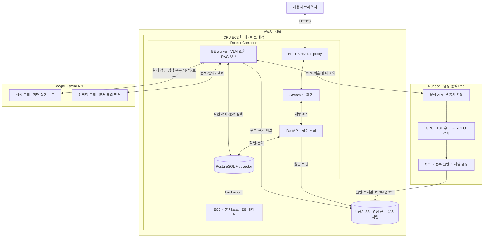
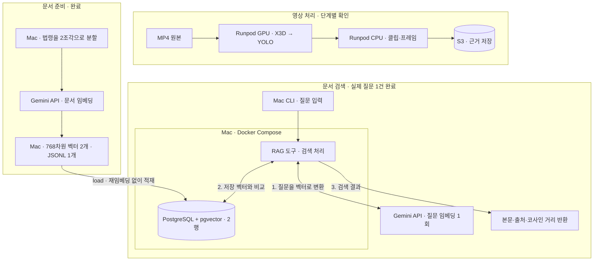
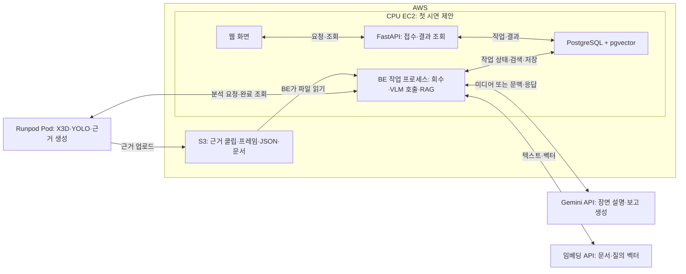
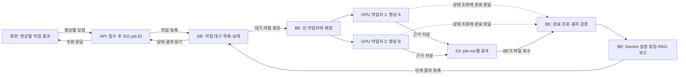
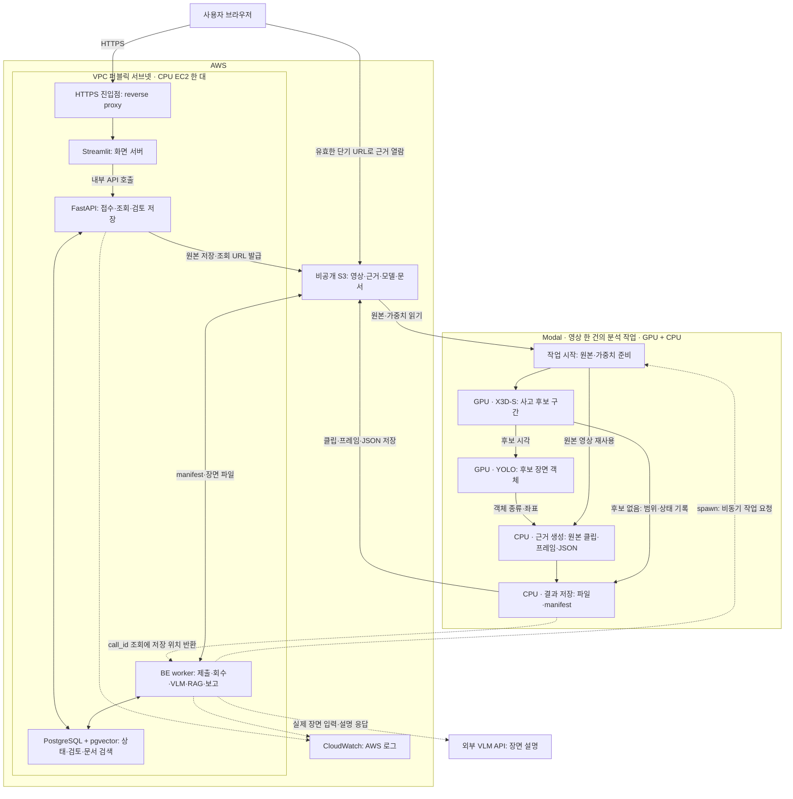

# 인프라 — AWS CPU 서비스·S3·Runpod GPU

## 2026-09-27 — 현재 클라우드에 배포된 범위

사용자 승인으로 **서울 EC2 t3.small 한 대 + SSH + Docker Compose PostgreSQL/pgvector + RAG 명령 도구**를 실제 배포했다. 기존 법령 벡터2행을 재임베딩 없이 옮겼고 본문/출처/768차원과 저장문서 자기검색을 검증했다. 아래 전체 서비스 그림의 화면·API·worker·VLM 연결은 아직 목표다.

IAM 역할 생성 권한이 없어 SSH 키와 현재 Mac IP /32 접속 방식으로 전환했다. t3.medium은 계정의 Free Tier 유형 제한으로 거부돼 허용된 t3.small(2vCPU/2GiB)을 사용했다. 기본 gp3 20GiB는 유지하며 전체 서비스 동시 처리 용량은 미검증이다. S3 자동 백업은 꺼져 있고 역할 연결 후 활성화·복원 시험할 예정이다. 기존 Runpod→S3 경로는 변경하지 않았다.

AWS 상태검사2/2 정상, DB healthy, 배포 후 Terraform plan 변경0. 현재 EC2는 실행 중이다. 새 Gemini 호출·BE/VLM/웹 통합·GitHub 게시를 수행하지 않았다. [운영·접속 안내](../../infra/terraform/cpu-rag/README.md) · [검증 원본](../../artifacts/infra/cpu-rag-ssh-20260927-01/verification.json).

## 2026-09-27 — Docker 배포 목표와 현재 실행 상태

사용자 요청에 따라 기존 규모를 유지한다. **AWS CPU EC2 한 대의 Docker Compose + 기존 Runpod + S3 + Gemini API**다. RAG는 BE worker의 문서 검색/근거 결합 코드이며, VLM과 임베딩 모델은 외부 Gemini API로 호출한다. 아래 목표 배치는 아직 EC2에 적용하지 않았다.

### 1. 클라우드 배포 목표

EC2의 Compose에는 HTTPS 진입점·화면·API·worker·DB를 둔다. API와 worker는 같은 BE 코드의 서로 다른 실행 명령으로 구성할 수 있다. 임베딩 적재 도구는 문서 추가/변경 시에만 실행한다. Gemini 생성 모델의 장면 설명과 보고 작성은 별도 호출이다.



- 현재 Runpod 입력 계약은 MP4 바이트다. 첫 BE 연결은 이 계약을 유지하는 그림이다. BE가 원본을 S3에 보관한 경우 읽어 전달한다. Runpod의 S3 원본 key 직접 읽기·S3 자동 트리거는 별도 후속 기능이며 위 그림에서 구현 완료로 표시하지 않는다.
- S3 파일 업로드/다운로드는 코드가 수행한다. S3가 영상을 자르거나 Gemini를 자동 호출하지 않는다. BE가 근거 bytes 또는 지원 업로드 방식으로 Gemini에 미디어를 전달한다.
- DB는 EC2 기본 디스크에 남기며 별도 DB EBS는 추가하지 않는다. S3의 DB 백업은 준비된 호스트 backup.py/timer가 담당한다. 그림에서는 백업·로그·관리 접속 선을 생략했다.
- API가 DB에 작업을 기록하고 worker가 처리하도록 연결할 예정이다. 별도 큐 서버를 도입하는 그림이 아니다. 현재 작업/알림 테이블과 BE 실행 코드는 후속 구현이다.
- 첫 사고 의심 알림은 VLM 설명/근거가 준비된 뒤 제공하고 RAG·보고는 후속 보강한다. 실패·미확인은 별도 상태로 처리한다.

### 2. 현재 실제로 확인된 처리

아래 묶음은 처리 단계별 구분이다. Gemini 노드는 모두 Google의 외부 API다. 영상 경로와 문서 검색 경로는 각각 확인했으며 이를 이어 주는 BE·VLM 통합은 아직이다.



확인 범위:

- Runpod 영상 분석·기존 결과를 이용한 CPU 근거 생성·S3 업로드 연결을 단계별로 확인했다. S3 연결 성공은 사용자 보고이며, 이 문서 작업에서 새 영상 통합 실행을 한 것은 아니다. 현재 전체 MP4 방식이고 실제 실시간 CCTV 버퍼는 미구현이다.
- 문서2청크의 실제 임베딩/로컬 DB2행 적재·값 검증/새 질문의 임베딩1회·검색 결과2항 반환은 저장 영수증으로 확인했다. [검색 영수증](../../artifacts/rag/local-db-v1/receipts/20260927T085025037875Z-search.json).
- 문서 준비 때 만들어 둔 벡터를 검색에서 재사용한다. 새 질문만 임베딩하고, 변경 없는 문서는 다시 임베딩하지 않는다. 동일 질문 캐시는 아직 없다.
- 현재 반환하는 것은 검색된 본문/출처다. 영상 근거를 읽는 VLM 호출, 장면 설명에서 검색 질의 만들기, 근거를 사용한 답변/보고 생성, 화면 표시를 연결하는 BE 작업은 남아 있다.
- 다음 연결 순서: **BE가 S3 근거 회수 → Gemini 장면 설명 → 설명을 포함한 첫 알림 → 질의 임베딩·문서 검색 → 보고 보강**. 모든 단계마다 서버를 추가할 필요는 없으며 위 한 EC2의 worker가 맡는다.

구현 근거: [Runpod 근거/S3 안내](../../apps/runpod_worker/S3_SETUP.md), [Compose DB와 실행 명령](../../infra/compose/rag/README.md), [RAG 코드](../../apps/rag_index/index.py), [현재 상태](../current_status.md). 이번은 배치도/흐름도 개정이며 자원 생성·모델/API 실행·GitHub 게시를 수행하지 않았다.

## 2026-09-27 — EC2 한 대의 Compose DB 구성

사용자가 Docker Compose 방식을 선택했다. **CPU EC2 한 대 안에 BE와 PostgreSQL+pgvector**를 두는 배치는 유지한다. 현재 준비한 컨테이너는 DB와 임베딩 명령 도구이며 BE/worker/화면은 후속 작업이다. Runpod는 영상 분석, S3는 파일·백업, Gemini는 모델 API 역할을 유지한다.

[CPU·DB Terraform 안내](../../infra/terraform/cpu-rag/README.md)의 초안은 서울 t3.medium/암호화 기본 gp3 20GiB다. 별도 DB EBS는 생성하지 않는다. DB 호스트 경로 `/srv/cctv/postgresql`을 컨테이너에 연결하고 포트5432는 공개하지 않는다. 앱은 같은 내부 네트워크에서 제한 계정으로 연결한다. 이전 직접설치·소켓인증·별도EBS 초안은 이력으로 보존했다.

[Compose 안내](../../infra/compose/rag/README.md)에 실행 순서가 있다. Mac ARM64에서 PG16.15/pgvector0.8.6으로 합성2행 저장·검색·권한·재생성 후 영속·dump복원을 확인했다. Python13시험과 Terraform fmt/validate·mock1회5조건도 통과했다. 실제 EC2 생성·cloud-init·Gemini 법령벡터·EC2/S3 백업복원은 아직이다. 기존 S3 state·인프라 GitHub 저장소는 변경하지 않았다.

다음은 계정/서브넷/AMI·권한·비용을 확인해 Compose용 실제 plan을 만드는 것이다. 로컬 기동 성공을 전체 CCTV 서비스 배포 완료로 표시하지 않는다.

## 2026-09-27 — Gemini·AWS 기준 서비스 이름과 역할

사용자는 Gemini와 AWS를 사용한다고 명시했다. AI는 Gemini API로 호출하고 AWS는 CPU 실행·파일/DB 보관을 맡는다. 기존 Runpod 영상 분석 구성을 변경한 지시는 아니다. 첫 시연의 EC2에 PostgreSQL을 함께 두는 제안을 유지하며 RDS는 관리형 DB를 선택할 때의 AWS 서비스다.

| 필요한 기능 | 서비스/소프트웨어 | 입력 → 출력 |
|---|---|---|
| VLM 장면 설명 | Gemini API의 영상 지원 생성 모델 | 후보 클립/프레임 → 관찰 설명. 최종 모델 ID 미정 |
| 문서·질의 임베딩 | Gemini API의 `gemini-embedding-001` | 법령 본문/검색 문장 → 벡터. 현재 준비 코드 프로필은768차원 |
| 보고 작성 | Gemini API의 생성 모델, 장면 설명 모델 재사용 가능 | 관찰 설명+검색 본문/출처 → 보고 초안 |
| BE·RAG 코드 실행 | Amazon EC2, CPU | FastAPI·별도 작업 프로세스가 모델 호출·검색·저장 연결 |
| 파일 보관 | Amazon S3 | 원본 문서·근거 영상/이미지·결과JSON |
| 본문·출처·벡터 저장/검색 | EC2의 PostgreSQL + pgvector | DB가 데이터를 저장하고 vector 확장으로 유사 문서 검색 |
| DB를 AWS 관리형으로 운영하는 대안 | Amazon RDS for PostgreSQL + pgvector | 위 DB 역할을 별도 관리형 인스턴스로 이전. EC2설치형과 선택 관계 |

pgvector는 DB 안의 확장이고, RAG는 EC2에서 실행할 처리 코드/흐름이다. 각각 가입할 별도 AI 모델 서비스로 취급하지 않는다. Gemini 생성과 임베딩은 같은 공급자의 서로 다른 모델 호출이며 별도 임베딩GPU를 구축하지 않아도 된다.

현재 [임베딩·적재 코드](../../apps/rag_index/README.md)는 `gemini-embedding-001`/768차원, 문서/질의 용도 구분과 정규화를 준비했다. SQL에는 `vector(768)`이 정의돼 있다. 최신모델로 자동변경하지 않았고 실제계정가용성/API/DB호출은 아직 확인하지 않았다. 모델 변경 시 입력 규칙·문서/질의프로필·기존 벡터 재생성을 함께 검토한다.

문서 준비: 법령 본문→EC2 처리 코드→Gemini 임베딩→PostgreSQL. 후보 처리: 실제근거→Gemini 설명→설명후첫알림→검색질의 임베딩→pgvector검색→본문/출처로보고작성. 서버의 API 비밀값과 AWS접근권한을 설정하되 키를 문서/화면에 노출하지 않는다.

공식확인: [Gemini 모델 목록](https://ai.google.dev/gemini-api/docs/models)·[임베딩과 차원](https://ai.google.dev/gemini-api/docs/embeddings)·[영상 입력](https://ai.google.dev/gemini-api/docs/video-understanding)·[RDS PostgreSQL 확장 버전](https://docs.aws.amazon.com/AmazonRDS/latest/PostgreSQLReleaseNotes/postgresql-extensions.html). RDS선택시엔진별지원버전을확인한다. 이번은서비스역할정리이며새리소스/DB설치/유료호출/모델실행0이다.

## 2026-09-27 — VLM·RAG를 클라우드에 배치하는 최소 구성

**첫 시연 제안은 AWS CPU EC2 한 대에서 웹·API·BE 작업 프로세스·PostgreSQL/pgvector를 실행하고, 기존 Runpod Pod와 외부 Gemini API를 연결하는 구성이다.** 현재 Runpod→S3 성공은 사용자 보고로 확인했으며 이 절의 EC2·DB·Gemini·RAG 통합 배포는 아직 실행하지 않았다.

| 배치 장소 | 실행·보관할 것 | 역할 |
|---|---|---|
| AWS EC2, CPU | Streamlit, FastAPI, 별도 BE 작업 프로세스 | 접수/조회, Runpod 결과 회수, Gemini 호출, 검색·보고 조립 |
| 같은 EC2의 PostgreSQL + pgvector | 작업·이벤트·보고·문서 본문/출처·벡터 | 서비스 데이터 저장과 문서 유사도 검색. DB는 영속 볼륨에 보관하고 백업 구성 |
| AWS S3 | 현재 분석 근거·JSON, 이후 원본 영상/문서 | 서버 간 미디어 공유와 재열람. 작업 요청은 BE가 담당 |
| 기존 Runpod A4000 Pod | X3D·YOLO·근거 생성 | GPU 영상 분석과 S3 결과 저장 |
| 외부 Gemini API | 장면 설명, 필요 시 보고 생성 | BE가 실제 미디어/텍스트를 HTTPS로 보내 모델 호출 |
| 외부 임베딩 API | 문서·검색 질의의 벡터 생성 | 첫 구성에서는 별도 임베딩 GPU 서버 없이 사용. 모델 ID/차원은 연결 전에 고정 |

EC2 안에서는 Docker Compose 등으로 프로세스를 나눌 수 있다. 이는 AWS CPU EC2 배포 제안이며 Runpod Pod 내부의 중첩 Docker 실행 지시가 아니다. 작은 문서 집합의 시연에서는 RAG를 BE 작업 프로세스의 Python 모듈로 두고 DB를 공유해도 된다. 이후 DB 운영을 분리할 때 RDS PostgreSQL과 해당 엔진의 pgvector 지원 버전을 검토한다. 인스턴스 크기·API 한도·비용 상한은 아직 정하지 않았다.



이 그림은 배치와 통신 관계다. 모든 화살표가 동시에 실행되거나 이미 구현됐다는 뜻은 아니다. 현재 Runpod 입력 API는 MP4 본문을 받는다. S3 원본 참조를 전달해 Runpod가 읽는 입력 방식은 추가 구현 대상이며, 기존 결과 S3 업로드 성공과 구분한다.

### 1. 시연 전 문서 준비

검토한 공식 문서/확보한 사례 → S3에 원본 보관 → 본문 추출·문단 분할 → 임베딩 API → PostgreSQL에 본문/제목/출처/버전과 벡터 저장. pgvector는 별도 저장소가 아니라 PostgreSQL의 벡터 열과 검색을 지원하는 확장이다. [한 행에 저장되는 데이터 예시](vlm_rag.md)를 참고한다. 문서가 바뀔 때 갱신하고 사고마다 전체 문서를 다시 임베딩하지 않는다. 문서·질의는 호환되는 같은 임베딩 모델/차원/용도 설정을 사용한다. [Gemini 임베딩 문서](https://ai.google.dev/gemini-api/docs/embeddings)·[pgvector 공식 저장소](https://github.com/pgvector/pgvector).

### 2. 사고 후보 한 건의 처리

1. BE 작업 프로세스가 Runpod 완료 상태와 S3 manifest를 확인하고 실제 근거 클립/프레임·원본 시각·탐지 결과를 회수한다.
2. BE가 미디어 bytes 또는 Gemini의 지원 업로드 방식을 사용해 첫 VLM 호출을 수행한다. `s3://...` 문자열을 전달한 것만으로 Gemini가 비공개 객체를 읽는다고 가정하지 않는다. 업로드 처리 완료/실패도 확인한다. [Gemini 영상 입력](https://ai.google.dev/gemini-api/docs/video-understanding).
3. BE가 설명 구조·근거 연결·불확실성을 검증하고, 사용자 선택대로 **VLM 설명과 함께 첫 사고 의심 알림**을 제공한다. 실패/불확실은 검토 대기로 남긴다.
4. 장면 설명으로 검색 질의를 만들고 임베딩 API를 호출한 뒤 pgvector에서 관련 문서 조각을 검색한다. PostgreSQL/pgvector가 스스로 Gemini를 호출하지 않으며 순서는 BE 코드가 연결한다.
5. 장면 설명 + 검색된 **문서 본문·출처**를 Gemini에 두 번째로 보내 보고 초안을 만들거나, 기존 제안대로 고정 보고 양식에 조립한다. 숫자 벡터 자체를 보고 문맥으로 보내지 않는다.
6. 결과·문서 출처·모델/프롬프트/검색 버전을 DB에 저장하고 화면은 FastAPI에서 조회한다. RAG 실패는 장면 설명과 별도 상태로 표시한다.

### BE 실행·배포 기준

- 긴 처리는 웹 요청과 분리한 작업 프로세스가 맡는다. 첫 시연에는 DB 작업 목록을 사용할 수 있고 별도 Redis/Celery가 필수는 아니다. 단계별 상태·타임아웃·재시도 상한·job/run/event별 중복 방지를 구현한다.
- GPU 작업 종료 후 BE가 VLM/RAG를 수행하므로 영상 A의 설명을 기다리는 동안 Runpod는 영상 B를 분석할 수 있다. 외부 API 호출 동시 수는 별도로 제한한다.
- Gemini/API 비밀값은 BE 서버에서 관리한다. 화면은 BE만 호출하고 S3는 비공개로 유지한다. EC2의 S3 접근에는 인스턴스 역할을 사용하고 DB 포트는 내부에 둔다. 서비스 외부 진입과 공급자 API 연결은 HTTPS로 구성한다.
- 다음 구현 한 가지는 **기존 성공 영상의 S3 근거 한 건→BE→Gemini→구조화된 설명 저장·화면 표시**다. 그 흐름을 확인한 뒤 소수의 검토 문서를 색인해 출처 있는 검색/보고를 연결한다. 이번에는 배포·설치·API 호출·모델 실행을 하지 않았다.

## 2026-09-27 — 여러 영상의 비동기 처리·병렬 실행·시연 계획

**현재 기준은 Runpod A4000 Pod의 비동기 API이며 GPU 분석은 한 번에 한 건이다.** Modal은 앞선 설계 대안이다. 최신 재개 요약에는 사용자가 Runpod→S3 연결 성공을 보고한 것으로 기록되어 있다. 이번에는 원격 연결·여러 영상 처리·Gemini까지의 통합을 새로 실행하지 않았다.

### 비동기와 병렬의 차이

- 비동기 접수: 파일/작업을 등록한 뒤 `202 + job_id`를 반환하고 화면이 상태를 조회한다. 분석 완료를 기다리는 동안에도 화면과 다른 요청은 진행한다.
- 병렬 분석: 서로 다른 영상의 모델 연산이 동시에 진행된다. 작업자 수·GPU 메모리·처리량에 맞는 실행 구조가 필요하며 `async def`만 추가해 GPU 처리 능력이 늘지는 않는다.
- 단계 겹치기: 영상 A의 GPU 작업이 끝나 Gemini 설명을 기다리는 동안 영상 B는 GPU에서 분석한다. GPU 한 대의 한 건씩 실행 구조에서도 BE 후속 처리를 분리하면 이런 겹침을 만들 수 있다.

현재 [service.py](../../apps/runpod_worker/service.py)의 `Jobs.start`는 소비 작업 하나를 만들고 `consume`은 한 작업의 분석·S3 저장·결과 ZIP 처리가 끝난 뒤 다음 작업을 가져온다. 기본 `max_active=2`는 업로드 중/대기/실행을 합쳐 두 건까지 접수한다는 뜻이며 GPU 동시2가 아니다. 한 건 실행·한 건 대기 상태에서 추가 요청은 `429 queue_full`이다. 재시작 때 미완료 작업은 `failed/service_restarted`로 기록하며 자동 복구 큐는 아직 없다.

### 실제 병렬이 필요할 때의 구성 예

아래는 **파일 분석 작업자2개로 확장한 목표 예시**다. 현재 생성된 GPU 자원을 나타내지 않는다. 각 작업자는 영상 한 건의 X3D-S→YOLO→근거 생성·저장을 수행한다.



작업자2개가 A/B를 처리 중이면 영상 C는 BE의 DB 대기 목록에 둔다. 끝나는 순서대로 해당 job/run 화면을 갱신하며 A가 늦어져도 B의 결과를 기다리게 하지 않는다. S3 저장 알림이 BE를 자동 기동한다는 뜻은 아니며 별도 완료 조회와 검증을 유지한다.

| 실행 방식 | 병렬 확장 방법 | 현재와의 차이 |
|---|---|---|
| 현재 Runpod Pod | 기존 GPU 동시1 유지. 실제 두 영상 동시 연산이 필요하면 Pod/작업자를 추가하고 BE가 배정 | 한 Pod가 자동으로 두 대가 되지 않음. 추가 자원/배포 필요 |
| Runpod Serverless 대안 | 작업자 이미지·handler를 배포하고 Max workers=2 등 상한 설정, 한 작업자에 한 작업부터 시작 | 현재 Pod API를 Serverless 계약으로 연결하는 작업 필요 |
| Modal 대안 | 영상마다 `spawn`, 기본 컨테이너당 입력1 + `max_containers=2`로 상한 설정 | 현재 Runpod에서의 공급자 변경·배포 연결 필요 |
| 한 GPU에서 여러 영상/카메라 | 모델을 유지한 채 시간 창을 번갈아 처리하거나 배치화, 영상별 상태 분리 | 메모리·지연 측정과 스케줄러 구현이 먼저 필요 |

상한2는 최대 허용치이며 항상 즉시 작업자2개가 준비된다는 보장은 아니다. 계정 한도·GPU 가용성·초기 모델 로딩과 비용을 함께 확인한다. 동시 처리 수 증가가 총 처리 시간을 정확히 절반으로 만든다고 가정하지 않는다. [Modal 확장](https://modal.com/docs/guide/scale)·[컨테이너별 동시 입력](https://modal.com/docs/guide/concurrent-inputs)·[Runpod 작업자 상한](https://docs.runpod.io/serverless/endpoints/endpoint-configurations).

### BE·화면 연결 기준

1. 영상마다 서비스 job/run과 provider job을 연결하고 결과 경로·영상 SHA·모델 프로필을 분리한다. 동시에 끝나도 결과가 섞이지 않게 한다.
2. BE의 대기 작업은 DB에 남긴다. dispatcher는 DB에서 작업/가용 실행 슬롯을 원자적으로 점유하고 여러 GPU 요청을 제출한다. 한 작업의 최종 완료를 기다리는 루프로 모든 제출을 막지 않는다. 첫 시연에는 기존 DB 작업 목록을 활용할 수 있어 Redis/Celery 추가가 필수는 아니다.
3. Runpod의 명확한 `429 queue_full`은 BE 대기로 남겨 여유가 생긴 뒤 제출한다. 응답 유실로 접수 여부가 불명확한 요청은 중복 방지 계약에 따라 조사하며 무조건 재제출하지 않는다.
4. 완료 회수와 Gemini/RAG 실행을 GPU 작업 배정과 분리한다. 외부 API 호출 동시 수·재시도 상한도 따로 둔다. GPU 성공과 서비스 보고 완료는 별도 상태다.
5. 화면은 API에서 영상별 상태를 주기적으로 조회한다. 첫 시연의 조회 간격은 1~2초를 제안하며 오류/제한이 있으면 늦추고 완료된 작업의 조회를 멈춘다. 조회 갱신으로 새 분석 POST를 만들지 않는다. 서버의 실제 상태 enum은 [공통 계약](../contracts/service_contract.md)을 따른다.
6. 사용자가 선택한 **VLM 설명 후 첫 사고 의심 알림**을 유지한다. 설명 준비 중에는 처리 상태를 표시하고, VLM 실패·불확실이면 후보를 보존해 검토 대기로 둔다. 알림 채널은 별도 미정이다.

### 시연은 다음 순서로 준비

| 단계 | 준비·구현 | 보여줄 장면과 확인 |
|---|---|---|
| 1. 한 영상 연결 | 기존 성공 원본·모델 프로필 고정. Runpod 결과/S3 근거→BE→Gemini→설명 포함 알림·검토 화면 연결 | 실제 근거가 올바른 원본/시각인지, 설명 실패를 구분하는지 확인 |
| 2. 두 영상 비동기 접수 | 한 GPU 유지. 두 개의 서로 다른 job으로 접수하고 BE/화면에서 각각 상태 조회 | A 분석 중·B 대기, A 설명 처리와 B 분석의 겹침, 재조회 시 중복 실행 없음. 이 단계는 GPU 동시 분석 성공으로 표시하지 않음 |
| 3. 병렬 필요 시 두 작업자 | 자원/상한을 정해 작업자2개와 BE 배정 연결. 3번째 요청은 BE 대기 | A/B의 실제 추론 실행 시간이 겹치는지, C가 빈 작업자로 넘어가는지, 한 건 실패가 나머지를 막지 않는지 확인 |
| 4. CCTV 재생 시연 | 먼저1개 MP4를1배속으로 공급, 도착 프레임만 추론하고 FE와 같은 세션 시계 사용. 이후2개로 확장 | 카메라별 재생/처리 시각·근거 대기·설명·알림, 처리 지연·누락·버퍼 범위를 표시 |

여러 CCTV의1배속 시연은 전체 파일 작업 큐에 영상을 넣는 것만으로 구현되지 않는다. `stream_id`별 원본 버퍼·X3D 입력 창·후보 상태를 분리하고, 한 GPU라면 준비된 창을 번갈아 처리한다. 예를 들어 두 카메라가 각각1초마다 창을 만들면 초당 두 입력 창을 지속적으로 처리할 수 있는지 측정해야 한다. 뒤처지면 지연/누락을 드러내고 영상의 미래 프레임을 앞당겨 읽지 않는다. 파일/시크/루프 변경은 세션을 분리한다. 현재 배포 API는 전체 MP4 분석이며 이 재생·다중 카메라 연결은 추가 구현 대상이다.

비교 기록은 같은 영상 목록·가중치·전처리·GPU 조건에서 접수/대기/모델 준비/분석/근거 저장/Gemini/알림 표시 시간을 나눠 남긴다. GPU별 피크 메모리, 결과 원본 일치, 실패/재시도·중복 여부도 확인한다. 짧은 한 영상의 기존 전체 작업 시간을 다중 카메라 처리량이나 실시간 알림 지연으로 환산하지 않는다.

**이번 완료는 설계·시연 순서 정리다.** 기존 GPU 동시1·max_active2는 변경하지 않았으며 새 자원·부하 시험·모델 호출·배포는 실행하지 않았다. 첫 구현 대상은 한 영상의 S3 근거 회수→Gemini 설명→화면 연결이며, 병렬 자원 확장은 그 흐름을 검증한 뒤 필요에 맞춰 진행한다.


## 2026-09-27 최신 구현: Runpod 근거·S3

Runpod worker의 전후 클립·PNG/evidence.json 생성과 선택적 S3 업로드 코드/로컬 검사를 완료했다. 기본 local 모드이며 실제 버킷은 아직 없다. [실행·S3 권한·BE 전달 계약](../../apps/runpod_worker/S3_SETUP.md)을 따른다. BE는 status의 s3.manifest_key→원격 manifest→evidence.json과 미디어를 회수하고 Gemini API를 호출한다. 원격 manifest가 완료 marker다. 후보 첫 알림은 설명과 함께 전달하는 사용자 선택을 유지한다. 실제 Runpod 새버전/S3/BE/Gemini/재생 시연 통합은 미검증이다. 아래 과거 미구현/Modal 상태는 이력이다.


## 2026-09-27 현재 아키텍처와 전달 기준

### 버퍼 처리와 근거 보관의 구분

CCTV 재생 입력은 최근 구간만 유지하는 영상 버퍼에서 X3D/YOLO로 공급할 수 있다. 후보가 나오면 필요한 전후 원본 장면을 별도로 확보하고 후행 프레임이 도착할 때까지 유지한다. 전달물의 `StreamingDetector` 프레임 큐는 추론용이며 서버의 전후 근거 버퍼·인코딩·전송은 별도 구현이다. 현재 배포 API는 전체 MP4 파일 분석이며 이 버퍼 경로에 연결되지 않았다.

근거 생성은 로컬 디스크에 MP4/JPG를 먼저 저장해야 한다는 뜻이 아니다. 메모리에서 인코딩한 미디어 bytes를 S3에 업로드하거나 BE로 전송할 수 있다. 다른 서버는 Runpod 메모리 참조를 직접 읽을 수 없으므로 실제 bytes 또는 S3 asset 참조가 필요하다. Gemini의 지원 크기 안에서는 BE가 inline 미디어로 호출할 수 있다. 현재 서비스의 추천은 **버퍼로 분석하고 후보의 근거만 S3에 보관**하는 방식이며, 기존 S3→BE→Gemini 연결 순서는 유지할 수 있다. 버퍼만 사용하는 시험도 가능하지만 프로세스 종료 후 재열람/재시도에 쓸 근거는 별도 보관해야 한다. 아직 구현·미디어 생성·Gemini 호출은 하지 않았다.

### 속도·효율 선택 기준

현재 시연에는 최근 구간을 버퍼에서 분석하고 후보 근거만 S3에 보관하는 구성을 추천한다. 버퍼는 로컬 파일 쓰기/재읽기를 생략할 수 있지만 디코딩·인코딩·모델 추론·네트워크 지연을 없애지는 않는다. 원본 프레임을 오래 유지하면 CPU RAM 사용이 커지므로 보관 시간·해상도·동시 후보 수를 제한하고 후보 구간은 처리 종료 전 덮어쓰지 않게 한다.

기존 S3→BE→Gemini 순서는 공유·회수·실패 재시도가 단순한 초기 연결안이다. 속도 최적화 대안은 인코딩한 후보 bytes를 BE에 한 번 보내고 BE에서 Gemini 요청과 S3 보관을 병행하는 것이다. 이 대안은 아직 채택/구현하지 않았으며 전송/보관 상태와 실패 처리가 추가로 필요하다. 영구 근거 링크를 알림의 조건으로 두면 Gemini와 S3 양쪽 완료를 확인해야 한다. S3/Gemini 병행이 모든 네트워크 조건에서 더 빠르다고 보장하지 않는다.

비교할 시간은 입력/후행 장면 대기, X3D/YOLO, 인코딩, 전송/저장, Gemini 응답, 알림 표시로 나눈다. 같은 원본·후보 범위·해상도/FPS·모델/프롬프트·동시성에서 비교한다. 이번에는 공식 입력/저장 문서 확인만 했으며 속도·RAM·비용 비교를 실행하지 않았다. 한 번 적재한 모델 재사용, 후보 근거만 전송, 중복 Gemini 호출 방지부터 적용할 최적화로 제안한다.

### 담당자 간 교환 항목·CCTV 재생 시뮬레이션 — 후속 설계 제안

사용자는 담당자별 구현/교환물, VLM에 추가할 정보, 녹화 영상으로 CCTV 사고 판단·알림을 재현하는 방법을 물었다. 후속으로 **VLM 설명과 함께 사고 의심 후보를 알리는 순서**를 선택했으므로, 앞선 에이전트의 후보 선알림 제안은 철회한다. 아래에서 **사용자는 현재 Runpod 분석을 준비한 담당자**를 뜻한다. 사람 이름별 배정이나 새 클라우드/모델 실행을 완료한 기록이 아니다. 알림 채널은 아직 미정이며 설명 예시는 관제 화면 기준이다.

| 담당 | 구성할 것 | 사용자가 받을 것 | 사용자가 줄 것 |
|---|---|---|---|
| 사용자 · 모델/Runpod | 기존 X3D/YOLO, 후보 프레임·클립 생성, S3 입출력. 재생 시연을 위해 순차 입력과 실행 중 후보 출력 추가 | BE의 입력/결과 계약, 등록 영상 참조·실행ID, 인프라 S3 설정, VLM의 장면 입력 규격 | 인증된 GPU API 주소·호출 예제, 모델/전처리 버전, 후보시각·박스JSON, 원본 근거·manifest 참조, 시간·오류·사용량 |
| BE | 영상 등록·시연 세션/작업 제어, Runpod 제출·회수, DB·이벤트 중복 방지, 알림 조회 API, VLM/RAG 순서 | `source_video_id/job_id/run_id`, 시연 시계·stream/session ID, 원본 S3 객체와 SHA, 결과 필드·실행 중 후보 계약 | 현재 API/샘플 결과와 이후 근거 파일·manifest. 실제 앱 토큰은 BE 서버 비밀 설정으로 전달 |
| 인프라 | 비공개 S3, prefix별 접근권한, EC2/Runpod 네트워크·시작/복구·로그 | 버킷·리전·원본/모델/결과prefix, Runpod에서 S3를 읽고 쓸 인증 공급 방식, 모델/토큰 복원 설정 | 필요한 객체 읽기/쓰기 범위, 포트8000·필요 환경변수 이름, 모델/코드 묶음·한도·시작/검사 명령 |
| VLM/RAG | 선택 VLM 입력 어댑터·프롬프트·응답검사, 문서 검색·출처·보고 | 지원 영상/복수이미지 형식, 길이/해상도/프레임 수/파일크기 제한, 원하는 전후 문맥, 반환 JSON·실패 형식 | BE를 통해 후보별 실제 장면·원본 시각·객체 메타데이터·근거ID·불확실성. 실제 VLM 키는 BE/VLM 서버 쪽 설정 |
| FE | 같은 원본 재생, 분석 지연/상태, 의심 알림·근거·후속 설명 표시 | BE와 합의한 표시 항목·재생 제어/알림 동작, 시연 화면 피드백 | BE가 제공하는 상태/알림/asset API 기준과 실제 결과 샘플. 브라우저에 GPU 앱/S3 장기 자격증명은 전달하지 않음 |
| QA/통합 | 정상/사고/손상 입력·중복/지연/재시작·누락 시나리오 검수 | 시연할 기존 영상의 허용 범위·실제 사고시각 검수, 연결/품질 합격 기준 | 모델·설정·목록·실행기록·원본장면·오류/지연 측정. 기능 성공과 정확도를 구분 |

먼저 받아야 할 항목은 **BE의 입력/결과 필드, 인프라의 S3 버킷/리전/권한, VLM 담당의 장면 규격**이다. 현재 줄 수 있는 항목은 Runpod API/인증 방식·고정 모델/코드·검증된 한 건 결과다. 근거 미디어·S3 manifest·순차 후보 이벤트는 구현 후 전달한다. 자격증명 실제 값은 공개 문서·채팅에 넣지 않는다.

#### 영상은 어디서 오는가

**권고하는 시연은 ‘녹화 영상의 시간순 분석’이다.** 실제 카메라가 없어도 MP4를 재생 시간에 맞춰 공급하고, 그 시점까지의 프레임으로 후보를 찾는 흐름을 보여줄 수 있다. 실제 카메라/RTSP 운영 검증과는 구분한다. S3에서 파일을 가져오는 준비 작업과 관객이 보는 재생/분석 시작은 별도 단계다.

| 시점 | 입력·서버 처리 | 관객이 보는 동작 |
|---|---|---|
| 시연 전 준비 | 보유 MP4 등록. 현재는 Runpod 임시 디스크에 한 번 업로드하고 원본 SHA·영상 식별자를 연결할 수 있음. S3 연결 후에는 미리 다운로드해 준비. 모델 적재도 이 단계에서 수행 | 영상 목록과 준비 상태 |
| 시연 시작 | BE가 준비된 `source_video_id`와 새 `run_id/stream_id`, 재생 속도 1.0을 연결해 재생 세션 시작. MP4 전체를 매번 다시 전송하지 않음 | 선택 영상 재생과 분석 진행 표시 |
| 재생 중 | 공급기가 원본 PTS와 세션 시계에 맞춰 도착한 프레임만 원본 버퍼·X3D로 전달. 후보 장면에 YOLO 실행, 후행 근거 확보와 Gemini 호출은 별도 처리 | 영상은 계속 재생. 설명 완료·알림 조건 충족 뒤 사고 의심 설명과 근거 표시 |
| 영상 끝/교체 | 남은 후보 처리 상태와 부족한 후행 근거 기록. 새 파일은 새 세션/버퍼/후보 상태로 시작 | 세션 종료 또는 다른 시나리오로 전환 |

현재 추천은 한 영상·한 카메라·1배속 시연부터다. 짧은 영상 여러 개는 별도의 시나리오로 선택하거나 재생 목록으로 관리한다. 파일 전환 경계를 하나의 연속 사고 입력 창에 섞지 않는다. 영상 시작/끝에 없어 확보할 수 없는 전후 문맥은 부족하다고 기록한다. 짧다는 이유로 정상/사고 장면을 임의로 이어 붙여 하나의 실제 CCTV 원본으로 표시하지 않는다.

처음부터 S3가 있어야 이 시연이 가능한 것은 아니다. 이미 업로드한 Runpod MP4로 재생 공급·분석 연결을 만들 수 있고, S3는 이후 원본/근거 보관과 재시작 복원에 연결한다. 웹 화면과 모델 공급기는 같은 원본·세션 시계를 사용해야 한다. 두 프로세스를 따로 재생시키고 시각을 맞춘 것으로 가정하지 않는다. 실제 1배속 처리 가능 여부·지연/누락·Gemini 응답 시간은 새 연결에서 측정한다.

첫 시연에는 **지금 보유한 정상/사고 MP4를 가상 CCTV의 입력**으로 등록한다. T9/Drive는 사용자 설명상 같은 보유 자료이며 새 외부 다운로드를 선행하지 않는다. 이미 한 건 분석한 MP4부터 연결용으로 쓸 수 있다. 공개/발표용 사용 여부와 미노출 최종평가 제외를 확인하고, 정답은 QA에만 둔다. 자료의 사고 파일명·정답시각을 모델 입력 선택에 쓰지 않는다.

목표 영구 보관 위치는 비공개 S3, 공급 주체는 **시간에 맞춰 프레임을 내보내는 재생 공급기**다. Runpod의 CPU 프로세스가 준비된 MP4를 읽고 GPU에 전달해 프레임별 외부 HTTP 전송을 피한다. BE는 시작/정지·세션 상태를 제어하고 FE는 같은 원본·세션 시계로 표시한다. 미리 파일을 내려받는 것은 입력 준비이며 영상 전체를 미리 추론한다는 뜻이 아니다.

실제 CCTV로 확장하면 등록한 파일 대신 권한 있는 카메라/영상관리시스템의 스트림 수신부가 입력을 공급한다. 지금 시연에 RTSP 서버나 실제 카메라를 먼저 구축할 필요는 없다. FFmpeg의 `-readrate 1`/`-re`는 파일 입력을 재생 속도로 제한할 수 있는 공식 수단이지만, 초기 구현은 Python 재생 시계로도 가능하다. [FFmpeg 입력 속도 문서](https://ffmpeg.org/ffmpeg.html#Advanced-options). 실제 설치/송출은 미실행이다.

#### 알림을 내는 순서

1. BE가 등록된 원본과 별도의 `run_id/stream_id`로 시연 세션을 시작한다. 첫 시연은 한 카메라·1배속·시작/정지부터 제안한다. FE와 공급기가 같은 세션 시계를 쓰고 별도 시크/루프가 과거 상태를 재사용하지 않게 한다.
2. Runpod CPU 공급기가 현재까지의 원본 프레임/시각을 순서대로 전달한다. GPU는 완성된2초 창을1초 간격으로 분석하고 같은 모델을 세션 동안 유지한다. 늦어지면 처리 지연/누락을 기록하며 미래 프레임을 당겨 분석하지 않는다.
3. X3D 후보가 나오면 해당 원본 장면에 YOLO를 실행하고, **후보·객체 결과를 내부 처리 데이터로 BE에 연결**한다. 이때 사용자 사고 알림은 아직 보내지 않는다. 영상 재생 도중 후속 처리를 하려면 최종ZIP을 기다리는 현재 API에 후보/근거 준비 상태·순번·중복 방지 연결을 추가해야 한다.
4. 같은 Runpod의 원본 버퍼가 필요한 전후 장면을 확보해 클립/프레임을 만든다. S3 저장·manifest 검증 뒤 BE가 실제 장면과 객체정보를 VLM에 전달한다. 후행 장면이 아직 도착하지 않았다면 `evidence pending`, VLM 응답 대기 중이면 `vlm pending`으로 기록한다.
5. VLM이 장면 설명·사고 의심 평가·불확실성을 반환하면 BE가 응답 형식·근거·실행ID를 검사하고 합의한 알림 조건에 따라 **설명과 근거가 포함된 사고 의심 알림**을 생성한다. RAG/최종 보고는 그 뒤 보강하는 것을 제안한다. BE의 정책 판단과 사람의 사고 확정을 구분한다. VLM 실패/불확실은 원본 후보를 보존한 검토 대기로 두며 자동으로 정상 판정하지 않는다. 세부 실패/재검토 정책은 공통 계약 초안에 기록한다.

이번 완료 파일의 예: 첫 양성 창은2–4초, 대표시각3초다. 재생 시연에서 같은 창이 양성이라고 가정하면 **4초 입력 도착+추론/YOLO 이후 내부 후보**가 나온다. 예를 들어 근거 규격을 후보 전2초/후3초로 정하면1–6초 클립이므로6초까지 도착한 뒤 VLM에 보낼 수 있다. 실제 알림은 여기에 클립생성·전송·VLM·BE검증 시간을 더한 뒤다. 3초에 이미 판단/알림했다고 표시하면 안 된다. 전후 길이는 예시이며 VLM 담당과 합의할 설정이다. 원본 끝에 닿으면 실제 사용 범위/부족한 문맥을 표시한다. 이 순서는 설명을 함께 주는 대신 첫 알림 지연이 커진다는 선택이다.

#### 지금 코드와의 차이

- 배포된 `worker.py`는 `pipeline.analyze_video()`로 전체 파일을 처리하고 결과ZIP을 만든다. 실제 받은 성공9.84초를 재생 중 알림 지연으로 사용하지 않는다.
- 전달물의 `streaming.py`에는 `StreamingDetector.push()`가 있다. 완성된2초 창/1초 간격·연속 양성 중 첫후보 출력 구조이나 현재 HTTP API에 연결돼 있지 않다.
- `streaming_demo.py`는 `frame_index/fps`로 시각을 붙여 가능한 빨리 읽는다. 1배속 공급·PTS 검증·원본 전후 버퍼·S3·중간 이벤트 네트워크/알림을 구현한 상태가 아니다.
- 전체 파일 방식은 마지막2초 창을추가한다(이번6.6–8.6초). 순차 방식은완성된정규창만처리하며EOF정책이별도로필요하다. batch8과batch1 차이도있어같은결과·속도를검증없이보장하지않는다.
- 원본 후행 장면은 설명용으로만 추가한다. 최초 탐지에 사용한 입력 범위/시각·BE 수신 시각·화면 표시 시각을 따로 기록해야 시연의 실제 지연을 확인할 수 있다.

현재 다음 구현 범위는 **근거파일/S3 전달 계약에 재생 세션·실행 중 후보 전달을 함께 정하는 것**이다. 순차 재생 분석·알림 서비스·실제 카메라 연결은 아직 미구현이다.

사용자가 선택한 **A4000 Runpod Pod에서 분석 한 건 succeeded**를 보고했다. 기존 AWS CPU·S3·DB·외부 VLM 역할을 유지하고, 외부 GPU 실행 부분을 Runpod Pod의 인증된 비동기 HTTP API로 연결한다. 아래 Modal 배치도와 SDK 설명은 이전 설계 기록이다. 현재 Runpod API와 이후 S3 입력 계약은 [공통 계약 상단](../contracts/service_contract.md)을 따른다.

### 현재 확인된 범위

- 사용자 성공 작업 `fd20cca0be53483696e6704e7c985b84`: 입력5,407,190bytes, 작업 시작부터 완료까지9.844538초. 모델 로딩·영상 검사·JSON/ZIP 처리까지 포함한 작업 시간이며 순수 GPU 시간/업로드 포함 전체 지연/정확도 수치가 아니다.
- 후속 결과해제폴더5파일을 접수해30일관성검사를 통과했다. 8.6초/25FPS/215프레임·X3D8창(양성6)→후보1개, 후보범위2.0–8.6초/대표3.0초, YOLO Car박스3개다. 세박스의IoU는0.411–0.692로 실제3대인지/중복탐지인지는 원본장면검수가 필요하다. 분석·JSON4.832초, 계측worker5.903초, PyTorch피크할당341.065MiB/예약420MiB이며 장치전체사용량은 아니다. [사용자 수신 상태](../../artifacts/runpod/a4000-20260927-01/received/fd20cca0be53483696e6704e7c985b84/status.json)·[파일 검증](../../artifacts/runpod/a4000-20260927-01/received/fd20cca0be53483696e6704e7c985b84/verification.json)·[보존한 실제 result.json](../../artifacts/runpod/a4000-20260927-01/received/fd20cca0be53483696e6704e7c985b84/outputs/result.json)을 참고한다. 원본영상/실제충돌시각/PTS는 미검수다.
- HTTP8000/8888 Ready와 Pod 안의 인증 요청·추론 완료를 확인했다. 외부 AWS BE에서 인증한 HTTPS 호출은 아직 미검증이다. 저장소는 임시 Container disk이며 실제 S3 저장은 없다.

### 기존 아키텍처에 맞춘 책임
 
| 위치·구성 | 담당 처리 | 현재 연결할 내용 |
|---|---|---|
| AWS reverse proxy·Streamlit·FastAPI | 사용자 접수·상태 조회·근거 열람·검토 | 사용자 요청은 AWS 서비스로 받음. UI에 Runpod 앱 토큰을 전달하지 않음 |
| AWS BE worker | Runpod 요청·상태 조회·결과 회수, VLM/RAG·보고 진행 | 가장 먼저 Runpod API 명세와 실제 결과 샘플을 받을 대상 |
| PostgreSQL + pgvector | 서비스 job/run·provider_job_id·후보·검토·문서 검색 | Runpod 앱의 job_id와 서비스 job_id/run_id를 구분해 저장 |
| Runpod Pod · GPU | X3D-S 구간 분석→후보 장면 YOLO 객체 | 제공한 모델·전처리 유지. 영상 한 건씩 분석 |
| 같은 Runpod Pod · CPU/파일 처리 | 원본 읽기·근거 클립/프레임·JSON/manifest 생성·S3 저장 | JSON은 구현됨. 근거 미디어와 S3 입출력은 추가 구현 대상 |
| 비공개 S3 | 원본·모델·근거·분석 결과·문서 보관 | API가 원본 저장, Runpod이 원본 읽기/결과 쓰기, BE가 결과 검증·등록 |
| 외부 VLM·AWS RAG | 실제 후보 장면 설명·문서 검색·보고 | BE가 GPU 결과를 회수한 뒤 실행. GPU Pod에 VLM/RAG 대기를 맡기지 않음 |

목표 흐름: **사용자→AWS API→S3 원본/DB 작업→BE worker→Runpod 분석·근거 생성→S3 결과→BE 검증·DB 등록→VLM/RAG→화면**. S3 저장만으로 BE의 다음 단계가 자동 실행되지는 않는다. 현재 첫 분석은 S3를 거치지 않고 MP4 바이트를 Runpod에 직접 보냈다.

### 누구에게 무엇을 넘기나

| 전달 대상 | 전달할 내용 |
|---|---|
| BE 담당 | Port8000 HTTP Service 주소, 앱 인증 방식, 현재 API 요청/상태/결과 계약, 성공 결과 ZIP, 제한/실패 사례. 실제 토큰은 서버 비밀 설정으로 전달 |
| 인프라 담당 | 사용할 S3 버킷·리전·원본/모델/결과 prefix, 접근 주체별 권한, Runpod 앱 시작·재시작/환경 복원 절차. 버킷/권한은 아직 설정하지 않음 |
| 모델 담당 | 현재 고정 코드/두 모델, result/runtime의 입력 SHA·환경·시간·메모리 확인, 후보/원본 장면 대조 |
| VLM/RAG 담당 | BE가 등록한 후보 ID·원본 시각·객체 JSON·실제 근거 장면. 상태 JSON 하나로 VLM 입력을 대신하지 않음 |
| FE 담당 | AWS API의 진행 상태·근거 asset URL·보고/검토 계약. Runpod을 브라우저에서 직접 호출하는 방식은 현재 아키텍처에 넣지 않음 |

### 구현 순서와 인수 조건

1. **완료된 결과를 회수·검증한다.** 아래 명령은 새 추론 없이 기존 ZIP을 내려받는다. 기존 같은 이름의 파일이 있으면 클라이언트가 덮어쓰기를 거절한다.

   ```bash
   cd /workspace/cctv-runpod-a4000
   .venv/bin/python client.py result --job fd20cca0be53483696e6704e7c985b84
   ```

   위 명령을 그대로 실행하면 ZIP은 **Runpod 안의 `/workspace/cctv-runpod-a4000/fd20cca0be53483696e6704e7c985b84-results.zip`**에 저장된다. Mac으로 자동 다운로드되는 것은 아니다. JupyterLab 왼쪽 파일 목록에서 `/workspace` 아래 `cctv-runpod-a4000` 폴더를 열고 새로고침한 뒤 해당 ZIP을 우클릭→Download한다. Jupyter 시작 위치가 이미 `/workspace`라면 폴더만 열면 된다. 이번 한 건은 사용자가 해제폴더를 제공해 JSON/manifest/runtime 검증을 완료했다. 같은 다운로드/추론을 반복할 필요가 없다.
2. **근거 생성과 S3 입출력을 구현한다.** 등록된 원본 참조와 결과 prefix를 전달하는 새 GPU 요청 계약이 필요하다. 후보 주변 원본 클립/프레임과 시각·해시를 만들고 run/attempt별 경로에 저장한 뒤 manifest를 마지막에 기록한다. 현재 API에 S3 key JSON만 넣으면 동작하지 않는다.
3. **AWS BE와 연결한다.** 서버 비밀 설정으로 앱 토큰을 보내고 외부 HTTPS의 health→접수→상태→회수 연결을 확인한다. DB에 provider_job_id를 저장하고 출력 무결성·중복·이전 run 여부를 검사한 뒤 후보를 등록한다. 자동 재시도 전에 요청 중복 방지·접수 불명확 상태를 보완한다.
4. **후속 처리와 복구를 확인한다.** 후보 근거를 VLM/RAG로 넘기고 UI에서 조회한다. Pod 재시작 시 코드/모델/인증 설정을 복원하고 S3+DB에서 결과를 회수해야 한다. 자동 시작·영구 기록 복구는 현재 임시 디스크 실험과 별도로 확인한다.

결과 파일 검증은 완료했고, 현재 다음 한 작업은 **후보의 원본 프레임·주변 클립 생성과 S3 입출력 연결**이다. 실제 후보장면과 겹치는 YOLO 박스는 원본 대조가 필요하다. S3·AWS 서비스 신규 배포/키 발급·추가 모델 실행은 이번 검증에서 수행하지 않았다.

## 2026-09-27 이전 — A4000 첫 접수·입력 MP4 오류

후속 사용자 터미널 출력으로 실제 API 접수·상태·로그 회수를 확인했다. 첫 작업606fe29a39de4fa0b48aedab73226eb6은5MiB 영상을 받아 check_video에서 `moov atom not found`로 실패했다. 모델로딩/추론 전 실패이며 GPU 메모리 부족 근거는 없다. 원본 크기/해시와 현재 업로드 파일을 대조하고 완전한 파일의 디코딩을 확인한 뒤 새 작업으로 제출한다. 외부 HTTPS·실제 모델 추론·성능/메모리·S3 연결은 아직 미검증이다. 수신 기록은 artifacts/runpod/a4000-20260927-01/received 아래에 보존했다.

## 2026-09-27 이전 — A4000 Pod 생성 중·첫 연결 묶음

사용자가 A5000 재고 부족 뒤 A4000으로 변경했고 Deploy 후 생성 중이라고 보고했다. 현재 확정된 접근은 S3 연결 전 임시디스크로 첫 연결을 확인하는 것이다. 실제 Running/접속 화면은 아직 수신하지 않았다.

[Runpod 실행 안내](../../artifacts/runpod/a4000-20260927-01/cctv-runpod-a4000/README.md)와 [모델 포함 ZIP](../../artifacts/runpod/a4000-20260927-01/cctv-runpod-a4000.zip)을 준비했다. API는 HTTP8000의 인증된 MP4바이트 접수→202/job_id→상태 조회→JSON결과ZIP/로그 다운로드다. 원본 X3D/YOLO 코드는 그대로 호출하고 실제 영상은 ZIP에 포함하지 않는다. GPU동시1, 처음에는 작업별 모델 재로딩이며 지속 적재 최적화는 미실행이다.

이 첫 API의 계약은 `runpod-local-api-v1`이다. 서비스 전체의 `service-draft-v0.2`, S3/미디어근거/VLM/RAG/영구DB와 통합된 상태가 아니다. API 로직11시험은 합성worker로 검사했으며 모델 추론성능을 의미하지 않는다. Pod 생성/설치/프록시/API의 실제 연결은 아직 확인하지 않았다. 먼저 Running→Jupyter8888→ZIP 업로드→setup.sh 출력 확인 순서로 진행한다.

## 2026-09-27 최신 정정 — S3를 영구 보관소로 사용

사용자가 기존 배치도의 S3로 영구 보관하면 되는지 지적했다. **원본·모델·근거/JSON을 S3에 저장하고 시작/작업 코드를 재현할 수 있다면 Runpod 영구 볼륨은 선택 사항이다.** 앞선20GB 볼륨 추가를 필수처럼 안내한 부분을 정정한다. 아래 과거 볼륨 제안은 개발 중 재설치/다운로드를 줄이는 편의안으로만 남긴다.

실행 흐름은 S3 원본/고정 모델 → Pod 임시 디스크 → X3D/YOLO/근거 생성 → S3 결과/manifest 업로드 → 업로드 확인 후 완료 응답이다. 모델은 Pod 시작 시 내려받아 재사용할 수 있다. 코드·고정된 패키지는 컨테이너 이미지 또는 시작 스크립트로 복원하고, 편집 중 코드/로그도 Pod 중지 전에 외부에 보존한다. S3에 저장하지 않은 중간 결과는 Pod 중지 시 잃을 수 있다. 작업 상태는 기존 AWS DB에서 관리한다. [AWS 파일 다운로드](https://docs.aws.amazon.com/boto3/latest/guide/s3-example-download-file.html)·[파일 업로드](https://docs.aws.amazon.com/boto3/latest/guide/s3-uploading-files.html).

현재 overrides 화면 권고: Container disk30GB 유지, 별도 Runpod 볼륨 생략 가능, Volume mount path의 /workspace는 기본값 유지해도 S3와 자동 연결되지 않는다. S3는 권한 있는 SDK/API 요청 또는 서명 URL로 연결할 후속 구현이다. 이 화면에 S3 버킷 주소/키를 입력할 필요는 없다. 임시 디스크 용량은 모델·패키지·원본·파생 파일 합계로 실제 검증하고 완료 뒤 임시 파일을 정리한다. [Runpod 임시/영구 저장 구분](https://docs.runpod.io/pods/storage/types).

화면은 Start Jupyter notebook과SSH를 선택했고 HTTP8000/TCP22만 노출돼 있다. Jupyter 사용 시HTTP8888도 추가한다. HTTP8000은 분석API용이며 실제 서버를 실행하고 인증을 붙여야 동작한다. [Runpod Jupyter 연결](https://docs.runpod.io/pods/connect-to-a-pod). 이전 화면의GPU Instance not available 해소 여부는 새 캡처로 확인할 수 없다.

볼륨 비용은 생략할 수 있으나 S3 저장/요청/외부 전송과 재다운로드 시간은 별도다. 이번 변경은 설명·설정 제안 정정이며 실제 S3 연동, 자격증명 입력, 업로드, Pod 생성, 모델 실행은 하지 않았다.

## 2026-09-27 최신 — Colab 구동 후 Runpod Pod 생성 화면

사용자가Colab구동을확인했다고보고했다. 원본코드/로그/패키지버전은새로수신하지않았으므로독립재현/품질합격으로확대하지않는다. 같은Colab실험을다시요구하지않고Runpod서비스연결준비로진행한다.

첨부화면: Runpod PyTorch2.8.0, RTX A5000×1/VRAM24GB/RAM50GB/9vCPU, Available CUDA versions13.0, container disk30GB. GPU$0.27/h·container disk$0.004/h,상단합계$0.27는반올림표시다. 보이는항목단순합계$0.274/h이며영구볼륨추가후견적은미확인이다. ‘Deploy Pod’버튼이보이는설정화면으로실제기동완료를확인한것이아니다.

설정권고:

- GPU/CPU/RAM은영상한개씩서비스연결을시작할후보로유지. 실제X3D+YOLO VRAM과Runpod실행성공은미측정이다.
- Add volume에서일반volume disk를/workspace에추가한다. 두모델+코드+소수시험영상기준20GB부터제안하며전체데이터전송은필요없다. 화면의50GB는템플릿권장량으로모델최소요구량이아니다. 실제환경/클립누적이커지면증설한다. Volume disk는Stop/restart에는유지되나Pod삭제에는삭제되므로원본/결과는S3에도보존한다. Network volume은Pod와독립인별도선택이다. [Runpod 저장종류](https://docs.runpod.io/pods/storage/types).
- PyTorch2.8.0은템플릿선택값이며Colab성공환경과동일하다고가정하지않는다. Python/torch/torchvision/ultralytics/PyTorchVideo버전·commit과가중치를맞춘다. 화면CUDA13.0만으로컨테이너의torch CUDA빌드를확정하거나CUDA13으로업그레이드하지않는다. 실제torch.version.cuda·드라이버호환을확인한다. [NVIDIA 드라이버/런타임호환](https://docs.nvidia.com/deploy/cuda-compatibility/why-cuda-compatibility.html).
- API실행시Expose HTTP Ports에8000을추가하고서버는0.0.0.0:8000에서실행한다. Jupyter8888은관리용이다. Pod용HTTP proxy주소로AWS BE가호출하게하며Runpod관리API키를애플리케이션인증으로자동인정하지않는다. 공개전에애플리케이션용인증을구현한다.
- HTTP요청은작업접수후job_id를바로반환하고AWS BE가상태조회한다. GPU동시1/상태영구보존·중복방지·재시작시실패/재시도/결과manifest대조를구현한다. 프록시는100초제한이있어영상완료까지동기요청을유지하지않는다. S3에서원본읽기→X3D→YOLO→근거/manifest저장→완료조회→AWS VLM/RAG의기존역할은유지한다. [Runpod HTTP노출·100초제한·인증](https://docs.runpod.io/pods/configuration/expose-ports).

Pod생성은GPU환경준비이고서비스API/클립/S3연결은추가구현항목이다. 이번에사용자화면클릭·유료자원생성·계정접속·전송·설치·실행코드작성은하지않았다. 다음서비스작업은성공Colab환경을반영한Runpod실행/서비스연결묶음준비다.

## 2026-09-27 후속 — Runpod에서 바로 구현을 시작하는 제안

사용자는 이제 클라우드에 올려 구현을 진행하려고 하며 Runpod 비용이 낮아 보인다고 설명했다. **Colab 검증은 선행 조건이 아니다.** 아래 기존 Modal 배치도는 보존하며, 현재 개발 환경 제안은 Runpod Pod 한 대다. 사용자가 이미 공급자/장비/예산을 확정하거나 실제 자원을 생성한 것으로 기록하지 않는다.

1. Runpod On-demand Pod 한 대: RTX A5000 24GB를 첫 후보, L4 24GB를 대안으로 검토한다. 현재 코드의 순차 X3D-S/YOLO 추론을 위한 시작 제안이며 피크VRAM/적재성공 미측정이다.
2. 전달코드/두체크포인트와 선택한30~60초 MP4를 작업공간에 준비하고 CUDA호환 PyTorch·나머지의존성의검증버전을고정한다. 전체자료전송이나새학습은필요없다. 아직전송/설치하지않았다.
3. 기존 infer_one_video.py→ModelBundle→analyze_video로후보/객체JSON·전체/단계시간·피크메모리를확인한다. 약120초상한은유지하며긴영상보완은별도다.
4. 같은환경에서근거클립/이미지·S3결과저장을추가하고AWS BE의비동기요청/조회와연결한다. Pod에서직접서비스연결도가능하지만인증·작업관리API/worker구현이필요하다. Modal SDK spawn/call_id를이름만바꿔재사용할수는없다.
5. 작업이간헐적인자동서비스단계에서Runpod Serverless Flex전환을검토할수있다. Pod→Serverless이전을필수단계로요구하지않는다.

2026-09-27 [Runpod 공개가격](https://www.runpod.io/pricing): Pod A5000 $0.27/h, Pod L4 $0.49/h, Serverless24GB그룹(L4/A5000/3090/MIG) $0.69/h 상당. 이그룹요금이항상L4배정을뜻하지않는다. 실제Cloud종류/호스트/재고/최종콘솔요금은미확인이다. [Modal L4](https://modal.com/pricing)는GPU만$0.000222/s=$0.7992/h이며CPU/RAM이추가된다. 다른GPU·포함자원/시동시간/유지시간을무시해동일성능당비용을확정하지않는다.

Pod A5000을표시단가로2시간켜면컴퓨팅$0.54,24시간이면$6.48다. 실행중모델을쉬게해도Pod컴퓨팅비용이남고,중지뒤영구저장소비용은별도다. [Pod 요금/저장수명](https://docs.runpod.io/pods/pricing). Serverless는시작/실행/idle timeout까지과금하되Flex를0으로축소할수있다([과금기준](https://docs.runpod.io/serverless/pricing)). 개발중여러시간반복실행에는Pod가편리하고,가끔들어오는요청에는Serverless가총비용에유리할수있다.

이번은직전설명의권고순서정정과세팅안이다. Runpod계정접속·결제·자원생성·코드묶음작성·전송·설치·모델연산은0이다. 다음서비스작업제안은Runpod직접실행용전달묶음준비이며기존모델비교TODO와원본결과를보존한다.

기준: [PRD](../../PROJECT_BRIEF.md) · [공통 계약](../contracts/service_contract.md). 사용자는 AWS 예산·크레딧이 없다고 답했고 외부 GPU 사용을 허용하는 설계를 요청했다. **비용 상한·계정·실제 자원은 아직 정하지 않았다.** 이 문서 작성은 유료 자원 생성이나 영상 외부 전송 실행을 뜻하지 않는다.

## 첫 배포 구성 제안

| 위치 | 구성 | 운영 책임 |
|---|---|---|
| AWS CPU 환경 | Streamlit, FastAPI, BE 작업 프로세스 | 웹/API·작업 회수·VLM/RAG 후속 처리 |
| AWS 비공개 S3 | 원본·클립·프레임·결과 manifest·문서 파일 | 보관·접근·수명 주기 |
| PostgreSQL | 작업·결과·검토·문서 메타데이터, 필요 시 pgvector | 영구 상태·백업·스키마 변경 |
| Modal | 배포한 YOLO11s/X3D-S GPU 함수 | 모델 실행·근거 생성·파일 저장 |
| 외부 VLM/임베딩 | 선택한 API | 비밀 관리·사용량·단계별 오류 |

처음에는 CPU EC2 한 대에 웹/API/작업 프로세스/PostgreSQL을 두는 구성을 비용·운영 비교의 출발점으로 제안한다. 단일 장애 지점이며 고가용성 보장은 없다. 관리형 DB가 필요하면 RDS 등과 별도로 비교한다. 인스턴스 크기·리전·DB 배치·동시 실행 수는 실제 조건 확인 후 정한다. Streamlit은 Python 서버 실행이 필요하므로 정적 SPA 배포 설정을 그대로 재사용하지 않는다.

## 클라우드 배치도 — 2026-09-27 보완 제안

목표는 녹화 영상 한 건의 팀 시연이다. **AWS는 웹·작업 관리·영구 저장을, Modal은 GPU 추론을 맡는다.** 아래는 앞으로 구축할 배치이며 현재 생성된 클라우드 자원이 아니다.



DB는 같은 EC2의 내부 프로세스/컨테이너다. DB 전용 private subnet이 이미 있다는 뜻은 아니다. S3는 AWS의 별도 저장 서비스이고 Modal은 외부 실행 서비스다. Modal을 EC2/VPC 내부의 GPU처럼 그리지 않는다. GPU 실행 로그는 Modal Dashboard에서 job/run ID로 대조한다.


### Modal 내부 단계를 읽는 방법

**Modal 상자 안의 다섯 단계는 영상 한 건을 처리하는 같은 배포 코드의 내부 흐름이다.** 각 상자가 별도 서버나 별도 GPU를 의미하지 않는다. 모델별 전처리를 유지하고 X3D-S와 YOLO를 순서대로 실행하는 구성을 먼저 제안한다. 두 모델의 동시 적재와 필요한 GPU 메모리는 실제 실행으로 확인해야 한다.

- GPU: X3D-S가 시간 구간별 후보를 찾고, YOLO가 후보 장면의 객체 정보를 만든다. YOLO 결과를 X3D-S 입력으로 사용하지 않는다.
- CPU·파일 처리: 같은 Modal 환경에서 원본을 읽고 후보 클립·대표 프레임을 추출하며, 객체·원본 시각 JSON과 manifest를 S3에 저장한다. 근거 생성은 원본 영상에서 검토할 장면을 추출하는 처리다.
- 후보 없음: 계획한 범위의 분석이 완료된 경우 후보 없음과 처리 범위를 기록한다. 분석 실패·미분류는 오류/미분류로 기록하고 후보 없음으로 바꾸지 않는다. 도식은 정상 처리 경로와 후보 없음 경로를 보여준다.
- 작업 완료: BE worker가 call_id로 완료를 조회해 저장 위치를 받는다. S3 파일 생성만으로 후속 단계가 자동 실행되는 구조가 아니다. worker가 결과를 검증·등록한 뒤 외부 VLM·RAG·보고를 진행한다.

**현재 받은 추론 코드는 X3D-S→YOLO→후보·객체 JSON 저장까지다.** 근거 클립·이미지 생성, 공통 manifest, S3·Modal 연결은 추가 구현 대상이다. 그림은 목표 배치와 처리 흐름이며 구현 완료를 나타내지 않는다. [모델 역할과 연결 범위](model.md)를 함께 따른다.

### EC2 내부 실행 단위

| 프로세스 | 맡을 일 | 연결·저장 |
|---|---|---|
| HTTPS reverse proxy | TLS 종료, Streamlit 요청/WebSocket 전달 | 외부 443, 인증서·도메인 설정 |
| Streamlit | 영상 접수·진행 표시·근거·보고·검토 UI | 내부 API 호출, UI 세션 |
| FastAPI | 파일 검증·S3 업로드, job 생성, 상태 조회, 검토 저장 | PostgreSQL·S3 |
| BE worker | DB 작업 점유, Modal 제출/회수, VLM·RAG·보고 단계 진행 | DB의 lease·재시도·call_id, S3 manifest |
| PostgreSQL + pgvector | 작업·이벤트·검토·문서 청크·벡터 | EC2 기본 EBS의 bind mount, 별도 DB EBS 추가 없음 |

같은 BE 이미지에서 API와 worker를 서로 다른 명령으로 실행하는 Docker Compose 구성을 제안한다. DB도 독립 프로세스로 실행하고 컨테이너 재생성 때 데이터 볼륨을 유지한다. Compose는 단일 서버에 여러 서비스를 배치할 수 있는 선택지다. [Docker 공식 단일 서버 배포 안내](https://docs.docker.com/compose/how-tos/production/).

API 내부에서 잠깐 시작한 메모리 작업에 전체 분석을 맡기지 않는다. worker가 DB를 기준으로 다음 단계를 이어가야 브라우저 종료·API 재시작 뒤에도 복구할 수 있다. DB 백업은 별도 보관하고 실제 복구 확인을 인수 조건으로 둔다.

### 네트워크·접속 기준

- EC2는 퍼블릭 서브넷의 인터넷 게이트웨이 경로와 공인 주소를 사용해 사용자·Modal·VLM과 통신하는 첫 시연안을 제안한다. 이것은 AWS가 문서화한 인터넷 접속 조건에 따른 구성이다. [AWS VPC 연결 조건](https://docs.aws.amazon.com/vpc/latest/userguide/VPC_Internet_Gateway.html).
- 외부 진입은 HTTPS 443으로 모은다. 팀 시연의 접속 통제·검토자 식별과 인증서 발급 방식을 함께 설정한다. 인증 방식이 요구하는 추가 경로/포트는 그때 명시한다.
- Streamlit 8501, API 8000, DB 5432는 서버 내부에서 연결한다. Docker 사용 시 내부 포트를 공인 인터페이스에 무심코 publish하지 않는다. DB가 퍼블릭 EC2에 있어도 DB 포트를 인터넷에 공개할 필요는 없다.
- 관리 접속은 별도 관리 경로로 제한한다. 첫 public EC2 구성은 인터넷 게이트웨이를 통해 외부 API를 호출하므로 NAT Gateway를 필수 구성으로 추가하지 않는다.
- EC2와 S3는 같은 AWS 리전을 우선 검토한다. Modal은 별도 리전/가용 GPU 조건을 확인하고 원본 전송 시간·비용을 측정한다. Modal의 리전 지정은 요금 조건에도 영향을 줄 수 있다. [Modal 리전 문서](https://modal.com/docs/guide/region-selection).
- S3의 ‘비공개’는 권한 없는 읽기를 막는다는 뜻이다. 허용된 Modal 작업·외부 브라우저는 HTTPS와 제한된 자격/서명 URL로 접근할 수 있어야 한다. 이후 S3 endpoint 정책을 도입해도 외부 Modal/근거 열람 경로를 함께 고려한다.

### 파일 경로와 역할별 권한

첫 시연은 비공개 서비스 버킷 한 개의 prefix 분리부터 시작할 수 있다. 문서/영상의 보관·권한이 달라지면 별도 버킷으로 나눈다.

| 경로 예 | 내용 | 주 사용 주체 |
|---|---|---|
| videos/{source_video_id}/ | 업로드 원본 | API 쓰기, Modal 읽기 |
| jobs/{job_id}/runs/{run_id}/ | 클립·프레임·분석 JSON·manifest | Modal 쓰기, worker 읽기·검증 |
| models/{model_version}/ | 추론 가중치·해시·전처리 명세 | 배포 시 등록, Modal 읽기 |
| documents/{corpus_version}/ | 검토한 RAG 원문 | 문서 등록 담당·BE 읽기 |

원본 영상이나 전체 모델을 브라우저→API→Modal 요청 본문에 반복해서 넣지 않는다. API는 등록된 객체 참조와 프로필을 전달하고, Modal이 권한을 갖고 S3에서 읽는다. 파일 데이터는 S3에, 작업 상태·문서 임베딩·검토 판단은 DB에 둔다. Modal의 DB 직접 접속은 첫 설계에 넣지 않는다.

### 영상 한 건의 실행 순서

1. 브라우저가 Streamlit에 파일을 보내고 Streamlit 서버가 FastAPI에 전달한다. API가 검증·S3 저장을 마친 뒤 video ID를 반환한다. 대용량 브라우저→S3 직접 업로드는 이후 별도 계약으로 추가한다.
2. 분석 요청 시 API가 DB에 job/run을 기록하고 202를 반환한다. FE는 이후 API로 상태를 조회한다.
3. worker가 대기 작업을 가져와 Modal `spawn()`을 호출하고 call_id를 저장한다. 비동기 호출과 완료 조회는 Modal 공식 패턴을 사용한다. [Modal 작업 처리](https://modal.com/docs/guide/job-queue).
4. Modal이 원본과 버전이 고정된 가중치를 읽고 X3D-S→후보 시각 YOLO→근거 파일 순서로 처리한다. 후보가 없으면 객체/설명 단계의 생략 이유를 기록한다.
5. Modal이 S3에 결과·manifest를 저장하고 결과 위치를 반환하면 GPU 함수는 끝난다. worker는 call_id로 완료를 조회하고 manifest/해시/범위를 검증한 뒤 후보를 DB에 등록한다. VLM/RAG 대기는 GPU 함수 바깥에서 처리한다.
6. worker가 후보 장면을 외부 VLM에 전달한다. 같은 worker의 RAG 코드가 PostgreSQL의 문서/벡터를 검색하고 출처와 설명을 보고 초안에 조립한다. 임베딩 API를 선택한다면 해당 호출·비용은 별도 기록한다.
7. FE는 API로 새 결과를 조회하고 단기 URL로 근거를 연다. 사람 검토도 UI→API→DB로 저장한다. 단기 URL은 제한된 시간 동안 비공개 객체 접근을 허용한다. [AWS 서명 URL 설명](https://docs.aws.amazon.com/AmazonS3/latest/userguide/ShareObjectPreSignedURL.html).

S3가 결과를 저장했다는 사실과 API/DB에 등록됐다는 사실은 다르다. 완료 회수·검증·DB 등록을 worker 책임으로 명시한다. 후보는 VLM 이전에 표시하고 VLM 실패 시에도 남긴다. 세부 상태·중복/재시도는 공통 계약을 따른다.

### 시연 후 확장하는 기준

| 관측한 필요 | 그때 검토할 변경 |
|---|---|
| 서버 재배포와 DB 장애를 분리해야 함 | PostgreSQL을 RDS 등 별도 관리형 DB로 이동 |
| 동시 접속/업로드로 API 응답이 느려짐 | UI·API·worker를 다른 실행 단위로 분리, 실제 부하에 맞춰 확장 |
| 가용성 요구가 생김 | 로드밸런서·여러 인스턴스·DB 가용성 구성 |
| 문서 인덱싱이 온라인 응답을 방해함 | 문서 수집·임베딩 작업을 별도 CPU 작업으로 분리 |
| 여러 카메라의 상시 입력이 필요함 | 스트림 수신·시간 버퍼·처리 지연을 포함한 별도 설계와 평가 |

현재는 단일 EC2 구성의 장애 한계를 받아들이는 팀 시연안이다. GPU 동시 1부터 시작하고 영상 길이/크기·최대 작업시간·호출량·금액 상한을 배포 설정에서 정한다. EC2 중지 후에도 EBS 등 남은 자원의 비용이 발생할 수 있으므로 종료 계획에 저장 비용도 포함한다. [AWS EC2 수명 주기와 과금](https://docs.aws.amazon.com/AWSEC2/latest/UserGuide/ec2-instance-lifecycle.html).

클라우드 담당자의 다음 산출물은 **이 배치도, 접근/권한 표, 리전·장비 후보와 사용량 기반 비용표, 실행·중지·복구 절차**다. EC2 크기·GPU 종류·보관 기간·도메인·VLM 업체는 아직 확정하지 않았고 이번에 자원을 생성하지 않았다.

## 연결과 권한

- S3는 공개 버킷으로 만들지 않는다. 입력 읽기·run별 결과 쓰기·근거 조회를 최소 범위 권한으로 분리한다.
- AWS의 API/작업 프로세스는 실행 역할을 사용한다. Modal의 S3 접근은 범위 제한 자격증명 또는 단기 자격 방식 중 구현 가능한 것을 선택하고 회전/만료를 다룬다. 실제 키는 문서·Git·브라우저로 보내지 않는다.
- FE는 API에서 단기 Asset URL을 받는다. presigned URL은 발급 주체의 권한과 유효기간에 제한되며 같은 key 업로드는 덮어쓸 수 있다. 새 영상/run별 경로를 사용한다. [AWS 공식 설명](https://docs.aws.amazon.com/AmazonS3/latest/userguide/PresignedUrlUploadObject.html).
- DB는 외부 공개 접속을 기본으로 열지 않는다. 팀 접근 통제·HTTPS·검토자 식별 방식은 시연 배포 전 확정한다.
- VLM에 보낼 실제 영상 범위·촬영정보·보관 정책을 정한다. 업체 선정 전 모든 원본이 외부 전송됐다고 기록하지 않는다.

## 로그와 장애 복구

CloudWatch에는 AWS API/작업 프로세스 로그를, Modal Dashboard에는 GPU 실행 로그를 확인한다. job_id/run_id/request_id와 단계·오류코드·시작/끝을 공통으로 남긴다. Modal 로그를 CloudWatch에 모으려면 별도 전송 구성이 필요하므로 초기에는 두 화면을 연결 ID로 대조한다.

S3 파일과 DB 참조의 불일치, BE 재시작, Modal 결과 조회 만료, 장시간 dispatching, GPU 반복 실패, 외부 API 사용량을 관측한다. 오래된 lease 회수와 manifest 재등록은 공통 계약을 따른다. 백업이 존재하는 것과 복구가 검증된 것은 구분한다.

## 비용·보관 설정

기록할 값: GPU 대기/실행시간, 컨테이너 수, VLM·임베딩 사용량, S3 저장/요청/전송량, CPU/DB 실행시간. 무료 또는 0원이라고 가정하지 않는다. 예산 알림은 소비를 자동 차단하는 서비스 로직과 구분한다.

배포 전 최대 파일 크기·영상 길이·동시 작업 수·실행 timeout·재시도 상한·사용량 한도·원본/파생/로그 보관 기간을 설정한다. 기본 제안은 GPU 동시 1이며 나머지 수치는 미정이다. 자동 삭제는 보관·평가 증거 보호 기준을 확정한 뒤 적용한다.

## 2026-09-27 — 전달 코드의 GPU 사용과 한 건 실행 환경

사용자 배치도를 기준으로 `deployment_handoff`의 실제 코드를 정적으로 검토했다. 첨부 README의 설치·실행 명령은 검토 자료이며 이번 실행 지시로 사용하지 않았다. 이번 내용은 세팅 제안이다. 실제 장비 할당·설치·전송·모델 추론과 비용 측정은 하지 않았다.

### 실제 코드에서 확인한 부하

- `infer_one_video.py`가 `ModelBundle`을 만든 뒤 `pipeline.analyze_video()`를 호출한다. X3D-S는 2초 창/1초 간격/16프레임/182×182/기본 batch8이며 CUDA에서는 autocast FP16을 사용한다. 60초 영상은 공식 시간창 식으로59창,120초는119창이다. 이는 처리 횟수이며 처리시간 예측이 아니다.
- `timeline.group_alerts()`가 연속 양성 창을 후보 하나로 묶는다. YOLO11s는 묶인 후보마다 대표 원본 프레임 한 장을640 설정으로 처리한다. 후보가2개면 YOLO도2회이며 실제 후보 수는 추론 전 미확인이다. CUDA YOLO는 half 옵션을 사용한다. 두 모델은 순차 추론하고 별도 GPU를 요구하는 구조가 아니다.
- `decode_resized_video()`는 OpenCV로 디코딩·축소한 전체 프레임을 CPU RAM에 모은다. `MAX_VIDEO_SECONDS=120.0`의 프레임 수 기반 상한이 있어 긴 영상은 거부한다. 120초/25FPS의 축소 RGB uint8 배열만 약284.3MiB이며 `np.stack` 순간 복사·라이브러리·모델 메모리는 별도다. 이 숫자는 VRAM 측정값이 아니다. 긴 영상은 PTS/끝부분 처리·기존 창 배치를 유지하는 순차 디코딩/제한 버퍼로 보완해야 한다. 기존 `StreamingDetector`는 재사용 후보이나 오프라인 끝부분 규칙과 동일하다고 가정하지 않는다.
- 출력은 `result.json`, `vlm_handoffs.json`이다. 실제 근거 클립·프레임 파일, S3 입출력, 서비스 manifest, Modal/Runpod 접수·회수 연결은 아직 없다. `processing_seconds`는 모델 초기화 이후 시작하고 JSON 파일 쓰기 이전에 기록하므로 준비·전송·저장까지 포함한 전체시간이 아니다.
- 근거: [기존 정적 접수 기록](../contracts/received-model-metadata-v0.2.json). 이번 코드·텍스트9개 SHA256/크기는 전달 manifest와 일치하고 Python6개 AST 파싱 성공. 모델 재로딩·GPU 피크 메모리·정확도·실시간 지연은 미검증이다. 다른 R3D/X-CLIP 실험의 시간을 이 결합 코드에 대입하지 않는다.

### 실행 환경 선택

| 환경 | 이 작업에서의 용도 | 연결 방식/한계 |
|---|---|---|
| Colab 관리 런타임 | 사람이 노트북에서 대표 영상 한 건을 실행하고 속도·메모리·출력을 확인 | 공통 추론 코드를 실행하고 Drive에 결과 보존. 자원/수명 보장이 없어 상시 서비스 작업자로 가정하지 않음 |
| Modal Functions | 현재 AWS 서비스에서 요청할 때 영상 한 건씩 자동 분석 | 기존 spawn/call_id/완료조회 설계를 유지. Python 코드와 실행 이미지/모델 버전을 고정 |
| Runpod Serverless | Modal의 대체 자동 실행 환경 | 같은 추론 함수에 handler와 요청ID/상태조회 연결을 추가. Flex workers로 비사용 시0까지 축소 |
| Runpod Pods | GPU 환경에 직접 접속해 설치·디버깅을 이어갈 때 | 실행 환경을 직접 관리하고 종료/스토리지 비용 확인. Serverless와 선택 기준이 다름 |

권고는 **Colab에서 같은 영상 한 건 검증 → 서비스 연결은 Modal**이다. Runpod로 바꾸더라도 X3D/YOLO·전처리·JSON 핵심은 재사용하고 제출/조회/저장 어댑터를 바꾼다. 세 제공자의 실행 코드를 동시에 구현하지 않는다. 현재 사용자의 최종 공급자 선택은 미확정이다.

공식 근거(2026-09-27 확인): [Colab 자원·용도 제한](https://research.google.com/colaboratory/faq.html), [Modal 비동기 작업](https://modal.com/docs/guide/job-queue), [Runpod 요청/조회](https://docs.runpod.io/serverless/endpoints/send-requests), [Runpod Pods](https://docs.runpod.io/pods/overview). 일반 Colab의 노트북 실험과 별도 자원 계약을 쓰는 Colab Enterprise/GCP는 구분한다.

### 첫 시험용 설정 제안

- GPU는 T4 한 대부터 검증하고 L4를 비용·속도 비교 후보로 둔다. 큰 GPU를 먼저 선택할 실측 근거는 없다. T4에서 실제 두 모델 적재·피크 메모리·성공 여부는 아직 확인하지 않았다.
- 동시에 영상1개. 첫 입력30~60초, 제공 코드의120초 상한 유지. X3D batch8/전처리/임계값을 우선 보존하고 변경 시 별도 실행 설정으로 남긴다. Modal 쪽 CPU2 physical cores/RAM8GiB는 초기 시험 제안이며 최소 요구량을 측정한 결과가 아니다.
- Modal 제안: `min_containers=0`, `max_containers=1`, `buffer_containers=0`, 입력 동시성1, `scaledown_window=5`, 함수 timeout300초. 실제 설정 파일이나 자원에는 적용하지 않았다. [자동 확장 설정](https://modal.com/docs/guide/scale).
- 초기화 때 모델을 한 번 적재하고 컨테이너 재사용 시 유지한다. 미고정 `requirements.txt`와 torch.hub 기본 브랜치 의존을 검증 가능한 버전/commit으로 고정하는 준비가 필요하다. 라이브러리 호환 조합은 미실행 상태다.
- 한 논리 작업 안에서 입력 준비→X3D→YOLO→근거→저장을 진행하되 VLM/RAG는 BE에서 처리한다. 클립 인코딩·전송이 길면 후속 측정에 따라 CPU 작업으로 분리할 수 있다. GPU 함수 내부에서 CPU 코드만 실행해도 GPU 예약이 자동 해제되는 것은 아니다.

### 비용 계산과 확인할 지표

2026-09-27 [Modal 공개 기본 단가](https://modal.com/pricing)는 T4 $0.000164/초, L4 $0.000222/초다. **과금 대상 GPU 시간이60초라고 가정하면** GPU 항목만 각각 $0.00984/$0.01332다. ‘60초 영상이60초에 처리된다’는 측정이 아니다. CPU/RAM·스토리지·네트워크·리전 가산·AWS·VLM·세금/환율 등은 포함하지 않은 예시다. 단가가 낮아도 더 오래 걸리면 건당비용은 커질 수 있다. GPU 사용에는 유효한 결제수단이 필요하다([Modal GPU 안내](https://modal.com/docs/guide/gpu)).

[Modal cold-start 문서](https://modal.com/docs/guide/cold-start)는 컨테이너 대기 중 GPU 예약도 과금됨을 설명한다. [Runpod Serverless 과금 문서](https://docs.runpod.io/serverless/pricing)도 시작·실행·종료 전 idle timeout을 포함한다. 비용에는 순수 forward 시간 외에 모델 로딩·디코딩·클립 생성·입출력과 종료 대기가 영향을 준다.

다음 서비스 작업 제안은 **한 건 측정용 Colab 실행 묶음 준비**다. 원본/모델/코드 해시와 버전, 창·후보 수, 다운로드/로딩/디코딩/X3D/YOLO/근거/업로드 시간, CUDA peak allocated/reserved와 장치 전체 점유, 실패/범위/PTS 및 JSON·근거 저장을 기록해야 한다. CUDA 동기화 또는 CUDA event 없이 CPU 타이머만으로 순수 GPU 시간을 단정하지 않는다. 같은 영상·가중치·전처리·판정으로 cold/warm을 구분해 비교한다. 이번에 이 노트북이나 클라우드 어댑터를 작성/실행한 것은 아니다. 기존 모델 비교 TODO는 별도로 유지한다.

## 첫 작업과 완료 기준

첫 작업은 위 구성의 리전·배포 위치·권한·예상 사용량·비용 표와 환경변수 **이름만** 작성하는 것이다. 이후 실제 자원 생성이 승인된 범위에서 S3 접근/거부, 서비스 재시작, 백업 복구, 로그 상관관계, 비밀 미노출, GPU 종료를 확인한다. 확인하지 않은 배포·복구는 완료로 표시하지 않는다.
