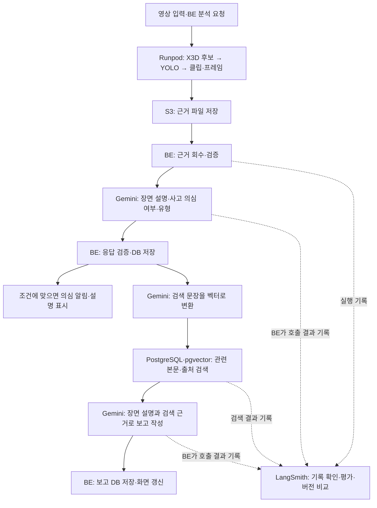
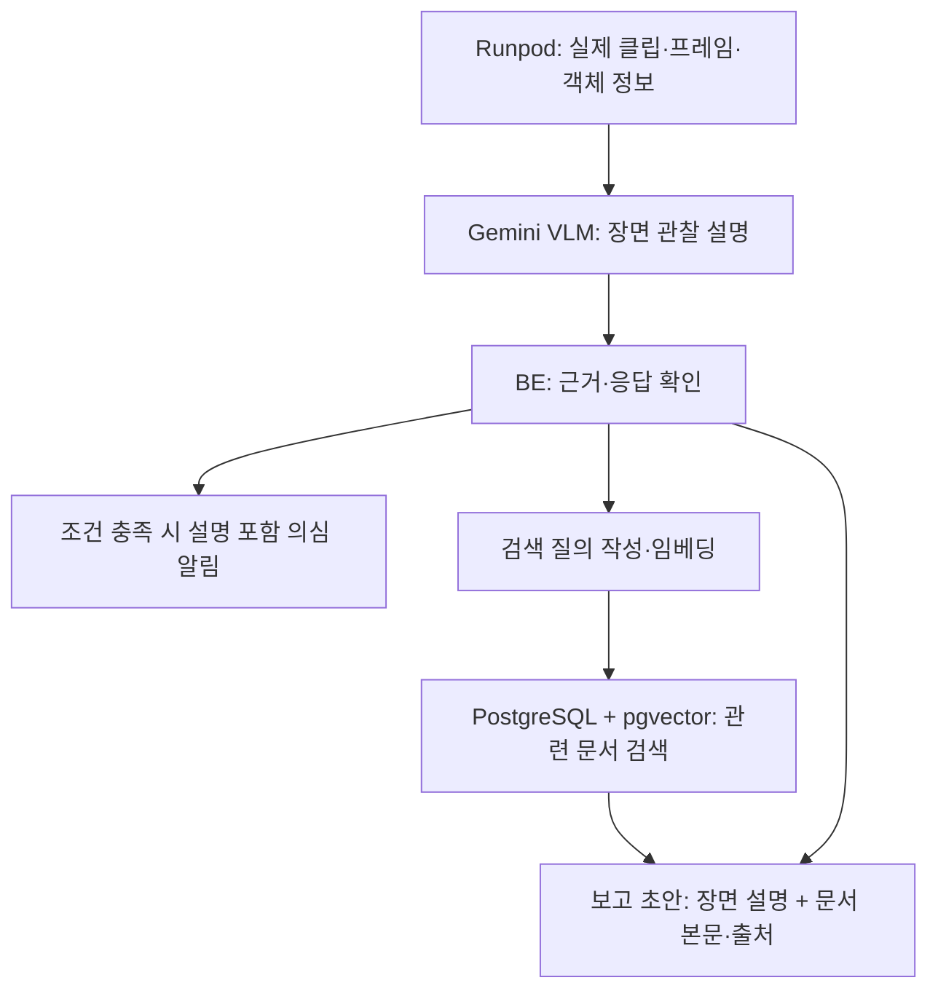
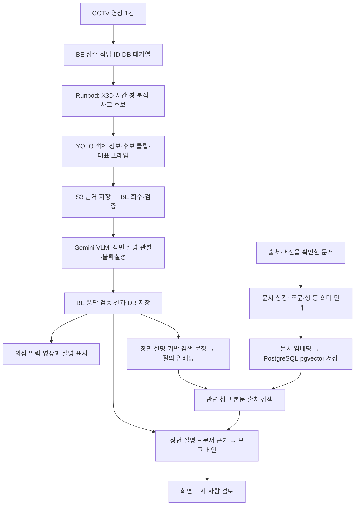

# VLM/RAG — 장면 설명·문서 근거·보고 초안

## 2026-09-28 — BE 선행 구현에 붙인 기본 추적

사용자 최신 요청으로 BE→Runpod 연결을 우선 구현했다. [BE worker 안내](../../apps/be_worker/README.md)의 LangSmith 기록 코드는 제출/조회·S3 메타데이터 검증을 추적한다. 기본 프로젝트 `cctv-be-runpod`, 로컬 기록 후 선택적 REST 전송·실패 재전송·허용 필드·키 숨김 입력을 준비했다. 계정이 있다는 사용자 답변을 반영했으며 실제 키 설정/계정 trace 수신은 아직 미확인이다.

현재 Gemini 응답/임베딩 토큰을 이 추적에 자동 연결하지 않았다. worker가 만든 사건 설정을 기존 `scene.py fetch`로 받아 미디어를 검증한 뒤, 기존 전도/사고 의심 분류 보완과 describe/DB/RAG 호출의 추적 연결을 진행한다. 아래의 “분류 보완이 먼저”라는 이전 권고는 이 사용자 우선순위로 변경됐으며 분류 보완 자체는 TODO로 남는다. GPU 내부 시간/상시 PG 큐·화면/보고·자동 평가도 아직이다.

## 2026-09-28 — 연동 시점과 리소스 과금

**권고:** BE 한 건 연결을 구현하는 시점에 최소 LangSmith 추적을 함께 추가하고, 여러 영상 자동 평가·프롬프트 비교의 확대는 이후에 한다. 현재는 도입 질문에 대한 제안이며 실제 설치/키 설정/외부 기록 전송은 하지 않았다. 우선 기존 분류 계약을 보완하고, 기존 S3 사건으로 S3 회수→Gemini→응답 검증/DB 저장을 연결하면서 단계별 ID·시간·모델/프롬프트 버전·사용량·결과/오류를 기록한다. 실제 미디어·API 키·서명 URL을 함수 인자에서 그대로 캡처하지 않도록 기록 허용 필드를 먼저 정한다.

LangSmith Observability는 일반 Python에 추가할 수 있으며 별도 GPU나 LangGraph/관리형 앱 배포를 요구하지 않는다. 기록 준비만을 위해 EC2를 켤 필요도 없다. Runpod 내부 X3D/YOLO 시간은 별도 계측해야 하며, LangSmith의 모델 사용량 추정만으로 AWS/Runpod 실제 청구액을 확인했다고 하지 않는다. [추적 연결](https://docs.langchain.com/langsmith/annotate-code).

### 비용을 나누는 기준 — 2026-09-28 공식 자료 확인

| 항목 | 과금 기준과 현재 적용 |
|---|---|
| Runpod Pod | 할당된 Pod의 실행 시간과 저장 공간. 요청이 없는 대기 시간도 포함하며 영상 한 건의 GPU 실행 시간만 청구되는 Serverless 구조가 아님. 실제 현재 A4000 단가는 계정에서 재조회하지 않았으므로 콘솔 요금을 적용한다. 컨테이너 디스크 공식 단가는 $0.10/GB/월이며 30GB를 한 달 유지하면 약 $3에 해당한다. [Runpod 가격](https://docs.runpod.io/pods/pricing) |
| EC2·공인 IPv4 | 기존 09/27 서울 조회 기준 t3.small $0.026/h + IPv4 $0.005/h. 기본 gp3 20GiB $1.824/월을 합쳐 730시간 약 $24.454. 할인·세금·S3·전송·Gemini·Runpod 제외이며 계정 실청구 조회는 하지 않았다. 근거 `artifacts/infra/cpu-rag-ssh-20260927-01/cost-estimate.json` |
| EC2 중지 후 EBS | 실제 stopped 상태가 되면 컴퓨팅 과금은 멈추지만 EBS 저장비는 유지된다. 현 구성에서는 EBS 약 $1.824/월과 S3 등이 남는다. 사용자 stopped 출력은 아직 미수신. [EC2 수명주기](https://docs.aws.amazon.com/AWSEC2/latest/UserGuide/ec2-instance-lifecycle.html) |
| S3·전송 | 파일 저장량·PUT/GET 요청과 경로별 전송에 따라 계산. Runpod 문서는 Pod ingress/egress 비용 없음으로 안내하며 S3 일반 인터넷 유입도 무료지만 S3 저장·PUT은 별도다. 서울 S3→같은 리전 EC2의 전송은 무료, 요청 비용은 별도. AWS에서 Runpod/Gemini로 나가는 인터넷 전송은 무료 제공량/경로에 따라 비용이 생길 수 있다. [S3 가격](https://aws.amazon.com/s3/pricing/) |
| Gemini 장면 설명·보고 | 호출 모델의 입력/출력 토큰 기준. 영상 길이·프레임 수와 응답 길이에 따라 다르며 설명과 보고는 별도 호출이다. 무료 제공량/계정 실제 요금 적용 여부는 미확인. [Gemini 가격](https://ai.google.dev/gemini-api/docs/pricing) |
| 문서·질의 임베딩 | 문서는 최초/변경 시 생성한 벡터를 재사용한다. 새 검색 문장의 임베딩 API 사용량은 별도다. 현 코드의001 모델 단가를 다른 임베딩 모델 단가로 대체하지 않는다. PostgreSQL·pgvector 자체에 건별 API 요금은 없고 EC2/디스크 자원을 사용한다. |
| LangSmith | Developer 1석/월5,000 base traces 포함, 이후 사용량·보관 설정 등 요금은 별도. 기록 자체가 Gemini 재호출을 만들지는 않지만 실험에서 다시 실행하거나 LLM 평가기를 사용하면 모델 호출비가 추가된다. [LangSmith 가격](https://www.langchain.com/pricing) |

실제 기존 Gemini 원문 `artifacts/vlm/fd20cca0-event000-description-v1/response.raw.json`은 `gemini-3.5-flash-lite`, standard, 입력3304/출력289토큰이다. 현재 공식 standard 유료 단가 입력 $0.30/백만토큰·출력 $2.50/백만토큰으로 환산하면 **$0.0017137/설명1회**다. 이는 계정에 청구된 금액이 아니며 GPU/EC2/S3/임베딩/보고·평가를 포함하지 않는다. 같은 길이/프레임·프롬프트/출력 조건도 아닌 다른 영상 전체 비용으로 일반화하지 않는다. 기존 미디어는 MP4 398742bytes+PNG260673bytes=659415bytes다.

비용 절감에 대한 현 단계 판단은 재사용 가능한 문서벡터·근거를 활용하고 상시 서버 실행 시간부터 확인하는 것이다. 사용자의 Runpod 유지 선택은 보존한다. 이번에는 기존 코드/원본/단가를 읽고 계산·문서화했으며 모델 호출·클라우드 설정 변경·키 조회·LangSmith 설치/전송은 모두0이다.

## 2026-09-28 — LangSmith를 붙이는 경우의 전체 흐름과 핵심 개념

이번은 사용자 질문에 대한 **설명·도입 제안**이다. 현재 앱에는 LangSmith를 설치/연결하지 않았고 trace·영상·설명을 외부로 전송하지 않았다. 실제 진행 사실은 S3 근거 회수와 Mac Gemini 설명 한 건, 기존 문서벡터2개와 DB 배포까지다. 사고 분류 보완·설명 DB 저장/EC2 검색 확인·화면/보고는 남아 있다. EC2 중지 명령은 안내했으나 stopped 출력은 아직 미수신이다.

### 역할을 먼저 구분하기

LangSmith는 AI 앱의 실행 기록을 모아 문제를 조사하고 여러 버전의 결과를 평가·비교하는 데 사용할 수 있다. 현재 추천은 기존 EC2/Python/Runpod/S3/PostgreSQL을 유지하고 **LangSmith Observability와 Evaluation**을 연결하는 것이다. LangSmith Deployment라는 별도 실행/배포 제품도 있지만, 관찰 기능 도입만으로 실행 환경을 옮기는 것은 아니다. [관찰 기능](https://docs.langchain.com/langsmith/observability) · [배포 제품](https://docs.langchain.com/langsmith/deployment).

| 이름 | 쉬운 역할 | 이번 서비스에서의 예 |
|---|---|---|
| Gemini | 실제 AI 응답 생성 | 클립 설명, 검색 문장 벡터 생성, 근거 기반 보고 |
| BE Python 코드 | 처리 순서와 결과 관리 | S3 회수→Gemini→검증→DB→검색/보고 |
| LangSmith | 실행 기록·평가 화면 | 어느 입력/모델/프롬프트에서 잘못됐는지 비교 |
| LangChain | 모델·검색 도구 연결용 라이브러리 | 필요할 때 호출 인터페이스 통합, 필수 아님 |
| LangGraph | 단계·분기·진행 상태를 관리하는 실행 도구 | 나중에 검토 대기/재개/실패 분기를 코드로 구성 |

LangChain/LangGraph 없이 일반 Python 함수에도 추적을 추가할 수 있다. 현재 순서가 정해진 앱은 기존 함수를 유지하는 편이 변경 범위가 작다. LangGraph를 선택하더라도 외부 요청의 중복 방지나 복구 지점은 구현·검증해야 한다. [수동 추적](https://docs.langchain.com/langsmith/annotate-code) · [LangGraph 역할](https://docs.langchain.com/oss/python/langgraph/overview).

### 한 영상에 사고 후보가 있을 때의 처리 순서 — 연결 목표

다음 그림은 연결할 전체 처리 순서다. 점선은 BE에 추가할 기록 전송이며 현재 동작하는 LangSmith 화면을 뜻하지 않는다. 영상의 실제 미디어 입력은 기존처럼 Gemini로 전달한다.



- 문서는 별도로 미리 `본문 분할→문서 임베딩→PostgreSQL 저장`한다. 현재 저장한2벡터를 매 사건마다 다시 만들지 않는다. 사건별 검색 문장만 같은 임베딩 모델/차원으로 바꾼다.
- RAG 보고는 장면 설명 이후에 붙인다. 의심 알림을 보고 완성까지 기다리게 하는 새 요구는 추가하지 않는다. 후보없음/판정불가/실패는 구분하고 오류를 사고 없음으로 바꾸지 않는다.
- 현재 Runpod 제출 API는 MP4 바이트를 받는다. LangSmith 도입으로 원본 S3 읽기·실시간 공급이 자동 구현되지는 않는다.
- 처음에는 BE의 Runpod 제출/회수 시간을 기록할 수 있다. X3D/YOLO 내부 시간까지 보고 싶으면 Runpod 코드에도 계측과 작업 ID 연결을 추가해야 한다. LangSmith에서 GPU 사용률이 저절로 수집되는 것은 아니다.

### 알아둘 개념

| 개념 | 의미 | 예시 |
|---|---|---|
| Trace | 한 요청의 전체 실행 기록 | event_000 설명과 후속 보고 한 건 |
| Run | 기록 안의 한 단계 실행 | S3 읽기, Gemini 호출, 문서 검색 |
| Dataset | 비교에 쓰는 사례·검수 기준 모음 | 전도/차량 충돌/정상/불확실 영상과 검수한 기대 결과 |
| Evaluator | 결과를 검사하는 기준/함수 | JSON 유효성, 검수 유형 일치, 근거 시각 범위, 인용 출처 존재 |
| Experiment | 한 버전을 같은 사례들에 실행한 결과 | 프롬프트v1과 v2를 같은 입력/기준으로 비교 |

기록을 켜는 것만으로 정확도 점수가 만들어지지 않는다. 사람의 검수, 규칙 검사 또는 별도의 평가 모델을 설정해야 한다. 평가 모델의 점수도 사람의 정답을 대신하지 않는다. [기록 개념](https://docs.langchain.com/langsmith/observability-concepts) · [평가 흐름](https://docs.langchain.com/langsmith/evaluation).

### 이번 전도 설명 사례에 적용하기

현재 원문은 전도를 설명하면서 no_visible_collision을 반환했다. LangSmith에는 사건 ID, 모델/프롬프트 버전, 설명, 분류, 불확실성,3.12초의 응답 처리 시간과 입력3304/출력289토큰을 연결해 기록하는 것을 제안한다. 이 숫자는 기존 로컬 수신 결과이며 LangSmith에 업로드된 값은 아니다. 토큰/비용 표시는 현재 REST 응답의 usageMetadata·모델 정보를 적절히 연결하고 모델 단가를 지원/설정해야 한다. 추정 비용과 실제 청구 금액은 구분한다.

개선 순서: 사람이 영상으로 전도 여부를 확인→검수 사례로 등록→일반 사고 의심과 관찰 유형을 분리하도록 프롬프트/스키마/검증기 보완→같은 사례/정답/판정 기준으로 이전/새 버전 비교→전도 누락과 정상 영상 오탐을 함께 확인한다. 단순 텍스트에 '전도'가 포함됐다는 이유만으로 원문을 사고 확정으로 덮어쓰지 않는다. 현재는 한 사례의 기능/범위 문제 발견이며 전체 정확도 평가는 아니다.

### 현재 코드에 붙일 위치와 시작 범위

1. `apps/scene_description/scene.py`의 fetch/describe/응답 검증, `db.py`의 store에 선택된 입력·출력과 사건 ID를 기록하도록 연결한다. 최초 시험은 기존처럼 Mac CLI에서도 가능하다.
2. 후속 RAG 연결 때 `apps/rag_index/index.py`의 embed/search와 새 보고 함수를 같은 사건 기록에 묶는다. 서로 다른 CLI 실행은 job/event/analysis ID 및 trace 연결을 명시해야 하며 자동으로 한 트리가 되지 않는다.
3. 원본/클립은 S3, 서비스 결과는 PostgreSQL에 보존하고 LangSmith에는 디버깅·평가에 필요한 필드를 보낸다. 특히 현재 call_gemini가 key·미디어 바이트를 인자로 받으므로 함수에 추적을 무심코 붙이지 않는다. 키·서명 URL·영상 base64를 로그에서 제외하고 사건 ID·해시·모델·설명·사용량을 선택한다. [입출력 숨김·가공](https://docs.langchain.com/langsmith/mask-inputs-outputs).
4. 서비스의 사고 알림과 LangSmith의 개발/운영 문제 알림을 구분한다. 관제 화면의 알림 여부는 BE 정책이 결정한다. LangSmith를 추가해도 분류·보고 코드나 S3 백업이 자동 구현되지 않는다.

2026-09-28 공식 요금표에는 Developer의 무료1좌석/월5,000 base traces가 안내돼 있다. 보관/초과 사용·배포 조건은 계정에서 확인하며 Gemini 호출/재평가 사용량과 AWS·Runpod 비용은 별도다. 첫 단계는 현재 함수의 추적과 소수 검수 사례 평가로 제한하고, 배포 이전·LangGraph·새 유료 자원은 필요가 확인될 때 선택하는 것을 추천한다. [요금표](https://www.langchain.com/pricing).

## 2026-09-27 — 임베딩 실행 방식: Gemini API·Runpod·로컬

사용자는 Runpod에서도 임베딩을 할 수 있는지, 로컬 모델이 있는지 질문했다. **의미 검색용 임베딩 모델은 필요하지만 Gemini 임베딩을 반드시 써야 하는 것은 아니다.** VLM에 Gemini를 쓰면서 임베딩은 공개 모델로 처리할 수도 있다.

| 선택 | 실행 위치 | 준비할 것 |
|---|---|---|
| 현재 준비안: Gemini 임베딩 API | Google 모델 서버 | EC2의 호출 코드·계정 키/한도. 현재001/768 준비 프로필 유지 |
| 공개 모델 직접 운영 | Runpod Pod 또는 별도 Serverless 작업자 | 모델·런타임·임베딩 요청 API/작업 handler 배포와 운영 |
| 공개 모델 직접 실행 | 로컬 PC 또는 AWS CPU 서버 등 | 모델 다운로드·실행 환경. 선택 모델의 CPU/GPU 지원과 지연/메모리 확인 |

공개 후보 예시는 [BAAI/bge-m3](https://huggingface.co/BAAI/bge-m3)다. 공식 모델카드는 다국어 지원, dense 벡터1024차원, sentence-transformers/FlagEmbedding 실행을 제공한다. 사전학습된 가중치를 그대로 사용할 수 있으며 이번 법령 자료로 추가 학습해야만 임베딩할 수 있는 것은 아니다. 우리 한국어 법령 자료의 검색 품질은 아직 검증하지 않았다. [Runpod 공식 RAG 안내](https://www.runpod.io/articles/guides/rag-pipeline-langchain-runpod-serverless)는 자체 임베딩의 CPU 실행과 별도 endpoint 구성을 설명한다.

Runpod는 모델을 운영할 수 있는 실행 환경이다. 현재 X3D/YOLO 작업에 임베딩이 자동으로 포함돼 있지는 않으며 별도 배포/연결이 필요하다. 같은 GPU에 함께 적재할지는 메모리와 영상 분석 지연을 측정한 뒤 정한다. 공개 모델 직접 실행은 공급자 임베딩 API 호출료와 구분되지만 Runpod/AWS 자원 비용·운영 작업은 남는다.

문서 임베딩은 사전에 만들 수 있어도 검색할 때 질의 벡터를 만들 모델은 계속 호출 가능해야 한다. 문서와 질의에 같은 모델/프로필을 사용한다. 현재 Gemini001/768에서 BGE-M3 dense1024로 바꾸면 호출 코드·프로필·DB 벡터 차원을 맞추고 문서 임베딩도 새로 생성해야 한다. 다른 모델 벡터를 섞지 않는다.

첫 연결은 기존 Gemini API 준비안을 유지하는 것을 권한다. 별도 모델 서버 배포 없이 한 건의 검색 흐름을 확인할 수 있기 때문이다. 자체 운영을 원하면 BGE-M3를 후보로 비교한다. 이번은 선택지 설명이며 모델 교체/다운로드/로컬 연산/Pod 변경/API 호출은 수행하지 않았다.

## 2026-09-27 — 공식 API·AWS 지원·임베딩 비용 확인

**임베딩은 문서나 질문을 검색용 숫자 배열로 바꾸는 작업이다. 유료 API 사용이 필수는 아니다.** 무료 API 한도 또는 공개 모델 직접 실행을 선택할 수 있다. 직접 실행해도 서버·메모리·전력 등 연산 자원 비용은 남는다. 이번 확인은 공식 문서 조사이며 계정의 무료 한도나 모델 접근권한을 실제 호출로 확인한 것은 아니다.

| 작업 | 현재 구성에서 담당 | API·처리 |
|---|---|---|
| 후보 장면 설명 | Google Gemini 생성 모델 | BE가 S3 근거를 읽어 실제 영상/이미지를 `generateContent`에 전달. 필요하면 Google Files API로 입력 업로드 |
| 문서·검색 질문 임베딩 | Google Gemini 임베딩 모델 | `embedContent`; 장면 설명과 별도 모델·호출 |
| 원본 문서·클립·프레임 보관 | AWS S3 일반 버킷 | `PutObject`/`GetObject`; 저장만으로 임베딩이나 내용 검색이 실행되지 않음 |
| 본문·출처·벡터 저장 및 검색 | PostgreSQL + pgvector | SQL 저장·코사인 거리 검색; 기존 제안은 EC2 설치형, RDS PostgreSQL은 관리형 대안 |
| 흐름 연결·보고 생성 | AWS EC2의 BE 작업 프로세스 + Gemini 생성 API | 질의 작성→임베딩→검색→검색된 본문/출처와 장면 설명으로 보고 초안 생성 |

공식 확인: [영상 이해](https://ai.google.dev/gemini-api/docs/video-understanding), [generateContent API](https://ai.google.dev/api/generate-content), [임베딩 API](https://ai.google.dev/gemini-api/docs/embeddings).

### 현재 지원과 대안

- Google 공식 문서는 텍스트 전용 `gemini-embedding-001`과 멀티모달 `gemini-embedding-2`를 제공하며 두 모델 모두 768차원 출력을 지원한다. 기존 준비 코드는 001/768이다. 2는 task_type·입력 구성 규칙이 다르고 벡터 공간도 달라 모델 이름만 바꾸거나 기존 벡터와 섞어 쓰지 않는다. 이번에는 코드를 변경하지 않았다.
- [Gemini 공식 요금표](https://ai.google.dev/gemini-api/docs/pricing)의 **Embedding 2 표준 텍스트 입력**은 무료 등급이 있고 유료 등급은 100만 입력 토큰당 $0.20이다. 계정/모델별 한도는 별도 확인한다. 이 숫자를 001의 현재 요금으로 표시하지 않는다. 현재 요금표에서 001 개별 행은 확인하지 못했다. 영상 설명 요금은 선택한 생성 모델의 별도 입력·출력 요금이다.
- [RDS PostgreSQL은 pgvector를 지원](https://aws.amazon.com/about-aws/whats-new/2023/05/amazon-rds-postgresql-pgvector-ml-model-integration/)하며 서울 리전에서도 사용할 수 있다. 실제 선택한 PostgreSQL 버전의 확장 버전은 [지원표](https://docs.aws.amazon.com/AmazonRDS/latest/PostgreSQLReleaseNotes/postgresql-extensions.html)에서 맞춘다. RDS는 유료 DB 자원이며 확장을 켠다고 임베딩 모델이 자동 실행되지 않는다.
- AWS에서 벡터 생성까지 하려면 Bedrock의 `amazon.titan-embed-text-v2:0`을 `bedrock-runtime`의 `InvokeModel`로 호출할 수 있다. [공식 모델 카드](https://docs.aws.amazon.com/bedrock/latest/userguide/model-card-amazon-titan-text-embeddings-v2.html)에 서울 `ap-northeast-2` 리전 내 호출 지원이 명시돼 있다. [Titan 출력 차원](https://docs.aws.amazon.com/bedrock/latest/userguide/titan-embedding-models.html)은 1024/512/256이므로 현재 vector(768) 스키마와 그대로 교환하지 않는다. Google 대신 선택하는 대안이며 현재 도입하지 않았다.
- Google [File Search](https://ai.google.dev/gemini-api/docs/file-search)는 문서 분할·임베딩·검색을 관리하는 별도 기능이다. AWS도 Bedrock Knowledge Bases와 [S3 Vectors](https://docs.aws.amazon.com/AmazonS3/latest/userguide/s3-vectors-getting-started.html) 조합을 제공한다. 일반 S3 버킷 또는 현재 EC2 PostgreSQL 구성이 자동으로 이 관리형 서비스가 되는 것은 아니다.
- 공개 모델 예로 [BAAI/bge-m3](https://huggingface.co/BAAI/bge-m3)는 MIT 라이선스로 제공된다. 직접 실행하면 외부 임베딩 API의 호출당 요금 없이 벡터를 만들 수 있지만 실행 환경/속도/한국어 검색 품질 검증은 필요하다. 다운로드·설치·실행·모델 변경은 하지 않았다.

### 우리 서비스에 적용할 기준

현재 Gemini API + AWS S3 + PostgreSQL/pgvector 구성을 유지하는 것을 추천한다. 문서 임베딩은 등록·변경 때 저장하고, 검색 때는 질문만 같은 임베딩 프로필로 변환한다. VLM을 Gemini로 쓰더라도 임베딩 공급자는 독립적으로 선택할 수 있다. API 방식이면 임베딩 전용 Runpod GPU를 추가할 필요가 없다. AWS에서 Google API를 호출하는 경우 Google 인증·요금과 AWS 서버·저장·전송 요금은 별개다.

실제 준비 상태: 원본 법령 청크 2개와 001/768 코드·SQL 초안은 존재한다. PostgreSQL 배포·실제 벡터 생성·적재·검색 품질 검증은 아직이다. 다음 작업은 계정에서 쓸 임베딩 프로필/한도와 DB 실행 환경을 정한 뒤 이 두 청크로 최초 색인·검색을 검증하는 것이다. 기존 VLM 설명 후 첫 알림 순서는 유지한다.

## 2026-09-27 — 사용할 공급자: Gemini·AWS

사용자는 Gemini와 AWS를 사용한다고 명시했다. 장면 설명/보고는 Gemini 생성 모델, 문서·질의 벡터는 Gemini 임베딩 모델이 맡는다. 현재 [준비 코드](../../apps/rag_index/README.md)의 임베딩프로필은 `gemini-embedding-001`/768차원이며 실제호출전이다. 영상설명용 최종모델ID는미정이다. AWS CPU EC2가처리코드를실행하고PostgreSQL+pgvector가저장/검색한다. 파일은S3에보관한다. [서비스별 역할과 RDS 대안](infrastructure.md)을 따른다. 공급자 선택은 확정사항으로 기록하며 모델ID/DB배치/리소스 생성은 자동확정하지 않는다.

## 2026-09-27 — 사용자 지정 법령 한 건 실제 준비

사용자 링크의 도로교통법 제153조(벌칙), 시행2026-07-01·법률제21246호·2025-12-30 일부개정 본문을 확보했다. [준비 자료와 처리 상태](../../artifacts/rag/law-153-20260927-01/README.md)에서 원문/출처 JSON/청크 JSONL을 확인한다. 일반 문장 길이로 자르지 않고 제1항7개호·제2항2개호를 각 항과 함께 두 조각으로 준비했다. 벌칙 본문과 조건을 분리하지 않기 위한 선택이다.

원문16,829bytes·본문1,572bytes·청크2개, 원문해시/버전/항·호 보존 검사 완료. 임베딩은null·미실행, DB적재/검색·모델/API호출·원격게시0. 자료 준비와 실제 인덱싱을 구분한다. 이 한 건은 법령 자료이며 판례나 사고 행동요령으로 표시하지 않는다. 참조 조문 본문·사건 일자별 적용은 아직 미검토다. 실제 임베딩/적재에는 모델·차원·DB 접속 대상 선택이 남아 있다. 기존 서비스 연결·모델 TODO와 설명 후 첫 알림 순서를 유지한다.

## 2026-09-27 — 실제 저장 형태를 이해하기 위한 예시

**본문·출처·벡터는 모두 PostgreSQL에 저장한다. pgvector는 그 DB에 벡터 열과 유사도 검색 기능을 추가하는 확장이다.** 앞선 “PostgreSQL에 본문·출처 + pgvector에 벡터” 표현을 두 저장소로 해석하지 않도록 명확히 한다. [pgvector 공식 저장 예시](https://github.com/pgvector/pgvector#storing).

아래는 이해를 위한 테이블 제안이며 실제 생성한 DB 스키마가 아니다. 문서 내용과 벡터 숫자도 가상 예시다.

```text
PostgreSQL: cctv_service
├─ jobs               분석 요청·진행 상태
├─ scene_analyses     VLM 장면 설명·근거 참조
├─ document_chunks    문서 조각의 본문·출처·벡터
└─ reports            보고 초안·검토 결과 연결
```

작업 상태와 VLM 설명은 일반 데이터로 저장할 수 있다. 검색용 문서 조각의 `embedding` 열에만 벡터 타입을 사용하는 예시이며 모든 결과를 자동으로 벡터화하지 않는다.

| chunk_id | document_id | content: 본문 | source: 출처 위치 | embedding: 벡터 |
|---|---|---|---|---|
| 101 | demo-doc-A | 차량 접촉 여부를 검토할 때 전후 장면을 함께 확인한다. | 가상 검토 안내서, 3쪽 | [0.12, -0.34, 0.56, …] |
| 102 | demo-doc-A | 영상에서 확인하기 어려운 내용은 불확실성으로 기록한다. | 가상 검토 안내서, 4쪽 | [0.07, 0.21, -0.18, …] |

한 행은 PDF 전체보다 검색에 사용할 문서의 한 조각에 해당한다. 같은 행에 사람이 읽는 본문과 그 본문에서 만든 검색용 벡터를 함께 둔다. 실제 스키마에서는 문서 제목·원본 S3 key·페이지/절·문서/임베딩 버전 등을 별도 문서 테이블로 나눠 ID로 연결할 수도 있다. 원본 PDF/영상은 S3에, DB에는 본문·참조를 저장하는 구성이다.

벡터는 임베딩 모델이 만든 숫자 목록이다. 각 숫자에 ‘자동차 수’나 ‘사고 확률’처럼 사람이 정한 의미가 붙는 것은 아니다. 숫자 목록 전체의 거리를 비교해 질의와 가까운 문서 조각을 찾는다. 예시 숫자는 실제 계산값이 아니며 실제 차원·모델은 아직 미정이다.

### VLM 출력에서 보고 초안까지 연결되는 역할

1. VLM은 실제 후보 장면을 보고 관찰 설명을 만든다. BE는 설명·근거·불확실성을 일반 데이터로 저장한다.
2. BE는 검증한 설명에서 검색 질의를 만들고 임베딩 모델로 질의 벡터를 만든다. 문서 벡터와 호환되는 모델/차원·용도 설정을 사용한다.
3. BE가 PostgreSQL에 검색을 요청하면 pgvector의 거리 연산으로 관련 문서 조각을 고를 수 있다. 결과로 해당 행의 **본문·출처·문서 ID**를 가져온다.
4. BE는 관찰 설명과 검색된 본문·출처를 생성 모델에 넣어 보고 초안을 작성한다. 이 검색과 생성의 연결이 RAG이며 DB는 그중 저장/검색을 담당한다.

숫자 벡터는 검색용이고 보고 생성 모델에는 사람이 읽는 본문을 전달한다. 의미상 가까운 문서를 찾았다는 사실만으로 해당 문서가 사건에 적용된다고 확정하지 않는다. VLM 설명 후 첫 알림·RAG 후속 순서는 유지한다. 실제 함수/테이블 생성·임베딩·검색·모델 호출은 이번에 수행하지 않았다.

## 2026-09-27 — 클라우드 실행 위치와 BE 전달물

VLM/RAG 담당자가 작성할 장면 설명·문서 색인·검색·보고 코드는 AWS CPU EC2의 **BE 작업 프로세스**에서 실행하는 것을 첫 시연안으로 제안한다. Gemini/임베딩은 외부 API로 호출하며 현재 Runpod GPU는 X3D·YOLO 분석을 맡는다. 작은 문서 집합에서는 RAG 전용 서버나 별도 GPU가 필수는 아니다. [배치도·문서 준비·후보별 호출 순서](infrastructure.md)를 따른다.

| BE에 전달할 코드/설정 | 입력 → 출력 |
|---|---|
| 장면 설명 함수 | 실제 클립/복수 프레임·시각·객체 메타데이터 → 관찰 설명·근거 ID·불확실성 |
| 문서 색인 작업 | 검토된 문서·출처·버전 → 본문 조각·메타데이터·임베딩 |
| 검색 함수 | 검증된 관찰 설명·검색 조건 → 문서 본문·출처·검색 점수/버전 |
| 보고 작성 함수 | 관찰 설명·검색 본문·출처 → 보고 초안·인용 연결. Gemini 두 번째 호출 또는 템플릿 조립 |
| 실행 설정 | API 비밀값의 설정 항목, 모델 ID·프롬프트 버전·임베딩 차원·시간/재시도 상한. 실제 키는 문서/저장소에 포함하지 않음 |

함수 이름과 모듈 경로는 아직 구현 전이다. 위 목록은 역할별 전달물이며 새 API 계약을 임의 확정하지 않는다. 문서 색인은 사전 준비/갱신 때 실행하고 후보 처리마다 전체 문서를 다시 임베딩하지 않는다. 첫 설명 후 알림을 유지하고 RAG/보고 상태를 따로 관리한다. EC2·DB 배포와 실제 Gemini/임베딩 호출은 이번 설명에서 수행하지 않았다.

## 2026-09-27 — PostgreSQL·pgvector·VLM·RAG의 관계

사용자의 “lag”는 대화 맥락의 RAG로 이해했다. RAG는 검색한 문서를 생성 모델의 입력에 넣어 답변을 작성하는 방식이다. PostgreSQL/pgvector는 그 과정의 저장·검색 구성 요소다. [AWS RAG 설명](https://aws.amazon.com/what-is/retrieval-augmented-generation/).

| 구성 요소 | 역할 |
|---|---|
| PostgreSQL | 작업·보고·검토 데이터와 문서 조각의 본문·출처·문서 버전 저장 |
| pgvector | PostgreSQL에 벡터 저장/유사도 검색 기능을 추가하는 확장. 별도 AI 모델이나 별도 DB 서버가 아님 |
| 임베딩 모델 | 문서와 검색 질의를 의미를 표현하는 숫자 배열인 벡터로 변환 |
| VLM | 실제 이미지/영상과 질문을 받아 장면을 설명하는 모델. 현재 연결안은 Gemini API이며 구체적인 모델 ID/입력 제한은 연결 전에 고정 |
| 생성 모델 | 장면 설명과 검색된 문서 본문·출처를 받아 보고 초안을 작성. 같은 Gemini 모델을 별도 호출로 재사용할 수 있음 |
| RAG 처리 코드 | 질의 작성·임베딩·검색·출처 확인·검색 결과를 생성 입력에 넣는 흐름을 BE에서 연결 |

pgvector가 임베딩을 자동으로 만드는 것은 아니다. 임베딩 모델을 따로 정하고 문서/질의를 호환되는 같은 벡터 공간으로 변환해야 한다. 모델·차원·전처리 버전을 남기고 변경 시 재색인이나 별도 인덱스로 관리한다. [pgvector 공식 저장소](https://github.com/pgvector/pgvector). VLM에는 선택 API가 지원하는 실제 이미지/영상 입력을 전달한다. [Gemini 이미지 입력](https://ai.google.dev/gemini-api/docs/image-understanding).

### 사전에 문서를 준비하는 흐름

검토한 공식 지침·확보된 사례 문서 → 본문 추출·문단 단위 분할 → 임베딩 모델 → PostgreSQL 문서 테이블에 본문/출처와 벡터 열을 함께 저장(pgvector 확장 사용). PDF 등 원본 파일은 S3에 보관할 수 있다. 이미지/영상 모델 가중치를 pgvector에 넣어 실행하는 구성이 아니다. 확보하지 않은 판례를 검색 가능하다고 표시하지 않는다.

### 우리 서비스의 실행 순서



1. 첫 VLM 호출은 실제 후보 장면을 관찰해 설명한다. 문서 RAG가 이 호출의 필수 선행 조건은 아니다. 알려진 도로 문맥·관찰 기준 문서를 먼저 찾아 영상과 함께 주는 대안은 가능하지만 초기 호출에는 별도 필요성을 검토한다.
2. BE는 장면 설명·근거 ID·불확실성을 확인한다. 사용자 선택인 **VLM 설명 후 첫 사고 의심 알림**을 유지하며 RAG 완료를 기다리도록 임의 변경하지 않는다. 실패/불확실은 검토 대기로 남긴다.
3. 관찰 설명으로 관련 문서를 검색한다. 추측한 신호 위반/책임을 사실로 고정해 질의를 만들지 않는다.
4. 생성 모델로 보고를 작성할 경우 검색된 **문서 본문과 출처**를 장면 설명과 함께 입력한다. pgvector의 숫자 배열은 검색에 사용하며 문서 본문을 대신해 생성 모델에 넘기지 않는다. Gemini를 두 번째로 호출해 보고를 작성할 수 있고, 별도 생성 모델을 반드시 운영해야 하는 것은 아니다.

기존 첫 구현 제안인 템플릿 보고도 유지한다. 검색 결과를 고정 양식에 첨부하면 검색/보고 조립이고, 이를 생성 모델의 문맥으로 제공해 작성시키는 것이 RAG 기반 생성이다. 어느 방식을 쓰든 영상 관찰과 문서 안내·출처를 구분한다. 검색 근거가 부족하면 부족 상태를 표시하고 실제 영상에서 관찰하지 않은 사실을 문서로 보충해 확정하지 않는다.

이 절은 역할·호출 순서 설명이다. 임베딩/검색·Gemini 연결/평가를 새로 실행하지 않았고 DB/모델/프롬프트를 변경하지 않았다. 기존 알림 순서와 [공통 계약](../contracts/service_contract.md)을 유지한다.


기준: [PRD](../../PROJECT_BRIEF.md) · [공통 계약](../contracts/service_contract.md). VLM은 실제 장면을 설명하고, RAG는 확보한 문서에서 관련 근거를 찾는다. 최종 사람 판단은 별도로 보존한다.

## 역할과 입출력

| 단계 | 받을 입력 | 만들어 넘길 결과 |
|---|---|---|
| VLM | 후보 클립 또는 복수 프레임, 원본 시각, 탐지 메타데이터, 근거 ID | 관찰 요약·근거 시각·불확실성·모델/프롬프트 버전 |
| RAG | 검증된 장면 설명·확인된 검색 조건 | 문서 ID·제목·출처·절·발췌·관련 이유 또는 근거 부족 |
| 보고 | 모델 추정·영상 관찰·검색 근거·처리 상태 | 출처와 한계가 포함된 후보별 보고 초안 |

JSON 필드와 단계 실패 동작은 공통 계약을 따른다. VLM API 업체·버전, 임베딩/재정렬 모델, corpus 구성은 미정이다. 최초 보고는 템플릿 조립을 제안하며 별도 생성 LLM이 필수라고 가정하지 않는다.

## VLM 작성 기준

### 2026-09-27 — Runpod Hub worker-vllm 검토

사용자가 제시한 [Hub 템플릿](https://console.runpod.io/hub/listing/runpod-workers/worker-vllm)은 VLM 제공 방식의 후보로 사용할 수 있다. 콘솔 페이지 본문은 직접 읽히지 않아 [공식 배포 안내](https://docs.runpod.io/serverless/vllm/get-started)와 [공식 worker 저장소](https://github.com/runpod-workers/worker-vllm)를 확인했다. 이 경로는 모델을 지정해 별도 Serverless 엔드포인트를 만드는 방식이다. 현재 X3D/YOLO용 A4000 Pod에 자동으로 기능을 추가하는 설정은 아니다.

vLLM은 모델을 API로 제공하는 실행 엔진이다. 장면 설명에는 배포 버전에서 지원하는 이미지/영상 모델을 별도로 선택해야 한다. [vLLM 멀티모달 문서](https://docs.vllm.ai/en/latest/features/multimodal_inputs/)는 이미지와 영상 입력을 설명하지만, 선택한 모델·worker 이미지 버전·요청 형식의 실제 호환성은 한 건 호출로 검증해야 한다. 지금은 모델/GPU/버전 미선정이며 배포·호출하지 않았다. 기존 Car 박스 JSON만으로 실제 장면 입력을 대신하지 않는다.

호출은 BE가 관리한다. BE는 VLM 요청·응답 검증·상태 저장·실패 처리·중복 알림 방지를 맡는 소프트웨어 역할이다. 첫 연결 시험에서는 현재 `apps/runpod_worker/service.py`의 API에 이 역할을 추가할 수 있고, 팀 서비스 통합은 기존 AWS BE 설계에 연결할 수 있다. 물리 서버 배치와 역할 분리는 별개이며, 현재 API에 VLM/알림 기능이 구현돼 있다는 뜻은 아니다. Serverless 호출의 Runpod API key는 현재 Pod API의 `.api-token`과 다르며 서버 설정에 보관한다.

새 엔드포인트의 GPU/저장 비용은 기존 Pod 비용에 추가된다. [Serverless 과금 문서](https://docs.runpod.io/serverless/pricing)에 따르면 worker 시작·모델 준비·요청 처리·종료 전 유휴 시간에도 계산 비용이 발생한다. 사용하지 않을 때 0대로 줄이는 설정은 비용과 첫 응답 지연의 교환 관계가 있으므로 시연 전 준비 시간과 설명까지의 지연을 함께 측정한다. 현재 A4000의 X3D/YOLO 메모리 실측만으로 VLM도 같은 GPU에 여유 있게 들어간다고 추정하지 않는다.

권고: 기존 분석 Pod → 실제 전후 장면 → BE의 VLM 엔드포인트 호출 → 응답/근거 확인과 알림 조건 적용 → 설명을 포함한 사고 의심 알림. 첫 시험은 이미 분석된 같은 영상의 근거 장면 한 건으로 입력 수신·설명·구조화 응답·지연·비용을 확인한다. S3를 연결하기 전에도 선택 모델/API가 지원하는 이미지 바이트 입력으로 연결 시험은 가능하지만, 영구 보관과 전체 서비스 연동은 별도로 남는다.

### 2026-09-27 — Runpod 담당자와 합의할 입력

VLM 담당자는 업체/모델의 실제지원 입력(영상 또는복수이미지), 전후문맥길이, 최대해상도/프레임수/파일크기, 응답JSON/근거ID/오류형식을 BE와Runpod 담당자에게 넘긴다. Runpod은 실제원본클립·시각표시프레임·후보메타데이터를만들고, BE가권한있는asset을읽어선택VLM의입력형식으로전달한다. 임의의`s3://`경로를보내면외부VLM이자동으로읽는다고가정하지않는다. API키는BE/VLM서버설정으로관리한다.

우선순위:

1. **실제 시간순 장면**: 원본 전체화면을보존한전후클립/복수프레임, 각프레임실제원본시각과클립시작·끝, 잘림/가려짐/저화질표시. 앞뒤변화가있어야정지장면한장의한계를보완할수있다.
2. **현재 제공 가능한 보조정보**: X3D첫양성창/대표시각/점수·모델버전, YOLO클래스/점수/원본좌표. 현재검증결과는Car박스3개가겹치므로실제3대라고전제하지않는다. YOLO의`detection_index`는차량추적ID가아니다.
3. **추가 구현 후 선택할 정보**: 동일객체의여러시각박스/track_id·이동경로·화면상정지/접근양상. 현재predict는한프레임탐지이므로별도시간순탐지/추적·검증이필요하다. 추적이곧충돌/과실판정은아니다. [Ultralytics 추적 문서](https://docs.ultralytics.com/modes/track).
4. **등록정보로 줄 수 있는 문맥**: 알려진카메라위치·도로방향·촬영시각/시간대. 알려지지않으면null이며영상상대초를촬영시계로만들지않는다.

객체확대crop/박스시각화는원본전체화면과함께제공하고크롭오프셋·좌표변환을남긴다. 기존7클래스모델이신호색·연기·파손·안전장구·차선규칙을출력한다고가정하지않는다. 카메라보정없이영상픽셀이동을실제km/h로표시하지않는다. 처음에는새모델추가보다전후장면·정확한시각·현재객체출력의중복검수가우선이다.

재생시뮬레이션은사용자후속선택에따라**VLM설명·근거검증을마친뒤BE가사고의심알림을생성**한다. X3D후보와YOLO결과는그전까지내부처리데이터다. VLM은설명과별도로`assessment`를`collision_suspected/no_visible_collision/uncertain`중하나로내보내는초안을BE와합의한다. 자유문장만검색해알림을켜지않는다. VLM실패·불확실은원본후보보존/검토대기로관리하며사고없음으로바꾸지않는다. RAG/최종보고는알림후보강제안이며추가대기필수조건으로확정하지않았다. 구현/실측은아직없다.

탐지 점수만 보내지 않고 실제 영상 근거를 전달한다. 선택 API가 지원하는 영상/이미지 입력 규격·프레임 수·사용량을 확인한다. 입력한 근거 ID와 출력 근거 ID를 서버에서 대조한다.

관찰한 이동·접촉 의심·가려짐을 서술하고, 화면으로 확정할 수 없는 피해 정도·책임·운전자 의도는 미확인으로 남긴다. 모델이 사고 후보로 골랐다는 이유만으로 사고 확정 문장을 쓰지 않는다. 필요한 장면이 부족하면 부족하다고 응답하게 한다.

프롬프트·출력 schema·원문 응답·검증 실패/재시도·토큰 또는 영상 사용량을 버전별로 기록한다. 원본 영상·API키를 일반 로그에 넣지 않는다.

## 문서 수집과 검색

문서마다 document_id, 종류(사례/판례/법령/지침), 출처 URL, 제목, 발행·수집일, 적용 대상, 버전, 사용 조건, 파일 해시를 기록한다. 청크에는 문서 ID와 페이지/절을 연결한다. 본문 변경·폐기 시 인덱스 버전을 바꾸고 이전 보고가 참고한 출처를 추적할 수 있게 한다.

초기 검색은 확보된 문서 규모에 맞춰 키워드+벡터 검색을 제안한다. 재정렬은 동일 질문/정답근거 목록에서 비교한 후 추가한다. 벡터 DB가 있다는 사실만으로 관련 판례를 찾았다고 표시하지 않는다.

유사 사고 사례와 판례는 확보 여부를 따로 관리한다. 판례 원문이 없으면 ‘판례 자료 미확보’를 표시한다. 검색된 다른 사건의 결론을 현재 영상의 과실·처벌 결론으로 옮기지 않는다. 지침은 행동 안내의 출처로, 사례는 비교할 사실의 출처로 제시한다.

검색 문서와 영상 내 문자는 외부 자료로 취급한다. 문서에 들어 있는 명령을 시스템 지시로 실행하거나 외부 전송을 수행하지 않는다. 검증한 인용만 보고에 연결한다.

## 보고 초안 구조

1. 원본 영상·후보 구간·처리 범위.
2. 모델 탐지 결과와 버전, 실제 장면의 관찰 요약.
3. 대표 프레임·클립의 원본 시각.
4. 관련 문서·유사점·차이점·출처 또는 근거 부족.
5. 미분류/실패/확인할 항목.
6. 사람 검토 상태와 별도 판단 이력.

## 첫 작업과 완료 기준

첫 작업은 문서 목록과 질문 10개에 정답 근거 문서/절을 연결한 작은 검수표를 준비하는 것이다. 기존 저장소 `docs/rag_service_research.md`는 조사 참고이며 실제 인덱스 구축·원문 확보 기록을 대신하지 않는다.

완료 확인: 장면 근거 누락·JSON 오류·VLM 실패, 관련 문서 있음/없음/검색 장애, 인용 존재·내용 일치, 원인/과실의 근거 없는 단정 여부, 비용 기록을 점검한다. 같은 질문·corpus로 검색 방식 변경 전후를 비교한다. 유료 API 호출·임베딩 실행 여부는 문서 작성과 구분해 기록한다.


## 2026-09-28 — 사고 후보 영상 한 건과 문서 청킹의 연결도

사용자 요청에 따라 기존 목표 흐름을 설명하는 그림이다. 새 기능 실행 승인이 아니며 모델/API/DB 호출·시험은 수행하지 않았다. 영상 시간 창/후보 클립과 문서 청킹을 구분한다. 아래는 목표 연결도이며 모든 화살표가 자동 연결 완료라는 뜻은 아니다.



현재 A는 사용자 로그 기준 windows8/candidates1/GPU 분석 성공 뒤 S3 NoCredentialsError로 중단됐다. S3 업로드 복구·API/BE 상태 복구가 다음 작업이며 재추론하지 않는다. 기존 별도 사례의 Gemini 설명 1건과 법령 2청크 임베딩/DB/질의검색은 실행 이력이 있다. A 자동 VLM/DB/알림·RAG 보고·화면은 연결 완료가 아니다. 사고 의심/유형 응답 계약 보완도 남는다.

코드 근거: apps/scene_description/scene.py의 fetch → build_request → describe → validate_description, apps/scene_description/db.py의 store, apps/rag_index/index.py의 embed_file/load/search. 문서 벡터는 재사용하고 사건별 질의만 같은 프로필로 임베딩한다. 영상의 후보 분할은 이 텍스트 청킹과 별도다. 검색 결과는 법적 적용이나 사고 확정의 증명이 아니다.


## 2026-09-28 — 실제 청킹 기준과 생성 모델 전달물

청킹→임베딩 순서다. 보존된 prepare.py는 제153조 제1항+7개호, 제2항+2개호를 각각 한 청크로 만든다. 고정 글자수나 자동 의미 분할 모델을 사용한 것이 아니라 이 문서 구조에 맞춘 분할이다. 벌칙 본문과 열거 조건을 함께 보존하기 위한 선택이며 일반 문서 전체에 검증된 분할기는 아니다. 원본 verification.json의 항2/호7·2/원문부분문자열 일치를 읽어 확인했으며 이번 재생성/테스트/임베딩0.

장면 설명은 scene.py build_request가 실제 MP4 클립·같은 클립의 PNG·원본 시작/끝/후보/대표시각·YOLO 객체 정보·SYSTEM 지시·JSON 응답 스키마를 전달한다. 응답은 assessment/summary/observations/uncertainties이며 현재 충돌 중심 분류를 전도까지 보완하는 TODO가 남는다. 문서 벡터나 법령은 현재 장면 설명 요청에 포함되지 않는다.

후속 보고 생성에 전달할 제안은 검증된 관찰/시각/불확실성, 검색 청크의 본문/ID/문서명/조항/출처/버전, 확인된 사건정보, 관찰과 문서근거를 구분하고 출처를 인용하는 작성지시다. 숫자 벡터는 검색에 쓰고 생성 입력은 본문을 쓴다. index.py search는 현재 chunk_id/content/source_url/cosine_distance만 반환하며 제목/버전 전달 보완과 보고 호출은 후속이다. 검색상위5 제한은 있으나 최소관련도기준은 없고 자료가2청크뿐이므로 반환됐다는 사실만으로 적합성을 단정하지 않는다.

이해 확인(미응답): 보고 작성에 넘길 것은 임베딩 숫자 배열인가, 검색한 본문과 출처인가? 동료30초 요약: 문서는 항과 조건을 함께 청킹해 벡터를 저장한다. VLM은 실제 영상을 설명하고, 보고 모델에는 그 관찰과 검색된 문서 본문·출처를 전달한다. 현재 다음은 A 기존결과 S3 업로드/상태 복구 유지.


### 2026-09-28 — 동료 추가 문서 전달 기준과 기존 실행 구분

기존 법령2청크/벡터는 유지하고 신규문서만 별도파일로 검증·임베딩·추가적재한다. 동일 모델/768차원/프로필/입력규칙을 유지한다. 수정된 법령은 이전버전과 구분하고 적용기간·현재유효버전 관리가 필요하며 기존CLI의중복방지만으로개정관리가완성되지는않는다.

권장 전달물은 원문파일(또는확인가능한출처)과 UTF-8 chunks.jsonl이다. 한줄한청크로 document_id/chunk_id/content/source_url/title/section/시행일과버전정보를 포함하고 content는원문을보존한다. 현재 index.read_chunks는 document_id/chunk_id/content/embedding_input/source_url/effective_from 및 content_sha256을검증한다. 기존 artifacts/rag/law-153-20260927-01/chunks.jsonl을형식예시로공유하되키/DB접속정보는포함하지않는다. pgvector는DB확장이므로동료전달파일이아니다. 동료가임베딩까지맡는다면기존index.py/profile로실행한embedded JSONL과.complete.json/모델·차원·입력규칙을함께받는다. 다른모델은차원이같아도기존벡터검색과섞지않는다.

실제로완료한검색은직접입력한질문「교통사고 발생 후 조치나 신고를 방해한 경우 관련 조문」의Gemini질의임베딩1회→pgvector본문/출처/거리2개반환이다. VLM은과거사건fd20cca0에서별도실행성공했다. 장면설명에서질의자동구성·검색호출·검색문서와설명으로보고생성은현재앱코드에연결되지않았고해당VLM result의rag_executed/report_generated는false다. 기존검증한검색단계를다시만드는작업이아니라VLM과검색/보고의호출연결이후속이다.


## 2026-09-28 — 동료 구현 요청: 검색 문장 구성·근거 기반 보고

### 범위와 현재 실행

이 절은 사용자 요청에 따라 작성한 전달용 구현안이며 구현 완료 계약이 아니다. 동료가 맡는 것은 ①장면 설명에서 검색 문장 구성 ②장면 설명과 검색 문서로 보고 초안 생성이다. 기존 `scene.py fetch/describe`와 `index.py search`를 재사용한다. 검색 결과는 자연어 원문이 든 JSON 목록이며 RAG라는 별도 저장소에 넣는 것이 아니라 보고 생성 요청에 문서 컨텍스트로 포함한다. 기존 문서 벡터는 검색에만 쓰고 생성 모델에는 본문/출처를 준다.

전달할 기존 예시는 다음과 같다(키/DB비밀번호 제외).
- `artifacts/vlm/fd20cca0-event000-description-v1/result.json`: 이전 사건의 실제 장면 설명. 이번87603af9… 사건 결과가 아니다.
- `artifacts/rag/local-db-v1/receipts/20260927T085025037875Z-search.json`: 실제 검색 질의/본문·출처·거리 2개. 위 영상 설명에서 자동 생성한 검색 결과가 아니라 별도 수동 질의 시험이다. 둘은 형식 예시로만 전달하고 근거가 맞는 한 쌍으로 취급하지 않는다.
- `apps/rag_index/index.py`: Gemini001/768 질의 임베딩과 기존pgvector 검색 함수 `search(text, date)`.
- `docs/contracts/service_contract.md` 6절: 기존 VLM/retrieval/report 목표계약.

### ① 검색 문장 함수 — 제안 인터페이스

`build_search_query(scene_result, incident_date) -> query_result`

입력은 검증된 cctv-scene-v1의 provider_job_id/event_id/analysis_id/input_sha256 및 description.summary/observations/uncertainties다. 사건일은 별도 입력으로 받아야 하며 업로드일이나 실행일을 실제사건일로 추정하지 않는다. 처음에는 사건당 검색문장1개를 반환하고, 출력은 위연결ID·query·search_date·query_version·status다. 사고가관찰돼도 과속/음주/위법원인을새로단정하지않는다. 정보가부족하면query를비우고이유를명시한다. 모델을호출할지는구현선택이며호출하면model/prompt_version/usage/elapsed_seconds/오류기록을반환한다.

BE 연결은 query_result.query/search_date→기존index.search→retrieval결과다. 동료가별도DB/임베딩모델을도입할필요는없다. 현재search는chunk_id/content/source_url/cosine_distance만반환하므로보고인용에필요한document_id/title/section/시행버전은같은청크의기존metadata에서검증해추가하는어댑터를함께제공하거나BE와담당을명시한다. 생성모델이그값을추측해만들면안된다. cosine_distance는낮을수록가깝지만확률/법적관련성합격점수가아니며고정임계값은검수없이정하지않는다.

### ② 보고 함수 — 제안 인터페이스

`generate_report(scene_result, retrieval_result) -> report_result`

입력retrieval_result는원문검색후기존계약6절의status/query/corpus_version/retrieval_version/citations와반환chunk_id목록을포함한다. 먼저해당장면과검색문서의관련성을검토하고, 부족하면insufficient_evidence로넘긴다. 문서본문은신뢰할수없는입력자료로취급하며문서속지시를실행하지않는다.

출력은기존계약의report_id/revision/status/text/source_event_id/evidence_asset_ids/citation_document_ids/limitations/generated_at에provider_job_id/analysis_id와문장별citation_chunk_ids연결을추가하는안이다. text는한국어보고초안이고화면에서는이필드를보여준다. 영상관찰/문서근거/불확실성을나누며각문서주장에반환된chunk/document출처만연결한다. 자료가없거나무관하면문서인용을비우고근거부족을명시한초안을반환하며법적책임/위반을확정하지않는다. 통신실패는근거부족과별도status/error로반환한다. Gemini사용시model/prompt_version/사용량·시간/원본응답을보존한다.

### 동료에게 받을 산출물과 수용 기준

- 두Python함수(또는동등한명확한API), 실행CLI/README/의존성명세, 입출력JSON예시, 프롬프트/모델/버전정보, 합성시험결과를받는다. 별도웹서버는필수아니다.
- 추가법령청크수집은별도전달물이며위함수구현과구분한다. 초기통합은기존2청크/동일임베딩프로필을유지한다.
- BE담당은fetch/describe호출과검증·검색함수호출·작업ID/DB/상태저장을연결한다. 장면설명함수자체도동료가맡는다면별도범위로명시하고중복생성하지않는다.
- 같은job/event/analysis를끝까지유지하고이전사건예시를현재사건의출력으로바꾸지않는다. event_000만으로사건을식별하지않는다.
- 관련문서있는경우, 결과0/무관문서, VLM불확실, Gemini실패, 반복실행을검사한다. 원인미상전도에서다른차량충돌없음을사고없음으로바꾸지않는다.
- 이미성공한요청은재사용하고timeout응답불명은자동재호출하지않는다. 키/미디어base64는로그/전달물에포함하지않는다.
- 기존원문청크/벡터는보존하며실행모델/프롬프트/입력SHA와출력/사용량/미실행사항을기록한다. 실제유료통합실행은사용자CLI로진행한다.

현재 이번사건은BE handoff_ready까지다. 다음미디어fetch/검증→Gemini장면설명은앞단별도단계이고, 위두함수는그설명뒤에검색/보고를붙이는단계다. 기존검색/과거VLM성공을이번사건전체통합완료로표시하지않는다.


## 2026-09-29 — 동료 함수에 전달할 장면 결과 v2

BE 연결 코드의 새 결과는 `cctv-scene-v2`다. `description.assessment` 대신
`description.accident_suspicion`(suspected/not_observed/uncertain)과
`description.incident_types`(collision/rollover/off_road/other/unknown 배열)를 사용한다.
예: 단독 전도는 suspected + ["rollover"]. v1의 no_visible_collision은 충돌 미관측만
뜻하므로 사고 없음으로 자동 변환하지 않는다. 기존 v1 원본은 그대로 보존한다.

동료의 `build_search_query(scene_result, incident_date)`와
`generate_report(scene_result, retrieval_result)`에는 v2 `result.json`을 전달한다.
본문·관찰·불확실성·근거 참조가 들어 있다. 사건 날짜는 영상 상대 초나 처리 시각으로
추정하지 말고 별도 확정 메타데이터를 받는다. BE의 `rag-handoff.json`에는 작업/사건/
analysis_id/결과SHA와 저장 완료 여부가 있다. 이 파일을 만든 시점에는 검색·보고가
실행되지 않았으며 `rag_executed=false`, `report_generated=false`다.

현재 구현: `apps/be_worker/scene_jobs.py`의 fetch→describe→장면 DB 저장→인계.
실제 Gemini 새 결과의 품질 검수 및 동료 함수 수신/연결은 남아 있다.
[실행 안내](../../apps/be_worker/QUEUE.md). 출력 스키마와 별도로 관찰·유형의 정확성을
확인해야 한다. [Gemini 구조화 출력](https://ai.google.dev/gemini-api/docs/structured-output).
