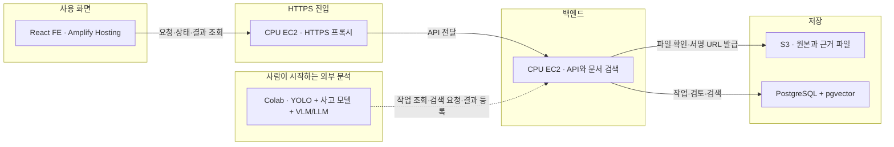

# 개발·배포 인수인계

프로젝트의 목적과 기능은 [README](../README.md), 실제 실행·종료는 [LOCAL_SETUP](../LOCAL_SETUP.md), 확인된 운영 상태는 [current_status](current_status.md)를 먼저 본다. 이 문서는 Git에 포함되는 자원과 별도로 준비할 배포 자원을 설명한다.

## 이 Git 게시본의 재현 범위

이 저장소는 실행 코드·설정 예시·공유 문서를 선별한 복사본입니다. 원본 프로젝트와 기존 Git main 이력은 보존하며, 게시용 디렉터리를 만드는 단계와 Git push·서버 배포는 별도입니다.

- `.github/workflows/runpod-image.yml`의 CPU 계약/서비스/패키징 검사를 checkout에서 실행할 수 있습니다. 실제 GPU 추론·학습·EC2 배포는 CI 검사가 수행하지 않습니다.
- `.github/workflows/source-checks.yml`은 BE 보고 재사용/복구·공개 조회/시연 경계·관제 UI·MLflow 추적·문서 관련성의 합성 CPU 검사를 실행합니다. BE/UI/보고 코드만 바뀌면 기존 Runpod 이미지를 다시 게시하지 않습니다.
- 전체 과거 테스트는 Git에서 제외한 `artifacts/`와 평가 원본을 참조합니다. 따라서 이 checkout만으로 과거 전체 테스트나 저장 관제 화면을 모두 재현할 수 있다고 주장하지 않습니다.
- 원본 영상·저장 사건 snapshot·모델 가중치·비밀 설정·개인 가상환경·실행 결과는 제외했습니다. 개인 절대경로는 이 게시 복사본에서만 프로젝트 상대경로 또는 중립 경로로 바꿨습니다.
- 문서의 실제 EC2 식별자·공인 IP·Runpod 주소도 게시 복사본에서만 예시로 바꿨습니다. 운영 명령에는 사용 중인 서버 식별자를 넣어야 하며 원본 운영 문서는 별도로 보존합니다.
- Runpod 이미지는 고정된 기존 P6 이미지의 모델/의존성을 재사용합니다. 신규 R2 모델은 Git/이미지 context에 넣지 않고 승인한 비공개 S3에서 Pod로 준비합니다.
- `apps/team_rag/data/chunks.jsonl`·`index.sqlite`는 보고서 검색의 필수 자원입니다. Git 게시본에서는 제외했지만 EC2 배포 묶음에는 같은 경로/바이트로 포함하고 기존 EC2 자원·E5 모델 mount를 보존해야 합니다. 생략을 빈 검색 결과나 보고 성공으로 처리하지 마세요. 공개 재배포 권리를 확인한 것으로 간주하지 않습니다.
- 기존 저장 결과를 조회할 때는 기존 EC2 API/DB 또는 승인된 로컬 snapshot을 연결하세요. 제외된 데이터를 다운로드하거나 분석을 자동 실행해 대체하지 않습니다.

관련 CPU 검사:

```bash
python -m pip install -r apps/runpod_image/requirements-ci.txt -r scripts/requirements-viewer.txt jsonschema==4.25.1
python -B scripts/ci_source_checks.py
python -B -m unittest discover -s tests/runpod_image -p 'test_mlops*.py' -v
python -B -m unittest discover -s tests/be_worker -p 'test_mlops*.py' -v
python -B -m unittest tests.be_worker.test_mlflow_tracking tests.be_worker.test_register_mlops_models -v
python -B scripts/prepare_runpod_ci.py --output /path/to/new-build-directory
```

마지막 경로의 부모 디렉터리는 존재해야 하며 결과 디렉터리는 새 이름을 사용합니다. 이 준비 명령은 Docker 빌드/게시를 수행하지 않습니다.

---

## 배포 시 함께 준비할 것

- 실행 코드뿐 아니라 현재 설정·비밀 파일·S3 권한·모델·검색 인덱스를 확인한다. EC2는 이미지와 호스트 코드/데이터 마운트를 함께 사용한다.
- DB, 작업 원장, 저장 영상 근거, MLflow 데이터는 컨테이너 수명과 분리해 보존한다.
- CI의 이미지 게시 결과는 tag와 digest로 식별한다. Pod 생성·이미지 적용과 EC2 서비스 반영은 각 배포 절차에서 수행한다.
- 모델 성능 수치에는 정답·평가 목록·판정 기준을 연결하고, 개발 검증과 독립 평가를 구분한다.

## 이전 기획·공유 이력

아래는 구현 전의 제안과 당시 인수인계 기록이다. 현재 기술 구성·알림 시점·완료 여부는 루트 README와 최신 상태 문서를 따른다.

<details>
<summary>이전 팀 공유 문서 펼치기</summary>

# 팀 개발 시작 안내 — 서비스 PRD v0.2

2026-09-27 Gemini 반영. **현재 설계: Streamlit + FastAPI + S3 + Runpod A4000 + YOLO11s/X3D-S + Gemini API + RAG + 사람 검토.** 이전 v0.1의 수동 Colab/React 구성 제안을 대체한다. 구현·배포 완료 문서는 아니다.

## 새로 시작하는 팀원이 읽을 순서

1. [전체 PRD](../PROJECT_BRIEF.md): 무엇을 만들고 어디까지 포함하는지.
2. [공통 API·데이터 계약](contracts/service_contract.md): 팀 간 연결 규칙.
3. [역할별 안내](roles/README.md): FE·BE·모델·VLM/RAG·인프라·QA의 담당 문서.
4. [요구사항](requirements.md), [가상 응답](contracts/demo-analysis-cases-v0.2.json), [통합 확인](roles/validation.md).

## 팀에 그대로 보낼 소개문

> CCTV 사고 의심 분석 서비스의 PRD를 v0.2로 정리했습니다. 먼저 전체 PRD와 공통 API/데이터 계약을 읽고, 맡은 영역의 문서를 보시면 됩니다. 각 문서에는 입력·산출물·첫 작업·완료 기준을 적었습니다. API 필드나 작업 상태가 바뀌면 공통 계약부터 수정하고 연결 영역에 알려 주세요. 현재는 설계 문서이며 Runpod 한 건의 X3D/YOLO 결과 JSON은 확인했고 근거 미디어·S3·AWS BE·Gemini·알림의 전체 연결과 품질 검증은 앞으로 확인할 작업입니다. Dynamic 클래스의 라벨 정의와 배포 설정 등 미확인 항목은 문서에 표시했습니다.

이 문구는 공유용 초안이다. 이 작업에서 팀 메시지 발송·외부 업로드는 하지 않았다.

## 나눠서 개발해도 연결되게 하는 기준

- 같은 `job_id/run_id/event_id`로 가상 응답부터 맞춘다.
- FE는 화면과 API 사용, BE는 상태·영구 저장·작업 회수, 모델은 영상 입력/결과 manifest를 준비한다.
- VLM 담당자는 Gemini 입력 프로필·호출 모듈·프롬프트·응답 검사를 BE에 넘긴다. BE가 실제 근거 장면을 Google API에 보내 설명을 받는다. RAG는 검증된 설명과 문서로 출처 있는 결과를 만든다. [Gemini 전달 기준](contracts/service_contract.md#6-vlmrag보고-계약)을 따른다.
- 인프라는 서비스 위치·권한·비용·로그를, QA는 중복/부분/실패/복구 인수를 맡는다.
- 개인 이름별 업무 배정은 없다. 역할 문서에 진행 기록을 중복 작성하지 않고 중앙 현황·계획·진행 기록을 갱신한다.

## 이전 그림에서 달라진 점

BE가 Runpod API로 분석을 접수·회수하고 Google Gemini API로 장면 설명을 받는다. S3는 영구 저장소다. 별도 vLLM 서버는 현재 구성에서 제외했다. X3D-S가 후보 구간을 판별하고 YOLO가 객체 정보를 제공한다. X3D 후보 장면에 YOLO를 적용하는 순서를 제안하며 YOLO 출력이 X3D 입력은 아니다. BE가 완료를 회수해 DB에 등록하고 Gemini 설명을 포함한 첫 사고 의심 알림을 제공한다. RAG/보고는 이어서 보강한다. 사람 검토는 UI→API→DB로 저장한다. GPU 로그와 AWS 로그는 job/run으로 대조한다.

## 전달 모델 확인

지정된 deployment_handoff의 11개 파일이 동봉 manifest의 크기·SHA256과 일치한다. YOLO는 0 Pedestrian, 1 Car, 2 Truck, 3 Bus, 4 Motorcycle, 5 Bicycle, 6 Dynamic의 **7개 클래스**다. 기존 그림의 6개 표기를 수정했다. Dynamic의 의미·성능·실시간 지연은 미확인이다.

받은 코드도 X3D 후보→후보 시각 한 프레임의 YOLO 순서다. Runpod에서 JSON 결과 생성은 확인했으며 원본 PTS 검증·근거 클립 추출·S3/AWS BE/Gemini 연결은 추가 개발이 필요하다. [모델 접수 근거](contracts/received-model-metadata-v0.2.json)는 모델 실행 없는 정적 확인 결과다.

## 공유 묶음

기존 전달용 ZIP `artifacts/team-handoff/20260926-02/cctv-service-prd-v0.2.zip`은 9월 26일 설계의 과거 스냅샷이며 이번 Runpod/Gemini 개정을 포함하지 않는다. 최신 전달 기준은 이 저장소의 PRD·역할 문서·공통 계약이다. 이번에 ZIP을 다시 만들지는 않았다. 영상·가중치·비밀·전체 과거 실험 기록은 포함하지 않는다. 저장소가 공동 작업의 원본이며 ZIP은 이 시점의 읽기용 스냅샷이다.

이전 `20260926-01/cctv-team-handoff-v0.1.zip`은 보존된 과거 공유안이다. 최신 문서를 편집해도 이전 ZIP을 덮어쓰지 않는다.

<!-- SERVICE_PRD_V02_HISTORY -->

<details>
<summary>v0.2 개정 전 문서 — 당시 범위·결정·측정 이력</summary>

# 팀 개발 시작 안내 — CCTV 서비스와 AWS 구성 제안

기준일: 2026-09-26 · 공유안 `handoff-proposal-v0.1` · 개인별 업무 배정 없음

**같은 버전의 서비스 범위·구조도·API/데이터 예시를 팀원 모두에게 공유하고, 첫 연결은 공통 예시 응답으로 맞춘다.** 아래 AWS 구성·API 경로는 검토할 제안이며 배포되거나 팀 전체가 합의한 명세가 아니다. 실제 PRD 본문과 OpenAPI 명세는 후속 작성 대상이다.

## 1. 합의된 목표와 현재 상태

| 구분 | 내용 |
|---|---|
| 사용자 확정 | 팀 개발·발표용 전체 서비스 PRD를 작성하고 이후 FE·BE·클라우드 설계의 기준으로 사용 |
| 대상 사용자 | CCTV 관제 담당자, 프로젝트 영상 검토자, 경찰·사고 대응 담당자 |
| 첫 완성본의 기획 범위 | 사고 후보 탐지·영상 확인 + VLM 장면 설명 + RAG 문서 안내·보고 초안 + 사람 검토 |
| 이번 모델 결정 | YOLO 사용 확정. YOLO 세부 버전/가중치와 사고 분류 모델은 확인 필요.  |
| 실행 환경 방향 | AWS에서 웹·API·자료를 관리하고, GPU는 Colab이나 다른 외부 환경 사용 가능. AWS GPU는 필수 아님 |
| 비용 | AWS 사용 예산·크레딧 없음이라는 답변. 현재는 구성 제안이며 유료 자원 생성·호출·배포 승인으로 해석하지 않음 |
| 현재 저장소 사실 | R3D-18 학습·Colab 평가 및 보고서가 있음. R3D-18은 현재 비교 기준이며 서비스의 최종 사고 모델 미확정 |
| 아직 구현되지 않은 연결 | 서비스 API, YOLO 통합, 실제 후보 병합, VLM·RAG·보고서 전체 연결, AWS 운영 배포 |

사용자 세 역할을 지원하는 결정이 화면 세 개·계정 체계·실제 기관 전송까지 확정하지는 않는다. 개인별 개발 업무 배정은 이번 문서에서 제외한다.

현재 사고 모델은 운영 품질 합격 상태가 아니다. 현재 기능/실험의 근거는 원본 저장소의 `docs/current_status.md`, `IMPLEMENTATION_PLAN.md`, 연결된 원본 JSON을 따른다. 기존 `PROJECT_BRIEF.md`의 오래된 상태를 팀의 최신 사실로 복사하지 않는다.

## 2. 팀원에게 무엇을 어떻게 공유할까

### 모두가 받는 한 묶음

1. **이 시작 안내:** 확정 범위, 현재 상태, AWS 추천안, 먼저 맞출 계약.
2. **[PRD 작성 프롬프트](prd_authoring_prompt.md):** 문서 작성 담당/도구가 공통 PRD를 만드는 기준. 팀원마다 별도의 PRD를 새로 만드는 방식으로 쓰지 않는다.
3. **[공통 가상 응답](contracts/demo-analysis-cases-v0.1.json):** FE·BE·모델 연결 논의용 6개 상태. 실제 영상·예측·성능 자료가 아니다.
4. **후속 확정할 공통 PRD와 OpenAPI:** `PROJECT_BRIEF.md`/기존 요구사항과 연결하되, 이번 묶음에는 완성된 PRD/OpenAPI가 포함되지 않았다.

원본은 팀 공통 저장소의 문서 한 벌로 관리하는 것을 추천한다. 팀 채팅·Notion에는 그 위치와 버전, 바뀐 항목만 안내한다. 저장소가 준비되기 전에는 같은 ZIP을 모두에게 전달해 시작할 수 있다. 실제 업로드·초대·메시지 전송·커밋은 이번에 실행하지 않았다.

공통 JSON/API 초안을 먼저 짧게 검토해 `v0.1`로 합의한 뒤 각 작업을 시작한다. 필드 이름·시각 단위·상태가 바뀌면 예시 응답과 명세를 함께 바꾸고 변경 이유를 남긴다. 저장소를 여러 개 쓰더라도 계약 파일은 한 원본에서 같은 버전으로 가져간다.

### 팀 채팅에 복사할 소개문

> 새로 시작하는 분들이 같은 기준으로 개발할 수 있도록 CCTV 서비스 공유안 v0.1을 전달합니다. 목표는 녹화영상의 사고 후보와 원본 근거를 확인하고, VLM 설명·RAG 문서 안내·보고 초안을 연결하는 것입니다. YOLO는 사용하고 사고 분류 모델은 비교 후 정합니다. 우선 AWS는 웹/API/저장을 맡고 GPU 분석은 Colab 등 외부에서 실행하는 구성을 제안합니다. 시작 안내 → 구조도 → 공통 JSON 예시 순서로 읽고, 먼저 API 필드와 처리 상태를 맞춰 주세요. AWS 구성과 API는 제안이며, 예시 데이터에는 실제 분석 결과가 들어 있지 않습니다.

## 3. 기존 그림에서 수정할 내용

| 기존 그림 | 수정 제안과 이유 |
|---|---|
| YOLO11s/DETR + X3D-M을 고정 | 객체 탐지는 YOLO로 표시. 사고 탐지는 `선택할 사고 모델`로 표시하고 R3D-18/X3D 등의 후보와 버전을 별도 기록 |
| 객체 탐지와 충돌 탐지 결과를 합쳐 사고 설명 | YOLO의 객체 박스와 사고 분류 점수의 역할 구분. 객체 존재만으로 충돌을 확정하지 않음 |
| 모델 출력 직후 사고 이벤트 | 시간 창 점수 → 후보 구간 병합·중복 처리 → 근거 클립의 단계를 명시. 병합 규칙은 구현·평가 필요 |
| CCTV → S3 → Redis → worker | 녹화 입력/등록 → BE의 분석 작업 → 사람이 Colab에서 실행 → 결과 등록을 첫 시연안으로 사용. 영상은 저장소, 작업 상태는 DB에 보관 |
| Redis/Celery부터 운영 | 사람이 노트북을 실행하는 첫 시연에는 보류. 자동 작업 처리가 필요해질 때 큐와 지속 실행 가능한 worker를 추가 |
| FE가 어떤 API를 부르는지 생략 | 영상 등록, 작업 조회, 결과·근거 조회, 검토 결과 저장 API를 추가 |
| VLM에 탐지 박스·점수 전달 | 실제 원본 장면·원본 시각을 필수로 전달. 박스·점수는 모델의 추정 정보로 표시하며 관찰 내용과 구분 |
| 모든 RAG 자료를 유사 사고로 표시 | `사례 검색`과 `지침/문서 검색`을 구분. 실제 사례 원문이 없으면 유사사고 Top-K 기능은 자료 대기. 일반 안내를 사고 사례로 바꾸지 않음 |
| PostgreSQL과 별도 Vector DB | 초기에는 PostgreSQL+pgvector 한 곳에서 메타데이터와 문서 벡터를 관리하는 안 제안 |
| 보고서 완료 후 서비스 화면 | 사고 후보·원본 근거를 먼저 열람. VLM/RAG/보고 초안은 상태와 함께 추가 |
| 정상/사고 두 결과 중심 | 후보 없음, 일부 미분류, 분석 실패, 설명/검색 실패, 사람 판단 보류를 구분 |

현재 `src/boram3_cctv/events.py`의 `validate_policy()`는 `synthetic_test`만 허용한다. 실제 모델 후보 병합을 완료한 모듈로 인계하지 않는다. `scripts/analyze_video.py`와 기본 `video_inference.py`에는 60초 범위 제한이 있고, 별도 Colab 평가 wrapper에서 전체 길이 처리를 한 이력이 있다. 서비스용으로 어떤 실행 경로를 사용할지 확인해야 한다.

## 4. 모델이 바뀌면 연결도 달라질까

**달라지는 모델 내부를 변환 코드가 맡고, FE·BE가 보는 결과 형식은 유지하는 방법을 추천한다.** 여기서 변환 코드는 모델의 고유 출력을 공통 결과로 바꾸는 작은 연결부다.

| 모델/기능 내부에서 맞출 것 | 공통 계약으로 유지할 것 |
|---|---|
| 프레임 수·해상도·정규화·시간 샘플링 | `job_id`, `source_video_id`, 원본 시각(초) |
| 모델 구조·체크포인트·출력 클래스 순서 | 후보 구간·근거 참조·처리 상태 |
| 각 점수의 의미·판정 규칙·후처리 | 모델/전처리/판정/후보 병합 버전 |
| GPU 메모리·배치·처리 속도 | 미분류 사유·오류·사람 검토 결과 |

예: R3D-18과 X3D가 모두 사고/정상 분류를 하더라도 입력 형식과 가중치는 별도로 맞춰야 한다. BE가 받는 `start_seconds`, `end_seconds`, `label`, `score`, `score_type`을 맞추면 FE는 같은 후보 표시 로직을 재사용할 수 있다. 단, 점수와 임계값을 모델 간 같은 의미라고 가정하지 않는다. 출력 자체가 사건 경계나 다중 유형으로 바뀌면 계약 확장이 필요하다.

YOLO 박스는 원본 해상도로 역변환한 좌표를 전달하는 안이다. 좌상단 원점·정규화 `xyxy` 범위 0~1·프레임 원본 시각을 함께 정의한다. letterbox/crop 변환을 되돌리지 않은 박스를 원본 영상 위에 그리지 않는다. 영상 모델 결과를 진짜 사고 확률로 표시하지 않는다.

YOLO는 장면 객체 설명에 사용하고 사고 모델은 시간 구간 판단을 맡는 병렬 입력안을 제안한다. YOLO crop을 사고 모델의 필수 입력으로 만들면 학습/평가 전처리가 달라지므로 별도 검증이 필요하다. 현재 모델 교체·YOLO 실행·새 학습은 하지 않았다.

## 5. 첫 시연용 AWS + 외부 GPU 구성 제안

**AWS는 웹·API·저장, Colab은 사람이 실행하는 분석 노트북으로 시작한다.** 이것은 사용자의 비용·외부 GPU 선호에 따른 추천안이며 상시 자동 분석 기능을 구현했다는 뜻이 아니다.

| 담당 기능 | 첫 구성 제안 | 메모 |
|---|---|---|
| FE 웹 호스팅 | AWS Amplify Hosting | React 등 팀이 선택한 FE. 저장 결과와 새 분석 상태를 표시 |
| API·검색·결과 검증 | CPU EC2 한 대 | 팀이 정한 BE 언어 사용. 모델이 Python이라고 BE도 Python이어야 하는 것은 아님 |
| 상태·검토·문서 검색 DB | 같은 CPU EC2의 PostgreSQL+pgvector | 작은 시연용. API와 자원을 공유하므로 부하·백업·디스크 유지 관리 필요 |
| 원본/근거/결과 파일 | 비공개 S3 | 웹 공개용 자산과 CCTV 파일 접근 범위를 구분 |
| YOLO·사고 모델·VLM/LLM | Colab 또는 허용된 외부 GPU | 사람이 노트북에서 실행. 모델별 순차 로딩·용량·지연 확인 필요 |
| DB 운영 분리 대안 | RDS PostgreSQL+pgvector | 예산과 운영 필요가 확인되면 분리. 초기 필수로 정하지 않음 |

Amplify는 React를 포함한 SPA 호스팅과 Git 기반 배포를 지원한다. [AWS Amplify 공식 안내](https://docs.aws.amazon.com/amplify/latest/userguide/welcome.html). RDS PostgreSQL의 pgvector 지원은 엔진별 확장 버전을 확인해 사용할 수 있다. [AWS 지원 확장 목록](https://docs.aws.amazon.com/AmazonRDS/latest/PostgreSQLReleaseNotes/postgresql-extensions.html).

아래는 **제안 구조**이며 현재 배포 상태가 아니다. API의 HTTPS 진입점과 DB는 첫 시연에서는 같은 CPU EC2에 둘 수 있다. DB 포트는 외부 GPU/브라우저에 공개하지 않고 BE를 통해 접근한다.



구조도는 API 연결 중심이다. 실제 영상 바이트는 API가 발급한 단기 서명 URL로 **브라우저/Colab ↔ S3** 직접 교환한다. AWS 장기 키를 브라우저나 공유 노트북에 넣지 않는다. S3는 동일 key에 업로드하면 교체될 수 있으므로 새 작업·실행별 key를 쓰고 완료 파일의 해시/크기를 검증한다. [S3 서명 URL 업로드](https://docs.aws.amazon.com/AmazonS3/latest/userguide/PresignedUrlUploadObject.html).

### 사람이 실행하는 첫 연결 순서

1. 웹에서 녹화 파일을 등록하거나 등록된 시연 영상을 선택한다. 전체 학습자료를 다시 S3에 복사하는 것은 선행 조건이 아니다.
2. BE가 `job_id`를 만들고 `awaiting_external_run`으로 기록한다. 웹은 “외부 분석 실행 대기”라고 표시한다.
3. 팀원이 Colab에서 해당 작업을 선택해 셀을 실행한다. 필요한 원본만 읽는다. 기존 Drive 원본을 재사용하면 동일 원본 해시·시각 매핑을 확인한다.
4. YOLO와 선택한 사고 모델의 결과를 공통 형식으로 변환하고, 후보·근거를 우선 업로드해 등록한다. 웹은 설명이 없어도 원본을 확인할 수 있다.
5. 같은 노트북에서 VLM으로 실제 후보 장면을 설명한다. 문서 RAG는 BE의 검색 API로 근거를 받고, VLM/LLM 실행 결과와 보고 초안을 등록한다.
6. BE가 작업/원본/모델 버전·파일·스키마를 검증한 뒤 화면에 제공한다. 사용자는 원본과 설명을 검토해 사고 확인/사고 아님/판단 보류를 남긴다.

RAG 벡터를 쓰면 문서와 질의를 같은 임베딩 모델·차원·정규화로 만든다. 첫 경로는 Colab에서 문서/질의 임베딩을 만들고 BE가 pgvector 검색을 수행하는 안이다. 키워드 검색부터 연결하는 안도 가능하다. 의미 검색·하이브리드·재정렬은 실제 검색 평가 후 추가하며 구현 완료로 표시하지 않는다. Colab이 꺼져 있을 때 새 자유 질의의 생성까지 동작한다고 약속하지 않는다.

VLM·보고 LLM은 동일 모델 재사용도 검토할 수 있으나 GPU 용량·한국어·영상 품질은 미측정이다. 유료 Bedrock/API 사용은 별도 선택지다. 예를 들어 Nova 계열의 영상 입력은 지원하지만 모델별 샘플링이 짧은 충돌 순간을 놓칠 수 있으므로 실제 근거 프레임 설명 품질을 검증해야 한다. [AWS Nova 멀티모달 안내](https://docs.aws.amazon.com/nova/latest/nova2-userguide/using-multimodal-models.html).

### 자동 분석이 필요해졌을 때

사람이 실행하는 Colab 시연을 먼저 연결하고, 상시 외부 GPU가 확보되면 `BE → SQS → GPU worker → 결과 등록`을 추가할 수 있다. 같은 JSON 계약을 사용하면 FE 영향이 줄어든다. 큐에는 영상 바이트 대신 작업 ID·원본 참조·모델/설정 버전을 넣는다. SQS Standard의 중복 전달에 대비해 같은 실행 결과가 중복 등록되지 않도록 하고, 처리 중 visibility timeout 연장·재시도·실패 보관을 설계한다. [SQS 중복 전달](https://docs.aws.amazon.com/AWSSimpleQueueService/latest/SQSDeveloperGuide/standard-queues-at-least-once-delivery.html), [처리 시간과 재시도](https://docs.aws.amazon.com/AWSSimpleQueueService/latest/SQSDeveloperGuide/sqs-visibility-timeout.html).

기존 Celery 구현이 있다면 유지하고 SQS broker를 검토할 수 있다. 아직 없다면 이 시연안 때문에 Redis/Celery부터 설치할 필요는 없다. [Celery SQS 공식 안내](https://docs.celeryq.dev/en/stable/getting-started/backends-and-brokers/sqs.html). 향후 AWS GPU를 선택하더라도 Fargate의 GPU 지원을 가정하지 않고 EC2 등 지원 환경을 확인한다. [AWS Fargate FAQ](https://aws.amazon.com/fargate/faqs/).

무료 Colab은 자원/실행 시간이 보장되지 않으며, 노트북 UI를 우회한 웹 서비스·분산 worker 사용에는 제한이 있다. 따라서 여기서는 **노트북에서 사람이 실행하고 결과를 가져오는 시연**을 제안한다. 상시 자동 worker·실시간 운영은 별도 환경의 조건을 확인해야 한다. [Google Colab FAQ](https://research.google.com/colaboratory/faq.html).

### 비용에 대한 현재 판단

AWS GPU를 쓰지 않아도 웹/API/저장·전송 비용은 남는다. 비용 지출이 전혀 불가능하면 우선 로컬 FE·BE와 기존 Colab/Drive로 계약을 검증하고 AWS 배포를 보류하는 것이 맞다. EC2는 중지 후에도 EBS 저장 비용이 남고, S3에는 저장·요청·외부 전송 비용 항목이 있다. [EC2 상태별 비용](https://docs.aws.amazon.com/AWSEC2/latest/UserGuide/ec2-instance-lifecycle.html), [S3 요금 구조](https://aws.amazon.com/s3/pricing/). 실제 리전·영상량·호스팅 시간·예산 한도가 없어 월 요금을 산출하지 않았다.

## 6. 개발을 나눠 시작하기 전에 맞출 계약

### API 초안 — 아직 구현되지 않음

| 제안 API | 역할과 최소 응답 |
|---|---|
| `POST /v1/videos` | 업로드를 위한 `video_id`, 단기 upload URL 또는 등록된 원본 참조 |
| `POST /v1/analyses` | 업로드 완료/원본 확인 후 작업 생성. `job_id`, `awaiting_external_run`. 즉시 사고 결과를 반환하지 않음 |
| `GET /v1/analyses/{job_id}` | 단계별 상태·처리 범위·미분류/오류·후보·설명 상태 |
| `GET /v1/analyses/{job_id}/run-input` | 인증된 실행자에게 작업/모델/전처리 명세와 단기 입력 URL |
| `POST /v1/analyses/{job_id}/artifacts` | 근거/결과 파일별 upload URL 발급. 영상 파일을 JSON 본문에 넣지 않음 |
| `POST /v1/analyses/{job_id}/results` | `run_id`, 단계, 버전, 해시·참조와 결과 등록. 같은 `job_id/run_id/stage/revision` 재요청은 중복 생성하지 않음 |
| `POST /v1/knowledge/search` | 질의/선택 임베딩 모델, `case` 또는 `guidance` 문서 종류·적용 조건으로 검색. 근거 절·원문 참조 반환 |
| `GET /v1/events/{event_id}` | 후보·근거·VLM 설명·RAG 출처·보고 초안·사람 확인 결과 |
| `PUT /v1/events/{event_id}/review` | `confirmed_accident`, `not_accident`, `uncertain` 중 사람 검토 결과 저장. 기존 모델 예측과 별도 필드 |

서명 URL은 접근 수단이며 DB의 영구 근거 식별자가 아니다. DB에는 object key/버전·해시를 보존하고 만료 시 새 읽기 URL을 발급한다. 실제 인증 방식·API 호출 권한·URL 수명은 API 명세에서 확정한다. 별도의 역할별 로그인 화면을 이미 승인한 것으로 간주하지 않는다.

### 데이터와 상태의 최소 규칙

- 시간은 원본 시작을 0으로 한 초 단위 실수. 후보는 `[start_seconds, end_seconds)`이며 시계 시각과 구분한다.
- 모델 추정·VLM 관찰·검색 문서·사람 판단은 각각 보존한다. 설명 수정으로 원본 예측을 덮어쓰지 않는다.
- `candidates=[]`만으로 “사고 없음”을 만들지 않는다. 분석 완료와 평가 가능한 범위, 미분류 수를 함께 확인한다. 완료+미분류0이어도 표현은 “모델이 의심 구간을 찾지 못함”이다.
- `awaiting_external_run → running → completed/partial/failed`를 작업 상태 초안으로 사용한다. `completed`는 선택한 처리 절차의 완료이며 모델 품질 합격을 뜻하지 않는다.
- VLM/RAG/report는 각각 `not_started/running/completed/failed/skipped` 상태를 가진다. 후보가 없어서 생략한 것과 실패를 구분한다.
- 후보 ID·모델 버전·기준 시각은 UI 표시, 보고서, 사람 검토에서 동일하게 참조한다.
- 문서 RAG는 출처 제목·버전·절/쪽·원문 링크를 보존한다. 근거를 못 찾으면 `insufficient_evidence`로 표시한다. 사례 유사도가 사고 원인/과실의 증거가 되지는 않는다.
- 예시 응답의 객체·수치·시각은 가상이다. 코드 연결 전에 실제 모델 출력과 스키마를 대조해야 한다.

## 7. 새로 시작하는 사람이 처음 완료할 작은 작업

개인 배정 없이 개발 영역별로 첫 확인 결과를 정한다.

| 영역 | 첫 산출물 | 확인 기준 |
|---|---|---|
| FE | 가상 응답 6개로 결과 화면 상태 확인 | 대기·후보 없음·부분 미분류·설명 대기·완료·실패가 구분됨 |
| BE | 위 API/필드/오류의 OpenAPI 초안과 가상 응답 연결 | FE와 같은 JSON을 반환하고 정상·실패 상태를 오해하지 않음 |
| 모델 연결 | YOLO 결과와 선택 사고 모델 결과를 공통 형식으로 바꾸는 입출력 명세 | 원본 시각·전처리/모델 버전·박스 좌표계·미분류가 보존됨 |
| VLM/RAG | 가상 후보 한 건의 관찰/검색/보고 입력·출력과 자료 확보 상태 | 실제 영상 근거와 문서 근거를 분리하고 근거 없음 처리 가능 |
| 클라우드 | CPU API·파일·DB와 외부 GPU 사이의 연결 계획 및 비용 항목 | GPU 없는 AWS에서도 웹의 저장 결과 열람이 가능하도록 설계 |

다음 공통 작업 하나는 **API/JSON 초안으로 녹화영상 한 건의 대기 → 후보 표시 → 설명/보고 → 사람 검토 시나리오를 합의하는 것**이다. 이후 가상 응답을 실제 Colab 결과로 하나씩 교체한다. 대용량 데이터·가중치·환경 전체를 모든 팀원이 받을 필요는 없다.

### 팀원이 각자 새 AI 대화에서 사용할 시작 문장

```text
첨부한 팀 개발 시작 안내와 공통 JSON 예시를 먼저 읽어 주세요.
확정된 서비스 범위와 제안 상태를 구분하고, 새로운 PRD를 독자적으로 만들지 마세요.
내 작업 영역은 [FE / BE / 모델 연결 / VLM·RAG / 클라우드]입니다.
먼저 이 영역의 입력·출력·다른 영역과의 연결·아직 미정인 계약을 요약해 주세요.
공통 ID·시간 단위·상태·JSON 필드를 유지하고, 바꿔야 하면 이유와 영향을 먼저 제시해 주세요.
모델과 API가 아직 연결되지 않았다면 명시적으로 가상 응답을 사용하세요.
이번 요청만으로 AWS 자원 생성·유료 호출·영상 업로드·추가 학습을 실행하지 마세요.
```

## 8. 확인 범위와 남은 점

이번에는 사용자 첨부 구조와 최신 결정, 기존 코드/기록, AWS·Colab·Celery 공식 문서를 대조해 공유안을 작성했다. 실제 AWS 계정·리전·비용·GPU 제공 상태·팀 다른 저장소는 조사하지 않았다. 모델 실행·새 영상 처리·서비스 구현·원격 공유·배포는 하지 않았다. 사용자 첨부 이미지는 수정하지 않았다.

확정해야 할 핵심은 YOLO 세부 버전/가중치와 사고 모델 선택, 사용할 사례/지침 자료, 업로드 크기·동시 작업·보관 범위, API 인증·외부 실행 결과 검증, AWS 비용 한도다. 이 가운데 모델 선택을 기다리는 동안에도 공통 응답으로 FE·BE 계약 논의는 시작할 수 있다.

---

<details>
<summary>2026-09-19~20 공유 기록 — 아래는 당시 이력</summary>

# 동료에게 공유할 현재 상황

> 2026-09-20 최신: 승인한 세 구간의 배열 3개·48프레임을 생성하고 정답 [1,1,1]과 기존 로더 읽기·기존 검수 픽셀/PTS 일치를 확인했다. 관련 35개 테스트 통과, 작업 프로세스 3.369초. [실행 방법·결과·한계](preprocessing_link_check.md). 기존 코드/원본/공식 test를 유지했으며 실제 학습은 보류다. 아래 내용은 이전 단계 공유 기록이다.

기준일: 2026-09-19. 아래 요약은 팀 채팅·문서에 복사해 공유할 수 있다. 실제 메시지 전송이나 원격 업로드는 하지 않았다. 전처리 내용과 확인 명령은 [전처리 확인 안내](preprocessing_review.md), 테스트 구성은 [테스트 설명](tests.md)에 있다.

최신 단계 기준은 [C~E v2](../CODEX_LOCAL_R3D18_C_TO_E_v2.md)이며 실제 실행 여부는 [현재 현황](current_status.md)을 따른다. 이번에는 문서 정합성만 수정했다. 순차 분석·로컬 이벤트 기록은 후속 승인 단계다.

## 그대로 공유할 요약

> 현재 목표는 검수한 짧은 CCTV 구간에 사고 장면이 포함됐는지 판별하는 R3D-18 단독 기준선입니다. M1 Max/64GB 로컬 우선이며 필요 시 Colab을 선택합니다. STATS19·중증도 예측은 제외했고 화면은 미정입니다. YOLO·ByteTrack·웹·DB·작업 큐는 지금 추가하지 않습니다.
>
> ACCIDENT 실제 영상 3개와 CSV 연결, 영상 정보·일부 디코딩을 확인했습니다. 원본 정답에는 사고 시점·유형·위치가 있지만 정상/사고 이진 정답표는 없습니다. 선택한 세 영상은 공식 분할상 모두 test입니다.
>
> 선택 구간의 원본 ID·시각·라벨 근거를 남기는 전처리 코드와 미리보기를 만들었습니다. 총 48프레임을 저장했고, 이후 다혜가 세 구간을 사고로 확인해 별도 검수 파일에 기록했습니다. 기존 미리보기의 null 정답은 생성 당시 이력이며 승인 라벨을 연결한 실제 배열 생성은 아직 하지 않았습니다.
>
> 학습 환경은 Mac 로컬 우선, 필요 시 Colab으로 바꿨습니다. M1 Max/64GB에서 R3D-18 전체 층의 순전파·손실·역전파·가중치 업데이트를 MPS 1 step으로 확인했습니다. 테스트 난수와 임시 가중치를 사용한 C-1 연산 점검이며 실제 사고 학습이나 성능 평가는 아닙니다.
>
> C-2에서 공식 사전학습 가중치를 읽어 마지막 분류층부터 학습하는 코드, 자료 준비 검사, 저장·재개 코드를 작성했습니다. 고정한 특징 추출부의 BatchNorm도 유지합니다. 기존 전체 테스트는 80개 통과했고 저장·재개는 작은 테스트 모델로 확인했습니다. 정상 정답·학습용 자료·그룹·분할이 준비되지 않아 실제 사고 학습을 보류했고 공식 가중치도 다운로드하지 않았습니다.
>
> 다음 목표는 사고 예측값 출력이 아니라, 사람이 검수한 영상 구간과 정확한 정답이 함께 읽히는 것입니다. 이후 사고/정상 학습에는 검수된 무사고 CCTV 구간, test와 분리된 학습용 사고 자료, 원본·사건 그룹별 분할 근거가 필요합니다.

## 무엇을 더 준비하면 되나

| 준비할 것 | 이유 / 최소 기록 |
|---|---|
| 기존 세 구간 검수 — 완료 | 다혜의 사고 판정·시각·근거가 별도 검수 파일에 있다. 같은 검수를 처음부터 반복하지 않으며 다음은 배열과 정답 연결 확인이다. 새 구간은 별도 검수가 필요함 |
| 무사고 CCTV 후보 | 구간 전체를 직접 보고 사고가 없고 판독 가능한지 확인. 일반 주행·정체·급정지·근접 통과 등도 실제 장면을 보고 판정 |
| 별도 학습용 사고 자료 | 현재 3개는 test이므로 학습·튜닝에 사용하지 않음. train 쪽 파일과 원본 정답의 연결 확인 필요 |
| 출처·원본/사건 관계·분할 | 같은 사건의 다른 편집본·카메라·사고 전 구간이 train/test에 섞이지 않도록 기록 |

로딩 점검은 검수된 사고 1구간과 정상 1구간부터 시작할 수 있다. 이것은 파이프라인 확인용 최소 예시이며 모델 학습·오탐률 평가에 충분한 수량을 뜻하지 않는다. 정상 자료의 총 확보량이나 비율은 아직 결정하지 않았다. 화질·촬영 방식·주야간 조건도 함께 기록해 데이터 출처 차이를 사고 여부로 배우지 않게 점검한다.

## 공유 순서와 자료

1. 우선 이 요약을 공유해 현재 목표·완료 범위를 맞춘다.
2. [자료 목록](data_inventory.md) → [라벨 초안](label_policy.md) → [전처리 방법](preprocessing.md) → [로컬 연산 결과](local_model_check.md) 순서로 읽으면 근거를 확인할 수 있다. 전체 이력은 [진행 기록](PROGRESS.md)에 있다.
3. 아래 세 구간은 검수가 완료됐으므로 기존 기록과 미리보기를 공유한다. 새 구간을 추가할 때만 해당 시작·끝·판정 근거를 따로 검수한다.

| 원본 파일 | 현재 검토 구간(초) | 로컬 미리보기 |
|---|---|---|
| `-9oifpjUxxM_00.mp4` | 7.533~9.533 | `artifacts/preprocessing/s1-samples-02/unconfirmed/sample_001/preview.png` |
| `-PpBteU0p3Q_00.mp4` | 2.292~4.292 | `artifacts/preprocessing/s1-samples-02/unconfirmed/sample_002/preview.png` |
| `-SNFUobKjoM_00.mp4` | 12.533~14.533 | `artifacts/preprocessing/s1-samples-02/unconfirmed/sample_003/preview.png` |

이 파일의 상대 경로는 프로젝트를 받은 동료가 쓰는 경로다. 채팅의 내 Mac 절대 경로 링크는 동료 장비에서 열리지 않는다. 미리보기와 원본은 Git 제외 대상이므로 코드 저장소만 받아서는 영상이 생기지 않는다. 데이터 이용·공유 조건을 확인한 뒤 자료 접근 방법을 따로 안내한다.

처음에는 문서와 `scripts/`, `src/`, `tests/`, `configs/`, 필요한 requirements만 공유하면 된다. `.venv*`, `data/local`, `artifacts` 전체, `.env`, 토큰, IDE 개인 설정을 통째로 보내지 않는다. 저장소는 아직 첫 커밋이 없는 상태이며 이번 작업에서 커밋·푸시를 하지 않았다. Git 공유를 선택하면 공유할 파일을 먼저 확인해 명시적으로 커밋·푸시한다.

</details>

</details>

</details>
